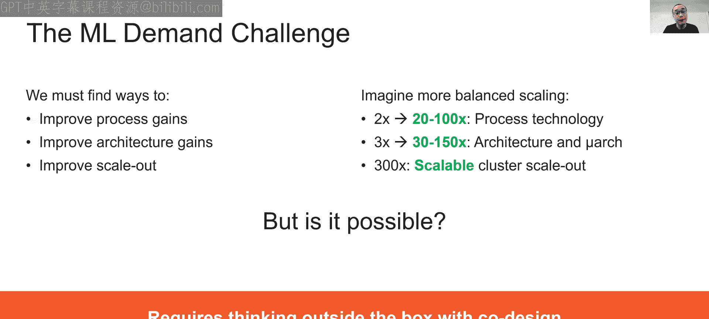
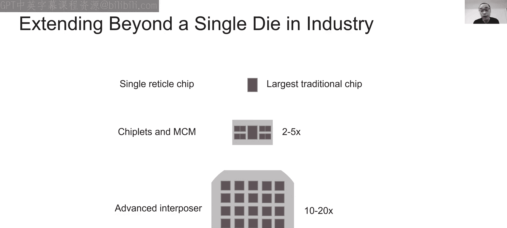
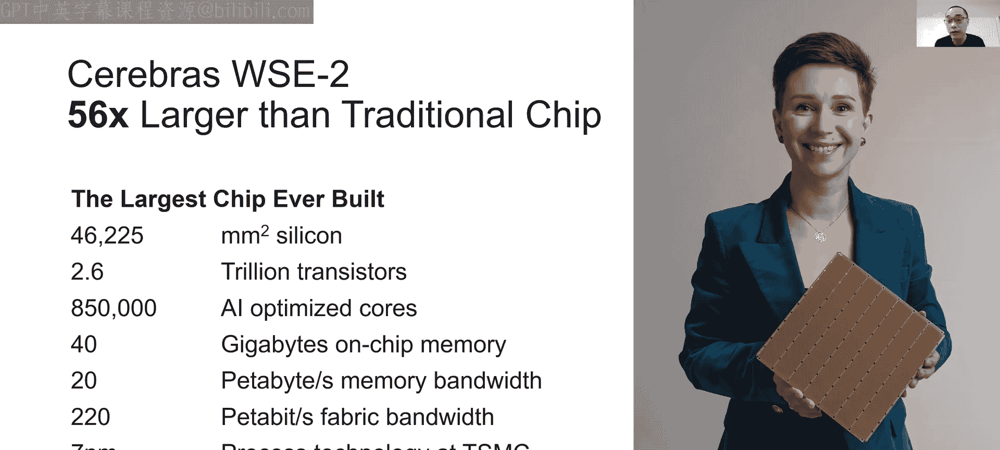
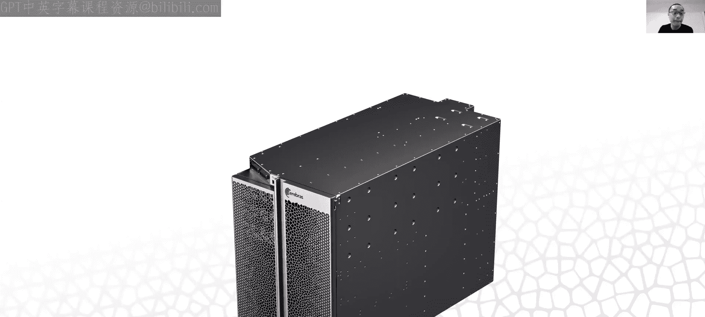
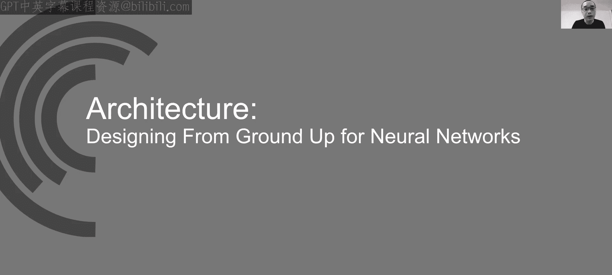
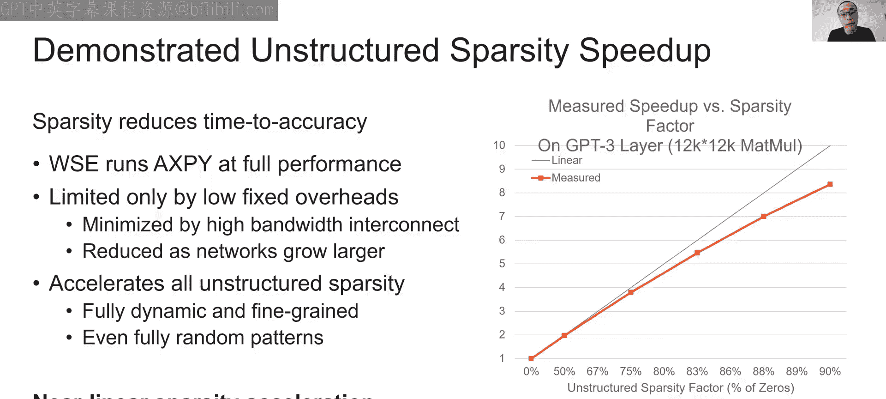
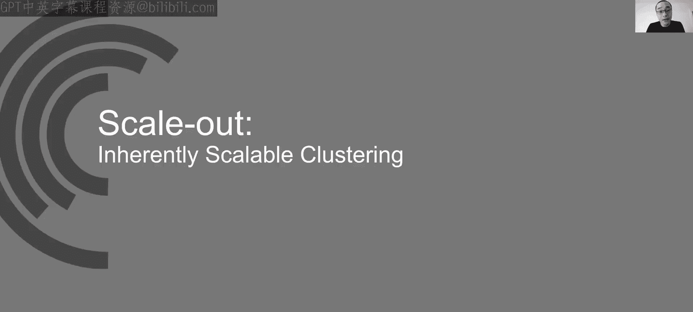
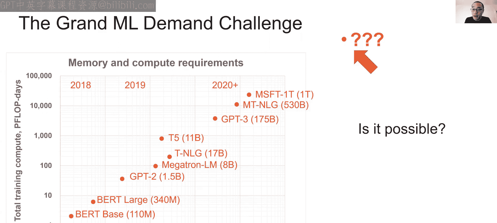

# 康奈尔大学《机器学习硬件和系统｜Cornell ECE 5545 Machine Learning Hardware and Systems》中英字幕 p10 -10-Guest Lecture_ Cerebras Sean Lie.zh_en -BV1CCqPYSEP5_p10-

Its my great pleasure to introduce Sean， so Sean Lee is the chief hardware architect and the co founder of Crebra Systems。

He before that， he was at C Micro and he was the lead hardware architect for the IO virtualization fabric。

 and after C Micro was acquired by MD， he was an AMD fellow and chief data center architect。

And earlier in his career， he spent five years at AMD in their advanced architecture teams。

He holds a Bchelor and master's in electrical and computer Eical engineering and computer science from MIT and has authored 16 patents in computer architecture so thank you so much Sean for being here at 645 where he is so he woke up early just for this and so we're all excited to hear your talk。

Thank you very much， if you guys can hear me all right。YAll right。

 well thank you for that introduction and it's my pleasure to be here I'm really excited to share with you guys some of what we've been doing at Creris we started Creris with really a vision to drastically change the landscape of compute for AI and what I'm going share with you today are some of the outside of the box thinking that we believe it's necessary to meet the demands of ML in the future。

For those of you who don't know us， Creris began in 2016。

 really just at the beginning of the modern deep learning era。

 and our mission is to solve the problem of AI compute by building full AI accelerator solutions from the chip to the system to the entire software。

And now we have engineers and customers all around the world and really what an incredible journey of the last few years have been not just for us as a company。

 but really the entire ML deep learning industry and community。But。

I'm here talking to you right now because we believe we're really just at the beginning of what neural networks can do and we're really reaching a pace where traditional approaches can't keep up。

So in this graph you can see that in 2018 state of the art neural networks had 100 million parameters and that was already a lot。

 but in 2019 we got GPT2 and megaron that were1 to 100 times larger。

And last year we got GPT3 with 175 billion parameters。And in fact， just a few months ago。

 Microsoft announced their megaron Tring NLG model that had a half billion parametersms。

530 billion parameters， a half a trillion parameters I'm sorry。

And really there's no end in sight tomorrow we're going to want to run models with trillions of parameters。

Now when you step back。That's 1，800 times more compute in just two years。Let me say that again。

 that's 1，800 times more compute in just two years。

That's completely unprecedented and as a computer architect and for us as a community。

I think this is both exciting and it's daunting at the same time。

Let's take a look at some of the ways that we've responded to this unprecedented demand。

In the industry。The exciting part is that as an industry we've been hard at work and we've seen some remarkable innovations。

 in fact， those models I just showed you they wouldn't have been possible without many of these。

And here are some examples in just the last few years。

 we've been continually improving process technology。We'd seen 16 nanometer， 12 nanometer。

 and now7 nanometer chips are used everywhere。We've also seen advanced packaging techniques。

That enable higher bandwidth memories， we have lower precision merit formats such as FP16 and B flow 16。

 and we have new data pass designs such as syic arrays。

 tensor cores that all improve the compute density and power efficiency dramatically。

So let's take a deeper look at these innovations。First。

 let's look at process technology on the right。I've plotted the transistor density of GPUs over the past 10 years or so。

And as you can see。The process industry continues to improve at an incredible pace。So in fact。

 Moore's law is not that。And we see this trend continuing for at least the next several years。

This is very promising。Next， let's look at the other innovations。And here， broadly speaking。

 I'm going to group all of these into a category。Of architecture and microarchitecture。

And on the right， I've plotted a metric。Peak flops per transistor again。

 I've done that for GPUs over the last 10 years or so。

And here I'm using flops per transistor as a rough measure of architecture performance。

And what's impressive is， as you can see。There's a very healthy increase and clear trend over time。

 in fact， it's keeping up or even outpacing Moore's law by a little bit。

And for us as a computer architecture community， I think that's really refreshing to see because architecture matters。

Now that's the exciting part， if you look back at the last two years。

 we got about a two times improvement from process from Moore's Law。

 we got about a three times improvement from architecture performance。

But now comes the daunting part。In the last two years from BRT to GPT3。

We also saw that the ML demands increased 1，800 times。So that's a 300 times gap。

And how do we meet that need？Well， it all came from system scale。In fact， when open AI trained GP3。

 they used 1000 GPUs。So when you step back， the performance gains over the last couple of years has been completely dominated by system Scal out。

So that's the answer， right， we just need to scale out further。Well。The ML demands。

 they're certainly not slowing down， so we might think that that's acceptable and we can just rinse and repeat the last two years and we can satisfy the next two years of demand。

But let's imagine what that would look like。We've get another two times improvement from Moore's law。

 we do have five nanometer and3 nanometer in the pipeline。

And let's say we get another three times improvement from architecture。

Maybe higher density compute data pass， maybe yet finer granularity。

 precision and lower precision numerics。And lastly。

 let's take another 300 times for more system scale out。

We should ask ourselves is that even possible？Well， that would mean clusters with the order of 100。

000 ships。And while that's technically not impossible。I think we can all agree that practically。

And that it's practically quite difficult to do that in fact。

 just as sheer cost power and physical footprint footprint would be quite prohibitive。So。

What can we do about this？One of the things that we need to realize。

Is that the reason why scale out has limitations。Is that it's actually not that easy to deploy and in fact。

 isn't that scalable。And fundamentally， the reason is that giant models， giant neural networks。

 may use massive memory， compute， and massive communication to tie it all together。

And by trying to do all of this with thousands or hundreds of thousands of small devices。

 turns the scaling of all three of these into distributed problems that are interdependent。

And it really becomes an explosion of distribution complexity。

Because we're all trying to solve a single problem with all of these small distributed devices and this complexity grows dramatically with cluster size and it becomes overwhelming at large model sizes。

So instead， for all of these reasons， with the existing scale out techniques。

I think there might be another 10 times improvement， but maybe not much more than that。

That would give us a cluster size on the order of 10，000 ships， maybe。And in fact。

 we're seeing evidence of some of this already。When GPT3 was trained， that was on 1000 GPUs。

 and a few months ago when Microsoft announced their MTNLG model， it was on 4，000 GPUs。

So we believe that this scaling outtrend， it will continue。

 but not much further with the existing techniques。So where does this leave us？

With the current approaches， the industry possibly has a path to another 60 times improvement in the next two years。

But。We need 1，800 times。And that。Is the grand ML demand challenge in front of all of us？

We have to find ways to substantially improve across the board。😡。

To improve process technology beyond Moore's law， to improve architecture。

My orders of magnitude and to improve and simplify scale out substantially。

 all of this is going to be required for us to have any hope to keep up with this unprecedented ML demand。

So imagine a world where the scaling is more balanced。

Where we can get another 10 to 50 times improvement on process。

Architecture and truly scalable clustering。Is that even possible？We believe it is， that's f。

But only by thinking outside the traditional box with true end to end co design。

And then the remainder of the talk， I'm going to highlight some of the possibilities when you truly embrace this extreme co design approach。

So first， let's focus on process。As I mentioned， Moore's law is alive and well。

 but can we amplify it even further？

Historically。Transistor density improvements they've been amplified by gradual increases in die size。

 and on the right I've plotted the die sizes over the last several decades and as you can see there's been a steady increase。

However， we're hitting a wall now and die sizes are not really getting much larger。

And there's a few reasons for that the first reason is that very large ships have low yield。

The second is that there are fundamental challenges in lithography that prevent increasing the radical size。

 and then the last is that larger ships are much more difficult to power and to cool。

Now the industry has been really creative and they've been finding lots of ways to extend beyond a single die in solving some of these problems。

For example。With advanced triplets and MCM technology。

We're seeing maybe two to five times more silicon area than a single device。And recently。

 we've been really encouraged by early announcements of concepts using advanced interposer techniques。

 even using an entire wafer as an interposer by Tesla with these kind of techniques。

They're able to achieve up to about 20 times more silicon area in a single device。

 and we believe that techniques like this are highly valuable because they can extend us beyond a single traditional dye。

But let me show you what our approach has been at Creris。

To show what's possible to push even further with even tighter co design。

In 2019， we introduced the Waafer scale engine。And about a year ago。

 we announced the second generation。And here's a picture。

 it's the largest chip that's ever been built at 56 times larger larger it's 56 times larger than the largest GPU。

And what's amazing is that it's a single piece of silicon。

 it's in fact the largest square you can carve out of around 300 millimeter waveafer。It has。Over 46。

000 square millimeters of silicon area with 2。6 trillion transistors on a single kit。

And in that size， we can fit 850，000 compute cores。And with all of those compute cores。

On a single piece of silicon， we can get some truly mind boggling numbers from memory and fabric。

 bandwidth and performance。Because all of it is just on chip。Now。

 to do this required deep co design to solve the three main problems dimension yield process。

And power。Let's look at yield。Yield is an issue even for traditional small chips。

 so it becomes a fundamental challenge when you push the size of the chip。

 and in fact at a wafer scale， it would be literally impossible to yield a small wafer with zero defects。

Defects。In silicon and in manufacturing， they just can't be avoided even in mature processes。

So to solve this yield problem， we use redundancy and we architected the chip as a giant array of uniform small cores connected with a 2D mesh。

So that it could be highly redundant。The design has redundant cores and redundant fabric lengths。

 and the picture shows an example。There's an extra redundant core built into the hardware and that's shown on the top。

 so there's a whole row of redundant cores in the light。Yellow。And on the left。

 when there's no defects， the redundant cores are not used。Now on the right， when there is a defect。

 we use one of those redundant cores take its place。

 and then we reconnect the fabric with redundant fabric links shown in red。

And this restores the logical fabric， so even though physically there is a jog in the fabric。

The fabric is restored as a logical 2D mesh。Now with this technique， we can drive yield very high。

With very low additional costs。And as you can already see。

 this is only possible because of co design with the chip architecture in fact。

The yield solution is baked deeply into the fundamentals of the fabric design itself。

The second major challenge is how to extend beyond the traditional lithography limits。

Creating larger radicals has fundamental challenges。

 so instead we work within the standard independent dye on a single wafer。

But instead of cutting up the individual chips， we cut out the largest square from the round wafer。

In the standard fabric process， independent dye are separated。By what's called ascribe line。

 and these are used traditionally as mechanical barriers and for test structures。But instead。

But instead， we add wires to cross those guidelines lines to connect those otherwise independent dye。

And we do this using the high metal layers of the process。

 and this extends the 2D mesh resulting in a fully homogeneous array of cores across the entire fabric。

And this is only possible with T code design with the Fab， TSMC in our case。

And the trip architecture。Now these seemingly short wires theyre a huge， huge deal。

Because they provide the same bandwidth within a dye but across the entire wafer。

And that's really only possible because we're spending less than a millimeter of distance on silicon。

And for chip designers， we do this all the time without even thinking about it。

 the tools just take care of it。So when you compare this with traditional 30 phase techniques to connect chips。

 the difference is just a massive。And the reason is simple， it physicss， really。

 driving bits less than a millimeter on silicon isn't much much easier than through a package connectors。

 circuit boards， and sometimes even cables。And the result is orders of magnitude improvement compared to traditional IOs。

 as you can see in the table。We're able to achieve about an order of magnitude more bandwidth per unit area and almost two orders of magnitude better power efficiency per bit。

But there is a clear trade off here。And in many ways。

 by moving the communication problem onto the chip。We've made it much， much easier。

 but we've shifted that complexity that would have otherwise been in the chip in the form of 3s and we shifted it into the package。

So this is really only possible with extremely tight code design with the package and the full system around it。

As the PA shovel， we've taken this silicon and。We've。Brnd it out physically。

We've moved all of it onto a central concentrated location。And this one chip。

Consumes 20 kilowatts of power。And that concentrated high density of power exceeds all traditional power and cooling capabilities。

First， we need to bring the power in and traditionally。

Bringing current is done through power planes in the circuit board laterally as shown in the picture。

But the current densities here are simply too high to be distributed laterally through the circuit board。

 and if we did that， we'd only be able to power the edges of the wafer。Now。

 once you get the power in， you also need to bring out the heat and traditionally cooling is done through direct airflow。

But again， here the heat density is too high for that to be effective if we did that。

 we'd only need be cooling the edges of the wafer。So here the solution is co design into a 3D package。

We can bring the current in perpendicular to the wafer by going directly through the circuit board and we can bring the heat out perpendicular to the wafer by using water flow through a cold plate and this solution allows us to solve the power and cooling so that we can evenly distribute all the current and get the heat heat out across the entire wafer both from the edges and the middle。

But as you can already see， this isn't your typical chip package。

It needs to be co designed with the full system around it。And this is what that looks like。

So we start with a wafer。Which is held vertically here。

Then we surrounded by what we called the engine。This is the subsystem that holds the wafer and the package。

We bring in the power from the front。Again， perpendicular to the wafer。

And then we take the heat out from the rear。Using water from a cold plate and a manifold。

And then lastly。We build the system surrounding the engine block。

And here the entire system architecture is designed to support the wafer skilled chip from ground up。

The system level power supplies are in the front。Tofe the front of the wafer。

Right next to those power supplies are water pumps。

And then there's a heat exchanger below to remove the heat externally。Power comes in from the front。

Perpendicular to the wafer。The way for generators to heat。

And then the heat is removed through the water， being pumped through the coal plate and into that heat exchanger below so it can be removed out of the system。

And then finally， that cool water is then recirculated back into the wafer forming a fully contained internal waterway。

And this is what the full system looks like。

This is a system that is co designed to enable a chip。That's 56 times larger than traditional chips。

Now with this level of co design between the chip， the package， the Fab， and the chip architecture。

 we can literally push the envelope of die size well beyond traditional scaling。

And we believe new co design approaches such as wafer steel chips and other novel packaging techniques that a critical part to solving this grand AML challenge in front of us。

Because it enables us to push process gains by as much as two orders of magnitude and cluster scale performance on a single chip。

Now that's the first component of solving this grand challenge。So let's look at the next component。

 the architecture performance。Imagine what would be achievable if we designed an architecture from ground up for neural networks。

Well neural networks。They're generally assessed as a series of gem or matrix multiply operations。

 and this is really valuable。Because it's a simple way of expressing the computation and as a result。

 architectures have evolved to run dense gem matrix multiplies at a higher and higher density with every generation。

This has actually been one of the primary sources of architecture improvement in our industry。

And it's a big part of that three times speed up that we've seen in the last couple of years。

But can we continue this approach and get another order of magnitude or more speedup going forward？

Unfortunately， I think that's unlikely because。The physical and power considerations means you can fit only so many Fms onto a chip and as you build larger and larger gem data paths。

The larger the penalty is if your workload doesn't fit the data path exactly。

So as the data path increases， actually the utilization can drop。So they get significant gains。

We think you need to change the rules。We ask what if we could get the same result。

 but with fewer folkss？Is that possible？啊。😮，It actually is。

Because neural networks are naturally sparse。And in fact。

 thinking about them as just dense matrix multiplies is missing some fundamental properties of neural networks。

Sparrssity arises when there's zero that are floating around in a computation。

And the main operation in neural networks is a multiply ad operation and as we all know。

 multiply and adding by zero doesn't change the result at all， so it's a waste。Sparrsity can arise。

For8。Sometimes it's from common ML techniques like RE or dropout。And sometimes there's sparseity。

 even when you don't expect it， for example， there are nonlinear functions that introduce sparseity in the backward pass when the forward pass is otherwise dense。

And additionally。Even fully dense neural networks， they can be made sparse。In fact。

 inducing sparsity is often already done for inference today。

 and in a lot of ways it's not surprising because from an intuitive fence。

Neurural networks really are by definition overprimattized。

And really the act of training is in some sense， really just trying to discover which of the parameters are important and which are not。

 which are the far fl。And the MLL community， in fact。

 has been inventing techniques to exploit this property。Already。

 and I've listed a few examples of sparsity algorithms in this table。

We're seeing up to 10 times flop production and sometimes even potentially more。

So imagine if the architecture harness this potential。

And it can enable the ML community to invent and innovate on yet newer and sparser models。

We believe that's a level of ML and hardware co design that simply isn't possible with existing matrix multiply approaches。

And that's because traditional matrix multiply architectures。

 they're fundamentally at odds with the fine grained， unstructured dynamic computation。

And there's really two reasons for this。The first is that traditional architectures。

 they use caching。And they use local registers to exploit high degrees of data reuse。

And this works really well for dense matrix multiply when there's a lot of data reuse since it allows a very simple low memory bandwidth architecture。

Now， the second reason is that these data paths are physically hardwired to perform structured matrix multiplication。

And this structure， it works really， really well for dense matrix multiply since it enables very compact and efficient designs。

But it becomes a fundamental limitation when they's sparsity because sparse operations have less data reuse and。

They're less structured。But what if we could codine the architecture with sparsity as a first class citizen and we could solve these two fundamental constraintss？

And open up the vast opportunity for ML code design and sparseity acceleration。

Now there's a large spectrum of ways to handle sparsity at different levels of granularity。

But let me show you how we've addressed these two fundamental limitations。Aszes。

To show you what's possible。And how you can accelerate even the most fine grain dynamics parsity。

So first， let's look at memory bound。Traditional memory architectures use a shared central memory。

And that's slow and it's far away when you compare it with the compute performance。In fact。

 even with advanced bleeding edge techniques like silicon internoposs and HBM。

The relative memory bandwidth is significantly lower than the core data pathway。As an example。

 it's very common for compute data paths to have 100 times more bandwidth than the memory。

What this means is that every opera that's fetched from main memory has to be used at least 100 times in the data path to keep the utilization high。

And the traditional way to do this is by using data reused through caing or local registers and accumulators。

Howeverever。There actually is a way to get full memory bandwidth to their data paths。

And that's by fully distributing the membrane right next to where it's being used。

And this enables a memory bandwidth that is equal to the opera and bandwidth of the coordinatedative power。

This is only possible。With co design， with the system and the ML。On the system side。

 by using wayafer scale integration， we can get high capacity at orderss of magnitude higher performance without orders of magnitude higher cost and power。

And like the interconnect， it's really just physics。Because driving bits from the memory。

 just tens of microns to the data path。All of it's on silicon is so much easier than driving those bits through a package to an external device。

 even if it's on a silicon interpo。And on the ML side。

This level of memory bandwidth can enable some truly remarkable things。

When you look at the spectrum of memory bandwidth。With full memory bandwidth of data paths。

 we can run matrix operations at full performance across all blastLS levels。

Traditional architectures。That have relatively low memory bandwidth with。

 they can only run gem operations at full performance， that matrix multiplies。And in fact。

 you can see that any blastL level below full matrix matrix multiply requires a massive jump in memory bandwidth that really isn't possible with traditional techniques。

But with enough memory bandwidth， you can enable full performance all the way down to Axby。

And that's a vector scalar multiply。Now that's important because a farrse gem。

 a farrse matrix multiply， is just a collection of axV operations。

 one operation for every nonze element。And with this capability。

 it's possible to accelerate any sparse matrix multiply even。

When it's completely arbitrarily unstructured and fine grained。

So now that we have the necessary memory bandwidth。

 the second fundamental challenge is how do we handle the dynamic unstructured nature of Sprsity？

Now for that， it's possible to use fine grained。Data flow schedule。And here。

All computation can be triggered by the data。And that's what we've done in the Crebrous core。

In the Sers core， the fabric transports data and some associated control in the hardware itself。

And once the core receives that data。It triggers the tensor instruction to run。

And with this data flow mechanism。The entire compute fabric， we think of it as a data flow engine。

Now this enables native sparse harvests。Because by simply filtering out all the zeros at the。

And all of the compute is triggered by the data， if the sender doesn't send any data。

 the receiver doesn't perform in the compute。And it's really how simple。

So not only do we save the power because we're not performing the wasted operations。

 but we also get acceleration by skipping all of that wasteful work and using those cycles to perform the next useful work。

And coming back to our theme of co design， this is only possible。

With co design within machine learning and the compiler and kernel software。

On the machine learning side。This natively accelerates natural sparsity。

 but also enables co design of new sparse ML techniques。And then on the software side。

 we co designed the software to be data flow aware from ground up。And this is what this looks like。

So let's look at a sparse matrix multiply kernel as an example。

We consider our entire wafer as a single giant sparse matrix multiply array。

And here's how that works。We start with activations distributed across the entire wafers on chip memory。

 and then we stream the weights through。As these weights stream through。

 they trigger multiplication with local activation。One individual weight at a time。

 this is where we're using that fine grain data flow mechanism built into the cores and we're performing one ax vector scalar multiply for every weight。

And we're skipping all of the zero weights。The full memory bandwidth is what's enabling all of this at full performance。

 and the resulting partial sums are accumulated using the high bandwidth fabric across the entire waveerth。

There's no need to block or partition the matrix because of the sheer size of the wafer。

 we can operate on the full rangeaf of matrix sizes。

And it's exactly the same flow that supports dense and sparse operations。

And here are some of the results that we've measured in our lab。

 we've measured speedup for fully unstructured weight sparsity on GPT3 size layers。

All the way up to 90% far， that's 10 times more zeros than non zeros。And on the right。

 you can see our lab results， which are showing near linger speed up even at these extreme levels of sparsity。

The real only limitation here is just endollf law because you have to amortize some fixed overheads。

But our massive memory bandwidth and interconnect bandwidth。

 they enable us to reduce those overheads pretty significantly， as you can see。And the overheads。

 in fact， they only reduce as the model grows。These results they demonstrate we can accelerate fully unstructured sparsity that's not possible with traditional gem or matrix multiply data pods。

And， therefore。We can accelerate all types of ML sparsity algorithms that are available today。

 but also what's more exciting， we can enable a new class of smarter。

 sparser ML models that are actively being developed。

And really as an entire ML community， it's through this level of ML co design。

That we can practically reach extreme field models。

Because it lets us break free from traditional group4 flps scaling。In fact。

 we believe that sparsity operations。And the opportunity to get more sparsity。

Only increases as the model size grows。So coming back to the grand ML challengege in front of us。

With techniques like sparsly enabling deep ML code design。

 along with traditional architecture improvements， there is a path to driving another order of magnitude more。

Architectural performance。But only by changing the rules。

By going beyond just fls and by enabling an entirely new class of sparse ML techniques that are co designed with the ML community。

That isn't possible otherwise。All right， we've addressed two out of the three major components to scaling performance。

So let's talk about the last one， cluster。Yeah。Cosstering solutions， they already exist today。

But why is it still so hard to scale？

To understand why， let's take a look at existing scale out techniques。

Let's start with the most common， which is data parallel。

And here the model is replicated in every device and the training data is split across the devices。

 this is really the simplest approach。关。It doesn't work very well for large models。

And that's simply because the entire model needs to fit in every single device。

So to solve that problem， a common alternate approach is to use model parallelism。

And that's splitting the entire model and running different layers on different devices as a pipeline。

Now this enables larger model。But it has significant communication overheads。And。

As you spread out over more devices， the activation memory increases quadraically because you need to keep all of the activations in the pipeline。

 you have to keep the pipeline full。So to avoid that。

 there's also a common way of running model parallelism by splitting the layers across devices。

But this also has communication over。Because you have to split those layers and determining how to split the layers can actually be quite complicated。

So because of all of these constraints。There isn't one single technique today。

For one size fits all way of scaling out。In fact， in most cases。

 training these massive neural network models requires a hybrid approach which uses both data parallelism and model parallelism。

That's actually how open AI trained GPT3。So although scale out solutions。

 they technically do exist today。There are so many limitations and they're so complicated that often they're not really accessible。

And the fundamental reason for this is actually quite simple。

And that's because traditional scale out。Memory and compute， they're tied to each other。

And by trying to run a single model on thousands of devices。

 turns the scaling of both memory and compute into distributed constraint problems that are interdependent。

As the model size grows， we need to do more partitioning。We need to partitionant more chips。

 we needt do more fine grain coordination and more synchronization to keep it all working together。

If you've ever trained a large neural network on a large debut cluster before。

 you'll know what I'm talking about， in fact， many large companies like Google and Microsoft。

 they have entire engineering teams to figure out how to do this。

To solve this problem properly as Sbris， we believe is not about creating software solutions to hide that complexity。

But it's about truly co designing a solution at the cluster level。

And really thinking outside the traditional device。

We believe it's possible to architect a solution that's inherently simple and inherently scalable。

Let me show you the approach that we're taking that cerebius to demonstrate what's possible。嗯。

It's possible to think about the entire cluster。As the ML accelerateccellerator。And by doing that。

 you can architect the cluster level memory and the cluster level compute in a more natural and scalable way。

As threeers， we're doing this。With an execution model， we call waste streaming。

We first separate out the memory from the compute fundamentally disaggregmating them。

 and the reason we can do this is because neural network memory is used differently for different components of the model。

So at the cost level， we can design a purpose built solution for each type of memory and each type of compute that the network needs。

And we can untangle。The complexity and completely simplify the scaling problem。

So let me show you what this looks like。We start with the primary compute unit。

 which is the Crebra CS2 system， this is what holds the wafer scale engine。With a single large chip。

 it's the foundational building block on which all large model layers can run without partitioning。

Next， to handle these models of extreme size， we add an external storage device to hold all of the model parameters or the weights。

We call this technology memory X。And is designed specifically to scale to extremely large model sizes capable of supporting up to trillions of neural network waste。

And then completely independent of that memory， we introduce an interconnect to scale up the number of CS2 systems。

We call this interconnect Sex。And by specially designing it to scale neural network training。

 it can scale up the cluster sizes of 192 systems。Now in this execution model。

 all of the model weight are storedd centrally in that memory X unit。

 and they're streamed onto the CS2 system as they're needed to compute each layer of the neural network one layer a time。

The weights they're never storeded on the system， not even temporarily。And as they stream through。

 the CF2 performs the computation using the data flow hardware mechanisms I mentioned。

 and the resulting activations， they stay resident on the system ready for the next letter。

On the backward path， the gradients are streamed back in the reverse direction back to the memory X unit。

And that's where we did the weight update。So as you can see。

 we've designed a purpose built memory hierarchy in some sense。At the cluster level。Now to do this。

 we need to be careful。Because we have to architect the solution to be latency tolerant。

Because in general， when you move data further away from the compute。

 it can hurt performance if you're not careful about latency。But as I said。

 not all memory of neural networks is being used for the same thing， activation memory。

That's being accessed immediately by the next layer， it's latency sensitive， so we keep it on chip。

But weight memory that's used and updated relatively infrequently。

It doesn't have these back to back dependencies。So we can exploit this property by doing two things。

First。We can use coarse grain pipe planning to avoid the dependency between layers。

Because we can schedule the entire training as a pipeline of layers。

 we start streaming weights for a single layer without having to wait for the previous layer to finish。

And as with any pipeline， this enables high performance that's not latency sensitives。

And then second， to cover the dependency between training iterations。

We can actually overlap the weight update of the forward class of the thin layer。

And this forms a fine grain pipeline of the updated weights。

We're streaming up the weights while the Ford class is consuming it。

Since the CS2 can process the weights individually， we can stream out all the weights independently。

So once they're updated。The forward pass can proceed without having to wait for the entire weight matrix to be finished updating。

So by using these pipeline techniques。At the cluster level。

 the weights streaming execution model can hide all of that ex latency from the external weight and we can hit the same performance as if the weights were storeded locally。

To solve the problem of storage capacity。Our architecture moves all of the model parameters into a single external device。

And by moving the memory further from the compute， it's possible to use both DRA and flash storage to support extremely large model sizes。

This unit also has internal compute to perform the weight update or the optimizer function。

And just like we did for memory， we separated up the compute that's operating on the waist to be close to the weight。

So these weight computations。They're really small compared to the main model execution。

 so we can efficiently run them。In this external device。

 while the main model runs in parallel on the CS2 system。And with this approach， we can provide。

A flexible capacity to th up to really extreme scale。Models up to trillions of parameters。

So the next thing we need to do。Is scale the compute。

And we can scale compute completely independent of that memory。

And this is done by simply clustering multiple systems with a specially designed interconnect for data parallel execution。

This is what we call Sex。It sits between that memory X unit and all of the CS2 complete units。

But it's independent from both。The Swarmex。Interconnect。

 it broadcasts all of the weights to all the CS2s and then it reduces all of the gradients on the way back。

So in that sense， it's actually more than an interconnect because it's an active component in the training process。

 purpose built。For data parallel scale of training。And internally。

 that Swarex Interconnect uses a tree topology to enable very modular and lower all overhead scaling。

And because it's modular and it's disaggregated， you can scale to any number of CS2 systems with exactly the same execution model。

As a singlele system。Scaling to more compute is really as simple as adding more nodes to the SORax topology and adding more CS2 systems。

And lastly， since the underlying architecture supports sparsity natively。

The cluster also supports sparssity natively。Sparrsity is induced in the weight matrix within the memory X unit。

And then those sparse weights are streamed to the CS2。

The SRX interconnects and broadcasts them all in sparse form。And when the CS2 receives them。

 it performs a sparse computation using the underlying hardware data flow mechanisms I mentioned。

And all of this is happening natively with no change to the waste streaming model， in fact。

 it's exactly the same flow as done。With this interconnect。

 in combination with the pipelineing techniques I mentioned。

We project near linear performance scaling from a single CS2 system to 192 systems。

 and here's how that scaling translates to training speed up for a range of natural language models from 10 billion parameters all the way to 100 trillion parameters。

This is using the scaling laws for NLP models published by OpenI and for reference。

 the largest language models today like GPPT3 or Microsoft TNLG。

Is around a few hundred billion parameters so as you can see the scaling is quite near linear and only falling off for relatively smaller models where the batch size becomes a limitation beyond a certain point。

But for relatively large models， especially these extremely large scale models。

 we expect near linear scaling all the way to 192 systems。So as you can see。By changing the rules。

By thinking beyond the individual devices。And thinking holistically， at the cluster level。

 it's possible to solve the fundamental challenges of scale out today。

 and it's possible to execute exactly the same for a single device as for hundreds of devices。

And that's how it's possible to address the final component of the grand challenge in front of us。

We can get scale out。That's actually inherently scalealable。All right。

 so now let's look back at where we all got started today。In the past couple of years。

We've seen over a thousand times greater demand for the ML workloads。

And there's no sign of slowing down。In the next couple of years， this is where we're going to be。

On first glance。

This might seem daunting and not possible。But what we've seen today is that it is in fact quite possible。

But not by using traditional techniques。Only if you change the rules。

Only if you think outside of the traditional boundaries， this future is achievable。

It's only possible with deep co design。And by doing that， we can do some truly remarkable things。

It's possible to build chips beyond。Individual die。It's possible to push beyond roof force faults。

And it's possible to design an architecture with inherently cluster scale performance。

When you step back。What an exciting time it is to be a computer architect right now。

And I've shared just some of the ideas and approaches that we're taking at Creebbras to pursue this future。

Really as an example of what's possible， and I'm so looking forward to see what the community comes up with next。

Thank you very much。