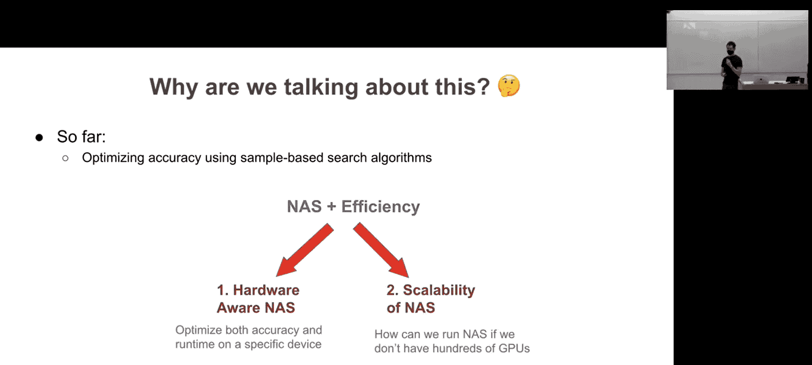
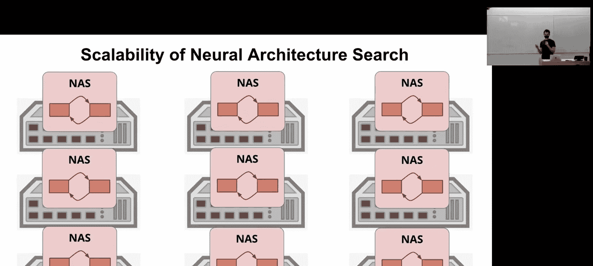
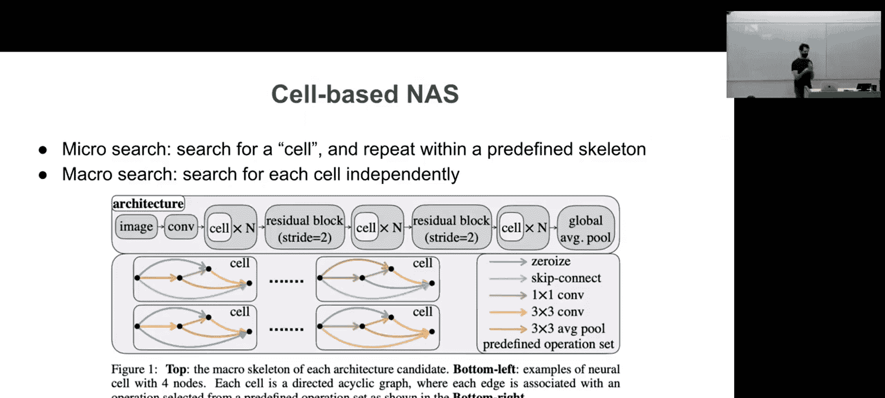
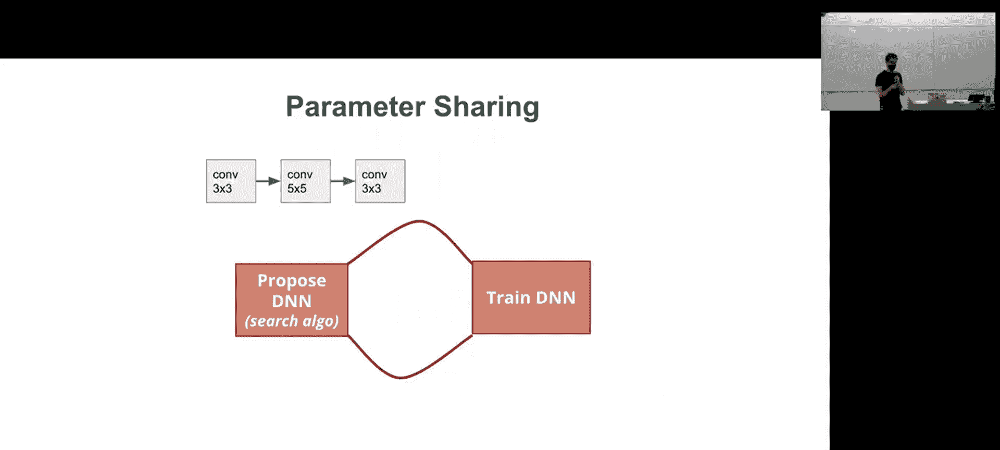
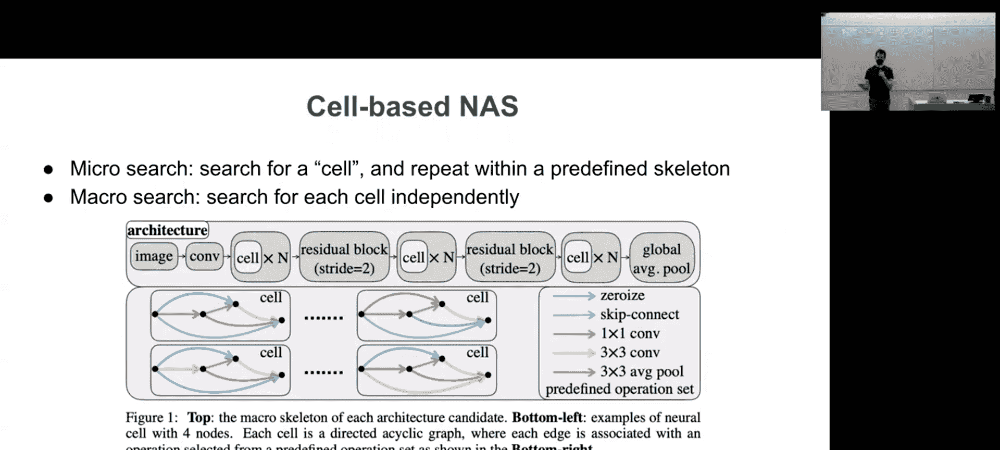
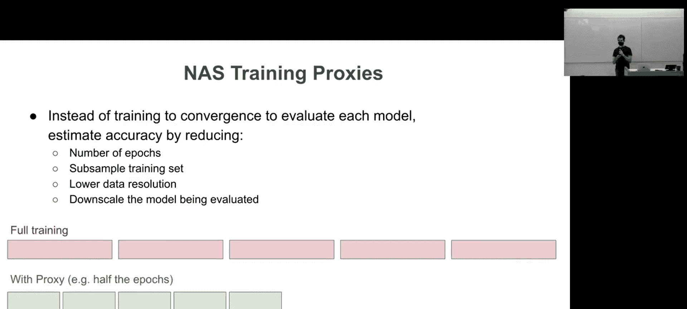
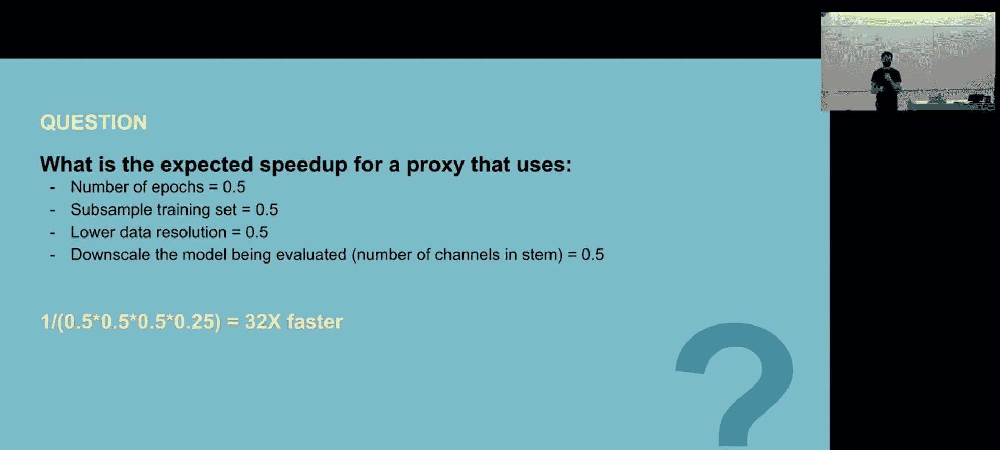
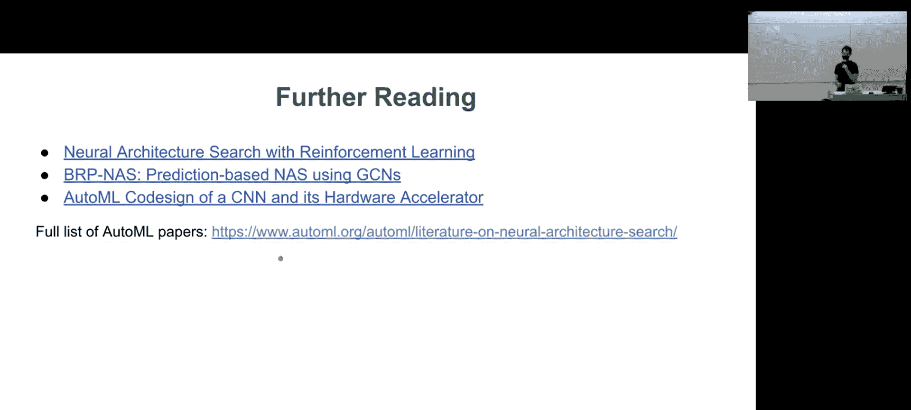

# 康奈尔大学《机器学习硬件和系统｜Cornell ECE 5545 Machine Learning Hardware and Systems》中英字幕 p12 -12-Lecture 10_ Neural Architecture Search.zh_en -BV1CCqPYSEP5_p12-

Okay， so today we'll be talking about quite an interesting topic and quite an advanced topic。

 I would say。 but I'll give an overview of neural architecture search。And that's， again。

 one of the other methods of you neural network optimizations to have more efficient implementation on hardware。

So this is again something that won't really dive into hardware systems。

 but we're still kind of at that neural network level。

 how do we make the neural network itself more efficient so we looked at quantization， pruning。

 knowledge distillation and now a neural architecture search。

I should say NAS or neural architecture search is usually kind of under this AutoM umbrella or automated machine learning。

 and that includes more than NAS， it's like neural architecture search。

 hyperparameter optimization and something called metal learning。

 but we will focus on neural architecture search specifically。

So how many people already kind of know what that is just kind of by definition。1，2。

3 so a few people， okay。That's always good to gauge。

So so the motivation here is that you know people have been designing neural networks to do a specific function。

 so you know Alexnet。You know has this very specific topology， it has five convolutional layers。

 three fully connected layers， there was a lot of intuition going into it from classical image。

Recognition work。 And so they said， we need a bunch of features。 the deeper we get into the network。

 the the deeper the layers should be， the finer grain the features will be。

 and the more of them that we will have。 So we will select kind of yeah， okay， let's select。

 you know the depth of 384 here。 number of fills。 So who thinks I mean this 384 number。

 the right number to use here。Right， it's it's as as arbitrary as choosing any other number， frankly。

 And then， you know， people continue to do that for a long time。 So for I'm showing here VG G。

 which is also kind of a manually designed neural network that outperforms Alexnet。 And again。

 it was based on a lot of intuition。 You know， that convolutional layers are much more important than fully connected layers and they're also computationally less expensive。

 So let's add more of those。And they also found out that stacking multiple convolutions with a small filter size。

 so three by three convolutions were the main thing in VGG were enough。

 we didn't have to go all the way to seven by7 convolutions and five by five convolutions which were present in Alexnet。

And then someone thought about it a bit harder and in fact not someone。

 but like a huge team of people at Google kept thinking about how do we make this more efficient and they came up with mobileNe before that。

 you know at Microsoft people thought about how to make gradients flow better and they came up with ResNe。

But I mean the key thing here is that， and this is kind of one of the superpowers of neural networks is that you know many topologies and many network architectures can perform the same function the training algorithm like SGD or something is very powerful。

 it can actually train parameters in a parameterized neural network of any architecture or any topology。

And so the question becomes， how do we design the best one that gets the best accuracy？

And that's what neural architecture search is all about。So yeah。

 how do we manually decide on these operations， it's all intuition based and kind of trial and error。

 so instead we'll show something that's more automated。

And so that's kind of the movement behind neural architecture search and there is a lot of industry interest in this because it automates a problem that has no right answer really。

 and so we're going from manual design which is， as I said based on a lot of intuition。

 has a lot of manual trial and error。And takes up a lot of human time and as we saw kind of the biggest cost for companies is actually the human time now like the software developers and the people doing doing the work。

Going to automated design， so it's still trial and error as we will see in many cases。

 very intelligent and automated trial and error， it doesn't require human time， requires GPU time。

 which is arguably also very expensive， but people are looking into how to make that also run a lot faster。

So what is it？What is this neural architecture surge right in its simplest form， it's quite simple。

 you have kind of some algorithm that proposes a deep neural network。

So it proposes its green one here， and then we want to know how well this proposal works so we train this green neural network and we get some accuracy in this case it's 79%。

And so what we do next is you know we change that neural network a bit by changing the number of layers。

 the filter sizes， the number of channels， the type of operation or anything。

 and then we try it again， so we train that new orange colored or yellow colored neural network and we get a different accuracy。

And so if we keep doing that repeatedly， then we will eventually basically you know have a bunch of neural networks that we tried and we can choose the one with the highest accuracy so what I just described is called random search。

 you know， you know， you're just randomly changing the neural network architecture。

 we are evaluating it in terms of accuracy and we we keep the best one。

So this is the most naive kind of search， but it actually works。 It works quite well。

 and it it outperforms， you know， a human design。Because you have this thing that's automated。

 that's trying a bunch of neural networks。So we will not just you know talk about random search。

 in fact， we won't talk about it again except to compare it to other algorithms。

 but there are many other much more intelligent algorithms people have been using here。

NAS kind of started with reinforcement learning， and so we will talk about that first。

 but then quickly move to more genetic and evolutionary algorithms。

Then there are very modern algorithms that people use that achieve a very good sample efficiency。

 or basically we try very few neural networks before we get to a very high accuracy one。

 and so we'll talk about prediction based search and differentiable architecture search。

Finally on this side this box here actually takes a lot of time so some neural networks you know itll take days。

 weeks， months， years， GPU years to train and so how do we actually do this in a scalable way and so we' will talk about a few ways to make that faster something called parameter sharing which is not written here and we will also talk about proxies that have kind of a reduced form of training instead of doing the complete training。

To kind of evaluate model accuracy。 then we'll also talk about the objective。 So in this picture。

 I'm showing that the objective is accuracy。 Can people think of what other objectives we can have here。

嗯。Latency yeah so that's correct so we can actually optimize the neural network for more than one thing you know in the classical neural architecture search we're just trying to optimize accuracy and get to the best performance of the neural network。

 but we also care about other things like how fast it runs on a mobile phone for example。😊。

And so let's start with kind of the reinforcement learning classical work。Yeah。

 number of parameters would be a possible objective and this is what I would call kind of a proxy for latency or runtime on a phone or in a GPU because you know the generally the larger the model。

 the longer time it will take， but that's not a hard rule as we will see as well。Okay。So， so again。

 by show of hands， who kind of knows what reinforcement learning is。Okay， okay， that's that's good。

 So many people know what that is。 So I don't need to talk a lot about this。

 but basically the process of optimizing a neural network parameters with。

reinforceinforcement learning was first kind of proposed by people from Google。

 and the idea here is that our searching algorithm is kind of replaced by deeper reinforcement learning in this case。

So what do we do here， we basically use a policy gradient algorithm in which you know the way that works is that we have a function parameterized with some parameters that's called them theta and that function in DRL is usually a neural network and so we can in this case we have a recurrent neural network and in every time step we're basically trying to predict what the best。

What the best value for these parameters are so choosing the number of filters and then choosing filter height and filter width stride height and so on for each operation in a neural network。

 and the way they do it is that they actually use like a recurrent CNNN here and they do categorical classification here so they have a softmax output and they choose one of different discrete values for number of you for each of those hyperparameters of a neural network。

And so the action here would be kind of to choose the value for one of those architecture parameters。

The state space is what we will call a search space。

 and this is the set of all possible deep neural networks in the search space given the parameters that we provide。

And finally， for reinforcement learning， the way you give feedback to your algorithm is you provide some reward value。

So so what would be the reward value here， what feedback would we get from a neural network that we try out。

Any， any guesses。So we want to kind of have a value that quantifies how good this neural network is。

 right， so am I？Yep， yeah， that's correct。 And what were you going to say as well。Yeah， yeah。 so。

 so you're both correct。 So， so basically， you know， in our very simple case， it's just accuracy。

 right。So we try a neural network with specific values for those hyperparameter。

 and then we get accuracy， we feed it back to the controller。

 it updates the parameters of our deep know neural network controller and then it tries to choose or modify the next neural network that it proposes so that it works better so this is just you know again in our random search example we will randomly changing the neural network were randomly trying another one and then measuring its accuracy and keeping the best one in this case we have some feedback and that feedback is in a form of this reward here that allows us to kind of quantify how well this trial works and so we give feedback to the controller that will update its policy so that the next time it proposes a neural network it takes that into account。

喂。And so I briefly mentioned the term search space while I was talking here and in the previous picture we had you know all of this filter width filter height and specific hyper parameters but here I'm showing a very simple search base and what that is is basically just you know we have seven layers in a neural network and we have four choices for the operation of each layer。

 the specific hyper parameters right so yeah so we got to choose at each layer which operation we put there。

And so can someone tell me what the size of the number of possible deep neural networks for this simple search base would be？

是吧。Come on。4 to the power7。 So that's correct。 So if at every layer。

 we have four choices and we have seven of those layers。

 then you know it's exponential with the number of layers， right。好。

So that's a good question so the question is whether there are heuristics to you know eliminate nonsensical models or invalid models and typically from what I've seen no so some models can even be invalid completely and that's when we have more complex toppologies and we have some skip connections in zero operations so like no operation you can have a model that has everything is no up right and that's an invalid model you quickly kind of weed out those models when you put them through an evaluator because you start to train them and they get kind of zero accuracy consistently or the error out or something and you catch the error and you say we move on to the next model but I haven't seen kind of manually crafted heuristics to guide neural architecture search in specifically。

So if you look at all of these neural networks before you make a decision。

 then that would be exhaustive search and of course， I mean， that would be ideal。

 but you wouldn't do that because you don't have enough GPUs basically。

And so that's why you need an intelligent search algorithm to kind of navigate that search space and hone in on the best path to take or the best changes to do to the neural network to lead you to a high accuracy one in this case。

So I mean， I've seen for search spaces of， for example， 32k or even 100k 100。

000 neural network example， like neural network possibilities。

 I've seen search algorithms converge to a good value in about 100 to 500 search trials。

So that's approximately kind of the fraction there。 So yeah， you search very little of that space。

 but you try to find the best model in that case and you don't have to find the best model right so you you're trying to find a model that kind of meets your Qs or quality of service constraints So something like you know I need at the minimum this accuracy or this latency。

啊，没有。Yeah， exactly， you're not shooting for the global maximum here so。嗯。

So as I briefly kind of said before for the reinforcement learning case。

 this turns into a classification problem， so you know for each choice that we have to make。

 we have this kind of discrete set of classes， let's call them and we basically put our RNN output through a softmax classifier to select which one to choose and so the feedback would then guide your RNN parameters is to choose a better one in the next trial and so on。

嗯。Okay， and so when people tried this。They found that。

 you know it outperforms all human design networks easily and of course。

 it's not so easy because in this case， you know， you need to spend a lot of GPU time to actually get to those results So can someone guess how many like how many GPU how many GPUs we need to kind of do this just a number。

So this is the first paper on neural architecture search。 And the hint is that it's by Google So can。

Can you guess the number of GPUs order of magnitude？Thousands， okay， a bit lower， actually。So。500。

 yeah， we're we're， we're binary researching now。 So it'ss so they actually needed。

 it's not in this slide， but they actually needed 800 GPUs to get this result， right。

And so so that's a lot of GPUs for a， what is this1% accuracy improvement。

And then you know more GPUs to get to this one。But basically it's a lot of compute power and we talked before about how you know training one neural network could use you know hundreds of GPUs for a long time and here it's you know even if a neural network trains really quickly。

 we need to do so many trials before we get to the right answer or a good enough answer that beats kind of manually designed networks that you know it's people are questioning this scalability of this approach and they're also questioning whether people other than Google can run this or Amazon or Facebook。

嗯。And so one of the main areas of research here was how to find a better search algorithm。

 a more efficient search algorithm right， so we want to reduce the number of trials and thereby reduce the number of GPUs that we're using。

And so the next thing people tried here were genetic or evolutionary algorithms。

And there are many variations of this， but I'll describe one of the very successful ones called aging evolutionvol。

嗯。And so。So what we do here is you know we initialize something called an evolution pool with a bunch of neural networks in this case we have eight right。

 and we initialize that typically randomly。Each one has an associated accuracy with it。

 what happens in aging evolution is that we take the best model and we mutate it。

 so we do some change to it and come up with a new model。

And then we take the oldest model in the evolution pool and we remove it。

 so that's why it's called aging evolution， basically the oldest one dies。Um。

 whether it's whether it has really good accuracy or bad accuracy。

 that's not a factor is just it has been in the evolution pool for a long time。

And then finally we put the new model the new mutated model。

 the child model into the evolution pool and we repeat this again and again and again。

 and so as you'll see here we no longer have you know an R&N controller and we no longer have parameters that we're updating this is just kind of a directed search algorithm essentially。

 and there are so many search algorithms out there that that we can use to do this as well。

 but this one has been quite successful。And in general。

 genetic and evolutionary search algorithms have been very successful as optimization algorithms。

 so as discrete optimization algorithms。And so that's what we do， we initialize the evolution pool。

 we repeat it n rounds where we do know we mutate the best model， we remove the oldest model。

 and we keep doing that again and again。So that's a good question。

 why do we remove the oldest instead of the lowest accuracy？

So in all of the very good search algorithms that navigate large search spaces。

 you have a good balance between something called exploration and exploitation right and so by removing the oldest one。

 you're increasing the exploration of this algorithm， even if it's the best one。

 you want the algorithm to explore new areas of the search base that haven't been explored before。

 and so let's say we always remove the lowest accuracy one。

That might mean that we're always evolving the same one again and again and again so it's kind of going let's see what would be the example it's going like along one tree in the evolution space as opposed to kind of exploring in different directions So so yes that's kind of the main reason there you want to have a bit of exploration。

 not just following the best path in the search bin so I mean there are so many variations actually of genetic and evolutionary algorithms and some of them may have a different heuristic for pool eviction and which selecting which one for mutation so here you know it selects the best genotype for mutation and that's a very greedy thing like you just you know find the best one make it a bit better some of them would randomly select one for mutation for example and always remove the worst one so there are many heuristics there I only present this one because it was introduced in the context of neural architecture research and it works quite well but you can think of many heuristic。

for sure， so。嗯。Okay， and then you know， when I started reading those papers， I was wondering。

 you know， why did we even use reinforcement learning in the first page？

Because actually most of the experiments I ran and most of the literature now agrees that RL doesn't actually work that well with neural architecture search。

 it it's so hard to tune usually you know there's something called reward function engineering there's just so many hyperparameters for RL for it to converge quickly on a good model and so why did we use it in the first place and why did the first paper actually use RL and I will say that is just arbitrary so people at Google really like reinforcement learning at that point and that's why they use it that's my opinion but I would say currently evolutionary algorithms are among the best kind of sample-based search algorithms out there。

And so this is from the same evolution paper written down there。

 and so basically when they did a bunch of random trials with you know RL with random search and with evolution。

 they found that you know approximately evolution was always kind of better or mostly in most cases led to a better result and this was verified in later works as well。

And so this is here a plot that you will see a lot in neural architecture search papers and you know on the X axis is how many trials we did or what is the number of hours that we're using for this experiment and on the Y axis is the best accuracy achieved so far。

So so yeah， this is the curve that， you know， an as person really cares about and tries to basically。

Make better and dominating existing approaches means， you know。

 you're higher in the accuracy part and you're lower in the experiment time part。

 So anything here would be better， basically。So I mean。

 a good question now if I'm sitting where you are is why are we even talking about this so so far we just。

You， we're optimizing for accuracy， and so what does that have to do with systems？

We care about hardware efficiency， designing hardware。

 scaling problems to multiple hardware nodes and all of this stuff。

And the answer is basically what we'll talk about next。

 so there's a lot of intersection between neural architecture search and efficiency。

And the first and very obvious one is what people already pointed out is you know hardware。

 I wear neural architecture search， instead of just optimizing for accuracy。

 I also want to optimize for latency or power consumption or something that is related to the hardware itself。

Even if I lose some accuracy， I maybe I want to fit a model to a mobile phone and I don't mind some accuracy laws just to make it work because otherwise it doesn't even work。

And so we will talk about this hardware aware neural architecture search。

Where we optimize both accuracy and something else。

And then the second more kind of subtle point is the scalability of NAS so while we won't talk about specific hardware systems to scale NAS。

 we will talk about different approaches that people have successfully used to shrink those 800 GPUs down to a few minutes in some cases actually and so people have really kind of optimized search algorithms and and aspects of the search algorithm to this specific problem of neural architecture search because of its importance and so you know so we'll kind of answer the question of how can we run NAS if we don't have hundreds of GPUs we'll actually start with the second one。

 I don't know why I said this is one and this is two but we'll start with the scalability of NAS first。

Okay， so so far this is kind of what it looks like。

 you know you' have hundreds of servers and we're running neural architecture search on each one and we kind of you know have kind of one of the servers synchronize the result and update a controller or update a search algorithm and so on。

 and people have thought about how to implement those algorithms in parallel as well。

And as I said， this first mass paper used 800 GPUs for 28 days。And so you know。

 800 GPU months basically， and so that's just for this one or 2%。Accuracy improvement， I mean。

 2% is still significant in these kinds of problems， but it costs a lot of money and power here。

And so to get more efficient neural architecture search there are typically kind of three things that we can start to think about and start to optimize we already talked a bit about more efficient search algorithms so basically in this sample- based neural architecture search how can we reduce the number of samples so the number of trials of a neural network before we find a really good one so that's the first thing。

The second thing is， you know， these very large search spaces， as someone already asked， you know。

 can we shrink them， can we use smaller search spaces。

 can we search for something that's really important instead of searching for the whole thing and leaving it open ended。

And the final thing is you know， instead of fully training a neural network can we do something else to evaluate how good that neural network is and so here we will look at you know inexpensive proxies where we basically reduce the amount of training to get an indication of the ranking of different neural networks。

And so we'll talk about search space first and the typical thing that people have been doing there is something called cell based NAS。

 so you'll see it being called cell based NAS or microcell NAS or microsearch or something like that in the literature and basically the big idea here is that you have a neural network architecture。

And this is what we call a DNN skeleton。 So this skeleton is fixed。

 This is what is going to look like， right， But then there is this cell here， whoops。

There is this cell here which you know you don't know what you want to put in this cell and that's what you're searching for but once you find the architecture of this small cell。

 you repeat it n times in this stage and then you repeat it again n times and n times here so instead of you know searching for all the operations in the entire neural network。

 you're actually searching for just operations within that one cell。

And what does that cell typically look like in this example search space。

 it looks like something like this， so it has some flexibility in the you know interconnection between layers。

It has different operations that it can choose along each layer。

 and so you can choose you know a number of different cells so the search base size here is the size of the search base of this small cell instead of being the size of the search base of the large model。

And so if this is typically called microsearch in the literature。

 the opposite of it would be macrosearch， or that's when you search for everything in the neural network and typically what that means is you still have a skeleton but each one of those cells can be different right so in micro cell or cell based each all the cells are identical and in macro the cells can be different。

And so so obviously there is a huge difference in the size of the search space and the cell can be the same or different and so for this example。

 if we have 10 cells， five operations per cell and each operation has three choices。

Can someone come up with， you know。The search base size， so I'm saying the number of choices here。

 but what is the search base size for micro and macro search we can start with micro search because it's actually simpler。

嗯。You just multiple okay， so so it's three to the power of five right， so in micro search base。

 you have， you know， five stages and as we did it before for the other one which had four stage seven stages and four operations here we have。

 you know five operations and three choices for each one。 So it's three to the power of five。😊。

But now what if it's a micro search space， what happens now so now each cell can also be different。嗯。

Reads the power of 50， not quite， but your。You you're shooting in the correct general area。Okay。

 I'll click。 So， so basically， oh， that's oh8 choices。 I read the8 as three。

 Maybe that's what confused everyone。 sorry， I told you I I can't hear and I can't see really well so。

I'm actually joking。 So， so， yeah， so for micro for wait。It's three here， and it's eight here。

Who would do this， like。Its very odd。

That's what happens when you kind of create slides。

You know， after midnight。So okay， so so if we have eight， let's go with eight。

 if you have eight choices per layer or eight choices for each operation and you have five operations。

 then it's eight to the power of five and that's you know32000 models that's not actually not too bad right but in a macro search base if you have 10 of those cells that you're repeating and you're not repeating an identical cell anymore。

 but you're choosing the architecture of each cell it becomes a huge search base right like it's eight to the power of five to the power of 10。

😊，嗯。嗯嗯。😊，Actually。Yeah I think that's right so so in this case it's 10 to the power of 45 so it's a much larger search base and that's why it's way easier to actually search for kind of a specific cell architecture and repeat it in a predefined skeleton than searching for everything than making everything variable。

And the intuition there has been always that， most of the neural networks that actually work have a specific block that's repeated again and again。

With with some scaling between different stages， but its still it's the case for you ResNe for mobile network for efficient met。

 for all of kind of the state of the art networks and so it works fairly well。

走。是。Yeah so that's a good question so is microsearch searching for the skeleton or search for every cell so typically what it means is that you know you have these cells here that are repeated throughout the network。

 what it means is that each cell can be different so that's what microsearch usually refers to whereas a microsearch all of the cells are the same you just search for one and you stamp it out in your model。

Yeah so that's a good question what's the criteria for stopping the evaluation so typically you know you have your own constraints application driven constraints so you wanted to run within 5 milliseconds or you wanted to have at least 80% accuracy or you want to beat your manually manually designed network for example or the existing network and once you find something reasonable you stop so。

That's basically。So that's a good question in practice are the results for macro better than micro so in practice I haven't seen macro research used a lot actually。

 so in most industrial cases at least that I've worked on and that colleagues have worked on they're doing microse and you'll find that at least 80% of the literature is on microsearch。

But those few papers that look at Mac research， they start by saying， you know。

 the larger diversity in models can get us better accuracy。

 And That's why we want to look into those， you know， more complex search algorithms。

 And so typically， I would expect Mac search to have a model with better accuracy in the search space。

 So that's that's an assertion。 So I I would that's what I' would expect。 But in practice。

 people don't go there because it's just so hard。But there are some emerging algorithms looking at that now。

没有。いな。So that's also a good question， so the predefined skeleton is basically manually designed。

So again， people follow their intuition， they want you know deeper layers to go later。

 they want some max pooling after each layer or something。

 and so they just define this cleton manually to get some also by using trial and error。

Or they borrow it from a manually design network。

O。Okay so so we talked about you know search based size and cell based design now let's talk about another technique which has also been very successful in making an NA faster and so that's called parameter sharing so it's from this paper cited here。

😊，And basically the idea here is that when we propose a deep neural network。

 we have to train it so you know I'll color it green when something is trained in this case or something other than gray。

 so I've already trained kind of a three by three convolution in the first stage and a five by five convolution in the second stage and a three by three convolution third stage。

So now when I propose another model。I'm actually using the same middle layer here。

 so I'm using five by5 convolution in the middle， and I already trained this before。

So what parameter sharing does is that instead of initializing everything to scratch again or randomly。

And training everything from scratch， I'm actually borrowing the parameters that I've used before。

Or that I've trained before in a model。And so when I now train this new proposal here or this new neural network。

 I only train those two extra ones that I'm coloring yellow in yellow。

 and the third one is just borrow the parameters that I've trained before。

And then when I propose another neural network， I do the same thing again， so for example。

 here you know I've already trained a7 by7 convolution。In the first stage。

 I've already trained the three by three convolution in the last stage。

 even if there are two different training trials， I just borrow the parameters and then I only need to train the model in the middle。

 right？And then tuition here comes from transfer learning where you can always train a network and then change the last few layers and specialize it for a specific task and then what it hinges on is whether this actually works and people have found that it works empirically quite well and obviously you shrink your training time by a lot。

Because once you train one of your choices， it kind of reduces a large number of possible trainings in your search base。

So so this is where it kind of starts we start customizing search algorithms specifically for neural architecture search right so this is something very specific to neural networks so if I can't really apply this to a search algorithm that's just you know optimizing something else that has no parameters and has no notion of layers so this is where people are taking you know current search algorithms which you know if there are L or genetic algorithms or something else these are just generic optimization algorithms right but now with parameter sharing we're actually you know focusing on the specific domain of neural networks。

嗯。And in this specific paper， what people have found or people have measured is that it's 1000 times faster than conventional neural architecture search without parameter sharing。

Okay， so on kind of another related thing， which is training proxies。

 so instead of you know taking each one of our trials and training it to conversions we can actually just do something else we can train it for a fewer number of epos or we can sub sample the training data or we can use lower data resolution basically we can we can do a bunch of things to speed up training the final value will not correspond to the value that we care about。

 which is you know the performance of that model on。

On the task that we're training good for so for example imagenet classification。

 but we at least will get an indication of how good the model is and again people have found that you know。

Halfway through training for example you can already tell whether one model is better than the other and so in this case compared to full training you know if we have five trials or we're trying five neural networks here with a proxy for example if we have the number of epochs we can either have our runtime or we can double the number of trials right and so these are called you know reduced generically reduced training proxies and they're also kind of standard now in neural architecture search no one does full training except for that very first Google paper I think。

And so a question now becomes， what is the expected speed up for a proxy that uses。

 you know half the number of epochs， half the training sets， half the data resolution。

 and half the number of channels？And I mean， think about it for a minute or something。

But the speedup is quite surprising， it's a very large speedup， right？有没异议。And you guys sit them on？

16。😊，Okay， you close。I think I'm right， so its I think it's 32 because when you reduce the number of channels。

 I think it has a quadratic effect on runtime in your STM convolution， but yeah。

So you know just by doing these reductions you can get up to 32 times faster and that's you know that's a huge speed of that means you can try 32 more times more models。

Okay。No， so。They're all 0。5， but the last one with the number of channels。

 I think it has a quadratic effect on runtime when you're training a model。嗯。

Maybe it's because of the forward and backward pass。 But yeah。

 so I I can do it with pen and paper later， but I think it's quadratic。嗯。

Yeah。So yeah， so we looked at those proxies now and the fact that you know we don't have to actually do full training and so people actually use these things in conjunction。

 they kind of do parameter sharing and they do reduce training proxies so they basically all of these different optimizations are stackable。

 you can use a bunch of them at once。嗯。We also said that you another way to to speed up NAS is to choose a better or more intelligent search algorithm。

 and this is one of the things that we worked on back at Samsung is you know we found a key observation is that you don't actually need to know the exact accuracy to evaluate whether a model is good or bad right you just want to know relative to another model so between A and B which one is better。

So so we trained this meta model called a binary relation predictor， basically it's a neural network。

 which takes as input to model architectures and predicts which one is better。And so you。

 you train this predictor on T DNN， so you take T of those and you train the predictor to correctly identify which one is better based on the architecture。

And then we use the predictor to sort the rest of the models based on that。

 so it's I mean it's not exact， it won't always give you the right answer。

 but then once we do this iteratively we can actually have a predictor that when you input any two neural networks in the search space。

 it kind of tells you which one is better。So this is supervised learning。

 right because in this first step we train the predictor on T examples where we know which one is better。

 we train them to completion。And so again， this is the plot that we always care about。

 you know you have runtime on the X axis and accuracy on the Y axis。

 so we already saw you know random search and we actually can see that reinforcement learning here is close to random search in this dataset and that frankly that was my experience with a lot of this maybe we can't where we're unable to tune RL well for each search base but it has so many hyperparameters it usually performs very poorly when you adapt it to a new dataset。

And then aging evolution is quite good， so you know it's definitely much better than random search and reinforcement learning。

 and then here is the curve for our binary relation predictor and as where it's even better and converges to a very good model really quickly。

嗯。And so I mean， a final note about this is that there are actually so many search algorithms now。

 a lot of them based on these surrogate models or these predictors and a lot of them based on other things like Monte Carlo Search or other kinds of searches。

 and so this is kind of a long topic with a lot of papers， but this is one example of this。嗯。

So so far we kind of talked about the scalability of NAS from 800 GPU months to something much better and we talked about how to you know shrink the search base size to use the cell based search base which gets you very close to a really good model。

 we talked about you parameter sharing and we talked about new search algorithms and finally we talked about reduce training proxies as well for shrinking the evaluation time。

嗯。So one more thing before we talk about hardware where neural architecture search is this notion of a supernet and beyond that。

 we'll talk about differentiable architecture search as well really quickly。So。So basically。

 what I'm showing here is， you know， we can construct this network if you think about it。

We can construct a network or a cell in this case that has all possible choices， right？

And so if I said， you know in each one of those edges， I can choose either a con3 by3。

7 by seven or average pool， I can actually build a neural network with all of these choices right and so that's what people typically refer to as a supernet。

 which is a superet of all of the possible networks in my search base。嗯。And so how do we do that。

 it depends on the work， but in the most common case。

 what we do is we actually add the output of all of these layers。

And so then we can construct a fully end and trainable supernet with all of the candidate operations in that super network。

So I mean， in this diagram here I just have an addition here。

 but usually so they call this a mixed operation or a mixed op。

 usually it's actually a softm of all of the output。That that we use here to to actually。

 this is premature。 Let's just say， yeah， we add all of the outputs here。

Of the different candidate operations， right？And so so the question now becomes， you know。

 what do I do with this supernet and that's where you know differentiable architecture search comes in。

We add something called the scaling parameters or architecture parameters on each edge。

And so let's call them Al one， alpha two， alpha3， and this is， you know。

 let's say this is the importance of each of those operations。

So and then when I train a neural network， I can actually make those alpha values。

 those architecture parameters trainable as well。And whichever you know is trained to be a very high value。

 that means it's more important and whichever has a lower value。

 it means it's less important and that's how I can select you know my operations here。

And so that that's probably not clear yet so let's take a look at it again。

 so basically you know I have this cell， I want to search for what operation to put on each of those edges。

I construct a supernet with all of the operations combined with this addition and these alpha values as well。

And then while I'm training the neural network， I'm also training those architecture parameters。

 right， so I'm also training the value of those alphas。And as I'm training the neural network。

 some of those alphas would be smaller and smaller and so they don't really contribute to my output anymore。

 and some of them would be larger and that's why we use the softmax there that's why I said it was a bit premature basically to select which output is the largest from them。

And then finally， once I'm done with training， I just select the best one and I end up with you some of these operations and that's my subnet or my search network in this case。

So this is called differentiable architecture search and it's basically we're using back propagation essentially to optimize my architecture itself right and so this kind of turns into what's called the bilevel optimization problem because you're optimizing two things。

😊，In the normal optimization of training any a neural network， you're optimizing the training loss。嗯。

Of w， so w is the weights here with a specific alpha， so with a specific architecture parameter。

 and then you are also minimizing the validation loss。

On of a neural network with specific parameters and you're optimizing the architecture parameters here。

So， so what what happens in practice is， you know， this is very hard to solve exactly， right。

 because for each set of architecture parameters， you need to train all of。

These neural networks separately， right to actually solve this exactly。嗯。

But in the paper cited here darts， they do an approximation where they basically alternate training steps one training step is normal。

 you know you use your training data set， you're optimizing your normal neural network parameters you're trying to find good values for them and you're keeping the alphas fixed and then in the second training step you are training using the validation set and you are。

Updating the architecture parameters themselves。So so you're updating those alphas to see which of the candidate operations are best。

 so you're updating you know the weights that youre assigned to each of those operations。

And so someone sitting there is probably asking you know how can we use the validation set and training this is cheating right and the answer is actually it's not quite cheating because when we're using the validation set we're only updating the architecture parameters and we are allowed to use the validation set to set you know hyperparameters of our neural network or topologies so when we do the normal sample based mass when we evaluate the neural network we also use the validation set typically and so this is kind of the reason for also choosing it here。

So yeah， so we optimize these architecture parameters during training and then finally we keep operations with the largest alpha。

So do people have questions about differentiable architecture search， did the main idea kind of land。

Yeah， okay， basically it's a gradient based optimization method for architecture parameters instead of being sample based。

 which is what we've seen so far。So this actually runs in like four hours or something。

 depending on the dataset， but it runs really fast and usually don't need to train this for a lot of epoCs to get to reasonable architecture parameters。

 although I will kind of give some caveats here is that people have found a lot of problems with this both empirically and fundamentally。

 especially on this approximation where they kind of just alternate the training。

 and so this is a very active area of research where people are trying to figure out how to actually do this bilevel optimization。

嗯。Okay， back to why we're talking about this， so now we talked a bit about the scalability of NAS and mainly what that means for us is how can we make that NAS problem more tractable。

 how can we make it run a bit faster so that we can actually do it on our computers。

Now let's talk about the other aspect of efficiency which is arguably quite important and interesting as well。

 which is hardware I wear NAS， and I have like three or four slides here， so we're almost there。

 but this is the case where we want to optimize the neural network。

 not just to get the best accuracy， but also to have it run well on mobile devices for example or if I want to run a neural network on my phone。

And people have started by， you know， they were motivated by running this on mobile devices first。

 but now people do this for all devices because you just you need a lot of efficiency in your neural networks。

 it's even for high NGPUs， you still need to make your neural networks more efficient and so。

And so this is relevant not just for mobile devices， but for all devices now。

And so what what the picture looks like here is only slightly modified from before。

 so you know you still have a controller or some search algorithm that proposes。

 you know your next neural network。And then you train it。

 you get accuracy and you provide a reward back and so this is you know our regular loop now instead of just training it。

 we're also running this neural network on a mobile phone。

We're measuring its latency and then we formulate this multi objective reward which has both accuracy and latency in it。

 so that's basically it so we add this extra step of running the neural network on the device that we care about we evaluate how fast it is on that device and we use that to provide feedback for the search algorithm right。

And usually we use that latency in one of two ways。

 a very common way is to have it as a heart constraint。So we run the neural network on the phone。

 It doesn't turn under 5 milliseconds。 Okay， you throw it away。

 you don't even train it So this is a hard constraint and in other cases。

 people use soft const where we basically just have a weighted sum of both our objectives So this kind of goes into the topic of multi objective optimization in general and how we can combine different objectives there are usually you know more hyperparameter introduced here for your search or your search parameters that's called them So basically you have to decide exactly how to combine those two weights some people multiply you know accuracy and latency together。

 some people add them with a specific weight that the hand tune so so the first one is usually a bit simpler。

啊。And。And so Harrisish already kind of mentioned the good point which is can we just use number of parameters instead of measuring this on a phone and we can and what I'm showing here is not number of parameters but flops so the number of operations in the neural network。

 I can use this as a proxy for this latency instead of you having a mobile phone and measuring on it every time and it takes time I need to convert the model and I do various things to actually run it on the phone。

 I can just use flops as an accuracy and I can compute that in no time basically。

But what we found and this is again part of the work we did at Samsung is you know flops is not a very good indication of measured latency typically for models in a search space so we took here I think 16。

000 models in a small search space and we measured all of their runtime on a specific phone and we measured we counted the number of flops and when we plotted you know flops versus runtime you see here this there are a bunch of models that have 100 megaflps but they have vastly different runtime right。

And you see this true for you know all of the other runtime as well。

 and so this wasn't a really good proxy for how fast this model runs on a phone。

So the question is why it'ss actually not that well correlated and is it because we're not taking the hardware into account on computing these flops。

 we're not taking factorization， we're actually not taking anything into account right so so you're right So these models may be memory bound it may be the runtime may be completely unrelated to flops or some of the layers in these model could be memory bound So in this case。

 no matter what the number of flops are it doesn't really matter。

 maybe in that case parameters would actually be a better proxy。

And so basically this doesn't encapsulate any effect of running on actual hardware and every hardware is different as well。

 I can run a neural network on you a phone and it will be memory bound。

 I can run the same one you on the desktop GPU or CPU and it will be compute bound。

 something like that right？And so and even before going on to the next way of doing this。

 why do we even want to estimate latency， why don't we actually run it in the actual device？

There are many reasons for that， one of them is it complicates your system so and it doesn't allow you to scale your system very easily。

 so in the case of sample based NA especially you know you want to try a bunch of things in parallel you usually want to run a number of GPUs in parallel maybe not 800 but maybe 8 or 16 so in this case you would need 16 phones standing by to also measure the latency of these models and that can be just complicated expensive and not scalable。

And so back to estimation， so another way of estimating。

 you know runtime is you know you have a neural network。

 you measure the latency of each layer separately。Right so in this case we have three layers。

 I measure three milliseconds for the first layer， five for the second layer and two for the last layer。

And then I do that for all of the candidate operations because now you know it's broken down into two layers。

 and then I just add those up。And so we tried this as well， and so in this case。

 you know the predicted latency from this layer wise model from just adding the latency of all of the layers。

Was it was better than， you know， flops as as a。As a proxy for latency， but it wasn't perfect。

 you know what we actually want to shoot for is this perfect you know y equal x line where the measured latency would be exactly like a predicted latency。

And so what we ended up doing actually， was we used， again， another neural network。 in this case。

 a graph neural network to encapsulate the。You know。

 prediction methodology for this for this latency。 So we trained the graph neural network to take in know the topology of a neural network and to predict the。

Sorry， and to predict the latency at the output。 And so again， this was supervised learning。

 we trained it with a bunch of samples， and then we used it to predict the rest of the samples。

 and it worked quite well。 And here I think we， we， we used it。

 We used kind of 100 or 1 hundred50 samples for training out of about 16000 samples。

 So it was a very small fraction of。Of the entire search space that we used for this so so yeah so this is again an active area of research and quite important because this is how you would actually faithfully customize the model to a specific hardware target and so we found that these prediction based methods again worked really well。

😊，Okay， and this is the final thing that we'll cover here， but a very interesting approach again。

 which is is also something we worked on at Samsung actually， is， you know。

 so far we've been just searching for a neural network and optimizing its accuracy or searching for a neural network on a specific device and optimizing both its accuracy and latency。

😊，But what if you also add hardware into that equation right so what we did there is that we are not just searching for a neural network。

 but we're also searching for a hardware architecture。

So this is we're co-designing both the neural network model architecture and the hardware architecture parameters together and we actually use reinforcement learning for this because this is quite early back and what we did there you know we proposed our RNM controller would propose you know the different operations to use so three by three one by one pulling choosing one operation out of a set of candidate operations and then the rest of it it would choose you know exactly the level of parallelism in your processor or the buffer depth。

 the size of the buffer on chip or something like the memory interface with how wide is that width to your external memory so we're co-opimizing both the hardware and the neural network parameters in tandem。

And obviously once we do this， you know， we need to fabricate a new chip to suit that specific model。

 but there are actually you know reconfigurable chips， there are FPGAs for example。

 which was the topic of this paper where we can customize an accelerator and an FPGA for a specific neural network。

And so I thought that would be kind of interesting to mention as kind of an extension of this hardware where neural architecture search is you know。

 hardware architecture search co designed with a neural network as well。

And here is kind of a sample of the results and I'll just highlight this one in green where you we managed to improve both accuracy and performance per area。

 so performance per area or performance per watt is usually how people kind of quantify how well or how efficient something is on a specific hardware and we were able to kind of get both a 1。

3% accuracy improvement and a 41% kind of efficiency improvement in this case。

 even though we actually customize the hardware in a very naive and simple way。

 like I said just buffer depth and things like that。是。这觉得。

So I mean it increases your search space size， so it makes the search problem harder。

 so I guess there is a trade off there with the same number of samples you probably can't get to as good at an accuracy。

 yeah that makes sense。嗯。So yeah so this is all I had and by the end of kind of creating these slides I found that we jumped to so many topics so I thought I'd have a quick recap of the day。

 you know we started by talking about neural architecture search and the classical algorithms to use their RL and evolutionary search and these are sample based methods where we try our neural network and then we intelligently provide feedback to the searching algorithms to you try a better neural network we then went on to search efficiency and we talked about parameter sharing training proxies and efficient search algorithms there including differentiable architecture search。

Then we talked about hardware aware neural architecture search where you we're also incorporating an objective of optimizing the latency on a specific device and we talked about how to predict that latency on devices using different models like flops layerwise or predictor based and finally we touched upon co-designing both the hardware and the deep neural network together。

So this is the further reading and yeah and you know AutoM is one of those research areas where there was actually a web page for all of the papers that was published in this topic。

 there's a group in Germany that that curates this list。

 so if you're really interested you can click on this link and you can find you know。I don't know。

 tens of thousands of papers actually。

And that's all I had。So thank you。