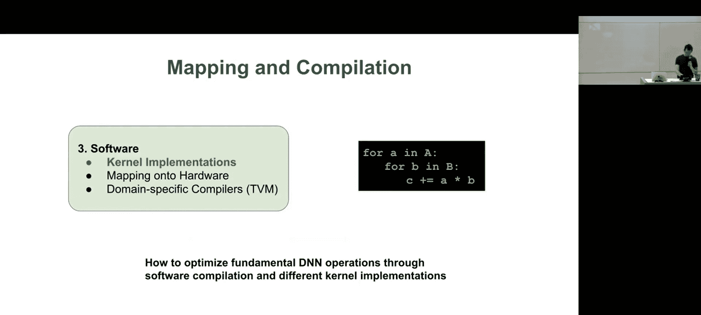
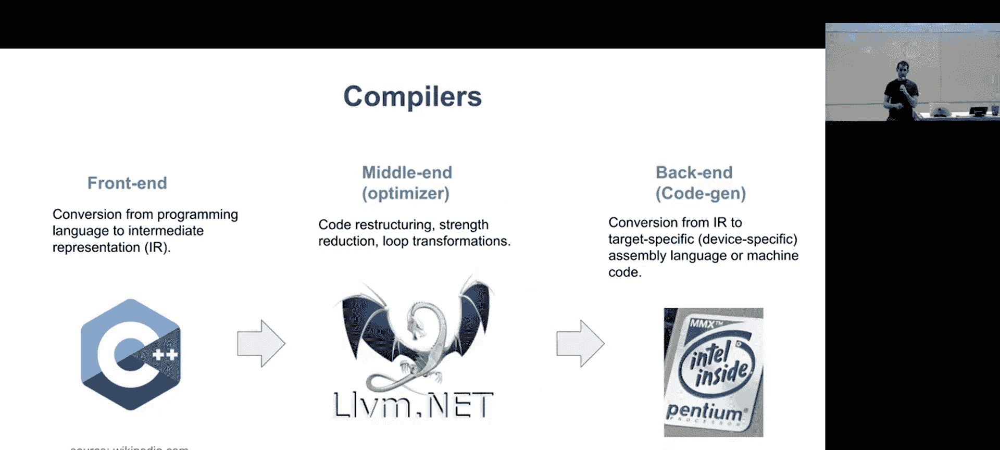
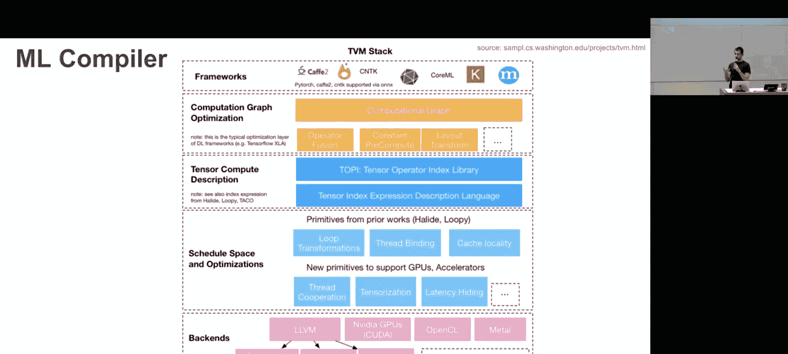
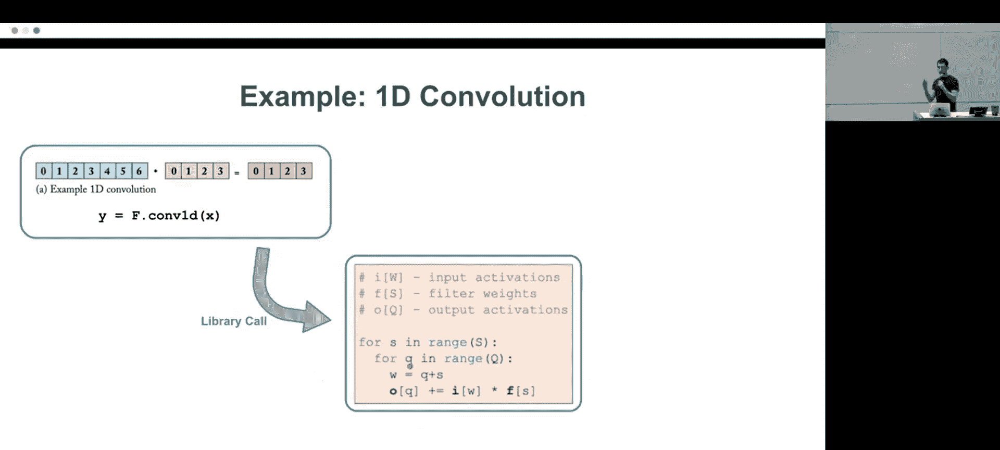
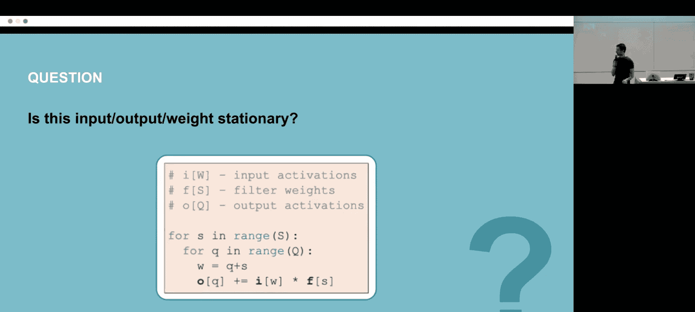
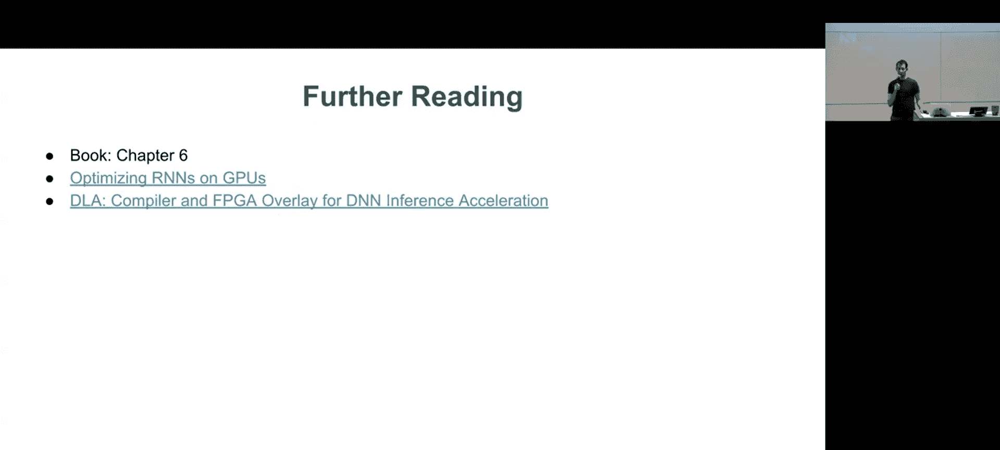

# 康奈尔大学《机器学习硬件和系统｜Cornell ECE 5545 Machine Learning Hardware and Systems》中英字幕 p14 -14-Lecture 12_ Mapping.zh_en -BV1CCqPYSEP5_p14-

So today we'll talk about mapping， which is another way of saying compiling but without talking about all of the kind of compiler infrastructure。

 so we'll talk about how you know given highle piece of code。

 how can we map it down onto a machine learning accelerator。

 or even just a GPPU or a GPU and specifically we'll talk about the different optimizations that we do to the code to make it work at or in certain pieces of hardware and these optimizations are what or many of these optimizations you will apply in A3 as well。

 to kind of get your code running quickly on different targets。So just one second。conference。

Okay， this is better。嗯。So you know what what are compilers right。

 and so most compilers have kind of three distinct pieces。

And this wouldn't be like you know an in depth dive into compilers or anything。

 but this is just kind of to have a rough idea on what compilers are if you don't already know。

And the three pieces are， you know， you have a front end and usually that takes kind of your programming language and converts it to some other language。

And you know， in a classical sense that it would convert it to assembly and then you would put that assembly on your device and it would run it。

 but that's no longer the case now it converts it to something called an intermediate representation。

So it's a kind of assembly。Or it's， it's lower level certainly than kind of your C plus plus code。

 or definitely your Pythonch or Python code or anything like that。 But it's。

And it's much easier to run optimizations on this intermediate presentation。

And so from a language like C++， we usually convert to an intermediate representation。

 something like LLVM。And LLVMIR looks a lot like assembly。

 I think I may have a code snippet in the next slide but it's much easier to do optimizations there and this part of the compiler。

 once we convert into this IR it's called the middle end not to be converted not to be confused with kind of middle ends and operating systems and stuff。

 this is just kind of the middle of the compiler sometimes also referred to as the optimizer。

So when you compile some sea code and you do00-01-03。

 that's where these optimizations happen to make your code faster and so what are these optimizations。

 they're merely code restructuring so can I move pieces of code around without changing its functionality。

 can I break a loop into two loops or fuse two loops together without changing the functionality can I change the indexing so that you my data fits better into the cache or I need to fetch fewer cache lines so all of that stuff happens in the middle end。

And then finally， there is something called the compiler backend also referred to as kind of code generator or codegen。

And this part again， transforms the L ofV MIR into target specific code and now that becomes you know。

know it runs on a GPU or it runs on a CPUU or it runs on something else or an arm processor or something like that。

 and so many modern compilers can now target different backends and that's part of the reason LVM was created actually to have like a unified intermediate representation that can be used to target different backends。

Yeah， any high level questions about this？

Okay。Yeah。So when we say machine learning compiler。

 this is a very active area of research and you'll hear about TVM in the next class but you having that previous image in your head now a machine learning focused compiler usually you consumes a domain specific language instead of you C++ which is a general purpose computing language。

 now this you it would take a domain specific language here so you know all of these frameworks which are subsets of kind of the Python language。

or use subsets of the Python language， they would be compiled using that domain specific compiler。

 so it wouldn't be able to compile any code， but you know machine learning code only that's what it would be focused on。

And usually in machine learning compilers， you also have kind of two levels of intermediate representation。

A nice thing is that， from these frameworks， you get this choarrus grain computational graph。

So this is like you know your deep neural network topology。

 it's like big coarse grained blocks that are connected together in some way。

 so something like convolution or matrix multiplication or addition or something like that。嗯。

And so there is this compute graph layer where we also do optimizations in it。

 so previously I said you know we only optimize on this intermediate representation which is a lower level of representation here。

 we can do optimizations both at the graph level and at the kind of IR or assembly level。

So in this case， you know， we go from this coarse grain representation or computational graph down to again。

 some more fine grain representation， and they do more optimizations there， as I mentioned。

And then finally， you have， again different backends to be able to run on GPU， CPUU。

 and a new hardware accelerator or something like that。

And you'll notice that LLVM here is considered a backend for this compiler。

 as opposed to in the previous image I showed that it's in the middle end or in the optimizer。

 and that's mainly because we're adding another level to the stack here。

 which is the pytorrch level which sits on top of C++ and we have this extra intermediate representation that they came up with called a computational graph where we do optimizations so now their view of this LLVM is that it's now something in the backend。

 something that generates my code basically。And all of the optimizations in LVM are kind of abstracted away from a person working on an ML compiler。

 basically。

Okay， so so in this lecture we'll talk about just how do we you know take a deep neural network and map it onto hardware and we'll talk a lot about those optimizations which happen on the computational graph and below as well。

So so what kind of things should we care about there。

 so we should care about which dataflow to use so many pieces of hardware can support different data flows and what is a data flow it's like when you have you know a weight stationary data flow or an activation stationary or output stationary which we took in hardware in the hardware lecture。

We'll talk about different tiling， so what is my unit of computation and my unit of memory that I'm fetching every time I do a computation。

We'll talk about vectorization or parallelization if you have multiple compute units or different CD lanes or different cores。

 how do you utilize all of those cores together and bind operations to them？And finally。

 I'll give an overview of some on chip memory management passes。

 so as we discussed in the hardware lecture as well。

 your on chip memory is really important because you have really high bandwidth from it to your PEs or processing elements and so managing that on chip memory effectively can determine your application throughput。

And in the first few slides， we'll just go with this very simple 1D convolution example。嗯。

So in a 1D convolution， you know， you have your input here and you have a filter and you sweep the filter across the input。

And so if I want to write that as a loop， I could write it concisely using those two loops。So first。

I'm going over the range of S， which is the filter size。And I'm going for each filter entry。

 I am going over all of the elements in my activation， so Q。

 and I'm multiplying it by that and then adding it to a running sum which depends on the queue depends on the index of the input。

 so for every input I'm accumulating or running sum for every filter， right。

And so one question now is， which kind of data flow is this？So if you look at this code。

 is it weight stationary， is it input stationary， is it output stationary？嗯。What do you think。嗯。

Wade stationary， Who， Who agrees with that with a show of hands。嗯。Okay， okay， half half the class。

 okay， so， so yeah， so it it is weight stationary。

Because， you know， my outer loop is iterating over the weights。So whatever is happening in here。

 the weight is still constant， right？Or it's not changing， the address is not changing。

So you know if I'm plotting the filter， the input and the output kind of across time。嗯。Then first。

 you know I fetch filter  zero， input0， and then writing to output zero。And then， you know。

 the weight or the filter stays the same。 and then I it using the inner loop。

 I go to the next input and then I write in the。Next output or at address one。

 and you know I keep doing that until you kind of finish the iterations of the inner loop and then you go to a new iteration of the outer loop where you go to filter number one。

And then you repeat the same thing and then filter number two， and then you repeat the same thing。

 So the filter here is what's stationary and so this is weight stationary。

And so a more common way of plotting this is actually kind of this spacetime diagram。

Where on the X axis here， we're showing the cycle or time where I'm fetching a certain weight。

or an activation or changing the address of my output。

 and then on the y axis we have the address of that element， whether it's weight activation or input。

And so why is this useful this is useful because you know it tells me a lot about my application certainly in terms of memory so for example。

 you know here we're increasing the address from zero to8 but then going back to zero on going from zero to 8 again and again and again so I mean what effect would this have on a CPU cache for example it depends on the cache line size but you know if my cache line size is four for example。

 so every time this happens I would need to evict the cache of that element or it becomes stale and then fetch a new one and so on so this is how you you can thrash your cache really easily。

The same is true here right so these patterns are usually not really good for caches unless the whole thing can fit in the cache then you have no problem。

Another thing is you know you have these suites that don't change， so where should I store them。

 so I'm not talking about CPUs anymore， but if you have an explicitly managed internal memory。

 then part of your compiler has to say where does this memory actually go？So here， you know。You。

 is it a good fit for leaving off chip， fetching every time we need it。

 or because you know we're using it and many times in succession。

 should probably actually store it to your registers or to your memory elements that are closest to the compute？

And catch it there。And so these plots are quite interesting and we'll start looking at them throughout different optimizations as well。

I'll pause for questions， any questions at this point。super clear， okay。嗯。Okay， so。

So now one of the things that the compiler can do is that。

 you know we can change the data flow through the compiler because different data flows can achieve the same final result at different performance on different hardware。

 but you know the same final result。So if you have a pen on paper or something。

 and you know this is how I would write that 1D convolution， you know。

 using this weight stationary data flow， how can I convert this to output stationary and input stationery？

So if you just， you know try it out on your laptop or on a notebook now。

 there're just two loops and one statement， one address calculation， and one a re axis。

So how can I restructure this computation to do output stationary or maybe easier to start with input stationery actually？

So how did it feel like being a compiler。 So that's， you know， that's what a compiler would do。

 It could change you know， your your data flow in that way。 So， you know， restructuring loops。

 you talked about reordering loops， you talked about you know， changing iteration variables。

 recomputing adveres and so that's all of kind of all examples of things that a compiler would do。

So yeah， so let's take a look at what， what the solution is。嗯。Yeah， so。

And so whenever you do a transformation， you need to make sure it's functional equivalent or compiler wherever out and so yeah。

 so I guess in this case you can't really replace S with W but you can replace Q because they're the same size。

And then that would just mean changing the address calculation to depend on Q instead of W or vice versa。

But you wouldn't really need to。 you couldn't really do that for S because it's a different size。

 at least not without if statements or something。嗯。嗯。So it's like if。Yeah， you could。

 you could iterate over W and then compute the S， which is the filter address。

 And then you have an if statement。 If S is greater than， you know。

 capital S than or greater than or equal to capital S， then you should stop the loop。

 something like that。 that would still be doable。嗯。Yeah。

 I couldn't think of a concrete scenario where that would be useful， but it could be， you know。

 your hardware is constrained and can only take your input and output， you know。

 as iteration variables you could design hardware that does that， for example。

 and your filters are handled in a special way so。So。

Yeah so so the compiler can do these kind of transformations quite well。

 things like loop preordering again without changing the functionality to fit the hardware a bit better and the way the compiler knows that this works better is it's usually embedded in a heuristic so compilers are not exact machines that give you always the best answer for a specific hardware just because of the possibilities here are very large usually I mean in this simple example not there aren't too many possibilities but in other examples it could be much larger。

And so sometimes we have explicit kind of you know not simulators but just models of what you know the cash hit rate and the cash miss rate would be。

 sometimes even models of energy consumption and things like that in the compiler heuristics and sometimes you know people who are building the compiler just use those to guide their heuristics so we don't have explicit models in there。

 but we just you know the people who wrote the compiler kind of transfer that knowledge into the code。

So now you looking at these different spacetime diagrams for different data flow choices。

 you can see that for output stationery now， we see the references for the output become constant。

And like I said that can work better in different kinds of hardware and I mentioned cache a few times and how things can fit better into the cache or whatever。

 but sometimes you actually need to do this， so maybe we design a specific hardware accelerator where it only supports output stationery so that means whatever code comes in。

 I need to convert it to that template or to that pattern to make it work。嗯。Okay。

 so so we looked at this first point where you know we're using the compiler to choose the data flow of our code next we'll talk about two very important optimizations as well。

 they're kind of obvious that you need to do them but they're really important as well。

 so tiling and vectorization。So what is tiyling？So basically， Tyling is choosing。

The size of your input or weight that you want to operate on。

So maybe you know you have matrices that are 1k size on each dimension but you only have 16 processing elements。

 so typically you would choose a tile size that either fits your number of processing elements or is a function of your on chip memory size。

So let's talk about memory first。And you know， practically speaking， when we're doing tiling。

 that just means we take one of the loops and we break it into two loops。

And so here I'm showing this simple example again of the 1D convolution。

 but then we took the loop iterating over the output Q and we broke it into two loops。

 so now we have an inner loop which has very few iterations in fact it iterates over the size of your tile let's call it Q0 here。

And then we have an outer loop that iterates over the number of tiles。

So we're still going over the whole output， but just using two loops instead of one。

And the way to compute you know Q back from those two iteration variables is just you know like this。

 so we multiply the outer loop variable by the tile size and then add the inner loop variable。

And so what did I gain here， like is this， why could this be useful， right？

So it's usually useful on the first order just because you know， you have a memory hierarchy。

And you need to fetch that memory from your external DM， for example。

 onto different pieces of your on chip memory hierarchy。

 and so what to put where is usually determined by those tile sizes。

And so if you have this inner loop iterating over， you know Q0。

 then maybe you know you choose Q zero so that everything fits in your registers， for example。

 close to the PEs。And then you know that you can allocate that memory there。And so you say okay。

 so this style for this loop iteration i'm going to just put it in the registers or maybe it fits in the sRA and that's where you you will put it and so usually your levels of loops they the memory associated with each kind of。

Ittueration of one of those loops would fit in one level of your memory hierarchy。

And usually the innermost loop is the one you care about。

 this is your tile size and that's what fits in your kind of your memory closest to the PEs。

 which in this case I'm just calling registers。So that's kind of the first benefit of tiling。嗯。

You will often also see tiling being called blocking and that's the same thing。

 it's just different terminology and so block， especially in GPU land is often just used actually in CPUs as well。

 we use blocks is often just used to mean a tile。And speaking of terminology。

 you know in KudDa you you often hear thread block as well。

 and so that's kind of the number of threads or your thread iteration variables that are associated with one of your tiles。

In OpenCL， which is kind of the alternative to KUDa， which runs on AMD GPUs。

 but also many other things， the thread block is often called workgroup。And you know， in Ka。

 it's called thread， open sales it's called work item。But basically。

 this is kind of what a block or a tile is usually referred to in CPU and GPU land。嗯。Yeah， and so。

 so we have the tile。We are able to fetch the memory associated with each tile into a level of our memory hierarchy。

And then now we also have another thing， so we don't just care about memory。

 we also care about compute。And so usually wed also choose our smallest style so that it corresponds to the number of Cindy lanes or the number of processing elements on our chip。

And so what we're doing here is that we would take a memory tiled version and we would paralyze the innermost loop。

 so that happens in vectorizing or automatically paralyzing compilers and I mean the only difference between those two loops here。

 at least in terms of pseudocode is that your innermost loop now becomes parallel。

And so the first optimization that Tling allowed us to get the memory close to our PEs in the kind of the lowest the smallest and the closest memory to my PEs。

 and then the second optimization just leverage all of the available PEs and multipliers and adders and stuff to be able to run all of these operations in parallel。

So tiling and vectorization are kind of two essential parts of compilers。

 especially for machine learning， because that's how you get performance from it。

Now you'll see some CPUU code sometimes which you know uses AVX or SS instructions explicitly and that's when a person doesn't you know they can't rely on the compiler to automatically paralyze the code for them basically so the compiler is unable to do it properly because it's you know full of heuristics and it supposed to work for general code it can detect these patterns often quite easily and so。

Intel， for example， exposed an API for people to write this explicitly paralyzed code themselves。OK。

So。Yeah， so now for our same code for a tiled and vectorized version。

 this is what these spacetime diagrams would look like now。And so you see at each。Time instance。

 we're actually doing two things or we're fetching know two inputs because we're doing operations on two elements at a time。

And so if I ask you kind of what is the number of cores or the tile size here？Then it would be。不。

Me too some。Right。Because， yeah。Because you know at each time step we're fetching two pieces of two elements from my memory for both the weights and the input。

 and so that's what we're operating on as well。嗯。So yeah so。

So tiling and vectorization they kind of go they always go together the way I think about it is that one of them which is tiling is mainly done for the memory aspect of it。

 but to get performance you always need to do both memory and compute so first I choose my tile size to fit in my memory and I know that it will match my processing elements as well and then vectorizing just know leverages or takes advantage of all of the parallel computational lanes that I have so the number of PEs or the CD lanes or the number of cores on a GPO or something like that。

Okay， and then one final thing which is kind of necessary for many devices is binding。

 so we also you know we have all of these PEs or all of those cores on a piece of hardware we still actually need to explicitly specify which PE will operate on which operation exactly。

And so in the example where we have two PEs。You know。

 the simplest case is just to bind loopiteration， the loopiteration variables to our PE variables or our kUDa or not kudDa our core variables。

 or our thread indices basically so the easiest thing is to take this parallel for loop and say that my iteration variable is going to be my thread my thread index as well。

So there are often cases where they're not the same number like you don't have the same number of cores as number of iterations in your loop。

 obviously that can happen and that's why we have this abstraction called the thread so that abstracts away exactly how many cores we have so we can issue the same number of threads as we have loop iterations and then they're scheduled onto the hardware as soon as cores become available。

So yeah， so binding， I think of it more as housekeeping， it's like， yeah。

 I just need to make sure I have you know an index for every loop iteration for a thread to operate on that and that's what we do here。

Yeah。Okay， any， any questions at this point。嗯。Not really， okay。嗯嗯。so。Yeah。

 so I mean we talked about many of the important optimizations or necessary optimizations really to get performance out of something like matrix smaller or 1D convolution or 2D convolutions。

 you know we choose the data flow， which is tiyling vectorization tiles has for memory and vectorization to use all of the PEs。

 and then finally we need to bind all of these loop iterations or computations one of the PEs。

And then there are now， you know there are other optimizations as well。

 and as I mentioned on slide two or three， we kind of have two levels of optimization。

 one of them operates on this course level you know graph。

And what I'm showing here is actually the compiler that we used back at Intel for our deep learning accelerator。

 and here are some examples of the passes that we have there。

So fusion is is often something that runs early where we combine operations together to get more parallel out of the。

Out of the computations。We also have， you know， what we call lowering and strength reduction passes where you know we have。

More operations that can be specified in software than the operations that are available in hardware so for example。

 you know deconvolutions， we just can map them to normal convolutions。

 even average pooling we can map onto a convolution and then we would only need to have one operation and hardware called convolution。

 we don't need a specific operation for all of these different variations of it。

What else elementement wise edition， I think we mapped it to bias Ed or something like that。

 so these are called lowering or strength reduction operations basically going from a richer set of operations specified at the user level to a more restricted and the hardware supported。

Layers。Then we had kind of middle in the middle of our compiler we had what we called an optimizer and this was really focused on just the memory management。

 so how exactly to use our different levels of memory and how to make sure that we're keeping data on chip as much as possible they'll show a few examples of those because that's actually that was actually the hardest part that's where we invested kind of most of our time and effort。

And then the rest of it is again， like housekeeping， you know， addressing。

 computing the right address to read from shape propagation and constant propagation， just， you know。

 making sure constants translate into no ops and they just fold into your computation and things like that。

Okay， so so I mean， this is a very abstract view of our accelerator where you know we have an FPGA。

 we have an on chip buffer and we have external memory。

And our goal is to keep memory on chip as much as possible。

And so one of the passes that's related to memory is called allocation。

 so where exactly do we put data in this on chip buffer， how do we handle the memories there？

And usually when you're storing data to your object memory， you just do it serially。

 so you know you look for the first address that has no memory allocated to it。

 you make sure that you have enough space and then you allocate a buffer there。But in option memory。

 it's a bit different because you don't actually have that much memory to play with。

So what we do is that we usually had this double buffered scheme where。

Where you know if if you have a buffer a， for example， that you need to allocate。

 you would allocate it you know from address zero， so assuming you know this starts from address  zero going to the length of our buffer or the size of our buffer。

We would allocate address a at the very beginning， and then when we have another tensor to allocate we you know in the incorrect version。

 we would allocate it right next to a， and that's what you would do in external memory。

 but what we do instead is as we put it at the end of the buffer。

Can anyone think of why we would do that？Or why this would be useful。对。Yeah， yeah。

 that's that's correct， Larry。 So basically once you free a in the first instance。

 you actually now have a fragmented buffer， right so。

So if you have a really big tensor to allocate now you won't be able to do it in the first version。

 but you may be able to do it in the second one that's absolutely right so you know we try to maximize the contiguous buffer space available for use by doing allocation this way。

嗯。Okay so another know tightly related optimization is also scheduling。

So if we have a subgraph that looks like this。Then we also need to decide on the order on which we kind of go through these operations。

And so。We actually played around a lot with the heuristics and kind of itating over a complex subgraph like this and here I'm showing again our on chip buffer usage for two different kind of iteration order so both scheduling allocation are quite tightly coupled here so you know this first tensor I can allocate it at the end of the buffer and then my second tensor if I'm just going depth first for example then this is where I'll allocate it and so on。

 but we found a heuristic where we kind of allocate the biggest buffers first and that actually shrunk the size of our buffer by about 35%。

And so， you know， this is another example of， you know， at the Co grained computational graph。

 we are not changing the functionality in any way， we're just changing the order in which we do those operations。

 but we're able to save about 30% of the on chip memory buffer size。嗯。So yeah。

 so I mean the analogy I like to give there is that you know this is Sp temporal Teris。

 so we we ended up formulating this into something called ILP into endtegerlinear programming and each of our buffers was a two dimensional shape。

And we just needed to make sure that they fit correctly in our spacetime diagram of our AnA buffer without having any data inconsistencies or data hazards or things like that。

So。Yeah， so， I mean， we're almost at the end of the lecture。

 I see people are kind of already tired and dozing off， which is， yeah。

But I have just a few more slides about this concept of a mapping space。

You know it's usually very large because you have all of these options if we talk about binding alone like thread binding you know if we have 10 operations and we need to bind them to 10 different cores。

 there are many different ways of doing that many of them will be equivalent so even though you have a really large mapping space many of them are functionally identical or even performance wise they wouldn't make any difference and many of them are invalid so many of them just would make your code not functional。

And so， for example， you know， if you choose a tile size that doesn't fit into memory。

 then that would just be invalid。So as I said， we usually navigate the space using heuristics and we usually build those device models to make sure that we can actually do it in a way that would minimize our objective。

And and I think it's important to also kind of have a mental view of what you know instructions look like or low levell hardware instructions look like for deep learning accelerators specifically so I'm not talking about CPUs or GPUs anymore。

 but you know because these pieces of hardware so specific。

 you would usually find very specific ISs as well or instruction set architectures。

 so for example here you know we have。The compiler doesn't even need to worry about the data flow of your matrix vector multiplication because there is a low level instruction that does that。

 so the compiler would just need to make sure you know that this instruction is called at the right time and that's it and so increasingly these compilers for machine learning accerator something like a TPU are becoming much simpler than。

Then compilers for general languages like C++ or KUDa even or something like that。

You would often also see these very long instruction word instruction sets where you have you know an instruction like convolution but then it's followed by all of those hyperpara like the size of the filters the padding the stride and so on and this would actually be a low level instruction in your hardware so again you would your compiler would just parametermetize these course screen operations and then send it to the hardware directly and so I think the TPU has these kind of instructions as well like do convolution or do matrix multiplication and so on。

And sometimes the hardware doesn't have all of the instructions， like I said。

 so I've seen accelerators where they only support matrix vector multiplication or vector vector multiplication。

 for example the GC TSP is like that， and so the compiler would then have to lower a convolution into different matrix vector multiplications like we saw in the previous lecture for the image to call kind of algorithm so the compiler would be in charge of that instead of a user writing it themselves。

Yeah and this is kind of I think I'll end with this slide actually。

 but this is another example of kind of a coursear grained optimization which is increasingly we're seeing more and more of those optimizations and fewer of the fine grainined optimizations actually in production deep learning compilers and so what I'm showing here is you know this is a reS module so this is one block of a ReNes neural network。

And you know， we have a one by one convolution， a three by three convolution。

 and then a one by one convolution added to another one by one convolution。

 so we have this kind of structure here。So one of the optimizations in our compiler is actually to reduce the number of operations and increase the parallelism。

 so to have fewer but bigger operations。And so instead of having two one by one convolutions that are added together。

 we can actually do a depth concatetnation of those tenss and perform the whole thing in a one one by one convolution。

So we took those three operations and we basically fused them into one operation with a lot more parallelism because we have a lot more。

You know， elements to multiply here in every pass of this filter。

And so these kinds of optimizations that expose parallelism are usually really good for you know DLAs that have a systolic array of 128 by 128 and that's the smallest block also for GPUs where you have all of these coa cores that would be sitting idle otherwise。

 and so you see a lot of those you know optimizations where we're cosening the computational graph like I'm showing here。

So I won't go over this case study， it's in one of the readings that you're going to read。

 it's actually in both of the readings that you're going to read two different versions of it because I think we're basically out of time。

But yeah， I really recommend going through chapter 6 in the book。

 and these two papers are kind of actually one of them is a blog post because it had better diagrams than the paper that they published。

And the other is a paper that we wrote back at Intel that talks a bit about our compiler so I recommend going through them to kind of understand more what production compilers look like and what kind of operations they do but yeah that's it I'll hang around here if people have questions or anything。

Yeah， thanks。