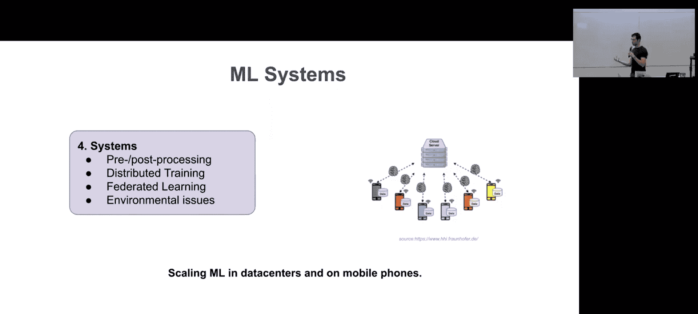
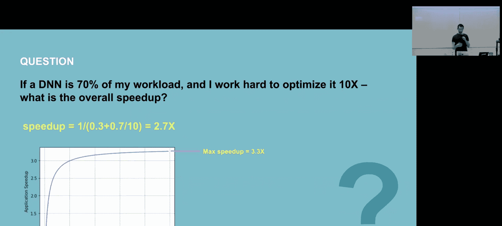
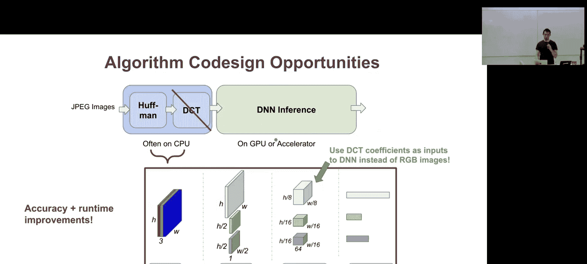
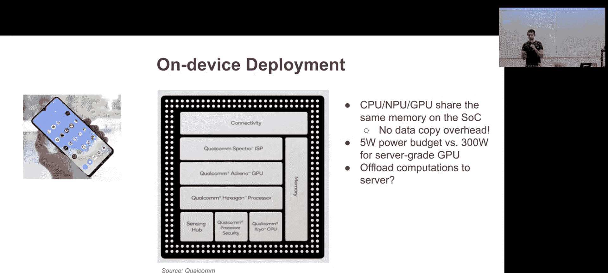
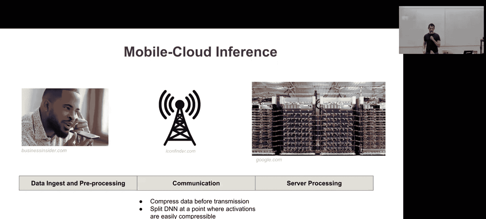
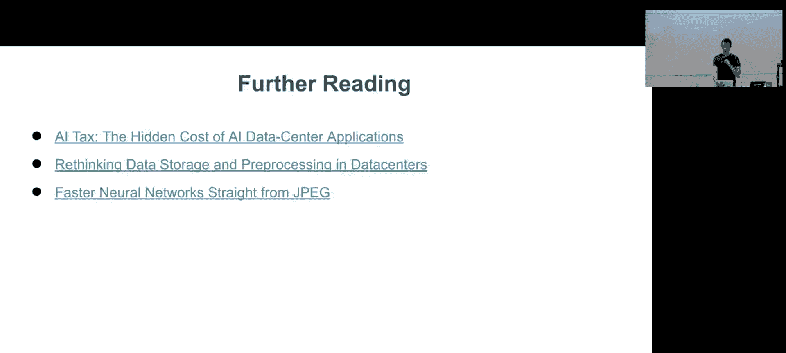

# 康奈尔大学《机器学习硬件和系统｜Cornell ECE 5545 Machine Learning Hardware and Systems》中英字幕 p16 -16-Lecture 13_ Pre-and-Post-Processing in ML Systems.zh_en -BV1CCqPYSEP5_p16-

So today we'll talk about kind of， you know， in in whenever you're running a deep neural network。

 that's not the only thing that's running， theres other stuff that's going on as well。

And this is kind of an emerging topic like unlike you know quantization or pruning which is quite a well establishedablished topic now in neural network efficiency。

 this is people are only starting to pay attention to this right now。

 so we'll discuss a lot of interesting ideas around this what kind of overheads we have in the pre-imposed processing in kind of a DNA centric computation model where your main workload is a deep neural network。

 but then you also have to consider everything that's going on around it as well。嗯。So yeah。

 this also marks kind of the beginning of our last module。

 so we have I think four more lectures to go and then that's it in terms of lectures at least。

So we're going to talk about systems and this is the first lecture in that module。

Yeah and other stuff we'll talk about here includes kind of you know multi device training like distributed training or federated learning and also you will have kind of a discussion lecture about environmental and ethical issues related to systems from machine learning and that will be more of roundtable discussion so come with your ideas but that's next week hopefully。

Yeah， so so what is ML systems all about it's you know it's about actual basically it's the real world deployment of a machine learning model or a deep neural network in our case which is our focus。

 you know what happens when you need to deploy this on a phone what happens when you need to train a very large model with multiple devices。

 how do you kind of synchronize between the devices， how do you connect the devices even what。

Like I said， what kind of pre and post processing do you need to do？嗯。Yeah。

 I'm hearing a bit of an echo， maybe the ceiling mics。Are on so。So yeah。

 so what we will discuss in next this and the next three lectures is how do we scale machine learning both in data centers and on mobile devices。

 how do we run it on multiple devices but how do we also run it on one device efficiently considering system issues。

 not considering the deep neural network efficiency anymore because we've already talked about that。

So。So we'll start kind of the lecture with a question and it's a fairly simple one should be covered by some of your elementary courses。

 but basically if I have a workload and the deep neural network component of it is 70% of that workload。

And I optimize that part 10 x。 It's 10 times faster。 So what is my overall system speed up。嗯。

So take a minute， write it down on a piece of paper， think about it for a bit。yeah， so， so I mean。

 the techniques we discussed so far can get you 10 x on a deep neural network， but usually， you know。

 there's other stuff that's going on。 So we want to know what's my end to end system improvement if I actually get this order of magnitude improvement on the DNA。

没。We'll move on to the answer。 So the answer is 2。7 x。So you know I'm a deep learning engineer。

 I'm working on efficiency and I'm working on the compiler level。

 I'm working at the deep neural network level I'm working on all kind of levels of this stack I optimized my hardware to run the neural network really fast and I get 10x improvement and I go to you know my manager my boss for something and I say I I got 10x improvement but then he says no you actually got 2。

7x improvement so it's much smaller right and and this is basically called MDDL's law who remembers MDDL's law。

Kind of oh okay， no， ohow， it's okay。 So I those laws really important。

 And it's one of the simplest laws out there。 but basically。We'll see it on the next slide。

 but basically you know if you're optimizing one piece of a system。

 you really have to pay attention to the rest of the pieces because even if the rest of the pieces are really small。

 they can limit your overall throughput significantly。And so I plotted here just， you know。

 what is the speed up in this you know fictitious system that we constructed if we。

If we keep speeding up just a neural network portion so first you get a lot of you know bang for your buck basically you optimize it like you know less than 10 x and you keep getting like a steep improvement in overall system performance but at some point it quickly saturates you know at this 3。

3 x number so even if you know your neural network disappears completely you still have 30% so even if if this one becomes you know lightning fast this 30% isn't touched so so this is what you know Amel's law is all about you。

Your speedup is typically not limited by just the biggest part of your system but also the other parts and so let me see and and so this is what the law looks like。

 it's very simple， it's basically you know we have this important thing that we're running denoted by P here that's the runtime of the deep neural network。

So what if I speed that know S times， so in our example it was 10 times。So now。

 you know that runtime is divided by 10。But you know the rest of the system stays the same so one minusP。

 all of kind of the rest of it this 30% is constant。

 so this remains constant while this keeps shrinking as I speed up you know the D in this case。

 which limits overall speed up。And this is a quote from Mr。 Mll。

 so basically the overall performance improvement gained by optimizing a single part of a system is limited by the fraction of time the improved part is actually used。

嗯。So Amel's law is you know it's one of those know sometimes people call it Amel's observation because it's such a simple thing。

 it's not really a law， doesn't include you know physics or kind of device characteristics or anything more profound than just this but it's importance I found in actually deploying this systems it's quite high like time and again we're working on a deep neural network we're optimizing it and then turns out that that's not the issue anymore it's everything else so one example that we were working with security camera company and they had a system where they had a CPU FPGA system and then it was PCE attached so it's connected through a link from the CPU to an FPG which is a typical kind of accelerator organization and we kept speeding up the FPG I think。

We got like 23x performance improvement over the CPU。

But then we still had some preprocess on the CPU and we couldn't move that easily to the FPJ because we have to know create custom hardware for it and custom IP and so on。

 and then we still had to transfer the data to the CPU over this PIe link。

And so all of that kind of meant that our whole system was 1。

6x faster than just a CPU system and of course to a company they look at that and they say a that's extra cost that you know extra effort in maintaining that kind of design and so is it really worth that 60% improvement in our case actually it wasn't and we lost that bit so taking care of kind of the whole system is super important in industry I found。

So any questions or comments about AmL's law， So basically this lecture is about MDL's law in deep learning and and how it's important in various places yeah。

3。Yeah， so that's an interesting point We will actually focus mainly on inference。

And it is super relevant in inference and deploying the model that's for sure。

 but in training you do have preprocess as well and so what is that preprocessing and postprocess you know you have data augmentation when you have multiple devices you have gradients propagating from one device to the other so we consider that also kind of an AI overhead just moving the data around so we'll discuss kind of overheads at different levels of the system stack and you can kind of infer the importance of them to something like distributed training one thing to keep in mind also is you know training is a very like heavy workload right but in terms of just total GPU or device cycles in industry in general I think inference is either one or two magnitudes more overall because you train the model once but you deploy it and you scale。

depending on the number of users whereas training scales with the size of the model right so so for a company like Google or Facebook when they scale something to their number of users starts becoming much larger so typically again for ML systems you know don't underestimate inference even though the workload itself is much smaller than training it usually need to scale it to many more people and many more instances。

Any other questions or thoughts？But yeah， but this is basically what the lecture is about。

So I mentioned you know different layers of a system stack and this is not kind of a formal definition of layers or anything and when it comes to kind of deep learning systems you won't find any formal systems definitions kind unlike networking for example where you have those welldefined layers but but let's call them you know we have a deployment layer you know how do you deploy your actual systems so usually you use you know Docker and Kubernetes or something like that who knows what that is by the way the people know yeah Docker wellknow okay so basically it's。

You know people created， I don't know much about it。

 but basically people created these virtual machines and then they wanted something lighter than a virtual machine。

 so they kind of created this Docker system where they package all the required dependencies in a piece of software and you can basically move that thing across devices in a virtualized way so that you don't have to kind of。

You kind of have compatibility support through that docker instead of the actual machine。

 so it abstracts the away the machine in case you didn't know。

So that's kind of one layer and there are overheads associated with that there are a lot of overheads actually and then you know you have your application so what are you actually running one example the example that well look at is face detection that's actually the example for the security camera thing that we were working on as well。

 no big surprise and you know what kind of overhead do you have there。

And then even at the hardware level， you have overheads or you have things unrelated to your application that you need to account for in your overall throughput and one example is just transfer of data so usually in an accelerator you have a host a host is typically a CPU and then you have the accelerator and everything goes through the host and so you have to transfer the data through PCIE to the accelerator that's one piece of overhead as well。

Okay， so let's jump into an example and this is also from one of your assigned readings called AIT。

And this this paper is like 37 pages， but it's not it's not too bad like you can you can skim through many parts of it because it gives a lot of context。

So I recommend reading it。But basically we have know a very simple system here where you have a video stream coming in you ingest those video frames and then you know you run face detection on them and after face detection you run feature extraction and then classification so what does that mean you kind of detect where the faces are and then you take each face and you extract some features from it and typically that becomes like a feature vector and then you have classification which is typically you know matching that feature vector to a stored set of feature vectors and then you figure out who's in that picture and that's how surveillance works and that was actually also the system we're working on at Intel and then you identify who that person is in our system we also had you know various characteristics about that person so whether the eyecol hair color you even race and ethnicity。

And things like that， which is quite debatable if it's something that we should run。

 and this is one of the things we should probably discuss in this last lecture about ethical environmental issues in my case this system was in China and I'm kind of glad we didn't get that bid actually because I wasn't sure if it it was a good thing to work on but anyways that's another story。

So yeah， so this is the example system here。And you know。

 shaded gray are all the boxes that have some DNN processing。

So already you can see that there's stuff that's happening that doesn't have a deep neural network and so ingesting the frames and just capturing frames from the video stream。

 so that's one thing that doesn't have any D processing is just basically organizing the frames into raw pixels and then feeding them into the waste detection system。

And so if I want to deploy this using， for example Docker， then you typically don't。

 if you want to deploy this on a large scale， you typically don't just deploy one instance of it。

 you usually have hundreds of cameras like we do here on campus even and you kind of have a system which scales with the number of cameras quite easily。

 and that's where usually Kubernetes comes in。So what I can do is that， you know。

 I connect all those camera streams to a bunch of instances of my container。

And so I'll create a container that has both ingest and detection on one machine， on one image。

 and then I'll create another container which has identification because thats roughly balances my workload and that's how I want to deploy it。

But then between those containers。You you can assume that each one of them is running on a different machine in data center right and so you have you know this instance running here doing ingest and detection and then you have another instance that's sprout somewhere over there in my data center and it's doing identification based on that results from ingest。

And so how do they communicate， So there is something called a broker and this is。

I think what is it called Apache Kafka kind of terminology？But in general。

 you need something to manage that communication to tell me where to manage communication between one Docker instance and another Docker instance and so in this case that's called a broker and so in this system when people actually went and measured it。

 they found that these brokers actually took 36% of the time approximately。Or 36% of the latency。So。

 you know， if and this is kind of for a state of the art kind of。Way of running this。

 this is not kind of the baseline where we can still and improve it and so on。

 but just the idea of synchronizing between different dockers running on different machines that takes time for obvious reasons like for data transfer overhead but just for synchronization and you know depending on how many machines I dedicate for this broker。

 how many requests it can process each second and so on and so in this case when we measured it。

 it was actually like 36% just quite a large number。And so in this case， you know。

 the multi deviceice overhead， just running this on multiple devices incurred this latency overhead of 36%。

So。Yeah， so this is an example of a system where you know it is a DN centric workload。

 the main thing that's running is a deep neural network to do this workload。

 but something completely unrelated to my application incurred the overhead。

 so this isn't even part of the application， but it's just part of scaling it to multiple devices on a system。

Any questions or thoughts about this part？嗯。Yeah I think this specific lecture would work really well if there is more discussion just because like I said it's not kind of a grounded and well- establishedablished topic yet it's something people are starting to pay attention to and so you'll see all those white papers and all those new kind of in your further reading actually a new kind of proposal papers from people at Google and so on saying oh we need to pay attention to this you know in the Google example people worked hard on this TU and they keep boasting you know their improvements of 10x here 100 x there and so on and you still need to measure the thing end toend and see whether it actually gives you that improvement and the same is true when it comes to something like Microsoft system which will also discuss and they were paying a bit more attention to those you know overhead and that's why you will find that they really cared about where that FPJ sits in their system but。

Let's continue and I'll talk about that one later。So now moving down from the system level， right。

 so this container and docker and scaling to multiple devices， let's look at the application itself。

And so what's happening in that application is it simply you know one end to end neural network and the answer is typically is no。

 you know typically to run an end to end system like this。

 you don't just run one end to end neural network I think people really want that to happen but that's not the current reality at least so one good example is actually speech recognition where for the longest time we had these standalone language models。

 these standalone you know then Markov models to do whatever and only one part of it like the speech modeling was done using an LSTM based layer。

 but only now people are starting to move towards end to end speech recognition maybe not now maybe like a few years ago now two or three years ago。

 but that's one example where we started off by a system which wasn't you know completely deep learning and then it's starting to become know an end toend deep neural network but in many of those systems that's not the case yet。

So you know， you have， in this case， your ingest。And this is purely not a deep neural network operation basically extracting frames from a video stream depending on the format of that video stream。

 sometimes resizing doing a bunch of overhead just logging how many frames I have where I am in terms of time and so on and so that's purely not deep learning but then the blue stuff shaded here so that's in the detection part and the identification part that's where deep learning is happening let's look at detection。

So you know you have a deep neural network running after you know you resize your frames and everything and then you detect a face。

 but then you need to crop that face out of the image。

 you need to resize it so that you can feed it to the next layer or the next part of your neural network so basically you know you have。

An image。And you have a bunch of faces in it。And then， you know。

 face detection gives you those bounding boxes。Then but you'd need to take those and then feed them downstream to another deep neural network。

And that has a specific input resolution， so you know you need to resize those faces to make sure it fits that that other neural network。

And then you know you have other stuff happening， you know in Tensorflow just。

 things like garbage collection， you know， various things。

 networking and networking and Kafka here these will still refer to things that happen at the system level just overheads on this device on this node or in this container to be able to communicate so it's not just the brokers on other machines that have that overhead but also stuff that's happening on this container image。

And then we have the identification， which is supposed to be you know a simple you know face in。

 deep neural network and face out， but you know you still have other overheads here a bit smaller。

 like 8。3% but again in kind of managing the images networking， running various functions。

through NI in this example and so on so now kind of moving down from the system level。

 we take a look at you know these containers that are supposed to be running the application and we still find more overheads and so now as you can see in some cases。

 the AI portion or the deep neural network is no longer the majority of the workload。

And so as you're looking at these pie charts just think about Heel's login right so if I'm the system designer and I'm trying to optimize this。

 should I spend my time kind of creating a TPU to optimize this 42% or should I find a better system architecture to optimize the rest of this and that's a very a much harder problem to solve because typically your systems need run need to be very general。

 they need to run many different things not just AI not just the neural networks and so designing at the system level is usually quite challenging and you usually do it with cost considerations in mind even before kind of a specific application and performance。

Any questions here？For comments。Random thoughts。No。O。So， I mean， if you， if you want to take kind of。

 if you want to take away one number。嗯。You know about this preimposed processing overhead。

There isn't one number， but if you want to take away one number it's typically kind of in the 30% range and that's based on two or three papers that I've read so it's not based on many things。

 but it's also one of the papers in your further reading here。

And they measure kind of overheads of database access and various other things that you need to do。

 and they say it's never below 30%。So our example which you know we did at the beginning of the lecture is actually quite realistic。

 so if you actually take the deep neural network and you speed it up 10 x。

 you're still in kind of trouble because you only get this 2。2x improvement in your overall system。嗯。

Okay， so we talked about， you know， system level。Application level。

 now let's look at the hardware and why some of these overheads happen in our hardware systems like what what is typically the underlying reason behind it and what are sources of additional overhead that I need to take into account when I'm designing these systems and how can I get around them。

So here I'm showing you know a very simple PCIE attached GPU and that's typically how accelerators run。

 you need to run your operator so yeah when when I was much younger I thought you know why do we still have you know all these CPUs in data centers right why don't we just put GPUs？

And the answer is that you I need to run an operating system somewhere right and so typically that's done on a they call it host CPU so that hosts the accelerator。

 that's the main kind of data marser， you know it controls the accelerator。

 tells it what to do basically。And so you know you have a data center cable coming in over Ethernet。

 typically 40 gig Ethernet now and moving to 100 and then it goes into the CPU and that's how data arrives at the CPU。

 the CPU has its own you main memory or CPU memory and then over PCIE you can transfer data to a GP memory。

 which is its own dedicated piece of memory so you should already know this part。嗯。

So you know a typical data center scenario is that you the model sits somewhere in the CPU memory or even it sits in storage somewhere first。

 but then it's copied to a CPU memory and then we have to transfer it over to the GPU so that takes time right but that's usually kind of a one time cost that's easily amortized because you know it transfers the model to the GPU and then you run inference on it hundreds of times or millions of times or something so usually that's kind of a small overhead and something that's not too bad。

But then when you run this model these millions of times。

 you need to run it with new input data every time so that is meaningful and so where do you get this data from so it arrives obviously over you know your ethernet cable here。

And then it goes to the CPU stored in main memory of the CPU， and then you initiate a PCIE transfer。

 you store it in the GPU main memory， and then you run the inference and you send the result back to the CPU。

So what's the overhead here， like what's wrong with that picture so far？

The kernel scheduler that's I mean that's a detailed form of overhead which sure。

 I mean but there's an even more obvious one which is you know just the data transfer itself right so while I'm transferring the data will my GPU sit idle like just waiting for the data so in some cases it could but basically typically we actually don't let the GPU sit idle right typically we would overlap data transfer with computation and that's one of the key kind of ways of overcoming this kind of hardware overhead so you know while I'm transferring the data to the GPU。

I would be running something else on the GPU and then while I'm running this first inference on the GPU。

 I'm transferring the data for the second inference。

 and so this you know predicates on the fact that the GPU memory can fit both pieces of data。

 at the same time because I need to kind of transfer one while I'm using the other one but you know your input data is usually much smaller than the model size。

 which means there is usually room for it in your GPU main memory。So。And you know。

 it's important to kind of distinguish between two kinds of overheads at this point because。

 you know， you have overheads that will impact your throughput。

And you have overhead that will impact your latency。And so。

 so which one of those is more important actually and。And by overlapping you know。

 data transfer and like inference， for example in our case， which one of those am I fixing？嗯。

You're fixing throughput exactly， so you're making sure that the device is busy and that you're doing more operations in a unit of time。

 so you're fixing throughput， but latency is still a problem right because typically for these systems you know you're holding your phone and you're waiting for the answer to come back。

So you know you're transcribing your speech to text or something or you're taking a photo and you want it to look pretty。

 and so it gets sent to the data center in some cases， does that processing。

 and you know all of this now counts， the PCIE transfer counts， the execution on the GPU counts。

 the overhead of just transferring this within your data center networks or data center network speed matters。

 obviously the link to your data center as well whether you're 4G 5G， whatever。

 that's all contributes to your latency as well。So so really kind of keep in mind this distinction between throughput and latency and how the different overheads will impact one or the other。

And latency is typically the harder one to solve because it's always kind of on your critical path。

 you can't overlap anything with it。嗯。And so typically also we。You know。

To get more throughput we can have more GPUs right so we can scale the number of accelerators or GPUs in this case and then our throughput will improve and so why do you do that of course as we saw at the application level you have these you know these things that don't run on the GPU typically it's just the DNA that runs of the GPU so whether you know you're decompressing an image or you you know you're cropping it or resizing it or even those very simple operations once you scale to multiple GPUs and you have one host kind of in charge of all of that preprocessing quickly that host can become the bottleneck as well。

So if I have this system architecture， what can I do now？

How can I kind of improve you know my overall performance if the CPU pre processing is becoming the bottleneck and I'm unable to keep the GPUs busy。

Go on， want new hands up or new ideas when he is sure。Add more CPUs。

 but that's quite a simple and effective solution。So that's what Nvidia did actually so the latest a100 series they said okay we will have a4 GPU system and we'll put four arms four arm cores instead of one x86 core and the reason for doing that even though the X86 core is like 10 times more power hungry than the armor and 10 times more like more full featured you only need a few operations and a few simple things to run on the CPU so even if I have a very simple core but many of them then that could be sufficient and so that's what they did they had one arm core per GPU just two marshahal data into it。

Um。And I don't actually have numbers for how well this works， but。

But I can imagine that it would work better than having a simple single core to process the data coming in。

So we can increase the number of host CPUUs in this case。嗯。

Another thing we can do is and this becomes very relevant when it comes to distributed training as well。

Yeah my emissions are a bit broken but you know you also don't always want to go through the host right through the host CPU so if I'm doing distributed training and I want to transfer the gradients from one GPU to the other。

 but my CPU is already busy because the CPU is doing the preprocessing where the data augmentation for that you know an next round of training or something and I just want to do that you know some DMA transfer or some transfer from one GPU memory to the other GPU memory to reduce all the gradients then you know at the system level what I can do is also just you know connect the GPUs together。

And so in N VDS case， they have this NV link， which is a very high bandwidth link between GPUs。嗯。

I believe TPUs also have a very interesting connectivity。

 I think it's like a ring connectivity between four TUs called TPU pods， I think。

And so having tightly coupled accelerators can benefit you for things like a distributed workload。

 whether it's you know a single inference that distributed over multiple devices。

 that's way less common， but mainly for training where you have a model split over multiple devices and you need to kind of synchronize between them every now and then。

嗯。I will talk a lot more about distributed training in the next lecture。

 but this is just kind of a preview of how we can get rid of some of those overheads when running on multiple GPUs。

Okay， questions on this part。O。So another interesting thing that data center providers did at the system level to kind of overcome some of these overheads is you know stick an FPGA before the host CPU and again we will discuss this in more depth。

 hopefully in the distributed training。Lecture， but so that's what Microsoft is doing。They said。

 okay， if I have， you this overhead of going from the CPU and then a PCIE transferred to the GPU or the accelerator。

 then why don't I circumvent this whole thing by putting the FJ before the CPU？And just to be clear。

 their first version of this looked like this， it looked like you know。CPU p ie。FPGA， right， so。

You know， that's， you know， your textbook way。Ethernet。

 So that's your textbook way of connecting any accelerator。 That's how you do it。 You connect。

 you know， your accelerator on the PCE bus of a CPU。And they actually had an interesting。FPGA only。

You know， network here to connect FPGs together。But then in their second iteration。

 which is the one that they scale to I think all of their data centers now。

 is that they put the FPGA first to intercept data at the Ethernet point or before the host completely。

And so what this allows me to do is you know， your data is coming in。

You do the inference on the FPG and then you send it back out so you don't even incur this overhead latency overhead of you know transferring data over PCIE or doing any of that stuff that we were just discussing but instead you know you're intercepting data before it even goes to the CPU before it becomes bottleneck by any operations that the CPU is doing and so on so。

So yeah， so sticking this FPJ here can reduce latency that way if you're doing inference on the actual FPG。

If you're not doing inference on the FPG and you still need to send your data to a GPU。

 at least now you have an additional accelerator kind of in your network to do some of these preproces functions。

So for many of this inline preprocessing， you know， even cropping， resizing decompression。

 decryption， all of this stuff happens often at the data center because you need to encrypt your data you need to compress it to be able to store it。

 you need to do cropping and resizing just for each application， for example。

 instead of doing it on a CPU， now you can do it on an FPGA。

 which in some cases you can get you an order of magnitude up to two orders of magnitude faster latency。

 than doing it on a CPU。Yeahep。那没。What do you mean by extra layer？嗯。😊，对。

Right so so there is some latency incurred on the FPJ so that's correct obviously if you're not using the FPJ you can just bypass it。

 even if you bypass it through the FPJ this could mean like two cycles of latency which is typically nothing if you're running at like a 400 megahertz cog speed that's very small so because I want you when you look at an FPGA and a CPU。

The FPG is kind of your programming a hardware circuit onto it。

 so typically what you do is that you try to match the line rate with that hardware circuit that means it becomes they call it bump in the wire architecture。

 it's typically like a very small overhead and you're just transferring from point A to point B even if you're doing processing in the middle and you try to minimize that latency as much as possible when you're designing the hardware。

When you think of a CPU it's very different because data is sent there and you have this operating system running and then on top of the operating system you have a virtual machine and then you have this Docker and so just the latency of getting a command through that operating system is way more and it also you it sits in thread queuees and various other things so it's not you typically can't quantify that latency you can't say it will take five cycle at 400 mehertz so it's this number you can do it that way it's like my worstcase latency is you know three seconds or something but my bestcase latency if nothing is running there。

 it's half a second and so so yes there is some latency overhead but I would say it's almost negligible compared to something like a CPUU just because of this you all of these layers of this stack are not running on the FPJ it could be implementing part of it。

But they're not explicitly running there。Yeah， but that's a good point。嗯。So and I mean。

 putting FPGAs to handle these pre processing functions。

It's not the only thing people have been doing， so NviDdia also has these blue field。

Chipps that they just created， they call them a DPU data center processing unit。

 it's basically to handle all of these networking and packet processing and preprocess functions that you need to do before sending your data into a data center node。

And typically people had you know Asics here nonprogrammable Asics so you would have you know a certain packet processing protocol or a software defined networking protocol that's you know stuck on there and you do some of those packet processing and that's it but you know Nvidia obviously because they're creating all of these systems they realized you know oh MDL's law exists and there is other stuff that's running it's not just whatever makes it to the GPU so we need to make sure that that runs fast as well so I haven't taken a closer look at these blue field chips but it's interesting to see kind of a company like NviDdia saying oh it's not just the GPU that we have to worry about it's this other stuff to be able to scale or workload and that means know what MDL's law is that means that they won't run into trouble。

嗯。Okay， so you know we look now at these different layers of the stack。

 you know and we saw how there is a lot of overhead at each layer and it adds up and some of it overlaps as well between layers but you know the main thing to keep in mind is that when you're running a DNN when you actually want to deploy it it's not you know this profiling that you did in the first assignment where you measure how fast the deep neural network runs on various platforms and so on it's a lot of other stuff that happens in between as well and you need to take care of that stuff when you're creating a system architecture or you're trying to build you know a computer to do the whole thing right。

Okay， so for the for the rest of this lecture， I will kind of go through some very interesting ideas that people have been working on related to those system level issues related to pre processing and and so on。

 and and these are kind of。嗯。They're somewhat unrelated ideas。

 but I think they're all quite interesting and they kind of open up the way we think about those systems and how we can optimize them。

And the first one that I really like is this， you know there was this very simple paper。

 I think from Uber Labs， and it's also in your kind of further reading。Right。

 and so the simple application level pipeline here is that， you know we have JPEG images coming in。

But you know to feed those JPEG images into a neural network we need to do decompression and that's often done on a CPUU and by the way there is a lot of research to move JPG decompression or image decompression in general to GPUs。

 JPEEC is not very parallellyzable because it has something called Huffman encoding。

 but people have been trying to find new ways of compressing images which are more parallellyzable so I've seen many papers come upon that。

But anyways， for now， we'll assume that this is running on the CPU and then we do DN inference on an GP or an accelerator。

And you know what JPEG looks like， something like this， you know， well， this is compression actually。

 so you start with an RGB image。And then you convert it to this YCBC。

Radance and curl I don't I don't remember luminance， something like that。

 So it's just a different format of storing the image。

And then you run discrete cosine transform on top of that， so that's similar to FFT basically。

 but it's only one part of the FFT， the cosine part。And then you run these halflfman codes。

 which actually assigns different bit lengths to each color， to each pixel value， basically。

And so if I want to run this now on this inference accelerator， I need to do the opposite。

 so that's what I have here coming in at JPEG image。I need to do Huffman decoding。

 I need to do inverse discrete cosine transform and then do the color space mapping。

And so the main two blocks here are Hman decoding and DCcT。

And so what people found in this paper is that you know。

We don't actually have to do the whole of JPGD compression。So instead of doing the whole thing。

 I will just do the halfman decoding so that every pixel has the same number of bits。

And then I'll feed those DCCT coefficients without doing the inverse DCCT straight into a deep neural network。

And they'll see what happens。And what they found is that they actually get an accuracy improvement and obviously a runtime improvement。

 the runtime improvement is because now you've taken away a chunk of your preprocessing and the system which used to take time latency and throughput impact。

 but now you know you've taken it away， but they actually found that they improve accuracy as well。

And you know， they have some analysis in the paper which I recommend reading where they think about why this happened and so on。

 and they said actually the first few layers of your deep neural network。

 they were doing that exactly that， they were finding the spectral components or their frequency components of the image。

So it was like running a DCT filter on top of the image。

And so they found that when you do that and you do some retraining。

 you don't only regain the accuracy， you actually improve on accuracy as well。

So I thought that was kind of a neat idea where now you're thinking about your preprocessing system and you see what you have in terms of preprocessing。

 but you also start to eliminate some parts of the system from an algorithmic standpoint right so you're looking at what I can absorb into the deep neural network。

 which means it will run on an accelerator and it will be fast or I can easily control how fast it runs。

So yeah， so I thought that was a neat idea and when you're thinking about system design。

 this usually comes up in my head as a good co-design opportunity between the system。

 so how many CPUUs I need to have and how many GPUs and also the algorithm。

 which is how I'm running the deep neural network and what I'm running before it and so on。

Okay now jumping to another idea and you know this idea of running something on a mobile device so you know all of the big companies they want to avoid all of these system level problems they want to just run stuff on your own phones and the main reason for that is you know you plug in your phone in the electricity outlet at night right so you're paying the electric bill not them so the biggest cost of running a data center is actually the electric bill next I think is the Capex of buying the machines and next is the money to give to the employees at the data center so so electricity is the biggest thing and then if you just run it on your own device that's much better for them。

And so but what happens here， so on your phone， unlike a data center， on your phone。

 you have something called a system on chip。So that means that I have multiple devices。

 but they're not connected through PCIE， they're not connected through Ethernet。

 they're connected together on the same chip through a shared memory system。

And so when you think about running stuff on your phone。

 you no longer have that PCIE or data transfer overhead from your host to the accelerator。

Because all of the devices can access the same memory。

So it's like in the previous picture where we had。You know， CPUU with its memory and you know。

 GPU with its memory。So on a phone， it's like， you know， this is the same memory。

So if data comes here and the CPU can access it， so can the GPU just by figuring out the right address？

So there is no copy overhead or data transfer overhead there， so that's one thing to keep in mind。

However， another thing to keep in mind is that this chip， even though it has so many devices on it。

 is way smaller than one of those chips in the data center， so you know you should already know this。

 but basically it's about 5 watts of power or 10 watts of power in some cases compared to 300 watts or 400 watts for a server great GPU so it's also so you know it doesn't have this overhead and so that's nice but it's also not very capable it can't do much。

So typically what happens is that you know we off computations to a server， so you get your data。

 you do some things on the phone like data ingest， some data preprocessing。

 sometimes even part of the neural network， but then you send the rest of it。

To the to the cloud to run it on a TU or something。

And that was actually the main motivation behind the TPU when Google kind of realized。

If all of our users use speech recognition for three minutes a day。

 then we need to double data centerer capacity right and so that's because you we need to transfer that data。

嗯Yeah。然后。嗯。Yeah that's a great question and I don't have a good figure for you。

 but that would be a nice topic for you know a term paper just diving deep into kind of these system level profiling and you know what is the breakdown between those different things I will tell you that data transfer over 5G is significantly smaller than especially in terms of latency。

 significantly smaller than previous generations which makes many of these systems which makes the communication。

 many of these systems not no longer the bottleneck so that's kind of a handway answer but what I saw from various conversations in Samsung that 5G is the answer basically so and people are working on 6G now as well and stuff like that but basically this latency is shrinking very quickly。

But people are still looking into ways of kind of eliminating the overhead of this latency。

 especially that you know， 5G is not available everywhere， even in countries like the US。

 but definitely not in other countries。And so。You know what people are doing there。

 people are seeing things like， you know， how can I compress you know。

 the data before transmission or some people are even looking at。

 you know running a piece of a neural network on the device and then splitting the neural network where my activations are very small or very compressible。

 doing that compression， sending it to a data center and then doing the rest of。

The computation there。And yeah， or or only offloading， for example。

 when you when a faster network is available。 So if if you know， we only have 3G available。

 I won't offload， I'll just run the whole thing on device and if I have 5G available。

 then I'll transfer it to the data center。 And so that gives me a better kind of quality of service trade off。

And so yeah， so that's kind these are the kind of research problems that people are looking at now and it's mainly centered around you know sending that data between the device and the cloud and what do I run on the device and what do I run on the cloud in an ideal case everything would run on device and so what are the benefits of that someone can someone guess。

So。Yeah， save money for Google basically， yeah， so that's one thing。Yeah。有。Yeah。

 latency is a big one because you know you'll never yeah， I mean。

 it depends on how slow your phone is， but in terms of overhead of latency。

 it's definitely smaller when everything is on device and you don't need to be connected even so。

Privacy concerns exactly so what if you don't want your data to leave the device right so it's much better to run it on device this way and I think that that's what the cloud how the cloud providers are usually selling it as you know we're keeping your data secure that's why you want to kind of buy the new phone and we'll have this pixel ship or whatever it's called and then but behind the scenes there this is also kind of financially motivated obviously because that saves the money and the data center so。

Okay。Now we'll switch gears to kind of another idea。

 still sticking with phones and kind of running stuff on device and we'll take a look at you know what does the imaging pipeline look like on a device on a phone。

 for example， you know you have your camera， so that's the sensor。

Then you go through something called an IP， an image signal processor。

 And what that does is that it does some processing to your。

Your pixels to make the image look nice so typically the image coming off of your camera sensor。

 if you view it， it will look really dark， it will almost look monochrome but then you and and it it's also they have this thing called the Bayer pattern who knows what that is。

No， so basically your sensor is too dimensional。But your image is actually three dimensional。

 has RGB， it has three channels。So what happens is that you know one。

What's your sensor actually looks like， something like this。

And then you have this bay or pattern where this pixel captures red light， this one captures green。

 this one captures blue， and then this one captures red again。

So you need to take that pattern and figure out how to create three channels out it so that's one thing that ISP does。

Another thing is HDR， so you know taking multiple images at different exposures。

 combining them that used to be done later now it's done even at the ISP level。

 so it's all things to make your image look pretty basically。And so I would transfer yeah， Ha。

It's a device， sometimes it's on the SOC， sometimes it's even a standalone chip。

 but increasingly it's part of the SOC。有。So youll find Qualcomm creating those and putting them on their snapdragon chips。

And this is actually a poorly researched area， there are a couple of people working on it。

 but most of the secret sauce is with people like Qualcomm and Apple。And Samsung。So then you know。

 if I want to store this image on the phone， I usually compress it， so we talked about JPEG。

 that's usually what people use or other formats like that。

And then I would store it on kind of the phone memory， even the phone storage。

Then if I want to do some processing on this so kind of detect who's in the image or do some effect or something before I upload it to some platform。

 then I would read the image again from storage， I would send it to my CPU memory。

 I need to decompress it typically first and we talked a bit about how to optimize that and then I can do the process finally。

And you know I can process it under the CPU or if I have a dedicated neural processing unit that I can do it there。

And so there is this very long pipeline even though it's just on this phone。

 there is actually a very long pipeline of things that happen。

 there is latency associated with that pipeline and there is also energy consumption and you have a limited battery life so so this is actually quite time consuming especially if all you want from the image is some metadata I quotes in that image or something like that so in this case I'm actually spending a lot of overhead just you know sending it through that ISP。

And typically the split is like 50% of your energy of capturing an image in the camera sensor and 50% is in the IP。

 so it's not a small portion。Your IB can also degrade your quality if you're doing inference using a D later and people have measured that like different color processing if you like take photos using one phone and then try to run them on another phone on a neural network trained for phone A then you can degrade accuracy by more than 50% so it's quite serious and that points to how unrobust neural networks are in some cases。

 but also to how important these steps are。对。So train and neural network on raw pixels basically coming from the sensor。

So that's a really good question actually， and you will see papers kind of talking about that and trying to do that。

 the main issue people face there is that this ISP step actually maps your image to a standard color space typically other than the demosaking of the HDR and stuff。

 there is a color space mapping step， which people have found to be very important because different sensors will give you different outputs。

And then what the ISP does is that it maps all of they call it color gamut。

 I think it maps it all to a single color gamut。What is it called RGB， something SRGB。

 so standard RGB color gamut， so by doing that you're actually reducing the variance in your image data set by a lot。

 making it much easier to actually run neural networks or train neural networks with these kind of images。

嗯。Yeah。Yeah so it's very different between a Google and an Apple phone。

 but you will find slight differences between two identical sensors as well because of manufacturing differences。

 but also because of you know temperature like how hot it is today or something like that and so so I'm saying that you know part of this IP function is to map to this standard color space which。

You know hides some of that variability coming from the sensor， so it's still good。

 but also different things you do here other than this color space mapping makes your picture look quite different and that's why you know pictures from a Huawei phone or an Apple phone or a Google phone they look different right and that's also because of the IP。

And that can affect your inference。Then you have compression before you even get to run this thing on a neural network and so you lose information that way。

 and so if you're running a super resolution algorithm。

 which is something that we often had to optimize for zooming in， for example。

 then you lose information before you even get to run that algorithm。

And just generally you know you you know you're wasting storage。

 you're wasting energy and so yeah and that's how you know。

 if you just want to figure out what's in the image， for example， you know， this is a cat then。

What if we can do it in a better way right and so I really like this idea of thinking about you know。

 this is one example of a system where we can optimize it if we just want that metadata out of that image。

 just analytics out of that image， instead of having you one image pipeline to do everything for us to give us pretty images but also give us metadata。

And so in this case， there are some very interesting ideas on how to bring the processing much closer to the sensor and then everything you propagate downstream is just a very small piece of metadata。

 which is bytes or kiloytes instead of megaytes or even gigabytes in some cases for the image itself。

嗯。And so I'll show this one example from Sony kind of because they create a lot of those camera sensors actually。

 but there are many examples out there looking into optimizing this and in this case you know Sony said you know 3D stacking of chips exists。

 why don't we take our pixel chip not the Google one。

 this is an actual pixel array so this is a camera sensor？And we just take it on top of a logic。

So now I'm putting a DNN accelerator， custom design piece of hardware。On my camera sensor。

 I'm connecting the two together and so you know and this is all taken from their website。

 but basically they call it the intelligent vision sensor。So now if I capture an image。

 I have the option， you know to output the capture image by just bypassing this accelerator completely。

 but I also have the option of just propagating the metadata downstream。So you know。

 when I look at this pipeline now。Coming out from my you know intelligent sensor will not be the whole image and spending all of that time in the ISP doing compression for it。

 it will just be the word cat right right from here and so it will save a lot of energy and a lot of latency as well and so metadata is one option for output。

Yeah， different image formats or region of interest image， so for the example face detection。

 you know we've already detected the faces you've already done part of this preproces。

 you've already cropped it and that's what you propagate downstream。

And so in some cases this can actually kind of you know cut your you know the energy of doing this whole thing by half or something just because you are especially in this first case which is transferring kind of the image class then yeah you're replacing gigabytes by bytes in your whole you know phone imaging pipeline and so that that can be really advantageous and this is you know an active area of research this thing was released for kind of preview like last year or the year before so people are still looking into this and this definitely didn't make it into any products that I know of yet so。

Okay， so that's all I have for today， we kind of went over an introduction to deep learning systems。

 how we run stuff in data centers and on phones and the system level considerations in those parts。

The main takeaway is you know MDdL's law， it's not just at the neural network that we're optimizing and making sure it runs fast。

 there's other stuff that's going on and there's other stuff that's going on in different layers of the stack and depending on what device you use and how many devices you use and so on。

We also went quickly over some emerging topics and some interesting ideas so related to you know this JPEG decompress codes example。

 mobile inference and offloading and finally this near sensor processing idea and by the way people have also thought about integrating this accelerator within the sensor itself。

 but that's even more challenging。But， yeah。Here's the further reading。

 I think these are quite interesting papers。 Yeah， and I'll stick around if there are any questions。

 thanks。

