# 康奈尔大学《机器学习硬件和系统｜Cornell ECE 5545 Machine Learning Hardware and Systems》中英字幕 p17 -17-Lecture 14_ Distributed Training.zh_en -BV1CCqPYSEP5_p17-

Okay。

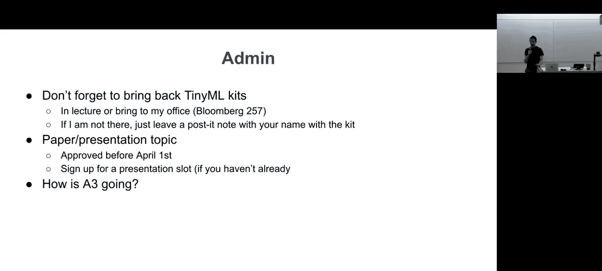

So did anyone watch the NviDdia keynote yesterday so you guys did so that's kind of the Apple event for hardware engineers now and machine learning engineers as well So there is now this H100 architecture so Hopper is the kind of the generation after Am。

And I mean， these graphs are really impressive。嗯。So I mean。

 we motivated some of this hardware work by GPT3 and the first plot shows that。

 you know you can get almost a 7x improvement on GPT3。嗯。

Giving kind of an H100 cluster instead of an A100 cluster。The second plot shows that， you know。Yeah。

 it shows that you training can be up to nine times faster and latency。Yeah， up to 30 times。

30 times throughput while maintaining the same latency so I mean the numbers are very impressive so I mean how did we get there and this is just a preview slash spoiler of the talk but I recommend actually watching it because it's quite technically it goes into kind of what's relevant the relevant models and machine learning today and how to optimize them and how and what NviDdia's approach was we'll see that they focused a lot on kind of raw throughput and it's interesting because we see a shift in the numeric formats so if we compare amre A100 to the H100 we're now the Hopper architecture they're focusing much more on floating point formats。

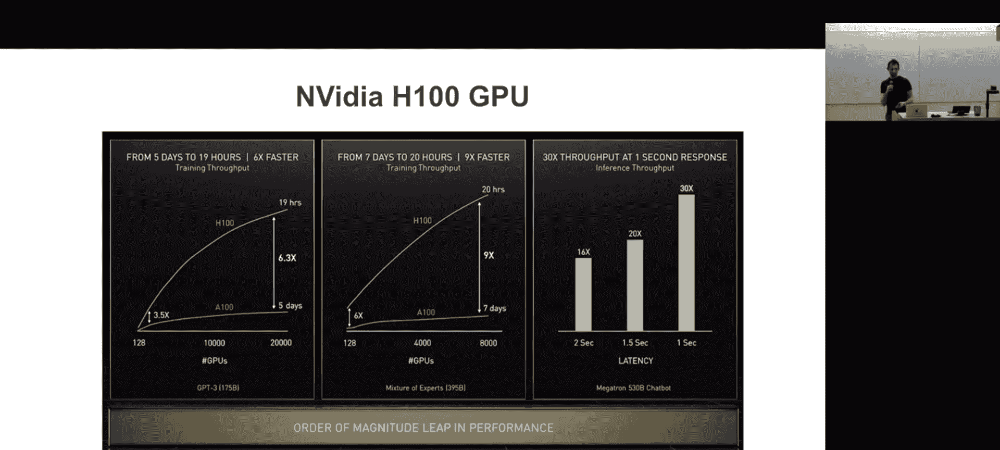

So FP8， I don't know how many bits they assign to the mentican exponent。

 but it's very different from in8。And typically it has a bigger dynamic range based on how many bits are assigned to the exponent。

 but much smaller menisa， so it's also you can think of it as a nonlinear kind of quantization because。

You have an exponent and a mentia， so the numbers usually on the number line that can be represented by FP8 are no longer kind of equally spaced。

 they're usually kind of there's an exponent and there are a few numbers around it and then another exponent you can represent and a few numbers around it。

So I mean， it's quite interesting what we saw back at Intel。I don't know that's five。

 six years ago now we were using FP 8 FP9 and FP11 so so to me personally it's interesting to see people shifting to that numerical format now and embedding it in the GPUus it also seems that they got rid of int8 altogether so they have FP8 and FP16 and then other floating point formats as well so it's quite interesting a big focus of the talk as well was how to scale these GPUus to how to connect many of them in kind of a rack in a cluster then kind of a supercomputer scale they really focused on enV link and how kind of and that's very relevant to the lecture today actually because we will see that when you're training a model using multiple GPUs you do need a lot of communication bandwidth in some cases or in all cases frankly。

So yeah。 So， I mean， as kind of an。Extra thing， if， if you're interested in。

 in watching this keynote， I'd highly recommend it。 As I said， it's quite technical。 So， yeah。

 so lots of interesting things。

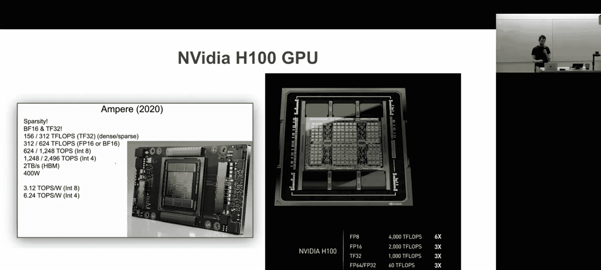

One thing is， you know， what's the catch， like how do you get 7 x performance， right？

Can anyone guess So， So there is a catch and there is， theres a good thing and there is a catch so。

Any你。Yeah， so so basically this chip is now 700 wts。And by comparison。Let's see。

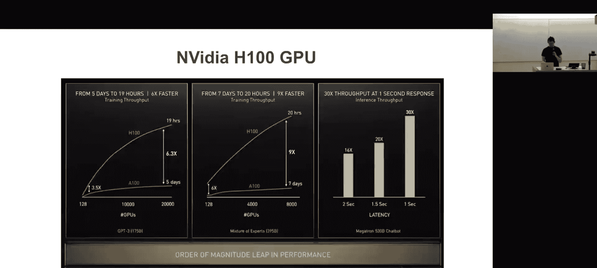

The previous one was 400 W。So approximately two x of those7 x or 9x are coming from just。

 you know we're putting more power into this chip and I think am was seven nanometers。

 is it written here no， it was seven nanometer technology that means the transistor size is seven nanometers。

 the channel gate， whereas this one is four nanometers。

And so you know we have the size of each transistor。

 but because of the art scaling which you guys learned about， we're not having the power density。

 and so I think they are maxing outut kind of the power envelope now of a board that they can stick in a data center and have you know a proper cooling for it。

This this can be both water cooled and air cooled so yeah so that's I think that's the catch basically other stuff obviously includes you know they have now dedicated support for you know transformers。

 they have this new numerical format which could all use less power。

 but they also needed to double the power to get these performance numbers。Okay。

 so on today's lecture and this is quite an interesting topic distributed training。

 so I think there are I mean many of the techniques that we'll see are quite simple and straightforward but again it gets you to think outside of that you know single device box I'm not optimizing one device anymore and I have to think about the whole system and so we'll be talking a lot about communication between devices。

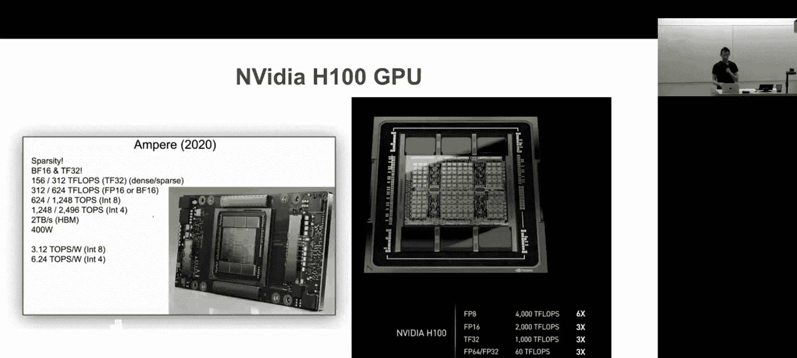

So just a reminder we're kind of in our last module called ML systems。

 we covered kind of preimpost processing and what that means you know for the performance of over the overall performance of my system and we talked about MDL's law there and MD's law is the main thing I think in pre-imposed processing and we'll talk about distributed training to see how can we actually scale you know training to many GPUs and they'll use the word GPU here。

 but it's just many devices。Enter these very large models。So。So I mean。

 what what's wrong with training on a single GPU right？

 So there is there are a couple of obvious problems。

The first one is that you're limited by the speed of that single GPU。And as I said again。

 I'm using the word GPU throughout this lecture， but you can replace it by TPU or FPGA or whatever。

So you're limited by kind of the performance of that single GPU。

 so it depends on how many multiply accumulate operations I can do per second for a specific workload。

 right？But then a heart constraint is actually， you know your memory。

 so whatever memory is attached to this chip is limiting you in terms of the size of the model that you can put on that GPU and actually run it。

And so what do you have to fit in that memory， you have to fit you know the model parameters。

 and so if the model parameters don't fit， that's it， you can't do it。

But during training you also have to fit the mini batch of data。

 you have to fit the forward activations， the backward gradients and some optimizer states。

 and so all of these things have to fit based on the mini batch size that you are training for。

And so if that doesn't happen， you need to go to multiple GPUs or you can't train that model without multiple GPUs and if your training is too slow like it will take years。

 for example， again you have to go to multiple GPUs to make that work so these are two kind of very obvious and clear reasons to go to multiple GPUs。

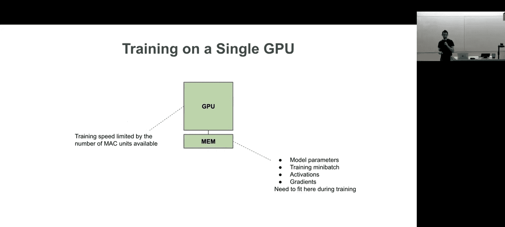

And you know the main motivation I took that slide from our lecture too is that you know deep neural networks are getting much bigger and so you know if we wanted to train AlexNe。

 they actually had to use two GPUs at the time to train this effectively and they split it in an interesting way which we'll talk about。

 but now you know the models are much larger。You know， where is the。

Yeah 175 so we're in the hundreds of billions of parameters now as opposed to millions of parameters。

 so we haven't hit trillion parameters yet， I think Microsofts working on something that's that big。

 but we're in the hundreds of billions of parameters。And you know， when you look at GP3。

 why is it so well known and why is it so effective and successful， it's because， you know。

 it's a general language model that kind of uses like who knows how G3 works actually。

 just to show of hands。Kind of， okay。 So basically， what。

 what happens is that they took all the text of the Internet。

And they trained next word prediction on this GPT3 model， and it's a huge model， right？

But then if they want to do any language modeling tasks like next word prediction， that's one task。

 you know code synthesis， for example， writing code for you， that's another task， question answering。

 giving get a question and taking an answer that's another task。

 you can always train these downstream tasks very easily。

 given this huge embedding model called GPT3。So if you think of it， you know。

Text is actually the simplest modality in this case。

 What if I want to train a general model like this for images， So instead of， you know。

 my tokens being a single word， now they become， you know。

An image which is you know megapixels instead of a few bytes What if I want to do this for video or speech So basically you know for the different modalities already you can see that if you want to train a GP3 like model you have to do way more than you're doing now in terms of hardware so these machine learning researchers are kind of waiting for this next generation of hardware to come that gives you this leap and performance at least an order two orders of magnitude to at least correspond to the order of magnitude difference in the size of the data between text and image and you know speech and other things and people are already talking about you know multimodal models so there is。

If you search for Google Pas， so Jeff Dean at Google is very interested in this multimodal model called Pas again which doesn't just take texts and speech and images but like all modalities at the same time and so how to even approach the idea of training these very huge models yes you have to go to multiple devices but you also have to you know figure out scaling you know both at the device level and multiple devices and get kind of orders of magnitude improvement so I think distributed training is kind of now one of those things which we have to do it's not optional anymore and yeah let's see how we can do it。

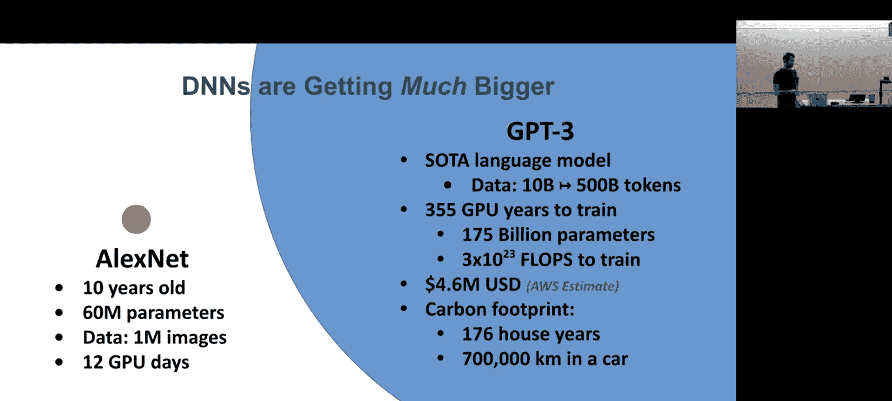

So we'll talk about three things here。So there are two ways of doing distributed training on multiple devices。

First one is called model parallelism， so that's where you know the model doesn't fit inside the GPU memory。

 so I take the model and they split it into parts and put it on different GPUs the second thing that we'll talk about is data parallelism so basically the model can fit on my GPU but my mini batch doesn't fit。

And I want to train it faster so I split the mini batch into two and know put it on two devices or more。

 and then finally we'll talk about quickly some compression techniques for kind of making GPU to GPU communication faster。

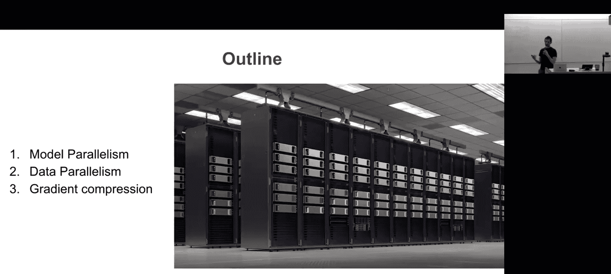

So model parallelism， so what is that？So I'm showing a model here on the left。

 I think that's efficient net and you know model parallelism is very simply you taking that model。

 taking a piece of it， putting it on one GPU， taking another piece of it and putting it on another GPU and what does that mean that means you know the parameters associated with this first piece are now stored in this GPU's memory and the parameters associated with the second piece are stored in this GPU's memory。

 and then when I compute the forward pass， the first part is computed on GPU zero。

 the second part is computed on GPU1。So you can already kind of see that you know we have to do stuff other than normal training。

 so first you know I need to move the input data or my mini batch onto GPU0 right and then I'll compute the forward pass on GPU0 for that first part of the model。

Then after that， I need to move the activation so the output of this first part of the model。

 which is usually a very large tensor。I need to move it between GPUs，0 and GPU1， right？

And then I can use these activations as input for my second part on GPU1。

 and then I will run the forward pass on GPU1， I'll move the labels to GPU1 because that's what I will use to compute the loss。

Then I'll compute the loss and then start back propagation on GPU1， and then I move the gradients。

 so now I'm doing the backward pass， I'm moving the gradients from GPU1 back to GPU0 to compute the rest of the gradients。

 so I'll run part one backward pass on GPU0。And then finally。

 I can now update the parameters because I have both the forward and the backward pass computed on all models。

So did that make sense， basically， you know， I have the model split here， I go forward pass。

 then copy to GPU1， then forward pass and compute loss， backward pass， copy to GPU0， backward pass。

So。You know every time I say move something from one GPU to the other。

 something is happening it doesn't happen automatically， they don't share the same memory space。

 they're usually on different you know chips on my motherboard or whatever it is and so I have to copy these things somehow and the standard way to do this and the standard way GPUs are connected together is through a CPUU and so I need to do these PCIE transfers you know from GPU0 to GPU1 and you know how do I do it in terms of code at least on Pytorch simply you know。

Whatever tensor， dot2， and then device name。So this is very simple programmatically。

 but this of course， you know incurs some overhead， so this takes time。

And the other thing with model parallelism is that you know there is also these dependencies。

 I need to wait for you know GPU zero to finish its forward pass before I start you know。

 operational on GPU1。And so model parallelism is actually quite hard to get to work with at full throughput of a GPU system。

Okay， so I'm showing here kind of the code for a toy model。

 let's say that it kind of represents this network here。

 and I'm splitting it into net one and net two。 It doesn't actually matter what's in net one and net2。

But if you take a moment and look at that code。How can I change it to work on multiple GPUs？

So as I said in the previous slide， you know， to move stuff， I just need to write this command。

 right？And so how can I change this model by adding dot2 Kuda 1 or couda0 to make a run on2 GPUs and specifically what I want to do is I want to run net1 on GPU0 and net2 on GPU GPU1。

So if you take kind of a minute and and write the different dot2。Move commands。

To make that work kind of with model parallelism。If you look at that code now。

 so basically I just need to add those two you know co to0 kuda one so I'm just placing the parameters first on the right GPU and then here I'm moving the input to the first GPU because that's where I'm going to run that first part of the model and then I take my intermediate activations I move them from GPU0 to GPU1 and then I can run the second part of the network。

喂。So yeah this is the simplest way of doing it， there are libraries that kind of try to encapsulate that a bit more and do it in a bit more implicit way。

 but that's kind of the easiest way to do it really is to write a wrapper on top of your model。

 split it however you like and move things between GPUs one other thing you're trying to do here is balance the runtime between your two devices and so that's another kind of issue with model parallelism typically is that you your different devices on which you split the model they should ideally run approximately the same speed so that you can try to pipeline it well and yeah so I mean to get around you know the memory issue sure you can put some a bit of your model on the CPU but that means that you have all of these overheads of swapping in and out the model and so on。

And， you know， speaking of that， actually pipeing， this is not easy because let's see is there a。

Tingy here no， but basically， there are many data dependencies and so。You know。

 you have to do forward 0。And then。Forward one。 No， that's not good。啊。And then。Forward one。

 and then backward0。And then backward one。So there are data dependencies here。But that means that。

 you know， what can I run here？And people have figured out ways， does that make sense。

 so that's kind of the timeline of GPU0， whats it's executing if that's the timeline of GPU1。

And so ideally I'll try to fill those empty kind of idle periods with something and people have figured out ways to do that。

 but you do have this hard memory dependency between sections of your computation。

 so basically people do it by splitting the mini batch in some way using stale parameters and doing things like that。

 but but yeah it's not easy to pipeline these systems。So。

So some people split the models in different ways， so this is from kind of the original AlexNet paper where each layer was split into two parts。

And what that means， so basically they used groups for that。

 so they had a grouped convolution with group size equals  two。

And they ran each group on a different GPU， but that meant that after each layer we had some synchronization to so we had to send the output of this。

 you know bottom part， which runs on GPU1 for example， to the input of this top part and so on。

So that's kind of a different way of splitting the computation the previous one I showed is just very coarse grainined splitting the model in half。

 but here we're splitting every layer in half basically and we do the same for fully connected layers where you know we split them in half but after each layer we do need to synchronize the gradients and the forward pass as well。

So yeah， so modeled parallelism， so basically people usually do model parallelism when it's necessary。

 right so when you can't get away with running on a single GPU because of hard memory constraint。

RightBut however， you have this issue of， you know it's very hard to pipeline it usually。

 you need to be very careful about load balancing， so you need to make sure that each part kind of runs for approximately the same time on the different GPUs and so there is some manual work that you have to do to be able to hide the synchronization latency。

U。Yeah， any， any kind of other。Thoughts about model parallelism。Qu so。

Usually model parallelism is more limited in performance than data parallelism。

 which we'll look at next， just because of these kind of synchronization overheads and these hard constraints related to synchronization。

 for the AlexNet one it was done because of performance。

 I don't think it was strictly because of memory but I may need to double check that but basically yeah you can split the model however you want。

 basically。Okay， let's see， okay， so that's model parallelism at a very high level like okay。

 you need to split the model， you can split it in different ways and put it on multiple GPUs。

 you just have to be careful about kind of you know filling those GPU cycles and minimizing the idle time and then programmatically it's very easy to do by just using those you know dot2 coa 1。

2 cota0 command。

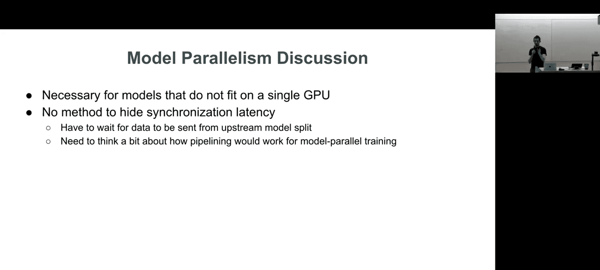

So data parallelism is actually， you know。

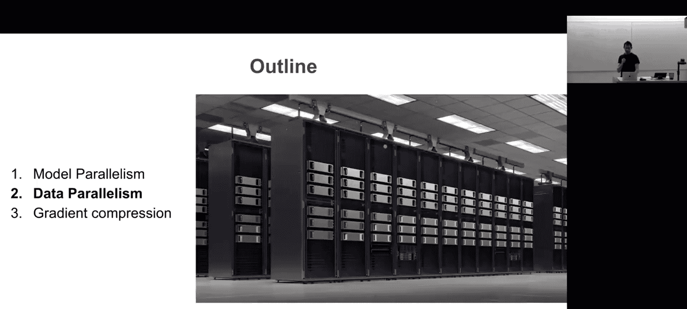

Quite important and usually when a model is large enough that you need to split it across multiple devices。

 sometimes you also put data parallelism on top of that， so they're composable techniques as well。

And so if I'm training on a single GPU that's usually what I'm doing， I have you know my data。

 I have my model， they're all in the same GPU and then I'm doing the forward pass。

 backward Pass weight update right if I have multiple GPUs， so what am I doing now？

The first thing is that you I want to split the data across the GPUs and so that's why it's called data parallelism。

 so I take my mini batch and in this case I put a quarter of it on each of the different GPUs。

But then what I need to do next is you know I can't just independently compute the forward pass backward pass and wait update for all for each GPU separately。

 this is the same mini batch and the way mini batches work is that you're averaging the loss from the different from the different inputs right from the different samples or pieces of your training data。

And so what I need to do is I will need to aggregate the gradient somehow and average them before I do the weight update to capture the information from all of the mini batch pieces。

And so what we do is that we add this extra computation called averaging the gradients。

But what's happening here again， implicitly， is that there is a lot of communication between GPUs。

AndSo what I need to do is that for the gradients on GPU0。

 I need to broadcast them to all other GPUs， and then I would add them all up here on each GPU and then I would take the average and then I would compute the weight update based on that。

So the problem is that I need to do this for each GPU。

 so for every GPU I need to kind of broadcast my gradients to all of the other GPUs。

 we need to average the gradients there and then we can update the weight。ically。

 what is the communication requirement here per GPU？First of all。

 is it kind of 100% clear why we need to broadcast gradient？Does that make sense， Yeah。

 so we need to average the gradients over the mini batch before we do the weight updates。 But yeah。

 so whats what's the communication requirement。 So by the way。

 this technique is called all reduce and you will see these terms which has。

 you know two words stuck together They're all MPI terminology message passing interface and that's kind of for interprocesed communication It's a library for inter processces communication that everyone on Earth uses if they use multiple devices。

 And so you'll see you know this is called all reduce and it's coming from MPI But what is the communication requirement。

 How many。How much what is the communication cost if you know I have K gradients。

 so my gradients are size K and I have N GPPUs。So how many gradients will each GPU have to broadcast every cycle？

So。Yeah so for example， GPU0 has to broadcast its K gradients to three other GPUs。

So if I have N GPPUs， what is kind of the general formula here？Take a guess， just shout anything。呃。

K times n minus1。N times k -1。N times n minus1。Is that per GPU or is that total， Oh no。

 we're talking about per GPU。So it would be。Okay， so yeah。

 exactly so basically each GPU has to transfer k gradients to n minus1 other GPUs， right？

And so so what's the problem with that right like okay， so I can just do that。 That's fine。

 I'll scale my number of GPUs。What happens as n increases？

So the communication cost also increases linearly。So I'm trying to scale my computation so that I have multiple GPUs and I do things faster。

 but I actually have this overhead called communication between GPUs that's also scaling linearly and it's getting worse the more GPUs I add。

So quickly at some point you find that your runtime is dominated by this communication and it doesn't make sense to add more GPUs。

 so it's a very bad parallellyization paradigm because the more you parallellyze the slower you get at some point when the communication overhead is kind of the dominant runtime factor。

So。So obviously people don't use all reduce， although at the beginning people started using all reduce but people don't use it anymore because of that reason and we need to figure out you know other ways of doing it so Harrisish also already kind of mentioned one way of doing it kind of let's send all the parameters to a single GPU and let's do the gradient averaging there and then broadcast back。

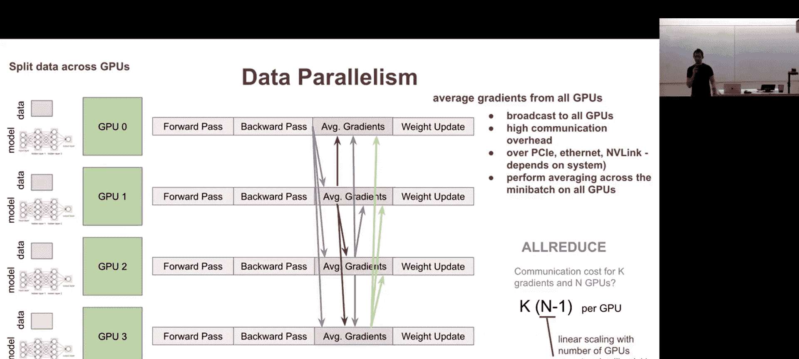

So that makes sense， can you think of other ways of doing this as well？

So if you're a system architect you at Google， you want to train on their kind of big data center clusters and you don't want your communication cost to scale linearly with the number of devices。

 what else can we try here？嗯。I mean， let's work off of Harrisish's suggestion， for example。

 what if we have you know one， let's call it server。

 a parameter server where we average all the parameters there。

 and then we broadcast it back to kind of the workers or the GPUs that are computing you know my model。

 what becomes the bottleneck in this case？诶 go ahead。さ？Okay。

 so the performance of your parameter server essentially becomes， you know。

 the bottleneck Okay so you want to leverage kind of the speed of local communication within one server as opposed to going to Edor center network and transferring things that way okay。

I see so so basically this is one way that people do think so there are I've seen papers doing a hierarchical kind of data parallelism so you would kind of reduce the gradients within a pod and then you would broadcast those average gradients out you can also combine it with model parallelism which I think is what you're kind of getting at but yeah that's a great point so doing it hierarchically based on the data center architecture that's also a great way we're actually not cover that in the slides but there are papers so basically I mean these are all great answers and that's what we do so now you know we have our four GPUs here instead of having this allto all communication after each forward pass or each backward pass rather then we will have this thing called a parameter server so once we finish and we just for terminology we'll call these GPUs workers and we'll call that GPU server or parameter。

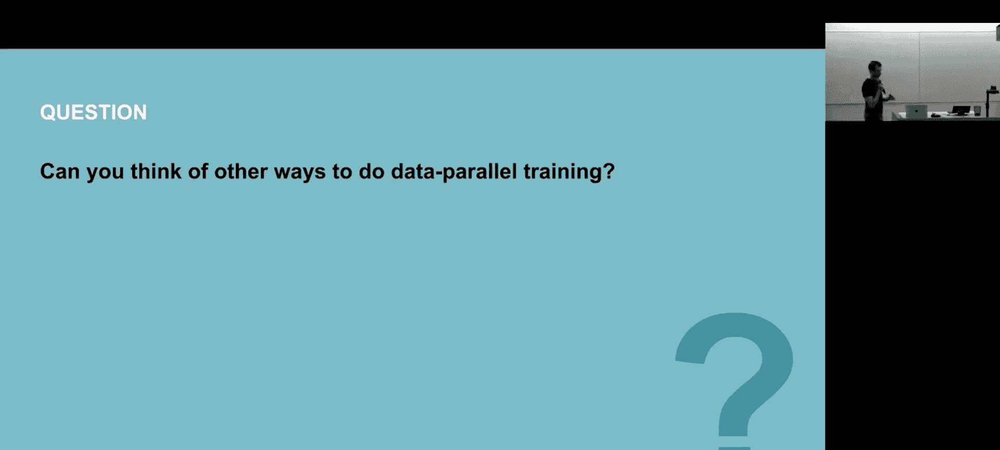

Or server。And these GPUs would compute the forward pass for different parts of the mini batch。

 they would compute the backward pass， and then they would send all the gradients to the GPU which is designated as the server。

 we would do some averaging there， and then we would broadcast the result back to all GPUs。

So is this better in terms of communication costs compared to the all reduce and you know the problem with all reduce is that communication costs scale linearly with the number of devices。

 so the more devices I add， the more communication I have， what happens here？

So if I have K gradients and I have n workers， how much does each worker send slash receive or let's just say send？

K。So that's correct， I think。Yeah， so it's CA per worker， but what happens at the server site？

So at the server side， I still have that problem because now I've added all of that communication cost at my server。

 so my server has to receive KN gradient per forward pass or per mini batch。

And so I still have that linear scaling problem， so the more workers I add。

 the more communication I have at the server side， and so that will quickly become the bottleneck and I can't scale it any further。

So how do I fix that？sorry。Use multiple servers。 Yeah， so it， it is as simple as that。

 So people use multiple servers for that。 And so now what is my communication cost。 So， so。

 so that's a good point， but。嗯。You can do that reduction locally on each GPU so you can compute so that's what happens in kind of parallel parameter servers。

 you're computing you know half the result on each server and then you you send two sets of gradients to each worker GPU and then the reduction happens there but some people。

 as I said do it hierarchically as well where kind of this level of servers。

 they would broadcast it to another one which does that reduction and then that one broadcasted back so that happens as well。

嗯。So the communication cost now for K gradients and workers and S servers。

 so the problem last time was you know my servers had to send KN gradients or had to receive KN gradients per mini batch so what happens now when I have you know S servers。

So。So basically， I'm dividing by S right I think there is a factor of two in there somewhere。

 but yeah at a high level， we're just dividing by S。

 So each server is now responsible for one over S of all of the gradients。

And so this scales quite nicely I think Google uses this a lot， at least historically。

 they came up with it and they used it for all of their large models。And the idea is you know。

 you have these parameter servers and whenever you run into a communication bottleneck。

 you add one more server and you use that for reduction and so on。

 but the problem here is that you know you still have a linear scaling， it's not with n anymore。

 which is good because you can scale the number of workers， but then whenever you scale n。

 you also need to scale S to keep that ratio at a good level。And so the problem now is that。

 you know I kind of have this overhead of adding these parameter servers to begin with。

 so I have these servers that are just waiting for the gradients to average them and send them back。

And so this is not you know the ideal way， the ideal way is that I wouldn't have overhead here and I have scaling that's independent of the number of GPUs right so can I achieve that do you think there is a way to do that？

The hint is， yes， there is a way。So so let's see what we can do there so I mean one nice thing about deep learning is that we are re kind of not reinventing but rediscovering many methods that existed already before so this is an example of something that was used in HPC applications for a long time usually it was multiple CPUUs not GPUs and things like weather simulations and stuff。

 but still we this thing called ring all reduce so that existed and predates you know deep learning by a long time。

And the idea is that what we want to achieve is this all reduce operation， right？

So we have gradients on four GPUs， the gradients are A， B， C， and D。

 and we want to end up with you know the sum of all gradients or the average same thing on all of the GPUs。

 so how do we do that we can break down this all reduce operation into something called reduce scatter and all gather。

Again， this is MPI terminology。If it sounds weird， but basically what is reduced scatter？

I'm breaking each tensor or each vector each array on each GPU into n chunks where n is the number of GPUs right and then now each of my GPUs。

 each of my worker GPUs is responsible for computing a partial sum for part of that array。

That is reduced scattering right， so I'm breaking the arrays into pieces and then I'm saying each GPU is responsible for a piece of that array。

And then now I end up with these GPUs having， you know， the。

By piece of the result essentially so this is kind of the result on the first GPU。

 the result on the second GPU and they need to broadcast it to all GPUs so we do an operation called allga。

 which is basically this broadcast sending this you know piece of the array to the different GPUs and you end up with you know the whole result on each GPU does that make sense。

So basically we're decomposing this addition operation or averaging。

 the same thing into different parts， each part is the you know each array is broken down into n parts where n is the number of GPUs。

 each array each GPU is now responsible for aggregating the different parts for that piece of the array and then we broadcast that so you know reduce scatter is the part where we compute the sum and then allll gather is just we broadcast that partial sum to all of the GPUs。

this is confusing， we'll go through it kind of step by step。嗯。

But the reason it's called all reduce is that communication。

 we can implement this in a way where communication is only you know from one GPU to one GPU。

 so you only need a ringed topology in your network to actually compute this so to compute this you know reduce scatter and allga。

 you actually only need to ever receive and send data from one GPU next to you and you know in networks。

 the ring topology is the most scalable topology because to add a new node。

You can easily add it and connect it to just two existing nodes right if I want to add another GPU here and so you already see where this is going。

 this would be a much more scalable way of doing this。So let's see how it works。

 So here we have five GPUs， not four anymore just to make it slightly more confusing and first we want to do this reduced scatter operation。

So I broke down the array into each array into five pieces because five is the number of GPUs that I have。

And then now I will proceed and have this logical kind of view in your head where these are connected in a ring。

 so GPU0 can only ever send to GPU1 and receive from GPU 4。

GPU 2 can only ever receive from GPU1 and send to GPU 3。So。

So that's what I'll do I'll send you know this first part from GPU0 to GPU1 and as I'm sending it I'm adding the partial result。

 so now I send that piece I'm adding a 1 plus a0 here， B2 plus B1。And I keep summing， you know。

 in that ring topology。 So again， as you can see， communication， I'm sending， you know。

 one piece of that array， which is equal to the size of my gradients divided by the number of GPUs。

And as I'm sending it between GPUs， I'm summing it up。

 I'm adding it to that section that exists on that GPU。

So we keep doing that until we have the result sitting or a piece of the result sitting on each GPU。

So now each GPU has one finalized chunk。So these golden kind of bordered pieces are you know GPU0 now has you know all of the B's summed together GPU1 has all of the C's GPU2 has all of the D's and GPU3 has all of the E's and finally GPU4 has all of the A's so now the result exists it's just on different GPUs so now I'm done with this piece called reduce scatter。

Does that make sense so far， nods， yes？So I just split my gradients based on the number of GPUs I have。

 so I have five GPUs I do five splits。So yeah so vertically these are my different mini batches。

 remember I'm training not different mini batches， but different pieces of the mini batch I'm training different pieces of the mini batch on each GPU and I want to average all of the gradients between them so each one has a set of gradients related to the inputs that it was trained with and I want to add them all up I actually want to average them but it's the same operation right。

And so I'm splitting each set of gradients into five pieces and the goal is to add all of these arrays together。

 right。Any more questions？Okay。Okay， so now I've done this operation called Redcater。嗯。

A piece of the result and what I want to do next is this allga operation where I send those pieces of results to all of the other GPUs。

So let's do that so now we're doing allga so again this is connected in a ring topology every GPU can only send to the CPU of the GPU next to it and receive from the GPU before it and so it's the same idea。

So we will just broadcast and this time we will not be adding anything on the GPU， so we will send。

 you know this and replicate it， for example， will replicate this block on GPU0。

 so now we have two pieces of the result on GPU0 will replicate this block now on GPU0 and this one on GPU1 and so on。

Until we have kind of the full results on all GPUs。So now all GPUs are finalized partial sums。

 so they're simply added together to compute the average gradient。

 so now that statement is actually not 100% correct but basically now we have you know the same thing on all GPUs and it's the sum of all gradients on all GPUs right so we've done what we wanted and now let's look at the communication costs。

So you know， for NGPUs， K gradients and in the middle case， you know S parameter servers。

 that's what we needed before， we needed k times n minus1 for all reduce。

 and we needed k times n over s for parameter servers。

 given that overhead of you know having these parameter servers to begin with。

So now who can tell me what the communication cost is for ring all reduce？

So now all of the GPUs are the same。They're sending and receiving the same kind of bandwidth。

And there are two operations， right， So there is the reduced scatter， and there is the allga。

So what happens in reduced scatter， for example？So。So what am I sending to begin with。

 so mys are k size， what am I sending in each cycle？srry我。对。是。电。Correct， so K divided by n。

And how many times am I sending it？Right， so I'm sending that， you know。

 is it n times or is it slightly less？So。So I mean youre it's n minus-1 exactly。

 so I need to do that for reduce scatter right and so what do I need to do for all gather。So。

I'm sorry。Yeah， exactly。 So it's it's the same thing。 So if I， you know， both of them。

 I'll just put a factor of two。So that's correct。So now I finally have a communication cost that doesn't actually scale with the number of GPUs。

Because， you know， and cancels and is at the top and at the bottom。

And so now if I increase the number of GPUs， I'm not increasing the communication bandwidth needs。

 I'm just you know scaling my computation， I'm always sending approximately 2 k gradients from each GPU to each other GPU。

And so per GPU， maybe in parameter server， you know， each one has to send just k。

 whereas here I have to send 2K approximately。But but this is a much more scalable technique。

 basically， and it requires only this ring topology。To to work well。

So this is what most people use actually now， and has anyone heard of HoV training libraries。

 so that's how it's implemented there as well。I believe the first people to work on this were Baidu actually。

 and then Horovwood took their library， which was a fork of TensorFlow and they kind of polished it and made it work with NVDs it's called NCCL。

 NVDdia Compute something library， and yeah and so many people now use Howood in industry everyone uses Hovo。

 Howood is a library written by Uber Labs actually， to train large models。Okay。

 any questions about tri all reduce so yeah。Yeah， I mean， there are no issues。

 usually the gradients are like， you know， the case size is like millions or billions in some cases and you know。

 your number of GPUs are usually a couple of order like six orders of magnitude less than that so it's easy to divide it you know a million parameters over8 GPUs or something's not it's not an issue usually。

Okay， and I mean， so far， we talked about。You know。

 the data parallel training and we talked about something called synchronous。

 a data parallel training， and what that means is that you know。

 we are trying to mimic the training on a single node。

 we're thinking all the parameters we're averaging them before we run the next forward pass。

But there is something called asynchronous SGD as well or asynchronous training and what that basically means is that。

of waiting for all of the GPUs to finish what they're doing before computing the average gradients。

We will just as soon as a result comes from GPU0。We will update the parameters on the server。

And then whenever GPU1 wants to compute a forward pass or a backward pass。

 it would just take the latest result or the latest set of parameters from the parameter server and use that so we are not doing averaging of gradients anymore right we're not waiting for all GPUs to finish and doing a synchronous weight update as soon as a piece of my mini batch is finished I just update the parameters on the server immediately。

嗯。And the problem with that is obviously， you know。

GPU0 may update the parameters on this server here based on its piece of the mini batch。

 but then GPU1 will be using sta parameters， it will be using the parameters from before the update from GPU0 that's why it's asynchronous so you have different GPUs operating on a different set of parameters at any given time they're computing the forward pass with either old or very brand new parameters or something like that and so that's the problem with asynchronous SGD。

That's why it's often less used， although it's much more scalable because you don't need to do that broadcast operation and typically what you will see is that you know it just converges much more slowly or you lose some accuracy even in some cases。

 so especially as you increase the number of GPUs。So yeah I saw that asynchronous is we used way less in industry。

 but this is actually what Google started with to be able to scale their stuff。

 they started with asynchronous SVD in their data centers。Does that make sense。So everyone， okay。

And you know so far we talked about data parallelism and model parallelism。

 there are some ways to combine the two。This is one example。

 this is an interesting kind of note written by Alex Kzyevsky after joining Google he didn't actually stay there for a long time。

 I think he didn't enjoy it very much but basically he was also trying to scale his model at Google and he saw okay I will use data parallelism for the convolutions and I'll use model parallelism for the fully connected layers so that's kind of an interesting paper to just go through and see his thought process of how he split the model that way。

 but the main purpose of this slide is to tell you that people do combine the two in many different ways sometimes by composing them by having both data and model parallelism on each section of the model and sometimes by splitting the model in parts and leveraging different parallelism for each part。

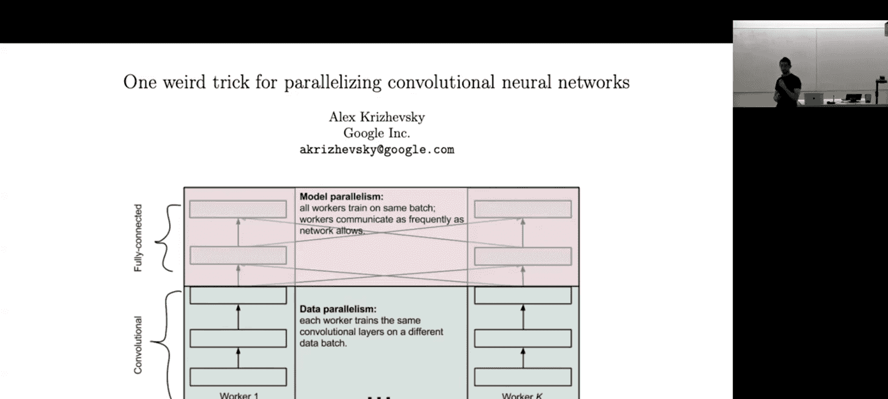

Okay。So we talked about model parallelism， talked about data parallelism。

 now I'll talk very briefly about gradient compression。

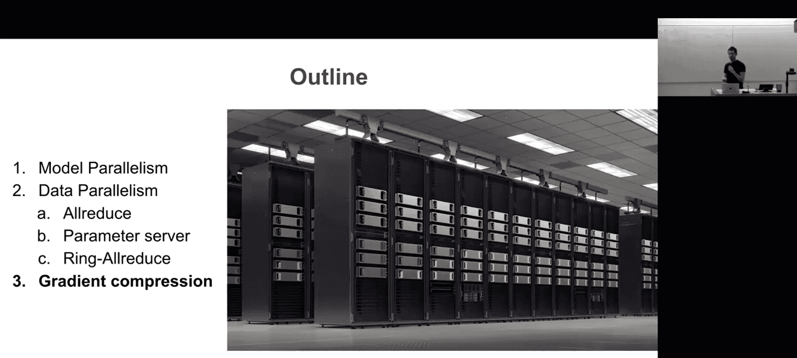

And so what we solved so far with this string all reduce and data parallelism is the linear scaling of communication costs with the number of GPUs。

 so that's good。But you know， can we do better， what is my communication cost now it scales linearly with k。

 which is the size of my gradients。So there's a lot of research in the area of just shrinking down those gradients and it's a lot of the stuff we know from earlier lectures so some people use quantization on these gradients。

 so there's this paper called QSGD which you can go read if you're interested。

 but basically instead of transferring you know FP32 or 32 bit gradients we can quantize those gradients to4 bit or8 bits and here's a table from this paper here so it's showing that you know we do get a degradation in terms of accuracy in some cases。

You get an improvement in accuracy in other cases and people usually just attribute this to oh。

 this is a regularization technique， which makes training more robust。

And then this speed up is usually in the ballpark of 2x。Maybe a bit less in some cases。

 but approximately2 x on8 GPUs， so you know by reducing that communication cost further by compressing the gradients that are being transferred between GPUs。

 you can further get know speed up with the number of GPUs that you're scaling。

Another method is pruning， so we also know about that from previous lectures for model parameters。

 but here it's for the gradients being transferred between GPUs。And so again。

 it's all the same techniques， usually magnitude based pruning is used here。

 so youd see the gradients with the smallest magnitude and you would just know not transfer them at all。

 and instead transfer zeros and then you can compress zeroes very easily using something called you runline thing coding or something where you just say I have five zeros coming up instead of transferring five individual zeros。

And so so here theres these plots on you know MNist and NMT which is a language task。

 what's happening and you see here this yellow line we are losing。We are losing a bit of accuracy。

 so this is the training curve actually， so throughout training， we are losing accuracy。In terms of。

 you know， the。When we're dropping like 99。9% of the gradients。

 but that's a very high pruning rate right， but when we're dropping just 90% we're matching you know the baseline accuracy basically and so what people found is that these gradients are actually quite compressible and people have been combining both this quant quantization and the pruning。

To compress this thing that you have to transfer every time you reduce your gradient。

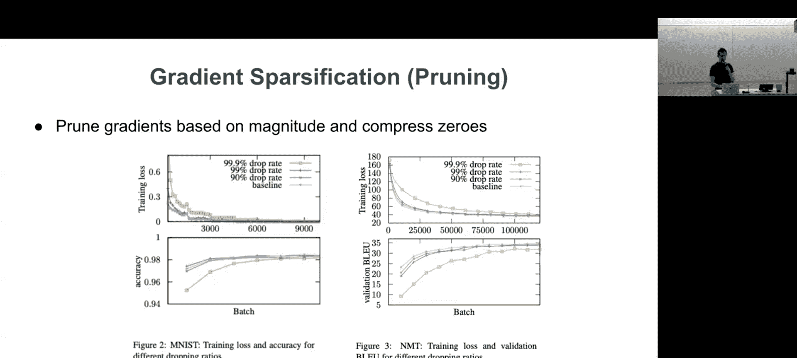

Okay， and that's kind of quick pointers to just what people do in that area。

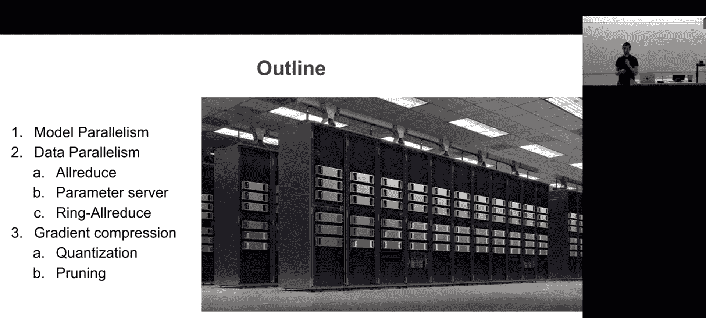

嗯。Now in the next three minutes， I'll just discuss you an alternative way of doing distributed training and specifically model parallelism and so you know we've been talking about GPUs throughout the whole lecture。

 but you can easily replace you the word GPU with an FPGA and we looked at this architecture way back in the hardware lecture and it's quite interesting where they have you know these FPGAs connected to the network line。

Before data even goes to the CPU， so usually GPUs are connected somewhere here。

Right all GPUs so far are connected somewhere here through the CPUU and through a PCIE link and that's how you connect a TU or any accelerator。

 you need the CPU to be the host and accelerator is connected through PCIE or something and so data usually has to go through the CPU before it goes to the accelerator and if the accelerator wants to communicate with anything else。

 sometimes it has to go through the CPU again unless you have an alternative network like NV link or something。

So the FPGA changes that a bit in Microsoft's data center by adding you this FPGA in the network you know bumping the wire architecture right。

 and so you can kind of think about distributed training now as you know the piece of my model will come here。

 it will never go to my CPU it will just you know I compute the forward pass。

 I compute the backward pass the gradients and then I send the gradient straight back out。

And so that's what they're doing actually， so they're calling this you know this other you know accelerator plane connected through this network of routers and you can implement you know a deep neural network on a few of those devices。

Without ever having to go to this， you know， lower plane， which is full of CPUs。

So so what does that improve， so if you remember the previous lecture where we talked about you know。

 the overhead of communicating over PCIE and so on。

 that overhead is not there anymore because we're intercepting the data before it even kind of makes it to the PCIE links and the CPU CPU land and the operating system there。

And what that also gives you is that it gives you very deterministic kind of communication speed because。

 as I said， you have your OS running on the CPU， which can't guarantee a specific latency and depends on how much load is on the CPU and how many threads are running。

 but with the FPGA， you can actually count the number of cycles it will take to compute the gradients and send the data back out。

Yeah， and this is what it looks like， you know， to connect different FPGAs together， you know。

 you have usually three levels of networks in your or network switches in your data center and you know if you want to communicate with the neighboring FPGA you would just go through this level zero if you want to connect with a further away one you would go to level 1 and so on。

And so interestingly， another thing that I saw in that keynote is that Nvi now doing this as well。

 they also realized that going through the CPU is always going to be a bottleneck for distributed workloads。

 so even if you're not using NVlink。

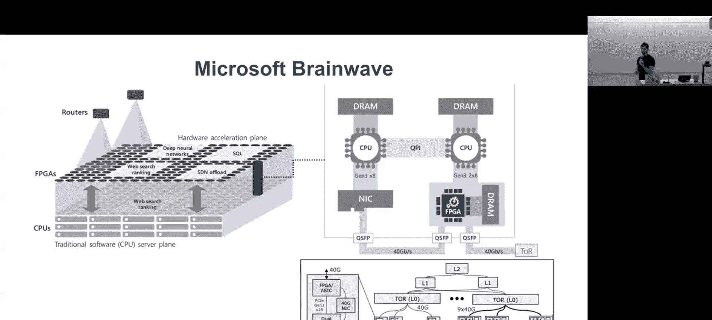

You'll see that now Nvidia offers this， you know。Instead of this traditional model， like I said。

 where you have your network interface card， they call Connect X7 because that's something they sell。

 I think。Da goes from the network through the network interface car to the CPU and then over PCIE to the GPU。

So they now have a card in which， you know， the GPU sits off of the。Network interface card。

And so I can see it has a lot of it bears a lot of similarities to the FPGA data center topology at Microsoft。

 and I can see that how this can be advantageous， especially for distributed workloads where you want to use the data center network itself to scale your。

To scale your number of devices without having to go through any CPUs and incurring the overhead and the non deterterministic latency as associated with CPUs。

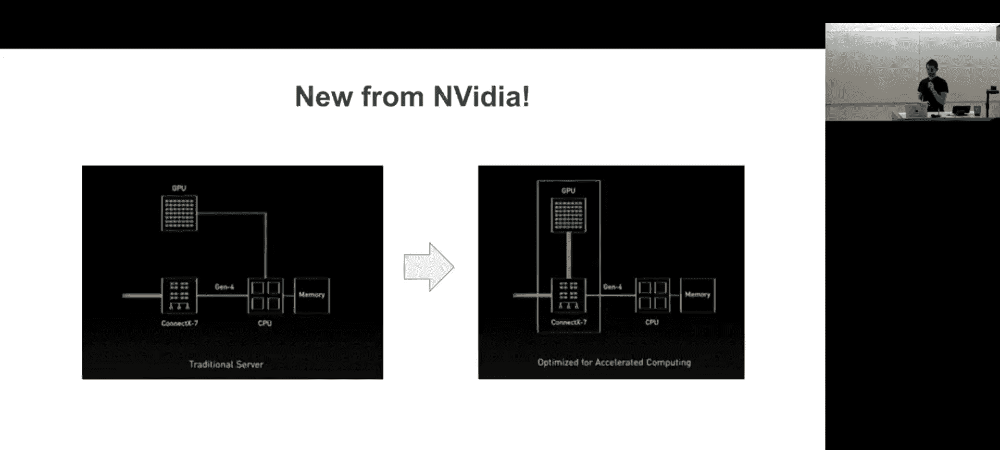

Okay， and that's kind of all I have today there are a couple of interesting papers that I think you should read。

 so please read them， submit your paper summaries and let me know if you have any questions， thanks。

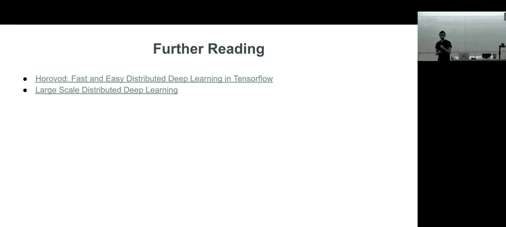