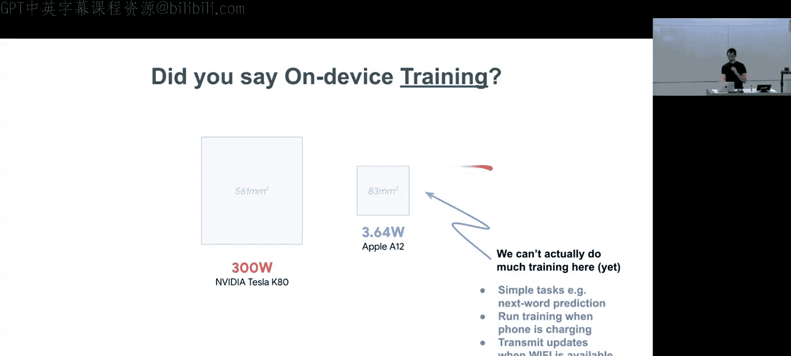
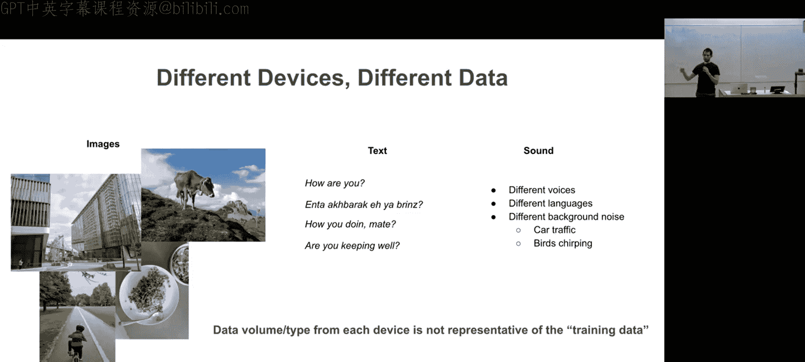
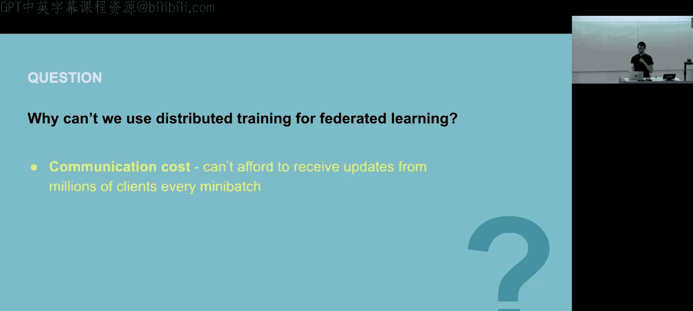
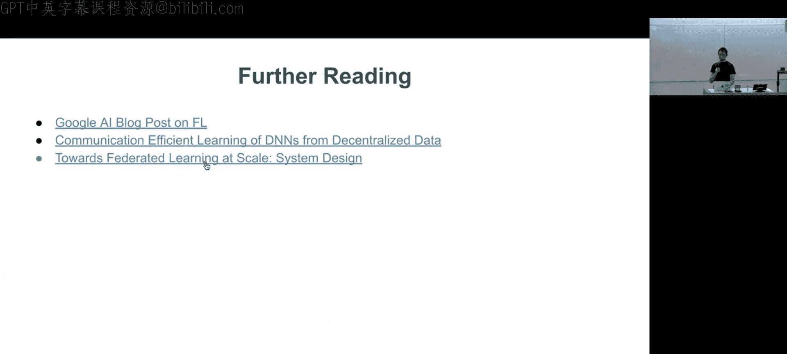

# 康奈尔大学《机器学习硬件和系统｜Cornell ECE 5545 Machine Learning Hardware and Systems》中英字幕 p18 -18-Lecture 15_ Federated Learning.zh_en -BV1CCqPYSEP5_p18-

Today we'll talk about a very interesting topic and I'm not an expert on this topic and that's partially why I found it interesting to prepare the lectures because I learned a lot about it as well。

 but it leads on nicely from distributed training， it's taking the idea of distributed training and scaling it to many more devices and many more users。

And so。Yeah， we're in this know last course module， ML systems。

 we talked about you know preimpost processing， how that affects。

 you know the speed of my system and what I should watch out for。

 the key thing there is still MDDA's law that people often forget about until they deploy their system and they kind of profile it for performance。

Then we talked about distributed training， we talked about all reduce and how that doesn't really scale because the communication cost increases linearly with the number of GPUs you're using for training。

 we talked about parameter server and then the communication cost was again limited by the parameter server communication bandwidth itself and finally we talked about all reduce we also talked about model parallelism and other things。

So today we'll talk about federated learning， which is a form of distributed training reallyly。

 but quite different and has different requirements。😊。

And thanks to a good friend Stehan Osless Carris， so he's an expert on federated learning and I consulted him a lot before kind of putting these slides together。

 so hopefully they look good。Yeah， so that's kind of what we learned last time。

 we talked about distributed training and we focused on the communication costs and how we can scale that in a way that's independent of the number of machines that we're able to have a lot of GPU's training at the same time without burdening the communication network too much。

 so I mean federated learning is not that different。

 it's still a distributed training problem but it has its own requirements。

So in conventional deep neural networks， what we do first is that， we gather a data set somehow。

So you know， the standard example is INe， you know we have a million images， we take them all。

 we label them by the image class， and then we have this data set that we can use for training。嗯。

And so that's nice because we can easily set up this supervised training problem。

We have the data set that we can try training on once and then try again and so on。

 but the fact of the matter is and reality is that you know data is being generated every second that's the whole idea of big data so we have all of these devices with fancy sensors on them capturing data as we speak so how do we take advantage of this data to train a model and make it smarter right？

嗯。So you know， you have your phone， you just took a photo， I want to add that to my own imagenet。

 which Google is doing in some way because they have this huge。

 I think it's 300 million images now called JFT， like a big benchmark。

And you know if you have a drone and you want to make it kind of avoid obstacles better you want to gather that data from all the drones out there or if you have you know these fancy augmented reality goggles then again you want to be able to train whatever algorithm on it using the data that people are seeing right now and and the same is true for self-diving cars especially like the main value proposition of the company called Tesla is that they have all this data and they have all these cars gathering data all the time they're all connected to a central server where that data is being used to kind of improve the model for self-driving every second so that's what we want to achieve we want to go from this conventional view of there's a data that we want to do really well on to a much more realistic setting where you don't have just a single central data sets towards somewhere that you bought once if that's it when you have continuously generated data that you want to continuously。

Use to improve your model。So so that's kind of our question in this lecture。

 so how do we leverage user generated data to train deep neural network so so that's what we want to do。

And so in the first setting that we'll talk about and what we'll talk about throughout this lecture actually。

 is this federated setting where all of these devices are with the user。

 and then you want to train a deep neural network that's stored centrally somewhere。

There are other cases as well where the neural network is not stored centrally。

 but this is kind of the scenario that we will be talking about。

So I had to actually go look up what the definition of federated means and it basically means distributed but reports to one central entity。

 so in case your English is as bad as mine， this is what it means so it's like you know federal governments for example。

 so you have you know all of the state or provincial I guess state here it's called state government but they all still report to one central federal government and so the same is true here you have all of these devices and they are independent in some way they don't really belong to that central entity but they still report to it in some way right？

And so that's what we want to do， we want to gather data from all of these devices and they still have models on them that we can train on device。

 but we want to improve a central model at a server somewhere。

And that's that's what we'll do through federated learning。Okay。

 any questions about this short intro of what federated learning is or what the difference is to distributed training so far？

So。So you don't actually know what the difference is to distribute training so that's one question。

 but we will say we will kind of go over that right now so at the highest level you know federated learning has kind of four steps and they look a lot like normal training but let's go through these steps one by one。

So first， you know we have the central server that we talked about and let's just say this is Google right and so they have a model that they trained here with a lot of data that they bought that they gathered before they curated and put somewhere。

And so that blue model， the first step is， you know， I want to give access to that model to my users。

 so we're downloading that model from the cloud to the users's devices。

And so now every user has the same model， it's identical， it's a blue model。

 and it's downloaded on my phone and I can use for inference。

 like for detecting faces or classifying audio or doing whatever。Then the next step is， you know。

Every device is now independent， it's not connected to the cloud it can operate offline and everything so you know each device is also gathering data as all the time so device one is gathering different data from device2 so maybe the person owning this phone really likes to take photos of you landscapes but the person owning this phone really likes to take photos of their dog for example and so this model will be really good now at detecting dogs while the other one will be much better at detecting landscapes so we can train on device to improve each model given the data that's available on that device so we don't have access to the global data pool anymore we just have access to our local model and the data that's on that device。

And independently， this step， step two is sometimes called personalization。

So you often take kind of a baseline model and you perform either transfer learning or top up training to just personalize that model and make it really good at that specific user and people do that often for example。

 speech recognition and definitely for photo classification。

 image classification and things like that as well。But federated learning doesn't stop here。

 so now that we've kind of specialized each model to each device and we've done on device training。

 which by the way is the first time we talk about training a model on the user's device。

 so we'll get back to that， but once we have these different models now on each device。

We want to find a way to get that knowledge or that kind of information and that data that's distilled into these models back to the central model to improve it as well。

So we need to find a way to propagate the information that we learned here back to the central server。

And so how can we do that， so what's the simplest way of doing that？嗯以。是。

So I mean I can just send the data back right， and then we can train on the server。

 that's one option。Are there other ways of doing it。

Upload the gradient so similar to distributed training， was that also what you were going to say？嗯。

Or yeah， okay， so so do something more fancy so training on the device itself and then use that information somehow propagated to the server you said figure out which one is highest accuracy that's I mean that's one way。

 but remember we。Each device doesn't have like all of the training data。

 it doesn't necessarily improve the model and performance of detecting， for example。

 all of the classes in a classification problem we're detecting all of the words in a speech recognition problem so every device is kind of specialized now so there' is information to be gained from each one in some sense so these are all great answers so James do you have another one。

不。哦。Yeah that's a good question so so I did mention that step two alone can be called specialization or personalization and people definitely do that for you know your keyboard app because you have a specific way of writing kind of text messages definitely for image classification and so on but that's only one part of these four steps that we call federated learning so for the sake of personalization alone we may actually not need to propagate anything back to the central server but our goal here actually is that we're Google and we want to improve that model right we were not the users in the other end eventually kind of the better model gets downloaded to the users again and so on but。

But。It's the goal is not just personalization。 Personalization is part of it， I would say。Okay。

 so yeah， so these are all great answers and we'll see in the next slide exactly what we do make to kind of propagate that information back to the cloud。

And then finally， we update the global model， so we get that information that we learned。

 whether it's gradients， whether it's updated parameters， whether it's data。

 and we use it to train that or to continue training that new model。

And these four steps are actually not just four steps， they continue in a loop。

And you know this loop in normal machine learning or conventional machine learning you would say these are different epochs of training。

 but here they call them rounds of training so every time kind of you do this whole thing it's one round of training and you do it multiple times so you continuously train as new data is being generated and so on。

So before we dive into the specifics of how it's done。

 let's kind of discuss quickly why it or what the use cases are so one one very important use case is you know。

Using health data to train models and so machine learning is very successful in many problems in medicine but it does face a lot of problems one key problem is that you don't have access to all of the data there is such a a thing as user privacy and you know not all patients want to disclose their you know private information and so on and not all laws actually allow you to disclose that private information and so training a model based on health data and health diagnostics is one key。

One key usage of hydrated learning。Another one， which is。

 I think the obvious one is kind of just personal data from your personal device。

 so basically look at your phone， any data that's being gathered about you from that phone。

 especially offline data so things like you know。Your your IMU data so how the phone moves and when for example you want to detect a fault you want to be better at detecting faults which Apple does I think now with their smartwatches and stuff so that's an example of kind of IMU data which is really to health as well fitness data so maybe you know you get the user to put in his weight after doing a specific exercise and then they can better correlate you know the weight loss for a specific person after you know working out you know running 500 meters or whatever or 5K or something again speech so just figuring out you know how to detect speech and transcribe it into text or something like that so all of this personal data is very amenable to this idea of federated learning just because it's being continuously generated and you don't necessarily have anything to gain from just uploading your data somewhere to the cloud。

Or giving access to people。And then finally you know we talked about self-driving cars and sensor data from smart home or a smart city again。

 you know you have all of these sensors dotted around the city now so things like at traffic lights detecting pedestrians and crosswalks or something like that so you have a lot of data being continuously generated and you want to use that data to improve your models can people think of other use cases actually that are not listed here。

 anything else that would make sense。Yeah告。Weather data。So yeah， I mean。

 if you're collecting it from user owned devices or something， then yeah。

 that would be a good example as well。嗯。啊，还行。Like they put them on the roof or something and they detect wind。

 Yeah， I think so I don't think the problem is as big in terms of just problem size the number of users that have but yeah。

 that could be an example as well yeah。没天来。嗯，Sorry， I can't really hear you。行政资源。Induial IoT systems。

 So， yeah， so Io T in general， like the word Io T goes really well with federated learning because Io T implies lots of sensors scattered around a large space。

 And so that would be a good use case as well so。O。All right， so yeah。

 so at this point it's good to kind of just， you know。

To say exactly know what is the difference to distributed training to have kind of a mental model of the problem scale and so the first thing to keep in mind is that the devices in something like distributed training are identical typically identical or even if there are variations they're very small variations like you know 1080 versus 2080 GPU or something have more co course or less memory but with federated learning you can have like I don't know an Nokia old Nokia phone versus the latest iPhone or even different generations of iPhone or Samsung phones or something and so the device type here really varies it could be a completely different device like we said you know augmented reality glasses versus a phone or a smartwatch or something。

And so how does that affect me？So it affects me because we're doing on device training and so we need to actually。

 for this system to work， we actually need to find a way to train the model on each of these devices。

And these different devices also have different communication links。

 some devices are only connected to Wifi for example。

 some devices would be connected over a 3G or 4G or 5G network。

 so it depends on how often you're also connected to the network。

And then a really big one is the number of devices， so in distributed training。

 you'd be lucky if you're training using tens of GPUs or hundreds of GPUs， if you're really rich。

 but and again if you're like a huge company， then maybe thousands of GPUs for a specific training run。

But for federated learning， we're talking millions to billions of devices。So again。

 the problem scale is much larger and this really dictates many of the training algorithms that we'll see in the next few slides。

The network connection again， in data centers we have these currently 40 gig 40 gigabbits per second links between server X。

 so it's a really fast very reliable network， you don't drop packet it's really on that network it's a bunch of cables unless something really goes wrong whereas with a federated learning you have your phone connected to a mobile base station and sometimes your phone is off or the battery is finished or you put it on airplane mode or your' underground or something so you don't have a reliable connection so you can't kind of really rely on that network as you would in distributed training。

The data， so that's another big difference， actually all of these are big differences between the two things。

 but this is also a very important one。In distributed training。

 you pay some attention to having kind of a representative mini batch on each device。

 so if it's a classification problem again， you make sure you have a mix of classes being trained in each mini batch。

And so the data coming from each device or being trained on each GPU in distributed training is almost the same。

 it's still representative。 It has the same data distribution。

That's what we mean by kind of similar data so the training problem is almost the same on each device whereas here we talked about personalization and really you know the data is not is not identical in any way across these devices so people call that nonIID independently anidently distributed so the distribution of data is different so the data itself is different that's you know for sure because we're training on different devices that's fine but you don't have the same mix of classes if you have 100 classes you may have you know 99 samples of one class on my device so in the case of images it's probably like photos of my son have 99 of those and then one photo of I don't know a building or something in another person's phone it may be know 99 photos of a dog and one photo of himself or herself so the data is very skewed and and this presents a major challenge actually and we'll talk about how we can fix。

That。Finally the design goals， so we didn't kind of say this explicitly yet。

 but you know a common theme across all of these federated learning use cases is that the data needs to stay private so we don't want to actually transmit the data itself so we want to make sure the data stays secure and private and we want to be able to scale that system to millions or billions of devices whereas in distributed training our design goal is kind of just speed how fast can we do this obviously accuracy is a design goal in both but you know where it differs as you speed versus scale and privacy I would say。

Okay， any。Comments about this part or， or anything that's。That kind of we should discuss more。

So yeah， so I mean， to sum up， we want to be able to train a model using data that's being continuously generated without having access to that data and being able to scale it to millions or billions of devices。

So that's kind of where federated learning is。And so now it's starting to look much different compared to distributed training。

Yeah， so that's a great question。 So how often do we need to communicate in the case of federated learning versus distributed training I mean。

 the first hint is that， you know， we have a much worse network to be able to communicate over and that question will be answered in a couple of slides so maybe we can move forward。

And before we talk about that， we I should point out at this stage that you know what I implied is that we want to do on device training。

We haven't actually seen that yet， so in fact like in your assignment2 for example。

 when you had a small device， you could barely perform inference on that device。

With a tiny model called tiny con right like it was the smallest model we could ever come up with。

 it did a very simple task and we just did inference and you know you profiled it。

 it took a long time to do that inference in terms of milliseconds at least。

So when we compare kind of， you know， the devices that we usually use for training versus the devices that we're talking about now。

 like the most powerful kind of device in the federated learning setting will look like this to be kind of you know。

 an Apple chip with an NPU， about three or five watts of power。

 which is two orders of magnitude less than kind of an NviDdia GPU。

 which is typically used for training。So keep in mind that we can't actually do much training on that device right so so far you will see if you read about federated learning you will see that it's used for things like you know making the Google keyboard better or keyword detection on Alexa or the Google Home or something like that so it's actually still being performed for very simple tasks just because ondevice training is not there yet we don't have。

Hardware that's powerful enough to perform on device training as of now。

So we can do inference fairly easily on mobile phones， but not training， basically。And so yeah。

 as I said， one thing is to keep in mind is that you know we use that for simple tasks for low dimensional data。

 things like health data it's quite low dimensional， it's kind of you know， it's over time。

 but it's a specific thing that you're measuring so whether it's you steps or speed or something like that。

And a few ways of kind of making it slightly better is that you know some of these algorithms actually kick in when you're charging your phone。

 so when you're connected to power， basically， and again to kind of circumvent some of the communication problems。

 you know you don't want to also be paying the bill for you know 5G especially if you have kind of a limited plan or something。

 so sometimes you know these data transmissions only happen when Wifi is available。

And so one of the readings is about the Google keyboard thing that I mentioned。

 and that's what they do basically they wait until you're connected to Wifi， you're plugged in。

 they do the top up training and they send something back to the server。

So just keep that in mind if you're thinking about federated learning for a problem。

 think of your device and whether if we want to do on device training。

 how much training can that device actually support？I will also say that， you know， many of these。

SOCs on your phone， for example， two have dedicated NPUs。

But I haven't seen training libraries for these NPUs。

 so currently unless you're writing your own lowlel code， you can't just say。

 you know train this model or model dot backwards， you don't have that command yet on these devices so people would often write their own kernel or they would run it on the CPU of that device。

In the case of Google， they did deploy a small version of TensorF to their phones and it's actually different than TFL I went and checked。

 so it's another thing that enables on device training for very simple models。

So they basically have to write their own code and it's not a public library yet。

Okay and yeah， and we touched upon this a bit， but you know， if you have different devices。

 you'll have different data so this idea of non IidD the data is not identically distributed this is really important and you know here are some examples of images they're all from my phone actually but I would say yeah 99% of my images look like this where it's my son doing something and you know the rest is just random random stuff。

There is probably a disproportionate number of cows in my phone。

 but just based on where I've been over the past few years， Im can ask me about that later。

 but yeah but you'll find kind of mostly just kid photos of my phone someone else may have more kind of building photos or food photos I know I know someone who takes a lot of photos of food so I'm sure his data will be very different than mine so text data is also quite different even though if if we're speaking the same language or using the same alphabet。

 we may say things in different ways right so these are all you know ways of saying the same thing in different languages or just dialects。

And so you want to learn from all of that different data。Sound so for things like noise cancellation。

 you're looking at background noise and people have different background noise。

 obviously if you're in a city it's different than from when you're in a countryside。

 people speak different languages， as I mentioned in different voices and you want to learn from all of that data。

So yeah， so I'm repeating myself at this point， but it's very important to realize that this is a main challenge of federated learning。

 you know， the data volume， the number of photos and the data type is different from each device and not representative of the global data that's being used to train that model。

Yeah， so that's definitely a concern， so devices will transmit at different speeds and at different times and so we will see something called travels。

 basically devices that can't make it in time for the next round of training。

 so we will talk about that again。

Okay， so at this point， it's maybe worthwhile to do kind of a quick discussion of you know。

 why can't we just use distributed training so distributed training is where we propagate back the gradients。

And we update the global model。 Actually， can we use that for fedated learning And if not。

 then why not so。嗯，没有。我那个。别他。So the network， so that's definitely。You know， one thing。 So in。

 when you're propagating， oh， that's， it's still my text。不是。OK。So the first thing。Is network。呃。

With distributed training， you're propagating gradient every mini batch of data。

 so that's a lot of communication we want to kind of make that less in federated learning because your network is not as good。

Okay， what else？有。嗯。I see。 so your gradients become stale because I see。

 so it's you don't you're not operating on the latest model anymore， basically that's what you mean。

Have gradients trained on an older version of the model。

 for example Yeah so that's true if we're doing the updates asynchronously。

 which is probably what we would need to do in this case so that's a good point again it's related to you know this idea of network and you know I talked about gradients and three mentionedioned gradients kind of being uploaded to that central server but then we have to download the average gradients as well to update our local model and so distributed training would require a lot of network so honey。

嗯哼。😊，So yeah the input data is highly imbalanced， so even if we actually do distributed training using that input data it might not converge properly。

 so we maybe we need to change stochastic gradient and descent in some way to make it scale to this much larger model so so that's number two。

对的。Ibalance。This is very bad。 It's so bad。It's a bad marker。 I don't have any eraser。 It's not good。

Okay， whatever。 Okay， what else， What else do we have， That's， that's an issue。

 Why can't we just do distributed training so。No。Number of devices Okay so that's a great point because I mean a number of devices would also kind of go over here you know do we have enough bandwidth to actually receive all of those gradients at once in a central server so we talked about how in the parameter server thing it scales linearly with the number of devices so you know we probably can't handle it if we have a million devices sending you know gradient updates to one server and then it needs to broadcast the model back。

嗯。That's great。So， so I mean， privacy is also an issue。And， you know， someone is thinking。

If I'm propagating gradient， which is what I do in distributed training， why is privacy an issue。

 it's no longer the data， right？But turns out people can somewhat easily now extract the data back from gradients。

And so that's， yeah， there are many papers about it， people can do it。

 and so just transmitting the gradients is not secure anymore， so you can't do that。

What else are we missing anything， so network， data imbalance and privacy？嗯。能。Yeah。

 I think that's it actually。嗯。

And yeah， the main one that I wrote down here， at least is communication cost。

 but forget the slide because we have a better summary here。Okay。

 so now let's kind of now that we understand what federated learning is and why it's different from distributed training。

 let's look at the first algorithm that was proposed in this space called Feerated Averaging。

Just one second。So this is one of your readings and this is actually。

I believe the first paper to kind of look at federated learning。

And to kind of attempt to do this on a large scale。

 Can someone guess from which company it came from？ Yeah， from Google。 So， I mean。

 one thing you will notice。Is that at least half the paper is about Feerated learning are from Google？

And one main reason is that there aren't many researchers that have access to millions of devices right or millions of users and so doing realistic research on this work is actually very hard in my opinion。

 unless you're taking a sub problemblem that you can test in the lab。

So so how does this algorithm work so remember this picture where we had four steps。

 you know we have a global model， we download it， we train it on local data。

 we update something to the global model and improve it and so on and we keep doing that again and again。

So here is what it looks like in this algorithm called federated averaging。

So we have the baseline model and in this algorithm here we're initializing it。

 so it could be randomly initialized or it could be pretrained using some large data set。

And then we repeat the following training loop for T rounds， and like I said。

 you can think of rounds as epochs。Basically in the equivalent of epochs in normal training。However。

 these rounds usually take days just because of the communication overhead and waiting for all of the devices to come back and so on。

 as opposed to EpoCs， which could take hours or minutes depending on the data size。

And so first what you do using those two statements here is that you sample some devices。

 so you have millions of devices out there， maybe let's say 1 million as an example。

 you sample some of them， and realistically you usually sample thousands， so between five and 10。

000 I think is what I've seen in real deployments。In each round， so you sample 1000 of them。

 you wait until1000 of them respond back with something before you perform the next step。

And so for each of those clients， you're training the model on each device and updating its weights。

 so we're doing normal training on the device using all of the data available in the device。

 and we're getting a new set of weights， WT plus1。And this is you know the updated model parameters on each device。

 so at this stage we have each device with a you know updated model different you know represented by different color here。

And it's trained on the device itself。And then what we do is that you know each of those clients will send their updated parameters。

 so after you know doing forward pass， backward pass， wait update， doing it multiple times。

 we have an updated model， we want to send that updated model to the central model or the central server。

Right and then what we do on the central server is that we basically average all the weights together。

 so it's much simpler than doing anything else like we just take all of the weights coming from all of the clients and we average them。

We also perform a weighted average， depending on the number of training samples that was available on each device。

Right， so let's say， you know， the first device has 100 images。 The second device had only two。

So we put that factor here and we linearly scale each one of them as a fraction of the whole updated data set。

 right？And then we use that to update the model and we perform another round and another round and so on。

So the concept is quite simple， right， so we are training locally on each device。

To minimize communication costs， we're not propagating the gradients or sending anything after each mini batch on the device now we're waiting until we finish training with the whole data before we send it back so below here it shows the client update and you know we're training for multiple batches。

We're just doing normal training for multiple epochs and for all of the data basically。

 so we're waiting until each model converges on each device before we send any update back。嗯。

And then at the server， we're just averaging all the weights together and we're seeing if we got anything meaningful out of it。

And so just by doing that by having each of the devices perform training for multiple epoCs locally。

 we're reducing communication by between 10 and 100x。

 so instead of communicating every mini batch we're now not communicating even every epoOC。

 we're communicating every training ground， so to speak。So it's a simple algorithm。

 but it works to some extent and we'll see what the problems with it are and it really addresses this communication issue at the first order。

 it reduces the communication by orders of magnitude。

 it also addresses the data imbalance a bit by adding this scaling factor which enables the training。

 so instead of weighing all of the weight updates the same way。

 depending on the number of samples we will apply that weight right。嗯。Yeah， so yeah。

 so this is kind of the baseline now this is how we can do this federated learning and scale to millions of devices。

While you know relying on on only kind of very weak communication links。

 so any questions about Fed average？嗯。OK。So there are some issues though right so the first issue is what Harris was was alluding to like stragglers。

 so what if you know I'm doing this training， I need all of the data to return at some point to do that averaging on the server。

 update my model and send the model back to the clients and so on。

 but what if that device doesn't return the data on time。Right。

 between you know those devices that I sampled。So what F average does in that case is that it simply drops the strglers。

 so if there are any strglers from these 5，000 or 10。

000 devices that I sampled it just and doesn't come back in time。

 I just drop them and go to the next round of training right。

And what if there is a huge data imbalance， right， so。What does that say， so we said you know。

 we scale each model update linearly based on the data and balance。

But basically is this really representative anymore because you know data from one device may be much fewer samples。

 but it's still as important and so there are questions of fairness and kind of equality that arise here in terms of at least model training itself。

 but you know we're currently favoring devices that generate more data but it's not necessarily better data it's just more well。

Security risks， like what？嗯。Oh oh I see so like maliciously you're trying to break the central model oh yeah people have done that and people have written papers about that as well so they usually call it adversarial attacks or something so basically finding a way to you know inject some data into the system to break the global model and people have done this in various ways。

 actually one interesting way is that you know if you take a sign of a speed limit I don't know if you read any articles about this but if it says 50 for example。

And you know， a self driving car would go next to the sign and it would read it as 50。

But if you just change three or four pixels here。The cell driving car would read it at 80 or 90 or something like that and you know it didn't really change the actual numbers。

 but it changed the image enough to exploit a weakness in the model that would make it kind of。

I incorrectly classify or incorrectly detect this text。

 so this is an example of an adversarial attack they call it。U。Adversarial attack。

And it's actually much so that's fairly complicated or complex and people do it based on looking at the gradients and how training works and exploiting various you know local minima in the model。

 so to speak， but with federated learning is's actually much easier。

 like you said you can just you know overwhelm the model with photos of a specific thing that you want to skew the model towards and yeah so people have done that and that's one weakness of the model basically。

Yeah， yeah， you can。 so so people call that adversarial training and so you basically。

You reproduce what that adversarial attack could have done。

 and you added your data augmentations and train it to the right label。 So yeah。

 maybe that's actually a good topic for one of those extra classes。

 like adversarial attacks security， so。嗯。So yeah， so these two things are major kind of drawbacks of federated averaging accuracy is also one thing like we don't actually。

Yeah， if we compare this federated averaging to normal training。

 if we took all of that data and just trained with it directly。

 we are losing a lot of accuracy by doing this federated averaging。I don't have the exact numbers。

 but maybe when you read the paper， you'll find them。

So what can we do about that so one thing that people have done is you know the very second algorithm that people invented there from the same company is called FedPOx。

 a pro proximal federated learning or something like that and this is an example of a really incremental change。

 a very small change to the algorithm but had a profound effect on kind of all of the data being learned and so。

The first thing is that this algorithm doesn't drop stragglers， so instead of dropping strglers。

 it would just take you know a snapshot of the model if the device didn't finish training if it's too slow or something it would just say okay give me what you have right now。

So that improves fairness a bit and increases the data pool a little bit。

Compared to kind of just dropping the strglers and not using their data at all。

So using partial results。And then a second thing it does to prevent models from dominating one of those rounds of weight update is that we limit the delta of the parameters。

 we limit the change in parameters on each device。And so we want to discourage large weight updates。

 so as I said， you know we update the model WT plus one， something you know after training of WT。

 so we want to have those previous and new parameters close to each other。

 we don't want them to differ too much because if they're close to each other that means they're also close to the global model。

 and that also means that all the numbers won't kind of skew away too much。

And so the way they do that is that， you know， instead of just minimizing your standard loss。

 so F here just represents， you know your standard loss function。

 they add this extra term in your loss function， which is you know just the。Difference。

 the square differences of all of the parameters。So basically， during training on each device。

 I'm trying to have my weights not changed by too much， at least in terms of magnitude。

And so when I propagate the updated weights to the central server。

 even if I trained on a bunch of parameters or a bunch of samples on this device it didn't actually change the weight values too much。

 so when I average them they're all still close to that original weight value and so it kind of puts all the weights in the same scale so to speak。

So these are the two simple modifications to F averaging to address particularly those two drawbacks that were presented here and so Fed productsx actually works a lot better than F averaging and we'll see I do have plots for those I will say at this point that there are other algorithms in this space there's one called QF average。

 there's one called per F average and there are many other algorithms that try to improve on this but I would say that this is kind of one of the biggest increments even though the changes are very small。

嗯。Okay， so so is F prox now clear， the two changes it does to address you know。

 stragglers and to address just large weight updates from a specific device。Makes sense。

So you will see kind of plots like these in the paper where they're try and get on different data sets across many devices and in the first row it's showing the training loss。

 so lower is better。With0% strglers。And pink here is fat prox and。

Blue is fat pros with this regularization term to limit the weights。And then orange is fed averaging。

So with 0% strglers， this pink line， so fat prox with mu equals zero。

 remember mu is just this weight factor next to the regularization term， right？

It's the exact same thing， so that's why you won't see the orange line the first line the first row because it's all overlapping with this pink line。

But when we added that regularization term， it actually made training a lot smoother and a lot better compared to that term not being there。

 because it limits weight updates， it limits kind of drastic changes in any direction at any given time and so it made training converge much better and we'll see that throughout kind of all of these plots as well。

But then when we look at an increased number of stragglers。

 federated averaging doesn't really work well because at least compared to FedPx。

 which takes some partial data。and the reason for that is that。

 you know you just have less data to train with， you have a poorer representation of the model because again。

 each device may be focused on a specific class， for example， or a specific type of data。

 so your data becomes really skewed when you're just simply dropping stranglers。

And here we see with like a really high number of stragglers pitches。

Yeah I don't know if it's realistic or not， maybe we should kind of consult one of the systems papers related to federated learning。

 but you know you definitely。Don't necessarily have the data from all devices。

 and so this is kind of an extreme case where you don't have it from 90% of the devices and you're dropping all of them in your training。

So yeah， so in this case， you know blue is always better than orange and so that's what Fed Parkx did and as I said it' very small change but had a big effect on training。

Okay so so this is kind of the technical part of the lecture， you know。

 federated averaging and proximal federated averaging again。

 and so these are two of the standard ways that people do this now and like I said I think Fed PRx is being used much more often just because it's much simpler but works much better and there are other algorithms there。

And so a couple of quick notes about you privacy and security， you know with federated learning。

 the data still stays on your device， which is a good thing if you're worried about that data being stolen or being hacked into or something。

 you could still be hacked into your device， but at least it's not you still own it and you can encrypt it however you want or something and you have the keys。

And as I said， you know if you're just propagating gradients there are ways of recovering the data from these gradients and you know the latest papers in here actually also recover the data from you know federated averaging weight updates。

 so just from model updates if people can intercept those model updates being transmitted in an insecure way。

 they can actually still recover some information about the user。

And so if you're interested in that topic I would recommend you go read that paper。

 it's quite interesting， so basically it's saying you know the current way we're doing federated learning its not private。

 don don't think it is， there are ways to attack it。

And so you also see a lot of kind of research from the security side of things where。You know。

 instead of。You know。Instead of just transmitting these weight updates in an unencrypted way saying oh they weight updates。

 no one can understand them instead people actually encrypt them so you don't have data。

 you have weight updates based on data and then you encrypt those as well and then a step further is that you only decrypt that data on the server after averaging that data in an encrypting in an encrypted way with 1000 other updates so what does that mean remember you know our federated averaging algorithm would take all of the weight updates coming in and it would average it altogether。

So instead of you know decrypting the data and then averaging。

 there are ways of actually performing arithmetic operations on encrypted data。

 the specific kind of encryption called homomorphic encryption and then we would only decrypt the data after we average 100 of them together so that makes it even harder for people to steal the data and understand kind of the data coming from each user so there is an interesting paper again from Google about this but practical secure aggregation for privacy preserving machine learning so that's quite interesting so what I'm saying is that you know as it is always the case with these systems you know don't just assume it becomes secure because you're obfuscating or withholding the data in some way。

 there are ways to attack this even in these really twisted cases of you know average model updates that are being sent and yeah and it's published stuff anyone could use it so it's quite easy。

Ey to do right now。There is a lot of research that actually also looks into minimizing the communication costs。

So even though we have those much more sparse weight updates as opposed to gradient updates every mini batch distributed training。

 we still want to optimize those and minimize the load on the network and battery usage on users' phone and so on。

 but I don't have much to say there because the research that's published in this area is all kind of the standard stuff。

you know， compress your model updates before you send them， quantize them to a lower precision。

 prune away all the zeros and all of that stuff， so it's all standard model compression methodologies that people use to minimize the communication bandwidth。

And then one thing that， you know at this stage when I was preparing the slides。

 you know what happens？With all of your label data， how do we get the labels。

 So I talked about you know how we get the data from users devices。

 but how can we actually get the labels， I mean， most machine learning right now is done in a supervised way。

And so if I'm training a supervised model， a model using supervised training。

 then how do I get the labels so because usually within training you have you know data and labels as well。

 so how do I get those labels to be able to train on device。嗯。

Any ideas I mean some of the ideas are already written here and so you know in some cases you don't need labels right so unsupervised learning is increasing and it's generally tipped to be kind of the future way of doing deep learning just because data labeling is so error prone to begin with right but also another thing is that you know these companies are really trying to incentivize users to sit down and label their data somehow so yeah so there are some problems which don't even need an explicit data label like next word prediction or something like that or when you're you know when you're speaking to your phone and you want it to transcribe your text in a text message or something you see something wrong you will correct it so they' will capture that and they will use that to train their algorithms so that's easy but in some cases like Google Photo for example I use Google Photo and it's always asking me like who was with you in that picture or where you in Switzerland in that other photo or something。

That or did we mislabel this if I search by a category or something。

 So all of these things are being kind of fed back into their model to be able to do that training。

So incentivizing users or using unsupervised approaches is what people do there。是。Okay。

 so we set out to answer this question， you know how do we leverage you know continuously generated user data to train a central single deep neural network model so by now you know we looked at how to do that using federated learning。

 we talked about the implications of the setting given you know privacy issues， scalability issues。

 communication bandwidth and so on。And we talked about two algorithms which successfully were able to actually perform that training。

 federated averaging at federated proximal， federated something FRx， let's call it FedRx。

So at this stage it's important to also kind of put this in context of two other approaches and these are the two last slides where you can still do this kind of thing。

 you can still train a central model。In kind of from from data generated on user devices。

 so the first one maybe just worth mentioning again is just offloading right so you know as soon as you have some data you send it back to the server training happens on the server。

And the reason this is good is that it kind of avoids all of the issues with federated learning like for example。

 many of these devices as I said they can't do training on large problems and so in this case you still have to kind of transmit your data back and in many cases now you find that your data actually sits on the cloud somehow like another example is Google Photo where they really make it easy for you to back up your data to the cloud for example。

 or Apple photos or whatever it may be so in many cases the data isn't actually on your device even though you can access it from your device and so it's not actually that complicated to just you do training with it on the cloud of course the main drawbacks here yeah what are the main drawbacks。

Main job access is that you don't own your data anymore you're giving access for someone else to use it and see it and。

 you know， debug with it and everything。So that's one of the main problems。

Scalability is also another issue， but we can typically deal with a lot of these scalability issues with stuff we learned in the last lecture。

 basically buying more GPUs and scaling the problem of training to more GPUs so this is still kind of I would say the main way large complicated models are being trained even though federated learning on paper is very scalable。

 the devices are still very weak so they can't actually do much training on device。嗯。

Another advantage is potentially you know。You don't put too much load on the device， so you know。

 the battery life and you know the hardware cost of just supporting training。

 you don't need to do that anymore。And then another emerging approach which I didn't find much about actually but it's called collaborative machine learning and I think this is this term will be used quite generally for federated approaches as well。

 and so if you're doing a literature search this may not be the best keyword but there are a couple of papers just finding ways of training a model in a distributed way without a central server。

 so we're no longer updating a central you know model stored somewhere in the cloud。

 we are propagating data between devices and incrementally improving the model on each device。

 of course this is an even more challenging you setting because there is no one device that has a global view of all of the model updates anymore or all of the data and each model needs to stay intact it needs to converge after you doing this top-up training with new updates and so on。

But I think it would be cool if people got this to work basically。

 you know it has all of the challenges of federated learning plus and then I forgot to continue this bullet point。

 but basically you don't have this global view， you no longer have a bunch of model updates that you can average together and so I think this is kind of a good goal to have。

 but it's currently not mature enough from what I've seen。

Yeah so so I mean what this reminds me of is just distributed training right so if we want to have an all to all communication it will never be scalable and so people have looking into this again ring topology where each device kind of sends and receives from one other device and we can propagate updates that way。

So so I saw blockchain in one other person's kind of topic proposal as well。

 So blockchain I'm not the person to ask about it。 many other people who can answer this。

 but basically it's a way of。Proving ownership， right？

 And so if you want to monetize your data in some way or。

Or trace it back to where it was created then the blockchain can be useful in a federated setting and there is a paper if you guys go through the kind of the。

嗯。Yeah the paper category on Ed so Gia G right so Gia posted one paper that kind of mixes you know blockchain and federated learning I haven't tried it yet but it looks super interesting so maybe that's a good way to kind of figure out where blockchain would fit in but I don't think it would necessarily help the training problem itself it would just allow you to trace back kind of where the data was generated or where or where it has been or something like that so。

🤧嗯。Yeah， so so yeah， I think this is one alternative to federated learning that could be quite interesting to watch out for。

 but currently nowhere near development ready or production ready rather。Okay。

 so what did we talk about today？We talked about federated learning。

It's a method to train a model using millions of devices。

 we still have this central server where we receive updates and average them。

 we talked about F average and F prox。And you know keep in mind this thing where you know not many people have actually access to this kind of scale。

 so there isn't much realistic research， unfortunately。

 especially when it comes to the variations or the real world variations of multiple devices。

And then you know， this collaborative ML idea is an emerging paradigm which could even get rid of that idea of a central server similar to how all reduce。

 ring all reduce kind of got rid of the parameter server in my mind at least。

Here's some further reading， I recommend especially reading the first one because it's very easy to go through it's just a blog post。

But these are great representative papers about fedated learning out。

And that's it， I'll stick around if there are any questions。

