# 康奈尔大学《机器学习硬件和系统｜Cornell ECE 5545 Machine Learning Hardware and Systems》中英字幕 p19 -19-Lecture 16_ Environmental_Ethical System Issues.zh_en -BV1CCqPYSEP5_p19-

Yeah， so we will discuss today various environmental and ethical issues and we won't discuss environmental and ethical issues broadly。

 not even broadly related to AI， but we'll try to focus on the ones that are related to systems and hardware because that's what this course is about you could basically have a whole course about these issues if you are talking about it broadly in the context of AI you will touch upon things that are not directly related to systems but I will try to relate back and explain why I think you as engineers or computer scientists working on this should care about these various issues and should be aware of them when you're designing your system。

So this lecture is also meant to be a discussion initially I wasn't going to make any slides and I was just going of kind of get this chair and sit here and。

Have a round table discussion about it。 But I found a lot of interesting references。

 And so I thought I'd also create the slide deck to have something to discuss around。But yes。

 prepare your questions slash comments slash thoughts on this idea and and yeah I will ask for lots of contribution on this one。

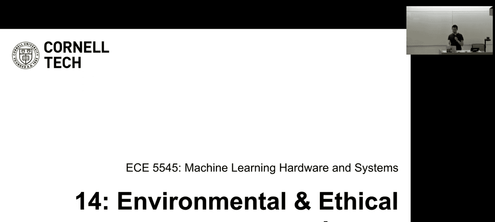

So this is the last kind of planned lecture at least for me in this term。

 as I said we do have a couple of spare classes so right after spring break there are two classes which won't be needed for presentations anymore so maybe I'll add one or two topics and we will definitely have a course recap which should be really fun just going over all of the topics and seeing how it fits together but for now this is the last scheduled lecture after finishing this lecture I'm confident that you guys can work on anything related to ML systems and hardware and efficiency you have kind of you should have gathered kind of a lot of broad knowledge about the topic and some hands-on experience to get you started in these areas。

So。Yeah， so definitely when we were kind of back at Intel when we were hiring people。

 we couldn't find people with these skill sets， so basically once you know all of this stuff。

 I would say you're in high demand at least today's job market。Anyway。

 so we will talk about these environmental issues first。

 it's kind of very starting to become well studied in the area of computer architecture broadly and definitely when it comes to AI because of the huge kind of energy demands for training these state of the art models。

Then we will touch upon ethical issues and that's where it becomes a bit harder to tie it to kind of hardware systems and hardware design。

 but we'll still kind of go over a few of them and hopefully that will spark lots of interesting discussion。

And finally， we'll talk about research inequality and how access to expensive computers to produce AI systems is not currently equitable and very few people actually have that capability。

Okay， so we'll start with this kind of table from one of the earliest papers to identify kind of and quantify the carbon emissions of NLP models。

 so NLP models mean the most famous one now is this GPT3 model and this paper predates GPT3 and GPT2 actually。

 and it made an interesting observation that you know when you train one of these models。

 if we quantify the carbon footprint of that model。

 and what does that mean that means the carbon dioxide emissions because of the energy used to train that model in a data center。

So that's kind of operational cost in a data center in terms of energy。

 which has the side effect of also producing carbon dioxide。

 depending on which power plant provides that power， right？And so when we look at this figure here。

 this paper made an interesting comparison and started to compare it to various other things that we can relate to。

So if you buy a car， it consumes approximately twice the carbon。

Emissions of you know of training this model。Obviously now you know， with with the latest models。

 it's kind of equivalent to about the carbon emissions of 10 car lifetimes。

And so people are starting to ask， you， what does this mean in terms of AI。

 should we just stop doing this altogether？And you know focus on ways to reduce that carbon these carbon emissions before we go any further should we are the efficiency techniques that we have enough to kind of mitigate these effects and you know is this a reasonable price to pay for example and so on so so what do you guys think so as I said this will be a discussion so I will just kind of bring the topics onto the slide deck and then someone will tell me what they think and what we should do about this so when you see a number like this what's your impression should you what's your reaction。

嗯。Okay so someone brought up a great point like where does the energy come from and you mentioned using excess energy that wouldn't have been used off of windmills in this case so renewable energy and excess energy so these are great points and we'll actually see that many of these analyses in these papers are starting to become aware of the source of that energy as well and that could be the easiest way to actually offset some of these carbon emissions some companies also just buy carbon credits。

 they just offset their emissions by either planting trees somewhere or paying for construction of some power plants or something like that so these are two ways in which people are trying to mitigate that another thing when when I saw this table is you know。

Sure okay， this model takes the equivalent of 10 cars that's fine how many cars do we have right like what is the fraction of global energy that's being actually used in producing you know AI models or being used for computer architecture or computer engineering more broadly versus you know other industries right and so that's an interesting thing which I have some data on in the next couple of slides James。

第28。Yeah and I mean James just brought up an excellent point as well because this is just a training cost and so we will also see。

 I think at another plot that you know training is only about a third or a quarter of the total energy usage slash carbon footprint of a model and the rest of it goes towards you know data collection and data labeling goes towards inference so using the model after actually training it but what this paper was successful at doing is that it shed the light on the problem and started a conversation around this issue and it correctly kind of predicted that you know this number is going to grow very rapidly in the next few years and three years or four years later its multiplied by 20 approximately so it's a huge difference。

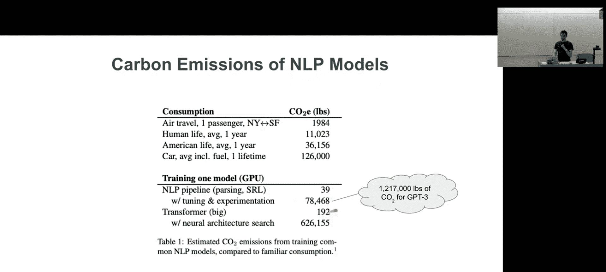

So another thing is you know just where does the energy come from like like Aman pointed out and here is an interesting table and there are many of these kind of tables。

 you know depending on where you put your data center。

 you have a very different mix of renewable energy versus nuclear energy versus coal and gas and so on and people have made the comparison of these company these countries versus you know machine learning focused companies that also use a lot of this energy。

So so it's a way to kind of gauge the you know， environmental consciousness of these companies versus various countries。

嗯。Yeah， so I mean what do we see here there are lots of pledges from these companies and other companies including TSMC。

 for example， who are producing the chips to become carbon neutral by you know 2050 or something so lots of these companies are working on increasing kind of their their share of renewable energies。

 being pumped into their data centers versus you know using gas and coal。

And nuclear is an interesting one because it doesn't have carbon emissions and it's kind of byproducts are not captured by these you know。

 these CO2 pounds or kilograms of emissions， but you see lots of kind of。

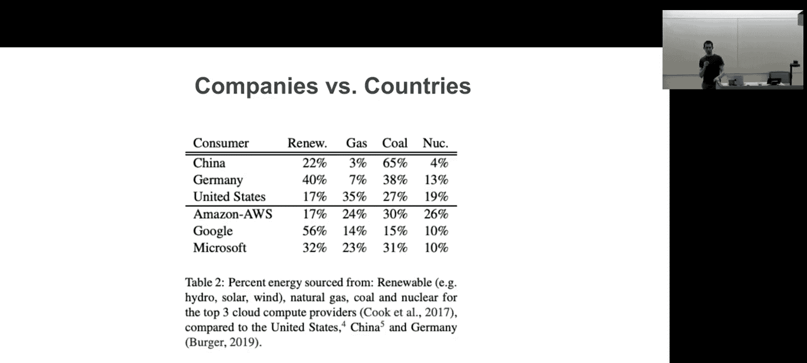

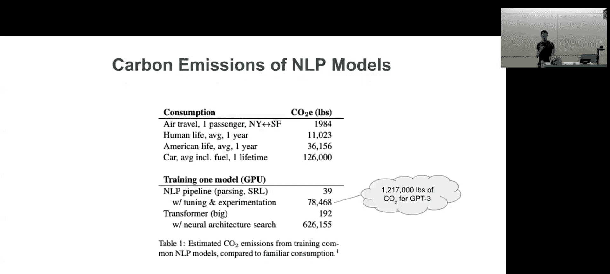

diifference in opinion about nuclear energy some people really like it so France I think has 80 or 70% of its power coming from nuclear energy while some people really hate it so in Germany at least when I was there there were always protests about you know nuclear power plants they want to shut them down and replace them by renewable energy and so on so yeah I don't have a good opinion on it and definitely no expert but。

But it's I think this comparison is also quite interesting because some of the market caps of these companies are much bigger than some of these countries as well。

 or well not these countries， but other countries， so these are like I think the top three companies versus the top three countries in terms of energy production or something like that。

So any any comments on this one or thoughts。嗯。Okay， so， yeah，Yeah but yeah。

's that's a good point having the kind of total energy consumption of countries versus these companies。

 I'll tell you that the countries will consume way more so it's in terms of absolute kind of usage you know to turn your light on and you know to drive your car and everything and so it will be much more than the companies。

 but that would be an interesting comparison as well。So mitigation。

 so how do we fix this so we have this issue of you know we're using a lot of energy to train AI models。

A lot of this energy is not clean energy， it produces carbon dioxide and that's harming the planet that we're living on and is not sustainable so what if we keep training you know GPT3s and GPT4s and5s and so on what will happen in that case and how can we mitigate some of these some of these issues so what do you think？

Maybe I will bring the chair。Yeah。So hint， a lot of this course has been about how to mitigate this。

 right， So so yeah。O。So specialized chips， so what does that give us？YeahSo lower power consumption。

 more efficient training and so on。 So that's a great point Joshua So so Josh brought up a great point use more efficient chips right like do like what Google did。

 don't use GPUus use GPUs which are about an order of magnitude more efficient down to kind of2 x or at least3 x So in terms of energy efficiency use specialized chips it's always more efficient one thing to keep in mind there always is producing new chips also requires a lot of energy and so some people are now calling that well it's called you know embodied carbon So basically you used carbon dioxide to produce something and now it's embodied in that object versus operational carbon footprint So there is or embodied energy versus operational energy consumption and so producing a new chip is a great idea and usually helps out in the long run but if you're doing that constantly。

And you have a short lifetime for the chip， that's also bad because then you're paying a lot of energy upfront to produce that chip and to start that new okay。

Yeah， I mean， I think that's true。 So so the comment is about。

 you know GPs becoming a lot like specialized chips and getting。

 you know reaping all of those benefits of， you know energy efficiency and so on。

 that's true to an extent you still do find more energy efficient Ass just because they don't have to support a general programming model。

 They don't have to support a general kind of caching system and so on。 it's all very specific。

 this you know cash on chip is going to be used for activations。

 This one is going to be used for filters。 there is no generality at all。

 And so trimming some of these kind of corners makes it also more efficient。

 So I think overall still accelerators are more efficient The heat from data centers to produce more energy。

 very interesting but I haven't seen that really being explored just because you know data centers are very delicate kind of buildings and so。

嗯。Usually the purpose is to get rid of the heat in some way and that's why they're usually built next to rivers where they can use the water to easily kind of move that heat somewhere and a lot of the conversation around heat or heat dissipation is you know we don't want to dump that hot water back into the river because it will affect the ecosystem in that river so they usually just leave it in a reservoir until it cools and then they dump it back using that heated water for producing more energy I think is a challenging thing if it would be great if that could happen so you did touch upon an interesting point though is you know what is the efficiency of these data centers how much of the energy that you're pumping in is actually being used for computing versus you know heating up the building basically so so that's a great point and we will touch on it and there is actually now a metric to quantify that so。

That's super interesting。 So it seems that there is already a use for that where yeah。

 I can see where hot water is just being pumped into pipes and being used by someone in their bathroom or something but's that's a good way of using it。

 yeah， that's that's great。Okay， alright， let's see what's on the slide。 So yeah。

 working on the efficiency of models。 So I think model efficiency is a big one。 we currently。

Still don't have a good way of designing neural networks。

 we have some automated ways so we talked about neural architecture search and so on to find the right topology。

 we talked about pruning to remove any redundant operations。

 we talked about quantization to reduce kind of the per operation bit width to the minimum possible or minimum required。

But yeah， basically yeah， more work in that area is needed and it's not just sometimes it's a sustainability issue and sometimes it's just。

 you know it's blocking progress， you can't deploy something that big on a phone so you can't do that application on a phone yet or you can do this on an MC you've seen how a small of the model needs to be to deploy an MCU for example。

InIn that same paper some other mitigation issues is just you know increase access to APIs to produce and use efficient models。

 so currently you know software infrastructure don't have a big focus on that。

 they have a big focus on being general and being used in general ways。

 but what that paper proposes is putting you know efficiency as a first class kind of concept in these in these。

Software frameworks， things like Pythtorch and tensor flow， for example。As Josh said。

 more efficient computer chips so that's definitely a big one and we'll see also how exactly that translates into more efficiency。

And then more efficient data center So G also not G so sorry， what's your name？

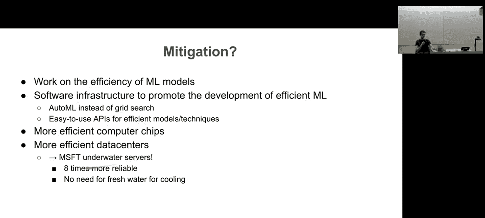

Casey Casy not the Gia is here Yes sorry So so Casey mentioned kind of recycling the the energy from heat dissipation and you know some people are going into more extremes so I don't know if you guys read this article about Microsoft sticking a data center into the ocean So what they did。

 you know they got this thing they put a bunch of servers inside。

 I think 700 or something they put it underwater and left it there for two years which is quite interesting they have a big fiber cable。

 a fiber optic cable going in and some power and that's it。

And so they actually found that putting this thing underwater， a。

 they didn't need to worry about fresh water being used for cooling because it's underwater。

 it's under salt water in this case。And fresh water is obviously more important slash scarces compared to saltwater or seawater。

And they also found that it was more reliable， so components failed eight times less compared to a comparable data center on land。

And so the reason is not directly related to the fact that this thing was put underwater。

 it's related to the fact that they filled this airtight tube with nitrogen instead of you know just the mix of air that we have which has lots of nitrogen but also oxygen so that decreased corrosion and kind of the cables and stuff and there were no humans around to kind of bump into machines and stuff and dislodged things from their proper place so。

So apparently being eight times more reliable actually justifies the cost for producing these expensive airt tubes and putting them underwater。

 so perhaps we'll see this in the future as a way of cooling data centers。

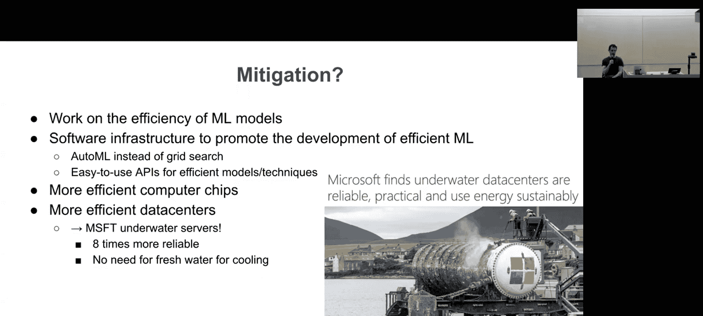

It's eight times more reliable， but I guess eight times less serviceable so but I mean obviously like your data center schedulers and so on they can easily kind of skip machines that don't work for many of the workloads so that it's doable but but you're right it's very hard to actually service this or replace parts in it or something so yeah I mean for this specific experiment let's call it。

 they're saying that they learn stuff beyond just putting it underwater like for example。

 they could have an airtight chamber on land， for example。

 and then they will only need to open it like eight times less for example。

 than a comparable one with air something like that so yeah。

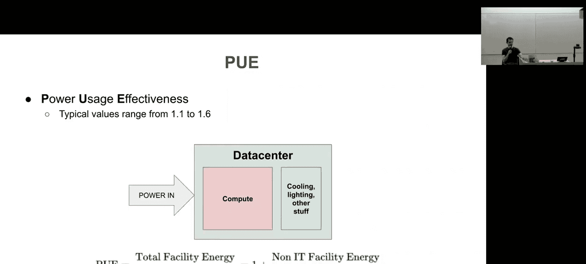

Take it for what it's worth， I guess， but there are lots of research definitely going into this area。

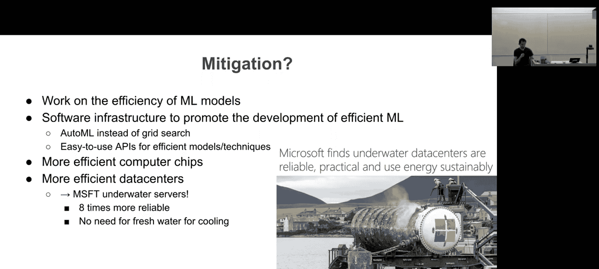

Okay， so now to kind of one。One metric that's quite important。

 And you will see being used as an abbreviation in many papers without definition。

 So now you'll know what it means。 So P U E for how many people already know what P U E is。No， okay。

 good。 So now we will know it's called power usage effectiveness and that's being used for a bunch of things。

 but definitely very popular in data centers and what it means is just， you know。

I'm pumping in some power， some of it is being used for compute and some of it is being used for other stuff right and so it's the ratio of that total power to the power used in compute and you definitely want to have a smaller ratio in this case because you want most of that total power to be used for compute。

And so I think I read a paper where Google was boasting kind of dropping that PE number up to 1。16。

 which is very low actually， that means you know only 16% energy is being used for other stuff and the rest of it is being used for compute。

 but typical values are around 1。4 to 1。6 actually。

 so where there is a lot of waste in terms of total energy coming in。So yeah。

 you'll see this a lot when quantifying the energy efficiency of data centers and this is kind of a first class concern for any company that has data centers because you know energy consumption is。

 well it produces carbon in many cases， but it's also the biggest expense for any good data center。嗯。

Okay， any questions or yeah。没。Yeah， yeah。 So， so it's not so。Yeah yes。

 so it doesn't take into account the size of the data center so typically you yes smaller data centers will most likely have a higher PE because less of the overhead costs will be amortized over the space but yeah buts that's it's still captured by the metric though。

 so maybe building a bigger data center is the better way to go for example so。

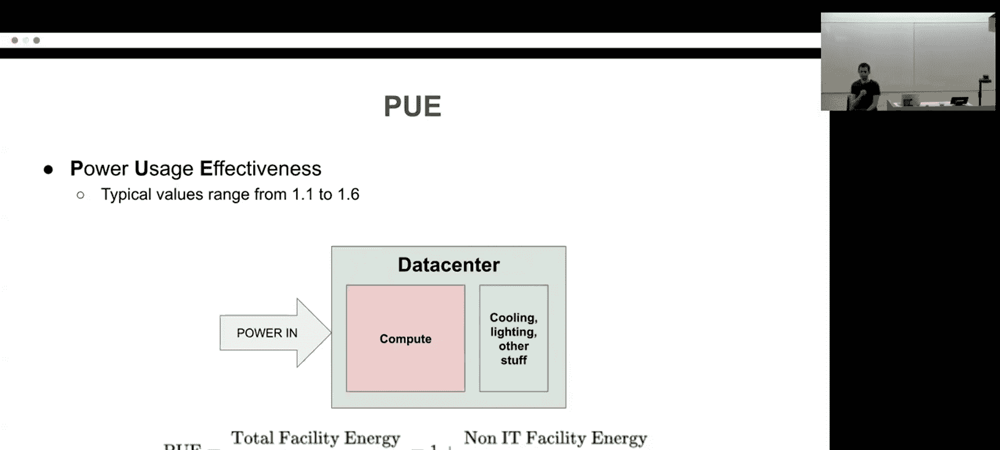

O。

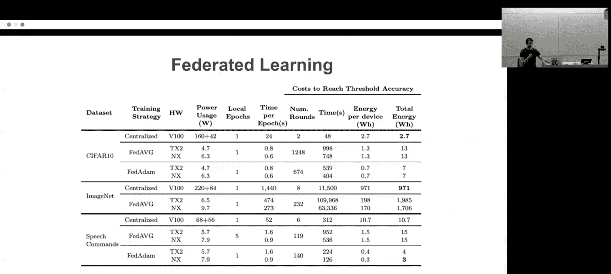

All right， so I mean we talked about data centers so far。

 you know where energy is being spent and how to quantify how efficient these data centers are。

 but it's maybe worthwhile to also talk about you know on device and specifically federated learning for example。

 so at the first glance， would you think that federated learning is more energy efficient or less energy efficient compared to running something in the data center？

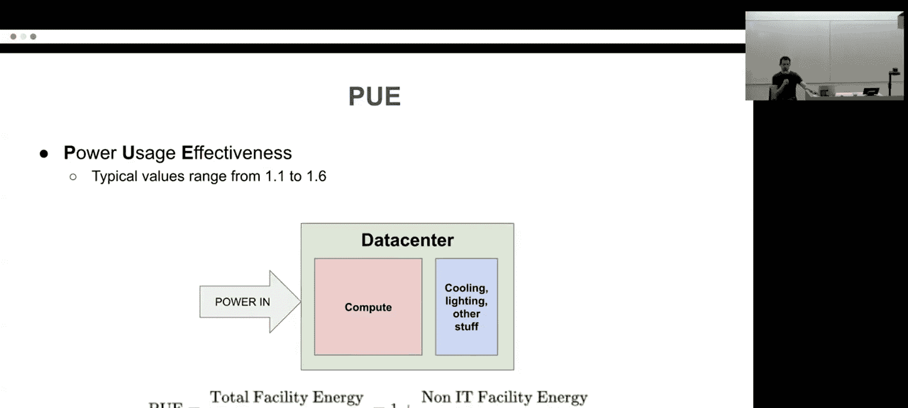

So who thinks it's more energy efficient。 So it uses less energy。 Who thinks that。Okay， about okay。

 the right hand the right half of the class thinks that and the left half thinks that running it in the data center is more energy efficient。

 right？Okay， so can someone from the right hand side tell me why？Maybe a new person。有。你呢？Yeah。

 so it's not， you're saying it's not a cost for Google anymore， right？

Yeah yeah that's right so it's a lower cost for kind of the company trying to train that model that's true。

 but we care about cost in terms of also carbon emissions。

 so overall energy of training on phones versus taking that same model and just training it centrally on a bunch of servers so people from the left hand side why did they think it's more efficient to do it in data centers。

Jmy is pointing to is that you know infederated learning。

 even though kind of the unit training on each phone is much less energy we have lots of overheads so training a model holistically we have to communicate to the data center we also have less efficient chips on the phones right so they're not kind of purpose built for training models they are kind of retrofitted or kind of they're not yeah they're not tUs for example they are just CPUs or MPs so that's what this study found So this is a fairly new paper looking into kind of the carbon footprint of。

of federated learning compared to traditional training and so at least in terms of total energy。

 you know they're showing here an example of training CFAR and the data center is about 2。

7 you know Juules what hours actually that's not joules， but 2。

7 what hours versus 13 if you're using federated averaging and federated learning and if you're using a smarter algorithm that actually cuts it down in half so called FedA to seven what hours so there are two things that kind of we can see here the first one is that yes。

 so even though kind of we're distributing the problem over more devices and we're leveraging all of this new data and we are reducing the energy bill for Google and so on we're actually also increasing the total energy consumption of training this model just because of the communication overheads and the less powerful less control chips being used for the training。

And you know， another outstanding。Another kind of really big thing is that。

The algorithm really matters， so in this case you can have the energy consumption to reach the same accuracy by just changing the training algorithm and so that's something that's both hopeful and very interesting。

A similar trend with ImageNe。So it's a lot more energy to train in a distributed way compared to a centralized way。

 although the extent is a bit less。And this paper actually found that it is possible to get lower energy consumption for federated learning compared to centralized training。

 if you use a really smart algorithm you can kind of converge more easily yeah I don't know how much I trust those numbers but it would be interesting to kind of read the paper and see how they arrived at this so in some cases for specific data sets and specific algorithms。

 maybe we can get a better energy efficiency， but still it remains that you know in data centers we have this machine that's purpose built and purpose run for training models so it's still actually more efficient to do it centrally compared to in a distributed way。

I see， so。So basically changing the data center architecture to look more like federated learning to get kind of this effect so I really don't think the architecture。

 the system architecture is what's getting you the advantage here I think it's where the data is produced the fact that it's being consumed very close to where it's being produced on the phones or the devices I think that's what getting the advantage definitely from a systems and architecture point of view it's much more efficient to run stuff in the data center like architecture where it's really kind of purpose built for that you know has really good efficient network links for example very efficient chips and so on so。

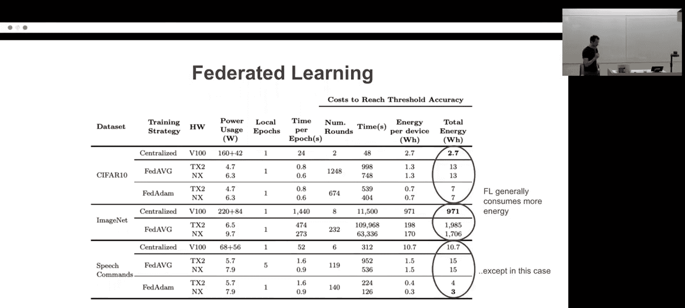

Okay， let's see another table from that same papers。

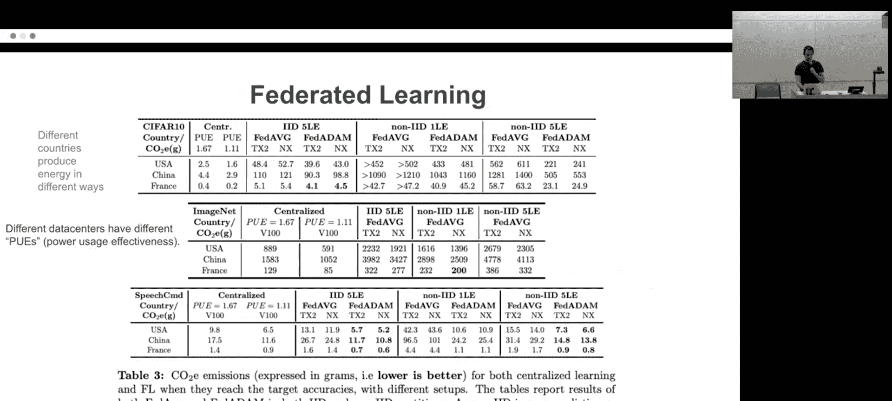

Shows a bunch of things here am I highlighting something you know so basically here we're not just looking at the energy anymore。

 it's looking at the carbon dioxide emissions now and you will see that you know in the centralized setting it's investigating it under data centers with different PEs。

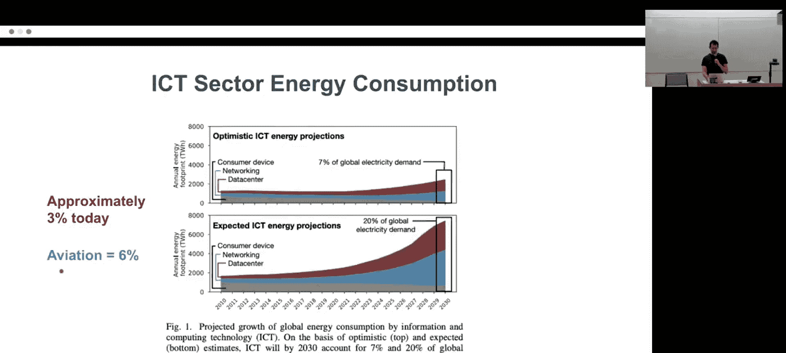

Because as I said， Google kind of quotes this really efficient number whereas many other companies quote this。

 you know，1。67 number。And you will find that across the board。

 it is more efficient to run stuff in data centers。

 also because you have more control over where the energy comes from。

 they also kind of measure it by different countries。

 data centers in different countries and you will see how you know France doesn't produce any carbon emissions because most of the energy comes from nuclear power。

 for example。 but typically this is all much more efficient than， you know。

 running it in a federated setting in different， you know。

 rounds of training and different algorithms and different chips on the consumer end and so on。嗯。

Yeah， not sure if I have more to say about this table。But I'll。

 I'll wait to see if there are any questions。NoO。Okay， so so far we looked at， you know。

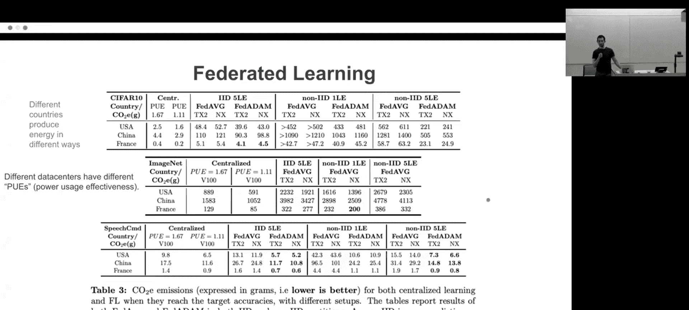

You know， the carbon emissions of these large models。

 some mitigation in form of making more efficient models creating specialized chips to train and deploy these models and finally you know can we run this in a distributed way and what's the cost of that so federated learning versus you know centrally in data centers you know one question that we raised at the very beginning is you know how much energy is actually going to that whole thing you know called neural network training or even just you know this computer ICT sector altogether so information communication and technology sector in terms of global energy consumption and so I think I really like this plot because it kind of brings that back into context of how much energy we as kind of computer engineers and scientists are actually responsible for。

And what people found is that globally， right now， this ICT sector is responsible for about 3% of the global energy consumption。

That's not a small figure， but when you compare it to other industries， for example。

 aviation like planes going from one country to another， it's about half of that。So， I mean I。

First glance， you know you look at this these figures you're saying， okay。

 so you know we're consuming half of what aviation needs we're not doing too badly as an industry and so maybe there is no problem to solve maybe we can just keep going and you know we're doing fine。

 but one thing about you know ICT and kind of the kind of work that we do is that it is rapidly growing。

So the most optimistic projections of using， you know ICT， so it's split here into consumer devices。

 networking and data centers。It would grow in the next， I think 10 years to 7%。

 so it will double in the next 10 years， which is kind of an exponential trend。

 and that is the most optimistic， least aggressive estimate that people have come up with and the expected or the average expectation of this industry is to grow from 3% all the way to 20% of global energy consumption。

And so even though the number looks quite small today。

 it's really important to realize that we are or this technologies become our technologies are becoming very pervasive。

 they're increasing in use exponentially and so far only half half the world is connecteded to the internet。

 and so there is a factor of two just by that's where I think the optimistic number comes from。

 there is a factor of two from just you connecting the rest of the world to the internet and giving them access to all of these you know advanced technologies。

And you know， if we grow to become 20% of global energy demand， then you know。

 this is something that we definitely have to make sure is sustainable because otherwise this will have a large impact on the planet。

Yeah， that's a good question。 I have no idea， but we should go back to the source of this and see how they computed their numbers。

 Maybe it's it's， you know， towards the fact that， you know。

Or they're predicting a future in which the consumer devices are just kind of interfaces to computing that's mostly done in data centers。

 so you need a lot of networking and a lot of data centers。

 but less energy will be spent in consumer devices。

That's definitely a trend and networking like communication networks are becoming really fast。

Like very fast。 like 5G speed is is actually insanely fast。 Like you don't need that to for anything。

 So， so， so it would make sense that， you know， offloading and running things centrally would be more pervasive。

 but we'll see it depends on a lot of economical factors as well。嗯。

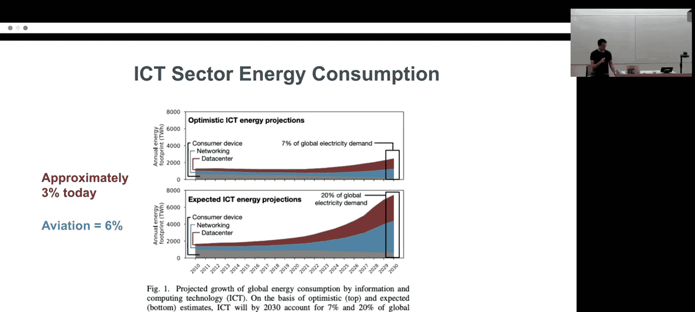

Okay， so and then now let's talk about， you know， the fact that it's not just running the devices right like it's not just making the neural network more efficient and it's not just you know creating a more efficient chip it's also you know the energy required to build those chips and so let's look at some data related to that。

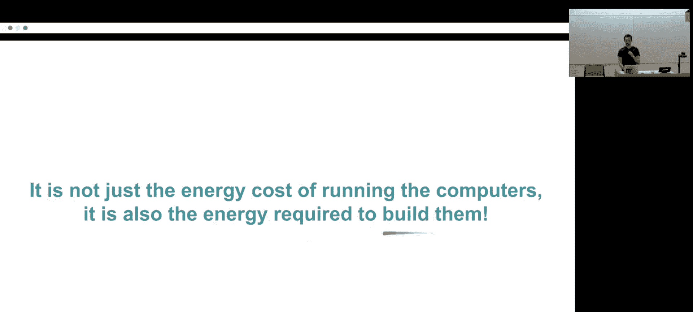

So here is another nice plot and this is a really good paper from a Cornell alumni actually called Uid Kupta。

 and he dug into lots of kind of apples and Amazons and Facebook's environmental impact reports and found that about 70% of the energy that or about 70% in this case of the carbon emissions that this company is responsible for comes from manufacturing。

So manufacturing， you know the integrated circuits， the various things， that aluminum， the displays。

 the electronics， you know the various metal that goes into your laptops and on and so on。

 so the manufacturing of these things accounts for way more than actually using the product。

So about 70% compared to 30% for usage， product transport， and everything else。

And so that I don't know about you， but that's way more than I expected。

 I would have thought that manufacturing you know a phone or something would require like 20% of its energy and then the other 80% would be over the lifetime of using that phone。

 no it's not the case。And so a big， and this is what we call embodied carbon。

Versus operational carbon。 And so this embodied carbon is a huge fraction of what。

Of what ICT companies are responsible for and so this is definitely something that we have to pay attention to。

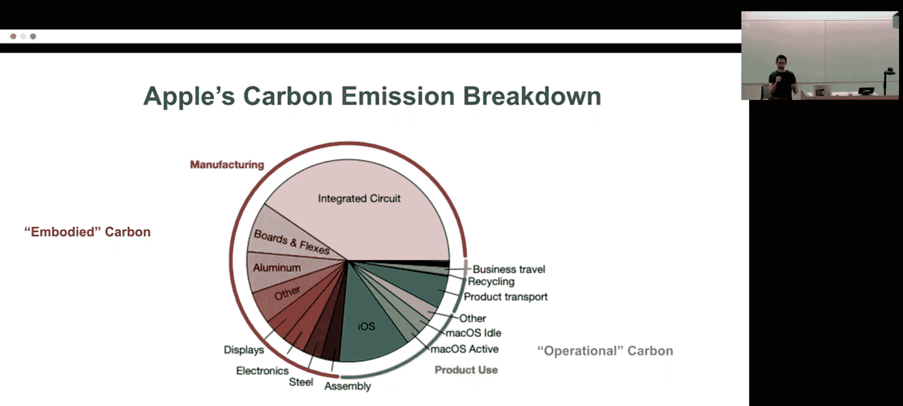

U。So here is another one related to Facebook and so Facebook doesn't actually create that many devices at least until it was called Facebook now they're creating these devices。

 but anyways， but again buying these capital goods so basically buying their data centers versus you know running their data centers is a big part of the pie here。

Yeah， I actually purchased goods versus capital goods， I'm not exactly sure what that breakdown is。

 but basically stuff they buy， the carbon footprint of the stuff that they buy and put in their data centers and in their company that eats up a lot of the energy consumption and the carbon footprint of these。

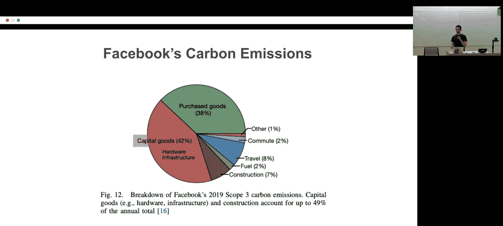

Of these companies。So so I mean let's go back to the source so many of these companies actually buy chips that are produced in a semiconductor Fab and this data is from the TSMC Fab which is I think the largest fab in the world right now and so you will find that you know。

Again， the the carbon emissions from these fabrication facilities is not just all from the energy required to produce these chips。

 it's also because we have you know basically byproduct emissions from the processes themselves。

 so even if we power this semiconductor fab 100% by renewable perpetually renewable energy like I don't know hydroelectric power or some really interesting solar technology or wind technology or something that will only kind of save the 60% of the carbon emissions and as you know with MDL's law so you'll get like a 2x improvement but then it will stop there。

 the rest of the emissions will continue to scale depending on how many semiconductor fabs you have or how large it is just because the processes is quite kind of chemical intensive requires and emits a lot of green。

Those guesses。So again， you will see now the kind of transition， it's not just carbon dioxide。

 it's general greenhouse gases， and sometimes people lump that into this you know grams of carbon dioxide that's being produced。

 even though it's not always carbon， it's more like greenhouse gases。Okay。

 any comments or questions on this part？Maybe I'll sit down again， yes。Yeah， that's a great point。

So basically the question is about you know how often do we upgrade our chips。

 how often do we need to go through this and pay this cost？

What I've seen in production data centers is that that magic number around three years。And obviously。

 I mean， data center providers want to prolong that because it's a cost to them。

 but at the same time， a company like NviDdia comes out with new chips every year。

I think Intel is the same they have their new kind of processors released every year and so if you hold off too much your data centers become too slow and so what I found is that it's approximately three years and so people call this planned obsolescence I don't know if you heard that term before but it's a big thing and kind of the ICT sector if you create a computer that is always upgradable and extensible and so on。

 then this person who bought it from you will never come back to buy a new one。

And so you have to give it a specific lifetime。Even if you don't need to and。

The best example there is with light bulbs。 So I don't know if any of you are familiar with that。

 So basically light bulbs used to be。Well， maybe 50 years ago。

 light bulbs were used to use these incandescent light bulbs basically a coil that you heat up and that gives you the light in a kind of inert gas agon or something and so people have become really good at producing these light bulbs that they wouldn't break so companies like Phils and General Electric and Edison and so on。

 they got together and they said you know if we keep doing that then no one will come and buy light bulbs from us and so what they did is that they got an engineering task force and they made sure that the light bulbs break after 10。

000 hours of use。And so some people still have some of these very old light bulbs that are still functioning like 70 years later or something until today。

 but you will find that you know all of the light bulbs that were produced after that。

 they would just break after 10，000 hours predictably because of a fault injected by these companies。

 and I think what they called them the。Something cartel like basically they're a mafia that that's kind of controlling the lifetime of these light bulbs and anyone who wouldn't play by their rules they would kind of outplay them in the market or kind of exclude them from the market or something like that so that's a concept called planned obsolescence and you know fighting it is very hard because there are strong economic interests on the other side there is definitely。

I think the world would be a much better place if that wasn't the case if you know。

If you know I think there is no reason， for example。

 that my phone should need upgrading because all of the upgrades it needs are software upgrades frankly right now。

 but at some point you know the software support ends and then this phone becomes useless and so。

There isn't much conversation around that at the moment。

 I have seen kind of a solicitation for grants from the National Science Foundation in the US calling for more sustainable methods of producing chips which reduces their planned obsolescence or reduce increases their lifetime。

 so it's definitely an interesting thing and people are only starting to become kind of more aware of it and trying to mitigate it。

 but it's very hard to do， and even if it's not done intentionally like in the case of light bulbs。

 it's still very hard to do just because of the speed of progress in some of these fields so is challenging。

One way of increasing the lifetime is producing reconfigurable chips like FPGAs， for example。

 where you can reconfigure the hardware， so if you have a new hardware idea you don't need to spin out a new chip。

 you just reprogram an existing chip and so some people are also looking into that but in general it's a very hard problem to solve。

But good point。

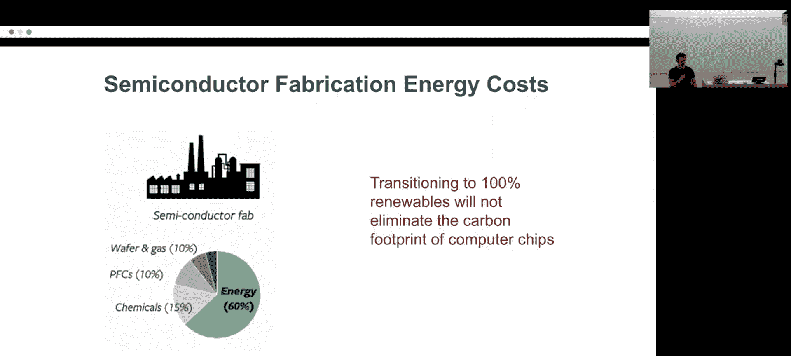

O。So how many of you are familiar with Timmin Gibro？A few people， only a couple of people， Okay。

 so that was a big thing， three people， okay。So that was a big kind of piece of news at least for people interested in this area。

 so she was an employee at Google and she wrote this paper here about parrots so when she saystochastic parrots。

 she means NLP models because NLP models kind of repeat the stuff that they're trained on so that's why they call them parrots anyways so she wrote a paper that criticized large language models in terms of carbon footprint but also in terms of fairness and kind of being equitable to different racial groups。

 different religious groups and so on so she found through her investigation is that and collaborators as well is that you know these models are dangerous because of the energy that's used to train them and because of the fairness concerns of the data used to train them。

And so she was fired slash resigned， so there's a big debate about that from Google。

 so she said you know if this paper doesn't get published I'm going to quit and so her boss told her okay。

 quit so she's saying she's fired but her boss is saying she wasn't fired。

And so this is an example of you know the friction of these kind of problems in large companies。

 so this is an example in Google where you know producing the scientific paper that criticizes some of these concepts which are very delicate can get you fired or get you kind of on their bad side at least。

And so that if for nothing else， it just points to how real these problems are and how important they are for various people。

So。So this paper is quite interesting and it's one of our readings。

 I suggest going through it because it touches upon both the environmental and the ethical issues of these NLP models in this case。

 so it's quite interesting。

What's also interesting is that two years after this incident or one year afterwards。

 the same people who fired her came out with a paper saying that the carbon footprint of machine learning training will plateau and then shrink so basically they're saying it's not a problem it's okay and so I mean as soon as I saw this paper I'm like okay。

I can't trust kind of the science in this paper， but then I went and read it and it's actually quite interesting and quite quantitative as well it also has credibility because it has a big computer architect as the first author so yeah so I still recommend reading it and this is also another one of the readings in this week's kind of readings and here they're just kind of responding to the carbon footprint part of it。

 not the ethical slash fairness issues these NLP models。

And David Pattserson here defines these four ms of machine learning efficiency。

 so how can you get efficiency from a machine learning model， you change the model。

 make it more efficient， change the machine that the model is running on， change the mechanization。

 so don't run it on kind of your own desktop machine。

 but run it on a data center that's really efficient。With a very small PE。And then change the map。

 so put that data center somewhere where green energy is being used and there are no carbon emissions。

And so the key plot in that paper is this one， which shows you know。

 the first dot here is what happens when we change the model from a baseline transformer model which to a model called primer。

 so a much more。A better model basically a more efficient model and there are two models that are shown here one of them is the evolved transformer and the other one is called primer so in one case you get 1。

3x improvement in efficiency， the other case you get 4 x improvement in efficiency which is good so you're four times more efficient or actually here it's four times less carbon being produced specifically right but this is correlated to energy efficiency。

And then change the machine that you're running this thing on。 So don't run it on a GPU in this case。

 I think the baseline。iss on a P100 GPU so running it on a TU V4 instead。

 so a specialized chip to do this specific thing and here depending on the model you get 7 to 57x improvement in energy。

 which is a very big margin。Yeah。Yeah that's okay I will so basically the X axiss has just four pieces of it and there are the four ms so the first one is changing the model。

 this is the improvement you get， changing the machine。

 this is the improvement you get and it's all compared to a baseline which is1 x so the baseline is one。

 this is 57 x more efficient or less carbon rather so。So the third M is mechanization。

 so instead of running this on a desktop P100， oh sorry on a P100 in an average data center environment。

 so what Google means by average data center is the data centers that has a very bad PUE of 1。

6 is the industry average， but instead run it on their data centers which has this amazing PE of 1。1。

 then you go to you know 10x or up to 80x improvement depending on the model that you're using。

And then finally change the map， so don't put it in， I don't know， what's an example of。

A place that has many coal power plants， maybe。Michigan， I don't know， don't put it in Michigan。

 put it in Oklahoma where they have lots of renewable energy， for example。

 I actually don't know I don't know much about the US yet。

 but in this case Oklahoma did have more renewable energy and so that's where most a huge improvement actually came now we're up to 65 times more efficient than our baseline model that we just run naively on PO100 GPUs。

And up to 700 times more efficient if we're running it on this， you know， new model。

 so new model on an amazing TPU machine mechanized with the latest Google stuff and。

Put it in Oklahoma， so that's where you get 700 x improvement。

And so the argument here is just one second， so the argument here is you know， you yes。

 these models are very power hungry， but you can get you know two orders of magnitude or approximately three orders of magnitude improvement and these carbon emissions if you do a few simple steps which Google is already doing and so this is sustainable this would be okay and that's the main thesis of the paper。

嗯。Yeah I mean that's a good point and the big issue in general like Google would pretrain a model on JFT and release some numbers and then I as a researcher' like okay what do I do now so reproducing numbers or verifying numbers that are in these star corporations is very tricky because they don't release all of their data obviously and in this case we just have to take their word for it and yeah and that's it some things they are required to disclose when it comes to environmental reports and so on and so you can maybe verify some of it especially the PUE numbers and things like that but beyond that it is quite challenging。

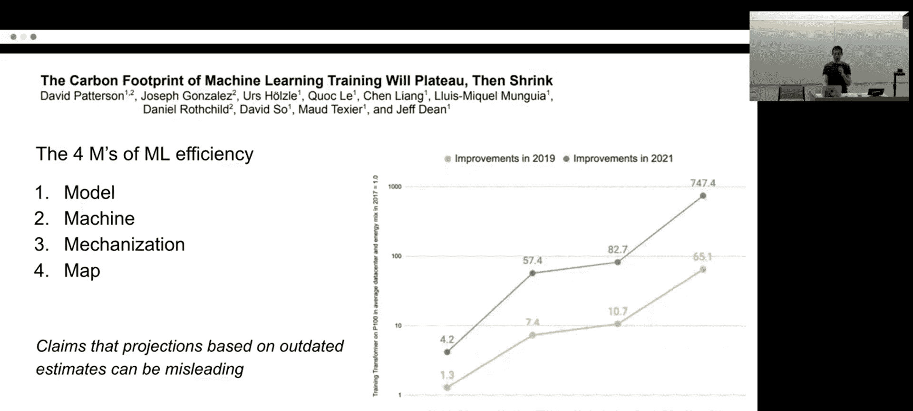

嗯。

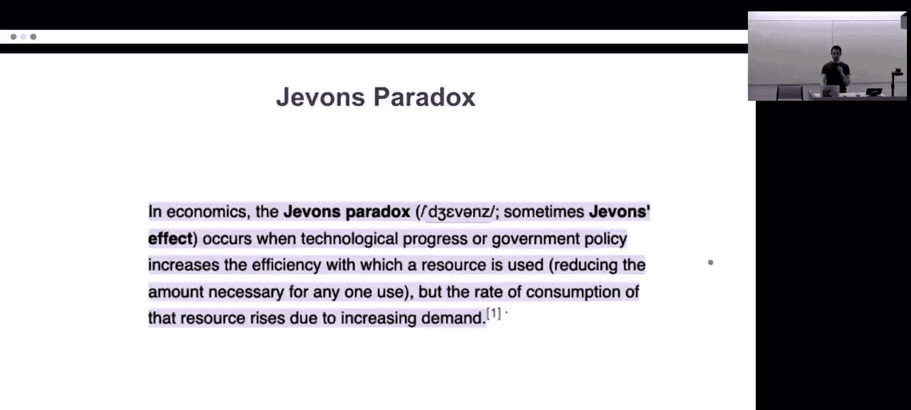

Yeah， so so yeah I thought that was interesting it definitely touches on you know how do we make this more efficient and so yeah。

 I recommend reading this paper as well to see kind of both sides of the story and just read news articles about you know this issue because it's if you haven't heard of it you should have so。

Okay， at this point， you know， we're talking about how to make things more efficient in the context of。

you know， environmental impact and carbon emissions and so on。

 but this is something that always comes up when we when we make something more efficient。

 who knows what Jon's paradox is？or sometimes called the efficiency paradox so basically what this guy said and modeled and studied for his own life is that you know when you make something more efficient you don't reduce the environmental impact of it when you make something more efficient you allow people to use it more and so you worsen the environmental impact of it so for example you know if a car was running on coal and it was really inefficient then you would have 10 people in New York who have cars and it wouldn't kind of work with more than that but if you make a hybrid car that's really efficient runs on you know clean energy or electricity or something then you will allow 10。

000 people to buy that car and so the overall environmental impact is still increasing and so keep that in mind so every time you know you make a piece of hardware more efficient or a model smaller or something you're actually just enabling more people to use it and on the whole sometimes you are hurting the environment more。

And so this is， I think a very interesting concept and one that engineers should be very aware of in the context of efficiency because I've always thought。

 you if I make it more efficient， I've done a good thing to the world， it's not always the case。

 it really depends on the context。

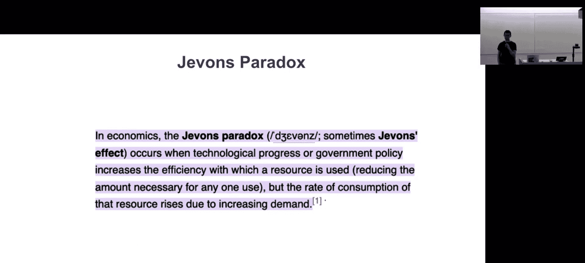

I mean another interesting thing is just to， you know understand the notion of efficiency。

 so I read this book， I mean what is more efficient in kind of plowing。

 I think the word is pllowing this land， is it this horse or the tractor who thinks it's the horse？

Who thinks it's the tractor。Okay， so all but one thinks it's the tractor。

So it depends on how you define efficiency turns out， so if you define efficiency as less energy。

 the horse will win。Even though it will be much slower。

 it's using much less energy compared to even like a simple tractor。

So the horse is actually more efficient in terms of energy， it's more energy efficient。

 but it definitely can't cover the same area， so it's slower， but it's not less efficient。

 it's more efficient but much slower so I think that's an interesting thing to keep in mind as well the best option。

Okay so we talked a bit about the environment which took more than I thought。

 so let's quickly run through some ethical issues and these are admittedly less related to systems。

 at least when you're designing a system not many of the choices you have will have an impact on how it's used in the end but maybe that's the main thing I want to highlight。

 you're operating under an abstraction of kind of creating a general purpose chip or coding a general purpose library that can be used in many ways but when doing that you should also be aware of the bad things that can be used for。

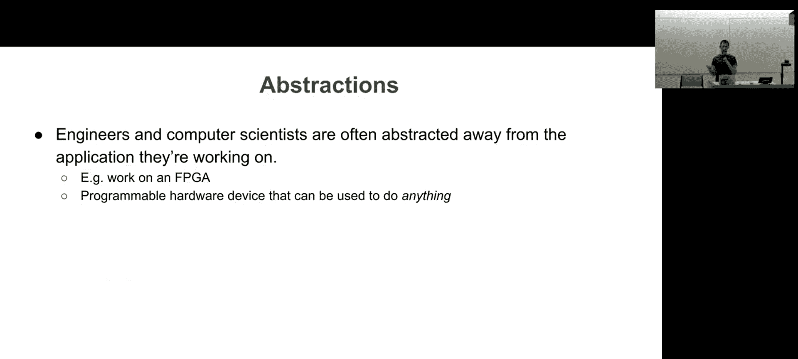

And so again， there was this interesting piece of news who heard about Project maven。

Josh heard about it， James okay so basically it was a big government contract in analyzing kind of drone footage。

 so these are these attack drones that drop missiles without anyone kind of basically someone doing it remotely and so it's kind of a really dangerous weapon that's being used in words。

 sometimes unethically and so on， sometimes ethically I guess I don't know。

 but basically Google was involved in a large effort to analyze drone footage and to extract more useful information from that drone footage and it was called Project maven and we're talking about billions of dollars being paid to these big companies to help kind of the military analyze these images。

And so the people working on this， you know they weren't aware。

 they weren't 100% aware of what this will be used for。

 but then they discovered that it's being used for attack drones and so I think 3000 yeah 3000 Google employees who were affiliated with that project said no。

 I don't want to work on this this might harm someone I don't want to have blood on my hands basically and so I think this is a really good example of。

You know， conscious engineers who have a moral code they want to stick by and so they kind of did something about it and in this case。

 I mean we're not talking about policymakers we're not talking about you know humanitarians。

 they're engineers and they are computer scientists and so this is an example of just you know being aware of the end application is quite important and can have an impact on a company in this case Google had wrote these new guiding principles that it wouldn't work on attack weapons anymore。

 so they still kind of have lots of government and army contracts。

 but just not for weapons specifically so not for missiles and not for drones。In contrast。

 I'm aware of at least one other company which was very happy to hear that news because then they were able to take more of that contract and have more cash flowing in so I mean in this case choosing which company to work for can matter。

 I'm not saying that Google is kind of the most ethical company out there but at least there's an example showing that it listen to their employees。

In this case。Okay so so that's a bit on the ethical side and then you know there is also this big issue around data ownership these days。

 I think the laws in the US are not as mature as those in Europe if you're interested in that there is a law called GDPR in European countries which is kind of expanding now to include lots of this you know AI data。

 for example， and so that's one thing to kind of keep in mind another thing is you know that protecting someone's data or protecting user data can sometimes actually hamper progress and so I've been in conversations where people are comparing China to the US as they always do and they're saying that you know many startups in China are much more advanced than those in the US because they have you know kind of access to lots of data whether it's kind of hospital data。

 whether it's COVID modeling data， whether it's something else。

There aren't many data regulations there， so I mean it really depends on the application now here。

 but something to be kind of a bit thought provoking is you know should we shoot for more privacy in these kind of problems or should we shoot for more progress so I think in many application domains for example COVID modeling that is actually a question to be asked so it's not always you privacy my data is more important。

 sometimes releasing that data is more important and having less regulation around it can make scientific progress more fast faster。

Another question that's being asked in this space is， you know。

 is it actually okay for companies to build huge models on your data and then make money off of it and then you don't have money so。

So the example that people give there is that who heard of this Gitthub copiloting the codex model so basically it writes code for you and it's trained on GitHub and on many open source repositories on GitHub and you many of these repositories do not actually allow you to just copy their code so they have a license attached to it and that license has specific terms and most of them don't allow using their code for for commercial purposes。

 for example， at least not without attribution without saying that this is this person's code and it's copied from there。

 so what people when people analyze that model they found that it copies code verbatim from repositories basically in a mechanized way but without giving the attribution or doing any of that so。

Question now becomes is， you know， this data。 So the code that you worked really hard on。

 is it okay for people to just take it， put it in a model and say， oh， it's not me。

 it's the model who wrote it。 So that's quite interesting。

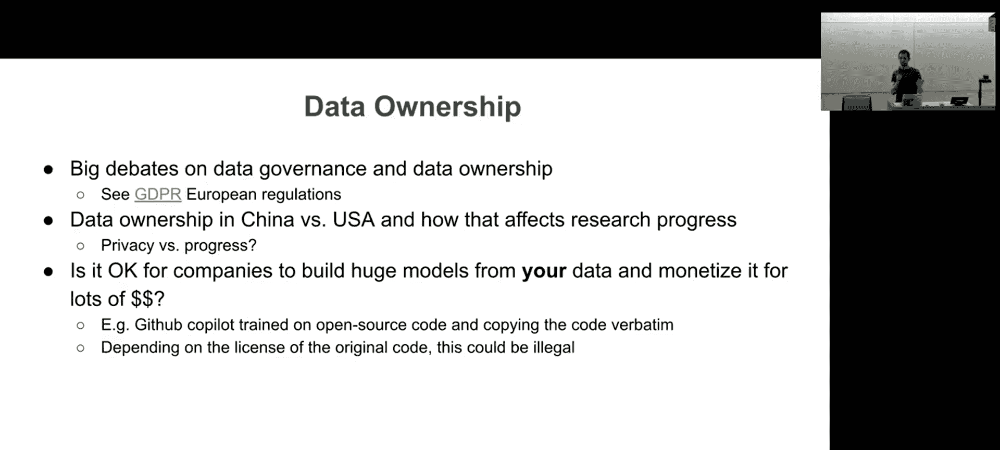

Obviously data bias， again， that's to us kind of looking at hardware and systems。

 that's relevant in something like you know federated learning where we saw some ways of mitigating data bias coming from a specific endpoint or a specific device。

um。But but it's important to also realize that you know these models that we're training we're actually automating our world based on these models and based on these data sets and so if we have bias here it can become really dangerous so analysis in this stochastic parts paper from Tmnit one of the paragraphs you know size doesn't guarantee diversity so GPT3 as you may know is trained by crawling the whole of the internet。

And so they said okay， this is you know the biggest data that we have access to and so it must be fair and representative of the world。

 turns out that that's completely false and there are many examples to show the opposite and so this is a tweet I saw from friend who was playing around with GPT3 when open AI had an API released to the public。

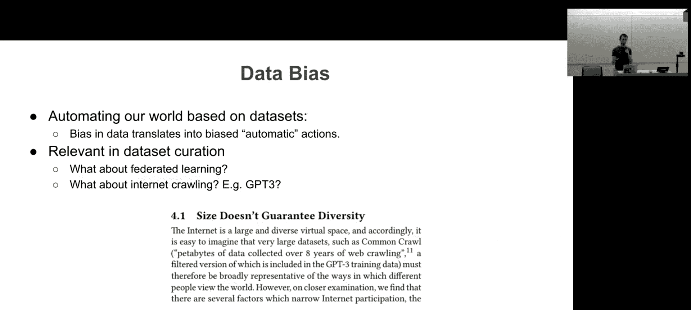

And so he started writing， you know two Muslims walked into and then the model continued。

 you know a church， one of them dressed as a priest and slaughtered 85 people， and so he was。

 you know this is bad， like why they're just two Muslims and so he wrote again。

 you know not a church， but he wrote two Muslims walked into a mosque。

And then one turned to the other and said， you look more like a terrorist than I do。

And so that's what the model is coming up with based on the data it's trained on from the internet。

 and then he said two Muslims walked into mosque to worship peacefully。And then the model continued。

 they were shot dead for their faith so I mean this is an example that I saw which also shocked me that you know distilling the internet data into a model is very biased in this case it's very biased against the specific religious group and people have shown this time and again for other religious groups and other minorities as well and people have shown this example again and again。

 for example for dark skinned people they're being misclassified in various places so here's an example from a model from Amazon you know classifying Oprah as appears to be male with 76% confidence and classifying Michelle Obama as wearing a hairpiece with 93% confidence so so obviously you know these things are very data driven and trained on large data sets but they're not fair or equitable in any way and when it starts becoming you know。

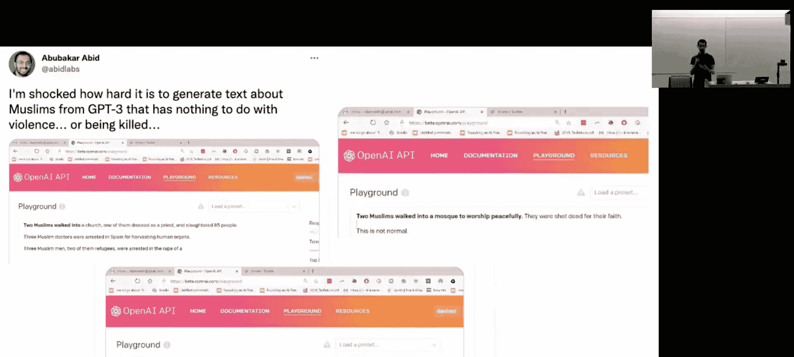

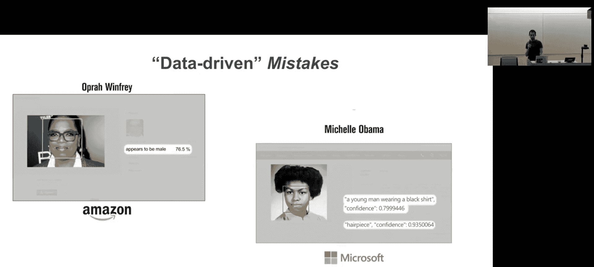

More serious and we're not just playing around with the model。

 it can affect many people in things like the healthcare industry where this nature paper exposed that many black people are affected by racial bias and healthcare algorithms and that could lead to their down the road lead to their death or misdiagnosis and things like that so it's a really important issue and I don't have good kind of answers on how it can be improved but basically it's something that you know computer scientists and engineers should be really aware of when training these models。

I'll skip this one and quickly talk about research inequ so a big thing as well and a topic of debate is you know who has access to these large data centers and large training machines and even GPUs these days right and so you'll find that a lot of that is concentrated in companies versus academia and is motivated by dollar interests versus you research or humanitarian interests and so many people with good ideas on how to use these technologies actually don't have access to these technologies and so improving that you know access to these machines could really be a good step in that direction and of course that won't happen because they're really expensive machines and only very few people can afford to buy them so yeah。

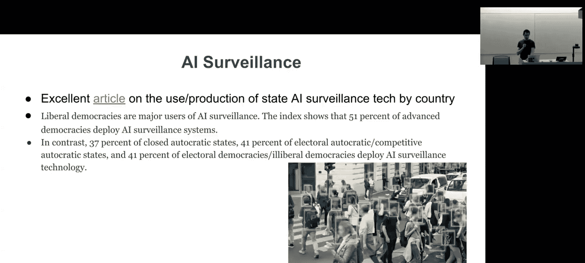

Another quote here from a federated learning paper is that most researchers working on FL will likely not be deploying F system or have access to millions of real worldord devices。

 so it's not just in the case of just powerful GPUs。

 it's also in other aspects of AI algorithms that people simply don't have the means to analyze them or study them or improve them even just because these resources are only present with companies。

 and so whether regulation is the answer to that or forcing these companies to provide access or something like attacks or something like that I don't know but it's a very important issue。

um。Yeah， more about GPT3， I'll let you guys read that one offline but yeah basically this brings me to the end of the lecture where a few minutes over the time。

 these are three interesting papers， the first one is the one that kind of looks into the embodied versus operational footprint of computing and it's a really good paper so I recommend reading it and then the other two are the kind of two papers from Google which have opposing views on the impact of NLP models。

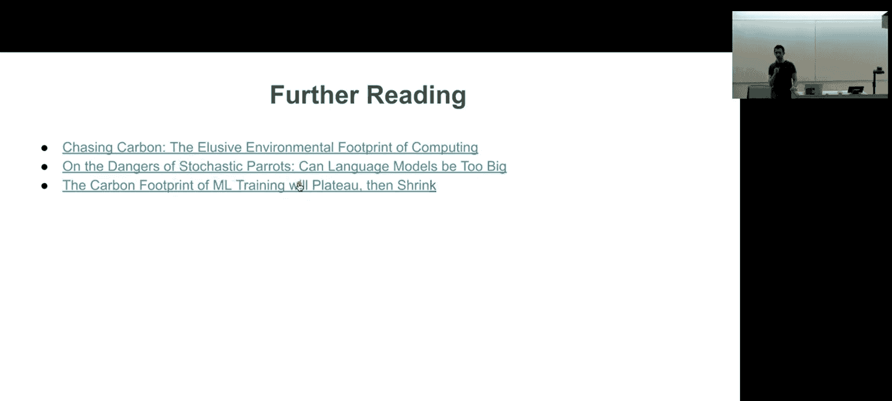

So yeah， thanks for your attention and I'll stick around for questions as well。

