# 康奈尔大学《深度生成模型Deep Generative Models (Cornell Tech CS 6785, Spring 2023) 》中英字幕 - P10：-10-Lecture 10_ Advanced Topics in GANs.zh_en - GPT中英字幕课程资源 - BV1az421q7Vf

Okay hi everybody， so this is going to be our second lecture on GNs。

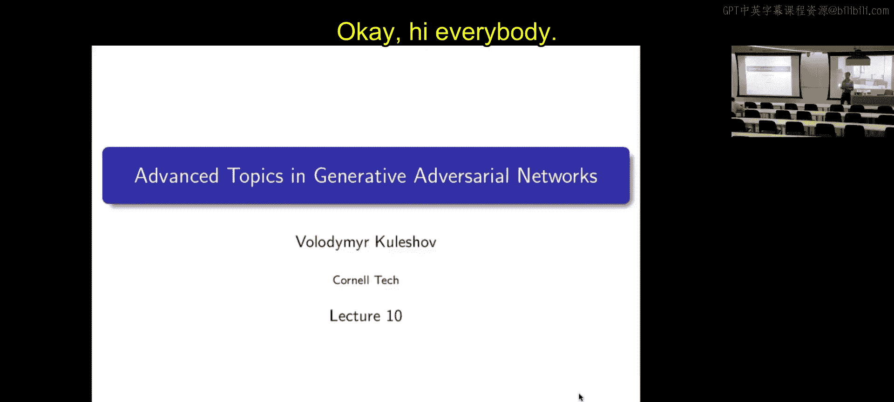

Remember we saw in the last lecture this type of model called gener adversarial networks and you can view generdversarial networks as a game between two neural networks。

 one of them is a generator， the other one is a discriminator so the generator defines a probabilistic model that takes as input some set of samples from a simple input space like a Gaussian and it transforms them into something which will look like our output space like the space of objects we're trying to model。

 so for example it might look like images or it might look like audio wave forms。Or in general。

 most types of continuous data could be framed in this framework and the crucial difference is that this。

Mapping here， this X， this G of theta， which maps X to Z。 It's not。It direct。

Takes in one type of variable and directly outputs the other type of variable as opposed to outputting the parameters of a distribution over the other type。

So， when you。When you implement areas， the G theta outputs the mean and the variance of the distribution over x。

 but here we're directly taking samples over x， so G theta can be thought of a sampler or a simulator。

And's that's really different the advantage of that is that it gives us more expressivity so we never have to constrain ourselves in terms of a particular formula for what the probability over x is we never have to specify any formula。

 we just have to specify a sampling process that that has some sort of parameters and when we specify a sampling process we still define a probability distribution。

Because when we take samples Z， we take samples X， these samples are going to fall somehow in our output space。

 and they will effectively form a distribution of some form。

But we're never going to specify the formula for what the distribution is， but it's there。

So we can express a lot of flexible distributions and probably。

It's fair to say that we have more flexibility in the kinds of distributions we can specify because we're not constrained to define a specific formula and so one important term to describe this is that we're defining the distribution implicitly via the samples as opposed to explicitly via a formula this is why these models are also called implicit models。

Implicit is an important technical term to remember when you think about GNS。Okay。

 so there's a lot of flexibility in how we can specify the generator it's just any function doesn't have to be invertible。

 it just maps z to x。But what makes it perhaps more challenging now is that because we don't have a formula for the log likelihood。

 we can't apply our usual log P of x formula and optimize that because we don't have a formula for log P ofX we just have samples and so therefore we have to define a different oops we have to define a different learning procedure which is based on minimizing a two sample test。

So a two sample test is a tool in statistics， which allows us to determine whether two sets of samples are from the same distribution or not。

And we can also use these tests as a trading objective for the for any general model， right。

 if we can fool the test and make the samples from the。

Model distribution and the data distribution indistinguishable under the test。 then that's good。

 That means that our data is looking more our generated data is looking more like the data we want to generate。

 Okay， so we have so we have to resort to these types of objectives。And in particular。

 what again does is that it。It doesn't just use any test for its objective。

 it learns the test that it should use and this is where the discriminator comes in so the discriminator is effectively a learned statistic in the two sample test right remember in a two sample test we have a statistic that we evaluate on the training data sorry on the on sample one on the first set of samples and on the second set of samples if that statistics if that statistic looks similar then we probably then we're probably then it's more likely that the two samples come from the same distribution but there's many statistics that we could use and in again we learn that statistic and that's what the discriminator is。

And the reason that we can learn the discriminator is that we have our model。

 we have a real distribution， we can generate samples。

 and then we have examples of real samples and examples of fake samples so our two samples we can generate an infinite amount of data from each of the two distributions and therefore we can train a disriminative model to separate between them to try to distinguish between them。

 and that's what the disriminator does。Okay， so。To summarize， and again。

 we have a generator that's generating samples to try to fool sample staistic a two sample test。

What the statistic of the test。Is the discriminator and is also learned while the generator is trying to fool it。

 The discriminator is trying to。Find a good test such that it's not fooled by the generator。

So it's a game of back and forth where one model tries to fool the other。

 the other one tries to not be fooled， and then ultimately after a long process of training both of these models。

 we should ideally converge to a point where theriinate the generator is completely fooling the discriminator and a discriminator can't do anything to。

Improve its。Aapbilities， therefore， we must be。At a solution where the。

 the model data looks like the real data。This is how， yeah。Again。

And remember I said that we just have to specify this mapping G theta which is just a sampler。

 we have a lot of flexibility so we get all of these benefits。

 but the price to pay is that the objective function that we're optimizing is now much more complicated it's a minimax game where we're trying to simultaneously maximize the objective over one model tries to maximize the objective。

 the other minimize the objective so now the price we pay for the flexibility of using a very general type of G here that can be any sampling process the price we pay is that the training procedure for this generator is much more complicated it's not just a simple likelihood maximization task this complicated process where one model is maximizing the other is minimizing and as a result training is much。

More complicated and it's often unstable。Okay。So let's just remind ourselves what is the training process for again and let's make it explicit。

 we started by sampling a mini batch of training points from our training set。

 then we sample a mini batch of noise vector from our prior。

And then we pass these through our generator to get。To get。Real data。 let's get fake data。

 So G of Z the that geo G theta of Z is the。Take the other point。

And now we're training the generator to maximize the likelihood of the data under the no 32。Well。

 okay， we're trying to okay， forgive so this is the gradient， but depending on okay。

 so we're going to be， we're essentially going to use this gradient to make the discriminator。

Believe that this is a real data point。And simultaneously we're going to update the parameters of the discriminator again using gradient descent to optimize this cross entropy objective so we're going to minimize this objective we're going to take steps along this gradient to minimize the objective we're going to maximize this objective。

 no sorry the other way around。Maximize the first one， minimize the second one。

 so we want to minimize the cross entropy loss and that gives us a。

So by optimizing the cross entropy loss， we are。Sorry。

 by maximizing the bottom loss by minimizing the top loss。

 we are going to make the discriminator as accurate as possible at distinguishing the real and the fake data for a particular choice of generator weights and then at the same time we're going to be updating the generator weights to fool the discriminator by essentially taking the same。

Objective here， but only this term depends on the generator。

 so this is precisely what we're optimizing here。So that's the training procedure。And again。

 as I mentioned earlier， this has the problem of unstable training。

 there's many things that can go wrong。One example is the problem of vanishing ingredients so for example。

 let's say that the discriminator is very， very confident。So here this D。X is close to one。

 so it's actually really good at distinguishing a real and fake which is likely to happen at the beginning of training because the generator is just it's not very good yet and so the discriminator might be really good at distinguishing real or fake so in that case this term is going to be really close to zero yeah so here d of x。

No sir， well， yes。Essentially， this term is going to be really small。

 is going to be really close to zero。And as a result， it's gradient。

 so it's gradient with respect to the。To the generator will be also multiplied by this small term。

 so the gradient of the generator just because of how we so here this x。Is actually。

So this is our fake X， right？G theta of Z。 And so this。

This this is our this is what the x is here right and so this x is going to be fake therefore if we want to back propagate through this the gradient。

 well we apply we apply the chain rule of。Of calculus and so the chain rule is going to be this term。

That's multiplied by the gradient of G。 so the gradient of G ends up being multiplied by this。

Log of1 minus d of x term which is very small because d of x is going to be close to zero on the so we want to make d of x small on the fake data。

 we to make it large， want to make it close to one on the real data close to zero on the fake data therefore log of one minus zero is log of1 therefore it's effectively zero so when we apply the chain rule this log of one multiplies other terms in the chain rule of calculus and that makes it almost。

Almost zero。 so we get vanished ingredients。This is just one reason out of many why whyganNs don't work well we can get a vanishing gradient easily using the standard objective when the discriminator is overconfident Yes so that's a good question can you address this at the beginning of training and yes in practice so again there's oops there's a lot of tricks that people use to to trainganNs one of them is to constrain the power of the G and other ones to add noise so again there are。

There are tutorials out there on various types of tricks label smoothing is something that people do there's a lot of things that could be。

Applyed here to reduce the。Instability of the gang， but usually theyre heuristics。

 although there are some more interesting methods。They came out around 2017， which are。

So there's one interesting paper called the Wassterstein G。

 which you're going to be looking at your assignment。

 which proposes a principled way of dealing with this type of instability by considering a different type of objective for the GN。

 which is not the genen China and divergence but something that's stronger。

 it starts with this idea of Earth movers's distance。

 which which we're going to talk about more on the assignment and then it provides a principled solution that doesn't have this。

This particular type of vanished ingredient problem and that's what I mean by changing the objective well there's also more heuristic ways of changing the objective by the way yeah。

Okay so the point here is thatganNs are unstable and that's another thing to remember and as a result of this instability there's a lot of common failure modes。

 one of them is mode collapse soganNs tend to favor fitting a small subset of the data well as opposed to fitting all of the data。

 but in the extreme case this can become a problem called mode collapse where the GN just generates the same output。

 for example the same digit and then as you train it the generator keeps cycling between different digits it never starts to generate the entire range of digits so it still it gets stuck in these sequence of sequences of local optima where you know the discriminator considers one set of digits real one set of。

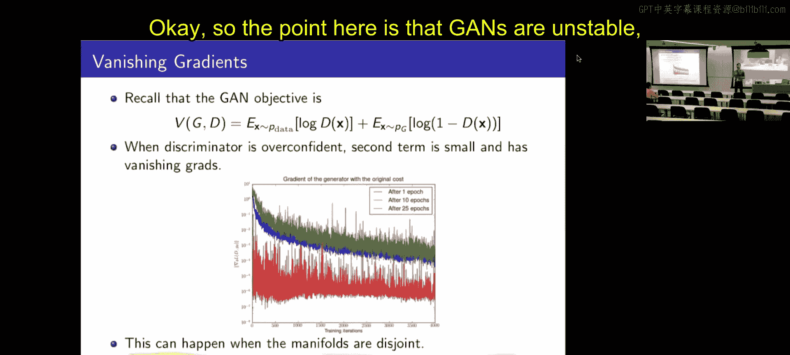

And then one digit fake and then the generator generates。A real digit。

 then that digit starts to be considered fake by the discriminator。

 but then you keep looping across different digits and you never goes to a solution where all the digits are being generated。

So mode collapse is a problem and again there's a lot of fixes like changing the architecture。

 feature matching isn't interesting。Solution where instead of instead of the discriminator just outputting a。

Instead of just trying to maximize the score of the discriminator on one set and the score on the other set。

 you look at the activations of the neural net of the discriminator neural net and you try to make like the set of those vector values。

 the distribution of these vector valued activations different so that's one one way of doing it label smoothing is you don't output01 you output you encode the classes as some number that's not one or zero。

 that's another technique adding noise to the data yeah。

So there's there's a lot of there's a lot of that are involved yep there is a typo okay yes I think this one should not have the log sorry yeah you don't have to yeah well depending on how you do it you could put a log in both but。

Sorry， there's a typo， yeah， what incentivizes mode collapse？

So there's maybe a theoretical and a more practical answer。

 the theoretical answer is that remember when we talked about the transenchan diversionence。

 in fact I have it on my in a few slides from now， genenchan divergence is inherently mode seeking so that could be one reason why we're incentivizing just。

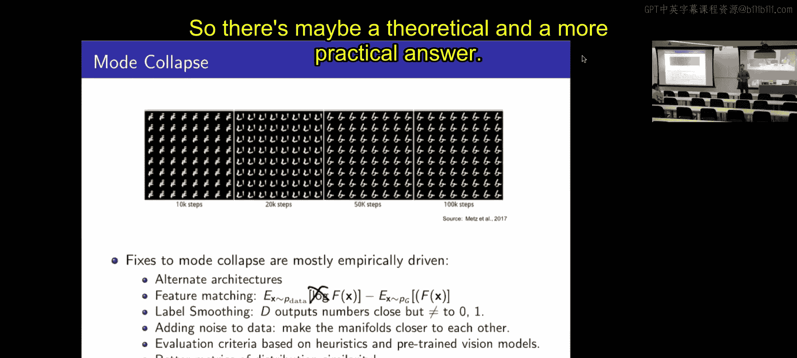

Uputting a small number of good samples and in the extreme case is just one sample。

 but I think that's not the only reason there's also just practical reasons with this this objective it it has something to do with the optimization landscape having these bad local optima where you can just predict one and it doesn't。

Yeah， it just， it doesn't expand to outputting many。Digits， it could be。 it's， I don't think there's。

A more。Pinciipled answer， but essentially。Yeah， if the discriminator has converged to。

So I guess I don't know how in practice what be the trajectory in the waste space during the optimization process to reach this point。

 but you can see that once you reach there， once you reach some solution where the generator only outputs one digit and then all the others are considered fake。

 then there's a natural way of there's a natural tendency of switching between local optima since they're predicting one digit。

 you switch not to the full distribution of digits。

 but you can easily there's an easier way to full the discriminator by just switching from one digit to the other digit。

 which is considered。

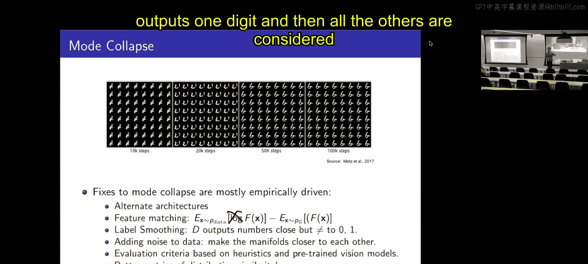

Real， and it's an easier way to fool the discriminator than start the full distribution of digits。

Therefore， you can just keep cycling back and forth， but how do you initially get into that mode？

Get into their error mode， I don't think I have a good answer for that。

 it's just something about the optimization process that breaks down。嗯，对。

How does feature matching work？How does feature matching work Okay。

 let's is it in the features you can use you could you could use some feature space， for example。

 you could use a pretrain neural net instead of instead of measuring the distance in。

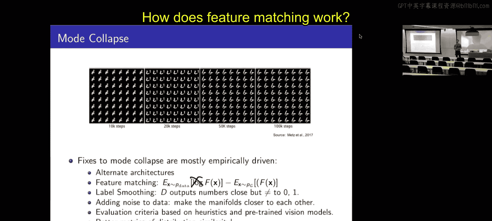

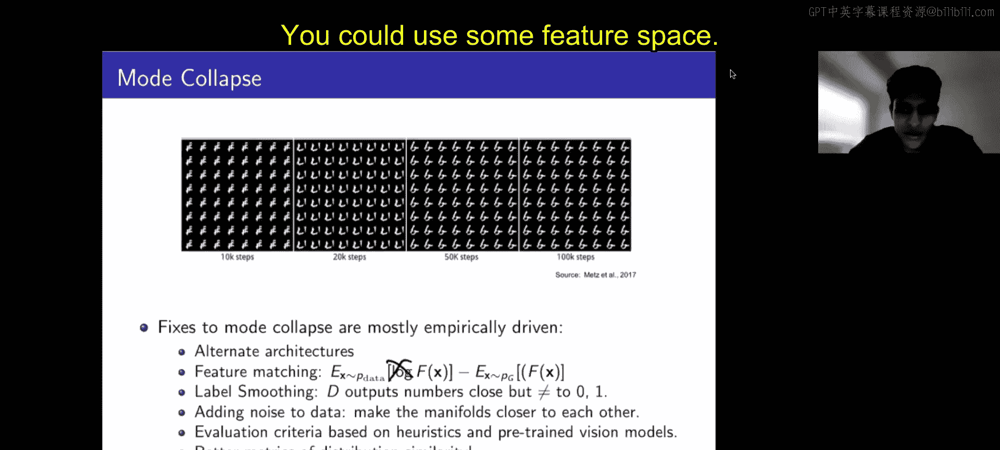

Instead of the so you have to define some kind of score。

On the real data on the fake data and you want to optimize that score with one model。

 I guess maximize the score with one model， minimize the score with the other model。

 you could also instead of having one score， imagine having multiple scores and there're all a little bit different So those are your features and in practice what you might use or the activations of a pre-trained neural net of some sort that could be one way of doing it。

 I think there are other ways that you could。Take your discriminator。

And instead of using the final score， you use the pre final activations。And you compare that。

 you also have to define then loss already vector valued。

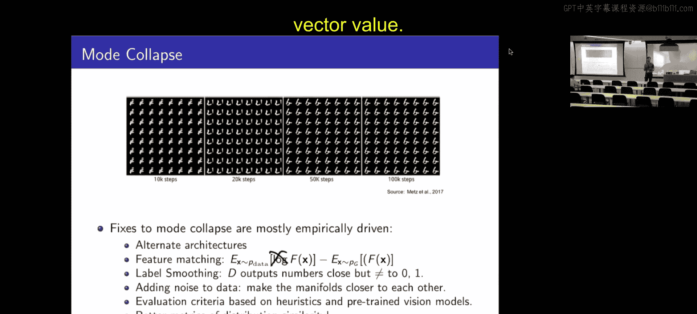

嗯。So basically like the doubt is like anyways。Jensen Shannon divergence is also doing some sort of feature matching it right so the only difference being that this is happening in the feature space。

 whereas that is happening。

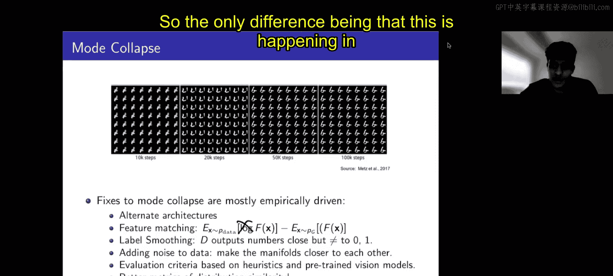

Actually， I'm not sure if there's a。How it reduce this to Jensen China and whether it reduces to Jensen Sha if you use multidimensional features。

But the main idea is， instead of defining a single score， you define multiple scores。

 these scores could either be learned or they could come from a pretrained neural net of some sort。

And then you try to distinguish between images in the space of that。

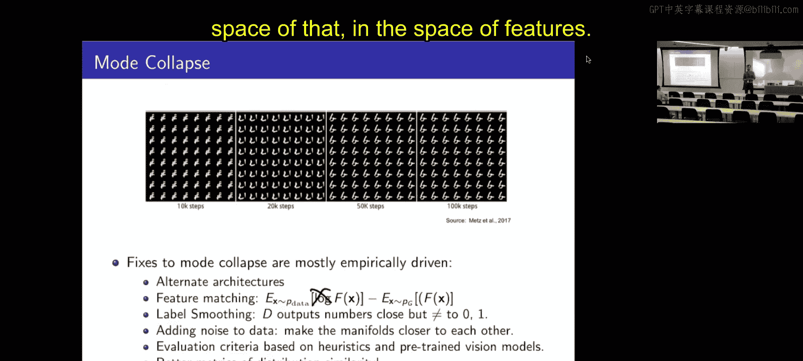

In the states of teachers。Yeah， so there's the question about GNs in discrete spaces and whether any of these techniques that I describe can help。

 GNs are still not great in discrete teachers。In discrete spaces， when x is discrete again。

 is not the best thing to use because you have to back propagate through the。

Through the sampling process of the generator somehow， right。

 so when you you have to update the weights and that involves essentially back propagating through the so you have to get the derivative。

 you have to find the theta， which changes the x。 so you have to essentially。

Back propagate through the sampling process and if that's the speed then it's not differentiable and that's causing a lot of pain in practice that will cause you a lot of pain。

 it won't work as well， there are various heuristics for trying to do it but none of these are perfect and in practice GNs aren't really the type of model that's commonly used on the speed data。

Yeah。Okay all right， so this was a recap of a lot of the things we saw in the last lecture。

 I want to talk about some more advanced topics in this lecture in particular I want to talk about other talk about other types of divergencies that we could be using for training general models but still staying within the GAN framework。

Then one more advanced one more advanced topic I want to cover is latent variables in GNS。

 how do we do latent variable inference， which is an important task in latent variable modeling。

And then I want to end with a fun application， which is called the main translation。Okay。

 so if you remember， this is the picture that summarizes what we're trying to do and we tried。

 I guess the idea here is that we have a data distribution。

 we have a model distribution that lives in some kind of set， and we're trying to make them。

 we're trying to choose the model distribution that's closest to the data distribution by minimizing some notion of divergence or distance between or closeness between distributions。

 which we've been denoting by the letter D。And we saw several types of。

Ts of choices for what D could be we started with the KL divergence that's what we use for our aggressive models and flow models。

 this is what leads to our likelihood objective then when we saw ends we saw another type of be that could be used which is the Jenen Shanon divergence。

But are these the only types of divergences we could use？The answer is no。

 there's quite a lot of that。The have their trade off， and I want to mention that again。

Remember the Jesen Shanon divergence， which is what GNs are trying to optimize。

 assuming we have a good enough generator and a good enough discriminator。

 this is what again we try to optimize it has the following form it's essentially a weighted kL divergence where we take the average between P and Q and then we take the KL divergence between P to this mixture and then。

We take the average of that and then the kL divergence between Q and the same aster that's essentially the structure of the of the genenchan divergence it's also called a symmetric k divergence because we're essentially using the kl divergence as the basis of it but we're。

We're combining the K dive virgence in a clever way that makes everything symmetric。Remember。

 we said that it has some natural properties， it's not negative， it's zero。

 if and only if P and P are equal， which means that it's a natural objective for optimizing generative models。

 it's also symmetric the so this says that it's symmetric。

 unlike the other types of divergencies unlike the k divergence in particular。

And also if we take the square root， then this satisfies the triangle inequality。

 which means that it's almost a distance， so a distance is a diversion which also satisfies the triangle inequality。

And we know that if we were to。So we get this divergence when we train our discriminator to optimality and it's sufficiently expressive。

 so the optimal discriminator gives us is given by the following form。

 this is the optimal discriminator， it's essentially the sigmoid of the ratio of the log ratio of the two distributions P&Q。

Remember， we looked in the last lecture at what does the discriminator learn？When the discriminator。

Is trained using the crosscenttropy objective， it's optimizing its solution is going to be this ratio of distributions T&q。

Yeah， sorry， there's a table。Thank you。Okay， so this is the optimal discriminator。

 which means that when we train the discriminator， we are trying to estimate the ratio of the densities of P and Q that's an explanation for what the discriminator is doing。

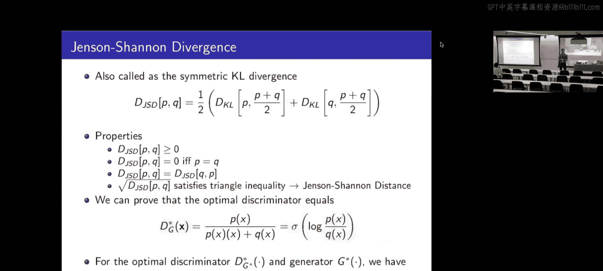

嗯。Okay， so the Genen channel dirgence is one type of dirgence we can use。 and remember we saw that。

There are trade offs when we。Start using different divergencies。

If our data is coming from this mixture of two Gaussians and we try to approximate it with a single Gaussian。

That single Gaussian is not expressive to represent the true data distribution。

 and in that case different objectives， different divergencies induce use different trade offs。

So when we have the KL divergence， we get something like the KL dirgence。When we optimize。

Dl divergence and try to fit that one unmodal Gaussian。

 we get something which is big and which tries to cover both modes of the data distribution。

 On the other hand， if we use the gensen Shannon divergence， we get something like this。

 we only fit one mode well and we don't really care about fitting the other mode so the Jensen Shannon divergence and the Kl divergence in use different。

They result in different types of approximations when we don't have a perfect model。

So the scale divergences， one distribution， the transenchaninness， one distribution。

 but there's other types of distributions that we could be using。

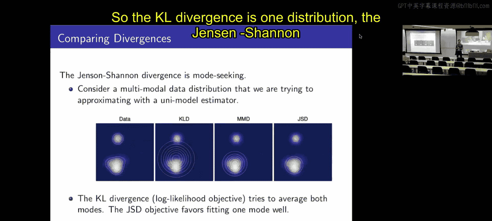

Here I'll introduce a class of divergencies called F divergencies。

 which will encompass a lot of really interesting objectives。

 which you might want to use within a gene model or many many divergencies which have been studied in statistics and in machine learning are special cases of this family called the set of F divergencies。

So NF theversions is any。Dversions between distributions that has the following form。

 so we have the expectation over samples x taken from Q。And in the。In the。In the square bracket。

 in the hintgr， we are trying to。So we have this function F。

 which evaluates the ratio of the two distributions。Okay。

 so whenever you have you're measuring something over the ratio of the distributions， you are。

You know， this starts to look like something that's going to be used to compare different distributions。

 and then this function f has to have a particular form。

Or it can be any convex and lower semi continuous function with this additional constraint。

And any F that has this property gives us an F divergence。So first of all。

 what do what do we mean by convex and lower semi continuous right， So convex。

 we know what this means， it means that the。So it looks like a。

I don't know to describe this in English but okay any line joining two points lies above the function right so it's like a if you could fill it with water it's almost like like a container for something right it has that U shape or well a more complicated shape but like a U shape would be an example of a convex function。

And then what lower semiiming continuous means， it's a slightly technical definition。 It doesn't。

It's okay if you don't fully follow this part， but the technical definition of a lower semi continuous is that。

 well first of all， continuous means that when we take any point here and if we approach it from either side。

Right when we when we approach it from here and from here。

 we converge to this point and lower semi continuous means that there are certain points where if we approach from one direction。

 it's either continuous and if we approach from the other direction， it might not。

We might not converge to this point， but we're going to be converging to something that's higher。

That's the technical definition of lower semi continuous。So we're either at any point x0。

 we're either continuous， which means that when any sequence of x is converges to x0。

 the sequence of f of x is that corresponding to the sequence of xs converges to f of x that's just continuous and then lower semi continuous means that that sequence can also converge to a point that's higher than f of x0。

Okay， this is just the technical definition so that you have it don't worry too much about the details。

 the main point is that these fs can include a lot of interesting divergencies， for example。

 if we choose this type of F， you can check that we exactly recover the KL divergence。嗯。Then。

The K dirgence is one dirgence that we know but there's actually quite a lot of them that we can recover this is just a long list of these divergencies so here again you have the callback labler divergence for this choice of F that I gave you so this is the formula that we know we can also get the reverse kale dirgence which is when we flip P&q here we flip P&q you can get it using this other choice of F here we have our Jenen Shannon dirgence which is。

which has this formula and it's given to us by this F and then there's more there's a really broad family of alpha divergencies that works for this particular generator。

 so alpha divergencies are a family of divergencies which have been traditionally important in classical machine learning。

There's also the variation distance， which is something that you may have seen from statistics metrics。

呃。variious types of applied math， various fields of applied math use stack log it has this working generator so my point is that there's many eiveverncs that exist。

And。There are general ways of applying the same machinery we used for the Jsen China diveverence to optimize arbitrary activeiveverncies。

Okay， so by this， I mean that。You use。🤧Many of these afterverncies as a to sample objective。

 we can perform likelihood free learning of generator models。That optimize any of the purchases。

So how do we do this again I will to introduce a little bit of extra machinery here from convex analysis。

 I will introduce one technical definition here if you don't fully get the definition that's okay as long as you get the two properties that I'm going to。

That I'm going to present in a second，Specific instruction here that we're going to use is called the Pen shell conjugate also known as the convex conjugate so for any function F that is convesed。

 it's conjugate it's defined so it's called S star and it's defined by the following formula Okay it takes a little bit of staring at this formula to understand what's going on let me just give you first a more intuitive definition。

So let's say that you have some kind of index function like this。

There are actually two ways of defining this index function。

One of them is literally the shape of the curve that I just highlighted。

Another one would be be the set of all the slopes， right， so imagine that you knew all the tangents。

 So at each point at each because this is convex at each point， such as here， there is a unique。

呃Dnget。To this this point and so if for each point I knew the shape of its。

 I could recover the full curve。Right， so for any con function， I can either represent。

The either form F or if I had this set of all the engines， then I would。Then I would know the。呃，一。

The shape of the curve。Right， and I know that because the function is convexed。

 it has to have at some point。All the possible slopes of the tensions will be covered。

 I think as we're going to be So this is this is going to be assuming it's strong in the x。

 Eventually every slope will be realized for some X。

 And so now if I know for each slope where it intersects with the。Y axis。

 then I can specify the entire set of supporting hyperplanes you have a single function。

 that's what my F star T is。So basically， F3 T， it tells me where。

Does the it gives me the point here at which a。At which the supporting hyperplane with slope T intersects the Y axis。

And then again， you can stare a little bit more to see why it's actually given by this formula。

 but I'm not well you can correct this at the end if we have time。

 but the point here is that the convex conjugate tries to the convex conjugate outputs the point at which the slope with。

The supporting hyperplane with slope key， at what point does it intersect the Xx to the Y axis？

So okay。This is what the potentialal conjugate outputs and again the idea is that you can equally so there's a unique mapping between F and its potential conjugate and that just means that you can represent a convex function either the shape of the curve or via the set of all the supporting hyper planees of that curve and those are two equivalent ways of looking at a convex function。

And now there's some interesting properties that the F conjugate has which we're going to use。

So one interesting property is duality， which means that if I take my F。

 and take it special conjugate， then I take its special conjugate， I get back to the original app。

That's a useful property again it just says that there are two ways of looking at the same function the shape of the curve and you have the tangents and if you switch the tangent mode you switch and you apply the transformation again and go back to the original condition。

It's just a nice property。And then also when F is convinced。And over continuous， so is that start？

So here are two interesting properties and this is just writing the duality property again if I start with。

 well， if I start with F and I take the convicx conjugate of。It's convex conjugate I get back。

That's again， what this formula is saying。Okay， so yeah， and again。

 an example of this that you can play with this detailed dirgs with this type of app to check that it works。

Okay， now that we have this tool and these two properties。

 we can use this to construct an algorithm for optimizing any kale dirgence。

By leveraging its public country。so this is how we're going to do it。

 let's say that we're interested in optimizing any F the versions。Here。

 this is just the definition of the Fverence and。Here I am applying my property that F equals F star star。

So I have replaced this F here by F star star。So this is literally the same formula as I had in the previous slide。

 I am writing the formula for the Unex conjugate ofstar。

Okay so far so good we have used our first property and now I'm just going to rewrite things with a little bit of piece and a little bit of math here I am explicitly grind out the expected value as a conjugate okay I have this Q of x here that's the same Q as here and then everything else is the。

Inteeg and。Notice that when we perform this soup we're taking the so we're choosing a particular T for each x。

 so for each value of x， there is a soup that is given to me and that soup is realized。Well。

 okay here and there's a lot of edge cases that a proper proof will look at that I'm showingoving out the log。

 but at a high level you can think of this soup as being realizing swift because this particular proof sketch suits that it is the case in practice is complicated with。

Believe me for now。 So this too， let's say that it's realized at every point， and it has some。

Value P of x， so T of x is literally the value of the soup at each x， and now I can just replace。

 instead of writing the soup， I can write this function P of x。

 which is the value of the soup will be。And and I can also。

 so I still want to take the soup at every soup， by the way， stands for su。

 sorry sense soup stands for supre is's like a mass， except that。

There are some edge cases where the max is not defined but the suit is defined。

 but soup essentially needs max。Supre so now that I have rewritten supre as a function key events。

 I can instead of taking instead of using the notation where I take the soup。

Over each point separately， I can take the soup over all possible functions。

 and then T of x will simply be the value that that soup will take。Again， if you're a mathematician。

 think of this theres。A lot of things that are shown under the throat。

 but this is the hell level lady。Okay， and now I can flip the integral and the soup。

Because I do this split， I have to have a。The less that are equal。

Sign their earss here right because now I'm not picking out the soup at every point and picking some kind of global soup when I date it。

The outside the integral。And now I'll just rerite the integral again as an expectation。

 which feels me something like this， yes。Okay， so this is a little bit of math that gets us to a really useful result and gets us to really useful form。

 which is what we have at the bottom， and this is useful because it starts to look a lot like again。

Right， so here we have some。Function T and something that shows like a sta T of x。

 and we're comparing this。To we're comparing this on on the data from samples from Q on samples from Q。

 And we're taking the super dysfunction。 So we're going to be trying to choose a team， which is。Just。

Which makes。Itakes values that are。Large on the first。Set of samples on deep and small and cute。

 so this is starting to look something like can， and that's something that we know how to optimize。

In fact， we can compute the optimal value for the T， and it happens to be the。

ItThat to have the following。Form， which is also a function of the ratio between it and distributions。

So the optimal T has this has this form， it's a function of the ratio。

 and it also says that the optimal T in some way acts as a discriminator that tries to figure out which sample is more likely。

 which is true it tries to determine。Which distribution is more likely to have generated x by looking like a varying the ratio of their distributions。

The optimal cases are for the which， oh， okay， why is that the case， I haven't proved it。Okay。

 and so it's a lower bound on the diversions that is also likelihood free with respect to P&Q。

 and therefore we can use our previous machinery for optimizing it。Okay， so this is our。

This is going to be our objective， that's what I derived from the previous slide。

And then we can apply the GAN framework to optimize any of these divergncencies。

 the resulting algorithm is called AfgAhan。And it involves the following process。 First。

 we let P be related distribution Q is our model distribution。Every way around doesn't matter。

 but yeah， we we use P andq as the data and model distribution and now instead of taking tea over instead of taking the soup of tea over all the possible functions。

 we're going to take this soup over，A finite family that are paratized by a neuralna。

 so now he will become our discriminator。And。And then we get again our。

we again get an objective which looks a lot like a again。

 we have a minimax gain between the model for T and the generator and the model for T tries to optimize this objective by optimizing the objective or trying to make it close to the value of this。

Divergence that we're trying to maximize。And at the same time。

 it's starting to get a different value on the unit date data。As we do this。

 we also train the generator to。To minimize this function and to make it as small as possible。

So in the end， we get a process that is a lot like again， but it optimizes， it can be。

 you make the argument， you make a relatively principle argument that it's optimizing not the jet andction andverence。

 but an arbitrary at theverence。Okay。对诶。All right， so the point of all of this is that we have developed machinery which lets us optimize an arbitrary typergence。

 and the point here is that。There's a lot of objectives in machine learning， that can be optimized。

It can be used as a training objective for our。For our。Generral models， in particular。

 if you're willing to work in the framework of G， theres this really nice and easy way of optimizing all of them。

 There's also ways of optimizing them in a not an unlikely free， but。In a model。

 in a way which involves likelihood， there's many divergencies within that bigger set。

 so not all those divergies， but many of them could also be optimized similarly to how we were optimized the likelihood use we have to have a formula for a lot of P of x in。

Don can take the variant and do the standard thing in the for likelihoodhood。

 but there's this general framework which Charles to optimize theize any of the urges if we're willing to live in the world of decent。

Okay， so this is， this was my first kind of。big my first advanced。诶Yeah make。Yeah， the first。

Little snippet within the world of。That' GNs that I wanted to mention the other thing I wanted to mention is the use of latent variables in GNs right so remember that GNs are still the latent variable model。

 there's a Z and there's an X and therefore in principle they could be used for representation learning Preation learning is this task that be defined in one of our earlier lectures and it's one of the tasks that were often interested in ingenative model。

嗯。So how can we use， again， to learn interesting interesting。

So this is challenging because unlike in a normalizing full model。

 this mapping here is typically not inverable。And， therefore。

It's not obvious how to use it to obtain。A。I obtain a Z given an X。And also。

 unlike in a variational autor， we're not training any Aler networks Q that can predict Z from x for us。

So we have to do something else。 We have to do something more fun。

And I'm going to propose two solutions， one is going to be a more hereistic solution。

 and the other one will be more principle。So the nearest is the solution is that。

Given that we're training a discriminator， we could try to use that discriminator to。

To obtain a latetnt representation for X in particular。

 discriminator is just a neural net trained using supervised learning and we know that when we train a big neural net it typically learns useful internal representations as part of its activations so in particular if we work to data discriminator and chop off the last layer and look at the prefinal layer of activation。

 these are usually interesting representations of the input。So one heuristic method we can use is to。

Trump the last layer of the scrimininator and use the activationations as a way to represent the date。

 and in practice you will find that it will place similar excess close to each other in that activationation space。

Yeah， so this could be one approach that was still a little bit unsatisfying becauses it's a curiousist it doesn't really use the principled probabilistic modeling ideas that we've been working all throughout the course。

little bit un， can we do better？Well， the answer is yes， there are some ways of。Of。Using。Yeah。

 there are more principal solutions to lean variable in print and yes。

The high level idea here is that。You know how again。

 is trying to separate is trying to learn a distribution over x by distinguishing wheel x from a x。

Well。We also have。In when we train again， we also have real Z。

And we could also consider training Ph Z by a model that we well that we're going to learn。

 so we can also have a model that encodes x into a Z。

 and then when we have a model that encodes x to a Z， that model is in some sense generating Ph Z。

And we could use the same idea that we used for again to try to train a discriminator that will try to distinguish wheels in P。

 minimize that to sample staistic， and ultimately try to make a distribution similar。

So right instead of comparing just real and take samples of x。

 the high level idea is that we're going to compare real and big pairs of x and Z。

 and as a result we're going to learn， we're going to have a principle way of learning and showing distribution over x and z。

And we're going to use it for think very well。Okay， so how does this work。

The model that implements this idea is called a bial gain。And first this vibrationalgan。

 it augments a standardgan with an extra encoder neckect。So first of all， when we see here。

What you see here is a standard get it。Starts with some late teachers to see。

And then invest them through a generator to generate fake data GT。

Now we're going to add an additional neural net， which is going to be the encode order。

 which takes real data X。你呢里。They， go through the encoder and it results in fake inacy。

So this is not the Z that actually generated at x， it's the Z that the encoder predicts for that x so you can think of E E of x as being a fake center right so again here we have the encoder network E。

 the headr network gets data from distribution and learns a mapping。

That's going to be the model that will be used within byca。And now the question is。

 how do we learn this？Well， one way in which we can learn this is by the same idea of training a discriminator that we have used to court。

So， now。At every high step， instead of just generating a single X， we're going to generate。

We're going to generate。Cupils of X and Z。So the discriminator will observe。

Samples from the generator model， which are going to be C and G of Z。

As well as samples from X and the encoded X。And these the distributions would match right。

 so here I have z and and the X that came from Z and Ill have a real x and I want to generate a z for that x。

 which looks like something that could have generated。So if these two distributions。

 Z and G of Z and x and e of x， if they match， then I have。

Effectively learn a good end cover right there's no way for me so let's say this has converged that G ofZ is indistinguishable from the real data X。

And Z is what would have generated rule Data x。And so then if I take an x and I take the encoded version of x。

 I think。By Z of x， then the Z of x is indistinguishable from the real Z。 So overall。

 the distribution of this E。The distributionist of the real means and a big these will be ininguishable。

And therefore， we'll have what want。I don't know much。Again that may have confused you move it here。

Again， define what's going on here， so here we have a discriminator and now the discriminator observes a sample of G and E and Z and X and E of X。

It tries to predict whether these the samples are correct or not。And ultimately。

 when everything has finished training the。Eas the distributions will match， right。

 just because we're。We're minimizing the genction and divergence for a larger space。

Or we're using discriminator to make these distributions in extinguable。

 So these distributions will be the same。And therefore。

 the distribution of Efx will look like the real data that has generated。Yes。And therefore。

 E of X will be elevated。This is a framework called by GenN and it extends GNs with an encode and it can be used。

我了ほ了。With。Although I should add that in practice， if you're ultimately interested in late variable learning。

 you probably don't want to use a hand in the first place， this is more of an intellectual exercise。

 I think in practice when people are doing some terribly variable modeling late variable inference。

 they don't usually use scans， they haven't really seen any。Real application of。

Again it's the late variable infants just because this procedure is also as it enhances all of the training difficulties of the regular again。

 it's more difficult to train。But I think this is an interesting in idea that shows that at least in principle。

A well justified formal leak variable inference is possible within gas。Okay， so this is a buy again。

ll just really quickly and I don't have time to。I a email， but I just want to end。

And with a upon application of GNS to a task， which is called the rain translation。

Let me just quickly define the translation， this is something that I showed you in the very first lecture。

 I had some fun videos， so now we can get to see how those images were created。

 what was the underlying outlook。So we're all the best here is that。We have we're given two domains。

 which we're going to know by y and x and we have data coming from those two domains they you can think of them as images and in particular we can think of them as images that are。

Somehow related to each other。So， here。Here I have an example of。Of two domains we're going to have。

various types of shoes and on one domain x， the shoe is it's just the outline。

 the X images are the outlines of the shoes and on the right hand side I have the Y which are the whole colorized shoes。

And I might be interested in translating to these two domains。 So given a。Why frame of a shoe。

 I want to generate the wheel shoe or a given。The photo of the shoe。

 I want to generate its stylized wire。That's the task of the nation station。

And this task can be solved in certain cases it can be solve naturally with a supervised learning model if I have their examples of X and Y。

 so let's say I have a data set where I have the same shoe and for each shoe I have the full image and the wire frame then I can just train a conditional generator model I can just train and content I can train a unitos sort to map one to the other and that's fairly straightforward supervised learning task。

But there are other domains where we would still be interested in doing translation。

 but we don't have this fair data。 We don't have a one to mapping between samples from text and samples from black。

So this is what we see here in the other example where we have uned data。

So here X is a set of photographs， and Y is the set of heart paintings。

And it would be really neat if we could take a photograph and convert it into an art painting and conly take an art painting。

 convert it into a photograph。But obviously we we cannot have a data set where for each possible scene。

 somebody paints the scene or for each paintinging， somebody generates a picture。

 somebody goes and takes a picture of the same scene， that's just not possible。

 we're never going to have a bare data set。So the question is。

 can we perform this type of domain translation without their data？So the answer is yes。

 we can do this using again。 So how do we do this？ Well。

 imagine now applying what we've learned about against to this problem。

One thing we could do is we could start with the generator and we could take this generator。

And train it to map elements of text elements of Y。 So given a photo， we're going to try to check。

fainting we're given a fainting， we're going to try to generate a photo。

So G is going to take x and alpha of y， and F will take y and alpha of x。

So this is how the power look like。 right， So G is。photo and up painting and。Why they sustain and。Aこ。

This is one possible approach so if we train GNF。Let's say that we have trained them successfully。

 then what you could do is give a photo， it will generate a painting so we start by sampling a photo。

 you put it into G it will generate for us a painting we take a painting best it will generate photo。

So， this is。Great， but the problem is that when we train this as a regular again。

 we're just comparing samples of paintings and real paintings and we want the samples to look like the actual paintings。

 but there's nothing that forces the painting to look like the original image like the original photos that went into generating if we were to train where I just drew here we would get a really nice unconitional generator of paintings where it's random noise instead of me Gaussian happens to be a photo。

But it doesn't have the property that。The image will translate into a the photo will translate into the painting that's the same as the original photo。

So how do we do this， Well， there's this idea called cyclegan。

 which enforces an additional property called cycle distance。And the idea is that if we take an x。

 take a photo of x， and we generate an image of。Of that photo Y hat。

 then we should be able to start with Y hat and then use F to get back to the original image。

So essentially， if we learn F and G such that。Followeded damage。Photo to painting。

 painting to photo gives us back to the original starting point。

Then we probably have learned to preserve。The properties of the original。Photo。

 which makes it translas。Pra where mathematicalematic is speaking what we want f of g of x to equal the original x and g of F of y to equal the original five。

And so again， just。Make it more visual， starting with a paintinging。

 we're going to generate sorry starting with a photo。

 we're going to generate generate a fainting white hat discriminator will just check if it looks like a paintinging。

 but then the original model。Sorry， but then the other model F will try to generate an X app。

 which looks like the original photo so starting from a photo we get a paintinging and then going back。

 we tried to minimize the psychoconistency loss， which asks for the vein。

Exgg had to look like the original thing。And this is called I guess you have the overall plus function。

 so it has these twoganN terms which I define on the very first slide。

 plus it has this cycle consistencyency and regularization term。

 which says that f of G of x has been called original height and G of F of y equals the original y。

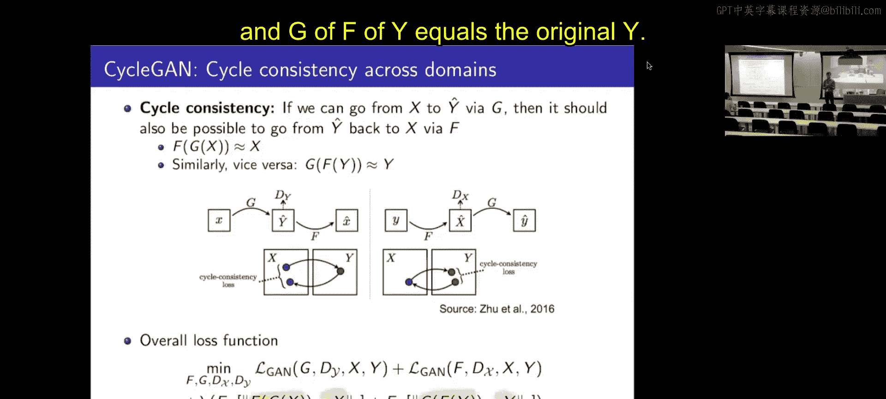

And now when you train this， you get really fun results。

 and this is how you can get this horse to zebra example that I showed you in the first lecture。

 we obviously don't have a data set of forces in zebras where the only difference is whether it's a horse or whether it's a zebra。

 but if we apply this clever recycling consistency idea we can get back to the original zebra from the we can get back。

You can start with the measure of force and convert。

 we can basically add stripes and keep everything else the same。

And the model learns to do that because。Starting from a horse。

The mapping G has to output something which looks like a zebra， but then going back。

 it still has to construct original courses， so the model was forced to keep all the details that are needed to construct the original course。

So yeah we can do fun things like this， you can also do monet to photograph， photograph to monet。

 and Im my favorite cat to dog image translation。

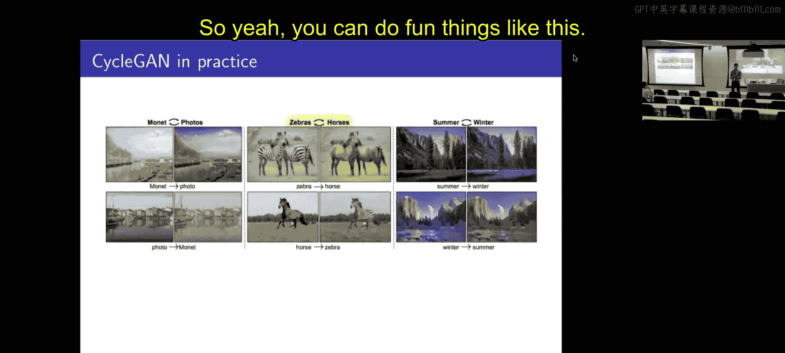

Yeah。Now you know how much is。Okay， so I'll add here， let's skip this part and'll。

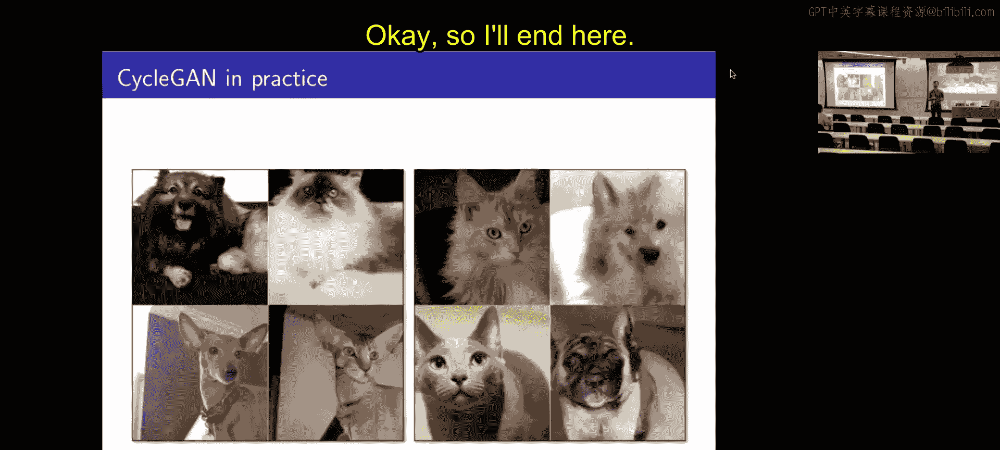

Okay here， so pros and cons of againsts， we mentioned them many times already。Again。

 generate great samples， but they're hard to train help post here and let me know if you have any questions。

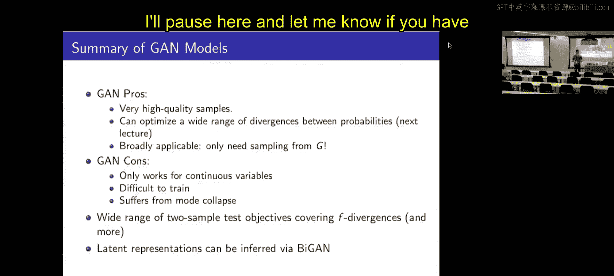