# 康奈尔大学《深度生成模型Deep Generative Models (Cornell Tech CS 6785, Spring 2023) 》中英字幕 - P11：-11-Lecture 11_ Energy-Based Models.zh_en - GPT中英字幕课程资源 - BV1az421q7Vf

All right so now let's dive let's dive in so as a quick recap of what we've done so far。

 we've looked at a few different types of general model families and in particular we started by looking at。

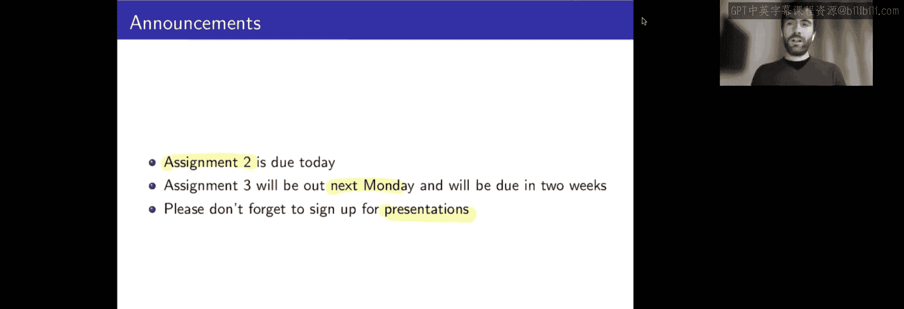

Different issues in terms of how we represent gene models and by that I mean how do we define a probability distribution that serves as a model of the data that we have and the first set of lectures looked at this question of representation from the perspective of latent variable versus fully observed models so we started with a fully observed family of models which were utter aggressiveive models and then we defined this new task of。

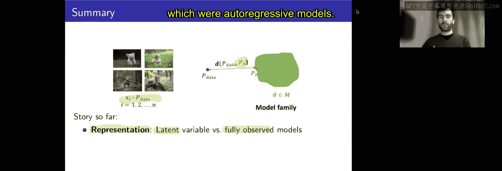

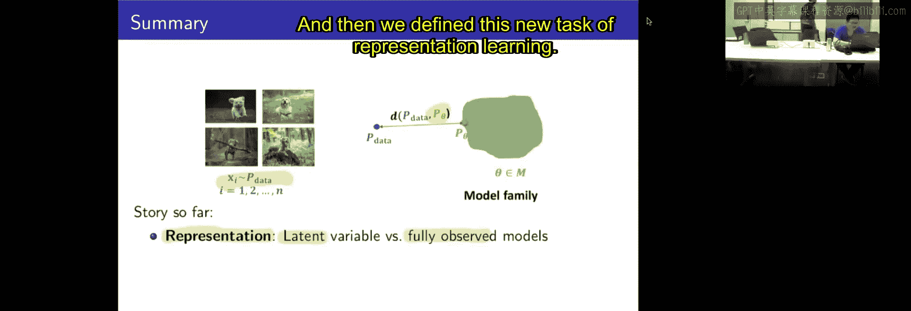

TheRepresent learning， and we define latent variables or late variable models as one way of。

Of doing that。

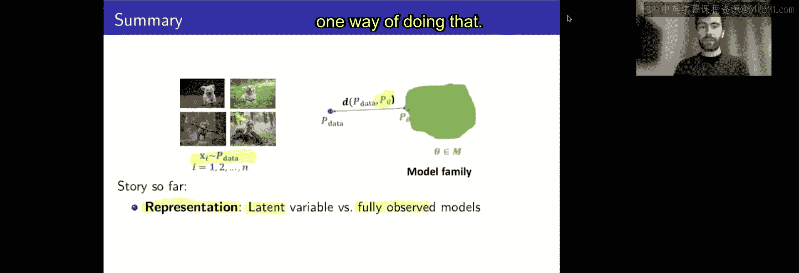

Then most recently in the， well， I guess starting in our lectures on latent variable models and then continuing into the most recent week。

 we looked at different learning objectives and different learning algorithms for these model families。

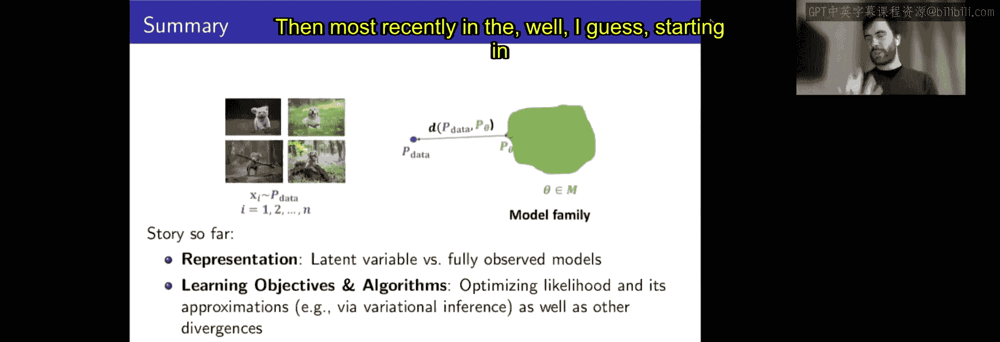

Initially with the fully observed models， we could optimize the likelihood directly in a way that's very straightforward。

 it's easy， but when we introduce latent variables。

 then we start to require approximate methods and in particular we looked at one important type of approximate。

Approximate learning technique called variational inference。

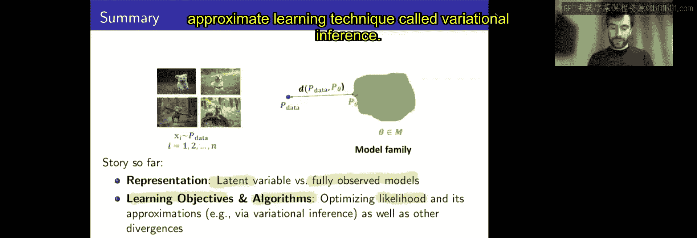

So variational inference is a way of approximating marginal likelihood。

 but then in the next sorry in the last two lectures we saw that maybe maximum likelihood is not the objective that we really want to use it sometimes involves intractable integrals or it involves intractable computational tasks which is why we have to rely on variational inference and also it doesn't even necessarily correlate with things like sample quality which is maybe what we're most interested in and then in。

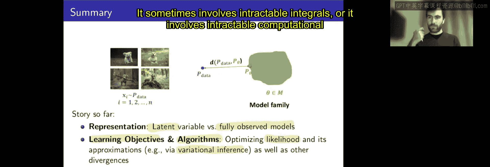

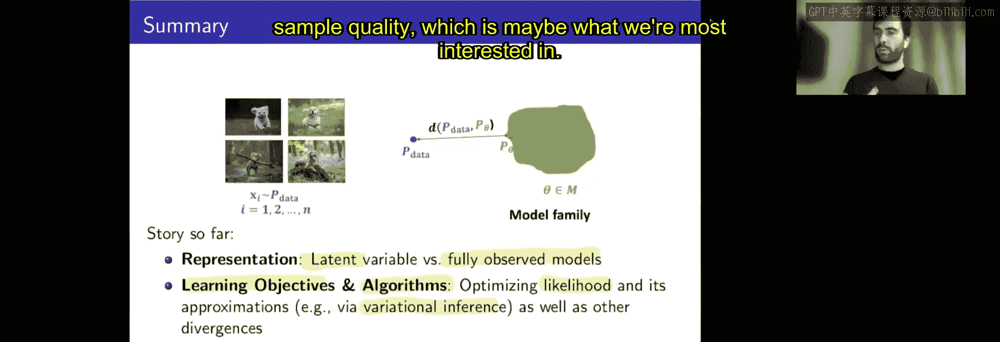

I guess in response to this issue， we defined another framework which were GANs generative adversarial networks。

 which can optimize arbitrary divergencies。

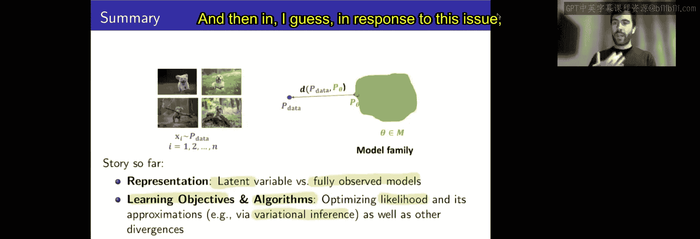

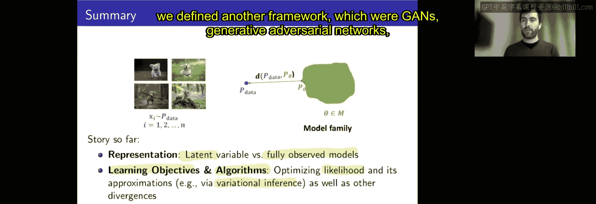

Using a sample free based approach where we're only optimizing the model using samples drawn from the model。

 but we never actually have to evaluate the likelihood itself。So these are a different。😊。

Denssions along which we can place the generative models that we saw so far in the course and in this lecture we're going to see yet another approach to defining a generative model as well as its associated learning algorithms。

And this approach will center on a different dimension along which we can construct models。

 it will focus on what i'm going to call normalized versus unnormalized or energy based model so this is yet another dimension along which you can place different geneative modeling algorithms and we're going to explore it in this lecture and I'll start by defining what it means to have an unnmalized or an energy based model this will be in contrast to every other model that we have seen before which was what I would call normalized。

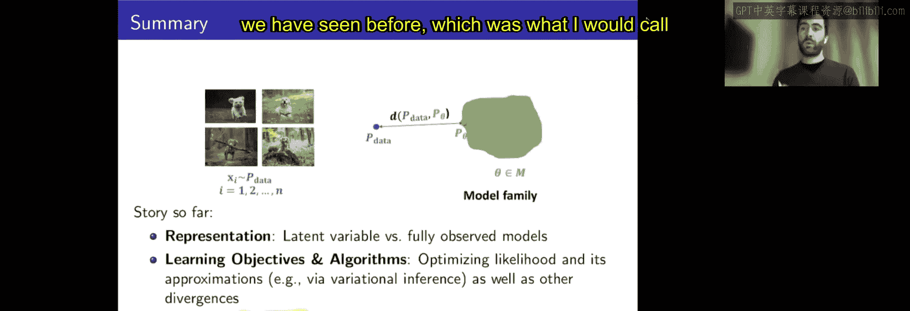

Okay so the plan for this lecture is going to be to first define what energy models are and then I'm going to give you a few examples of these models。

 I'm going to show you ways of representing probabilities using the energy based framework。

And then the last half of the lecture will look at learning algorithms for these。

For these models and in particular I will introduce a new approximate learning technique called Markov chainin Monte Carlo。

 which is going to be。Is going to try to achieve the same goal as variational inference。

 but it will take a very different approach to that goal， so it's a very。

Different type of technique that can be used as a replacement for variational inference。

 but it's based on a completely different set of ideas。对。All right so that's the plan。

 if you guys don't have any questions let me start by explaining what is an unorized or energy based model and why it might be interesting。

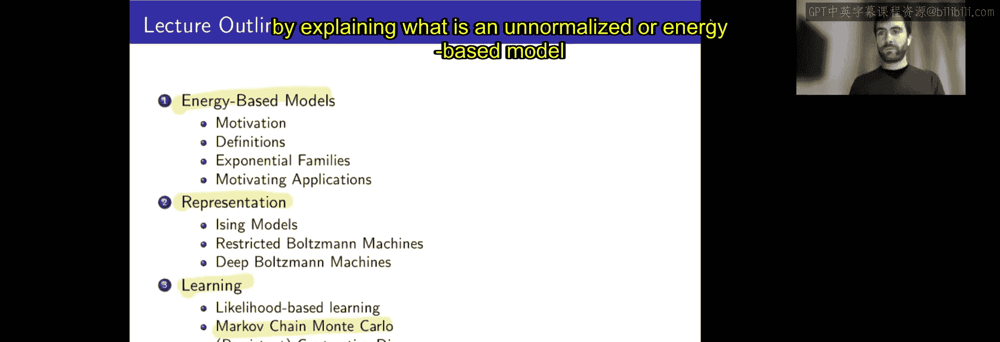

So at a high level， a lot of the effort in this course has been on defining probability distributions。

We spent a lot of lectures on finding clever ways to define a probability distribution over some data set of X's。

 which can be high dimensional images or audio or any other data form。

And there's two main properties that any of our pro model has to satisfy。First of all。

 because it's a probability， obviously it has to be non negative for every x right so a probability distribution will be any function P of x that satisfies these two properties。

 it's non negative。And when summed over all the possible inputs， it has to equal one。

That's just the definition ofroability。And so far， every model that we have worked with has satisfied these two conditions。

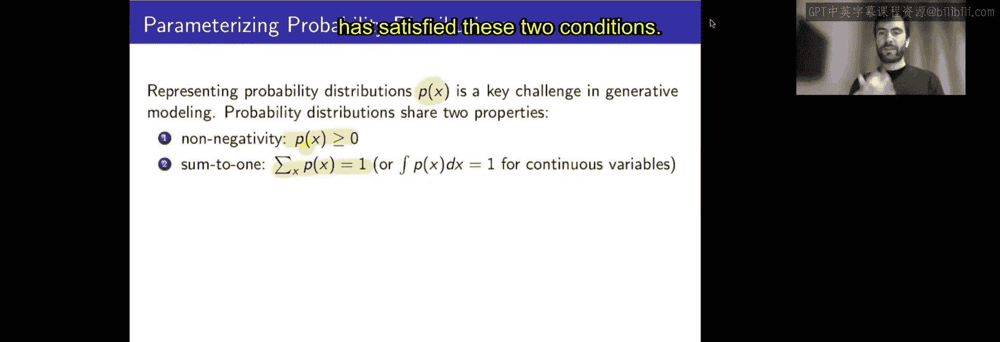

Okay。This sum to one property clearly we know that it has to hold for any probability and it's also really important it's probably the most important。

It's probably the most important of these two properties because it ensures that when we do any sort of learning。

 when we try to maximize the probability of the training set because we have a fixed amount of probability volume to work with by maximizing the probability of the training set。

 we are making it more likely， and then all the other data points that are not part in our training set will become automatically less likely because the probability has to sum to one。

So this property is a key feature of any herability distribution。

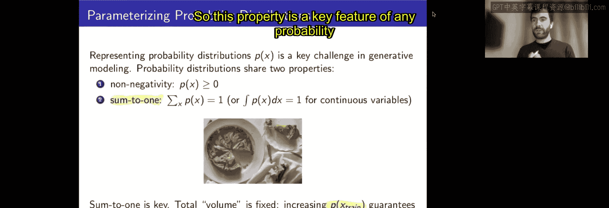

So maintaining these properties is can be hard or can be easy depending on which property we're interested in。

So。Coming up with a non negative function， G of theta x， that is usually the easy part。

Here is just a set of examples of models G of x that are non negative that satisfy the first crion。

 So for example， if I just take any neural net and I square it， that will well by definition。

 always be non negative。 or if I take the X of any function F of x that's parameterized by a neural net。

 that will always give me a non negative number。So this is actually quite easy。

What's hard in defining a probability distribution is the fact that for're an arbitrary non negative geotheta。

It might not necessarily sum to one。Yeah。It's actually much harder to get g of x to sum to1 than for it to be non negative。

Right so the reason is that in general， you know there's。These non negative。

Functions just that I just gave you as examples， there's nothing that forces them to be equal to one。

And so as a result， if I had just used this these simple examples， I don't get a valid probability。

 I can't really use it for generative modeling。

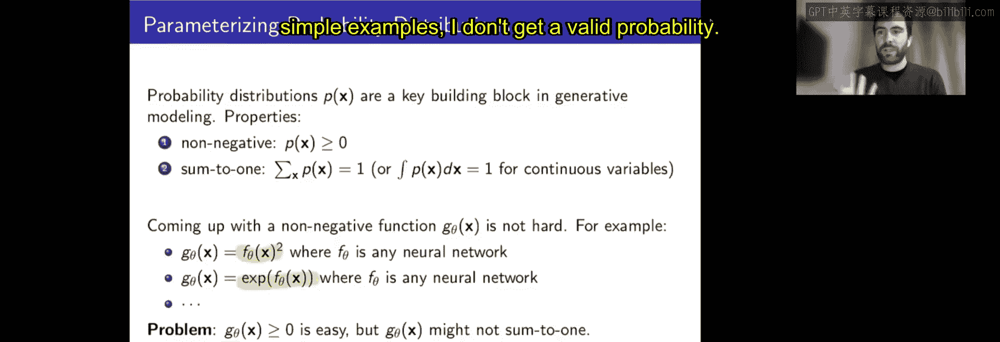

对。Um so。Getting a normalized G of x is something that's not necessarily straightforward。In practice。

 what we have to do and what we actually have done implicitly is to normalize this geotheta by its total volume or by its integral。

 such that it does sum to one。So we have to apply some kind of normalizing factor to an arbitrary G of x in order to enforce this sum2 one property。

And we have implicitly done that when we defined the different types of generatorr models that we have seen in previous lectures。

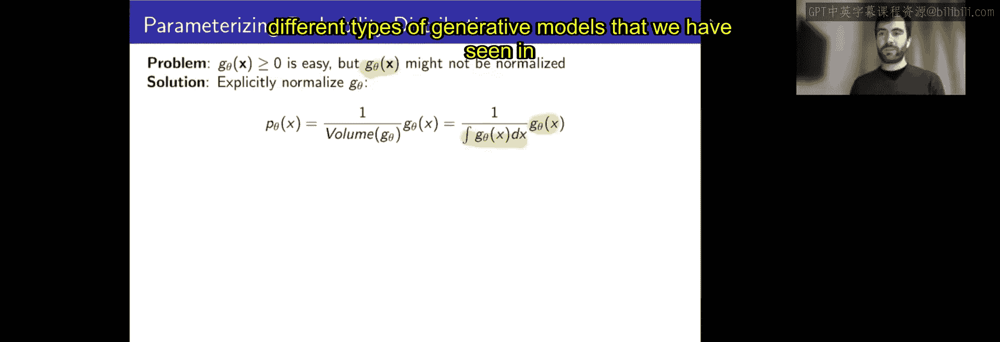

So for example， when we define an utter aggressive model。We're implicitly choosing。

Choosing a geo of theta such that。Such that this volume or this integral is available to us analytically。

 so by analytically I mean that we know what that integral is and we can easily apply its normalization term right so in an utter aggressive model we have a joint distribution that's a product of terms such that for each term we know what is the integral。

And then once we， once we know that， we can ensure that the。

All distribution sums to one because when we have， so I guess if we have a joint utter aggressivegress model over two variables x and y。

 its integral is given to us by this。Term， then when we pull the integral inside。

 we know that this has to be normalized to one。And then we get the marginal。

 the marginal will also integrate to one， and we know that it always integrates to one because we're choosing these terms here。

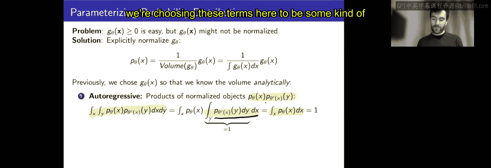

To be some kind of conditional distribution for which we know the normalizing factor， for example。

 it's a conditional Gaussian or it's a。诶。You know， if it's a softm。

 then everything sums to one by by by construction in the softm so we're when we define our regressive models。

 we're always conditioning our。We're always choosing。The conditionals to have tractable。

Integrals here。And therefore， their product is also something that normalizes to one。

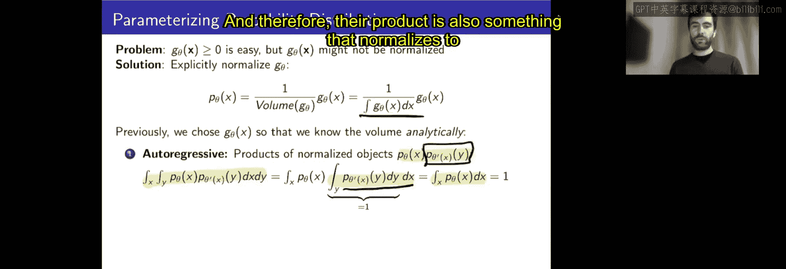

When we worked with latent variables。We assume that the P of x given Z is also in some model family。

 again， like a Gaussian for which the integral is tractable。

 therefore the mixture of these distributions will have。It will be normalizable and simple so。

 for example， if we were to do the full integral over all the x's and I have a mixture of two components。

 then that's just something that evaluates the one。 So again。

 with latent variable models by construction we always had。

Compons which integrated to one and then finally when we worked with flows we had to so we started with a simple distribution and then we tracked the volume change using the change in variables formula and that still ensured that after I applied the bidirect transformation to my lateent variables Z it still get something for which I can compute this normalizing factor efficiently。

So in all of the my point here is that in all of the modeling families that we have worked with so far。

 which chose the components of each model family， so each conditional in an our aggressive model or each or the conditional in a late variable model。

 we chose all of these probabilities to have tractable。Denssities to have tractable integrals。

What I'm going to do in this lecture is try to get rid of this assumption。And instead。

 look at a more general cluster of models for which computing the integral is going to be。

Not necessarily tractable and I'm going to find alternative ways of enforcing thiss。

Of an alternative way of dealing with this need of normalizing by volume。

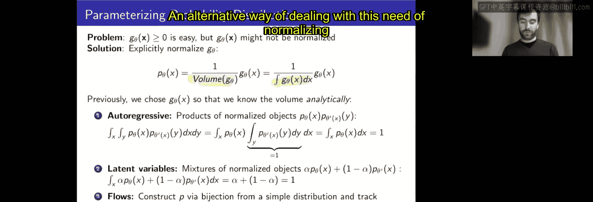

So what do I mean by that？So the idea of an unized or an energy based model。

Is to parameterize distribution of the following form。In an unormalized or in an energy based model。

 I start with some。Some model F of x， which gives me a score at each data point。

I make this score non negative by passing it via an X。

That satisfies the first condition for a probability now I have a nonneg score at each data point。

 however these scores don't sum to one because in an energy based model I'm going to choose an arbitrary f of x。

 I'm not going to care about I'm not going to try to restrict this to any model family at least initially。

And the way I'm going to enforce that。I have a valid probability is that。

We're going to try to normalize the function X of F of x explicitly by。

Adding the full integral over all the possible excess directly into the definition of the model。Okay。

 so previously， again， previously， we always chose a special type of model for which the。

A special model family such that the integral of the general of model always evaluates to one or to something that we can tractably compute here in this lecture in an energy based model。

 I'm going to let go of this assumption and i'm going to start by optimizing models with。

An arbitrary form。And I will ensure that they form a probability by explicitly maintaining and normalizing。

The distribution by this integral。嗯。And then to introduce some notation。This， as you can imagine。

 this term here is going to be very important， this is going to be the term that ensures that P of x integrates to one。

This integral is very important， and I'm going to give it its own letter Z。

And Z will be what I'm going to call the normalizing constant of the probability。

So Z of theta is going to be the number by which I need to divide my unnormalized probability to make everything sum to one。

And any probability that we can express in this form， we can call this an energy based model。

 so an energy based model is。A probability of this form。

That's the new type of gene model family that I'm going to propose in this lecture and we're going to see how we can do useful things with this model family。

Does anybody have any questions on the definition of an energy model， energy based model。

My understanding is that we define a score function and then we softmax it to get a problem distribution is that is is good because I'm is it always so are we going to have score functions that we can't softmax on or。

Well， you can always soft max it on theoretically， you can always define this。

This probability So first of all， when you say softm so normally softm is something that is defined over a finite number of。

Of values right so if your x was discrete and if x would take a finite number of values then yes this would be exactly the softmax here x can also be continuous in which case the normalizing function becomes an integral but I guess you can think of it as a continuous valued extension of the softmax and then your question is can we actually do this which is a great question well in practice doing this will be really hard but we're going to see ways of getting around these difficulties。

And the question of whether can we do it， we can always do it in theory。

 the question is whether it's computationally tractable or not and there's going to be many cases where it's computationally intractable and in those cases we're going to rely on approximateimate methods。

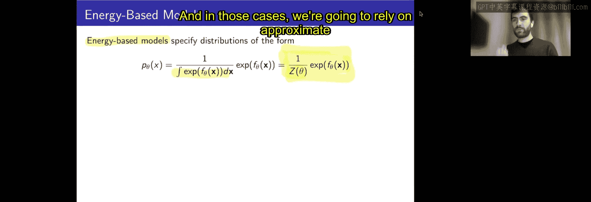

Okay。Okay so yes this again this constant here is really important。

 it's also known as the partition function， so it's the normalizing constant also known as the partition function and as you can see it's a function of theta so for each assignment of the model weights theta we get a different score here。

 I'm going to give it a better name in a moment but so right now I'm just calling it score at a high level and thisF theta changes because when we change theta we change the score。

All right， so this is the partition function。You might ask yourself the question is might one question you might ask yourselves is why do we exponentiate this core function。

 why not for example take the square so there's a few practical reasons。

 one is that typically probabilities vary a lot， especially when x is high dimensional they could vary by orders of magnitude over different x's and therefore if we。

If F is on a log scale， right because we expentiateiate F is on a log scale。

 it's easier to model large variations than probability numerically。

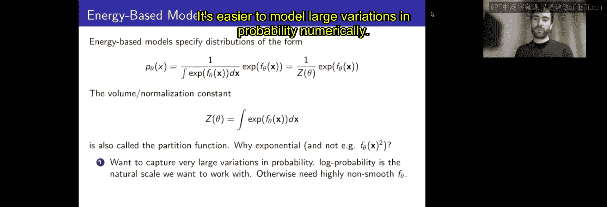

This model family， as I will explain later in the lecture。

 it generalizes other modeling families that you might be familiar with。

 even a Gaussian could be placed in this framework。And many more。

And there's also reasons that are based on theories from statistical physics and also information theory that explain why this is。

A reasonable。Why the X is a reasonable operator to use here， I won't go into these details。

 but there are arguments based on the principle of maximum entropy and also based on the second law of thermodynamics。

 which in a sense argue that using an X here is the。

The X is the operator that when we use it we end up making the least assumptions on what the probability should be un given a certain set of constraints I won't go this I won't go into these details but I can tell you more after the lecture and and I can or I can point you to some readings I just want to be aware I just want you to be aware that there is theory from statistics and thermodynamic which explains why that's the case。

And then one。One interesting one implication of this connection to thermodynamics is that we also often call this function minus f of x as the energy of the model。

 again this comes from the connections to thermodynamics。

 this distribution is called the boltolman distribution in physics。

 it's used to model the state of a system and then this f of x。

Is can be thought of as the energy of a system， so in machine learning we also refer to minus f of x as the energy and this is why we call these models energy based models。

Okay， so here on this slide， I define what an energy based model is。

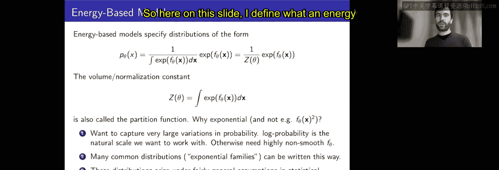

Now， why would we want to work with geneative models of this form？

The main reason is that it gives us very high modeling flexibility if you remember in most of the lectures in most of the previous lectures。

 we spent a lot of effort trying to devise a careful。

Tpe of probabilistic we try to carefully derive a certain probabilistic model for which the representation will be tractable right so in a aggressivegressive model we had to think a lot about how we define the conditionals in a flow model we had to spend a lot of energy to define a certain byive function between z and x here in an energy based model we make the least set of assumptions in fact any neural net or any parametric function appximator can be used to define f of x。

And then as soon as we have an F of x our formula here gives us a valid probability distribution。

So the main benefit of the energy based framework is the extreme flexibility in terms of which representation we can use for our probabilistic model。

However， as you can imagine and as Janan alluded to。

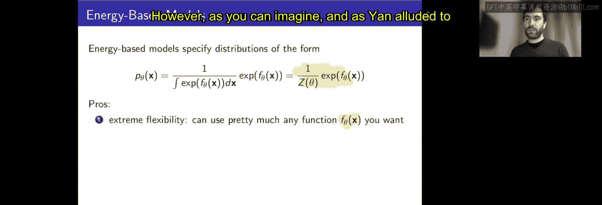

Moments ago， this is also going to be challenging from a computational perspective。

 at least without any approximation tricks， this is going to be difficult。

And the main challenge here is going to be。As you can imagine。

 is going to be to compute this constant Z of theta。This is。

Going to be computing Z of theta will involve solving some high dimensional integral。

 and we know from our lectures on variational inference that in general。

 this is hard and computationally intractable。So as a result。

 a lot of the standard things we like to do with general models will become much more computationally difficult。

 so sampling is one such thing even evaluating the likelihood and then as a result optimizing the likelihood。

 these tasks are difficult because just to evaluate the likelihood I need to compute this functions Z of theta。

And also in its current form， this doesn't involve any feature learning。

 which is something that we also want to do。And okay， there is a question， by the way。

 if you have a question I think it's going to be easier if you raise your hand in black and sorry in zoom and then I can pause。

 but the question is， would it still be challenging to find a theta that satisfies integrate well that's the okay？

So the question is， is it not challenging to find enough theta such that this integral is one？And。

My point is that we're not going to try to find n f of theta such that this integral evaluates to1。

 we're going to start with any f， and then we're going to try to compute its integral and normalize F by that integral to ensure that the final P sums to one。

Yeah， so。We start with any F and then we compute the interval。

So this is all going to be quite difficult， but still there's going to be lots of tasks where。

We're still going to be able to do interesting things without knowing Z and in this lecture and especially the next lecture。

 I'm going to show you some learning algorithms。Which are。

Some both approximate and exact learning algorithms。

 which will allow us to learn interesting models of this form here you also have a question。Yes。

 my question was， can you model any distribution？With this Gibbs distribution， so I guess like。

We're not putting any restrictions on F， but this gives distribution approximately any arbitrary distribution as well。

That's a good question， I think you can probably make that argument because if F of x。

 if you if you view the neuralNe as a universal appximator。

 I guess that should be right I think I think that should follow from the fact that a neural net that's sufficiently large can be a universal function appxiator。

 you could probably make that argument。

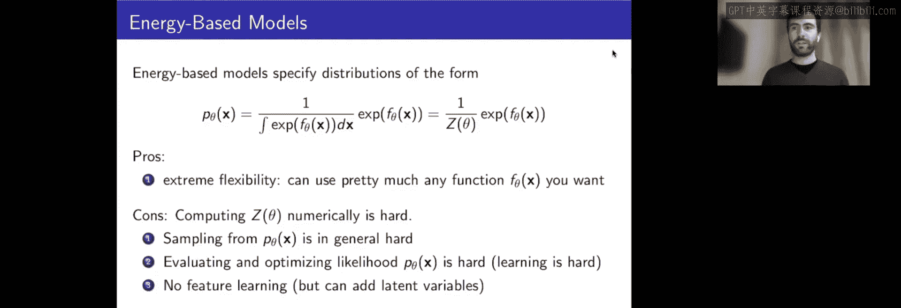

Yeah。Okay， so as I said earlier these models can still be interesting for certain tasks here I just want to give you the flavor of a few types of tasks that could be solved using an energy based model。

One ask is a form of outlier deduction。Let's say that， well， I guess in many of these tasks。

 the key observation to make is that。If we have two samples， x and x prime。

Evaluating the likelihood of each of these samples。Does require the normalizing constant。

 but if we're interested in their ratio， then we don't need the normalizing constant because it cancels out。

So let's say that we were interested in an application such as outlier detection。Or some sort of。

Version of density estimation， then we could apply energy models without having to deal with the hassle of estimating the normalizing constant right so the formula or the ratio is just is just this。

诶。We only use the energy， but not the normalizing constant itself。

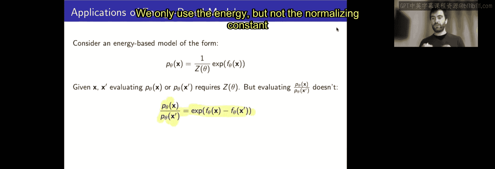

Right so as a result， many applications such as anomaly detection and also dennoizing and imputation。

 for example， let's say that we wanted to find an X prime that is close to another point x that is fully observed that we could try to optimize this。

This ratio。 and again， we wouldn't have to。Deal with normalizing constant。

So there are some downstream applications where the normalizing constant is not needed。

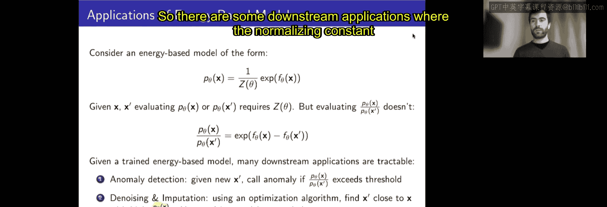

Yes， question is there any particular reason that you said doesn the normalizing constant would be needed in case of anomaly detection。

 could I not just do it without normalizing constant。

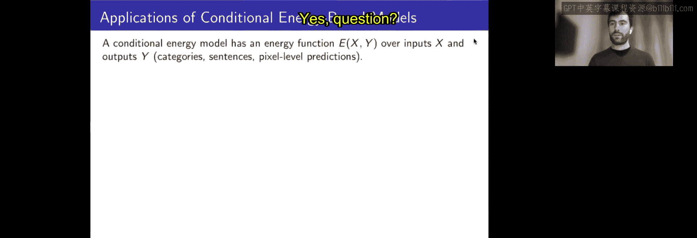

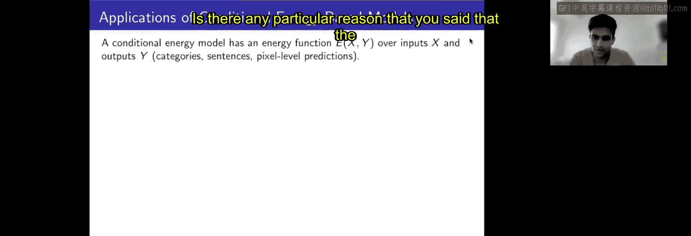

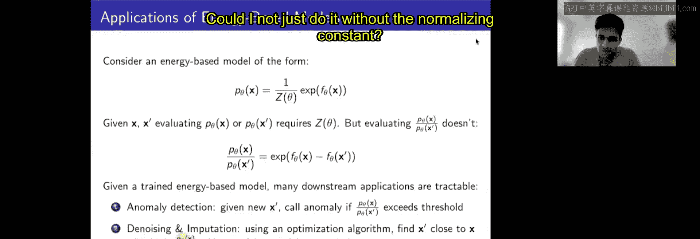

Need， okay， sorry maybe I misspoke， I'm saying that it's not needed。

Okay， the normalizing constant is not needed， that's the point。

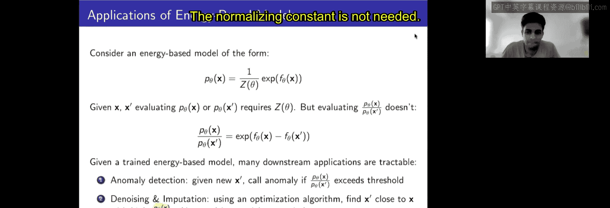

Yeah。to estimate the ratio， it cancels out。At the top and at the bottom。

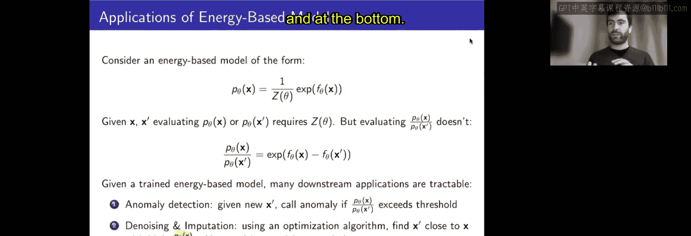

And then there's also other types of models that we might be interested in， which are。

Which are these。Conditional models in which we have labels y and inputs x right let's say that we have let's say that we wanted to do some sort of conditional estimation some kind of conditional tasks for example maybe we're interested in object detection or object recognition or maybe we're interested in assigning labels to elements of a sequence let's say we want to do part of speech tagging or something like this then we can solve a lot of these tasks again without using the normalizing constant。

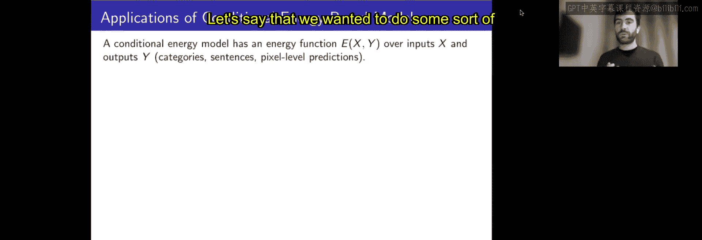

We can solve these tasks about simply optimizing the energy。

 which is the measure of how good of a fit is there between an x and a Y。

And we could optimize the energy over y for a fixed x right， imagine we wanted to find。

The most likely set of labels， the most likely set of part of speech tags for a sentence。

 so we want to classify each word as either a noun or an objectiveject or a verb。

Then that involves only maximizing the energy， not the probability。

Right or the assignment of y that maximizes the probability is the same one that maximizes the unnormalized energy。

 therefore we can reduce the task of finding a good y to an optimization problem over an objective whose evaluation is tractable and therefore that task can be the downstream task can be tractable as well。

So image restoration is another one， it's an instance of that thenoising example that I showed you earlier and I'll come back to this in just a moment。

 but my point here is that any time that we have，A label Y or not even not necessarily a label。

 just a high dimensional object y and an input X and we want to match them once we have learned an energyng model somehow we can still match them pretty well。

By simply optimizing。Optimizing the。the input， the label Y， the variable Y。ok。And again。

 you might ask yourself well this all assumes that I have a trained energy model where does it come from。

 I'll tell you one way of doing this later in this lecture and then we're going to see an even better way in the next lecture。

嗯。And also I'll add that energy based models can be thought of as a framework that generalizes a lot of types of probabilities that we have seen before。

 and it's still useful to adopt that framework， even though in general。Training any。

 even though training an arbitrary energy based model is hard。

Many of them generalize tractable probabilities and therefore。Well， sorry， many tractable。Energies。

 many many models are instances of the energy based framework with a more restricted and tractable energy。

 and so it's still helpful to know the energy based framework to reason about these。

Other special cases。Okay。I'll answer the next questions aren integrals for x prime and x is going to be different thus the normalization constant is different and it can be canceled out so the question is for different x and x prime is the normalization constant different or is it the same and so the point here is that for these two points it is the same this is really important。

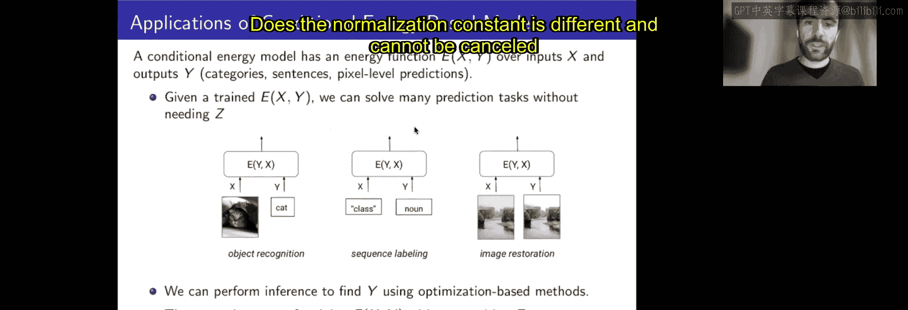

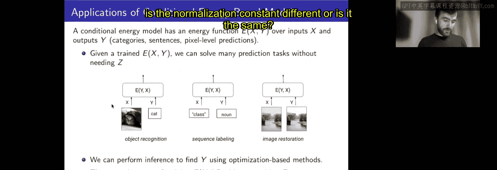

The normalizing constant doesn't change if you change the x。

 the normalizing constant is something that normalizes a probability。

 which is why it's a function of theta when you choose a probability function when you choose an unormalized probability by choosing theta。

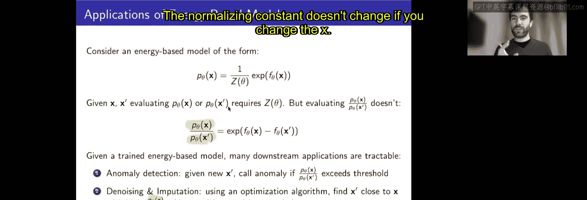

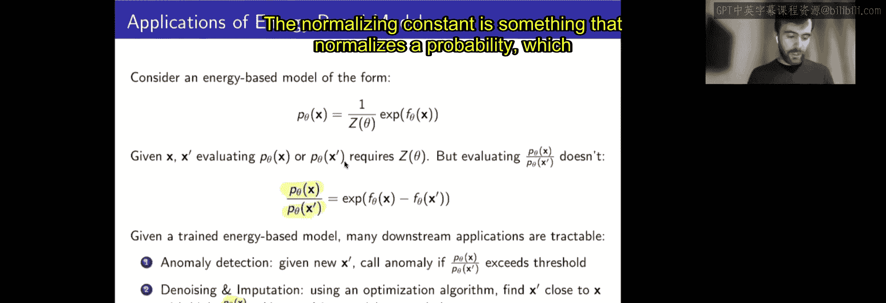

That fixes the assignment of。Unormalized probabilities all over the space。

And then that fixes the normalizing constant， the normalizing constant changes when you change the f of theta。

 which is when you change the theta， therefore it's only constant， it's only a function of theta。

 not a function of x， which is why it's called the normalizing constant because it's constant in x。

 but it's only a function of theta。Okay， I hope that answered the question。

 this is really important the normalizing constant is the constant in x it's only a function of data。

 I think that's really important to note。

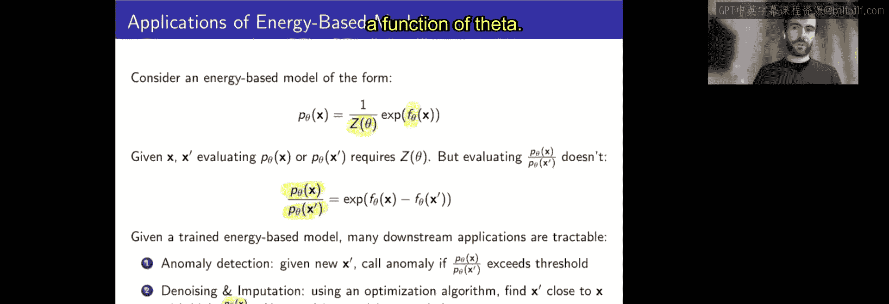

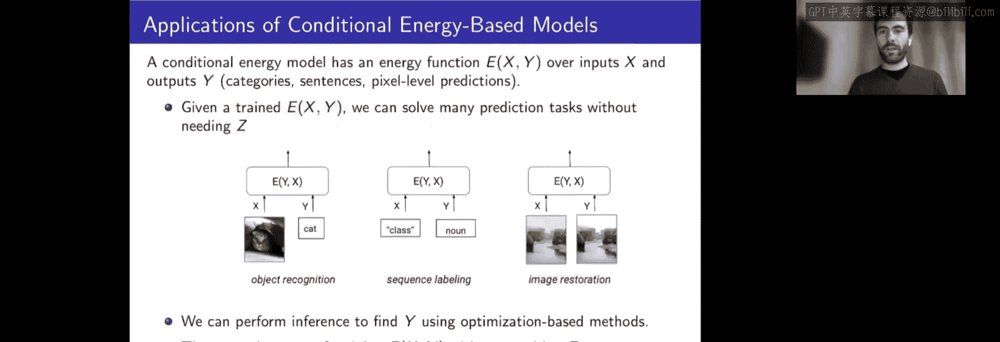

Okay， so we have defined what a normalizing sorry， what an unnormalized energy based model is。

Let me know if you have any questions so far and otherwise i'm going to give you a few examples of classical energy based models and these are actually models that have been really important in deep learning and in computer vision for some time now they're not right now energy based models or at least these classical energy based models aren't that big of a deal there's other ones that are more popular but I just want to mention these classical models so you're aware of them okay I just want to explain I just want to give a few examples of classical energy based models so you know what。

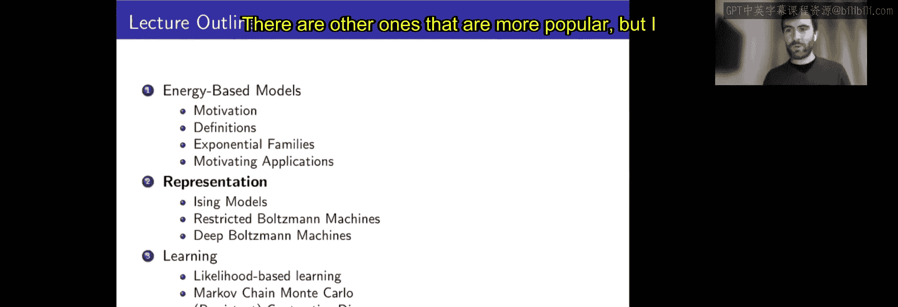

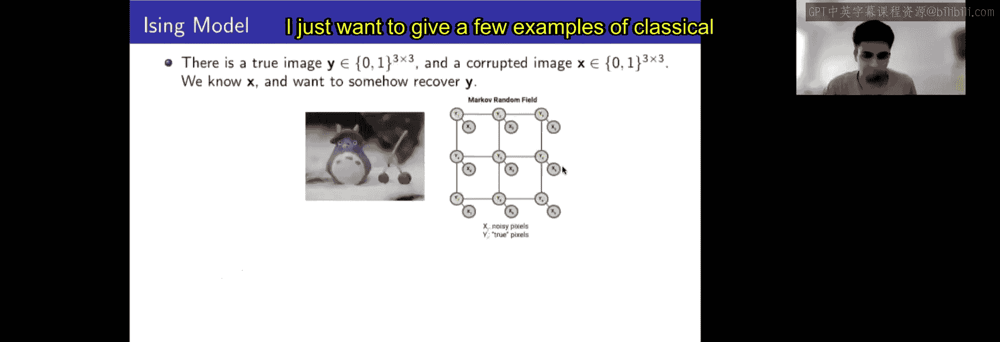

So you just know them and you're also familiar with these classical results in generative models。

 one really old type of model which can be thought of as an energy based model。

 it's called theicing model。The icing model can be seen as a distribution over two types of variables y and x where x represents some noisy signal that we have observed you can think of x as being an image in this case I have a three in this example I have a three by3 image therefore x is a three by3 grid of binary variables that's what I observed and I assume that x is some noisy or corrupted version of a true image Y。

And our task is to recover Y given x。In order to do this task。

 we will define an energy and that will result in a probabilistic energy model in this form。

 so what you see here inside the parenthesis is my energy。

And this energy involves two types of terms it involves。Notode terms and edge terms。

 So these are what I call the node terms and they correspond to every pair of y and x variables in this grid。

 So the y and the x is， you can think of them as being two grids of pixels we want to infer y from a noisy the true y from a noisy version X。

And in this energy， I have a sum over。Pears of pixels X Y and over pairs of neighboring pixels Y I Y J。

 so by Y I O Y J， I mean that I have a term for each neighboring。Why here in this grip？Okay。

 so I have these two sets of terms and each of these phi I's and phi I Js is just sorry P p I and Phii I J that's just some function。

 gives giving me a score。Ultimately a good model with this form assigns a certain type of score。

 it assigns a high score。Well， no， I guess here it assigns the lowest because we want to in so low energies or I guess low values of this function are good。

 they means we have high probability， so when y and x are similar to each other。

 this term will be low and it will be high when they're different。

And this term will be low when Yi and Yj are similar and high when it's different。And so as a result。

Y will have good low energy when it looks like X and when neighboring。

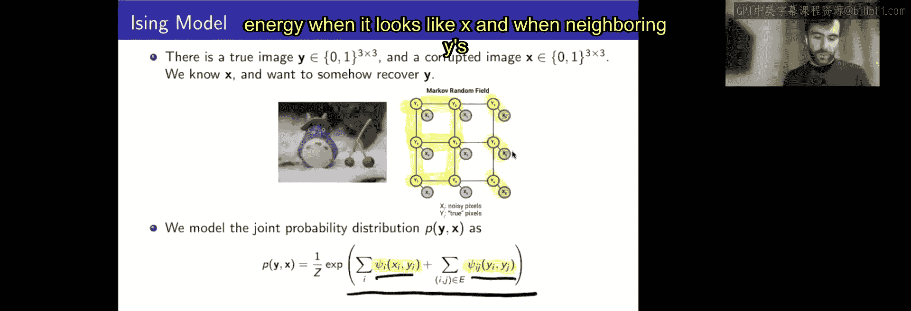

Ws are similar to each other， and that's because in an image。

 neighboring pixels tend to have similar colors。So neighboring wise should be similar。

And then these y and xs should also be similar。So I will choose an energy where。

Similar X and Y's are encouraged and similar Y and YJs are encouraged。

Given that I have this energy function， I can。I can define the task of dennoizing this image。

By maximizing this value P of y given x， and there are efficient algorithms for doing this once I have defined my energy。

So this is a way of casting the problem of dennoising an image in the framework of energy based models。

嗯。Are there any questions about icing models？

Could you add like a delta function to this to ensure that it doesn't collapse like every neighboring pixel is exactly the same as？

Because the second componentant of the loss clearly enforces that all of them should be similar so maybe yes。

 so they should be similar， but this term enforces that they're also similar to the x so the point here is that if some x are corrupted it could override the value so if this x is corrupted it could use the neighboring y's to fix that y so it could override the x but it wouldn't do it too often because then it will have bad energy according to the other term。

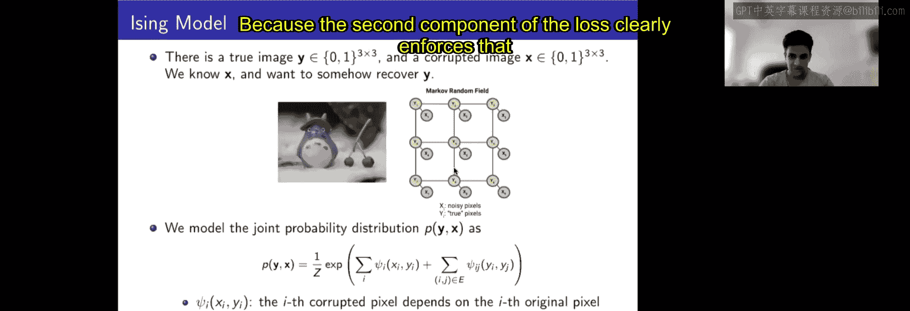

So this is an example of an I think model again， it's just an energy based model with the following。

Energy， and it's useful for。

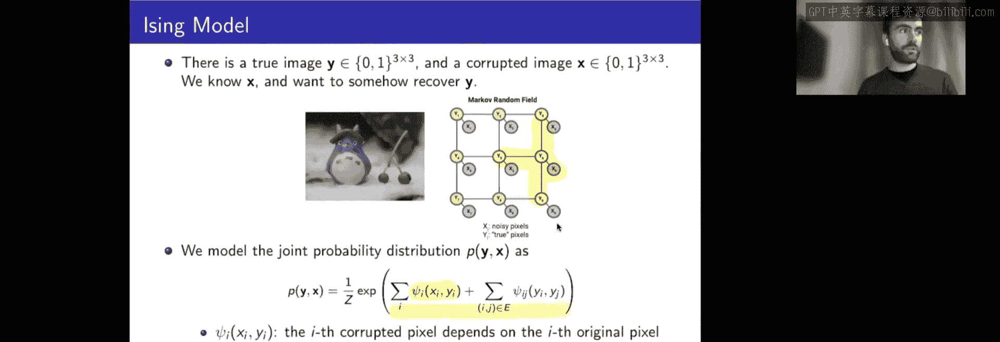

Denoizing images。Another classical type of model is called the restricting Bolman machine。

So an RBM or circuitos machine is a latent variable energy based model。

 so I previously derived energy based models。As not having latent variables。

 but you could just add them to your energy and that becomes。A latent variable energy based model。

 so there's two types of variables x and Z x is observed z is latent。

And the energy that the form of the energy is the following， so it's a quadratic function of x and z。

So this is a classical model， it turns out that it can do a lot of interesting， yeah。

 it turns out it can it's actually surprisingly powerful for a energy which looks。At first glance。

 simple， it's just a quadratic。It still can be used to yeah。

 I guess you can you can work out the math here you can。You can show interesting things。

So one interesting observation is that there are no visible visible or hidden hidden terms right so if you were to。

Look at the dependencies between the variables， the visible variables depend only on the hidden variables。

 but not on themselves， so within the set of visible variables and the set of hidden variables。

Each variable is conditionally independent on。Each hidden variable is conditionally dependent on all the other hidden variables given the visible units。

So this is。Interesting， it makes this model more tractable。

 it's also why it's called a restricted boltman machine。

 an unrestricted boltman machine would have connections between the hidden and the visible unit。

As a result of it being restricted， there are certain learning algorithms which become much more effective for this type of model。

And it's still very expressive， there is some math that could be done to show that this has。

A level of expresslusivity comparable to a neural network layer。

I won't go into this into these details， but you can derive the expression for the marginal of the hidden given the visible and visible given the hidden。

 and it kind of looks like a neural network layer。In any case。

 this is actually quite a powerful model that can be used to easily model digits such as MIS。Okay。

 there is a question about the icing model in the icing model don't we need the actual image Y in the first place。

 so no our task in the icing model is to。

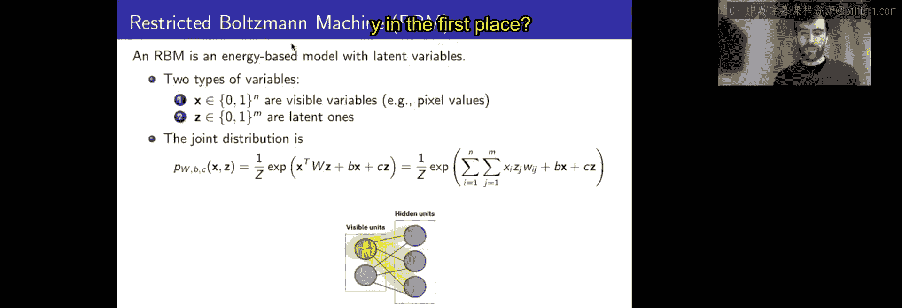

So we have x， we don't have y， our goal is to get y。

 therefore we define an energy over both y and x and we try to infer y Y is the thing that we're trying to predict。

And we have an energy over y and x， and we find the y which optimizes the energy。

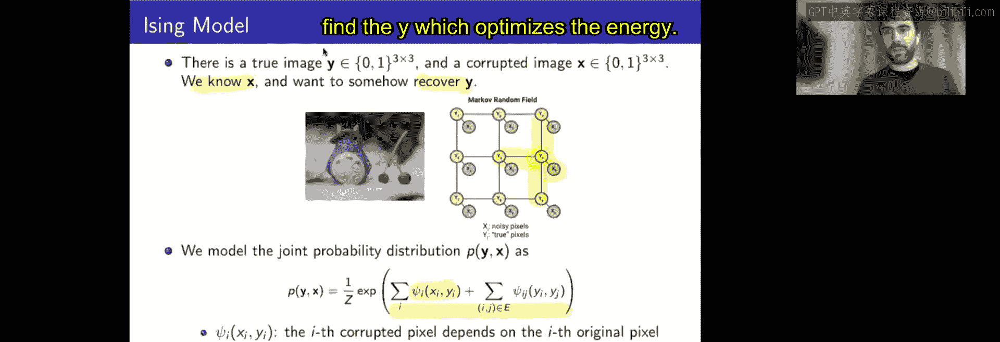

So that's the question。That was there in the chat now， okay， back to our BMs。

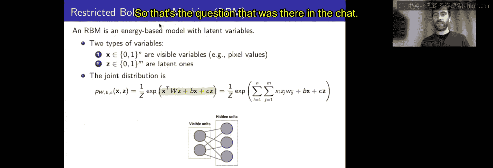

This is a latent variable energy based model。They're useful they're quite useful by themselves and they're also useful when stacked in layers and this is why is's called the deep boltman machine this is a historically interesting and important machine learning model this was probably the first deep gene models model that came out as part of the new wave of deep learning so when when the term deep learning was coined it used to refer a lot to or。

It。One famous type of early deep learning model was the deepulttzman machine。

 and this is just a stack of RBMs where we add additional hidden layers。

On top of an initial layer of visible units， but within each layer。

 the energy between these two variables is just an RBM so it's just an extension of the previous energy models to having previous layers。

And when we train these debolzman machines， first of all， it's really not obvious how to train this。

 I will talk about it shortly， but。Let's assume we have a way of training it and i'll talk more about that in a few minutes once we train this these models tend to learn a hierarchy of representations where higher level hidden variables and higher level concepts a bit like in the neuralNe but again this is all generative so there are no labels when it does it and it can also be useful for generating samples so here are some samples that were generated by。

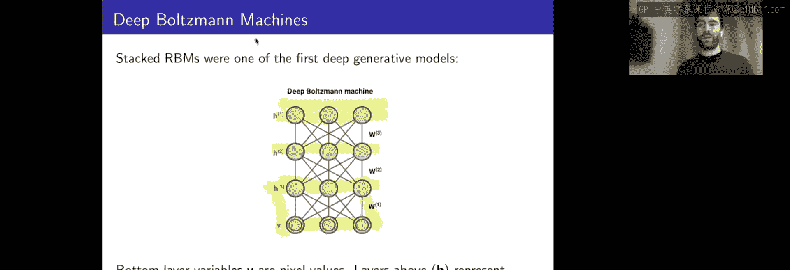

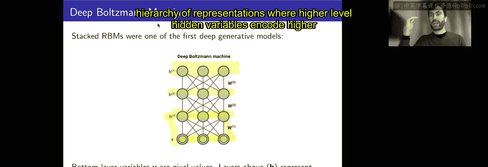

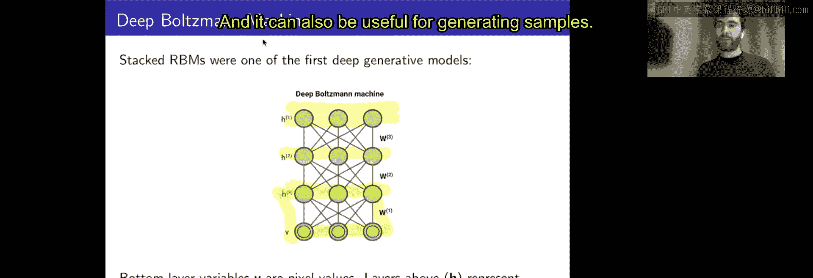

Debolsman machine type of models back in the day so it's still able to do some interesting simple generation and even a single layer restrict boman machine can。

 for example very easily model MIS。嗯。So these models can do some。

Simple gene modeling tasks and they were a state of the art around 2006 2008， maybe until 2010。

 now people don't really use reable swing machines。

 but I think it's still a useful algorithms it's a useful algorithm to know for historical reasons。

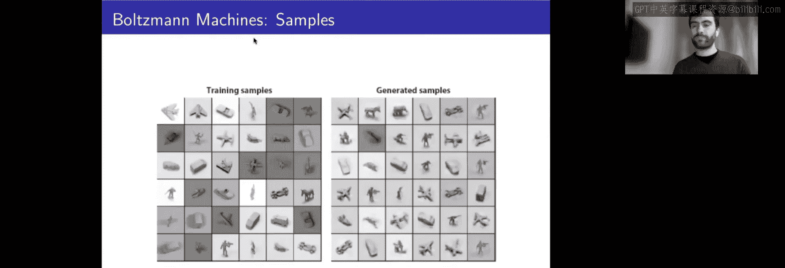

Okay， but so far， everything that I talked to you， everything that I said。

 everything that I told you。Involved a learned。Energy based model， right。

 so for these motivating applications， the model was learned here when I。

Give you an example of dennoising using icing model， we somehow had a good energy。

In the case of an icing model， the energy can probably be specified by hand， but for。

Other types of models， for example， use RBM type of models。

 it's really not clear how you would actually learn that model。

And that's what I want to talk about next。

So as I said earlier in general， learning these models is intractable， in fact。

 even computing the likelihood at one point is intractable because it requires taking the integral。

 so in the most general probabilistic setting， maximum likelihood learning is intractable and therefore we have to rely on approximations。

And there's different types of approximations that we're going to see。

One type of approximation still tries to do maximum likelihood learning。

We're still going to use likelihood as our objective。But we're going to try to approximate it。

And there's two main ways of doing this。One way is based on variational inference。

 that's something that we have seen in previous lectures。

Val inference is a general approach that can be used to approximate many types of。

It can be used with many types of intractable models， it could even be used with energy models。

And the key idea of variational inference is that it reduces。

Approxiation to solving an optimization problem where we optimize for an approximate posterior cu。

 we learn an approximate posterior cu using optimization。And then we work with that queue。

That's the high level idea of variation inference。But that's only one of the two big ways in which。

Approximations are done within。Probilistic models。There's a different approach based on something called MCMC。

 which I will talk about in this lecture。And so this is going to be another broad class of approximate。

Learning and inference methods， but rather than being based on optimization。

 they're going to be based on sampling。And I'll explain what it means。Right now。

Okay。So variational inference was one big family of approximate algorithms today I'm going to briefly introduce another family based on MCMC。

And before I do that， I just also want to mention that there are also methods for learning energy based models that don't rely on likelihood another strategy for energy based models is just to get rid of the likelihood objective entirely like we did with GNs and and work with。

A different learning procedure， and that's what we're going to see in the next lecture when we will talk about score based generative models。

But for now， let me introduce MCC based methods。

So I'll introduce MCMC in the context of a type of model called exponential family models okay here you see the formula or an exponential family。

So this is a function where the relationship between the parameters theta and the input x is linear。

 so x is being feturized。With some vector features F。And then the energy is linear in theta and F。

So this is a this is actually a very common type of model， for example。

 a Gaussian would be a special case of this and this is why I said earlier that a Gaussian distribution could be thought of a special case。

 of an energy based model and many， many distributions。

 many classical distributions in statistics right many of these are special cases of an exponential family and by extension there are a special case of。

Of。Of， of。I have an energy based model。And also some of the other model families that I just introduced introduced to you。

 for example， icing models or conditional RBMs conditional。

 I mean that you fix the hidden and you have a distribution over the visible or you fix the visible and you have a distribution over the hidden when you clamp either set of variables in an RBM。

 you also have something which looks like an energy based model with a particular choice of features X here。

So my point here is that many types of interesting probabilities， including。Yeah。

 many types of energy based models are instances of the exponential family。

And I'm going to introduce MCMC in the context of exponential family models。

So。Let's say that we have an exponential family model here， as I said earlier。

 we will still try to learn this model using maximum likelihood。

 although in the next lecture I'll show you that this is not the only way of learning these models but for now let's say that we're interested in maximum like。

So we can show that the maximum likelihood， which is this right it's basically the probability of the data set。

 let's say we have a data set D， so the likelihood is the log probability of the data set normalized by the number of data points in our data。

 which is the cardinality of the set D。That likelihood has the following form。

 right this is the form of my L likelihood。That's just plugging in my definition。

Of an energy based model here。I get this particular expression。So this expression has two terms。

 it has this term， which is easy and linear。The first term is easy to handle。

What's difficult about this likelihood is the second term here right this is my log of z so this is the really challenging and important term。

 it's challenging because it involves this。So as you can see here it's log of sum of x and here this summation is over over all the possible x's that I could see here i'm just assuming that x is discrete for the sake of this explanation。

 but a。Yeah， it's even more complicated when X continuous plus theta x is the street。

 so here I'm summing over all the possible X。And so this summation。

Is going to be over an exponentially sized set， it will be intractable and approximate I can't easily simplify it by switching the log in the X because they have this annoying summation in the middle。

Soです。This， this term here。Is what's going to give us？

Trouble and our goal is to is going to be to somehow still perform approximate learning and inference while dealing with this。

So even evaluating the term is hard， therefore it's going to be even more difficult to optimize an objective function。

 which contains the term。

So what can we do？Well， let's just still try to optimize the likelihood using gradient descent。

Let's just assume that we can somehow。Do this and let's just as a thought exercise。

 let's try to compute the gradient of this intractable objective that I just showed you。

So this is the intractable objective。How can we get a gradient for this？Well， as you can see in。

 as I just mentioned， there are these two terms。And so， this is。The first part here， this is the。

Lar part and that's just a linear function of theta。

 So if I want the gradient of that with respect to theta that's really easy。

 It's just a linear function。 so i'm not i'm not even going to。Spend time on that。 That's super easy。

The challenging part is this log of Z term， but we can still at least try to get a formula for what the gradient of log of Z is。

And that's what I'm going to try to do here。So if we want to have the gradient for the full function。

 we have to have the gradient for this term。And with a little bit of derivation。

 I will post these slides online so you can you can look at this derivation offline since we're。

Since we're closer to the end of the lecture now， I won't go through all of the details。

 but if you look at these feww lines。It very easily simplifies the following interesting expression。

So it turns out that the gradient of the partition function。

Is the is equal to the expected value of the features F of x under the model。

So I have a model with parameters theta。The gradient of the partition function is the expected value of the features。

Where the expectation over x is with respect to the distribution with parameters theta。

So that's a key fact about any exponential family。And we can use this fact for obtaining an expression for the gradient。

Of the look likelihood。With an exponential family model。

The form for that gradient is going to be exactly this。

So here I have plugged in my formula for the green of the partition function to obtain this term。

And then the first term， that's just from the fact that we had a linear model。

 so you know in the objective it's theta transpose times f of x。

 well the the gradient of the function is just f of x it's just the gradient of a linear function。

 that's what I use to get the first。Dn。So this is the correct formula for the gradient of the luck likelihood and it has an interesting structure。

What's interesting about it is that this is the difference between the expectation of the。

Natural parameters F under the empirical and the model distribution。Right， so if you take this。

First the here。You can view this as the expected value of F where the expectation is taken with respect to the data distribution。

And this is an expectation over the same set of terms， but with respect to the model distribution。

And， you know， eventually I want this to equals zero， which means that。These two terms。

 if I have optimized my model correctly， they will be equal。When the likelihood is optimized。

 the gradient equals zero， therefore the expectation of f under the model distribution and under the data distribution will be equal and as a result we have learned the model。

And therefore we refer to we can also refer to this type of learning as moment matching we're trying to match the expected value of the features under the data distribution and the model distribution。

 we do that implicitly when we perform maximum likelihood learning using gradient descent in an in a。

In an energy based model。Or in an expansion family model。Okay。

 so this is a fun fact about exponential families。

Okay。But this still has a problem， right？This term on the。This this first。The first term here， again。

 this is easy。 This is just。The average of a function over our data set。

 that one we can compute easily。What's challenging is to compute this term。

 so we tract we have a formula for the gradient， but computing this second term which I highlighted。

 that is challenging。And it's challenging because it requires， well。

 either sampling or inference or taking expected value with respect to P and that's in general intractable and therefore computing the gradient is also intractable。

So our main challenge is。This term， right， this is。Going to be hard。

But it also hints at a way of doing approximate inferenceferen in these types of models。

Let's say that we could draw samples by sampling x from P in some way。

 maybe if we could approximately sample from P， right， maybe taking exact samples from P is hard。

 but if we could draw approximate samples。Then we could take these samples to get an estimate of this expectation using Monte Carlo。

And so the idea of the sampling based approach。To approximate inference is to use this formula and to approximate the expected value by approximately drawing samples from P。

Okay， so this is a really key idea I want to just repeat this again in probabilistic machine learning。

 there are two main ways。Of dealing with intractable probabilities。

 one way is variational inference and variational inference reduces。

It reduces inference to optimization， if we can optimize for an approximate theerior。

 then we can solve our instructable inference task。And here I have defined a second approach。

 which is based on sampling if we can so here we're trying to reduce sampling we're trying to reduce。

Inference to sampling and if we can approximate sampling well， sampling instead of optimization。

 if we can do sampling efficiently， then we can learn this。

 well then we can approximate the expected value， then we can approximate the gradient and then we can perform approximate learning。

Okay， so this is a key idea here。This is really， really important the idea of sample based approximate learning is to approximate the expected value in this formula by taking samples from P。

Using approximate methods。Are there any questions about this？If you remember one thing about this。

Portion of the lecture， I think it should be what I just said。

Year ahead of question。Yeah， I just wanted to clarify so Monte Carlo is an approximation of the expectation and mark up Mark Carlo is like an approximation of Monte Carlo。

Marup chainin Monte Carlo is a way of drawing samples which will be used for month for the Monte Carlo approximation of this。

Expected value right but these samples are themselves an approximation to samples for now yes and no it depends on how you run the markup chain if you run it for an infinite amount of time it's not an approximation in practice you have to cut it at some point so it could become an approximation right so okay again at a high level。

An important approach to approximate inference is based on sampling。

 and that's what I just described here， it's really important。

One particular way in which we could obtain these samples right so now the question is how do you get these samples X from P one way to do this is based on something called Markov chainin Monte Carlo。

And that's what I'll talk about in the time that I have left and another special case of Mark of Cha Monte Carlo。

 which I will introduce。

After if I have time is persistent contrastive divergence， which is itself an approximation to MCMC。

可。

嗯。Yeah， okay， I'll just give you the high level idea。

 I don't think I have time to introduce the method in full。

 but you can look at my slides later the high level idea of Markup chain Monte Carlo is to reduce the sampling process to running a markup chain。

So first of all， what is the markup chain， what is a markup chain？

A Markov chain is a sequence of random variables， which I'm going to denote by as0 s1 s2。

 and you can think of s as being a state。We start with some distribution over the initial state。

And then we have a transition operator that tells us the probability of going to one state when we're in another state。

And this could be a visualization of a Markov chain， so we initially start in some state。

 let's say we start in one。And then when we're in one， we， well in this case。

 we always transition with probability one to state two now once we're in state two。

 we can transition back to state one with some probability or with 50% chance and then with 50% chance we go to state three。

And。And and then if we ever go back to state three， then we always go to state one。

 and then from state one， we go to state two and then the process repeats itself。

So this is a Markov chain can be visualized by a graph with transition probabilities on each edge and we can transition from one node to the other with that probability。

And the crucial aspect of a Markov chain is this Markov assumption。

 which means that this transition probability is always the same for every step I。

 so when we're in state two， it doesn't matter how we got to state two。

 maybe we just started in state two， maybe we've been running the Markov chain for a million steps。

 but once we get to state  two， our probability to transitioning our probability of transitioning to state three here is always going to be 0。

5。No matter how he got there， this is the mark of assumption。Okay。

 so it's a process over random variables， which has this structure。

And the crucial thing to understand about a Markov chain is that a Markov chain defines a probability distribution。

When you run the markov chain for a very long time。

You get samples which are drawn from some probability distribution。ok。😊。

What is that probability distribution？Well， let's assume that。You have a finite number of states。

And the initial state as0 is drawn from some vector probability p0。

And let's say that I can represent the transition probability or。

Let's say that I can always write my transition kernel。Which is this probability of SU given I。

Times as previous given J， I can write it as a matrix。Right。

And then my probability of being in a certain state after D steps， it equals p0 times。

This transition operator T， capital T applied lowercase T times。😀く。😊，ok。

So if I start with some distribution， some initial distribution over states， be zero。And I apply my。

Mark of chain p times I will get I will be in some other state and my probability over what that other state is will be given to me by。

Peace of tea。Which is given to me by this formula。🎼So this is just the result of applying the Markov chain many。

 many times， right because it's Markov， I can just estimate the probability of the next step by repeatedly multiplying by the matrix T。

Right。And then this limit when it exists and it often exists。

It's called the stationary distribution of a Markov chain。It's the limit of。This state PT。

And you can also prove that it's an eigenvector of this matrix。

 so this matrix will have a particular this matrix C that I just defined will in many cases have an eigenvector with eigenvalue one。

And that will be a stationary distribution of this Markov chain and in practice what it means is that if I start with some state in some initial state and I run the Markov chain for a very。

 very， very， very long time。The state in which I will end up eventually will be。

Will be distributed according to this distribution pi which is the the stationary distribution of a Markov chain。

 so a Markov chain defines a probability distribution via this process。

 the stationary distribution of the Markov chain， which is the distribution of the state in which I will end up if I run the Markov chain for a very long time。

That's the distribution that the Mark chain defines。Okay， so a markov chain defines a distribution。

We can check whether a distribution is stationary or not by this formula。

 so this is actually a sufficient condition， I'll skip this for now。

 but now the idea of Marker chain Monte Carlo。

I want I want to at least make sure that this is that I get to mention this。

 the idea is to create a markov so given P I want to sample from P so I will create a markov chain。

Who'se。That will generate。Samples from X。And so the states of this Markov chain will be assignments to the variables of the model。

 variables in the model。And I will design my Markov chain in a clever way such that its stationary distribution equals the distribution P from which I want to sample。

And then once I have carefully designed my Markov chain。

 I will run it for a while and then the samples that I will get eventually will be samples from P。

And then these samples， I can use them for Monte Carlo integration or for sampling， just you know。

 I can just use these samples， it could be my images that I have generated from the model。

So that's the idea of Markov chain Monte Carlo it's to construct a Markov chain especially when I draw samples from it。

 it gives me samples from key。

嗯。Okay， so。Yeah， typically the way this is run is that I have to define the typically the way a mark of an MCc algorithm works is that I have to define a certain transition operator T and this is。

This is kind of the hard part， we define the transition operator and then we run the markov chain for some number of burning steps。

 and then all the other steps that come later， they will be my samples。

And then if this burn stage is sufficiently large。The samples that I will get in step two will be samples from my model。

Although in practice， I don't really know how long B is。

 but there are heuristics that people use to define what B is。Okay， so since I'm out of time。

 I'll just， so these slides are available after the lecture。

 I'll just mention that there's a general way of constructing an MCMC chain for the distribution that I want。

And this is called metropolis Hastings。So given any the Shapolius Hastings， which is on this slide。

 it gives me a formula for defining the transition operator which has whose。

Paationary distribution will be the P that I want。

Okay， so let's skip this part and's there's a short proof actually for why that's the case。

And a special case of metropolis hasting is Gi sampling I'll's skip this sorry。

And so。Now when we apply MCMC sampling with maximum likelihood learning。

 it gives us an algorithm called contrastive dirgence。

 so contrastive dirgence is the learning algorithm or is the classical learning algorithm for energy based models。

And so the way it works is that we start with some guests for the parameters of the energy based model。

 we run an MCMC chain such as Gb sampling or metropolis Hastings to compute samples from the model with a particular theta then we use these samples to get the gradient。

 we take a step of gradient descent and then we again recompute new samples in stage one and so on。

 so it's basically gradient descent with samples drawn from MCMC。

Now， the only difference that persistent contrastive diversions does is that in stage one。

 we don't restart MCMC， we just reuse the。

There's so we basically yeah we restart the chain from where the last chain left off and we don't run it for long for very long because if the parameters haven't changed。

 I don't really need to reinitialize a new chain where I left with the old one is pretty good so I can just I can just make it I can just do a few more additional samples。

So that's persistent and contrastive diversions。And this is the classical algorithm for learning models like RBMs or depo emissions。

Okay， I'll end on this note。

We saw energy based models。In general， probabilistic energy based models trained with maximum likelihood are intractable。

But they still have a lot of interesting use cases。And once we have learned the model。

 we don't need the energy function the normalizing function in many cases。

 and there are also ways of learning these energy models without even using the。

Without even having to compute the constant， so saw I show you one approximate way of learning energy based models using MCMC and contrastive diversions and we're going to see an even better way of learning them in the next lecture when we're going to look at score based general models。

Okay， I'll stop here and yeah， if you want to look at the proofs and the details of the definition of the metropolis Hastings。

 the slides are online。And yeah， let me know if you have any questions。

