# 康奈尔大学《深度生成模型Deep Generative Models (Cornell Tech CS 6785, Spring 2023) 》中英字幕 - P12：-12-Lecture 12_ Score-Based Generative Models.zh_en - GPT中英字幕课程资源 - BV1az421q7Vf

Okay welcome back everybody， so today we're going to start another new type of generative model which is going to be score based models and then diff fusion models in the next lecture which are closely related to them so it's going to be a new topic orre almost done with generative modeling families this is these two lectures this week are going to be the last set of generative models that we're going to be the last set of new generative model families that we're going to be seeing and then we still have some extra additional topics in the coming lectures。

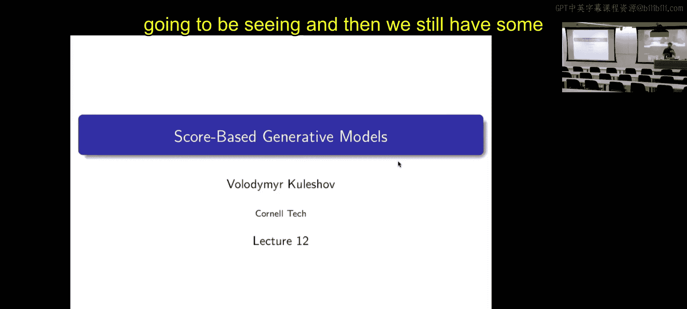

Okay， so I'll start this new topic of score based and diffusion models with as usual a quick recap of things we saw in earlier lectures so first of all in the first several sets of lectures we saw a few classical types of deep generative modeling families so we looked at our aggressivegress models。

 latent variable models and by that I mean both these and flows and then we also looked at GNs as an alternative model which doesn't optimize the log likelihood like all the other models。

And there's several sets of tasks that these models can do， which we covered， for example。

 so the most typical task that we want to do is generation。

 but also there's other related tasks in the field that we might be interested in。

 such as representation learning or density estimation for applications like outlier detection。

So there's a wide range of tasks that these different models can do。Now some。In most cases。

 or at least for the beginning of the class， for the first generative modeling families。

 we used maximum likelihood as our training objective。

And this objective is it's a very standard type of objective that we use in machine learning and statistics。

 but when we train using maximum likelihood， we usually have to deal with。

Various types of complications。 So， for example， if we have latent variables in our model。

 then we have to worry a lot about how we can approximate the likelihood。

 which is intractable in general， or if we have a bijective model like a flow。

 then we have to think hard about how do we ensure that the。

That the model is both inverable and has attractable Jacobian。

 so there's a lot of thought that has to be invested in what kind of neural network can we use with each of these models。

 we can't just plug in and arbitrary neural net inside a flow or inside some of these other models and expect it to work efficiently。

 we spent a lot of energy with coming up we spend a lot of energy coming up with different architectures that fit these model families。

And then towards the end of this block of lectures。

 we saw GNs which don't use the likelihood and which can use an arbitrary generative process。

 an arbitrary simulator to generate samples， so they have the most flexible type of the most flexible type of model that can parameterized in neural。

 you can use any generator， any neural net that can output samples can be trained as part of aganN。

 but the problem is because GNs are trained from samples using a discriminator and we're simultaneously maximizing and minimizing the objective with two different models as a result。

 training is unstable， so GNs have flexible models but they're unstable。And then in the last lecture。

 we looked at energy based model， which is an approach where similarly to how， well。

 it's even more general than。I guess it's comparably general against in that we again in a generative model。

 don't have to worry about whatization we use for the neural net that parameterizes the model。

 we start with very few modeling assumptions。But then we'd still train these models in the last lecture using maximum likelihood training using MCMC。

 which can be slow in practice。So with energy models。

 we came up with a modeling family that admits very flexible。

Very flexible neural network para parametricizations。

 but the cost that we had to pay for this was that training is slow。

So the question I want to ask in this lecture is can we again in some sense get the best of both worlds。

 can we have a very flexible neural network， can we use very flexible。

 very general types of neural networks to parameterize our models can we be as flexible and as general in terms of our modeling assumptions as in energy based models。

 but can we avoid paying the cost of slow training and slow sampling using MCMC like we did in the last lecture？

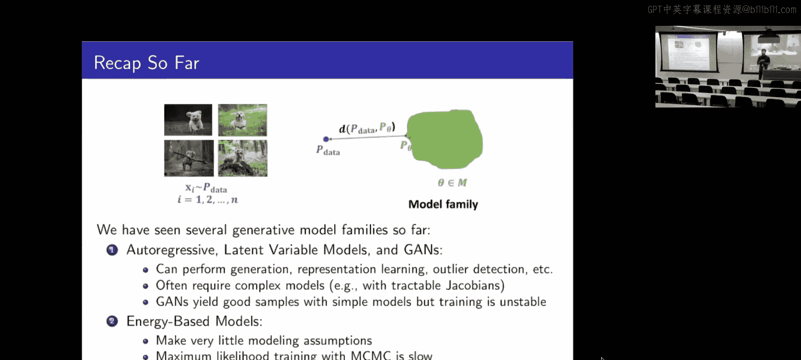

That's going to be the topic that I want to start this lecture with and that I want to use as motivation for the kinds of score based models that we're going to look at。

So let's again redefine some of the things we saw in the previous lecture。

 remember that in the previous lecture we introduced these energy- based models which are very flexible。

 very general classes of generative models in which we define again here。

 we define a probabilistic model P of x using an unnmalized function using this unnormalized energy F of x。

So we define an unnormalized probability， which can be any non negative function here it will be x of f of x。

And then we explicitly normalize it by explicitly dividing。The unormalized density by this term。

 by this integral， which is what we call the normalizing constant or the partition function。Right。

 so previously， for example， in a flow， we were very careful about what kind of。😊。

What kind of parameterization we would use for the model in order for the density to be tractable in order for this normalizing constant to be always tractable when we do the changer variables right we had to be very constrained in terms of what kind of neural net we can use to parameterize for example a flow model in order for this partition function to be tractable here we take the opposite approach。

 we're going to say we will use any model， any neural net to approximate and model the unnormalized distribution and we will worry about the normalizedizing function later it might give us a probability well it might give us an unnormalized density for which the partition function is really hard to compute but that's fine we'll just take this approach and we'll deal with computing the normalizing function later。

That's one way in which you can think about these energy based models。So very general。

 but requires dealing with a potentially intractable partition function。So again。

 what are the pros and cons of energy based models？The main advantage is， as I said。

 is that we can use。Any normalizing function is any。

Any function F for the unormalized probability without。Without any constraints on what F of x is。

 So that's great。 that gives us a lot of modeling flexibility。 However， as I said earlier。

 the partition function ends up in general being intractable if we don't have any constraints on what F is so therefore。

😊，Computing the density is intractable right so just evaluating this P of x is intractable and therefore optimizing the likelihood is also intractable so just the forecast for computing P ofx will be intractable therefore learning is hard。

And similarly， sampling from this distribution is also hard because we only have a weight at each data point。

 it's not obvious how do we actually sample from this unormalized probability。

Now there are ways we look at MCMC as one way of sampling from aormalized probabilities from these kinds of yeah unormalized probabilities and then sampling can be MCMC based sampling can be used as a subroutine for learning。

 that's what we saw in the last lecture。嗯。But in general。

MCMC is still a slow procedure that in the worst case。

 you can come up with examples where it will take a very long， exponentially sized。

Amount of time to converge。 So this is not。The approximate techniques we saw in the last lecture don't fully solve our problem。

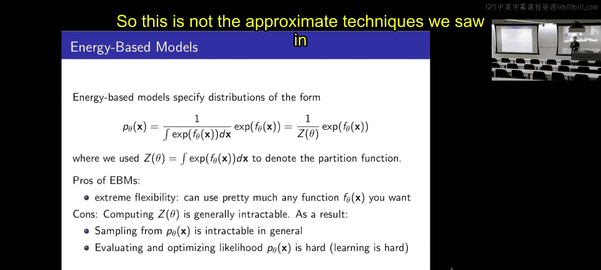

So in general， without any additional constraints。On F of X， energy based models can be intractable。

As a result， we have to use approximations， similarly to how we had to use approximations when we worked with。

With GNs， with Vs and yeah， with Vs。One type of approximation that we saw when we first had to deal with intractable likelihoods was variational in。

And variational inference is one of two main approaches to dealing with intractable probabilities in machine learning。

It's probably the most popular one these days， but it's not the only one。

So another approach is sampling based methods， which is what we saw at the end of the previous lecture and these two approaches。

 so variational inference and MCMC based sampling approximations these are。

Two really important classes of techniques in machine learning that are very， very important。

 they're used throughout machine learning to approximate things when they become intractable。

So we saw a variational inference， we saw MCMC based methods， in particular。

 we saw MCMC in the context of。Energy based models。 And again， just to remind you how。

Slow and complex as procedure can be if we wanted to learn to approximate learning。

If we want to approximately learn an MCMC based model， sorry energy based models using MCMC。

 then the procedure that we would follow would look like this。

So for each set of for each step in our optimization procedure。

 we would try to compute this gradient of the log likelihood。

 but in order to compute the gradient of the log likelihood， we have to。You know。

 we can't get the exact gradient because that would require computing the partition function。

 therefore we approximate。This gradient by taking samples from the distribution， and we use。

A Markov chain Monte Carlo algorithm compute samples from T of x。

 then we use these samples to compute an approximation to the gradient。

 and then we take a gradient step， but essentially at every step of gradientcent we have to run a Markov chain。

To take samples from our distribution， which is very slow。But still this is。

An approximation procedure that is worth knowing。Now。

These are two approximate techniques that are trying to optimize the looklight。What if， as in GNs。

 we try to not optimize the look likelihood， but instead choose a different objective。

And maybe that would make things easier。So the idea that I want to explore today is。

Instead of relying on these two classical sets of techniques for approximating log likelihood。

 can we instead use something other than the log likelihood which will not require us to deal with the partition function and therefore will be a better way of learning of learning an energy based model and so the answer to this。

Well， sorry， it's not a question。 but， but the， I guess you could probably see where I'm going。

 We're going to see a different way of training an energy based model， which will be。

More effective than using MCMC in many applications， and as a result。

 it will allow us to learn energy based models。W that's more tractable and that doesn't require dealing with the partition function。

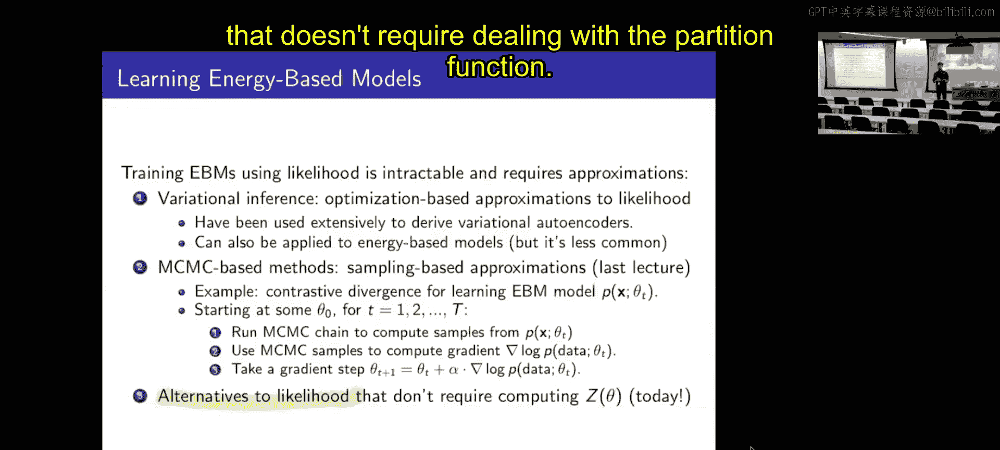

Okay， so this is the outline for the lecture I will present a different way of learning an energy based model using something called a score function。

'll start by defining what a score function is then we will look at how we can learn this new object called a score function using algorithms that are called score matching so this is going to be cloud learning right one will be about presentation。

 how do we represent a probability distribution using its score function。

Then how do we learn this score function and finally， how do we do inference。

 how do we draw samples from this new object that I will find called the score function。

That's the plan for this lecture。All right， so let's start。So。First of all。

 what is this idea of score function that I want to use that I'm going to propose that we use？

So the score function is。To make it short。The score function is what is given to us by this little formula at the top of my slide。

So the score function is the gradient of the log density with respect to its input。Right。

 so suppose we have some。Some density or some probabilistic model T of x。

 itss associated Ste's score function is given by this formula。Okay。

 so let's stare at this for a moment and understand a little bit better what this means。

The first observation I want to make is that this Ste score function is different from the gradient of the log likelihood。

 which is what we used earlier。Notice that the gradient is taken with respect to X。

As opposed to with respect to the parameters theta。Right， so if we were to use gradient descent。

 we would be using this particular。Expression， we would be trying to optimize the model with respect to its parameters。

 therefore we would take the gradient with respect to the parameters。

 but that's not what the Ste score function is doing here the gradient is with respect to x。

So what the score function doing is something different， thestein score function points。

it's a gradient on x that instead of pointing in directions where we want to move in the parameter space。

 it points in a direction of the input space， it points in the direction of the space of x and it tells us where we should go to increase the probability of the x's that we're optimizing over right so we're in the space of x here I have a two dimensional example where I have a probability distribution two dimensions and this distribution has two modes there's one mode in the top。

Right， and there's a mode in the bottom left。And one of them is bigger than the other and what the sign。

Score function is giving us is at each point of this two dimensional space right my distribution is defined over two dimensional axis at each point I have an arrow that points me in the direction where I have to go in order to increase。

In order to go towards region of the space of x where there's a higher probability。

So it's a vector field that points me in the direction where I want to go in order to get to a higher probability x。

Are there any questions on the score function？Okay。

 the score function is another way of representing where the。

High probability regions are not a score for each x。

 but via a gradient field that tells me where I should move in order to reach the higher probability regions of the input space。

Yeah， and depend on makes sense。This is for a fixed the you have a model or a probability that has it may have it may be parameterized with some set of parameters data。

 so for a fixed data have。I have a score function。That's okay。

That's what we use for generating adversarial examples， this core function。

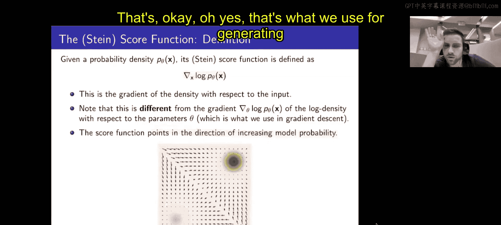

Well， this is what we use to generate or say you could use this to yeah。

 you could try to fool a discriminative model by finding X's that give you the wrong class I don't think it's quite applicable here we have a I think a nesial example is normally something you define for a discriminative model like a classifier here it's a generative model。

But yeah， I guess if there was a why， it could be similar。Okay。

 so why is a score function interesting， Oh， Well， okay， first of all。

 let me just give you one more example。 So this is another example of how a score function might look like in。

In one dimension here our distribution here my distribution P of x is a mixture of two Gaussians。

 which is the one dimensional analog of the previous example。

 and you can see that the score function which is on this side it。

It tells us roughly in which direction we should be going。In order to move towards。

A region of higher probability so for example this function is negative。

 which means that it points towards the left near the left mode and so what I mean by this is that if if we're somewhere here。

 then the score function is negative， which means that it says that we should be decreasing x。

 we should be moving。And we should be making x smaller in order to reach a place of higher probability。

 and similarly when we're on the positive side， when we're on the right here。

 the score function is positive， which means that we should be increasing x。

 in order to go to a point of probability that's high。

That's just another version of the score function is in one dimension。

 this is the one dimensional analog of the previous example on the previous slide。

The example with the vector field。Okay， so why this is interesting？

One of the main reasons why score functions are interesting is that they are independent of the normalizing constant or the partition function。

Let's say that we have an energy based model。Of the following form， this is again。

 our standard definition of an energy based model， it has this intractable partition function Z of theta。

Well， if I wanted to compute its score function。Then I don't need the partition function， Z of theta。

This is my score function。And that's just the difference between the unormalized。

ennergy and the partition function， the log partition function。

 but this is because the partition function is not a function of x， it's a function of theta。

 but not a function of x。Therefore， this is zero and my score function。

It's simply the gradient of the energy f of x。So this is really neat。

 This should start to look like something that we can use to learn the kinds of energy models that we found to be。

Intractable or computationally hard to work with in the previous lecture。

So the idea that we're going to use in this lecture is that。Instead of trying to learn。

The probability P of x itself， instead of trying to build a model for the probability。

 which is given to us by this formula， which involves this intractable constant。Instead。

 let's not look at the probability， let's instead try to build a model of the score function directly。

And a score function is something that gives us a lot of information about a probability。

 let's model it directly， and if we model the score function。

 then maybe we can get away with not having to ever touch the partition function。

And that's going to be an alternative way of learning the of learning an energy based model because again。

 recall call that by。By this equivalence here， a partition function sorry， a score function。Equals。

The green of the energy function， so they're closely related， perhaps by learning a score function。

 we could have a more tractable way of learning an energy based model。

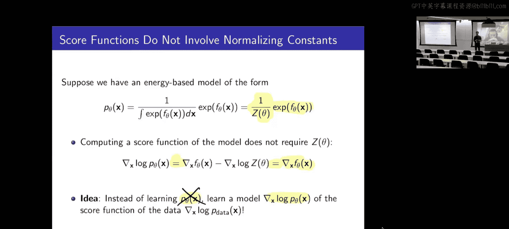

So the idea of score function estimation will be the following here I'm going to precisely define the task that we're going to be interested in。

So our goal in this lecture and the task of score function estimation will be to learn a model of this form。

 we're going to learn a model of the score function， S of x。

 which is going to be a vector valued function going from r to the d to r to the D。

 so it takes as input a。Dimsional variable X， which you can think of as an image or the kinds of high dimensional objects we typically try to model in using generative models and its output will be the score function because the score function is a。

Gradient with respect to x， it will also be d dimensionsal。

 and therefore our model of the score function is a mapping from D dimensions to d dimensions。

And the setup that we're going to be dealing with is that as usual we will assume the existence of some data distribution。

 in this case， I have the same two dimensional data distribution that I used in my first example。

But as usual in machine learning we don't have access to the data distribution directly we have access to samples in particular we have access to ID samples from the data distribution so these are the points that you see here in my other picture and our goal will be to somehow learn this。

Graient。This vector field from the data and this vector field will so this model S of x will try to approximate the true score function of the data distribution。

Okay， that's the task that we will be interested in。So again， as usual， we have a data set。

 our task is to estimate this。Score function using a model of the score function。

 and in order to perform this task， we will need to define a few components。

We will first of all have to define a models that's something that can be really general。

 I will allude to this a little bit later I will。Give you an idea of what the model can look like。

 but most importantly， if we are somehow to fit our model。To the true score function。

 we need to have some objective and some optimization procedure。

 which will somehow make S of x close to the gradient of the log of。Close to the true score function。

And so our first step in order to solve this task will be to define a。A learning objective。

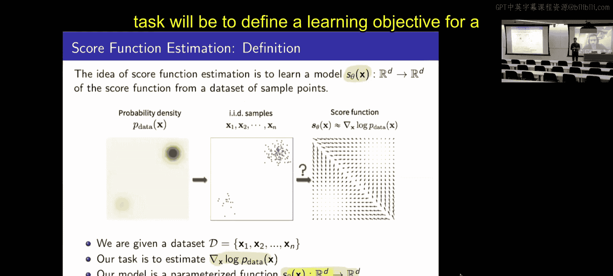

For a score function。Okay， so let me just pause here and see if there are any questions about what are score functions。

 and then after this I will talk about score matching。

 which is how do we actually solve this task that are just defined？

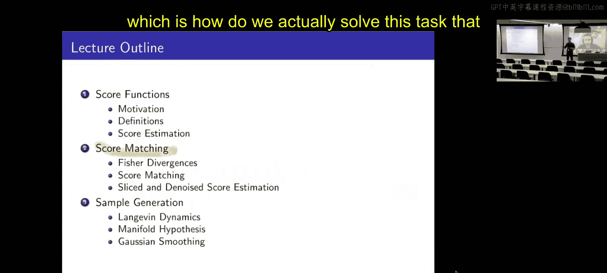

Eacharrow represents the gradient of the log probability of the data where the gradient is taken with respect to the data。

 so the arrow is pointing in the direction where you want to go in order to increase log P of x which means you want to move to a higher probability region so now defined the task of score matching or sorry define the task of score function estimation now how do we actually solve this task and that's going to be the。

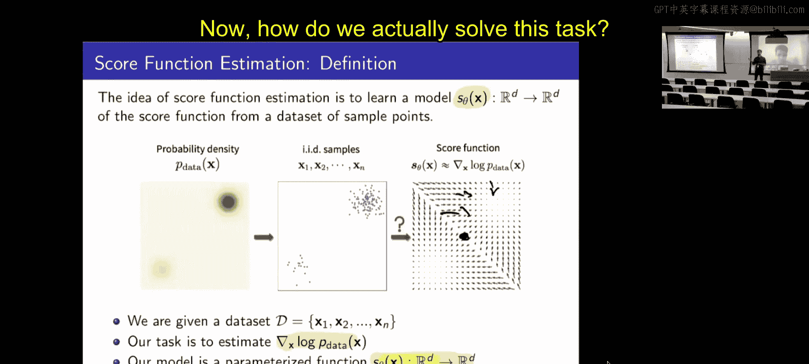

The goal of score matching。So score matching is a way of learning a score function。

And it does so by optimizing a particular objective。So again。

 our data score and the model score are both vector fields。

And so what we want to do is effectively match these vector fields， right， a vector field， as I said。

 is。Is a function that define you can think of it as defining an arrow at every point of the input space and we want these arrows to match right so here in this example。

 let's say that I have I have an arrow here and I have the same arrow here so this one is pointing in a slightly different direction from this arrow so I want to make these two arrows more similar to each other right so this。

The true data。Probability has an arrow that's pointing in this direction here。

 This one is pointing in this direction。 So I'm going to try to massage it。

And make it more like the true gradient of the。Like yeah。

 like like like the true grade like the grade of the true data distribution， so again。

 our goal our goal is to match these two vector fields。How do we do this？Well。

 one natural objective is to simply。Define the al norm between each of these arrows right so again at each point。

 let's see here I have this arrow here at the same point I have this arrow。

 theyre a little bit different， there are two vectors so I can define the al norm。

On the difference between these two vectors。And I can try to minimize。

This difference over all the points。And this is exactly what the Fer diversionence is doing。

So here in the middle， like I said， I have the L2 norm of the。Difference between the。

e the true score function at a  point x。which is a vector and what my model is predicting。

 and I take the expected value of this L2 norm over all the xs that I see over all the x's sampled over the data distribution。

 therefore it gives me the following objective。So the fiser divergence is literally just trying to minimize the average error between the model vector and the true data vector at each point x。

 where we're averaging across all the x's。According to the data distribution。

That's what the Fisher divergence is telling us that we should do。So to put it differently。

 it's the average Euclidean distance between two vectors， and this is a valid objective。

 you can show that this is zero if and only if the actually this should say equal。

 if and only if the two distributions are the two vector fields are equal。Okay。

 so this is a possible objective for us。 Does anybody see any problem with this objective？What。

You don't know P data exactly so we can't really use this objectiveive because we don't know this true score function right so what can we do instead so score matching is a way of dealing with this problem that we don't know log P ofx and much less it's creating。

It turns out that there is a way of transforming this objective into something that is tractable by using a particular trick called changer variables。

 and this gives us another objective called the score matching objective。

 which was proposed by Hevarian in 2005， this is an equivalent reformulation of the fiser divergence that now no longer involves any。

呃。Anything that's。Related to the true data distribution within the object。

 within the formula whose expectation we're taking， we still have the the expected。

We still have an expectation over x coming from the data distribution。

 but that's okay when we have an expectation。Over the data distribution。

 we can approximate it using Monte Carlo。 That's fine。 but the inte does not involve any。

Anything that looks like the true score function。So this is one approach that leads to a。

Possibly it could possibly lead to an tractable objective。But this new objective now is tractable。

 as I said earlier， it doesn't involve any。Log likelihoods or any score functions in the integr。

 and we can approximate this expectation using Monte Carlo， as I said earlier。

 which just means that given a data set sampled from X。

 we approximate the expected value with an average over the data set sampled from P data。嗯。

So now this gives us something that is。Starting to look like a practical objective for score matching。

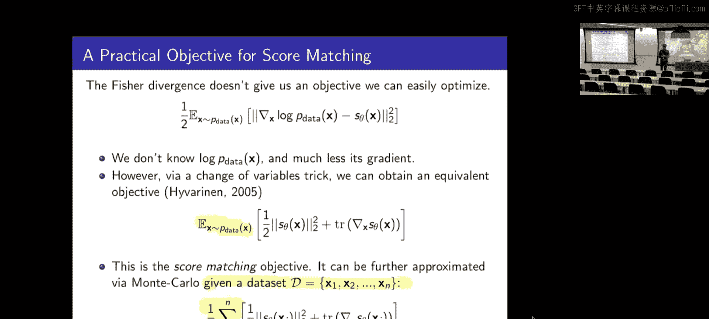

I have here a short proof for how you can derive this objective in one dimension。

I think I will just skip this for now just in the interest of time， but the high level idea。

 so you're welcome to have a look at this proof asynchronously， you can download my slides。

 and look at them， but essentially this is going to be a change of variables trick where we start with the original fiser divergence then we expand the。

we expand different the squared difference into three terms， one of these terms is a constant。

 therefore it completely disappears， and then we can apply integration by parts to rewrite this integral in a different form so it's integration by parts。

 which I am working out here， and then this integration by parts， transforms，This term into。

A sum of these terms， one of which equals zero under some basic regularity conditions。

And then you can check that this term and this term， when combined together。

 that gives us exactly what the other objective had。

 these are exactly the two terms that you would find in the other objective。And again。

 I'm going through this quickly， you can get the proof on your own in the slides。

 just in the interest of time， I'll go through this quickly。Yeah。Okay。

 so now we have a first potential objective that we could use for score matching。

So we could potentially take our function S of X， we could parameterize it using a neural net。

And notice here there's literally no restriction on what S of X can be。

 it's just any function from RD to RD， unlike in a flow model。

 it doesn't have to be invertible that makes things much simpler so any neural net could theoretically optimize this objective。

So we。Can compute this objective efficiently using a we can compute this piece the forecast efficiently。

 and then we could try to optimize it using gradient descent。However， when we do this。

 we run into a complication。Notice that this term here has。

It involves the gradient of the score function。So the gradient of a vector valued function is a D by D matrix。

And then we're taking the trace of this matrix， which means that we're taking the sum of its diagonal elements。

And so now we have to back propagate through this。Through this。Gradient。

 so we have to take the gradient。Of a gradient of a vector valued function。

And this becomes computationally challenging。 This can be seen as equivalent to computing big of the。

Back propagation passes right so for each of these terms on the diagonal which is a scalar。

 we have to effectively compute its gradient， which effectively means that we have to do a passive back prop。

For each of these terms， so our costs。The cost of doing backpro here would scale as big of the would be bigger of d times more expensive than if we had a simple scalar output。

And as a result， even though the score matching objective is compable。

 the previous fier diversions was not computable here， it's a leastcomputable， but it's not。

Scalable enough not it will be too slow to optimize a big neural net with this objectiveor。

So we still need to do a little bit more work。

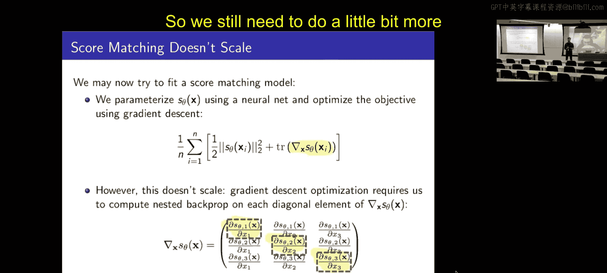

And。One way in which we could remedy this。Computational inability this problem with high computational cost is to introduce。

An additional idea， which is going to be slicing。So slicing is， again。

 a general technique that's used in many machine learning algorithms。

 it's the idea of doing random projections on one dimensional vectors。So intuitively。

 if you look at this objective。It involves。It's computationally expensive to compute the gradient。

When the output， the input and the output of x is high dimensional， but if we were in low dimensions。

This objective will be computable and tractable therefore we could try to make it low dimensional by projecting everything into a low dimensional subspace in particular。

 we could project it into a one dimensional subspace。

 which is going to be effectively a slice of the input space。

 which is effectively which is the reason why we call this process slicing and the resulting objective will we call slice score matching。

So first， I have a picture here which illustrates what slice score matching is doing。

Here I have a vector field， and I would like to match these arrows with。

I basically want to match these two vector fields。 I want these two arrows to be the same。

 It is computationally expensive to do this in high dimensions。 However， I could choose certain。

Slices， which in which in this case， are just lines through the input space。

 and then I can project every。Line here into。Into this slice。

 which means that instead of looking at the full arrow。

 I just look at one of the components of this arrow。

 I just look at the component that's parallel to this。To this line。

 And so now instead of matching these arrows， I'm just going to try to match them along the direction of the slice that I have chosen。

 So this is my slice。And I'm going to optimize。I'm going to match these arrows only along the direction of the slice and similarly here in this other example I have a different slice right now I have this diagonal slice and if I were to look at every arrow it has a component along this direction and therefore I can also try to match these arrows along。

That direction， right。 And if， if I can。If I can match。These vector fields along every slice。

 then I have effectively made the two vector fields the same。

 so that's the idea instead of trying to match high dimensional vectors or high dimensional arrows。

 let's match one dimensional arrows in a random projected one dimensional space that we choose。

That we choose at random。So okay， this was the intuition， how do we actually do this。

 Well we can extend our objective to something called slice for matching。

 which defines something called the sliced fissure divergence。

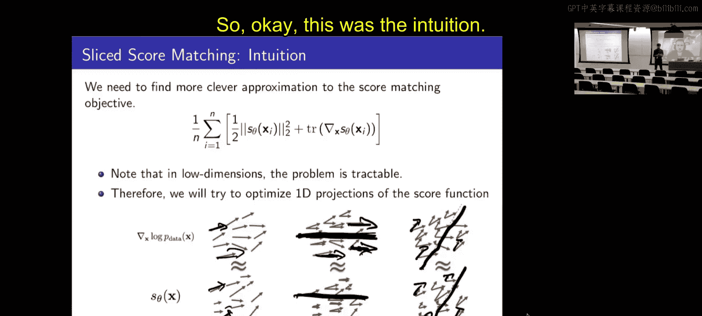

Okay， so this is the formula of。The formula for the sliced fiser divergence。

 and you can notice that this is effectively the regular fissure divergence。

 except that I have this extra term here where I sample random slices V。

 so V is a projection vector that's sampled from some distribution Q of V that we choose。

 you can think of it as just being it can be a uniform distribution over vectors。

And instead of projecting， you know， instead of measuring the L2 distance between the。True。

Score and the model score。I instead， measure the。L to。

 I measure the square of the difference of their projections onto V。Okay。

 so now I have defined an extensions of the fiser divergence over slices。

This is also a valid objective for minimizing a。For optimizing a score function。

 so your question was。Do we choose one V or do we choose all the V's。

 so in general we use all the V's and in general we average over all the possible V's。

 but in practice we will approximate the expected value over V by random sampling by Monte Carlo which means we will take random samples from Q of V。

Yeah， if this was to be optimized using gradient descent。

 then similarly to how we take a mini batch of。As from the data distribution。

 we would also take a mini batch well we would take a V。

 we would take a random V for each data point in our mini batch and then at the next step of gradient the when we take a different mini batch。

 we would take a different set of Vs。Okay， so this is an extension of the fier dirgence， however。

 it still has the problem。That we don't know P data。

 this was an extension of the original fissure divergence， which uses slicing。Therefore。

 to make things tractable， we again have to use the same change of variables trick that I used to rewrite the original sliced fishser divergence。

 and this gives us now a sliced score matching objective which has。Which has this form。 And again。

 you can notice that。Everything that's in the square brackets has been rewritten to no longer include the score function of the true distribution。

 everything within the square brackets only involves our model， which is tractable。

And this is effectively the same formula as the score matching objective。

 except that we are projecting everything into。Into the slice V。 And so previously。

 this term here was complicated to deal with。 So we had to compute a。

We had to differentiate the Jacobbian of the score function， now we no longer have to do this。

 we project everything down into one dimension and then we deal with this in one dimension。Sorry。

 yeah， we we project the score function into one and sorry， sorry， I I said， I said this wrong。

 Actually， this was the term that was complicated and we。

We basically project down this matrix into a scalar by taking the dark product with V on both sides。

Question the question is what is V and does it always have to be one hot I think you would want to avoid it being one hot because you want to average all of the components of the objects that you're projecting down you would rarely want this to be one hot I think if it was to be one hot you would have a higher variance than with other choices so the answer is that you should not use in practice one hot vectors it will theoretically work but in practice it will give you a higher variance estimator of the true gradient in practice choosing a multivariate standard normal is something is probably the most common thing that。

That that anyone would use here or as an alternative ro marker noise。

 which means that each entry of v is plus1 or minus1 at random， that could also be another option。

 but I think choosing it to be one hot would be worse because that well you would be averaging over a smaller number of vectors。

 only the basis vectors， and you would also have higher variances。Okay。

 so now we have defined a new objective that is finally tractable and that has。Yeah， it's。

 it's tractable。 It approximates a principled。Objective called the slice fiser divergence。

 And therefore， if we this objective can be analyzed mathematically and shown to have。

Properties of consistency and。And by that， I mean if you optimize this objective， given enough data。

 given a good enough model， you will recover the true score function。

 so there is also helpful theory that explains this is a good and valid objective for us to use。Okay。

 so we went from。The fiser divergence， which was intuitively。Plausible， it made sense。

 but it was intractable for several reasons one is just pure compability。

 the other one was scalability and we came up with two solutions。

We came up with first we reformulated the Fser dirgence as a score matching objective。

 and then we made it more tractable by introducing slicing。

So this is one way in which a score function could be learned。

 this is one valid objective for a score function。And there's another way that is also important that I will show briefly on the next slide。

 and so at the end of this part of the lecture we will have this objective and then the other one that's going to be on my next slide that will form two valid learning objectives for score based journal model。

Asy your melody means that you。He that the error will be distributed normally across the。

With finite data。Your error will be approximately1。

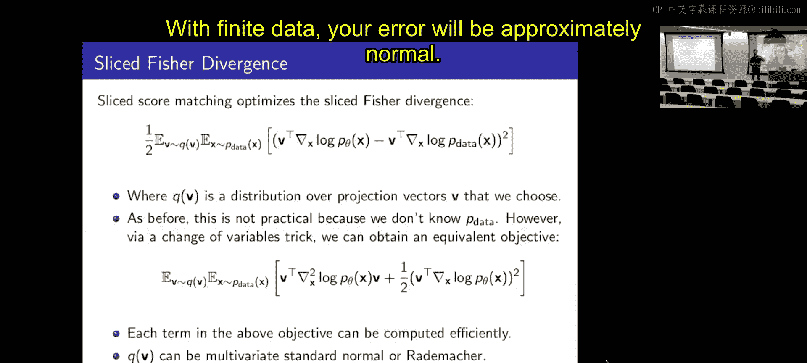

Okay， so this was one way of。Learning a score function。

But that's actually not the only objective that's used and in score based generative models。

There is also the option of using another objective。

 which is called denoizing score matching and denoising score matching is going to be another way of approximating。

Of approximating。This intractable fissure divergence。In slide score matching。

 we try to rewrite the objective。Using this。Integration by parts， trick。In order to obtain a。嗯。

In order to obtain an exact approximation sorry in order to obtain an approximation to the exact distribution。

In vnoising Sc matching， instead we have a trick。For learning exactly without slicing the gradient of the gradient of a noise version of the。

Sorry， the score function of the noise version of the data distribution。

So what do I mean by a noise version of the data distribution？Let's say that we have clean data X。

 and we somehow corrupt the clean data， for example， by perturbing it with Gaussian noise。

And this is how we get a new data。And you set of data points x tilda。 So for each x tilda。

 we take the original x and then we take some。Random。Some random noise， epsilon。

 and we append and we add that noise to our x and the amount of noise is controlled by this。

Extra parameter stigma。So this is a noising process。That introduces。Yeah。

 that introduces noise into my clean data he。So the idea of score matching is that while it's typically hard to learn or well。

Yeah， it can be hard for the reasons that we just saw to learn the score function of the clean data。

 there is an efficient technique for learning a score function of the noise data。

And so the idea of denoizing score matching will be to instead of trying to learn the gradient of the。

Instead of learning the score function of the clean data， we're going to try to learn a。

We're going to try to learn the score function of corrupted data。

 and then hopefully we're going to be able to reduce sigma gradually to get back a cleaner distribution。

So this is an alternative approach。That this can be seen as an alternative to slide score matching if we want to learn score you could either use slide score matching or we could use denoing score matching to learn and we could use slide score matching to learn to try to learn the score of the true。

Distribution， or we could try to use denoising score matching to learn the score of a noisy approximation to the true function and this one will be a bit the advantage of this one is that it's a bit faster in practice and also I'm going to define the formula。

In a moment， but I guess there's a few questions。Sorry， when you say the noise version。

 like are we the ones applying like we know the exact parameters of yeah。

 we choose the noise okay and this is going to be a general technique for learning the score function of any noise distribution。

Okay。There was another question， there's another question on Zoom。Yeah。

 could it be something like applying like a box filter or like bilateral filter instead of like Gaian noise？

呃。Most likely yes， I don't remember off the top of my head of the exact restrictions on what the noise is on what the noise can be。

 but this applies beyond just Gaussian noise， yes， but I think have there has to be some randomness though so if I。

IfI remember correctly， I think it has to be。I'm not 100% sure if it can be deterministic。

 I think it has to be random。But other types of noises could also work here。Okay。

 so what is the noising score matching here I have defined a noise version of the data distribution called Q of Sigma。

And then what denoising score matching。Says sono denoing score matching is saying that if we wanted to approximate the fiser divergence between the model。

And the scored。诶。Between the model and the score of the noise data。

 then we can easily rewrite this in a slightly different form where。

Where instead of computing the L norm between the model and the true score， we compute them the。This。

The L norm between the score and this other version of the model and this other mathematical object which looks very similar。

 but is actually different， it's the score of the conditional。

Lock probability of xtilda where the conditioning is on x。

 and so in practice we first sample a point from x， then we sample a noise version xtilda。

And now we take the gradient of the log probability of x stillta given x。And this by an argument。

 it' really similar to that。Trick that I showed you earlier。In one dimension。

 that equals the original。Isure dirgence or sorry， should it equals plus constant terms which are not important for optimization。

Okay， so。And again， the point here is that while this original。Entity could be hard to compute。

The condition the score of the conditional distribution of extilda。Where it's condition on X。

 that is typically easy to compute。 It has an easy form， for example， when。

X delta is perured with Gaussian noise， this is the exact formula for what。X is。

 it's just the residual noise between x and x tilde。

And so now we have an objective that's tractable we don't have to apply the same changer variables and we don't have to apply slicing this does not have the problems we had earlier。

 this is just。The L2 norm between two vectors that we know。

 one of them is our model and the other one is typically given by a simple formula。

 like the one that I highlighted here， therefore we can just optimize this L2 loss。

And so this is an alternative approach in practice this can be faster and work better than slides or matching right so it's faster。

 but the problem is that it can only learn noise distribution。

And we couldn't hope to apply this by gradually bringing down our noise and make it smaller。

 but when applied like this withoutifications， this also has the problem that the variance of the resulting grain estimator will start to increase as we make sigma square smaller right right clearly sigma square can't be zero in this example because then we'll be dividing by sigma square would be dividing by zero in that number so sigma square can't be zero when it becomes close to zero。

 there are。The variance of the resulting gradient estimator， the variance of the resulting。Yeah。

 gradient estimator will increase， but the hope is that we could still gradually anneal sigma in practice this could still work for interesting applications。

All right， so to summarize things， I have defined an objective for doing score matching。

 which is based on the fier diversions and I have。We formulated that objective to make it practical in two ways。

 one of them was slight score matching， the other one was dennoizing score matching。

And so in summary， we have the following algorithm that we can use to learn a score based geneative model right let's say our goal is to learn a model like this one。

 S of x of the score of the data distribution， then what we can do is given an initial guess for the parameters of these models。

 we sample a batch of training points。And then we compute the gradient of either the slice score matching objective which is here or the gradient。

 where for the slicing score matching objective， I use some random set of projection vectors or I could use a noise version with some noise level of sigma and so I minimize this objective both of these are tractable objectives that you can optimize these in ptorch in a straightforward way。

 so you obtain a gradient and then you take a step on that gradient。And you keep doing this。

 So this is the full algorithm for learning a score based gene of models that involves either of our two objectives and this model S of x。

 it can be。Anything it typically chosen to be a unit。 if you know what that is。

 so it can be a very flexible type of。Neural network。Okay。

 so now I defined my full algorithm and I will conclude with。

Some examples of what you can do once you have learned SF data。S sub theta of x。

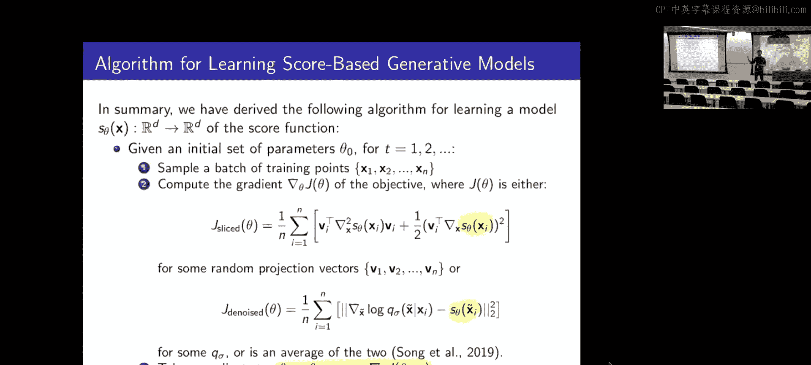

I think there was a question there is no data within Q because Q is not part of our model Q is a noise Q is the distribution that we're going to eventually learn instead of learning the score function of Q we're going to learn the score function of Q and Q is going to be a noise version of the original distribution so this technique does not allow you to learn the true data the score function of the true data distribution。

 it lets you learn the score function of a noise version of data distribution。

And that's what Q is yeah， and sigma is a noising parameter that we get to choose in this case it's the strength of the Gaussian noise that we have。

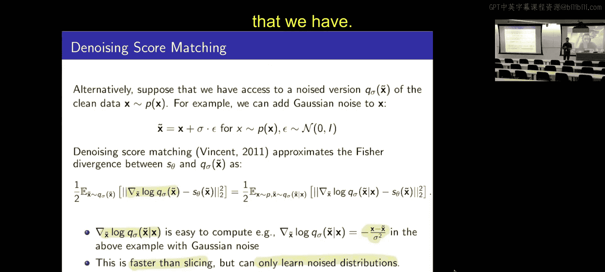

对。Okay， all right， so now I have given you a full algorithm for learning a score based generative model。

 let's now see how we can do this， how we can use this to do something useful in particular。

 can we use this to generate samples？

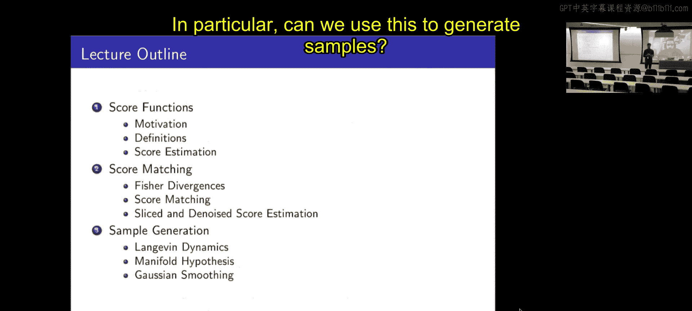

So how do we do this？The intuition is that。If we have a score function， the score function。

 as I said earlier， it's a vector field that tells us where we have to go in order to increase the probability。

The the yeah， in order to make our probability larger。 So if we want to sample。

High probability data points， what we could do is we could start with random data points and then move along this gradient field。

With some random noise added in to reach points where the data where the value of the probability is high。

 so in other words， once we have the score function。

 we can take samples by following where thearrow by starting somewhere at random and following where the arrows are pointing us to go。

And this process is called launch of dynamicss。so we start with some random noise and then we follow the score function。

 which is the gradient of the data distribution， we follow the gradient which tells us where the data distribution becomes。

Has more mass， we follow it in those regions until we have something which looks like a point with high probability under the data distribution。

So that's the intuition of long vein dynamics。And so specifically。

 longger dynamics is a particular MCC sampling process。

That is designed to take samples from a distribution of which we only know the score。Okay。

 and the way it works is as follows， we start with some random guess for x。

 we're going to call this x0， it comes from the noise distribution。

 and then we follow a sequence of T steps where at each step we random we sample some Gaussian noise。

And then we take a step。好汪。Where our gradient is pointing us。 So we start with our。

 os we start with our previous guess for what x is， and we add to it this gradient。Plus， some noise。

So effectively， this formula is just gradient ascent。On the log probability with extra noise added。

And alpha here， this parameter alpha， that's just our step size。

So one way to think about what launchman dynamics is doing is gradient ascent on the log probability。

ok。And you can show that this works so it can be seen as green ascent and you can show that it works and is guaranteed to produce samples from our probability P of x if you anne alpha in the right way as t goes to infinity alpha actually goes to zero and if you do this at the correct rate。

 you can mathematically show that this will give you a。Falid sample from your data distribution。

TheThe reason why you have this particular noise with this particular term crude of alpha T and then alpha T has to satisfy certain property。

 the math becomes more complicated， but the short answer is it has to be random for you to generate that otherwise you just find the if if you run。

An infinite number of。Steps of an infinite number of runs of Lama dynamics。

 and you take the resulting samples， then the distribution of these samples will look like the distribution that you're trying to sample from。

In principle， yes， this is just saying that you have in order for this to work at least theoretically you just need to have the gradient of the log probability。

 so if you have a model in particular if you have some kind of model which approximates the true log the true score function。

 then you can plug in that model and have and take samples from the distribution that you want assuming your model is good enough and either of these objectives can give you something which approximates the true log the true score function。

 right？So that's the short answer， but there is actually a slightly longer answer to your question。

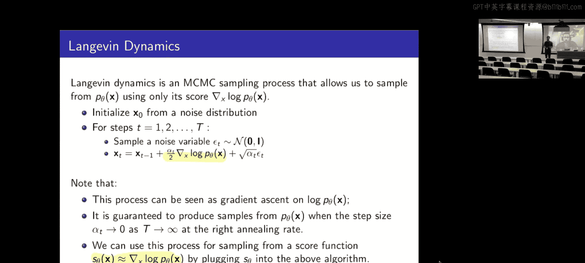

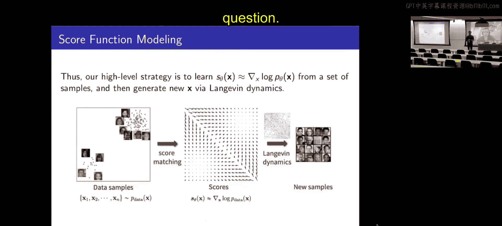

So this is just okay， there is actually a more complicated answer to your question and this depends so this question involves a fact from machine learning called the manifold hypothesis okay so basically the problem is that what I said is correct in theory but it's not always correct in practice that because the fact that the data that we're trying to model has some peculiarities。

And in particular。Laun ofve dynamics， in order for it to work。

 the score function has to be defined at every point of the input space X。

But with a lot of the data that we're interested in modeling， such as image data。

 you can argue that the score function would actually be。

 the true score function will be undefined in most places of the input space。

So what do I mean by this？The reason why this will be true is because of this hypothesis， which。

Is you can heurically study it and show that it's actually， it seems to be true in many cases。

 this hypothesis says that the data that we're dealing with that we're working with。

 this high dimensional data， like images' live is not uniformly distributed。Along the space of xs。

 so the the x's that are images are not uniformly distributed in the space of all possible tensors of a certain dimension they're distributed on a subspace in fact on a small subspace of all the possible vectors and tensors that we could have right so this is what I have here in this example I have a few data points but these data points they live on this。

Kind of one dimensional manifold， which is the Mobius strip within a sorry within this two dimensional manifold。

 which is the Mobius strip in the three dimensional space。Or to make it a little bit more practical。

 let's say that we are working with digits， let's say're working with Mnes digits。

 so these are 784 dimensional vectors。But the space of digits is much lower dimensional than 784 in fact。

 if you just take PCA and you project down from something like 784 to 600。

 there is virtually no degradation at all in pixelel quality。

 the images are completely unchanged if you throw away a big portion of the dimensions。

So the data lives in a much， much lower dimensional subspace than the full dimensionality of the data。

 which in this case is 784。And because the data just doesn't live at all in certain portions of the space。

 the score function is not defined in those regions。

 right if there are regions of the input space where the probability of the data is zero therefore。

Then for those x's， the log probability is not defined and the gradient of log probability is also not defined。

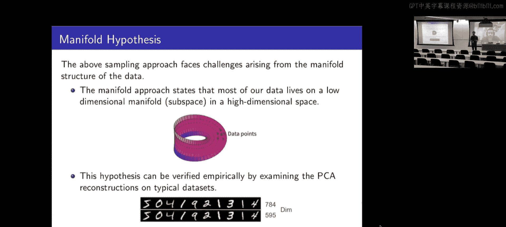

This is called the manifold hypothesis， okay？So we have this practical problem。

 so this figure illustrates what the problem is right in our two dimensional example。

 we have a mode of the data distribution here and a mode of the data distribution here。

 but the data doesn't really live in this region。

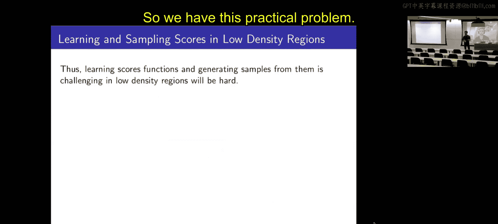

Therefore， if we were to try to estimate the score function。

 it would either be undefined here or we would not even or we would have very very little data in the region to estimate the score function。

 and this is a problem because if we were to try to start this process from random noise which could live in this inaccurate region。

 then there is no way for us to start with this random noise and reach theaccurate regions。

So this is a problem， this manifold problem is something that will in practice break all of the math that I described earlier。

 so the solution that we're going to use to solve this problem is to add noise to the data is to smooth the data distribution。

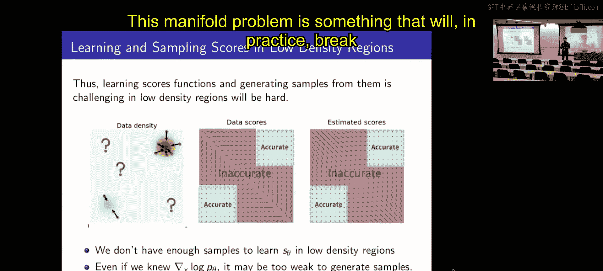

For example， if we were to somehow blur or perturb the density。

Such that it covers more of the data distribution， for example。

 if I were to start with a data set and I were to expand， I were to apply some kind of Gaussian blur。

 then we would get something which looks。Like this。

I would have two modes and these modes would cover most of the space therefore the score function will be accurate in most places。

Right。So the score function will be well defined everywhere。

 but now we have a different distribution， so that's a problem。So there's a tradeoff right。

 we could apply more noisy and more smoothing to get back to make learning the score easier。

 but then in the process of doing this， we changed the data distribution， which is bad。

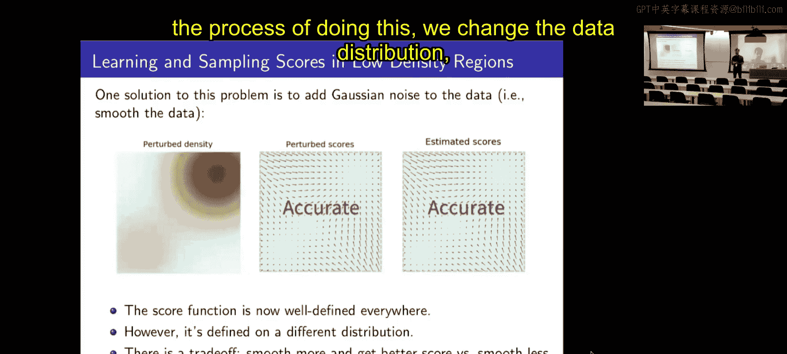

And so the solution to this will be what I'm going to call multi scale noise。

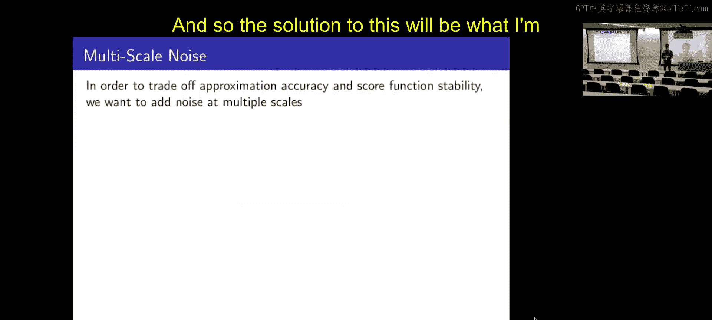

Instead of just learning the score for either the clean data or some noise data。

 we're going to perturb the data using。A number of these levels we're going to perturb it。

with increasing levels of noise， and we're going to learn a model for each type of noise level。

 and when we sample， we're going to annel the noise。

 we're going to start by taking samples from the highly noise distribution then from the less noisy and so on。

And this is a process that is going to be called a yielded important sampling。

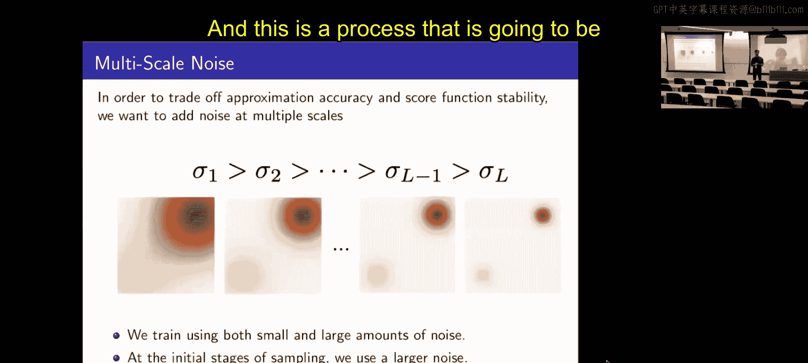

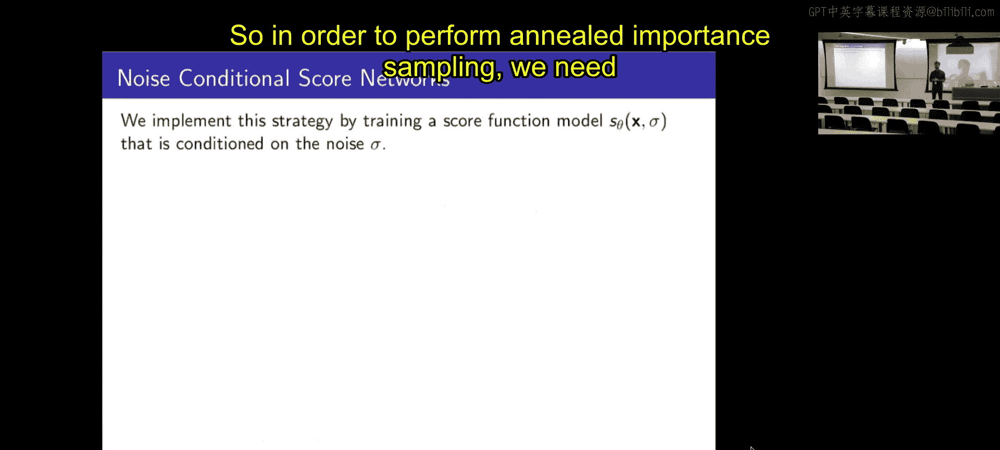

So in order to perform a yield important sampling， we need something which is we need a slight extension to our model。

Instead of。So as I said， we now need a score function for the clean data as well as the various noise distributions。

 which are going to be with noise Sigma 1， Sigma 2 and Sigma 3。So in order to do this。

 we're going to augment our model with an additional parameter sigma。

 which is the level of noise that we have。We refer to this model as the noise conditional score network。

So now instead of just predicting the score function of the data distribution。

Our model will be trained to predict the score function of the distribution with some level of noise sigma。

 and we get to choose this level of noise。So that's S of x of sigma。And in practice。

 the same neural net will parameterize all these noises。

 the sigma will just be an extra input to the noise conditional network。

 so we use the same set of weights right so the same model is trained for all sigma and the parameters are shared across noise levels and so if we were to now apply this with the noise score matching。

 we would have our usually the noise score matching objective which is here。

 but we would also average it over all the various noise levels that we see。

So this is how we can train a noise conditional network and once we have a noise conditional network。

 we can apply anial longvan dynamics and basically what anal long very dynamics is。

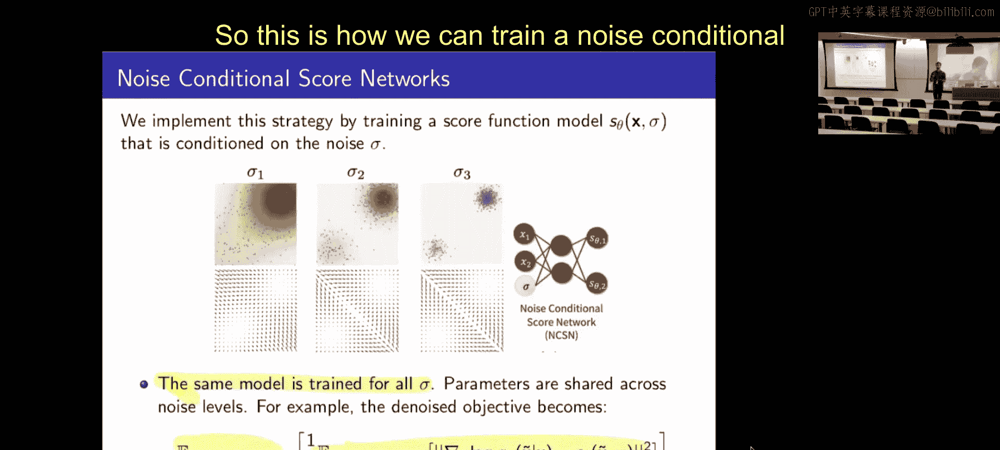

It's that you start with a high level of noise sigma。

And then you start with a lot of points which are all over the place initially the random noise。

 but because we have so much noise， the score function is defined everywhere for this wrong data distribution。

 but it's still defined everywhere， therefore after we run launch array dynamics for this noise level sigma 1。

 our data points will move a little bit closer to the modes， it will not be the true distribution。

 but they will move a little bit closer to what we want now we can reduce the noise。

So now the points will start to concentrate even more around these modes and then as we slowly annel sigma。

 the points converge where we want， and then when we have a low level of sigma。

 we are going to be performing modular dynamics with the tri distribution and with points x0 which are already generated close to these modes。

 therefore we will reach the value that we want。

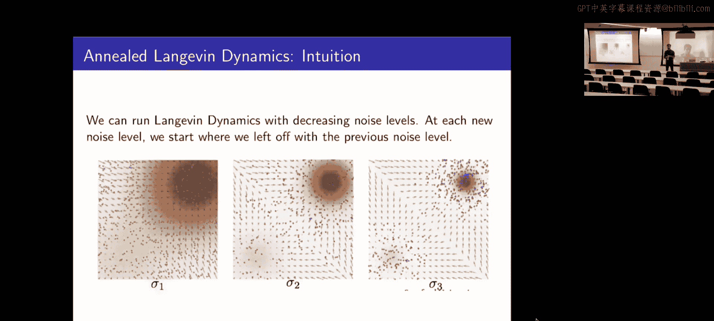

Right， so this is。The intuition of launch domain dynamics and the pseudo code is just here again it's the same as regular launch of vein dynamics I haveops except that I have so the inner loop here is regular launch main dynamics。

 but if's an extra outer loop where we grade over all the possible noises sigma。All right。

 and then I'll just end here by saying that when you combine all of these things together。

 they give you really good samples。

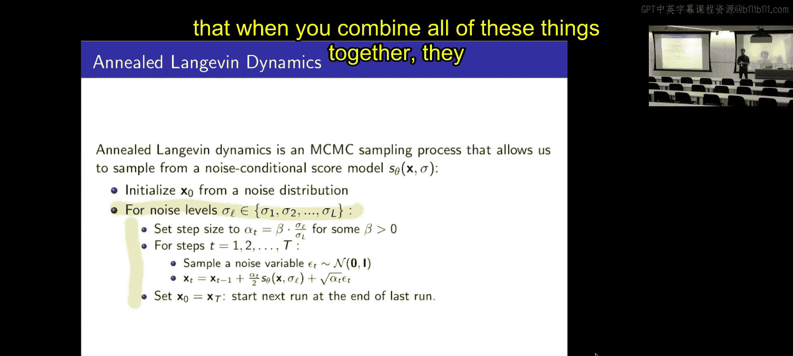

So score based geneative models have been introduced around， well。

 I guess their most recent iteration was published in 2019 and then they were refined in a few ways。

 which I will talk about in the next lecture， but this approach and its modern versions are able to yield very high sample quality。

And a sample quality is comparable to that of Gs， but without relying on this unstable objective that involves both the discriminator and the generator。

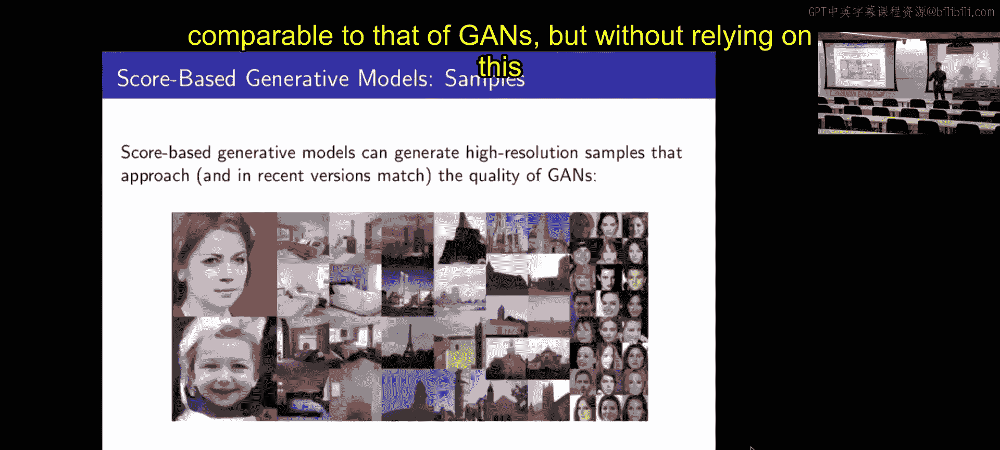

And so in practice what's interesting about these models is that they work by generating images from noise so in a score- based geneative model we well when we train this model when we add these different levels of noise。

 we create these increasingly noise images and then when we perform anneed longome dynamics。

 we start with complete noise and then we gradually out of noise。

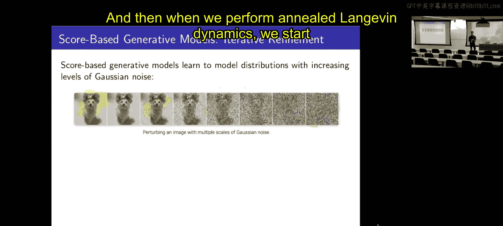

So from this Gausian noise， we gradually sample images which are increasingly less noisy。

And this process can be thought of as a form of iterative refinement。Okay。

So that's an interesting fact about how these samples are generated when you actually run an long dynamics。

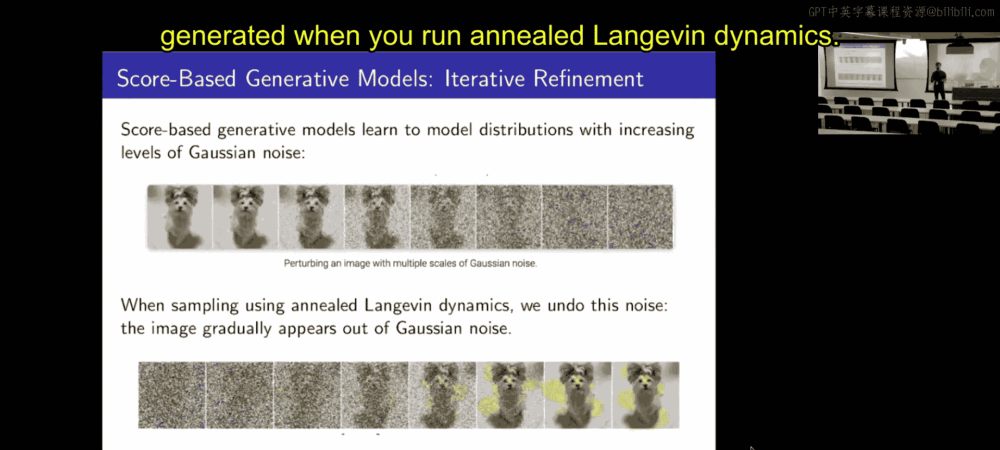

是。

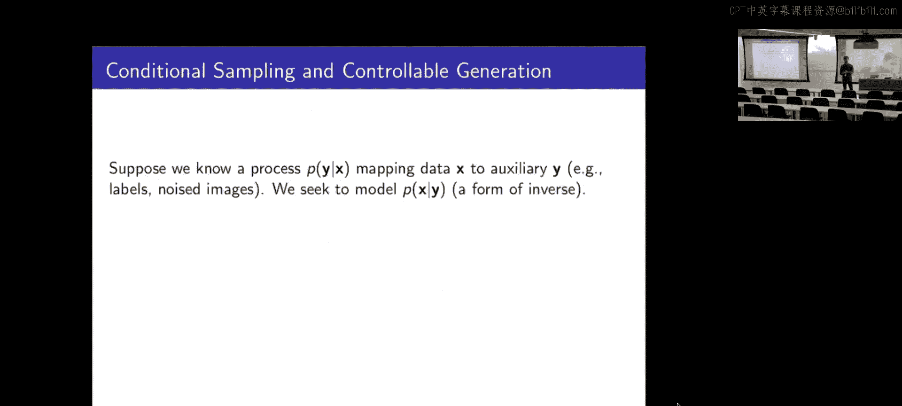

So to summarize。We saw this new type of gene model called score models。

 which can be used to produce really high quality samples with stable training。

 and they can effectively train。An energy based model。

 you can effectively use them to train an energy based model without worrying about the partition function。

But there are some problems， sampling is slower than in GNS because you have to use this slow well relatively slower management MCMC process which you have to run typically for thousands of steps and it still doesn't solve some of the problems that we talked about such as density estimation or likelihood estimation and it still doesn't have latent variables in it so it produces good samples but it doesn't solve some of these general modeling tasks and so in the next lecture we're going to look at an extension of this called diffusion models which will address some of these cons while keeping the main advantages。

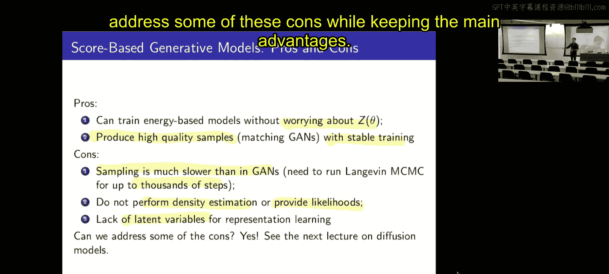