# 康奈尔大学《深度生成模型Deep Generative Models (Cornell Tech CS 6785, Spring 2023) 》中英字幕 - P13：-13-Lecture 13_ Diffusion Models.zh_en - GPT中英字幕课程资源 - BV1az421q7Vf

We're going to start our lecture on diff fusion models。

So diffusion models are a new and really exciting family of generative models that came out in recent years。

 I would say this is probably one of the more wellknow and one of the most active research areas in generative models they have achieved very impressive results recently。

 so this should be a really exciting lecture。

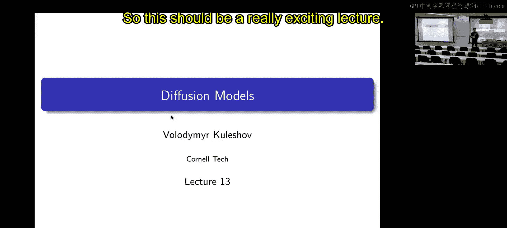

So as usual I'll do a brief recap of what we have seen in the last few lectures again our entire course course so far has been about identifying different types of generative modeling families we start with re light variable models。

 GNs， energy based models and all of these families can to various degrees perform certain tasks such as。

RePational learning， outlier detection and such。But all of them have different tradeoffs for some of these models。

 we have to be very careful about the kinds of neural architectures that we specify， so for example。

 with flow models we have to worry a lot about having a tractable Jacobbian。

And that requires us to spend a lot of energy in terms of defining the specific model family that we're going to use。

In other kinds of models such as GNS， we have a lot of flexibility for how to specify the model。

And again， it can be any simulator，s but in order to train these models。

 we have to either use unstable objectives like in GNS or with energy models。

 we have a lot of flexibility how we specify the model。

 but they're slow to train because we have to use MCMC， Monte Carlo to optimize the log likelihood。

So there are these tradeoffs between expressivity and the extent to which it's easy or fast or slow to train the model and motivated by these different pros and cons we introduced in the last lecture and youth family of generative models called score based generative models。

So the idea of score based models is to effectively train。An energy model or in fact。

 well they can be seen as a way of training an energy model not by optimizing its likelihood。

 but rather by modeling a different object called the score function。

 which I'll describe in a second and so essentially they use a different learning objective which allows them to train models which are as general as energy models。

 but they don't optimize the likelihood， therefore they're much。Faster to train。

 than if we had been using the log likelihood。And they give us very high quality samples。

While using a very flexible model， it can be any RD to RD neural net。

 so the type of neural networks we can use with them is very general and at the same time they're both fast and stable。

 so score based models gave us high quality samples with stable training in much faster speed than MCMC based methods。

Now。On the other hand， score based models are very different from the types of models we have seen they at first glance at least they seem to be optimizing a very different type of objective。

 they seem to be parameterizing a very different type of model。

 they're very different from the kinds of models we would use for tasks such as density estimation or representational learning and so these key features of generative models at first glance seem to be missing from score- based generative models。

And so in this lecture， we're going to look at a different perspective at score based general models and we're going to connect them to all these other families that we have seen。

 including latent variable models and fees。In doing so， we will。

We will gain a different type of understanding， willll gain a greater understanding of what score based general models do。

 and we will also be able to solve these additional tasks of representation learning and density estimation using。

A model family that's closely related to score based general1。

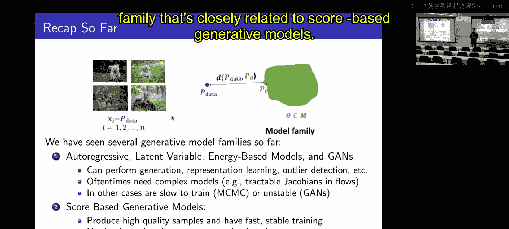

So this is what's coming for this lecture。Now， again make sure we're on the same page。

 let's quickly review what a score based geneative modeling is as a score based generative model is。

So the idea of a score based model is to solve a different task。

 a different learning objective from likelihood maximization。

 instead we're solving this other task called score function estimation。First of all。

 what is a score function， the score function is the gradient of the log likelihood with respect to the input X。

So this is an object that essentially tells us in which direction we should go in the space of excess to reach a higher probability region over distributionribution。

And it is a different way of representing and modeling a probability distribution。

When we perform score function estimation， we're trying to learn this object。

 the score function from data。We as usual assume that there is a data distribution the datata of x。

 in this case， I have this toy example with a mixture of2 D Gaussians。

But as usual we don't have access to the distribution itself。

 we have access to samples from the distribution， which is what we see here on the in the middle。

 we have samples from one of the two components from each of the two components。

And then the score function of this distribution is what is shown on the right。

 it's a vector field which as I said earlier， points towards regions of high probability of the distribution。

 so these arrows， they all point towards one of the two modes of the distribution。

And the task of score function estimation is to learn this four function is to learn this distribution that's on the right so given this data set we want to estimate this score the log of the the log of the data probability。

And in order to do this， we define a model S of x。 So it's a model of the score function。

 which can be any neural net that maps from RD to RD。 right， remember。

 this is RD to RD because our inputs are x's and our outputs are score function。

 So there our outputs are gradients of the log。Probability that we're trying to model so those gradients are of the same functionalityality as the input。

 which is why S of x is is an RD to RD function， but again this is the only constraint that we have this is the only yeah the only constraint is that we have an RD to RD network unlike in a flow model which was also RD to RD there's no requirement S of x be invertible in practice S of X uses an architecture called a unit and oh it can also involve attention components inside of it so there's a lot of flexibility in how to choosing this in how we can choose this S of x。

And then our goal is to approximate the score function。

 the true score function of the data distribution using this parameterized model S of x。

And the way that we can do this is to minimize something called the fiser dirgence。

 that's the ideal objective that we would use。One way is called slice score matching and then another way is dennoy score matching learning objectives that allow us to fit and model S of x to the true score function。

And once we have a score so this figure here shows the entire process of score-based generative modeling。

 so as I said earlier， we start with a set of data samples here。

 this is the same figure as in the previous example that's the same set of samples but just to make things concrete here。

 each sample in this figure course could has or I've added little or the figure adds little images to each point which says that the points on in our in our data could be for example。

 images of human faces， then when we perform this task that I presented in the earlier slide called score matching we get this score model which is an approximation to the true score。

 and then we can once we have the score we can solve the generation task by using a technique called launch of value dynamics which means that we follow these scores so we start somewhere along this。

to these spaces and we follow the arrows until we get to points that have high probability under our distribution。

 so we essentially perform a form of gradient ascent on the score function by following its gradient and after we follow this procedure。

 we get samples so the ultimate samples of the ultimate output of this procedure are samples from the score based generative model。

Okay， this is an overview of what score general models do one important nuance that we talked about in the previous lecture is that in practice this process。

Fils on a lot of data types because it's hard to estimate the score function in low probability regions。

So if there is a probability of the space where the data doesn't live。

 the score function is not defined there， therefore we cannot learn it。

 and therefore if we try to learn it， we get an incorrect score function in those regions which prevents us from doing longger vein sampling lager vein sampling just doesn't work in that case。

 and therefore this high levelve procedure has to be modified slightly。

And instead of taking samples from the original distribution and the true for function。

 we perform an yield longary dynamics， which means that we perturb our distribution using various amounts of noise。

 and we gradually sample from a noise distribution， then we reduce the noise。

 we reduce the noise until we get samples from the distribution that we want。

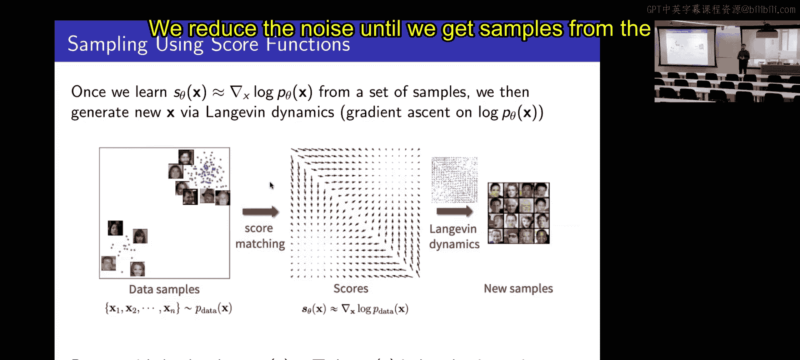

Right so this is just to remind ourselves what an yielded important sampling does in the early stages of an important sampling。

 we well first of all， we learn a score function not just for the true data distribution but for versions of the data distributions that are perturbed with noise so this is an example of various types of noise for various levels of noise that are applied to our example data distribution here the example with the most noise。

 Sigma1 we have expanded out the support of the Gaussians。

 such that they essentially cover the whole space， so now the data distribution and the score function especially the score function is defined everywhere and the input space it can be estimated everywhere accurately。

 and Sigma1 is a distribution Sigma1 is a level of noise that allows us to perform accurate sampling。

From any space of distribution。But the problem is that Sigma1 now is a level of noise that's so high that that is it no longer corresponds to original data distribution。

Therefore， what we do is we gradually anneal this noise and so we learn the core function for various noise levels。

 including Sigma 1， Sigma2 and Sigma3， and then when we start sampling。

 we first perform longmet dynamics with noise level Sigma one there everything works because Sigma1 has。

High enough support。 We take some samples and Sigma 1。 Then we reduce the noise。

 but we start with the original samples。 So now these samples will again。

 be roughly distributed over our input space， but they will be closer to the modes。And therefore。

 they will。Basically the samples at the end of longma dynamics for Sigma1 will be in the regions of the distribution with Sigma 2 where the score function is defined。

 therefore we can also perform longma dynamics starting with those samples and a noise level of Sigma2 then after a while we further reduce the noise。

 but the samples from the previous step are in high probability regions of Sigma 3。

 therefore we restart， we again have a working process upting samples and we gradually repeat this process we further reduce the noise until we get something which looks a lot like our until we're able to take longma dynamics samples from our true data distribution。

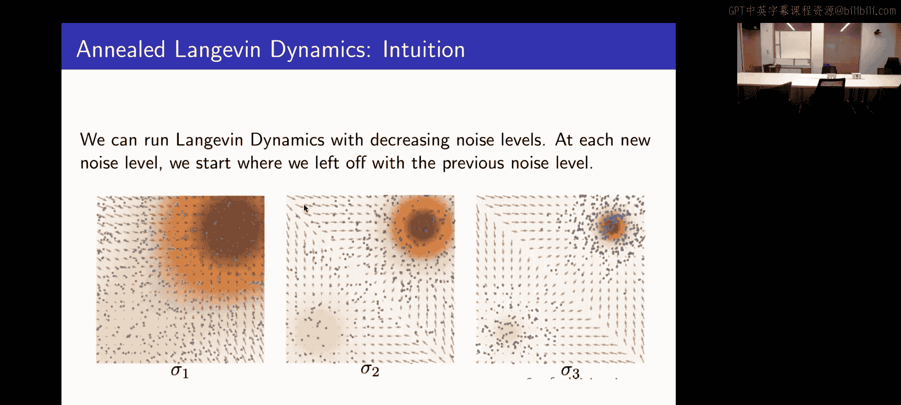

Okay， so this is the idea of anneed longome dynamics and it。

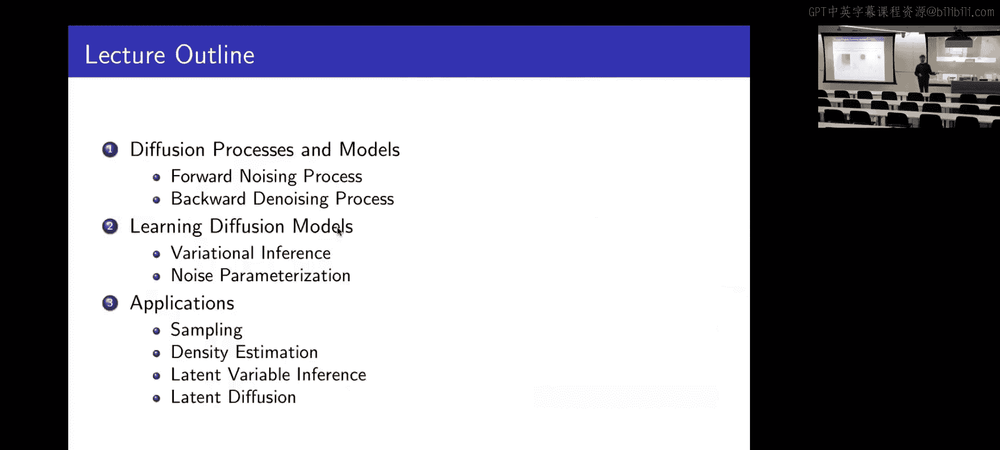

It is in practice how score based generative models。

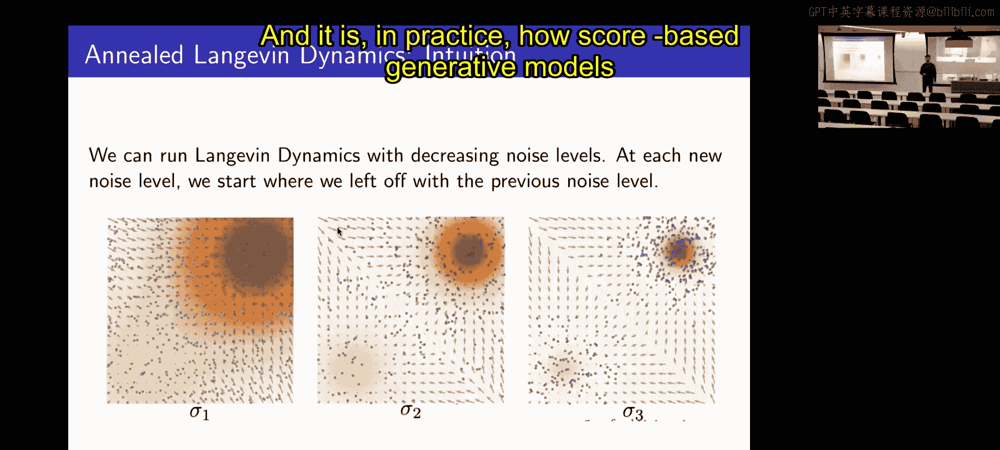

So now I want to take this machinery of score-based generative models。

 which at first glance seems really different from all the other types of models that we have seen。

 and I want to connect it to the machinery of latent variable models and variational outenrs that we saw earlier and in particular I'm going to derive a different perspective on score- based generative models that is much more closely connected to the kinds of generative models we saw earlier and as a result it will also allow it will provide us with new and interesting insights about what score based models do and it will also allow us to solve new types of tasks including density estimation and latent variable inference and representation learning。

 I will talk about that。But first， in order to make this connection between score based models and the other types of gene models we have seen。

 I'm going to have to introduce a little bit of notation。

 I will introduce this new concept of diffusion processes。

 which is a different way of describing the process that goes on when we do a neural launch main dynamics。

 I'll explain what a diffusion process is， then we'll see how to learn the diffusion model which is something that mimics the diffusion process from data。

We're going to see that next， and then we will。

We will see some applications of this process so diffusion is a way of representing it's a its it's a different way of representing what goes on when we add this gradual noise as part of anneed long vein dynamics recall that in a regular。

Score based general model， we learn the score function of the distribution with various levels of noise。

 which means that we start with some kind of image or with a data set of images。

 and then we gradually add additional levels of noise。Then when we're after we have learned。

The score functions。For all of these。Interesting。Okay。

 after we have learned the score functions for all of these， we perform。

This process of anal launchmaade dynamics， which looks like sampling from distributions with these various levels of noise and so in practice when we do this。

 our initial samples look like complete noise and then gradually as we perform the anneing we start to see something which looks much more like an actual image that we want to sample and then at the end of the anal launchma dynamics process when we have something which is。

Pretty clean or when we have very little noise， we have outputs， samples or images。

 which also look very clean。So this is how a sample coming out of a score based geneative model looks like。

And so diffusion models are orff the idea of diffusion。

Is another way of mathematically describing this process of going from clean to noisy and。

The other way around from noisy to clean。

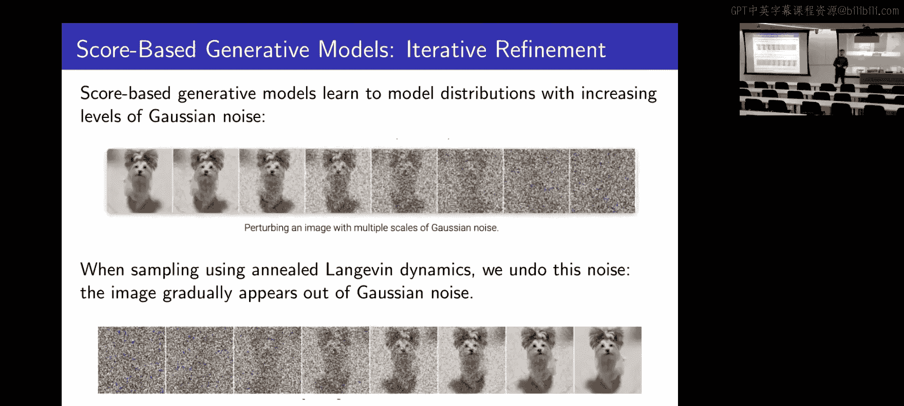

So the idea of a diffusion process and a diffusion model more generally is is to define a。

Is to define this forward， well， is to define this noising process via a probability distribution called Q。

So Q defines。The process of going from a clean image to a noisy image。 right。

 So there is this distribution cu of。Q that we define Q defines a sequence of progressively noise variables so it starts from x0。

 which is the clean data and then it generates a sequence of versions of this input image x0 called x1 x2 up to x capital T and each of these images will have more and more noise right so this is what the figure is trying to show here。

And then after we have created this noise， these noise versions of our image or of our set of images。

 we learn another process， we learn the backward diffusion process。

 which learns to go in the opposite direction and start with noise and undo。

This noise that we have added。So in other words， one way to think about what this diffusion process does is that it tells it creates for the model a trajectory that goes from completely noisy to completely clean you can even think of it as the form of data augmentation for example。

 when we trained a variational autoender， we asked it to。

 I guess we gave it pairs of noise and clean data， so the noise was provided to us by the encodeder so the encoder takes the image con it into a noise vector。

 this latent variable Z and then the decoder then is strain on pairs of clean and noisy data and it tries to reconstruct the image from the noise but it's only given two samples the complete noise and the clean data。

Here in a diffusion process， we're going to create a long sequence of images or data points that have increasing amounts of noise。

 and we're going to train the image on this entire sequence。

 so we're going to be providing more data to our model that will allow it to gradually go from the fully。

Noisy to the fully cleaned data right so the backward process or the denoisy process。

 which weode by T。Takes these trajectories from fully clean to fully noise data and learns to go in the opposite direction。

So then it undoes this process。So that's the idea of what a diffusion models model does。

 and we refer to this process as so since when we generate， we again have this。

The result that we start from complete noise and we gradually undo the noise this process we call it iterative refinement or iterative generation or course defined generation and that's a characteristic of diffusion models and score based models that。

Is not featured by many other modeling families， for example。

 and again we're trying to generate everything at once here we're trying to generate the data gradually and this is a very powerful feature it's a very powerful idea in practice it results in very high quality samples。

So it's really a good idea in practice， you don't want to generate something complicated at once。

 you want to generate it gradually and be able to see your you know you make some changes then you see those random changes then you get to undo your changes if you want to as part of this process so you gradually add details to the image you don't add them all at once and because you add things gradually。

These diffusion models are very effective at image generation。

So this is the high level picture of a diffusion model。

 let's now define each of these two components separately。

 so let's start by defining the forward process and then we'll define the backward process。

The forward process is the thing that adds noise。And as I said earlier， in the forwardd process。

 we start with clean data， which we're going to denote by x0。

And then we run this Markov chain which gradually adds noise to the data。

 this is what happens for a single image and specifically the mathematical definition of what noise is in a diffusion model。

 it's this type of Gaussian noise where at each step given the previous image。

 the distribution given given given an image with some level of noise。

 the next image with a slightly higher level of noise， is a Gaussian center at the original image。

And then there is going to be some variance and the higher the variances。

 the more noise we add right so basically what this again what this formula is saying is that the distribution over Xt given the previous level of noise xt minus1 is going to be centered at xt minus1。

It's going to be a Gaussian centered at X T -1。 So we're going to start with the original with the previous image and we're going to add white we're going to sample in a Gaussian around it。

 And so in practice， it will look like a。Like like the previous image。

 but with an extra level of white noise。And notice that we have these parameters alpha。

 these are the noise schedule， So alpha is or these alpha t's are a sequence of scalars that goes from one to0。

 And so what it means is that at the end when at the end of this noiseing process。

 when alpha t is almost zero we get。SM， so this normal distribution。If alpha T is0。

 then it's just white noise， it's just a normal distribution with means0 and in variance1。

But in the earlier stages， when alpha P is large， then the variance of this normal distribution is really small and we get samples which look almost like the original image。

 so this is why when we sample it from the spark chain， we get a distribution of images。

 which looks like this noise。Are there any questions about the forward diffusion process？Okay。

 so then。

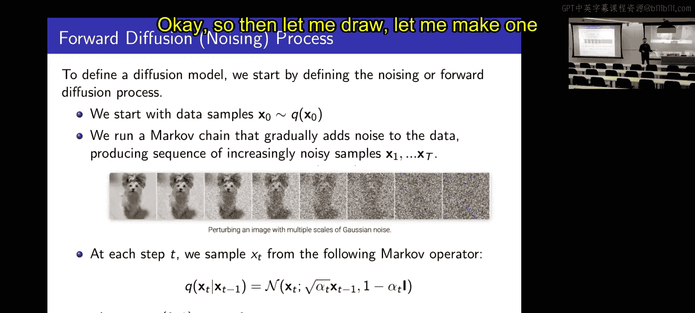

Let me draw， let me one， let me make one mathematical observation about this process。

 which will also form an an analogy to。

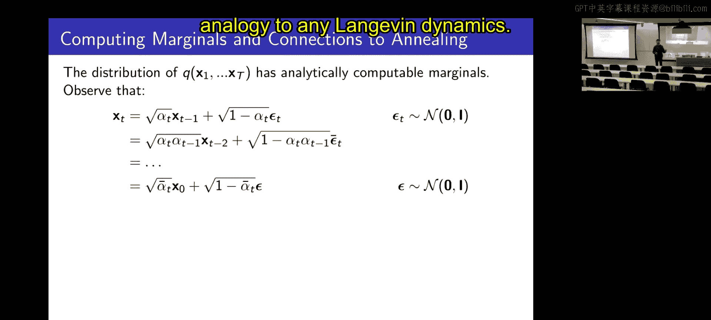

Andil lung main dynamics。In a diffusion model， we have defined this noing process as a markov process where we start with an image and then we。

In a Markov fashion， this is a Markov operator， we gradually add noise。

It turns out that we can also view this Q as defining a joint distribution over multiple noise images。

 this is what I mean by Q of x1。

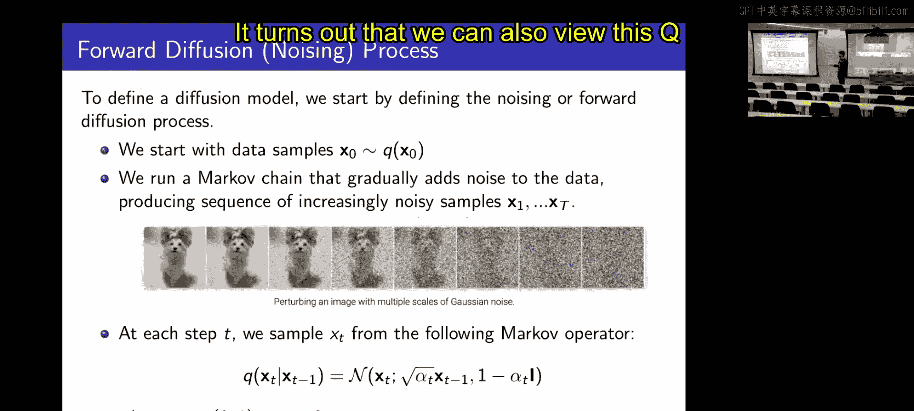

To XT right so this is a distribution over over all the noise variables of an image。

That is induced by this Markov operator。We can take this distribution。

 and we can compute its marginal over each image， and this will have an interesting form。

The way that we can do this is using a little bit of math。

 So what you see in the first line is just the mathematical definition of our。

Markov operator right it's just saying that the next Xt is the previous Xt plus some level of Gaussian noise plus some Gaussian noise variable epsilon with an extra。

Multipliier that。iss defined by the schedule and then we know that x t minus1 is itself a function of xt minus2。

 therefore we can take that formula， we can plug it into our definition of x t minus1 and get a formula for Xt。

That's a function of x t minus2 and then we can just keep doing doing this until we get x0 and in the end our distribution over xt our formula for xt as a function of x0 is going to have the simple form。

 which is again going to be a rescaled version of x0 plus Gaussian noise where the parameters that are multiplying by there are multiplying these two terms x0 and epsilon。

 these parameters involve scheduling variables alpha t bar alpha t bar is just a product of all the previous alphas from one up to T。

But essentially this is just another version of the schedule is these are just another the alpha t bars are another type of noisy schedule that is directly derived from the alpha in the manner that I just described Okay。

 so we can derive a nice formula for xt as a function of x0 plus some Gaussian noise。

And what this formula implies is that the probability of xt given x0 is just a Gaussian。

 that's just what this formula is saying， So xt equals a downscale x0 plus some upscale Gaussian noise that just means that Xt is distributed as a Gaussian distribution around a mean of x0 that's been downscaled plus some level of noise that's controlled by this alpha t bar parameter。

And so the key observation here is that this distribution is Gaussian。😊。

And this is interesting because this means that when we。pererform this diffusion process。

 we are doing the same thing that we did in anial longma dynamics right remember that in anial Lama dynamics we would we would basically perturb each distribution by adding different we would perturb the original data distribution by adding various levels of Gausian noise and a diffusion process does exactly the same thing its distribution over XT。

 which is the distribution of the noise data with a noise level。Tea corresponds to a Gaussian。

With a certain。Level of noise that's given to us by alpha T bar。So both。

Anial lung main dynamics and diffusion processes perform the same type of Gaussian noing on the data。

That's an interesting first connection between the two。Okay。

 so now I have defined the forward process。That is how we generate a trajectory from clean and noisy data。

 but recall that the reason for why we're generating this trajectory from clean to noisy data is that we want to ultimately undo this process。

 we want to generate clean data from noise。Right， so the entire reason why we've been generating these trajectories x1 to Xt is to provide data using which we can train a process to reverse the noising process and generate data from noise。

And that's what the backward or the denoing process does。

So the ideal thing that we could do is to try to run this Markov chain in the other direction right we have defined a markov chain which starts with clean and goes to noisy。

Well。There is some form for the distribution Xt minus1 given Xt for slightly clean or given slightly noisier。

 there is a distribution for this， unfortunately we don't know what it is。

And so our solution will be to fit another process。

 another Markov process called the backward or denoizing process to estimate it from data。

In other words， we define a model。P that has the following form。

 and so P now is the actual generative model that we're going to try to learn。

And this model has the same markov structure that Q has except its markov in the other direction。

 it starts with a prior on the fully noise variable and in practice k of x key is going to be at least in the standard definition of a diffusion model。

 it's just Gaussian noise， it's the same type of prior that we would have in a creationational outcor。

 and then we have a distribution over all the other variables。That factorizes as this mark of chain。

And each component here in this Markov chain， each xt minus one given xt is itself a Gaussian with some mean and some variance that we're going to try to learn。

嗯。Right so we're going to try to approximate xt minus1 given we're going to try to approximate Q of xt minus1 given xt using p of xt minus1 given xt。

And when this entire process works， when we have learned this model， when we take samples from it。

 we get。Astead of intermediary x's which look like this right so our very first sample on the very left that's x capital T and that just looks like complete white noise。

 but then when we sample xt minus1 given Xt， we get progressively less noisier version of the object that we will ultimately try to generate。

And so when we sample from P， we get this gradual undoing of the noise that we have added。

 we learn to generate from noise to image and this results in this iterative。Generation of the image。

 which looks a lot like what a score based gene model would do。

 and I will define it more precisely in a few slides， what's the connection between them。Okay。

 so that's going to be our strategy for defining a diffusion model and these are going to be the main components of the model and next I want to talk about how we can actually learn these from data。

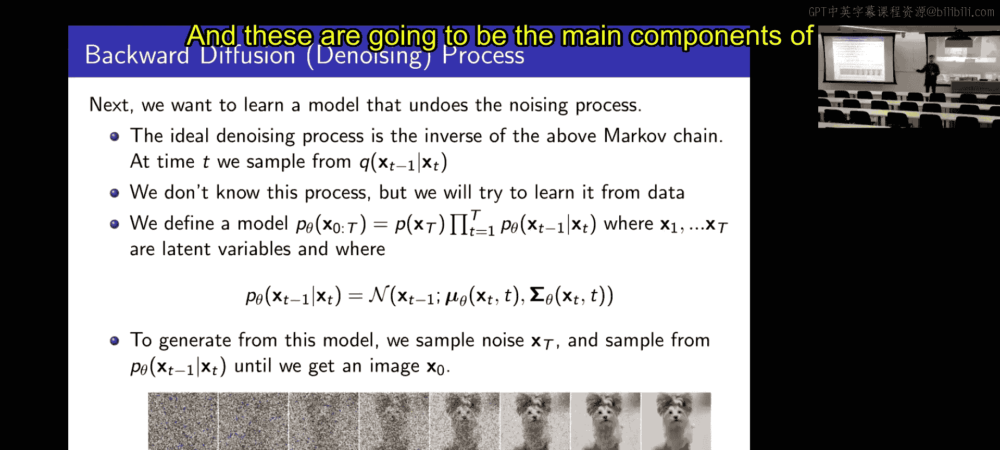

Before I do this， are there any questions on the definition of a diffusion model that I can answer？

Yeah。Okay， if not， then let me then go to the next step and let's talk about how we can actually learn this model from data。

Again， the goal of what we're trying to do is shown in the speaker。

 This is another example of how diffusion might look like when applied to a simpler 2D data set。

 which is a spiral， So the first column shows the clean data， especially the first row。

 the first row and the top cell in blue So the clean blue spiral that shows the true clean data。

And using this clean data and using our forward noing process Q。

 we're going to generate a sequence of increasingly noise versions of this distribution。

 So here I'm just showing two。呃。Two versions of the noise distribution， but in practice。

 there can be capital T of them。So here in the middle， we have something that's。Somewhat noise。

 And at the very end。The top right corner， the top blue blob that corresponds to data after it has been completely noise and we've added so much noise that it just looks like a white a unit Gaussian。

 like a unit normal distribution， which is just white noise。Okay。

 so the blue is the result of the noising process。 And then red shows what the。

Thenoing process will try to do。 It will try to draw samples from this noise distribution。

 and then it will try to progressively。5马路。Cleleaer versions of this distribution and ultimately if this process succeeds when it finishes dennoing the data。

 it will produce something which will look like a clean spiral again so the bottom left cell the red spiral is how the data will look like once we start with random noise once we start with this random wide Gaussian noise that's shown in red and then we progressively。

Learn to undo it。Okay， so we want to。Eect we learn to undo the blue process to get what is in red。

 So we want to fit a P that。That matches that results in the same intermediate steps as the ones the Q has produced。

 except in the other direction， so in other words， we' going to fit P to Q so we have two distributions。

 when it' called P one is called Q how do we fit them well it's natural to try to fit them using our friend the KL divergence。

We've been using decL diversions a lot， it's a great tool in our machine learning toolbox。

 we're going to apply it here to try to fit P to Q。Specifically。

 how do we do this well we're going to do this using the machinery of variational inference。

 which we have seen in our earlier lectures on variational outenrs。In particular。

 recall that when we when we try to maximize the evidence lower bound on the log likelihood of the data under the model。

 we are implicitly doing two things。 We are optimizing。

A lower bound on the log likelihood and we are also minimizing the kale divergence between the trueop posterior and the approximate posterior。

And in this case， the approximate posterior looks like。Well。I guess here going back a second。

 what are the latent variables？In this model， so we have a model P of x0 x1 up to xt。

 What are the latent variables in this is the model So I claim this is latent variable model。

 Do you believe me and if yes， what would be the latent variables。Yes， the steps。

 so the variables x1 x2 up to xt those are latent variables x0 is the clean data we have access to that。

 but x1 and x2 and x up to xt， those are going to be latent variables。

 they're going to be noise versions。Of the data， but we don't have them at training time。

 Well I guess we generate them using Q。 So now P is going to treat them as latent variables。

 and we can apply the machinery of latent variable inference。 Therefore， we can take。

We can form the elbow and remember the elbow。It can be defined as the log as the marginal log likelihood minus this scale divergence between。

Between between the trueop posterior， x1 given xt and the posterior under the model。Right， and here。

We can rewrite it and using a little bit of math and in the end we get something which looks like the definition of the elbow that we had for a variational autoender。

 it's simply the expectation under Q of the difference between the log probability of the model minus the log probability of so difference between log probability of P and the log probability of Q。

Expected value taken under Q so what we have at the very bottom is just the definition of the elbow that we derived when we had areal auto encoder and when we optimized this we are we're making this lower bound tighter by reducing decal divergence between Q and P and we're also pushing at the same time we' also pushing it up therefore we're pushing up a lower bound on the marginal log likelihood。

 therefore we're also effectively making the log likelihood of the data higher under the model so these are two ways of understanding what this objective is doing is doing what I said we should do on the previous slide which is to minimize decal divergence between P and Q and it's also。

Simply increasing the log likelihood of the data under P。Which is something that we normally want。

 this is what we did for a variational outr。And I'll just add here that there's a nuance however in a V。

Both P and Q would be models that we would parameterize and learn so P is in a V P would be our decoder。

 Q would be our encoder， and we would learn both we would parameterize both using neural nets here it's a little bit different here Q is fixed。

 but it has been handcrafted by us in a clever way。 It has been handcrafted to generate。

A trajectory from clean to noisy data， and we only learn P in a way that should try to undo this process。

Okay， so that's an interesting nuance。And， and when we learn this。When we learn this model。

 we are effectively， so I guess this will be the learning objective for a diffusion model。

And in that sense， you can think of a diffusion model as。An instance of a variational。

How to encode this is the first connection to classical geneative models that I want to present here when we learn a diffusion model。

 we are implicitly optimizing for the elbow and therefore it is in a way a VE except that we don't learn the encoder the encoder is fixed we only learn to decode the data for our clever handcrafted encoder in most cases in a diffusion model。

 although I would say it's an interesting area of research but whether this can be changed。

 but at least in the standard version of a diffusion model Q is typically fixed。Okay。

And I will tell you in a moment。What are the different components of this elbow that are interesting to us Okay。

 so actually this elbow has some interesting structure I'm not going ask you to understand this math right now but if you're curious you can download the slides and check it out but this is just a little bit of algebra and again it's literally simple algebra we just add and subtract things and use the proper use of logs and the distributions and we use base rule in a few places so this is just basic algebra and probability that can be used to start with the。

Elbow objective that I had in my previous slide。And using this algebra。

 we can transform it into something which has more interesting and more useful structure。

In particular， what this derivation is showing is that we can take the variational lower bound and we can transform it into a set of terms。

A set of t plus one terms where each term will have an interesting interpretation and I will give this I will tell you what each term does on the next slide there is a question。

Yeah there was a question on the chat and I'm kind of curious about the answer。

 are we assuming that the last Xt is going to be pure noise or or not the question it was。

 are the latent variables x1 to Xt or is it x1 to xt minus1 since we could assume that XT would be from the normal distribution？

XD。In this case， by construction， it will be effectively or well。

 the marginal distribution over Xt will be a Gaussian in this version by construction that will be the case。

 but there are some variations of this machinery where it might not be there are some variations of diffusion models where it might not be the case but here in a standard diffusion model that's。

That's the case。So we're assuming that x1 to xt are la variables。

 even Xt doesn't have to be something that's kind of like fixed。

So the distribution of Xt is going to be Gaussian the same way as the distribution of Xt in a variational utter encode。

 it should be Gaussian， but each Xt could still and a code。

 it could still contain some meaningful signal I。So there are three types of losses in this。

In the set of terms that Ive described at the end right so I guess first what I'm saying here is that we can rewrite our objective our elbow as a sum of terms which go as Lt plus lt minus1 up to L zero and there are three types of objectives that we're optimizing for when we optimize the elbow the first one is what I call the prior loss and that's just the probability that's just thel diversions between x capital T under Q and P。

As I said just now。By construction， this is often zero because the marginal distribution will be by construction zero。

No， sorry， but well but by construction， this Q of XT will be a sample from the Gaussian so this can。

In some cases， we dropped。The first term L0， we refer to it as as the reconstruction term， it's the。

It's the likelihood， well， I guess if this is a loss。

 then it's minus the likelihood of the clean data given x1， which is the least noisy latent variable。

And then all the other components， L sub capitalital t where t is between1 and minus capital t minus1。

 those are the kl divergencies betweenq of xt given xt plus 1 and p of xt given xt plus1。

So essentially， we want to learn P to undo the process。 given an X T plus one。

 we want to have a slightly less noisier X T， and we learn that。

Processed by trying to fit it to the true probability of Xt given xt plus 1 under Q。

So these diffusion loss terms actually force each step of the backward process to look like the inverse of the forward process。

So these last steps are particularly crucial。So this decomposition actually shows that by optimizing the elbow。

 we actually get what we intuitively wanted to get when I was first describing this model。Okay。

 so now I have an objective now how do I actually。Define a parametric model that I can learn using this objective。

 That's the next part。So again， the key part is this。Diffusion loss。

 where I'm trying to fit the marginal。 Well， sorry， not the。 We're trying to fit each step of the。

Of the reverse of each step of the backward Markov chain pe。Well。

What should be a good parameterization for P the ideal parameterization for P is something that matches the true parameterization of Q。

So then we should ask ourselves， what does this Q look like。

 what does Q of xt given xt plus1 look like？It turns out that it has a nice form。

 and in particular it's Gaussian。The way we can derive this is to use our trick about the marginal distribution of Q of xt given x0 and then we can also use basees rule so we know Q of xt given x0。

 we know the form ofq of xt plus  one given xt and then using these components in basees rule we can do a little bit of math which I don't have here。

 but it's an easy exercise， we can show that the distribution of Q of xt minus1 given xt which is what we're trying to learn will have a form which also looks like a Gaussian with some mean mut tilda and some。

And some parameter data filled up for the。Varance。Okay， so Q of x t minus1。

 given xt will be Gaussian， I will give you the formula for u tilda on the next slide。

 there is some u tilda for which there is some formula so it makes sense for us to also make P of Xt。

-1 given X T Gaussian。Right， so because Q that we're trying to fit as Gaussian。

 we're going to make P。Also， Gaussian with some mean and some variance。

 and we're going to make this mean a model of。A parametric model of Xt。

And we can try to learn this model from data by optimizing this objective。Right， so again。

 I have just given you an objective and now I need to fit a model to this objective。

 So the model is going to be this blue mutilda of Xt， the same。

The same way that we're parameterizing the mean of a Gaussian in a V here。

 we're going to parameterize the mean of this particular Gaussian。

And we can try to learn this using gradient the sense。Okay。

 so this is one way in which we could possibly learn a diffusion model。

Is there any question on this step？Okay， so then。This is almost the full definition of a diffusion model。

 but I want to add。A small nuance here。So it turns out that this parametermetricization。

 so choosing a model of the mean of feet is not the best thing we can do。

 we can actually do something a little bit better。And what we can do is to leverage the specific formula for mutilda。

Right， so I told you that this。TheThe correct formula for Q is this for some mutilda。 Well。

 it turns out mutilda has a formula This is actually a little bit。

It takes a little bit of effort to derive， I don't have the derivation here。

 but you can look it up in the original paper by Sodihi etal and there's also many blogs now that explain this。

 but there is a formula for what mutilda is。And this is the fourth。Okay。

 and it equals the previous x。And the noise variable， Epsilon T。

 which was used to generate Xt in the forward pass。In the forward process。Now。

 when we try to reverse this process， we have access to X T， right。

 because we're trying to do X T minus-1 given X T， but we don't have access to Epsilon T。

 And so Epsilon T is what we。Want to predict in order to get this mut tilda correctly。

And so the thing that I said that we can do better is that instead of。

Instead of modeling mutilda directly， right instead of having a neural net that directly spits out。M。

Given Xt and T， instead， what we could do is we could have a parameterized model for epsilon。

And then we would obtain mu theta by just plugging in our model for Epsilon into the correct formula for mutilda。

So what a diffusion model does is a slight reparmeturization of mutilda and instead of parameterizing mutilda directly。

 it parameterizes this component epsilon of the formula for mutilda and then everything else stays the same if I have a formula for epsilon。

 then via this if I have a model for epsilon， then via this formula， I have a。

I have an expression for mu theta， and now that I have an expression for mu theta。

 I can plug mu theta into the objective on the previous slide， into the keyL dirgence。

 and I can minimize that using gradient descent。So this doesn't change。What I'm doing。

 it's a different parameterization， but this parameterization is going to be easier to learn and will have some interesting downstream properties。

So first of all， it has this interesting interpretation。Because when I fit a model of epsilon。

 I effectively am trying to fit a model of Epsilon T。

 which was the noise that was added to x0 in order to produce the noise version Xt。

RightSo now instead of trying to model view I'm trying to model the noise that was added to Xt and in particular。

 given the noise version of Xt epsilon will try to produce that noise and then this formula will try to remove that noise from Xt so in a sense epsilon by modeling epsilon I am learning to predict and remove the noise from a noisy version of the image。

Okay， and so this is the。Orular for what decL dirgence is right I told you that LT is the divergence between two Gaussians well。

Let's assume the variance is a。iss a parameter that's the same in both cases。

 then the k dirgs between two Gaussians， assuming the variance is the same。

 it's just the difference of the L norm。It's just theel norm of the difference of their means。

So if I were to parameterize U。My objective would be the thing that's on the first line。

But because I have chosen that particular clever parameterization。

 I can take from the previous slide， my formula for mutilda and my formula for mu theta。

 I can plug them into the blue and the red and the green。Terms on this slide。

 and then everything except the epsilon will simplify。

 and therefore my KL divergence will use to the difference between the true noise and predicts is what my model predicts the noise to be。

And again， this is what I meant by the model tries to learn the noise distribution when we。

Take that parameterization and we apply the EL diversions we are literally。

Learning to predict the noise。Okay， and so now I have a model， I have a learning objective。

 and I can specify here the full learning algorithm。Again。

 our objective is to optimize this elbow objective， which is L0 plus L1 plus L2 up to Lt。

The way we're going to optimize this objective is that at each step of the optimization process。

 we will sample a data point or a batch of data points。

Then because my objective is a sum of a very large number of terms， a1， 1202， 1203。

 I'm not going to look at all of the terms at once。

 I'm also going to apply a Monte Carlo approximation to this large sum。

 and so I will choose one term one time step out of the capital P possible time steps。

So this chooses my objective， this chooses my term L sub T。Okay， so now I have an x0。

 I have an L sub T。Then what do I do， Then I generate。Now I need an Xt。

 I can generate that XT by applying the forward process in particular。

 I have a formula for what the noisy XT is given the clean X0 that's the formula that I derived on the second slide when we define the backward process therefore given this noise x0。

 I can generate the noisy version of Xt and now my goal is to predict is to learn to correctly predict a slightly less noisier version of Xt from Xt and by all the math that I did earlier。

 this is equivalent to learning to predict the noise epsilon that was used to generate this Xt。

I should have written this Epsilon as actually both face Epsilon T。

So this is maybe a slight you can maybe this is a slightty on my end。

 So when I say sample noise epsilon， I mean， you sample the variable epsilon T from that noise。

 then you use that variable。Within the formula that I derived earlier to get an X key。

And now you learn to predict the noise that went into creating Xt from Xt。

 so effectively you learn to dennoise Xt in some way。Okay。

 and so that's how you train this model of the noise。And。

The core of the diffusion model is this model Epsilon。

 which tries to predict the noise that was added to a variable。In order to generate the variable。

The noise that was added to the clean variable in order to generate the noisy version。Okay。

 so now this is the full learning algorithm for a diffusion model。

And the interesting thing that I want to note is that this has some really close connections to score based general models in fact。

 everything that I described can be thought of as effectively another derivation of a score based general model。

 even though it might not look like this at first glance， but all of this math。

It leads us the same result to almost the same result that we had for a score based general model that we learned using denoing score matching。

So let's just quickly remind ourselves what is denoing score matching。

 so in denoing score matching we're trying to learn the score function of a noisy version of the data distributionq sigma of Xtilda。

Xtilda is a noisy version of the data that I obtain by taking the clean X and adding Gaussian noise to it with a strength of sigma right Sigma is the standard deviation of the noise that I'm trying to learn。

This is the definition we had in the last lecture for denoing score matching。

And then what the noing score matching says is that if you wanted to learn the score function of the。

If you wanted to learn the score function of the noise version of the data distribution。

 Q sigma using the fiser divergence。There is a slight reformulation of that objective。

 I guess that objective is equivalent to another one where the score function is fit to a。

To this other object， logq of x stillil the given x。Right， and x still the given x is the。

Q of x still the given x is the more。So it's the posterior distribution over the noise data given the clean data。

So when we performed thenoising score matching。We optimize the objective that's on the right。

 which is equivalent to the objective on the left， which is the fiser diversions。

 which gives us the score of the noise data distribution。

But now observe that if we're using Gaussian noise， then this。

Conditional score has actually a closed form solution。

 so the probability of extilla given x is a Gaussian centered at x。

 and therefore if you work out the math， then the score is just this， it's xtil the minus。

X divided by sigma squared。 and that's just。Well， by this definition， x still the minus x。

Sigma squared， it's just excellence Sigma。 So the score function of this。

Conditional noise distribution is literally the noise that we have added to X in order to corrupt it。

Okay， and so when we fit a score model to this。To this noise version。

 when we fit a score model to this conditional noise score。That's what happens。

When we optimize this objective and when we perform the noicing score matching。

 so we're trying to approximate this object using s theta。

 but that object is just the noise over sigma。And that's essentially what I was learning using my other algorithm。

 I was also learning a noise version， so my model Epsilon that it learns to predict the noise that was added to Xtilder。

Except that。In the noisy square matching there's this division by Sigma。

 and so here I have this extra one minus alpha bar term that appears here。

So denoing score matchingion score matching and diffusion models are closely related to each other。

 they learn a version of this score。They both learn to dennoise。

 which is equivalent to learning this conditional score， and when you do this。

 this is equivalent to learning the score function of the noise distribution。All right。

 so this is one important connection between diffusion models and score matching。

And denoizing score matching and score based general models。

I want to conclude by just mentioning how we would also sample from these models。

So now we have an algorithm for learning a generative model。

 How do we actually then draw samples from this model？

Well we can do this really naturally here because we can just draw samples from it we just have a distribution key where there's some latent variables X T over which we have a prior and then there's a clean version so we can just perform what's called ancestral sampling where we sample first xcap T and then xcapl t minus1。

 et cea， et cetera， until we get the clean x0 so we just sample from our learn markup chain。

And because。Well， first of all， the sample of xt minus1 from this distribution that will be the mean of the Markov chain plus sigma times the noise plus sigma times the random noise factor。

Where sigma be the variance of this sounds good， I haven't really defined what sigma has but in practice you can you can this can be thought of as a hyperparameter and we have a formula for what you say that is。

Right it's this so then plugging in my formula for these data into my sampling formula。

 I get the following。Formula for help to sample xt minus1 Qs。

So this is the sampling formula from the generatorative model。

And now this also has some interesting connections to long domainma dynamics。

Right so ancestral sampling from a diffusion model is actually equivalent to long vein dynamics using a score function that's learned using denoising score matching。

Remember， this is our formula for long dynamics right we just start with x and we form the next x by taking a step on the gradient of the log likelihood。

And remember that this。So in practice we don't have access to this gradient。

 but we have a score function that approximates this gradient right we have this score function which approximates the gradient of the noise distribution。

 which equals epsilon over sigma， and we saw that epsilon over sigma is also what this expression would learn。

Right。And the formula for sampling from a diffusion model is what's at the bottom。

 And so notice that this formula。Epsilon over sigma。

 which is approximately our model Epsilon over one minus alpha screw of 1 minus alpha bar T。

 You find this term exactly here。 You have an epsilon over divided over。

Divided by screw of1 minus alpha t bar， which appears in this formula and that's exactly the score function that we're trying to estimate。

 so this is actually very closely related to anneed long main dynamics。

So when we perform ancestral sampling， this argument shows that we're effectively also performing a yielded long dynamics。

Okay， and now I just want to add with some examples of what this does。

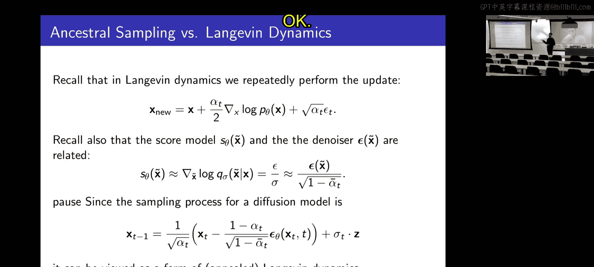

So if you now take all of these things， you take all of this math。

 you put a big enough neural net into it and you give it enough data。

 you get very high quality images， so these are images from the denoing diffusion model paper by Ho atol。

 which was the paper， the kind of brought up diffusion models to everybody's attention in 2020 but actually diffusion models were proposed by saltish et all in 2015 and then they just research in 2020 these are samples from the original model and so you can see they can generate very high resolution images of human faces and it can also generate really high quality on this T4 10 data set and the big takeaway here is that diffusion model via this process of iterative refinement。

 can produce very high quality samples which are competitive to what is produced by GNs。

But they don't have to leverage this unstable training objective。

 their training is much easier and much more straightforward。So yeah。

 these are the samples that we would get。

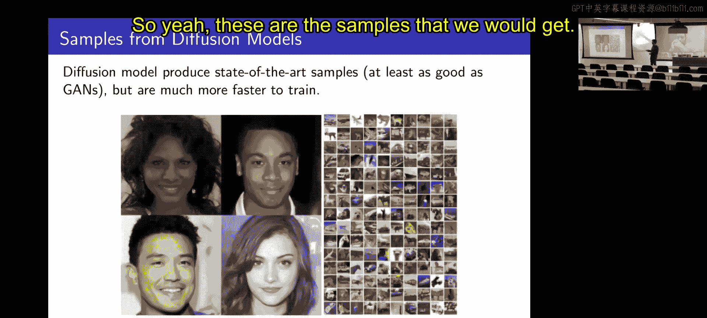

You can also do conditional sampling， so for example。

One cool thing about di fusion models is that they're now part of。

Of a lot of these text to image generators that you have seen like Dolly2， stable diffusion midjoney。

 all of them use a diffusion model as the decoder， so given a piece of text。

 you can also generate from a conditional distribution where each sampling step is conditioned on external data。

 why y can be an embedding of a sentence and using this kind of diffusion model you can generate very interesting images like the ones that are here which are based on a text prompt。

So this is a really cool feature of diffusion models， although I would say that。

There has also been work on using other types of model families in methods like dolly and stable diffusion。

 there is for example， a system for Google which does not use diffusion using an utter aggressiveive model and it still works。

 so diffusion model is not a diusion model is not the critical ingredient here but it is used in practice for a lot of the reasons that I describe stable training high quality。

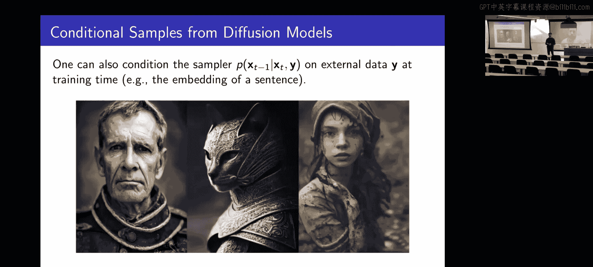

Yeah， there's also some interesting。

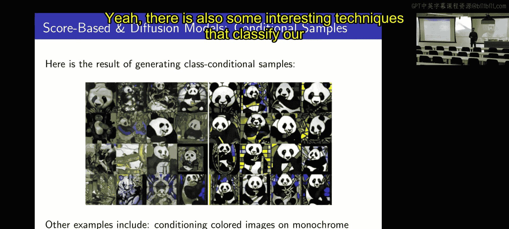

Techniques that classify free guidance， which you can do。

 and the other thing that I just want to mention is that。

Because diffusion models optimize for a lower bound on the log likelihood。

They can also get really good likelihoods， they can also do really well at density estimation。Right。

 remember density estimation is this other task in generalative modeling which could be interesting。

 you want to assign high likelihood to data that's coming from your distribution from your from the data distribution that you're trying to model and。

As of right now， diffusion models are also state of the art。

 so there is a version of diffusion models called radiational diffusion models like King model 2021。

 which introduced some additional refinements to a classical diffusion model， for example。

 learning the schedule of alpha increasing。Thecrization。

 making T very large and also adding these new types of Fourier features。

 which is a particular architectural。Detail within the model for the decoder and all of these innovations enable diffusion models to each state of the art log likelihoods。

 and so this shows the log likelihoods。The state of the art looked likelihood for many years on standard benchmarks like C4R1 and ImNet。

 since about 2016， the state of the art was always achieved by utter aggressivegressive models and in this work of Kingma et all。

 they have established that diffusion models can also outperform the state of the art on density estimation。

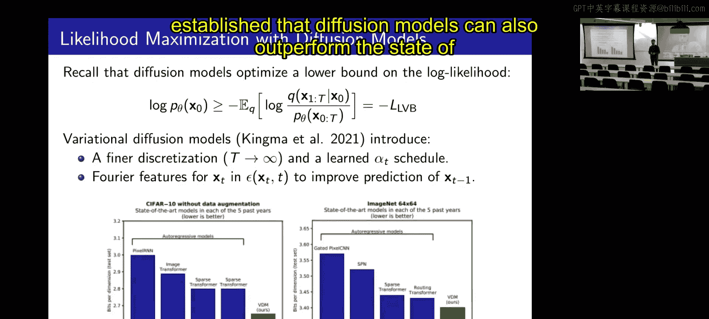

And then the last last thing is you can also add interpretable latent variables within diffusion models。

So I told you that all these noise versions of the image can be thought of as latent variables。

 but they're not latent variables that are easily interpretable， for example， in a VE。

 we have these low dimensional latents that can encode semantic meaning。

You can actually introduce these into diffusion models as well。

 so now instead of just having a distribution over0 and x1 to t。

 you can also add these extra z's which are the lowdial latents and you can have an objective a reasonable objective by applying the elbow twice first like in a regular V that's just the regular elbow you would get from a V and then you can apply them once more as in a diffusion model and now you get a principled objective for diffusion model for diffusion models and you can use these to do interesting things like interpolating between images or modifying certain semantic attributes so if you train it on a data set of faces then you can do cool things like take the image of a woman move it in latent space towards a male image so you can transform human a female face to a male face。

 male face to female etc so you can do interesting semantic manipulations。

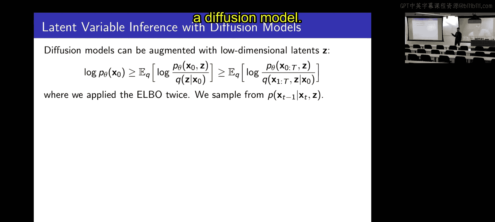

Once you introduce these late variables and so this is just an instance of representation learning using diffusion models。

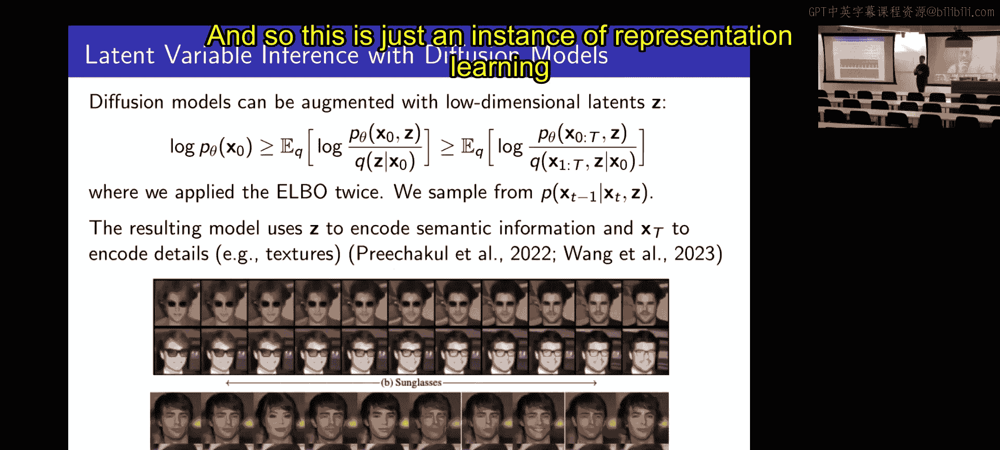

So I'll add here by just briefly summarizing the key pros and cons of diffussion models。

 diffusion models generalize latent generalize。Score based models or maybe no sorry they don't generalize they are a different perspective on scoreb generative models their advantages are providing very high quality samples matching or outperforming GNs while also maintaining a stable objective they're really good at controllable generation I gave you briefly an example with text conditional generation。

 but there's other applications where you can control or you can control them and they also achieve state of the art performance on other tasks such as density estimations If I were to mention certain drawbacks I would say that sampling can be slow and it works very well on continuous data but generalizing them to discrete street data is still an active area of research So this is my this is the end of my overview of the fusion models let me know if you have any questions yeah happy to stick around and answer any questions you have。

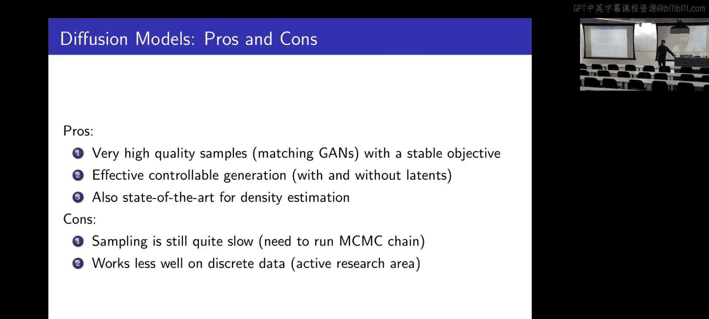