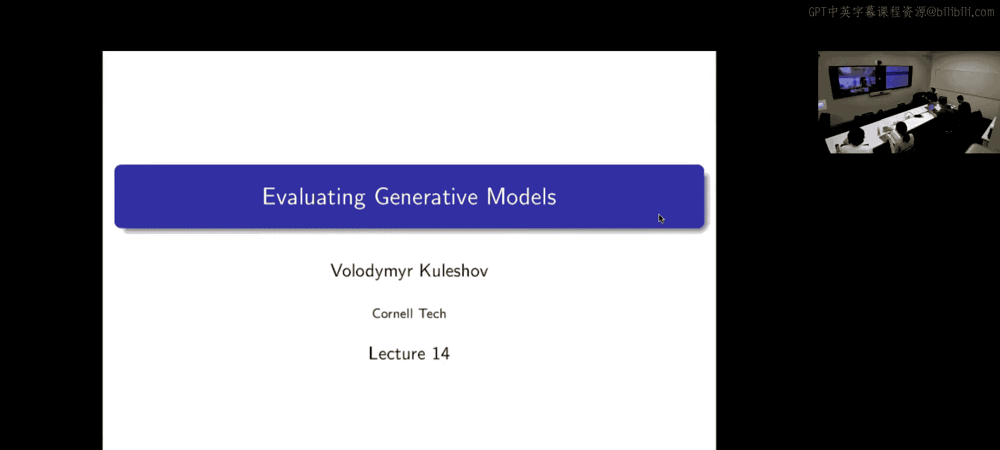
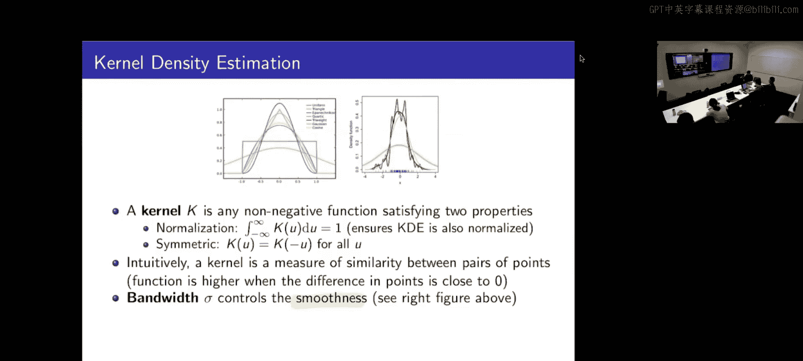
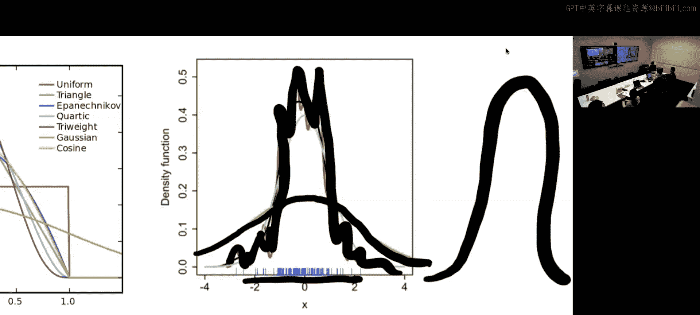
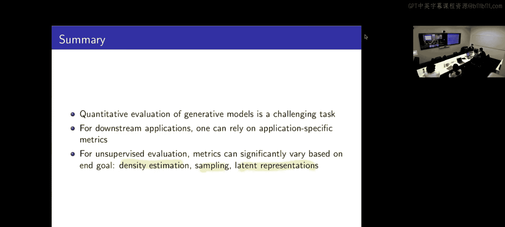

# 康奈尔大学《深度生成模型Deep Generative Models (Cornell Tech CS 6785, Spring 2023) 》中英字幕 - P14：-14-Lecture 14_ Evaluating Generative Models.zh_en - GPT中英字幕课程资源 - BV1az421q7Vf

So the topic for this lecture is going to be evaluating generative models okay so as usual quick recap of what we've seen so far。

 this is our figure at's summarizing the problem that we've been trying to solve for most of the class。

And I would say that you can view the contents of the class in different ways so far。

 we've seen several generative modeling families and we've also seen several generative modeling tasks。

And we saw that certain modeling families are better suited for certain tasks than others。Right。

 so the most obvious task is probably generation， which means that we want to generate。

High quality samples we want to generate these kinds of images so based on data we want to generate images which might look like this。

 given a data set of dog images， we want to generate new dog images and we saw many types of generative models that can solve this task reasonably well。

But that's not the only task that we might be interested in another task that we also saw in the first set of lectures was density estimation an outlier detection can be a special application of density estimation so in density estimation we actually want to learn this data probability we want to minimize some notion of similarity between the data probability and the model probability。

 we want to have a model which actually looks like our data distribution and then we can accurately estimate the probability of we can we want to be able to accurately estimate the data probability on new data。

And again， certain models are better than others for this task。

 so our progressive models are models where we can really easily compute the likelihood so they're very well suited for density estimation。

 similarly to normalizing flows and are also added energy based models because we saw that once we have trained the model we can perform outlier detection without using normalizing constant。

 but some models are not great for that， for example GNs， they can only generate samples。

 they're not great at density estimation。And then the other task that we saw which is also really important is representation learning。

 we don't want to just generate or fit the probability。

 we also want to discover some new interesting facts about the data we want to discover interesting structure in the data and that's something that we might be able to do using certain types of models in particular latent variable models are best suited for this。

So these are three tasks and different models for this tasks that we have seen so in this lecture and in the next few lectures I'm not going to introduce any new models。

 we're going to keep working with these models， but we're going to try to understand which to use when as well as how to combine them and look at different special cases of these models where there's some interesting complications。

 for example discreteness would be one so mostly we're going to look at how to work with these models。

And in order to decide how to work with these models and in order to decide how to apply which model in which scenario。

 it's important to understand how can we evaluate models right so in order to decide which model to use when we want to be able to evaluate these models and have some principled way of determining when a model is good and when a model is not good。

Okay， so the that's the task that we're going to be that' the that will be the focus of this lecture。

 so we will specifically look at evaluation and how to perform evaluation for general model。

Gerral models。Now， as you can imagine。And I think I alluded to this in one of the earlier one of the first lectures of the class evaluating generative models it's actually quite hard。

 it's much harder to evaluate a generative model than a discriminative model and the main reason for this is that generative model can do many more things that a discriminative model can undo the only goal of a discriminative model is just to maximize your accuracy so you have a natural metric。

Here， the question of how good is the generative model depends on the question of what task do we care about？

Right and I just named three very common standard tasks that exist in generative modeling。

 so density estimation generation representation learning。

 even these three tasks are very different from each other and as I showed you on the earlier slide。

 certain models are better for certain tasks so not every model is well suited to every task。

But it' it's even more interesting it's even more complex。

 there's other tasks that we could be using with that we could be applying general models to。

 for example， semiupvised learning could be a task maybe we're interested in in a predictive task like supervised learning or semiupervised learning。

So in this case， we would probably care about some kind of supervised metric， I guess。

 we could also care about a supervised learning task。

 but where the prediction is very high dimensional like image to image translation。

You'd also be interested in compression or compressive sensing。My point is that there's many， many。

Other applications besides the three that I just named that we could be interested in and because a model can do so many tasks。

 it's rare that a single model will do。Will be the best at every task。

And so in order to evaluate the model， we need to at least focus on a subset of these tasks。

So how do we do this？So for this lecture， I want to look at。A subset of these tasks in particular。

 we're going to look at the three main tasks that I outlined earlier on the very first slide。

 which is density estimation generation or evaluating sample quality and then latent variable modeling and for each of these tasks I will look at some standard methods for evaluating gender models and trying to determine whether it're good or not。

So that's the plan， any questions so far？嗯。Okay， all right， if not。

 then let's start with density estimation。So if you remember density estimation is the goal of learning some model P theta that is a good approximation to the data distribution so in some sense this is the most general task that we could be solving we literally want to discover the true data distribution and if we can actually solve this task if we can't recover the data distribution then in some sense we can solve all kinds of downstream tasks in an optimal way so for example if we have the if P is a perfect model for the data distribution and we can clearly and if we happen to be able to sample from P then we can perform perfect sampling clearly and we can also even with an imperfect model we can solve certain useful tasks such as outlier detection so maybe a more。

A more specific formulation for what it means to the density estimation is to approximate the data distribution with the model distribution using some kind of metric。

So that's what we did when we talked about log likelihood。

 we defined the kale dirgence as our metric， and we defined the task of density estimation as minimizing kale dirgence。

And then we saw that when we minimize the kiloL diversions。

 we are equivalently maximizing likelihood。So one way in which we can define the density estimation task more precisely is。

Minimizing k divergence right so density estimation is this general idea。

 you know fit the model distribution to the data distribution that's kind of。

That's a little bit hand w what does it exactly mean。

 one way to exactly define density estimation is that I want to make the k divergence small between the model distribution and the data distribution。

And there's different。There's also different objectives。

 but we'll stick with the KL diversions for now that's how we're going to define this for the purpose of the next few slides。

And then we saw that maximizing minimizing theivergence is equivalent to maximizing low likelihood so we can say that we have。

We can say that we're doing well at density estimation if we can have a low kale divergence or equivalently a high likelihood on heldout data。

 so if we have heldout data and our likelihood on the data is large then it means that we have a good approximation we have our distribution is in some sense close to the data distribution and if we have two models and one of them has a higher likelihood on on new data then because the maximum because the likelihood is the KL divergence plus a constant it means that that model with the higher likelihood。

 it also has a lower kL divergence relative to the data distribution so in other words we can quantify how good how good we are a density estimation by using the maximum likelihood as a metric。

High maximum likelihood means we're doing better at density estimation。

 so literally density estimation reduces to maximum or one way to quantify one way to define a rigorous principled metric for density estimation is to use maximum likelihood again。

 because that is kL divergence plus a constant and kL divergence is a notion of similarity between the data and the model distribution。

So that's how we're going to define this。Right。And。Now that we have this metric， well。

 we can try to compute this metric in various types of models。

And we have seen several models in particular， regressive models and normalizing flows that have tractable look likelihoods。

 which means that we can evaluate this metric easily and directly。So how do we do this。

 we literally just split our data site into a training a validation and a test set。

 then we fit the model on the train set。Then we tune the hyperparameters on the validation set。

By again， using the log likelihood as our guiding metric for hyperparameter tuning。

 and then we evaluate the likelihood on the test set and that is literally it's almost like reporting the Kale dirgence。

 modulelo the constant and modlo some approximations that are attributed to Monte Carlo approximations but。

To a good extent， we are approximating detailed divergence by measuring the blood light。

So if the look likelihood is computable， then we can just use that as our metric and in at least those kinds of models we have a good estimate for we have。

A principled metric， a principled evaluation approach for determining if we're good at density image。

So that's easy。In certain models that's easy。However。

 not every not every model has a tractable look like。

So we saw at least V4 even model also thesion elbow against theion theff fusion also and score based models。

 in fact most of the models that we have seen in the class don't have a tractable likelihood in the case of a VE。

 we have to use the elbow right so for VE， we don't have the actual log likelihood we can only approximate a log likelihood we only have the elbow。

So that makes things more difficult and then with GNs we only have samples with score based models。

 we also have only samples， although if we if we have the if we take the diffusion perspective then we also have an elbow for energy based models we do have the look we can theoretically compute the true look likelihood。

 but it requires computing the partition function， which is intractable， so for。

And for most intents and purposes， it's also intractable to compute and energy based models。

 and so in that case we have to do something more complicated。So in the case of the easy。

It is common to use the elbow as a substitute for the log likelihood if you read general modeling papers you will often see that in the same table they compare both blood likelihoods and elbows on log likelihoods。

And in practice， at least for image data sets， this often still works the elbow turns out to be。

Quite competitive with the state of with main state of the art log likelihoods。 And so in practice。

 it's okay to just report the log likelihood the elbow and specify either market as a little star or you。

Otended papers， they report that the look likelihood is greater than or equal to this number。

 so it's just literally reported as a lower bound so it's still possible to use the。

The elbow and I'll mention in a moment。A better way of doing this。

 but at the least reporting elbow is possible well actually the better way or another way。

 which is also good， but。Sometimes the elbow is actually quite decent。

And we don't even use this other approach， but in cases where the elbow is not tight。

 then we can perform special types of sampling to get an estimate of the log likelihood using a V type of model and this involves a technique called important sampling or for energy based models there's an even there's a more sophisticated technique called an ill important sampling which。

Which can get better samples of the look like so we can can still estimate for ease and energy based models。

 the density， the the log probability directly。And in other models in particular in implicit models such as GNs which you can only generate samples and maybe you have some kind of score based model that you know you don't want to compute the elbow you just want to use the samples in that case there are still some techniques that could be used theoretically it is possible to use versions of nonparametric kernel density estimation to try to estimate the density from samples and that's something that I will talk about as well in GNS。

So there are techniques to use when the local likelihood is not tractable。

 but I should also add that。These techniques are not bulletproof。

So sometimes like if you train a E on MNIS or even more complicated data sets。

 the elbow can sometimes can often be very tight and so the elbow can be a good solution。

 but in other cases， for example， an yield port and sampling with an energy based model。

That sometimes work， but it's much more difficult to get working well and for certain very complicated energy based models it won't give you results that are as good and then also for GNs nonparmetric kernel length estimation can work in theory。

 but if you have very high dimensional samples and you'll have enough of them you will still not work as well so these methods。

Can it work， but they don't always work there's some nuances to keep in mind。Okay so。

What are some of these techniques？First of all， remember。

 I said that if you don't want to report the elbow， you can try to report the actual log likelihood。

From a VE based model by applying a technique called important Sam。

So you can think of important sampling as a clever way of applying Monte Carlo sampling。

So the math behind this is going fits on one line， remember that our goal is to estimate this log likelihood。

 well this probability P of x， the probability under the model。

 we can rewrite this probability as this，As this sum。

 so this is just a playing law total probability， but in practice this sum is intractable。

What we can do is something clever。So here let's say I'm just going to multiply and divide by some distribution Q this is kind of what we did when we derived the elbow。

 remember I just introduced an arbitrary distribution queue here again introduced some distribution cu this will work for any Q and I'll tell you in a moment which Q is better but for now this works for any Q I just multiply and divide。

And now observe that this looks a lot like an expected value where I'm taking the expectation with respect to the distribution Q of Z。

 but the inte is not the original joint probability。

 it's this joint probability that's been adjusted by a factor  Q of z for each z and this Q of z we or one over Q of Z。

 we refer to that as the importance weight。And so this is important sampling because we're。

Sampling Z， not， I guess if we were to apply Monte Carlo to this。

We would have to sample Z uniformly essentially right this is just each Z here we're just summing over all these and each Z has the same weight here so we're just sampling Z uniformly that's not great here we're sampling Z using another distribution Q which can be any distribution and if Q is chosen well then。

This。Expression when approximated using Monte Carlo。

 it will not only have the correct expected value because that's true for any distribution。

 even for the uniform， even when to use uniform， it's still correctly has the right expected value。

 but with clever Q we will have a lower variance estimator。

 so the Monte Carlo estimator will'll have a lower variance。

 so we're going to be able to get P of x more accurately。Yeah， so Q can be any distribution。

 but the ideal distribution is one that has low variance and if you work out the math if you choose。

So if you choose， I guess Q star， which is the ideal Q。

 the ideal Q star is actually the true posterior P of Z given x so that's the optimal Q。

 And if you were to actually plug in this Q inside this formula。

 you will see that this will always reduce the P of x for any。For any。For any。

 so even for one sample you will have exactly the correct answer。

 so this will have a variance of literally zero and the correct expected value。

 this is the optimal solution but in practice you can't get this。

 but you might get a greater approximation。Yeah and this is kind of what the elbow does it also essentially tries to you can think of the elbow as as as being closely related to important sampling so this works for any distribution and now after you have trained a VE you could use so because the VE encoder approximates this this true posterior you can use the V encoder as part of this formula to get get what you want so this is important sampling right。

Yeah， so specifically this is the full process right if we wanted to get an estimate。

This probability， we sample these latent variables from Q of z。

 and then we approximate this expectation using Monte Carlo， which is just。

Which is just this formula。So that's the full definition of important sampling。 And again。

 if you have a VE， you can use the encoder， so Q Phi。Is you of X？

Which approximates P of C given X is a good encoder to use here。Sorry。

 this encoder is a good choice for the distribution。Oh， yeah， so again。

 this gives you a correct density in practice we choose。Choose that。嗯。

So this is just what it told you。In slides， and I'm not going to derive this in detail。

 but you can also look up at this technique called a yield important sample。

And yield important sampling， which is an extension that also works for energy based models and there the queue is essentially。

A yield between。嗯。Well， actually no sorry， you use important sampling， but you anal P。

 so initially you use important sampling to sample from a noise distribution and then you gradually anneal that distribution from being noise to being a true distribution and you reuse those samples over timeme oh yeah。

 essentially yeah， in anneal important sampling you start from an energy based model。

Whose temperature has been made so large that it's almost uniform and then you gradually reduce its temperature and you keep sampling like this okay it's almost like a diffusion model yeah you kind of you start with a completely diffused queue and then you gradually may make it more and more and more precise and you reduce the sample from the previous step。

Yeah， so you can think of it as actually sampling from a score based or a diffusion model。

 It has a lot of the same structure。 I'm not going to define where it is。

 but you should be aware of an important sampling as a technique that you can use for more complicated distribution when Q of Z doesn't work right like if P is an energy based model and find a a good cu is really hard then you could switch something more sophisticated。

 which is an yield important sampling， which is going to instead of sampling from a fixed B it will try to also anneal P and it still fits in this。

Important sampling framework。Okay， so this is important sampling。

And important sampling works in any setting where you can get an un normalizedormalized probability right so here we want to sample P of x we have access to the joint P of x given Z。

But we don't have access to P of X itself， you have access to the joint so you can think of the joint as being kind of an unnormalized version of the marginal whereas the normalization factor is。

 what would it be？Well， you can view the yeah， essentially something like that you can you can you can view the joint as being an un normalizedized version of distribution or in an energy model。

 you also have an un normalizedized distribution。 But what if you don't even have an un normalizedized distribution What if you're。

What if you have a G and the again only generate samples and you don't even have access to the joint or you don't even have access to the energy of an energy based model。

 what do you do then， what if you only have samples？So in this case， we can resort， as I said。

 we can potentially try to resort to a technique called kernel density estimation。

So what's the idea of kernel density estimation？Let's say that we have a model。

 but we only have samples from the model。And just to illustrate what kernel density estimation is。

 let's say that we have six data points， so these are these are our six data points。

 they're all one dimensional， so these are the values that they take and let's say that we want to estimate the probability from these six data points。

 let's say we wanted to estimate a density from these samples。How would we do this？Well。

 let's say specifically we wanted to compute after once we have the samples。

 we wanted to compute or estimate the density of a point that's not present in our data set。

 let's say it's 0。5 minus 0。5。So what will be its density？Well， what answer？That。

Could be debate here is that， well， it's not in our set of samples， so then it's zero。

But that doesn't feel right， it's probably unlikely to zero because we only have six samples in our model。

Another approach would be to then maybe try to have a histogram。

So we could try to bend the samples right so these numbers are all somewhere between I guess。6。

2 and minus。2。1 so this this range and of corresponds to our range here at the bottom and then we can form bins of a certain size and we just count how many points fall in each bin so here in most in most bins in these。

In these bins I have one data point then I have one large bin with two data points and I have one bin with so this is just a histogram you know what a histogram is。

So the histogram already gives a better approximation of what the density looks like right it seems like we have a little bit more here and then'm a little bit less here kind of looks like a distribution has this shape。

So， that's good。嗯。But imagine if we try to slightly play around with certain points， for example。

 okay these are the parameters of the histogram， let's say that we again wanted to compute 0。

5 now we get something。That's 16， one over6 because minus0。5 falls into H n。 I think it falls into。

I think it has to fall into groupss。It has to fall into this bend， so's 0。5。

Now what if I look at another thing called another variable minus。But two。

It fall in the bigger bin so it falls well so minus1。99 it also kind of falls in this bin。

 but it falls at the very edge of this bin and if I just perturb minus 1。

99 by a little bit now it falls into no sorry okay sorry sorry this one one over six is the big is the big bin。

And one over 12 is this small。Okay， so。Before yeah， both minus 0。5 and minus2。

 they fall in a big bin， but now this so this number， if I just if I just perturb minus。1。

99 and I make it minus 2。01 and now it falls into the small bin so if I just shift a little bit my probability changes by a lot。

 this is not smooth and so from that sense it's a little bit unsatisfying。

So what kernel density does is to try to smooth this histogram using kernels。It does。

The thing that I drew with my pencil just a moment ago on the slide where I tried to have it as it looked like two Gaussians。

So in particular， in kernel density estimation， our estimate of the probability looks like essentially a weighted average。

So the probability of a new x here， x is a new number。

 it looks like a weighted average over all of the data points。

 but each data point it gets a weight that is specified by a kernel k and this kernel K。

 its magnitude is proportional to how close x is。To the ice point。Okay。

 and then sigma here is a hyperparameter called the benefit。Let me give you an example。

 so one example could be the Gaussian kernel again it's something it's a number that you want to be large when Xi and X are similar。

 therefore X contributes more weight。And you want it to be small otherwise。 So this。

 so this function， it satisfies this property when accent expire。Far apart。

 this is almost zero and when they're close to each other， this is almost one， no not one。

 but it's a large number。Okay， and so what happens in practice is that instead of having this discretized。

Histogram， we have something which will smoother。You have something which looks like this， right。

 just just this。So we have a smooth version and the reason it's smooth is that this is a weighted average of many kernels。

 so here this。here these dashed。These dashed lines。

 they represent little kernels and so you can think of that big curve as being the sum of many of these small kernels so in some areas。

Like here， when you have a lot of these curls。Then it looks and the peak is higher。

 and in areas where there's fewer points， there's less journals。Okay， so and again。

 just another way of looking at this formula is that here given a new X。

 I am counting how many Xs are close to it， so I count I sum over all the Xs and the contribution of each Xi to the sum。

It is adjusted by this kernel and so this kernel is large when Xi is close to x。

 so if x falls in a portion of the input space like here where there are a lot of points then。

There will be in the sum， several points with a large kernel value。

 therefore the sum will be larger and if it falls in a region of the space like here where there are no points at all。

 well this kernel will be almost zero for everyxi， therefore P of x be also0。Okay。

 so essentially curl density the estimation is a way to try to guess density only from samples。

The main， so here are some well okay， first of all。

How do you choose the kernel K remember that there's this bandwidth parameter and the bandwidth parameter matters it can result in choosing the right bandwidth is important for having a kernel estimate that's not too smooth or that's not too sharp right so for example。

Okay the kernel that's just the definition of the kernel。

 it's a measure of similarity and essentially the bandwidth controls smoothness。Controls smoothness。

 what I mean by this here I have an example。 Maybe you can choose your name like this。

Here I have an example with。With many points falling to here I have quick。

Quite a few more points here， and this is the result of thecur density estimation with different curls。

If you use a kernel， that's too smooth。Get a big curve like this。But this seems to be。

Way too overstretched。If you use something that's too sharp， that's if the bandwidth is too small。

 then you're essentially overfitting because you're fitting these like small。Noise。

 you're fitting the small noise in your data。 So what you really want is something which kind of looks like this。

 and that's what the correct kernel size will。

Okay， so the bandwidth controls the smoothness。And yeah。

 so this is what I just showed on the previous figure。

 you can tune itV across validation and if you tune the bandwidth with well。

 this can be an estimate of density。Now the main limitation of kernel density estimation is that。

It doesn't work that great in high dimensions if you have a very high dimensional data。

 then you need a very large number of samples。So this is an approach that can work in theory if you only have samples you could try to do this。

 but and this is by the way， this is guaranteed to given enough samples。

 this is guaranteed to give you the true density so there is if you yeah there isn't like a mathematical analysis kernel estimation is guaranteed to recover the true density given enough data the problem is that that rate is exponential in a dimensionality so in practice this doesn't work。

Great for there are definitely worst case scenarios where this will not work well。

 and even in practice it will probably not work well for very high dimensional data。

 but theoretically for evaluating sample based orlicit- based implicit geneative models and low dimensions。

 this could be a potential principled approach， but in high dimensions。

 this caveat is really important。Yeah。Yeah， so if you're using cross validation to figure out the bandwidth。

What exactly are you comparing Oh， you would have held out data and you would try。

 you would estimate it look likelihood on held out data。Okay。

So if you're like if you're really in the extreme case。

 if you're overfaing and you have a delta function at each data point。

 then give a new data point you have very low probability。

 you're just showing that it has high bucket yeah that makes sense。Yeah。

 but it's also the same principle as why we would use hypermeter why would use held out of likelihood as a hyperparameter selection metric for a regular general model。

 the same principle holds。对。Cool， so essentially this is kind of kernel density estimation and these are so I guess these are the main techniques that I have you know。

 that I have for you in terms of how you can compute density。

And next I want to look at a few other tasks， sample quality and late variable quality before I do this。

 are there any more questions on kernel density estimation？Or certainly a kernel density estimation。

 but density estimation in general。Okay， so if not， then let's look next at sample quality。

So we talked about density estimation and as I said earlier。

 density estimation is in theory the most general task we could have in machine learning because it's literally estimating the data distribution if we can perfectly estimate the data distribution if we drive our kL diversions to zero。

 then we have perfectly recovered the data distribution。

 and then we will have by definition have perfect quality because we're literally sampling from the data distribution。

In practice， however， we're not going to be able to perfectly optimize the look likelihood。

And winter model is imperfect。Having improvements in low likelihood doesn't always。

Crelate perfectly with sample quality so you could have a slightly better model in terms of kale dirgs。

 but it could have also slightly worse samples so sample quality and log likelihood are not perfectly correlated This is what we saw when we looked at GNs and we have this example we have these two examples The first one is an example where we have potentially really good test log likelihoods with poor samples right let's say that we have this mixture distribution let's say that we define our model to be a mixture distribution that's 100% data。

And let's say we somehow use the data distribution and it's 90% noise。

 so clearly this will have bad samples because it's 90% noise。

But we can also argue that it will have quite decent look like。For example。

 we we can use the definition of P to get an upper and lower bound on its s like。So first of all。

 this is just the definition of the log likelihood and because the log is a monotone function。

 then we get that the log probability， this density is going to be within this constant factor of the true data distribution。

就 the lock。Probability of the model will be within a log factor of the data within a constant factor of the log likelihood of the data right so here we have a lower bound and we also have an upper bound because we know that the optimal log likelihood will always be achieved by the data distribution because it achieves the lowest possible kvernce so we also have an upper bound。

This is our upper bound。 This is our lower bound。 So we know that the true。

 we know that our model distribution。Sorry， we know that our model of likelihood is going to be sandwiched between。

The true data distribution and this additive constant。But this constant is additive。

When this data x is very high dimensional， then p of x becomes in practice very small。

Which means that love KX becomes a very large。Negative number。

And so the magnitude of log P of x becomes very large， so for high dimensional x。

 log P of x will be very large in absolute value will be a very。

 itll go towards zero sorry towards minus infinitefin。And when it goes to minus infinity， so yeah。

 this can go to minus infinity。Oh sorry， this can go to minus utility。The。It this。Yeah。

This goes to minus infinity， but this is a constant， so the log data。

 so the log probability of the model will be。On relative terms。

 almost the same as the true log likelihood， it will only be this constant。

 but as a percentage it will be almost the same right so again this increases log 100 remains constant so this will as a percentage of the data distribution our log distribution will be going to 100%。

And so in this case， especially for very high dimensional model。

 it will be really hard to disentangle good samples using the disangle to separate models which have good samples and bad samples using only the love likelihood。

So this is an example of how we can get good blood likelihood with poor samples。

Converse them can have good samples， but really poor desk likelihoods。

 so for example you could memorize the training set。Clearly。

 this presents very visually appealing samples。But。

But the test set has zero probability because we never sample anything close to it are true， well。

 our chosen model distribution is literally a delta function over the training set。

 so the test set has zero probability。And so these are two examples of why using the log likelihood as a metric doesn't necessarily mean that we're going to be doing well on other tasks。

 such as on generation， and this was also our motivation for developing GNs which have a different objective than it's not the log likelihood。

And similarly， for evaluating model， if what we're really interested in sample quality。

 it doesn't make sense。Reporting look likelihood will not correlate necessarily with sample quality。

嗯。So how can we do this then？We can try to come up with metrics that look at samples directly instead of using the look likelihood as a proxy for sample quality。

 we could try to create create metrics which。Assess samples directly。

One way to do this would be human evaluation， and that's something that is sometimes done in some works。

Now the problem is that this is expensive and you have to hire a lot of humans and it takes a lot of time。

 this is not a very scalable solution。In particular。

 it's hard even for humans to assess certain metrics like generalization。For example。

 there's this ongoing question with many general models in particularganNs and human diffusion models。

When they generate a good sample。Is that because there is a very similar sample， for example。

 a very similar human face？That's found somewhere somewhere in the training set and the model has just memorized this data set this is really hard to evaluate and it's even hard to evaluate using mechanical Turk because。

No human will ever be able to systematically go through the training set and find that。

 so it doesn't capture certain problems like generalization。And also。If you。

If you if you ask them to rate images this meaning can have this this rating can have different meanings for different humans。

 so it's not a particularly robust and reliable approach， I mean it is one approach。

 but it's definitely not。Bulletproof。And so people have also come up with。

Quantitative metrics that are they don't require human intervention to evaluate sample quality directly。

 and these include conceptception score。FI D and K I D， which I will describe next。

 So these are quantitative metrics， which unlike mechanical direct。

 don't require you to ask the human for readings they're completely automated。

So first we'll look at inception scores What is an inception score an inception score is at the。

 which uses a。A classifier to assess sample quality， so let's say that you're generating human faces。

Or even M is digits。Well let's say you're generating C410 images， C410 has 10 glasses。

 if you have generated good images， then a classifier train on C410 should also do well on your data on the generated samples。

So this is the intuition here in particular it's using this neural network architecture called inception from Google。

 which is this large pre trained。Con of net for image recognition， it's using that classifier。

As an auxiliary model to perform evaluation of generated samples。

But actually even though it's called an inception score。

 this is theoretically defined for any classifier， so the more general condition for applying an inception score is that we have a label data set we have a。

Label data set， and we also have access to some classification model that predicts the probability of y given x for any input X。

And so often this is an inception neural network trained by Google。

This is where the inception that this often this is the or originally this when this model was proposed。

 they use the inception architecture for Google， which is where the name comes from。

 but it can also be any classic。And so inception scores define a metric that tries to look at two criteria。

 sharpness and diversity。So sharpness， this is the formula。

 and this can be thought of as being the entropy， the conditional entropy of C of Y given x。

So this is literally the expected entropy of the variable y。

And why do we want to have a high entropy Well， we want the model to be confident in its predictions when it's giving when you give it a new class。

 when you give it a new object you want。It to be confident on what the class is。

 so we're asking the gener model to produce x's that are easy to classify by the classification model that's been trained on the real data。

Right， so。If this score is high， it means that the classifier is confident when making predictions on generated images。

So that's good。あん。Yeah， and so this is equivalent to saying that the predicted distribution has。

AL entropy。Yeah。The other thing that we want also is diversity。

 so we don't want to just output the same number many times we're going to have a diversity of numbers and so there's a different formula that tries to quantify this again using this classifier and it's really similar to the previous one。

 but here we now have the marginal instead of the conditional distribution。

And if you combine these two things together， yeah。

 so we want to have high entropy over C ofY when I generate many images。

 so we want the marginal to have high entropy， and then the KL divergence is sorry the inception score is a metric that combines these two scores into a single simple metric。

And so in practice， people evaluate this inception score and report this papers using some pretrained neural net。

 and this can be shown to correlate reasonably closely to visual sample quality and in the original paper they argued that this is better at this would be better correlated with sample quality than than the like。

Or release with human judgment。Now one drawback is that you still have to have a predictive model here。

Right。If the classifier is not available， then well， you could create this classifier yourself。

 or you could use a classifier let's train or pretrain on a large data set， for example。

 inception network。Or if a classifier is not available， there's other scores that could be used。

Which is。Of which two that are really popular are the crochet inception distance in the kernel inception distance so first of all。

 what is crchet inception distance？This is a metric that compares the distribution。

It looks at the similarity between generated images and real images。Using。Us。

a metric called a pressure distance， but it does that not in pixel space。

 but in the space of activations of a pretraining neural net。

So basically two images could be very similar to each other in pixel space but have a very large L2 distance so if you take two images and you just shift one image by a pixel it's visually the same image but if you look at the L2 distance it could be huge so instead we could do is we can run both images to a con ofnet and look at the activations of one of the final layers and measure L2 distance than that and typically to semantically similar images will have very very very similar activations because of the way the columnnet applies these kind translation variant filters as a result the activations will be similar and can and they provide a better way of comparing images so what the fochet inception distance does is that it applies this crochet divergence。

But not in the space of pixels， it applies it in the space of activity。

So this is what I mean also here， I say feature representations that those are the activations of a neural net。

So in practice， how do we compute the FID， let's say we have two samples， G and T。

 that's the generated and the real data。Then we compute feature representations for each of these。

 so we take each image and we go from pixel space to the space of activations of a pretrain neural network。

 which again could be this pretrained inception architecture but principle it could be something else to in practice this is what's used and then we can。

Approximate this crchet distance by fitting。A Gaussian。To these distributions， these distributions。

 and then we measure the fche shade distance between Gaussians， which is effectively。

Which is given to us by this form， so this is。The crchet distance between two Gausians。

AndThese are the Gausians that we have fit to the distribution of activations。

 so there's still an approximation factor that comes in when we fit those Gaussians like maybe they have maybe the distribution of activations have the same meaning and the same variance。

 but actually there's like a third moment that's different so that's a small nuance。

 but in practice this still does a really good job at comparing the distribution of generated and fake images。

Genrated in reallay images so yeah， we essentially map images into a space of activations。

 we fit two Gaussians and then we apply the fochet dirgs over these two Gaussians。

 which gives us this metric。And lower FID means better quality because the two distributions are more similar to each other。

Yeah。Okay， so this is the fchet inception distance The kernel inception distance is doing something similar except instead of comparing the instead of instead of applying the fchet distance in。

In activation space， it applies the MMD maximum mean discrepancy in that space。

MMD is a two sample test。 remember we talked about two sample tests when we looked at Ys。

 so the MMD is a two sample test it defines a statistic。

Such that if the two distributions are different， the statistics will be higher and if the distributions are similar。

 the statistics will be lower。And specifically， the way that we do this is。We compare。

So we do the following here the first term compares。So okay， the kernel here。

 the kernel here is a way of comparing to x x and X prime。

 remember in our previous example of kernels， if x and X prime are similar。

 then this will have a large value if they're different it will have a low value。

So this measures the extent to which。They're similar。

 and it takes the expectation over all pairs of x and x prime。 So given two sample。

 given two points sampled at random from。My first set。My first distribution P。

I look at how similar are they among each other， then I look at how similar there are。

with Q and then I look at how similar is a point one point from p1 point from Q and I take the difference between them and if they're the same distribution。

 then it shouldn't matter if I pick two points from P or two points from Q or one point from P and1 point from Q。

 it should all be the same these expectations should all be the same， but if they're not。

 then this would be nonzero。And therefore， we will。We will yeah。

 this will they will have a non zero statistic or two sample test and we will be inclined to reject the hypothesis that P andq are the same so kernel inception distance applies this。

Apply this test statistic again in the feature space of a classifier， such as an inception network。

So the process of applying kernel inception distance is the same as FID。

 but once I have my images in embedding space， I apply this formula and if it's large then。

And that's bad so there are some advantages that the KD has over FID first of all you can choose an arbitrary kernel here so can you can define an notion similarity between points in different ways this could also be a kernel a mixture of kernel is also a kernel so you can you can have a more sophisticated way of comparing distributions so that's nice and and also there are some interesting statistical properties so for example the fiID。

When estimated from finite samples， theID tends to an estimator of FID from a finite number of samples tends to be a biased estimator because the FID is always positive。

 it tends to overestimated， is an interesting fact that DKAD is unbiased because it's not。

This can always be positive or negative， so in practice when you approximate this with Monte Carlo。

M Carlo is an unbiased estimator， therefore the Monte Carlo estimator of this formula will also be unbiased。

That's nice。And the disadvantage is that PD requires more computation。

 so this it takes we go a1 square time， So depending on。How big your data set is is my actually。

So typically you tend to use a large end here， like on the euro of tens of thousands。

 which means that this could in practice be you want to use that your full test set。

And a set of samples of the same size， this could be on the earth of tens of thousands。

 this could be computationally challenging。Yeah。Okay so these are some techniques。

 so by the way for chainception distance deception scores definitely for chainception distance is probably the most standard metric for image quality right now。

 so if you take any paper on imagegen models youll almost likely have an FD number so this is an extremely important and widely used metric。

But is it like an accurate metric to judge Yeah yeah。

 I don't think any of these metrics is a perfectly accurate metric。

 but you can definitely show that this is it will correlate better to visual sample quality than likelihood。

 for example。Yeah， there's definitely correlation， yeah。

Definitely image samples have been getting better and if has been getting better it's not like we're getting better if IDs but our samples are getting worse。

Okay， so in the time that's left， I want to look at the last task that we have a general modeling。

 which is evaluating linked variablesness。And as you can imagine。

 this is also a not well defined task， so we want a good representation， but。

Just as in generation or just as in other areas of general modeling。

 good can have different meanings。And unclear what good can mean。So one being of good is。

Whether it's useful for downstream tasks， that that's actually the easy scenario， for example。

 we might be interested in。Llat representations， which are good for downstream tasks like semi supervised learning。

Let's say that。Yeah， we want to train a generative model and and then we want to。

Use that we either want to use the later presentations on new data points for making predictions or we will somehow find clusters in the data and then these clusters will get labels from a few labeled points and then we will define a classifier based on that。

 but essentially gene models are naturally suited for semiupervised learning because。

Because missing data can be missing labels can be treated as latent variables and so if there's a downstream test。

Like semi superervised learning then that makes things very easy we have a well defined metric so there is this paper by someman at all called proofgans where they train again and then they derived activations。

They took they derived late in year presentations in the prefinal layer of activations of the GAN kind of one of the techniques that I mentioned one of the heuristic techniques that I mentioned in the GAN lecture。

 and then they use that as the basis for semiupvised learning and that works very。

 very well only so you can get。He is something like。Like I think with 100 labels。

 you get less than1% error rate。So it works quite well and again。

 if your goal is to get good latent representation for PC supervisor learning。

 just measure that or if you care about some task。Measure that。The problem is that in many cases。

There are no downstream tasks， so we have to figure out what a good representation means。Right。

 so there's three possible task that we might be interested in。

 maybe we want to discover some kind of latent clusters in the data。Maybe we're interested in。

The Z itself has a latent code that compresses the data， All right， so Z is a。

 you can think of the encoder as a compression algorithm。That creates the code。

 and then the decoder is the decompression algorithm， if you care about。Ml based compression。

And then there's this other point of disentanglement you' might interested in。

So what do I mean by clustering， I showed this figure in one of the earlier slides and it kind of shows the type of interesting structure that a geneative model can find。

So in this case， we have a。Here we train a model called an adversarial autoender。

 which is an extension of a generative outender。I will talk about another Al quarter in one of the coming lectures it's a way of combining theses and Gs。

 but essentially it gives you these latent representations which discover a lot of interesting structure in the data so here。

We find it was trained with a prior that's a mixture of 20 Gaussians and it has found interesting clusters that correspond to different digits so without this was trained on amnesist it didn't know what a digit is。

 it didn't know that there are different types of digits。

 but it learned to put all the all the ones together here。And all the do's are here， and furthermore。

 within the set of twos， it has found two subclasses which weren't even in the labels。

This is how you know that it found good clusters。嗯。Yeah。

 so clearly clustering or like unsupervised structure discovery is something that can be done using generalative models。

 the question is how do we evaluate？Right well one way to do this is to。

 I guess one world is when we do have labels in this case we actually have labels。

 we have the true endless labels that the model did not use but we can use for evaluation and so there are ways of doing clustering using there are ways of evaluating clustering when we have labels so there are several quantitative evaluation metrics that we can use in fact there are even implemented in psyic learn and there are these two important scores called the completeness score in the homogeneity score that you might be interested in。

When we evaluate clustering？So first of all， we have a model it has learned。

It has learned this thing so it has given us some clusters in practice the model can often tell us that each point belongs to a different cluster it they can tell this and if not then we can apply k means in latent space to discover or gasian mixture models in latent space to discover those clusters right so let's say that we have found interesting clusters either from the model directly or by using k means on top of the latent representations of the model。

And now we're interested in evaluating these clusters and we have access to labels。

 So when given clusters。And we when we want to evaluate them。

 we have this trade off that's similar to having false positive events and false negatives。

 right like one。Approach is we could put we could have a single big cluster that contains all of the data points。

 all of the data goes into one cluster。Imagine that we did this in some sense。

 it's good because the same class never gets spread out。Between two different clusters。 that's great。

 But the problem is that。Is that you know weve put all the points together or we could also have a separate point for a separate cluster for each point then we're in the other extreme our clusters are maximally pure but they're not that useful because we have too many of them they're too small and a class is spread out across many points so these two tradeoffs。

You can they're somehow comparable to having false positives and false negatives in my head at least but you can think of also them as being like purity and completeness so this is what's captured by these two metrics so completeness is basically maximized when all of the data points are that have the same label they could put within the same cluster right so I want all of the ones to be together I don't want all my ones to be spread out across 10 different clusters so this was the first example that I alluded to it had high completeness but it had low。

It had low homogeneity， so homogeneity can be thought of a measure of purness。

 so we basically want in an ideal world we have 10 classes and we have 10 clusters and we have a one to one mapping。

 but in practice it doesn't happen certain classes might be spread across different clusters than that will have a lower completeness score or a certain。

A cluster might have multiple classes inside of it。 Its also worse。

 It means that our clusters are impure。 They don't have。I comeage 80。

So that's a problem that we might have。And so combining homogeneity and completeness into a single score by taking their harmonic mean gives us the V measure score。

 so similarly to how we can have a harmonic mean of like precision and recall。

 yeah maybe precision recall is actually a better way of thinking about this。

 it's kind of a precision and recall， we can have more completeness or we can have more homogeneity and when we take the harmonic mean kind of correspond to the F1 score。

Okay， so I。This is what we can do if we have labels not I don't know manual inspection maybe is the next best thing to do we can also look at other properties of latent scores。

 for example compression so there's a lot of work on using general models for image for data compression in general this is an example from image compression so here this is a data set of shoes and here we have some baseline like JpeEG compression and then these folks created an algorithm encode code and you can see that so this is the clean image JpeEG 2000 at least gives a very blur image。

And it gets like 21 x compression。 And then these models， which do reconstruction， they find。

They can reconstruct a very high quality image and so that just means that we also have high compression can measure the compression level of these of a generalative model just as we measure the compression of a of a。

Regular compression algorithm。Bs for pixel so it's closely related to look likelihood yeah。

 we can can measure this and it gives us。This。Yeah。

 we can measure it and it gives us a quantitative metric for how good the generative model is and it can be a measure of the latent space quality。

 so this is an interesting downstream task。And then the last topic I want to mention is dis enanglement。

 so dis entanglement is there's a literature on studying dis entanglement。

 a lot of researchers are interested in this， and it's the idea that you want to find late in the presentations which automatically learn to discover factors of variations。

 which we as human， which we as humans would find intuitive。

So specifically let's say that we have a data set of faces。

 it would be great if so we know that when we look at a data set of human faces we as humans can perceive there to be natural factors of variation。

 for example， skin color or hair color or age or gender。

 there's natural factors of variation which we assume perceive to be important。

 it would be great if the model will discover these automatically and so for example。

 once we have learned the general model， we look at one component of the vector Z and it happens to correspond to age。

 look at another one that corresponds to color。And。

And when we change color it doesn't change when we change skin color it doesn't change age when we change age。

 it doesn't change skin color or hair color or anything like this。

 so it learns to find natural factors of variation and these factors of variation are disentangled if we change one it doesn't change the other it's a nice property we might want to have and so here this is an example of yeah so actually here here's an example of how it might look like on a toy data set this is a data set of shapes。

And this is a。嗯。So in this case， if we could have one dimension that corresponds to the size and then another dimension that corresponds to the shape and they're completely dis disentangled。

 changing one doesn't change the other。Yeah， this is an example of this enanglement in a simpler example。

This is something that people care about and that。You might be interested in。

And there's many techniques for enforcing these methods I briefly mentioned。And for VE。

 I think in one of the lectures， but essentially there are all sorts of techniques that involve regularizing the latent space of diffusion models using techniques such as the mutual information term and in practice。

 for example， infofoGN when applied to a data set of faces。

 it can produce images which so here in this example they had。

They train again with two sets of latent variables。

 one is the regular noise and then there was also an additional low dimensional auxiliary latent variable and when they regularized the model with mutual information term to encourage the use of that latent variable in this infofog paper。

 they found that that latent variable would correspond to interesting factors of variation。

 for example， within that。I don't remember to use like four or 10 or eight dimensional lead variable。

 but one dimension correspond to the position of the face another one correspond to lighting。

In some cases， on some data sets， again this is kind of hard。

 but still sometimes we're able to discover interesting factors of variation and there are some quantitative metrics which I will just name here。

 I'm not going to define them in detail， but if you're interested in this。

 you should look up papers such as PtaE where they define their own metric there's a factor B metric and there's some additional scores that exist that you should look at if you're interested in this。

Okay， so that's it for。For the lecture， I'll just conclude by again summarizing that quantitative evaluation is challenging。

 we have downstream tasks that's the best thing we can do。

 but otherwise there are specialized metrics that we can use depending on whether we're interested in density estimation sampling or late presentations。

