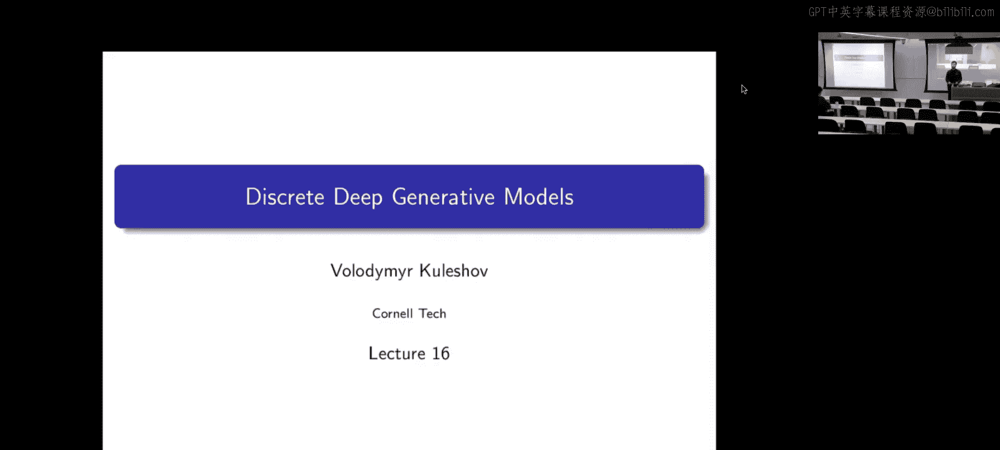
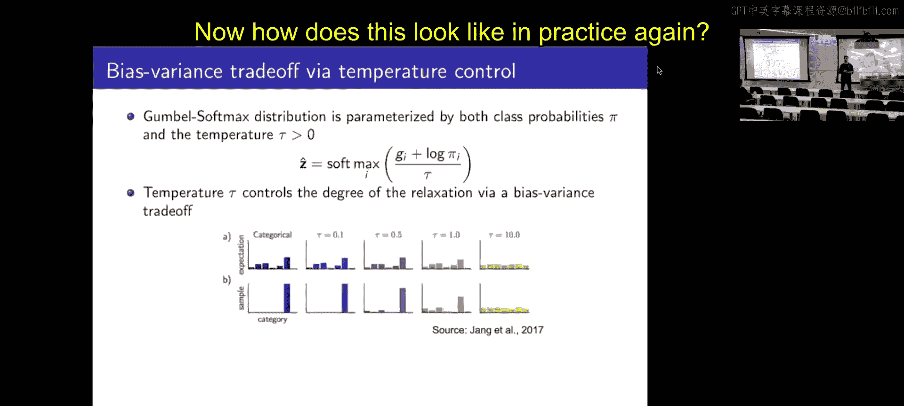
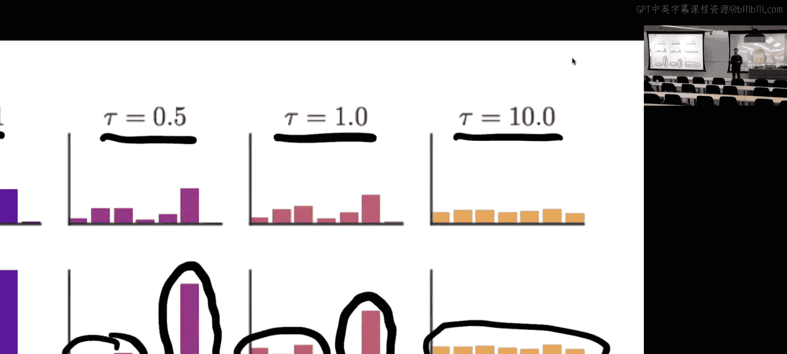
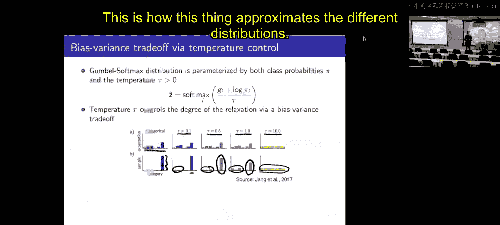
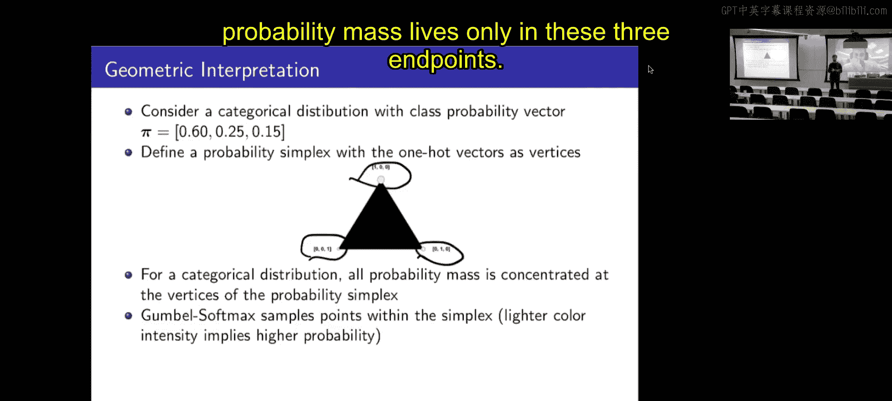
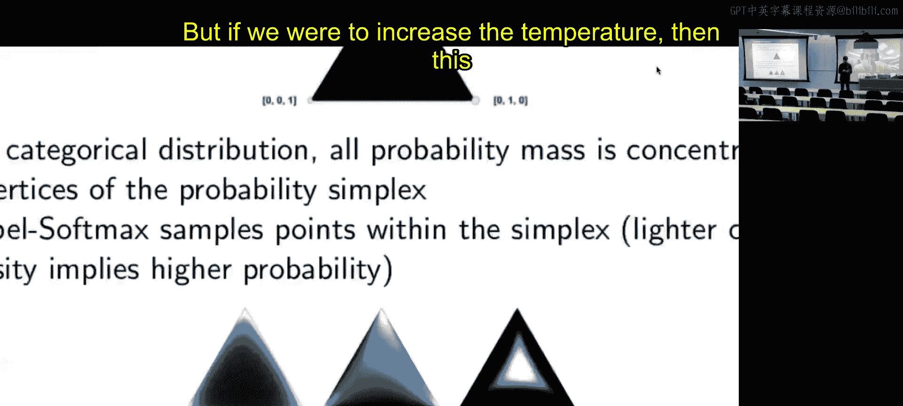
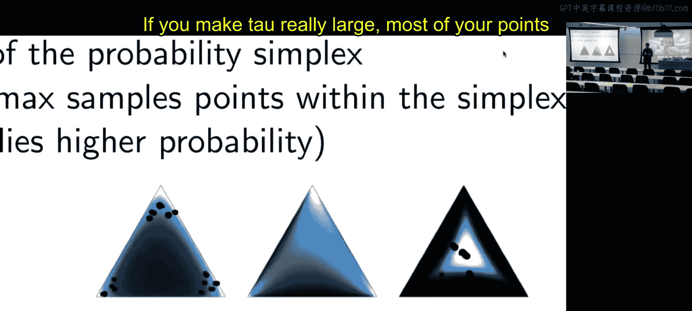
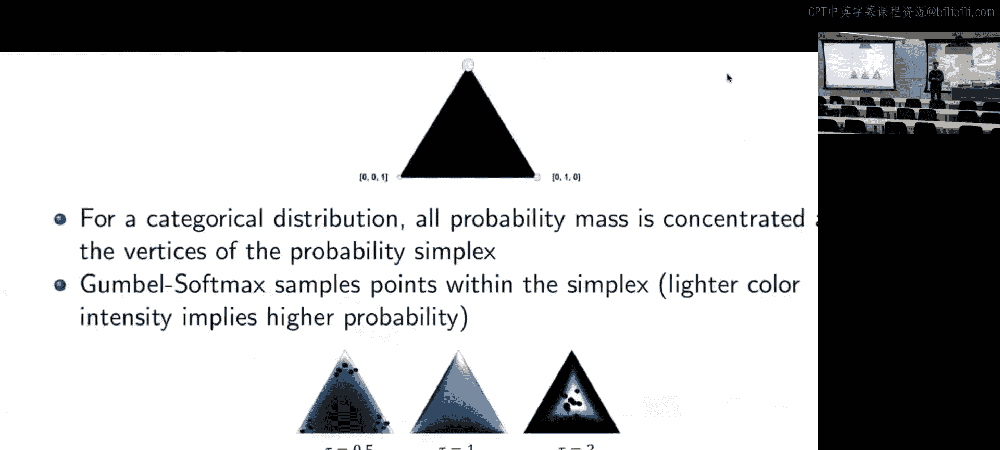
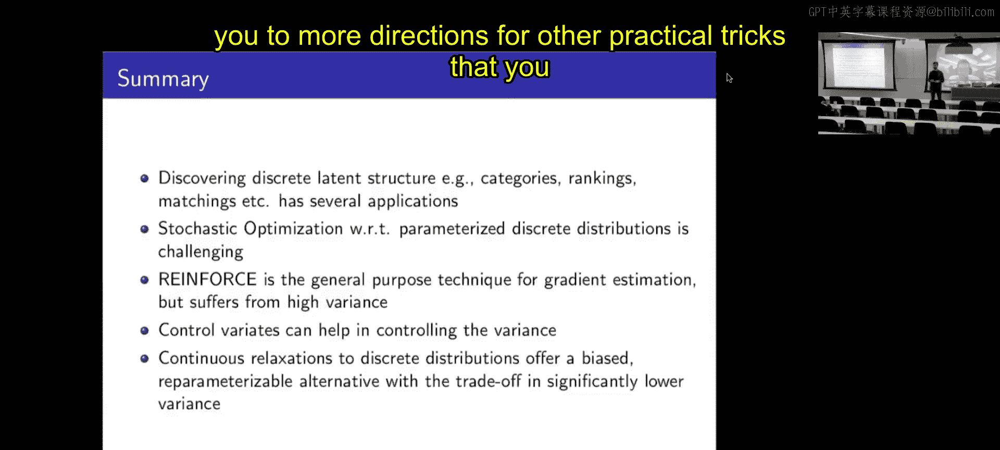

# 康奈尔大学《深度生成模型Deep Generative Models (Cornell Tech CS 6785, Spring 2023) 》中英字幕 - P16：-16-Lecture 16_ Discrete Deep Generative Models.zh_en - GPT中英字幕课程资源 - BV1az421q7Vf

We're going to be looking at a special topic ingenerative models， which is going to be。Again。

 this is part of my final set of lectures on several special topics in generative models。

 so we had a topic on evaluation， a topic on combining variant of generative models and today it's going to be on。

呃。The issue of discreteness in generative models。 So why is discreteness interesting and why does it merit its own lecture。

In a lot of the data that we're working with， we have inherently this aspect of discreteness。

 so for example， if you're working with certain types of data like graphs or DNA sequences， text。

 source code， representations of molecules， this data is often really different from the data the type of data that I've been using as my running example throughout the course。

 which have mostly been images。嗯。And if you want to model these kinds of data。

There's going to be some special issues that you will have to worry about and that's some of the things that I want to talk about in this lecture So that's one reason why discreteness is interesting。

Another that might be a little bit less obvious， but equally important is the fact that many latent representations that we would like to learn could also be inherently discrete。

Right， so these these two bullet points refer to two types of。

Generative modeling problems that we've encountered in the course generation。

And representational learning。In representation learning。

 discreteness might refer to the fact that you want to learn some kind of discrete binary concept。

 such as let's say， gender or some kind of latent parse tree that explains the。

The object that you're modeling or you might want to compress your image into or compress your input into a discrete latent code。

 so you might want to do compression， which has to be inherently histized。So in many cases。

 also these representations。Make more sense when they're discrete as opposed to continuous。

And so in this。Lure we're going to look at general algorithms for dealing with discrete street data both in latent space and in observed object space。

 so both in the space of X and Z。And the plan is that first of all。

 I want to spend a little bit of time defining what the problem of discrete gene modeling is and then we will talk about two important techniques and generative modeling that are useful for solving any sort of discrete discrete optimization problem that you might have one of them is going to be reinforce I alluded to reinforce in our first lecture on VEs but we're going to talk about it in a little bit more detail I haven't mentioned some important techniques that are needed to get reinforce working in practice that's going to be one topic of today's lecture and then。

I will talk about another technique called relaxed repairmetrictization or you may have heard of the Gombo softm trick if you've been reading a little bit on these。

 so this is going to be another approach that solves essentially the same problem is reinforced but in many cases it can give you improved performance so the other part of the lecture beyond this technique and I know that some of you are working with discrete projects I know there's a project on generating text using I guess either GNs or some kind of reinforcement learning type of models so these。

Approaches， I think， will potentially be really useful or at least being aware of this problem and being aware of these techniques will be really useful for any projects that you're working on that involve discrete data。

 either in input space or in latent space。Okay， so that's the plan。So as I said。

 let's first start by defining what is the problem of discrete？Optimization or dispute modeling。

For the purposes of this class。The problem of optimizing over discrete data or the problem of discrete modeling will be given by this equation。

So here I am trying to optimize an objective which consists of an expected value。

 and in this expected value， I have a parameterized model， which is a probability。

 and we're trying to take expectations relative to this probability。

So here Q ofhi is some kind of model， it's a function of some variable Z。

 and I want to take expectations。Of。I want to optimize the expectation of some function under the model。

 but the model is itself parameterized。By parameters sp and want to maximize pihi。

 So why is this interesting and why is this potentially hard？

So we actually saw one example of a problem of this form and this was the elbow of a VE if you have the elbow of a VE。

 remember this is the formula right， this is exactly what the elbow is。And here。

We have an expected value relative to Q， which is our approximate posterior。

And then the integra or the thing of which we're taking the expected value is a function of both Z and x。

And our goal is to optimize the elbow， or at least in standard variational inference。

 our goal is to optimize this elbow over two sets of parameters， the parameters。

 theta of the model which live here， and then the parameters of the parameters phi of Q。

This is the problem that we tried to solve when we did variational inference。

 and it's clearly an instance of the above formula。And if you remember， this was。

Not completely trivial to solve when we first studied this problem。As I said。

 there are two sets of gradients there are two sets of parameters here and each of them has their own gradient and the gradient with respect to the first set of parameters datata is easy that's because if we were to take the gradient of this relative to theta well we can flip the expected value and the gradient so I can put the gradient inside the expected value and now I have an expression that's the expected value of a gradient or the expected value of something and I can always approximate expected values using Monte Carlo so when。

We are。When we took the expected value， when we took the gradient with respect to theta。

 that was easy。 We just。Put the gradient inside the X and we apply it Monte Carlo。Now。

 oh and this is， of course， the formula that I just that I just showed you。

 so we do this and then we approximate the expected value using ingredients that's exactly what I just drew on the board。

我。IfIf we want to take gradients with respect to the other set of parameters， phi。

 then this was not immediately trivial。When Z is continuous。

 we saw one way of doing this using the reparmetturization chip。

So we reparametized Q and as a result as a result we obtain a formula that's similar to the one you see here。

 it's a formula that we can easily approximate using Monte Carlo and then we can flip the order of the gradient operator and the expectation operator because again the problem here is that now that。

We're trying to compute the gradient with respect to phi。 Now we can't。

We can't just flip the order of the expected value and the gradient operator because my gradient is with respect to the。

Yeah。Distribution。According to which I'm taking the expectation。 So now this。

This change of order of the operator doesn't work anymore。 And as a result， we saw two ways of。

Dealing with this problem， One was a first version of the reinforce estimator。

 And then we saw an even better way of doing it， which is applying the。呃。

The reparaitturization trick。嗯。So this is what we did with the elbow and my high level point here is that there are instances。

 there are many instances。Of this problem in generative modeling。

 and oftentimes it is not completely straightforward to solve this optimization problem。嗯。So。

In the first part of this lecture， I want to look at the reinforce estimator again and show you how it can be a general technique for solving optimization problems of this form。

So let's first quickly look at this。Let's first quickly。

Remember what this trick was when we first introduced it。嗯。And sorry， just before we do this。

 I want to mention a few more applications of this identity。In the context of an elbow。

 we could use the repermetturization trick， but sometimes it's inapplicable why would why would it be completely inapplicable Well。

 I guess there's two scenarios one scenario is that。

Sometimes the Z that we're trying to model could be discrete That could be the case of a discrete latent variable inside a latent variable model then we just cannot apply the reprometturization trick so a discrete V a V with discrete lant variables now can no longer be solved using the repermetturization trick you might not even call this a V anymore So we need a special method and also there could be other instances of this problem where Z is discrete I'll mention an example where we're talking about generating some kind of objects which are discrete right so this Q here could also be some kind of generator and we're trying to maximize the score of some set of generations for example well the example that I will mention in a moment would be something like a discretegan let's say we want to apply GNs but the。

Things that we're generating are discrete and we want to maximize the score。

 we want to I guess minimize the score of the discriminator under our samples。

 then F can be seen as the score of the discriminator and we want to optimize parameters phi such that。

This score is bad then this is again， another instance of this problem where F is non differentiable because。

It is a function of a discrete variable and also F could be non-diiable in the sense that let's say that we're generating some kind of text。

 but instead of maximizing the likelihood of that text。

 we're maximizing some kind of downstream nondifferiable score so for example there's a lot of automated metrics and natural language processing。

 their names are typically the names of colors they're called the bluemetric。

 the rouge metric for some reason it's always there's a Move metric。

 for some reason it's always a French color but these metrics they are handcrafted to evaluate specific properties of text。

 for example the blue score measures how good is a certain translation relative to the original there's another called Rouge which measures how good is a certain sentence in terms of being a summary of an original input。

And my point is that all of these metrics are non differentiable。

And there are there could be other non differentiable ways of scoring how good is the output or not maybe we maybe there is some general notion of reward or some general notion of score that we want to define over various discrete objects that we're generating and then and in those cases again。

These classical optimization frameworks that we've discussed are not applicable because our function F could be non differentiable。

 for example， these NLP scores are non differentiable and in those cases we would also want to apply some kind of more general technique than the repermetturization trick。

To optimize problems of this form and the reinforced trick will be one such general approach。Okay。

 any questions on this type of problem or the motivation behind reinforceforest？Okay， if not。

 then let's just remind ourselves what the reinforce trick is。

 So this is the essence of the reinforced trick in， yeah， in one line。

 Let's say that we wanted to compute the gradient of this。Of this expression relative to phi。 Well。

 we know by the definition of the expectation that this。

This this objective can be written as a sum over a different zs That's just a definition of an expectation。

 And now let's say that I wanted to compute the partial derivative of this expectation relative to some parameter phi I let's say I wanted to compute this particular expression Well I can apply the definition of the sum and do a little bit of algebra to define the correct formula for this。

Partial derivative because again， recall that I cannot simply change the order of the partial derivative and the expectation that's not valid。

I have to work out the correct expression with a little bit of math and algebra。

 so let's do that now。I want to compute this property。

I know that my expectation is a sum so I can write it as a sum and then once it becomes a simple sum。

 then I can interchange the order of the sum and the partial derivative operator。

 which means I get this expression so here I just apply the definition and now I apply the partial derivative operator to my function Q so that's just plugging in the above formula into the definition of the。

It's plugging in the first line into the second line。

And now I can apply a little trick to get an expression。

 to get an alternative expression for the highlighted term， here's what I'll do。

I'll divide and multiply by Q of 5。So this is valid because I'm just multiplying by one right Q of Phi divided by Q of phi。

 but this expression has the interesting property in that this highlighted term actually equals the log。

 well， it's actually the derivative of the log of Q of phi。So I can write it like this。

So this highlighted the， the derivative of log Q of phi is just。

So I can do this so far it's just applying the definition of the law and then what's interesting about this。

Other term is that I now have something which looks again like an expectation。

I have here a sum over different C and each Z has a weight Q of z， which is a distribution。

 so this is just an expected value over all possible c where the distribution is Q of z and the inside of the expected value contains the gradient of the log times step of C。

So what I have derived right here now is the correct way of changing the order of the expected value and the derivative operator。

 This is the correct way of doing this and this little。

Algebra trick is what we call the reinforced trick。The reinforce force greed trip。Okay。

 so now I have rewritten the gradient of the expected value as the expected value of the green。

And the reason that I want to do this is because now that I have an expected value on the outside。

 I can approximate it using Monte Carlo like we did in all of our experiments。Okay。

 so now let's use this trick and let's derive the full reinforce force estimate。

If I take this derivation for each partial derivative and I combine it into the full gradient。

 which is just the vector of all the partial derivatives， then I get the following formula。

 which is the reinforced formula。So similarly to how I can flip each partial derivative with the expected value and then there's a log that there's a green of a log that appears to site here I can flip the full gradient operator and。

When I put the order inside the Inte， I now have notes FMC。

 but I have FMC damaged grain of blog of Q。Okay， so this is the reinforce formula that we saw in our lecture on Britishwater courses。

And again， the reason why this is interesting is because after my。

G estimator is written in the form of an expected value。

I get compute it approximately by applying Monte Carlo， which is the second formula。

When I say applying Monte Carlo， again， what I mean is that I sample some points Z1 to Zk from Q and I approximate the expected value with the average or。

And now this gives me a validputable formula for the gradient of my objective。

 and I can now optimize my discrete non the objective using this。Okay。

 so this is gradientdiant estimation using the reinforce reading。嗯。And this is a very general trick。

 all that it requires is that we can take samples from the distribution Q and evaluate probaities under the distribution。

And it works for both the speed and continuous distribution。So as I mentioned。

 one application of this could be in discrete variable GNs。

 let's say that I want to optimize perspective。Then we can then it access the street。

So the objective for the generator is this， we want to maximize the score of a discrete。Again。

 we want to maximize the score of discriminator under the output of this B。

 but now that Z is discrete and if I'm thinking so P ofG is my generator， DOG is the generator。

 I have to take a gradientdiance somehow relatively this DOOG。

 now this becomes an instance of the above problem we can try applying this reinforce trick。

RightSince I have an instance of this problem， so since is these two highlighted。

Terms are in of each other， we can try to apply the reinforce trick to estimate gradients。

 and this is one way that people have studied for this one thing that people have studied for training。

This weekends， we need practice， these weekends are not。The very。

Successful general modeling approach， but this is one way in which these techniques work。

Another extension of this technique is as I mentioned。

 training other aggressive models with tasks like like text generation。

 where our goal is to optimize some downstream under fs or like flu or roe there again you have a generator。

 you have underf objective， you can use the reinforce re estimator in the context。So。Yeah。

 that's how it can be done and this has connections to reinforcement learning because。

The reinforce trade is something that originally was created to train policy networks and reinforcement learning if you know what that is effectively。

 you can view。呃。You can apply the trick also in reinforcement learning where the objective where the function Q that you're optimizing is your distribution over actions so it's your policy。

 it's distribution over actions that you want to take in a given statements and you want to maximize the expected reward under this model。

Under this policy and so the same type of optimization problem arise us there。

 and this was the original motivation for the reinforce estimate。

But you can also draw connections between the reinforce learning setting and the generative modeling setting。

 the sense that you can view your generator as a policy or as an agent， which。

Whose actions are to generate tokens， generate discrete tokens or generate discrete outputs。

 for example it could be generating words one at a time。

 and the ultimate goal is to maximize amount of board。

 see score for how good your generated text is or not therefore。

This technique from reinforcement learning equally applies to training a generative model if you view the geneative model as an agent whose actions are the things that are generate。

So in that sense， there are close connections between enforcement learning and geneative modeling。

And。It even goes beyond that， there are other techniques in reinforcement learning that I haven't mentioned。

 which are more sophisticated ways of estimating the same gradient。

 so today in practice in reinforcement learning， folks use more sophisticated green estimators of reinforce and they can similarly be applied to the problem that you see here。

It can similarly be applied to discrete generative modeling。嗯。

And this is along the lines of what you may have heard of if' you've been following the news or the literature on large language models。

 they tend to be fine tuned using techniques for reinforcement learning。

 and these are similar techniques that don't use to reinforce they use another more efficient green estimator。

 but the same type of problem is solved there as well。Any questions on these applications？If not。

 then I would like to now go back to the reinforce green estimator and。Give you a little bit more。

More， more material on， on， on that。 And in particular。

 I want to build on what we saw in the V E lecture and add additional components to this estimator。

 which will make it more reliable and more effective。So this is our reinforce estimator。

 this is our objective， this is our estimator for the gradient of this objective and。

As I said earlier， this is a Monte Carlo estimate that is a function of K random samples。

 therefore that estimator is itself a random variable as a function of the random variables Z1 to ZK。

 and when we view it as a random variable， we can ask ourselves what is its expected value and what is its variance。

We know that its expected value will be the correct gradient that is here。However。

 its variance will be non zero。 It will give us some estimate， some number that will be on average。

Cented around the true meaning。But the spread of this estimator around the true correct value can。

 in practice， be large。 And this is what we mean by the gradient estimator， having high variance。

So estimates of even though multipartral estimates of reads are unbiased， their variance is high。

And the intuition for why the variance is high is that the variance of the inte or the variance of the thing which we're taking the expected value。

Is in practice high if you remember the lecture on the size of Monte Carlo in lecture4 I believe believe。

 we had a formula for the variance of a Monte Carlo estimator and that formula was a function of the variance of the function whose value we were going to compute。

And in this case， the function of whose value we're trying to compute is this。

 whose expected value we're trying to compute this， what I just。W just highlighted on the slide。

And this involves a of appability。In high dimensions， these probabilities can be in practice small。

 Q of Z can be very small for certain reasons。And then when you take the log。

 it outputs a function that can be very close to minus infinity when this log probability is small。

So when we take。Logs of probabilities for small fluctuations of the probabilityability because the log is an eyote that0 that goes to minus theyity。

 when we have small values of Q we're operating near that eyotee so as a result log up Q can have high variance and the green of log up Q can have high variance and as a result。

 the variance of this estimator。The variance of the variance of this estimator will also be large。

 so even though it will be centered and the correct value the spread around the correct value will be very large and so in practice when you apply this to high dimension C it doesn't work very well it。

Doesn't optimize your model very well。 Your model will get stuck at a high value of the training objective and will not decrease。

And as a result， there are many techniques for improving over this standard degree for screen estimator。

I mentioned some more modern estimators in reinforcement learning on the last slide。

 so that's in entire literature， which I won't get the chance to talk about in this lecture。

 but there's also some standard techniques for improving reinforced estimators they don't want to talk about next and these estimators are often used in。

Applications of gender models， which。Evolve the weak se。Okay。

 so the main technique that I want to mention that can mitigate。

 that can partially mitigate this problem of hi varianceance is the technique of applying control variances。

Control areas is the important concept here。What is a control period？

Let me give you first a simple example that is a simple modificationification to the reinforce school which you see here。

So observe that if I were to take the lead force goal and if I were to add any constant P here。

 if I were to modify the multiplier of the gradient of the log of Q by any constant。

Then this will not change the expected value of my。Mefor green。So for any B that I add here。

 it doesn't change the expected value of the。好啲。It doesn't change this expected value。

 It is still correct。 It still gets us hope。Why is that the case here， I have a very short proof。

 So if I have。If I have the gradient of。If I have this expression。

 which is just the gradient of the log。P of z times any constant B now I can simply write out this expected value as a sum。

 I can take be out I can now use the fact that P of Z times gradient log of Z just by the definition log of the derivative of the log being simplified and now I get an expression like this that's the sum will receive times creating a P of Z。

I can swap the sum and the gradient operator because。

Because the gradient operator is a linear operator， I can do this。

 and now I'm taking the gradient of just the sum over all the Qs。

 which is just equal to one and the gradient of one is0， so for any B this expression equals0。

Therefore， I can always add this constant B and it doesn't change anything。

 it doesn't change the expect value， or changes variance， but it doesn't change the expect value。

So the Monte Carlo estimate using both this reward or using this scoring function and using this scoring function have the same expectation。

However， they can have different variances。And so。P is what I would call a simple example of a control area。

 when you put it into your function， it can significantly improve the training of your model if you choose it carefully because it will keep the same。

Expect the value of their grade estimator， but it will result in a lower gains。

So now let's apply so this is the high level idea of a control variant。

 I don't know if anybody has any questions on this or if the math is forward or if anybody has questions on this little derivation。

 I'm happy to answer questions。But if not， if we don't have questions， then I want to。

Give you the full version of the media control variant in the context of this。

General problems that we're interested in。So in its most general form。

 you can think of a control period as defining a modified scoring function app hat。

 whether that is the result of the original function app。Plus， this extra adjustment term。

 which involves two things， it involves this multiplifierier that I。

 which is similar to what I talked about， and then it involves an additional function。

 H of Z whose expectation I happen to know。And I add this expectation here on the side。

 So I'm going to essentially modify。5 see。Score function by two terms。

 one of them is a function of H Z and the other one is this special constant。

 which is in the expected value of Hs， so H Z will have to be something simple or come back to because we have complete expectation I'll come back to what H Z should be in a moment。

 but this is a more general initial portfolio。So the assumption is that we can compute the expected value and you can easily show that the expected value。

Of both the green estimator of F and F hat is the same。

 Well it's clearly the same because I'm just adding and dividing by this Htri of z。

So I'm adding H of Z， and then I'm subtracting the expected value of H and Z。

 So if I were to take the expected value of this term。

 it will give me zero because when some were all the possiblefuse。

This we cancel out with the expectation if I were to somewhere all the possible views。Stition。

 So the value of F hat and the value of F is the same。 But the Monte Carlo estimates。

Will be different。The variance of the material estimatess could be different。And you can see why。

By making one simple observation。Imagine if we took atriumacy to be exactly FmC。

So I think equals one。 and then I define Hs E to be an accuracy right so the optimal h star I think is。

F事。If I were to choose this optimal H star， then in my formula。So I'm going to raise this。

In this formula， if I make this choice， then these two terms cancel out and then my optimal。

Reward is just。This， so now I have。Now， my Monte Carlo estimate of FPA。

Equals exactly the expected value of h star， which is exactly the expected value of F。

 and I can get the correct estimate of my word with one Monte Carlo sample。

 which means that it has variance zero。Right， so if I choose this。

Perfect control variant at each star。 Everything cancel spells out。

 And my expectation over iPad pad is simply the sum。

Over a number of terms where each term is a constant and it equals exactly the value that I want。

 which is the expected value of and then this becomes the expected value of。的缝隙。

And because I assume that this is known by Monte Carlo estimator has zero variance， so in that sense。

 the optimal h star is the true evidence。Now of course， in practice。

 we can't choose this optimal h star because if we could。

 then we would computee the expected value directly and use that so we can't choose this H star。

 but it tells us that the optimal control variant is one which tries to mimic FM Z as much as possible。

Okay， this is similar to how in recational inference we would choose。

A Q that is as similar as possible to give a Zga N x。

 which is our trueior here our optimal control variant HR should be evidence。

So we'm going to try to craft some H， which would be somehow correlated with FC and if it's somehow correlated with FMC。

 we will get a reduced variance for our control area。Okay， so this is one application of control。

 This is one example of how a control variant might look like。

 and now let's use this control barrier let's see how this control variant can be used to train a particular type of degen model called a belief network or a sigmoid belief network。

So a soid belief network is essentially a V with a discrete lant space。RightRemember。

 I said that in many applications of latent variable modeling。

 we might be interested in having in discrete just intuitively。

 a lot of latent concepts in the world are not continuous， they're discrete， for example。

 you know maybe you want to know whether an objects present or not present in an image or you're going to model things like eye collar or hair color。

 there's only a discrete number well， and you can even argue， but it's with this。

 but there are clearly some properties that are naturally modeled by discretes how many people are present in the street example。

There are some discrete concepts that we want to learn and it's more satisfying if our models can reason in terms of discrete concepts。

 so this is what a belief network is trying to achieve。

 it is a B where the latent space is going to be discrete and instead of assuming that C is Gaussian。

Like in a regular me， I'll assume that C is a uniform。Cgorical variable。 Well。

 it's a vector of categorical variables， which means that it has some number of dimensions。

 And along each dimension， I have one of K possible values。

So this is the prior that I'm going to assume and then everything else can stay the same as anE。

 so my decoder P of x given T is going to be some parameterized distribution with parameters theta of psi。

 so theta is the parameter of a distribution of a P and psi is the parameter of the neural net that parameterizes the。

For data， which I just highlighted。This is great， for example， you have X given if x is continuous。

 if x is a。Fixbook data looking model is in a continuous distribution。

 then give of x given z can be a Gaussian， theta are the parameters of the Gaussian。

 and the parameters theta are a function of latetency variables， or if x is also discrete。

 then x can be a P of x given z can be the kind of categorical distribution。

 whose parameters are again some parameterized function of。走。

The eder is the same as the the regular E。And you can think of this similarly to how a V is an infinite dimension is is a。

It's a mixture it's a continuous mixture of an infinite number of Gaussians here。

 you can think of a belief network as a mixture of an exponential number of Gasians。

 one for each assignment to the late area。So how would we learn these belief networks？

Because our diseases are discrete， we can't apply the re parametermetricization。

Instead we can apply the reinforce estator， which is something that was done by this early work called Anviil from Deep Mind。

 So this was the paper that。They allowed to popularize the use of the lead for screen estimator for learning discrete variable discrete variable models。

 So what the。And what paper does is that it trains sigmoid relief networks with a modified objective where I have a scoring function F。

 which is the true scoring function F that I'm interested in。 So in this case。

 we're optimizing the elbow over discrete C。 So F by true objective is the elbow， which is just this。

And then An applies that control variant that I had in my earlier slide。

Or look at a very similar table。Eello， so it adds this extra term nature effects and some constant heat。

So here， H of X， you can think of。You can think of it as。

Or the term that the end of paper uses is input dependent baseline or input dependent control variant。

🤧Because my expectation is over the C here， I can add any function of X and because this is a constant C。

 then this is an example excuse me of that discrete。

l of that constant control period that I had in my very first slide。Right。

 so here I have effectively added a constant with respect to Z to my。Network to my objective。

 and it doesn't change the gradient for the reason that I had on my first slide on control areas。

Okay， so now this is the modified objective used by End build and now so I have these two control variances。

 constant baseline and input the the baseline。And both of these baseline can also be learned。

 So I said that the optimal control area is one that is。Similar to the true expect value of。

Of the thing that I'm trying to optimize so we can learn H and B by optimizing this。

Objective we can train the parameters side of H by minimizing the L error with respect F。

 and this gives me my。I into the independent baseline， so I do this music training。

I do this while I'm training my main networks Q&P by optimizing over refine data。

And so now the full gradient estimator。For this for。For the elbow is going to be this。

Reinfor estimator with these extra control areas and in practice， when you train these models。

 this is the difference between not being able to learn a signaligoid belief network at all and getting reasonable samples on。

Basic image datas。So these control variants are actually needed to get the green estimator。

 but to get the reinforce green estimator to do anything or latent dimensions greater than6。

So this is a useful tool to know。However， as I said earlier。

 the reinforce estimator is not the only tool that can be applied to。To learn and discrete models。

As I said， there are， in principle， more sophisticated estimators in real。

 and there is also a complementary approach which tries to apply ideas from the rerimetricurization trick for continuous variables which we saw in our lecture on these。

 so there' is another approach， which is going to try to apply these techniques to the discrete setting。

This is what I want to talk about next， this is the idea of applying relaxed wheat amateturtization tricks。

So what is this nature？Again， this is the problem that we're working with and sorry there's a question。

I'm just curious about the control variance ideas where they were they present before what was。

These ideas seem very much the same as the actor critic algorithms in RL。

What came first is it I mean seems like Nvil， the paper was in 2014。

 but the idea of control variances is that's kind of like a well-known idea and optimization in general and both a critic methods and thenvil used these ideas of reducing the variances with adding that baseline or was it fully an idea that was created inRL and was used for。

Generative AI afterwards。Yeah， that's a really interesting question。

 Control areas are the general idea in statistics。They're found in other areas of statistics as well。

 so there are， for example， control areas for important sampling estimates。

It' a it's a more general technique than just。Then even organization or。Sorry。

 then either reinforcement learning or general modeling， it's an idea that is stay ha old。Yeah。

 good question interesting question。具体。Okay， so control variance were one approach。

 But as I said earlier， this is。There are some。There is another interesting。So let's say that again。

 we have the same。Theization problem that we've been interested in。 And again， Z is a discrete。

When variable。Would a gramaturization check does not apply。And reinforcement learning。

 whether the reinforce trick is applicable in practice。

 it is a bit of a pain to get working well and it requires these extra patches it's the control areas and these patches require careful tuning and they require careful thinking about how to design them it's not it's sometimes not possible to design a good control variant that it's really hard so are there any other solutions？

Ideally， we want to use something。As simple as the re parameterametricurization trick where we just write our formula in a different form。

 and then we apply back propagation or we apply automatic differentiation in our favorite deep learning framework and we just get a grade freedom we don't even have to think about it。

诶。Unfortunately， it's not as simple in Z is discrete。

 but what we could try to do is when we have a discrete Z。

 we could try to relax this discrete Z into a continuous variable and then once we have a continuous variable。

 then we can apply our favorite remeturization trait。And of course。

 this is not going to give us the optimization problem that we want because we're actually interested in the sweet problem。

 but what we could try to do is we can start with a continuous variable and then start training with that and overtime as we're training with our continuous relaxation make that relaxation more tight and we gradually interpolate from a continuous variable to a fully discrete variable and so at the end of training we're going tighten our relaxation we're going to make Steve look less continuous and more discrete and we will ultimately end up optimizing something close to what we do。

So that's going to be the idea of relax with parametermetricurization。And I'm going to show you。

One way， at least one and a half ways， so one detailed example and one less detailed example of how this relaxation trait can yield life。

In order to give you the first example of the strip， I will need the tool。

 and this tool is going to be called the gumble distribution。

m so don't worry if you've never seen a double distribution。

 give you a formula and a bit of intuition， and then it will give you one important property of the double distribution。

 which is the key thing that we need to know about。

So first of all what is the gumble distribution well it's one of these distributions that is out there in statistics textbooks。

 this is the formula for the gumble distribution is this sometimes called the double double exponential distribution it is used in practice in applications like modeling extreme events。

I'm not going to dwell too much about the intuition of these parameters。

 It kind of looks like a Gaussian， but we have these two exponentials has these like。

You know beta parameters， which kind of look like the unique variance of a Gaussian and like you can control the center of the distribution data can control。

widthd of distribution， if you were to plot the distribution， you would see things like this。

Different。Dsities for the gobo softm。 So with different values of human data。And。

The main reason why the gunmbell distribution is interesting to us is that it can be used as part of this really non obvious trick for sampling speed variables。

So I'm not going to prove this， but this is a really surprising fact from probability theory。

Which says that。If we have a categorical distribution。With parameters by one to by8。Again。

 we call that the categorical distribution is just a distribution over a fixed number。Disre outcomes。

 so it's like distribution over the outcome of a dice scroll that would be in essence of a categorical distribution。

 for example。So let's say I have such a categorical distribution and let's say that I want to sample from it there is this one really surprising and clever way。

Of sampling from Z， which involves applying the gumbell distribution。

 And it's called the gumbell max parameterurization。So the way this trick works is as follows。

First of all， my goal is to sample a discrete。诶 see。

I can represent any discrete variable as a one hot employee right that's just what we normally do in machine learning when we have any categorical。

So let's just say for the sake of this。Nigvation that z is the one hot vector。

 and we want to sample one hot vectors using these class probabilities by one by two p。

There is one really not obvious sampling procedure that involves the gumbe distribution and it works as follows。

I start with my class probabilities， I take the log and I add a gumbell variable。

 a random gumbell variable。Do it。 So these are these Gs are I D gumbo variables drawn from the。

Uned no distribution。So I take my known log probabilities， my log by eyes。

 these are the class probabilities， I take their log， I add random bumble noise。And then， I think。

The max。Co， sorry， I think the a maps。And the A Max is going to be my plus。

The class that I clean was in。So I have the K numbers。I have k log by probabilities。

 I randomly perdbed them， and I have K perdbed numbers。

 I take the largest and the index of the largest is going to be the class that I will send。

So for each random draw of gumble distributions， I have a different max。

 therefore I have a different category。So the max is or the arc max is what defines the category that I have seen。

Right， and then I choose my Z to be the one hard encoding of。Of the category that I had chosen。

Does this sampling process make sense？Right， so I just start with my glass probability。

My class probabilities， I take their law。I add random double noise。

And I bit the index of the largest noise。Plusas， this will be the distribution of that largest index will be。

The same as the distribution of less under magneticver distribution。

This is the idea of the goal max trick， it's a clever way of sampling from mechanical categortyical distribution。

Now， why is this interesting， why did I show you history trick？Well， observe that this formula here。

 it looks a lot like3 parameterization。I have something that's a function of the parameters of my distribution。

 plus some random noise that's not a function of anything。

This really looks like the reparmetricurization trick remember for a Gaussian I had mu plus epsilon dyn sigma and epsilon with just randomoids here I have block p plus G and Gius sub randomoids so effectively what I have here is a type of reparmeturization trait for categorical variables。

Is there any problem that you see with the， I guess？Yeah。

 is there any problem that you see with this？Trick so far。 Can we apply this directly or。Learning。

We learning general models or is there anything that's missing？I'm assuming there's going to be some。

Like one hot argm these are non differentiable operations exactly so I have a rematturization trick but I still have a problem my my rematurization trick when I view Z as a function of log by it's reparmetized but it's not different because I have the one hot operator and I be amax operator so this is still not fully。

Soved， because it is。Because the ag max is not differentialiable with respect。

And this is where the relaxation idea comes in。What if instead of taking the one hot encoing and taking the art max。

 I took the soft max。And I took an approximate， well guess the softax will give me a vector。

So what if instead of taking me hard maxs， I took the soft Macs。

 which will give me not an exact 100 coding， but a soft 100。So what do I mean by this？

So this is my nondeable gunback， gunmbell max sampler。

 let's instead replace the art max with the soft Max。To get。The gumbell soft next sample。Right。

 so this is my gobe max sample， it has the hard Max， this is my go be stuff Max sample。

 and I have received。And ZI receives the softm。First of all， what is the soft next？So， this， this。

This here is the soft next。So it's an operator that has。An extra parameter called De ta。

So what happens here is that I have these scores GI plus block5。

 what the softmax operator does is that it takes their expected value， it adjusts。

 it divides the expected， sorry， doesn't expect it takes the x。

 it takes the it does e to the power of that thing and then it normalizes and divides each。

Each x provides the temperature to， and then it normalizes so that everything sums to one Okay。

 so here I'm here I have the formula for the highest component of the。Of the so nexts。

And the reason it's called a softm is that this temperature interpolates between taking a hard art max and taking a relaxation。

In particular， if I were to divide。By a tau that is very close to0 or in fact， as tau goes to0。

 this go this becomes an a。 So when tau equals0， all of these terms， all of these X terms。

 they go to infinity， but the term that is the largest goes to infinity faster than the others。

 and so the limit of this。Bector Zha when。Tal goes to 0 is a one hot vector where the one is at the index that correspond to the mass of the interest in the subm。

So when thou goes to 0， I get a hard max。 but when thou is non zero， I get some。三年。Some relaxation。

 I have。Some entries， which are so that the。I guess when x is better when that is not zero。

 I have a vector here， and this is going to be a vector with some numbers and。These are going to be。

So， these will。Someone。RightSo the some of these vectors。

 some of the entries that TA will sum to one， and the max will have the largest entry。

But it won't equal， it won't be equal to one exact。Right， so in other words。Sorry。

 on the previous slide， the taO is inside the exponential。The doubto is inside the exponential。

Yes so yes。It is basic。Okay sorry， oh， this this layer on display。But I guess yeah，好好。

It stuff for yeah is missing。Okay， but my point here is that the。This Z hat vector， it lives。

 so the original Z were all discrete street they were all。1 thousand for。

Right so let's say this is100， this is 00， this one is 00。

 so let's say I have three classes and these are the three possible factors that。

That correspond to these three plus now the now the Zhad vectors will live in the space that's between them。

 so they will so they will be。They would be mixtures of these different。

PointsSo basically the Zha will be a set of numbers which fall sum to one and that live in the convex hall of the art classes。

Okay， so now my Z hat will be a continuous relaxation of the。Ad variable Z。对。And also。

 the main benefit of applying to softmax is that I can now that propagate through the software。

I can differentiate yourself。So now that I have this variables have。I can。

Usee this variable as a continuous relaxation of the original z。And in addition。

 one that is fully reriized。So now the idea of the Nobel soft matrix trick for generative modeling is to take my original。

Cateorical。Sampler and replace it by the following soft sampler。

 which samples a variable Z hat that is a continuous relaxation to the original variable ZH。Now。

 how does this look like in practice again，' let's look at a few examples。

 so this is an example where I would like to draw from a real categorical distribution。

And then say that what you see here are the distribution of different pie。

 So if I were to take a sample from this， I will get some kind of。The speed sample from。

So this is going you might。Dpe。Category that I had sampled from distribution。

If I do the same thing with a reasonably low temperature that tau equals 0。5。

 I will get as my output， the vector where most entries will be tiny。So in particular。

 there will be some entries here which will be non zero and tiny。And this。

B vector or this one component will be really close to one， but it will not be close to one。

 but it will still be large at the index of the variable that I have sample。Right。

 so basically what you have on the left is the result of applying the combbell max strip。

And then on the right， you have the result of applying the Gound stop max tray and the output of the Gobe stop max tray is a variable ZAd where most entries are small and then one entry is really large which corresponds to the formats。

I can also take this further， I can make the temperature smaller。

 and then you can see that these small variables have almost completely disappeared and almost all of the weight is where my max should be。

Or you can also go in the other direction。 You can make the temperature larger。

 And if you make the temperature larger now。There's still most of the weight that's on the max category that we want to sample。

 but the Z hatD variable also has a lot of non zero components in the other dimensions in their order。

And if you make your temperature too large， then the output Zha from the conum sampler will not look like anything at all。

 it will just be a uniform distribution because now you have chosen a temperature that is too high。

This is how this thing approximates。

一份。Different institutions。Right， so again S I equals zero。

 we have samples from a categorical distribution and so what we could try to do now is to。Plug in。

 let see add directly into the elbow， for example， and try to optimize this function。

Advantage of this is that。If we have a small enough temperature。

 we will almost get a categor of air evolutions， we will almost be optimized for few months。

Now the problem is that we make our cloud too small。

Then we will almost have a discrete variable and if we want to try to back propagate to something that is almost an underfferfentable artrc max。

 a radiance will be varying。Large， and as a result， the green estimator will have high variances。

And so in practice， what you want to and of course。

 the other problem is that if the temperature is too large， then。

Our greening estimators will have low areas， but we will be sampling to the different distribution。

Its in practice what we will do is we will interpolate that for the course of learning and we will start with some very diffuse to see how can gradually make them tighter。

 we will gradually make the temperature smaller， make the approximation tighter and as a result。

 it can work quite well。This is again this geometric interpretationdation that showed you earlier。

 imagine we had three possible classes， then this see hat lives in the simplex or in the conve hall of the three hard classes。

And you can view the distribution。As。But a slaing weight you can view the ta is determining where to place weights。

Within the simplex， if t is very small or if t is zero and you have the categorical distribution。

 then the probability all of the probability mass lives only in least in these three end points。

But if we were to increase the temperature， then this blue region shows the parts of the input space where the Zhad are allowed to live。

So if you increase out， then you allow the sampling of points。Close to the edges。

 but within the simpleplex， if you make that really large。

 most of your points will be within the sink。

对。All right， and so let's look at an application of Googleumbbel Softmax。

One way to apply one place where gunmal suspects can be applied is in。These sigmoid belief networks。

 which I showed you。A few， few， a few moments ago when I defined the。

But I was getting an example of the reinforce estimator。

 so let's say that now we want to solve in an elbow。

 let's say FMC is the elbow we could do is we could replace。F by you could replace the C by C hat。

 and then gradually anneil the。第啲。一。🤧，Nemper during learning。 Now。

 one note here is that you practice this。We have to have an F which supports discrete approximations。

 which supports continuous approximations， so F has to support some continuous he had or some F。

It might not be defined for a relaxation of C hat， so this only works with objectives that are defined or it continuous relaxation。

If it's not defined， then we can apply a scization step in the forward pass and still perform this。

It still used the same grain estimator and the backwards best it to be insert regular approximationation known as the straight true green estimator。

去。You can get up until tell you more after the lecture。Okay。

 and so what is the result of applying all of this。 Also here， these are some。

Examples of the elbow as a function of dying for various green estimators。

 so for some of these estimators。I guess here I am looking for。This doesn't even how what I think。

So essentially， these are two versions of the。投时的。Of the softm estimator and then everything else。

 I think some of these should be really similar to reinforce in some of these other instances of this straight estimator that I mentioned。

But essentially in practice， the Google softmax trick works quite well and it's also quite easy to implement。

 you can just apply， you can just plug in that formula directly into Ptorch in for your favorite framework and then run the forward pass。

 you get degreess for free in the backward pass for in choiceice。So drivers it really easy。

So this is the gogg South next trick， and I'll just conclude briefly by saying that。Actually。

 this idea of。This idea that that I just described is much more general than just the idea of priorizing discrete variables there's a lot of other objects that we might be interested in。

 for example， there's a lot of other discrete objects that we can be。

That we might want to try to model， for example， peruts could be another object or maybe latent syntax trees are another discrete object we want to。

And in fact， for most of these discrete categories， trees， crafts， gramutations。

 all these discrete objects tend to admit a。Relax the parametermetricization trait that can be used to obtain grade estimators for these stochastic optimization problems when Z is that variable。

So just an example here for permutations is something called the pet loose distribution。

 so the pet loose distribution can be thought of as an extension of the categorical distribution to permutation。

 similar to how the categorical distribution is a。Is a distribution over。

Fixed classes or categorical variables， that at whose distribution is a distribution of aations。

And we might want to sample for from permutations as well， right， so there is a。A relaxation of。

The black loose distribution or those there is a sampling tray。

 there is a re parameterametized sampler for the pla loose distribution where we also perturb the scores of each element using gunbell noise and then we apply a sort operator。

And we can update and discrete per out of that。嗯。Again， this is me parameturized， but not。

Inferentable and similarly to how the softm can relax that hard。Differentiation step。

Can how it can how it can lead to。To a differentiable approximation to an undiiable objective。

 there is a similar relaxation that can be applied here to the applied system。

Okay so I'll just summarize all of this by saying that discrete making variables can even thought of it as its own special topic within geneative modeling。

 discreteness is found in many places， either the things that are're trying to model or in latent space and it has its own set of challenges I've just mentioned two important tricks in geneative modeling that address some of these challenges and there's any more if there's an entire literature on this so if you're working with any of this or your own projects。

 I encourage you to talk to me and I can point you to more it can start with these ideas and I can point you to more directions or。

Other。Iical tricks that you might want to use。

