# 康奈尔大学《深度生成模型Deep Generative Models (Cornell Tech CS 6785, Spring 2023) 》中英字幕 - P1：-01- Lecture 1_ Course Introduction.zh_en - GPT中英字幕课程资源 - BV1az421q7Vf

Hi and welcome to the online course on Deep generative Model at Cornell University and Cornell Tech My name is Vlaimir Kushov。

 and it is my pleasure to be your instructor for this course。

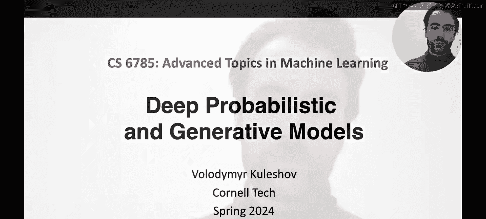

In this first video， in this first lecture， I would like to give you an overview of the course and give you some examples of recent applications of deep generative models that hopefully will convince you that this is a really exciting topic and hopefully will give you a flavor for the kinds of algorithms and methods that we are going to see in the rest of the course。

Before I start the main set of materials， I just want to give you a brief introduction of myself。

 I am an assistant professor in the Department of Computer Science at Cornell University and Cornell Tech。

 which is the New York City campus of Cornell University。

I really care about the topic of deep generative models because it is one of the main focus areas of my own research as well as the focus one of the focus areas of my research group。

 I am really interested in the development of new algorithms in machine learning and specifically within deep generative models so my group works on the development of new generative modeling algorithms and also we work on improving existing families of deep generative modeling algorithms and we also look at all kinds of application areas。

 these application areas range from some classic ones such as natural language processing or image generation and we also explore new application areas in various domains of science and in particular in biology it's another interest of mine and hopefully I'll give you throughout the course I'll be able to give you some examples of research problems in this。

across these areas that I find particularly interesting and motivating。

I also spend some of my time teaching such as this course。

 but I'm also really passionate about releasing a lot of my course materials with with the world if you end up watching this course and if you like this course please also check out my applied machine learning course for which the lectures are available on YouTube and you can also look at the link that you see on the slides in order to access both the videos and the course materials so I really encourage you to look at some of my other materials and if you find all of this interesting。

 please follow me on Twitter or follow me on YouTube and I'm sure you'll I'm sure you'll find I'll be releasing a lot of additional materials both for this course and for my other courses in the future and following me on social media。

Ias and Twitter is a great way of。Of keeping track of all of that。

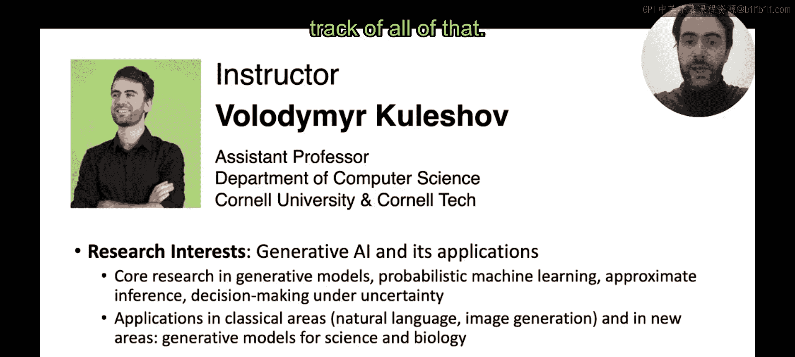

Alright， so this was a brief introduction brief introduction of myself now I want to spend the rest of the lecture on the core topics of the course and I would like to start by spending the next 15 to 20 minutes describing what exactly is the topic of the course。

 what are deep probabilistic and generative models。And。

What you see here on the slides is the title of the course。

And I would like to explain what this title means by。

Double clicking into each of the words that make up its title。

 make up its definition and hopefully by doing this。

 I will give you a better a better understanding I will give you。A rough。

A rough intuition about the kinds of topics that we are going to be covering throughout the rest of the course。

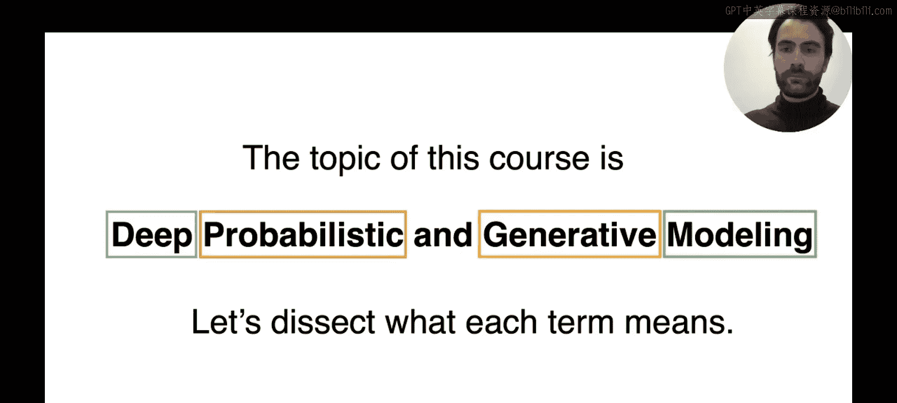

Alright， so the topic of the course is on deep generative models and the most important word there is the word generative。

This course will be about a particular type of algorithms that we call generative models。

 and the key defining aspect of a generative model is that it with is that it's an algorithm that deals with very high dimensional data。

High dimensional objects， high dimensional entities。

What are some examples of high dimensional data What do I mean by this。

You see here some examples on the slide。What you see in the top left corner is perhaps one of the most one of the most common types of data that deep generative models work with。

 The first example is high resolution images。 So you can think of an image as being a very large array of numbers。

 and a deep generative model tries to model and understand this data。 This high dimensional data。

And as a result models have generative models have capabilities such as being able to generate images。

 In fact， the two images that you see on your screen have been generated by a computer program using a certain type of generative modeling algorithm called a diffusion model。

 we're going to see diffusion models in the course and in recent years the quality of these models。

 the quality of image generation models has increased tremendously and as of this year images computers are able to generate really beautiful artistically compelling images like the one that you see on the screenshot。

Now another example of high dimensional data would be text。

This is the example on the right side of the slide。

Here you see an example that shows a snippet of code。

 which actually describes it's a small piece of code that implements one of the components of a generative modeling algorithm that we will see in the course。

 in particular this。Code for part of a diffusion model and code or text in general represents another type of high dimensional data because it consists of very long sequences of discrete tokens and so when we view that entire sequence as a data point。

 it corresponds to a very long very very high dimensional data point that contains many variables。

 many free parameters， and so a generative model that can ingest text data can also often perform tasks such as generating text。

 it can generate code， it can serve as a code assistant and it can also generate natural language and it can be used to power chatbots like chatGBT and so this is all to say that text is another example of high dimensional data。

Now， images and text are not the only examples。Human speech might be another one。

 you can think of human， you can think of a speech recording as being a very long time series that it's a time series in which each time point corresponds to an audio sample。

 and we have a lot of these samples。 In fact， we commonly sample at over 4 a common typical audio recording would have something like 4 more than 44000。

Samples per second， and so that is a very large number of data points per second。

 which results in a very complex， very high dimensional signal。

And a generative model can try to operate over that as well。

Another example would be chemical molecules， you can represent a chemical molecule either as a long string of symbols。

 or you could also represent it as a 3D structure， perhaps as a 3D point cloud or another type of 3D representation。

 and that again corresponds to a complex high dimensional input that can be modeled or that a geneative model will try to model。

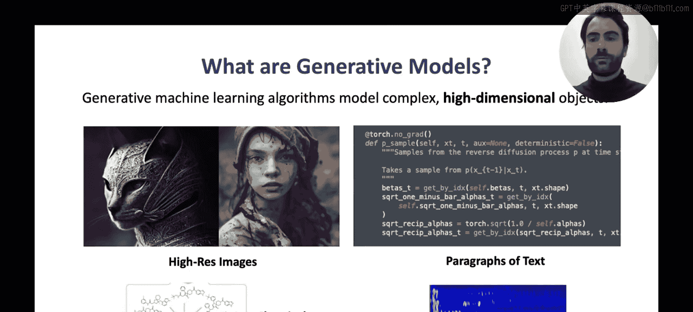

Now， another way of understanding generative modeling algorithms is to compare them against the other type of machine learning method which are discriminative algorithms or discriminative models。

In fact， most machine learning algorithms in use today are actually discriminative models。

A discriminative model can also operate over high dimensional data。

 but it does so in a very different way。Typically， a discriminative model would take the high dimensional data as input as a fixed input。

And it would then process that data point to output something simple。

 such as a class label or perhaps a small number， a low dimensional number。

 perhaps just a scalar that would correspond to a regression problem。

But the key point here is that in a discriminative model。

 high dimensional data is only a fixed input。However， in a generative model。

 the complex data is instead the output。You could even consider a generative model as。

RunningYou could imagine it as running the computational graph of a discriminative model in the other direction。

So for example， we might start with something simple， like， for example。

 the name of the object that we want to generate or perhaps just vector of a small vector of random numbers。

And then we would pass it through the computational graph in the other direction and try to obtain the complex data point as the output。

And the the work that is done in between， the computation that is done in between can be。

Prametized by different types of models， in this case， the distriive model。

 my example of a distriminive model is something like a convolutional neural network and we could also use a similar type of transpose convolution to generate the high dimensional data point in the bottom example。

But again， the key point here is that the。Complex high dimensional data is the output of the model。

 and that means that the task that we are going to try to solve is going to be much more complicated。

 It is going to be much more difficult to generate an image than it will be to classify an image。

However， the benefits of doing that are also going to be significant。

So it is going to be useful to think a little bit about the pros and cons of discriminative models versus generative models。

And also about their capabilities。In brief， a generative model can typically do all of the things that a discriminative model can do In fact。

 the main use case of discriminative models are supervised learning problems where we are trying to either perform classification or some form of regression。

In a generative model， we can also typically solve classification problem problems， for example。

NiveBase is an algorithm that you are likely to have seen if you've taken a machine learning course and it corresponds to a simple generative model that can be converted into a classification algorithm by applying a certain mathematical trick called Base rule。

So generative models can do the same things that streamminative models can do。

 but they can also do much more。Perhaps the most impressive use case of generative models is being able to generate new data。

 for example， we could ask for a generative model to create new images。

 images that it has not seen before at training time。Or perhaps we could ask it to generate images。

 but condition on some kind of input， for example， a piece of text that describes the thing that we would like to generate。

Or perhaps if we are in the domain of classification， we could perform classification。

 but on data where certain attributes are missing。And there's all kinds of other applications that are possible。

 for example， we could try to detect whether a certain data point is coming from our data distribution or not。

 that would be another interesting use case。Now， the kind of generative model that we will be studying in this course will be。

It will have a certain form。 It will have a certain。 we're going to focus on a particular type of。

A particular type of generative model and to better understand that I want to contrast the generative models that we're going to see in this course with another type of generative system that you may be familiar with。

 which is a graphics engine that may be used in your favorite video game。

 so perhaps the unreal engine or I don't know the Atari engine for generating simpleari for rendering simple2D Atari games。

 pick your favorite graphics engine。And I would call this graphics engine as an instance of a different approach to generation。

 which I'm going to call the rules based approach， and that will be very different from what we're going to study in this course。

So let's first try to understand the rules based approach and contrast it against the learning based approach that we're going to see in the course。

So you can think of a graphics engine as taking a certain specification for what the user wants to render。

 this is typically in some kind of programming language。

 and then it passes it through a system that was designed by a programmer that was implemented by hand by an engineer。

 a programmer and then the output of that will be some kind of rendering of the objects of the scene that we want to create。

And the crucial thing about this process is that the rendering engine is based on a set of rules that were created by the user。

So in other words， we have some understanding of the laws of physics。

 we know the way light is reflected on different surfaces and the way that it gets。

That it gets reflected by a mirror and the way it gets it passes through water or glass。

Based on these laws of physics， an engineer wrote down rules by which different textures and different materials should be rendered and they should appear。

 and this is the basis of how the graphics engine works。Now， in contrast to the。

Rules based approach of a graphics engine， the models that we will see in this course will adopt a learning based approach。

So what do I mean by this？Suppose I want to generate objects like bedrooms。 Well。

 instead of specifying a rules based system for how clothes or light should be rendered。

 we will instead give the computer a very large data set of images of bedrooms。

 and then we will ask it to learn from data， the rules that map an abstract representation of a of a。

OfOf the scene that we want to generate into the pixels。

And the reason why we want to do this is that this approach will ultimately prove much more scalable than specifying rules by hand。

 and in particular it will apply to new domains where it is not possible to easily create these rules。

 for example， in biology or perhaps for code， for language I don't know for audio， for human speech。

 it is really hard to write by hand， rules for how human speech looks like。

 but instead we should be able to learn these things from data。Now， of course， some degree of。

Of human knowledge will always be necessary， we will have to choose we will still have to define the learning algorithm in some way。

 but along the spectrum of how much manual handcrafting is needed。

 the algorithms in this course will be based as much as possible on learning as opposed to manual rules- based specifications。

Now， in order to better understand the difference between a statistical approach and a rules based approach。

 let me give you an example of how a probabilistic approach might be implemented in practice at a high level。

So in this course， the generator that will， for example。

 generate images will not look like a human engineered black box。Instead。

 it will be defined by a probability distribution。嗯。

We will define a probability distribution over all the kinds of objects that we would like to generate。

 for example， over all the possible images， and then we will generate by drawing samples from that distribution and if the distribution places mass at the correct parts of the high dimensional space if it places mass over things which look like images。

 then by drawing samples， we will generate new images。

That is the high level overview now double clicking with just a little bit more detail。

You can imagine the algorithm that outputs the probability that outputs the probabilistic generator。

 that algorithm will always have a certain structure in our course。

 and it will always be consisting of the same three components。And in fact。

 these three components are also the same that would be shared by most machine learning algorithms。

So these three components are first and foremost， the model family。

 So what kind of probability distribution are we considering to output。

And there could be many kinds of types of probability distributions that we might be interested in。

For example， a Gaussian distribution is a particular type of simple parametric distribution。 However。

 the probabilities that we will be interested in working with in this course are going to be much more complex than a Gaussian distribution。

 They might have millions， hundreds of millions， maybe even hundreds of billions of parameters in the largest cases。

 but they will still ultimately be clever parametermetricizations of a certain probability distribution。

Okay， so these are this is the model or the model family。Now， if we have a model family。

 we also need to choose a particular set of parameters。

 We need to choose a particular model that represents a good distribution that fits the data well。

 And in order to do this， we need to specify an objective function or a learning objective that tells us whether any given model。

 whether any given set of parameters happens to fit the data well。And we will see many。

 many objectives。 In fact， again， if you're familiar with machine learning。

 then you are familiar with simple objectives such as the mean squared error for a regression model。

 or the cross entropy for a classification task here because we are fitting a generative model。

 we will have to develop learning objectives which are suitable for the tasks that we're interested in and this course will introduce several different objectives which define different learning algorithms For example。

 maximum likelihood is a famous one， but there's also other approaches， for example。

 that are based on two sample testing or score matching and there's others as well。Now， finally。

If we have a learning objective and a model， we still need a way to select the set of parameters that maximizes the objective or optimizes the objective。

And that is the goal of an optimization algorithm。Now， oftentimes the algorithm， in fact。

 in most cases。Exactly optimizing the learning objective will be intractable。

 and therefore we will resort to all kinds of approximation techniques which range from stochastic gradient descent to more sophisticated approximate probabilistic inference algorithms。

 the most famous of which are variational inference and Markov chain Monte Cargo。

But these are details at a high level， any learning algorithm。

 like the ones that we are interested in working with in this course will be defined by three components。

 a model， a learning objective， and an optimization algorithm。Now， once we have defined an algorithm。

 the process for using that algorithm will look as follows。

We are going to start by collecting a data set which again the data is what describes the objects that we want to generate。

 for example， this could be a data set of images or bedroom images。

And then we will also specify a learning algorithm。

 which essentially means us specifying these three components that we just described。

Then once we run the algorithm on the data set， the output will be this probabilistic model will be this probabilistic generator that that I。

That I mentioned earlier。And once we have this probability distribution。Wwhich by the way。

 can be either defined explicitly or implicit， we will talk about what this means later in the course。

 but once we have this distribution， now we can sample data points。

 we can sample data points from the model which will correspond to the generation of new objects。

Now in addition to drawing samples from the distribution， we can also solve other tasks， for example。

 we could ask the probability for we could ask the we could try to measure the probability of a certain data point and that could help us understand if a new data point looks like。

Like it could have been part of our data or not， this is a form of outlier detection。

 we can also fill in missing values in our data， we could perform all kinds of manipulation。

 we could try to rearrange the bedroom in different ways these are all interesting tasks that we can solve once we have a probabilistic model of the data and so this is also why the models that we are going to be working with are going to be called probabilistic generative models。

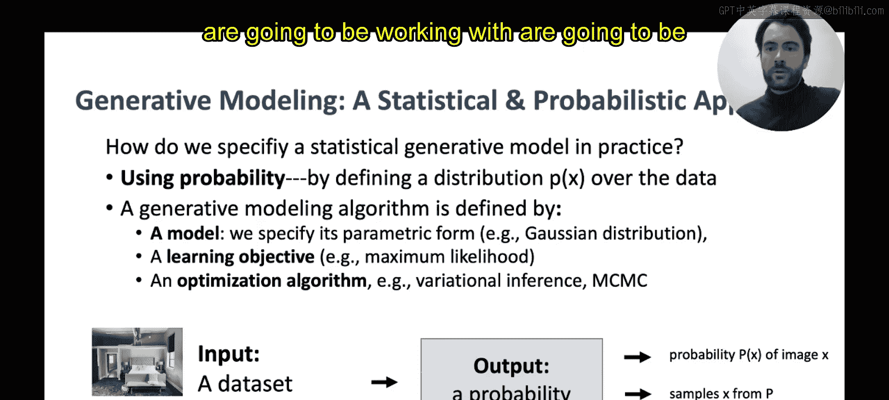

And finally， the last word of the definition of the course into which I want to double click is the word deep。

The reason there is a reason why this course is called deep probabilistic and generative models。

It is deep because the probabilities that we are going to be working with are going to be almost always defined by deep neural networks。

 they will be parameterized by the deep neural networks。

 so the parameters of the distribution are going to be the parameters of a neural network that describes that distribution。

So here I have， of course， we are going to see many of these neural networks in much more detail in later lectures。

 but just to give you。Just to give you a very rough sense of what I mean。

 this is a figure that describes a convolutional architecture that takes as input a。

A random set of random numbers and then it outputs 64 by 64 by3 tensor which corresponds to an image that we want to generate。

 or it could also correspond to the parameters of a distribution over images that we want to generate and and so when we draw random numbers we get images at the output effect in the way that these images are created is by following this convolutional process that is defined by our architecture so we are going to see a lot of models of this form and the reason why we are interested in deep neural networks is again because we are interested in building very complex。

 very expressive models that can fit the high dimensional and complex data that we have。

If we had simple scalar data， we could perhaps work with a with a。Simple Gaussian architecture。

 with a simple Gaussian distribution， but here we are trying to model very high dimensional complex data such as images。

 and therefore we need a very expressive probability distribution that can place probability mass precisely at the images that look like good images and this is why we need to resort for deep neural networks to take advantage of their expressivity。

Alright， so this summarizes the。Key terms that define this course。

 deep probabilistic and generative modeling， hopefully now you are starting to have a sense of the kinds of topics and the kinds of algorithms that we are going to be exploring later in this course。

Now， next in the in the remaining maybe 20 minutes， I 2025 minutes， I would like to。

Dive a little bit deeper into applications of deep generative models and give you an overview of all kinds of generative learning algorithms which frankly。

 I think are very impressive and hopefully will also help convince you that deep generative models are really interesting and worth studying。

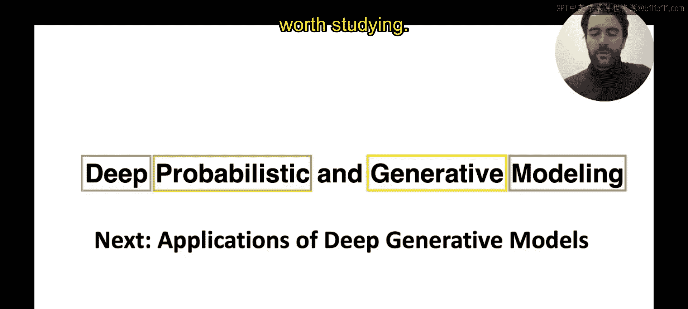

So the first set of examples that I want to give you are examples of generative models over images。

This is perhaps the most flashy and some of the most impressive set of results that we could obtain from generative models。

And these image generation models have applications in domains such as computer generator art。

So here you see some examples of images that were generated completely automatically using a computer algorithm。

These are really beautiful， really striking images it is also really I think I think it's also worth noting that the quality of these images has progressed immensely over the last several years in fact I have to regularly redo these slides because the field is changing so quickly only a few years ago the best thing that the best kind of image that a generative model could produce was perhaps a pixelated human face or simple digits or you know little little house numbers now especially over the last。

12 to 18 months。The field has progressed immensely。

 and current models are able to produce extremely sophisticated， extremely compelling。

 artistically compelling images， like the ones you see here。 Now。

 this particular images come from a system。 They come from a service called mid journey。

 the way mid journey works is that you provided a text prompt。

 and then it generates an image for you。 And so the image in the middle of the one with the cat。

 It was obtained by feeding to the model a a。😊，A prompt which roughly looks like what you see at the bottom of the screen。

So again I think this is extremely fascinating， here is another example of an image that is obtained from a different wellknow text to image model called stable diffusion here。

 stable diffusion， here we fed to stable diffusion the prompt that you see at the bottom and it produced this really interesting work of art that you see on the screen。

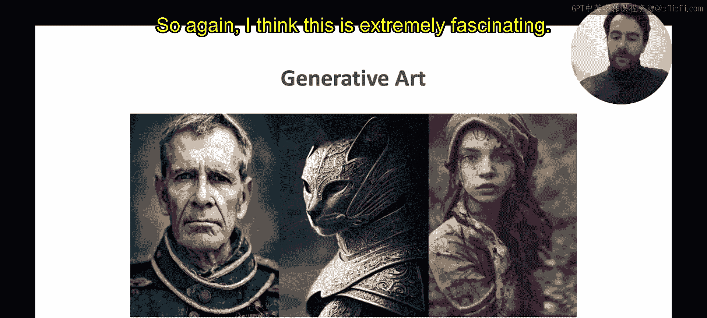

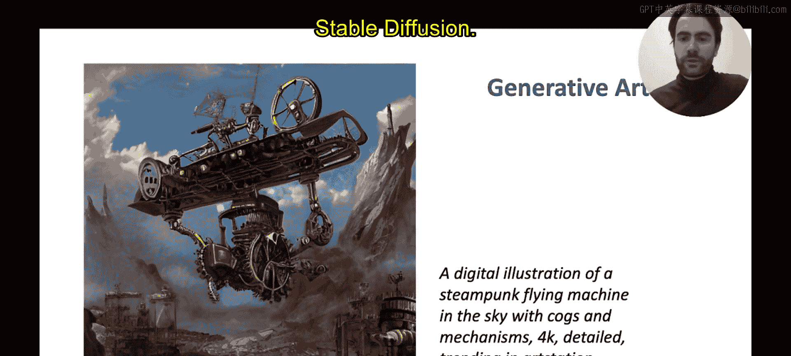

I will also add that what is fascinating about these models is that they are able to combine concepts that they have seen in the training data in completely novel ways that are not present in the training data so for example。

 when we generated the image of the cat wearing armor the image has seen cat has seen images of cats it has seen images of armor but on its own it was able to combine them in novel ways and create this cat wearing armor and this is a really fascinating emerging properties of text to image models that we're starting to see when we train them on a large scale and yeah I just think this is extremely fascinating and interesting and yeah it tends that these models are learning something important and useful。

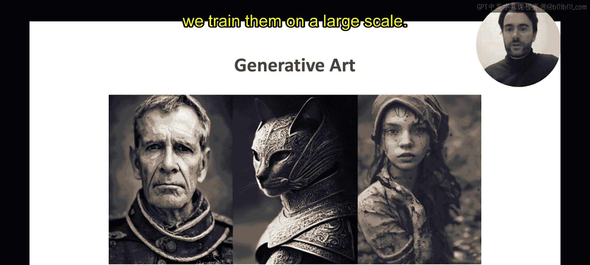

Now， image generation models and gene models more broadly are not just useful for applications like art。

 they're also useful and very practical down to Earth。呃。

Signal processing problems like the ones that you see on this slide。And also， by the way。

 these images can be。Conditioned on data that is also equally complex， for example。

 they can be conditioned on another image， which is also what happens in this slide。

So this slide shows an example of a particular signal processing task called image enhancement or super resolutionolution on the left hand side。

 you see that we start with very with a relatively simple pixelated image with a very pixelated image of a human face and the model is able to recover the high quality face。

 well it's able to recover to a pretty good degree the high resolution face from which the pixelated version was obtained。

And you also see an example of this on the right where we start with a blurry image。

 but then with a blurry and lower resolution image。

 but then the neural network and the generative model is able to fill in all kinds of interesting details and textures and recover the high resolution image。

Now these kinds of models have interesting applications in fields like compression they can if you have a good super resolution model。

 you could also have a good algorithm for compressing certain kinds of images and you could also have these algorithms also find applications in areas like microscopy they're often used to also enhance other types of signals such as MRI data and more broadly here my point is that there is a broad set of tasks which I would call signal processing and a generative model can typically improve all kinds of signal processing tasks。

 if it can learn about the signal that it needs to produce then it can often produce higher quality signals or it can perform interesting types of manipulations on existing signals and therefore it can enhance all kinds of data processing signal processing pipelines。

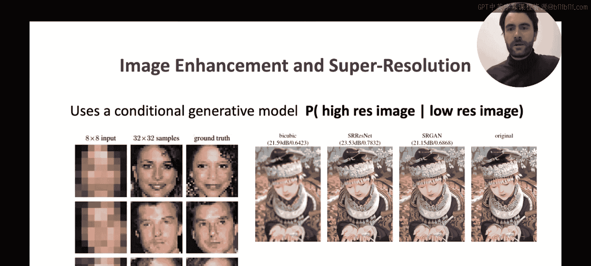

Now， another important example that I want to highlight。

 which now I would say it comes from a different family of algorithms from I would say this is a different type of example。

 I call this type of application in general representation learning。So。

What do i mean by representation learning。You can use generative models to create images。

 but you can also use them to better understand images。

 you can use them as very sophisticated unsupervised learning algorithms。In fact。

 typically a generative modeling algorithm has the ability to not only generate images or to decode some small random vector into an image。

 but it also has the ability most generative models many generative models have the ability to encode an image into some kind of low dimensional vector。

 which often carries semantically meaningful。Some kind of semantically meaningful knowledge。

 some kind of interesting knowledge about the image。

 and I refer to this low dimensional vector as a representation as a learned representation。

 we could also say a distributed representation or vector based learned representation of the image。

And the reason why these representations are interesting is again。

 because they can help us learn something new about the data。

We will often find that similar images will tend to have similar representations and the structure of the vector space of representations will also carry important information about images about whatever data we're working with。

And this is useful both for understanding the data and also for performing。

Interesting tasks over images such as manipulating them or playing with their attributes。

 and this is the example that you see on the screen。

So what you see here is an image that has been manipulated by playing with its representation in the high level representation in the semantic representation space。

 so one way in which this or I guess many many gene modeling algorithms work as follows。

 given an image it is possible to encode or embed the image as a vector in some kind of high dimensional semantically meaningful vector space。

 which is what the green rectangle here represents that is its vector representation so it's a row of numbers。

And similar images or images with certain properties will be placed in certain areas of the of the vector space。

 and we can often find certain directions in that vector space which correspond to。

To certain attributes of the image。 or if we are in one area of the space。

 we could try to move towards another set of images， which or another subspace of images。

 which contain certain attributes。 And then when we move towards that direction。

 the image will gain certain attributes。 So， for example， by playing around with the vector space。

 we can often find an interesting direction， like， for example。

 we can find a set of images which contain glasses。

 And if we move our our green representation of the image towards the images that have glasses。

 And by that， I mean that we add the vector that we add the delta。To from from a delta which points。

 we add a vector which points in the direction of having glasses， we add that to the green vector。

 and then we generate an image from the new representation。

 which is the sum of these two vectors that we will typically have。A person which。

 which carries which has glasses。 And then we can similarly find another direction。

 which corresponds to the person having a smile。 And if we add that， then we also add a smile。

 So now we decode from the sum of all of these vectors to sum of these three vectors。

 and we now have an image that has a smile， and we can similarly generate a person with curly hair by finding the curly hair vector that modifies it。

 So being able to learn representations is interesting because it enables a certain interesting kind of semantic manipulation of images。

And more broadly， representation learning is a form of unsupervised learning and by inspecting the data in the semantically meaningful space。

 we can also often discover something interesting about the data。So for example， if we。

 if we were working with。Perhaps genetic data that describes cancer tumors。

 if we could embed that data into a high dimensional space that is meaningful。

 we could then inspect different clusters of tumors in that data set。

 and we might find that tus that have a similar representations。

 similar presentation they also share some kind of biological mechanisms， and they might。

 as a consequence， respond similarly to a certain type of cancer treatment that other tumors might not respond to so we could use。

If we could use information， could use knowledge that is learned via representation learning。

In this example， we could use it to perhaps design better treatments for cancer。

if were if we were to deal with cancer tumor data， just as an example。

So representation learning is another interesting is another important application of generative models。

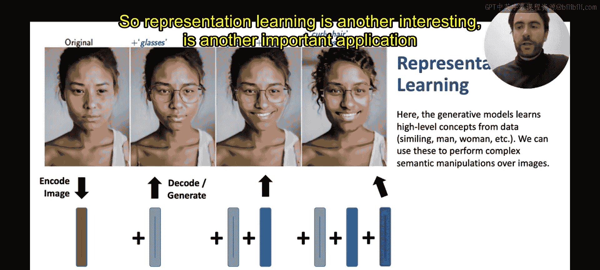

Now， generative models are also， they， as I mentioned earlier， they are applicable。Beyond images。

Here I have some examples of a recent generative model over audio that was released by Google DeepM。

This is an image this is a model that generates audio from text。

 so it's a text to audio model similarly to how the previous models were text to image models。

So here。The prompt asks to generate a fast pace soundtrack for an arcade game。

 and now if we listen to this， we hear something like this。Cool。

 so this really sounds like what the user was asking for。And if I， if I similarly。

If I similarly give it the description of a paintinging， then we can get something like this。🎼我跟你。

🎼やて도さま的い。So this is an audio cliplip that was generated to fit this famous painting by Arrimatiz。

 again I think this is very impressive， very cool。

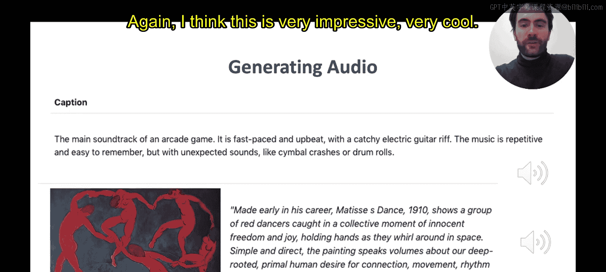

Now， just as in the example with images。Geneerative models over time series like audio can be used beyond just simple generation。

 they can also be used for signal processing。 In fact。

 there is an analogy of the super resolution task that I mentioned that I mentioned that I gave you for images in an earlier project a few years back we worked on an extension of the same task for audio data so we wrote a paper on audio super resolution and so here the idea is that we start with a high quality signal。

 we subsample that signal to only take a quarter of the samples in the original data。

 which means that we essentially throw away the high frequencies of the signal and then we use a neuralNe to reconstruct back the original high quality high dimensionsional piece of data and we get something which looks like this so this is the low resolution data。

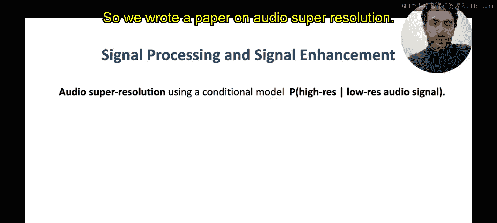

One is investment， one is reform。And now this is the high resolution reconstruction。

One is investment， one is reform。So I'm not sure how the quality translates over the video recording。

 but there is a pretty noticeable improvement in quality between the two signals。

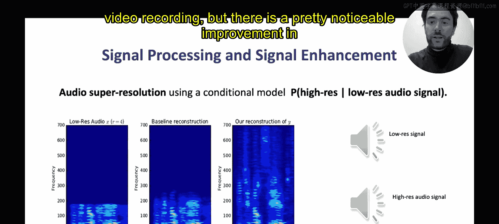

Now， again， this type of signal processing and signal enhancement。

A type of model is applicable beyond just audio and images it is applicable to all kinds of domains here is an example of a perhaps slightly less common but also equally interesting application。

 so we actually also worked on applying the exact same model to genomic data。

Where you can view a certain type of genomic assay called Chipssek or chromatin immunoprecipitation sequencing as collecting a set of measurements for various positions in the genome。

 so you can view the result of a chippssek assay as a long time series that's indexed by the genomic position and at various positions we have a set of measurements。

And similarly to audio， you could have a high resolution。

 you could have a high quality and a low quality chippsseick measurement。

 And here we trained the same model to reconstruct high quality chippsseig data from low quality chippsseq data with really good results。

 So this is just another example of how。Of how。Genative models go beyond just generating cool sounds or images。

 they can also be used for very practical signal processing and signal enhancement type of tasks。

Now since we're on the topic of biological applications here is another application in drug design。

 in fact I would say a lot of researchers right now are extremely interested in applying generative models to drug design so the model would generate a molecule with certain properties。

 for example， it might bind to another molecule which then would hopefully influence some pathway or some biological process which might help alleviate some kind of disease。

 so the creation of these models， the creation of these molecules is also being studied in the context of generative models。

 it is being studied using generative models and there are。

So this is a screenshot it's a screenshot from a model called Chroma which was developed by a company called Generate Biosciences and the output of this model that you see on the right is a protein backbone and it generates this backbone through an inter refinefinment process where initially it just starts with a set of positions and of atoms in3D space and then it gradually moves these atoms until it arrives at something which looks like an interesting molecule。

So this is yet another application of。Of generative models。 And， of course。

 there's many more famous applications in。In in biology， you might have heard of Alpha fold。

 which was a big breakthrough by Google Deep Min a few years ago。

 it was a model that was a huge breakthrough in。In protein folding。

 you can even view that as a type of generative modeling problem where we start with a string that describes the protein。

 and then we try to generate this complicated3 D structure using。A pretty complicated model。

 but this model also by the way， involves a kind of iterative refinement step that is in some way reminiscent of the one that you see on this screen right now。

Now， of course， I have to also mention text as an extremely important application domain of generative models and I'm sure all of you by now have played with ChadGT。

 which is a model from OpenAI here I have a screenshot of the kinds of things that the model can do here the user is asking to find a bug with a piece of code and then the model is able to provide a very detailed response to why there is a bug in this code and what's interesting about this model is that it was trained I can describe very easily how this model works。

 it is essentially trained at predicting the next word in a sentence， given all the previous words。

But when you take these simple， predictive models and you scale them to a very large amount of data with very large computers and very large models。

 you start to observe this extremely interesting， this extremely sophisticated behavior where the model is starting to do things like answer questions or you know follow well。

 it can can generate very elaborate， very very sophisticated stories and。It can generate code。

 it can perform retrieval， it can answer questions， very， very impressive。functionss。

This is another perhaps more frivolous but frivolous and amusing example。

that I found on the internet here the user is asking to write a biblical verse in the title of the King James Bible explaining how to remove a peanut butter sandwich from a VCR。

 and I encourage you to you're welcome to read the output I think it is quite amusing and you can find many kinds of fun。

 many kinds of funny or amusing applications like this， on the internet。

 there's people that are asking ChedGBT to write sonnets。

 Shakespeare it can do ChedGPT can do rap battles， there's all kinds of very amusing things you can find out there。

Now， again， just in the same。Along the same vein as I was discussing。

 you can also train geneative models to generate text not unconditionally。

 but instead conditionally on another piece of text。

 and this is how modern machine translation algorithms work， machine translation systems。

So you can think of a machine translation system as a generative model that generates English text。

 condition on Chinese text。So this is a screenshot from a blog post that was written by Google。

 which describes their machine translation system。

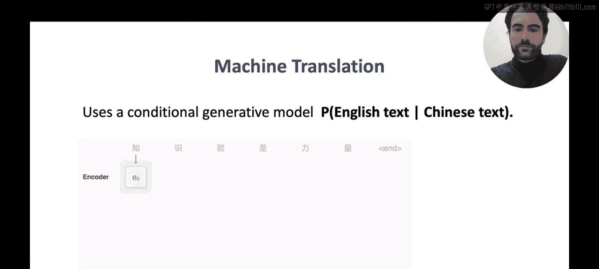

嗯。This is another interesting example which does translate。

 which which shows that we can do translation not only over text， but also over images in some sense。

 so this is a model that translates a video or an image of a horse into an image of a zebra keeping everything else the same。

And it can also go the other direction， can generate a horse from a zebra。

Now what's fascinating about this example is that unlike in the previous example of text translation。

 the model was trained without paired data。So if you look at the Chinese to text example。

 the model was trained on a very large corpus of Chineseese and text。

Pried sentences where each sentence has the same meaning。

 and so the model just learns to map the version the same thought in Chinese， it maps it to English。

Here we obviously don't have paired examples of horses in zebras standing in exactly the same pose。

 we just have a large data set of horses and a large data set of zebras。

 but there are very creative ways of applying generative models to go between the two and translate these images as you see here。

 so this is using a clever idea called cyclegan consistency。Cycle consistency。

And the resulting model is called the cycle again， we're going to see this in a few lectures if you're interested。

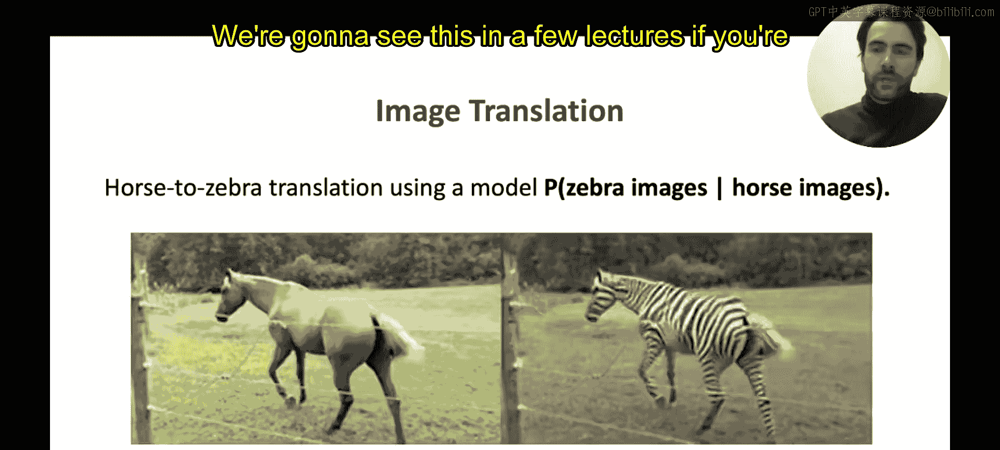

This is another amusing example of translation here， this is doc to catth translation。

 you look carefully at each pair of images。It is just the same animal looking。

Add the camera in the same with from the same angle。

 except that it has been transformed from a dog to being a cat。

It's also one of my favorite and amusing examples of generative modeling。

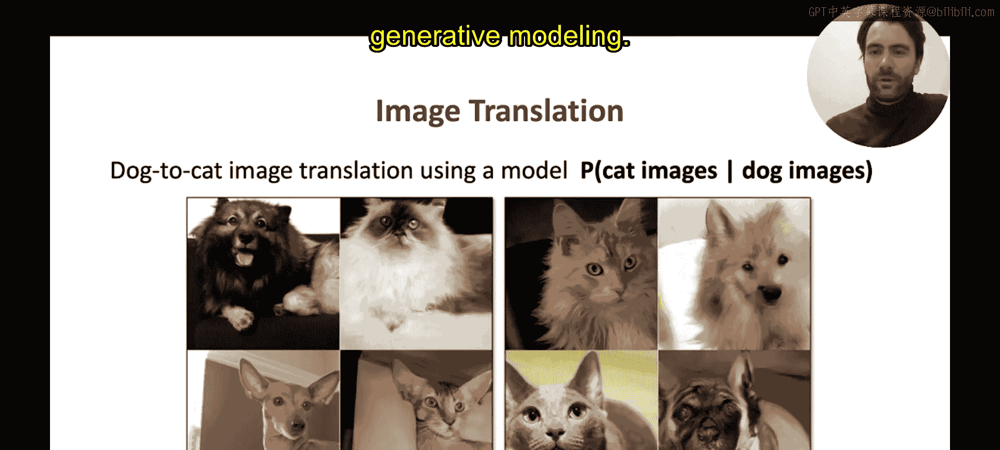

Now， the last big bucket of applications that I want to highlight is decision making and planning。

One of the promises of generative models is that they can enable intelligent agents that can perform complex series of actions in an environment。

And the intuition here is that if I have a good generative model。

 if an agent has a good generative model of the world。

 which means that it can generate the outcome of certain actions。 for example。

 if it pushes on an object then the object will fall。

 it can generate the result that the object will fall。

 or if it goes to a certain room and it looks in a certain direction。

 then it will be able to generate how the how the world will look like from that angle。

If an agent has this kind of generative model， then it can use it to plan its future actions。

 it can use it to decide what actions to do next， then it can imagine doing a certain set of actions and then anticipate the outcome and by imagining the results of its actions。

 it can choose the best action， it can plan which is the best sequence of actions it can take。

And this is a very promising application of generative models that a lot of researchers care about。

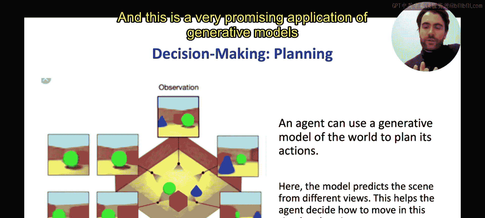

Another way of connecting generative models with decision making is through the lens of imitation learning。

Imitation learning is。Imitation learning means that if I have access to a large data set of。嗯。

Of actions from an expert， so for example， if I'm trying to learn how to drive a car or fly a helicopter。

 let's say that I ask an expert to drive the car or fly the helicopter for me for a very long time then the actions of the expert correspond to my data and imitation learning tries to build an agent and automated intelligent agent that emulates the behavior of the expert。

And generative model can help here as well， because you can think of the actions of the expert。

 you can think of their sequences of actions as being examples of high dimensional data。

And if we are able to generate similar sequences of actions through a generative modeling algorithm。

 then we can execute these actions in the world and hopefully emulate the behavior of the expert。

 so this is another important example for why generative models are useful for decision making。

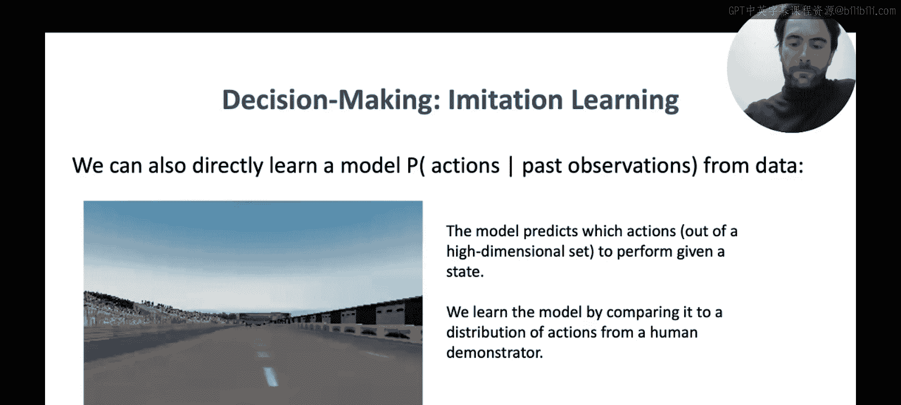

Okay， so I will end here by summarizing again， the main types of applications of generative models。

I would say one big bucket of applications involves generation and also manipulation and signal processing and signal enhancement。

 so tasks like super resolution or signal enhancement， audio enhancement。

 enhancing experimental data from a scientific from an experimental assay in some field of science。

This is one important big bucket of application。The other bucket I want to again highlight is anything that has to do with representation learning。

Representation learning can be useful for learning how to manipulate images。

 so it can it can be used to learn useful knobs that we can turn to explore the space of data that that we are working with。

 but I think even more importantly representation learning is a type of unsupervised learning that allows us to discover something new about the data by inspecting the learned representations and looking for patterns again。

 remember the example with cancer tumors that I gave with clustering the genomes of。Cancer tumors。

 that is an example of where we can learn something interesting about the biology of cancer using a form of representation learning。

 And finally， the last set of experiments， the last set of applications that I want to highlight is everything that has to do with decision making and that I just mentioned to you earlier。

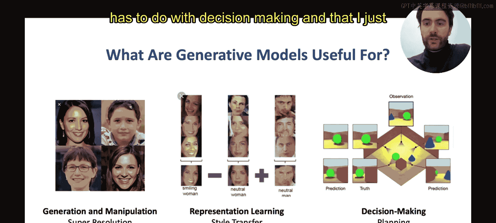

And finally， I want to conclude the section on applications and examples of generative models with this quote from the famous physicist Richard Feynman。

So there's this famous quote from him which says what I cannot create。I do not understand。

 And this goes back to。A way of thinking that Feynman had in that he felt that he only felt confident that he could completely understand a certain physical theory if he could effectively derive it from Scrash himself。

And if he couldn't， then some piece of knowledge was was was missing and what this quote is or one way to interpret this quote is that the ability to create or the ability to generate things so generate molecules or generate language。

 well， it means that an entity or a model or a system or a system that can generate。

Things like text or molecules。 Well， it must surely also understand something about text or language or molecules。

And so the idea here is that the process of generation is a step towards obtaining knowledge about the world。

 which in turn is a step towards building system which exhibit intelligence and in fact。

 the holy grarail of AI is to build systems which are generally intelligent which can emulate intelligence across a a wide range of situation similarly to how human intelligence manifests itself across a wide range of domains so you would have a single system that could both write an email and classify an image and prove a theorem a single intelligence system would do all of these things and so the long-term vision here is that generation is ultimately a tool towards it's a strategy towards realizing this long-term vision of building generally intelligence。

Sts。And in fact， I would say that。In recent years we are seeing this strategy bear fruit。

 If you think of systems like Chad GT or just the GT models in general。

 they are trained to generate text to generate human language but in doing so。

 they learn all kinds of facts about the world and you can ask them questions about physics or you can ask them to write code。

 you can ask them to do you know to create songs so they learn all of these things by。You know。

 by the process of generating。All kinds of texts that they see on the internet or out there in the world。

 so this is a specific example of how generative modeling and generative AI is a tool and is a path towards general artificial intelligence and this is maybe the last and maybe the most profound reason for why generative modeling is really important as a field。

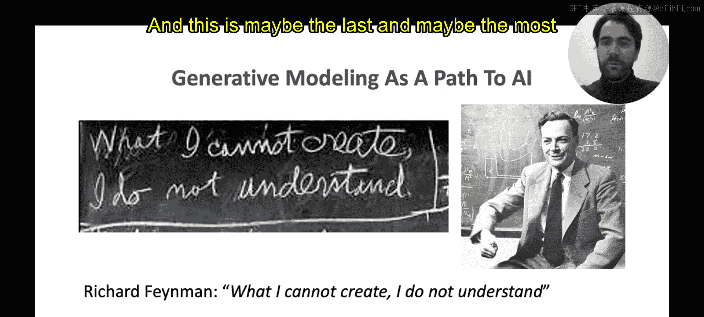

Okay， so this was my overview of the course， I want to end briefly by discussing some logistical details I want to again tell you so I guess I would like to give you a sense of how the course will be like。

 what will be the style of the course， we talked a little bit about the topics of the course so will be our approach to learning these topics。

So this is a this is going to be a PhD level course。

 which means that we will prioritize the foundations of the field of generative models In other words。

 we're not going to teach you how to build a rag system。

 how to build a retrieval augmented generation system we're going to instead。

Learn to derive all the main families of generative modeling algorithms from scratch。

 and then if you understand the foundations， you will have all the tools that you need in order to go and very quickly learn about your favorite application。

Allright， so we're going to describe from first principle every important family of generative modeling algorithms。

And in order to do this， we're going to have to use math。

We're not going to use math in order to prove theorems， so this course is not a theorem proof course。

 but we will be using a lot of math to precisely define the algorithms。

Right and and so that will require a certain level of mathematical maturity。

 so if you look at the slides for the course， it is mostly a lot of equations because again we are trying to derive from first principles at the level of a PhD level course in computer science。

 all of the key algorithms。Now， even though we are going to be doing a lot of math in the lectures that doesn't mean that that you will not learn to implement these algorithms so this course comes with assignments and the assignments are are where you will practice implementing all of these all of these all of these families of algorithms。

 in fact all of them will have to be implemented at some point and so for the online version of the course we will also be gradually releasing materials where you will be able to roughly do the same work as the PhD students at Cornell do when they implement the algorithms we will not release the exact same assignments but we will be releasing comparable exercises that will help you translate the mathematical definitions of the algorithms into code and so if you do all of these exercises。

 you should also be able to implement these algorithms。So。嗯。And so in order to do these exercises。

 you have to have programming expertise， you have to have a certain level of familiarity with programming and especially with neural network frameworks like with deep learning frameworks like byTrge。

Now a little bit more specifically， you could view the topics of this course as being， first of all。

 an overview of the main families of generative models。

 I would say right now out there there are I would say。

5 or six key families of generative modeling algorithms， So these include autoregressive models。

 normalizing flows， variational outencors， generative adversarial networks。

 energy based models and diff fusion models， score based models continuous time generative models。

 continuous time normalizing flows are related to these So these are some of the main modeling families and each of them will have one or two lectures that will start from the basics and will go all the way to discussing advanced advanced and cutting edge variant of each of each modeling family So by the end of the course you will know what all of these families of algorithms are and again we will derive them from scratch。

 We will start with the basics of probability and we will from first principles derive。

Using math every one of these algorithms。Now in order to define these algorithms。

 remember that these are machine learning algorithms that are defined by a type of model。

 a type of learning objective， and then an optimization procedure so we are going to we're going to cover several important learning and inference algorithms and also so learning objectives and algorithms for optimizing these objectives these include methods like variational inference。

 Markov chain Monte Carlo， two sample testing， we're going to see divergences as a general type of constructing objectives for generative models。

And a lot of these concepts will be important beyond just generative modeling itself。

 these will represent general purpose techniques that you can apply to other types of machine learning problems。

 for example， Bayesian inference and other techniques as well。

And finally in addition to having a main set of lectures that covers the main types of generative modeling algorithms。

 we will also have several lectures on some specialized topics in generative modeling so we will have a topic on discreteness so discreteness is really important it's an important challenge for generative modeling so we will have a particular topic on how to deal with certain types of discrete data like graphs or text we have a lecture on probabilistic programming and probabilistic reasoning we have a lecture on evaluating generative models evaluating them is actually very hard so we have an entire lecture on that and finally in the Cornell version of the course there is an there are many weeks which are dedicated to discussing cutting edge research and papers typically students present these so this will not be part of the online course but。

I anticipate over time sharing resources to some of these cutting edge research and papers。

 if you are interested in keeping track of additional elements of the course that I will release over time。

 the best way to keep track that is to follow me on Twitter or perhaps follow me on YouTube。

In terms of their prerequisites， as I mentioned， we do require a certain level of mathematical maturity。

 so you should be familiar with。An exposition that is basically that involves mathematics in terms of actual knowledge。

 what is needed is effectively a first year college level coverage of linear algebra and calculus and probability。

And so by this we mean that you should be familiar with concepts like base rule。

 change of variables in probability， you should know what is a random variable。

 what is an independent of what are independent variables or what are conditional independent variables and on the calculus side you should be familiar。

 very familiar with gradients， derivatives。And then we also assume that you have a certain basic knowledge of neural networks at the level of a basic machine learning course or neural network course。

 So I'm going to assume that you know what is a convolutional neural network。

 you know what is back propagation you know what is an activation function。

 what is a fully connected layer， So all of these things I'm just going to assume if you are not familiar with any of these topics。

 So here are some so these are some links to course numbers which are offered at Cornell and I'm sure you will find this information in all kinds of。

All kinds of courses or textbooks that are available and for the background on deep learning。

 I can also refer you to my applied machine learning course， which is also on YouTube。

And finally in order to implement these methods you will need some familiarity with preferably Python and a deep learning framework for Python I will end here for in terms of the first video in the first lecture in the next lectures we are going to start by covering the first family of generative models which is going to be autoregressive generative models and I encourage you to subscribe to the rest of the videos to find out more about generative models thank you。

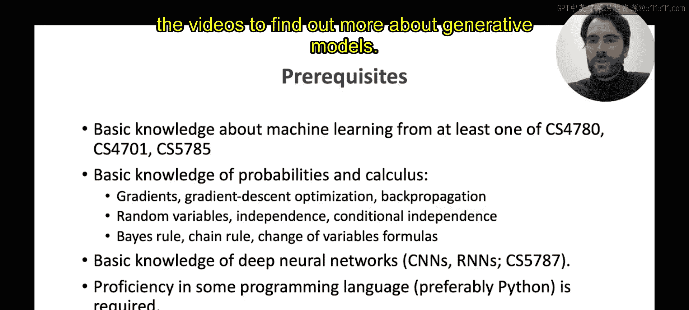