# 康奈尔大学《深度生成模型Deep Generative Models (Cornell Tech CS 6785, Spring 2023) 》中英字幕 - P8：-08-Lecture 8_ Advanced Flow Models.zh_en - GPT中英字幕课程资源 - BV1az421q7Vf

Today， we're going to have our second lecture on normalized role models。

 So let's do again a short recap。 So remember we've been looking at a few different approaches to the generative modeling problem。

 So we have a data set of。

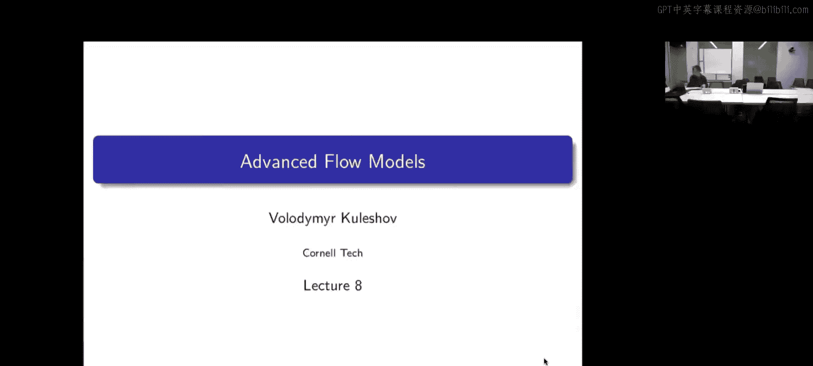

high dimensional objects such as images or text or audio or genetic sequences。

 some kind of high dimensional data， and our goal is to learn a probability distribution。

 the theta that approximates the true data distribution from which these images come from。

And there's different ways that we had seen to represent the probability to theta。In particular。

 in the first few lectures， we've seen at least two ways。

First we saw aggressive models first we saw other aggressiveive models which are based on the chain rule of probability。

 so they start by decomposing the probability of a high dimensional object like a text or an image x。

 they decompose that into a product over each component of x。

 so you can think of each X size meaning a pixel， then they train a model to predict the next component。

 the next pixel given the previous component。And。That has many advantages。

 one advantage is that it's tractable to evaluate the probability。

 which means that it's relatively straightforward to train this using maximum likelihood optimization optimization using gradient descent。

And that's actually quite。Rare that it's as straightforward to compute the look likelihood so this makes these models useful for density estimation。

 for example， they also have reasonably high generation quality in many domains。

 but one problem is that they don't have a mechanism for learning features or for doing unsupervised representation learning。

So to compensate for that， we looked at this other family called variational autoenrs。

 which are a latent variable model， they have these extra latent variables Z here that can represent latent factors of variation in the data。

But because we don't observe these factors， when we train the model。

 we have to perform this integral to compute the marginal density of x。

 so we have to train using an objective which can be potentially an intractable integral and because of that we have to perform a lot of machinery to approximate this intractable integral and this is where variational inference comes in。

So in the last talk， we saw one way of getting the best of both worlds。

 so getting a tractable late variable model， getting so first of all， having late variables。

 but also maintaining tractable log likelihood。And this is where normalizing flows come in。

By using normalizing flows， we can at least in theory， get the best of both worlds。Now， again。

 there are some。Other difficulties that come in， but at least from this perspective。

 normalizing flows can get。Some of the advantages of both types of models。

 although as I mentioned in the previous lecture， the way in which these models are parameterized now has additional constraints so that imposes a different set of problems we have to be much more careful about the architecture of the neural net and I'll talk about this again in this lecture。

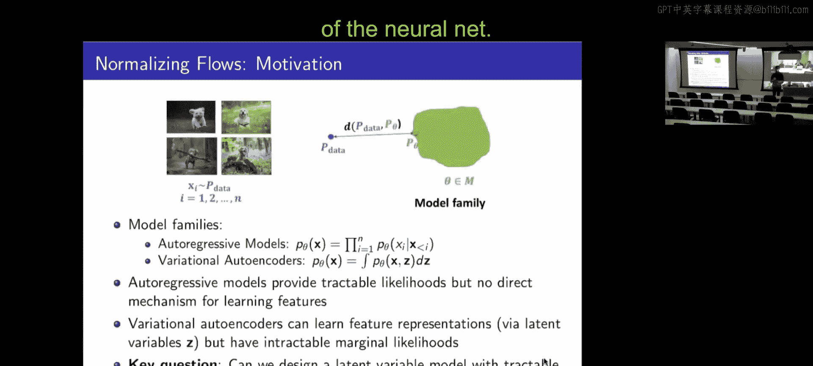

So let's recall what is a normalizing flow model。So in a normalizing flow model。

 we have latent variables Z and observed variables X。And so we start with a simple prior over z。

 which can be something like a Gaussian， and then P of x given z is given to us by this mapping F。

 it's an invertable mapping， therefore it has a well definedfin inverse。

 which we denote by f minus f you f inverse， this is f inverse。

And what's interesting is that this is a one to one mapping。

 so for each z there is a unique x that is associated with this。

 so for each x for each z this probability density is just a delta function on a single point。

But if we were to sample many z's like this， if we were to sample many of these Z's。

 we can so starting from a simple prior over P of Z。

 we could take many samples from Z and then these samples get remapped in some way to the x's。

 and now the distribution over x can be more complicated because this function F has learned to remap by pushing certain things up。

 pushing certain things down， so it learns to remap the simple distribution。

 and now we can get something that's a more complicated distribution for x。Right， so even though。

X here， h P of x given z is essentially a delta function， while the probability mass is just in1 x。

This still defines a valid distribution over this defines a valid marginal distribution over the x's。

And what's more， this P of x is tractable for each x， for any x， we can compute this。

Distribution this we can compute the density of x or we can compute the log likelihood P of log P of x via an approach called the change of variables formula which you see here so this is the main thing that we worked on deriv in the previous lecture it's a formula for the density or if you take the log it will give you the log density or the log likelihood of x。

You can get this。You can get now an exact formula for what p of x is now。

 because the mapping between z and x is1 to1 and P of x given z is a delta function。

 now you don't have to do any integral， there is a unique。

There's a formula that precisely defines what P of x is。

 and this formula has two components First we start with x。And then we map it back to。

 you can think of it as z of x， so this is the unique Z that is associated with that x。

Then we look at its density under Z。But that's not enough we can't just go back and measure the density。

 there also has to be this adjustment factor， which is the determinant of the Jacobian and you remember the intuition for why we needed that is because when we。

Remap variables from one distribute from one when we switch when we change variables and we go from one density to another density。

 the overall support of the density can change both globally and also locally around each around each point it might the the global。

 if you can think of if you think of Z as being discretized。

 if you can if you think of the space of Z as being discretized into little squares。

 when we remap Z to x， the volume of these squares might increase so that one volume for。

That the volume of the distribution when in one square could go to a larger square。

 but that volume has to roughly stay the same。 Therefore。

 we have to adjust by the change of volume in each of these mini squares that are。Yeah， the the。

The size of these squares we go to。We go to zero in the limit。

 but we still have to make this adjustment and the correct formula for this adjustment is the determinant of the Jacobian of the inverse mapping。

Which is what you see here。So in order to apply this formula and that's something that somebody pointed out in the previous lecture。

 the determinant of this Jacobian has to be tractable that's the main challenge so we have this formula that works in theory but in practice we still have to compute this formula efficiently and if you remember a determinant is an operation that naively takes at least cubic time。

So we have to do something with that， we have to choose an F that satisfies some number of conditions。

First of all， this F has to be invertible。Because otherwise。

 we can't apply the changer variables formula。It also has to be expressive。

 so it has to be able to remap a really simple distribution like a Gaussian into something which is extremely complex like the distribution of all the images of human faces。

So it has to be very expressive。And finally， as I alluded to earlier。

 it has to be computationally tractable so that we can apply and optimize the changer variables formula in a reasonable amount of time。

And again， naively， the taking the determinant of an n by n matrix takes n cubed。

So it's not any inver function that will work here。

And we saw a few strategies that could be used to construct these these types of。Nice。Mappings F。

The first strategy that we saw involved applying a sequence of simple invertible transformations or maybe I should not say sequence。

 maybe I should say composition， so we are composing many of these simple functions so the dot here just means the composition of multiple function the circle means composition so you can think of each simple transformation F as a layer of some sorts。

 but it's also an inverttable mapping so we can apply the change of variables formula to a composition and we know that the determinant of the composition so here the determinant of this composition equals the product of the determinants of each function and so the hope there is that even though each function each of these fs here is simple。

When you compose many of them， it will give。He will give a。Mapping effort is still complex。

 but at the same time， it's it's。It's deter determinant will be tractable because it is the product of。

Simple determinants。 Each layer is still simple。 and so the。

Determinant of each layer is tractable and the determinant of the full composition is the product of the determinants of each layer。

 therefore it will also be tractable and again as a reminder of an example of what a simple inverable transformation can be we saw planar flows in the previous lecture and can and we also visualized and we saw that starting from a simple Gausian it looks。

After composing10 of these functions we get something that looks highly multimodal and non Gaussian so that so that was the one example that we saw should then Zm potentially be Fm minus one。

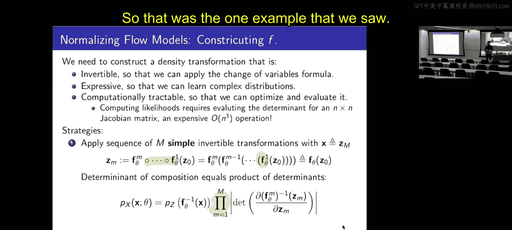

Or am I misunderstanding the formula？Oh， hold on。 Yeah， I think there is a typo here。 Yes， sorry。

 that's a good point。 There is a。Okay， this should be like this。呃。Yeah， that is。Correct。

So that was our first strategy。But I would say there's also potentially another strategy that could be followed and here the idea is to directly work with the Jacobian matrix so we can start by thinking about what is what would be a good Jacobian matrix。

 what kind of structure would make it。Table， for example， if it was diagonal。

 it would be clearly tractable， what can what other structures lead to tractable Jacobians？

And can we then。Can we then directly？Can we starting from this？Starting from。

Thinking about a Jacobian can we go back and create interesting mappings that's another general strategy and let me give you now an example of what I mean by that。

One strategy that we're going to follow in this lecture is going to be to try to create。Mappings。

 invertebible mappings for which the Jacobian is triangular。

What be an example of that so consider some kind of invertible mapping F that goes from x to z so F here in this equation is mapping z to x okay and this is the general form of the Jacobian so it's matrix here the the rows or。

The rows are the different outputs of F， the columns are the inputs。

 and it's the matrix of all the partial derivatives。嗯么。Imagine what happens if this function。

So if the I component， which is simply the I component of the vector。F of z。

 what if this component F of z depends only on the components of z that that come earlier in the order。

 So here we have a vector the。Components have been ordered in some way for us。

 and let's imagine that each component Z。Each XI depends only on the ZI that come before it in the ordering。

In some sense， this is a little bit like an utter aggressive model。Well， in that case。

 you can see that。Any， any entry of this matrix that lives in this triangle， right？

 So that would be D FJ。The I or something where where J would be here J would be。Less than I。Sorry。

 did I say this correctly， no J would be greater than I。嗯。Yeah。YeahOkay， no， sorry。 this is correct。

 Where J equal where J is less than I， this would be。ThisThis would be zero， right because of。

This dependency structure， anything that's in this。

Block has to equal zero because of this utterregressive type of assumption that I see that I just made。

And we know that if a Jacobian or if a matrix is triangular。

 then the determinant is simply the product of terms on the diagonal。

 therefore we can compute this determinant in linear time。

So here I have another potential strategy for。For defining a tractable inverttable mapping。Here。

 the determinant of any mapping that satisfies this property will be computable in linear time。

And so this is going to be an insight that we're going to use in this lecture to define many other types of normalizing flows and these are going to be much more advanced normalizing flows than the first example that we saw in the previous lecture。

 and this will also lead to some really interesting connections between normalizing flow models and other aggressivegressive models。

Okay， so that's going to be the plan for this。For this lecture。嗯。

Right so we're going to be looking at a few types of flows with triangular Jacobbians。

 there are some wellknown models in this area， for example。

 some early models were nice and real NVP if you're also familiar with the glow model that's a little bit more recent that is also based on a very similar structure as these real NVP and nice models and then we're also going to talk about some connections between utteraggressive flow formalizing flow models in a middle part and finally I'll conclude by connecting these two ideasS。

 connecting the adsS from flows and utter aggressivegressive models and drivingriv an algorithm called parallel waveNe which will allow us to define a waveNe type of model from which it will be fast to sample and this is actually a practical algorithm that has been influential and that has enabled。

Fast speech generation on many practical devices that you may be using。All right。

 so let's now look at an example of one of these new types of flow models in which we have a。

A triangular Jacobviian。So models that are based on this strategy that I started talking about。

We're going to start with this model， which is called NiceE。

 which stands for nonlinear independent componentson estimation。It is also based， so by the way。

 this idea of combining。Multiple of composing multiple transformations， it doesn't。

Prevent this is this idea is applicable in any type of flow model。

 so it's not like we're going to be discarding this idea of having a composition of flow layers that will always remain and that's essential central part of most flow architectures and if you look at the implementations of these flows they heavily rely on the fact that you can compose many layers like this so we still have。

A composition of different flow layers in a normalizing flow model。

What's interesting is going to be the choice of layers that we're going to use。

 So these Fs are going to be。Within two types of。Of layers。

 so the nice model defines what are called additive coupling layers and rescaling layers and let me explain what these two layers are。

So the idea of an additive coupling layer is to define。So yes。

 the additive coupling layer is precisely the layer that defines this interesting triagonal Jacobian structure。

And the way that it does that is by being a little bit clever about how this transformation is performed。

It starts by partitioning the input variables right so this layer has some input variables Z they're going to be transformed into an output variable x。

 and it starts by partitioning the Z into two disjoint subsets which are it can be actually any subsets but just for the sake of this explanation。

 I'm going to say that the first d components are going to be the first subset and the remaining n minus d components are going to be the second subset。

 but you can choose an arbitrary an arbitrary subset， so we partition z into two subsets。

And then we define the forward mapping Z to x as follows。The first set of variables。The one。

 the set of variables that are in the first subset。They get mapped into X without any transformation。

Now， the second set of variables they。Undergo this a fine transformation where they get。

We add to them this additional term， and sub theta of。Z1 to D。

And this m sub theta is a model that is just parameterized by a neural net。

 So this is some transformation of the first set of variables。 So here again。

 the output here is a is the。Is the output for the second set of variables。

 it receives the first it receive sorry。This is。The output here is the。

Output for the second set of variables。 it receives the。First。

It receives the second subset of the input setter variables plus a transformation of the first subset of the input setter variables。

This might be a little bit easier to understand via a picture。

 so I took a picture here that comes from the original paper。

 I apologize in the paper they use a slightly different notation。

 but what we have here so this when they say x key。

 this actually means so this is what we refer to as the first subset， this is Z to1 over D。

 and this one gets mapped without any changes to X from1 to D。And then we also use it。

We also take this first subset and we feed it into a neural net。M。

Which then gets combined with this other subset， Z D plus 1 to n。So， this is。

What this variable is it goes into so now the output x d plus1 to n becomes the sum of this term plus the output of this neural net。

 these get added and this is what gives us the output for the second subset。

Are there any questions about this transformation？错。Sure。Okay。

So that's how we define this and I oh and again this M sub datata can be just any neural network and it has the input units because it takes as input the first d components of Z and then its output has n minus d。

Components because it has to have the same shape as this vector。Okay， this is the forward mapping。

 and I claim first that this is an invertible mapping。Why is that the case？So let's， okay。

 this is the forward mapping。Here I'm just rewriting it compact。

 we start by having an identity mapping for the first subset。

 and we have this more complicated formula over the second subset。So I claim that this is invertible。

Why is this inverable， well let's define this。So first。

 if we were to go from x to z now in the inverse direction。So。

The inversion of the first set of components is easy。That's just。That's just the identity mapping。

From one to D， that just equals x from one to D， because that's the identity mapping。

What is more interesting is the other component。And here we apply the following formula。

So where does this formula come from？We can make a little drawing here。 so here I have。

Remember the figure on the previous slide， it looked like this。No。I have x from1 to D。

 that one is just getting remapped directly to get z from 1 to D。Now that I have Z from one to D。

 I can compute M。Because I have this number， then I get to know the M that was added to this node。

Right， and now I have X， let me just call it x prime。 That's the other part。 So now to get。

Z and minus1 to D， I take this M， which is here， I subtract it from this X。

 which is what I'm doing here， and now I get this variable that I want so here because we have this interesting structure in our forward mapping。

 the inverse mapping is also completely invertible。

So this now becomes an invertible mapping that we can use within a flow。

Layer within a normalizing flow layer。And it's called an additive coupling layer because we're coupling。

The the two subsets of Z in in an interesting way， that also happens to be。Heditiveitive。Yep。嗯嗯嗯。

So I guess I wouldn't really use the term constant to refer to M M is definitely M is most definitely a very expressive function。

But it's a function of only this term z of1 to D。And it is crucially。

 it is not a function of this term， which is why things are invertible。

 This little trick wouldn't work if M， if we needed to have the second subset in order to compute M。

 then this wouldn't work， but because we have。Because we have this part in the inverse mapping。

 which is exactly this part， this whole thing becomes inverable。哎好。Okay。

 so this is an additive coupling layer question Okay， and that's a good question。

 How big are these subset， You can think of it as roughly being split into two halves and in practice。

 if you look at。If you look at models like RENVP and B。

 they're also very clever about howitioning how this partitioning is performed。

 so you don't just take a random subset if you have an image。

 you partition the image in interesting ways that so in realNVP。

 they use this checkerboard strategy for partitioning the pixels to get better empirical performance。

So there are also a lot of practical details about how you choose this partition and it helps things。

 but for now just， okay， I guess I'm explaining it at a slightly higher level。

 but there are some interesting implementation details about how you choose this partition。Okay。

 so that's an additive coupling layer， it's invertible and now the remaining question is。Is it。

Ttractable to compute the determinant of the Jacobbian。So。The answer is yes。

What is the forward mapping？Well again， the first part is the identity。

 the second part is the identity is the additive coupling layer that's just what I had in my earlier slides I'm just putting it here so we can see it now what is the Jacobian of this forward mapping。

Well， the Jacobian has exactly this triangular structure that we're looking for。So。And then。

It happens to have the identity on the diagonal， therefore its determinant is always going to be one。

 So this is called a volume preserving transformation。The deterant is one。

 so why does the Jacobian have this shape？Well。So this here is。This zero here corresponds to。

It corresponds to sorry this maybe be a little bit flipped it corresponds to x from。1 to D。

 And this x from1 to D does not depend on。嗯。On the put variables， Z。And -1 to D。 So there is。Okay。

 sorry， I'm not great at drawing this arrow so these two things are。There is。

No dependency between them。 Okay， I apologize for my improvised drawing。

 but the point here is that this so this component here。With which this zero is associated， no。

 sorry。This component here with which the zero is associated does not depend on this component of Z。

 therefore that's a zero。Does that make sense yeah okay so this is a zero here we have this more complicated submax of the Jacobian which will depend heavily on M。

 but it happens on the of diagonal terms。So we don't have to compute it。

And then you can see here that in on the diagonal。Here we have the identity because。

There is nothing that' so we only have an additive modification to these z variables right X is everywhere a linear function of its corresponding terms so this second subset of the output is a linear function of the second subset of the input and the second the first subset of the output is the linear function of ohs fact it's the identity function of the first subset of the input because things are linear well。

 it's not even linear it。It's been here with a slope of one， therefore。

The entries on the diagonal are just the entity。Let me know that if that makes sense or not。

The point here is that the Jacobian is triangular， the entries under the diagonal r1。

 and therefore we have a volume preserving transformation and the determinant is always one。

 so we don't even have to include the determinant in our loss function。

 it's always one for any choice of M。so this is for any choice of this neural net and。

 which is really powerful， that we can use any architecture that we please within this normalizing flow layer and it still gives us the kind of inverable volume preserving transformation that we're looking for。

Okay， this was an additive coupling layer。Again， I want to re emphasizehasize that the universeverse can be computed for any M。

嗯。And now I just want to complete the full nice model by mentioning the rescaling layer。

 which is much。Simpler， the rescaling layer。I just the name implies。

 it's just a component wise multiplication of the input by a rescaling factor s。

This is the forward mapping， so S is going to be always strictly greater than zero。

 but therefore the inverse mapping is also well defined， it's very simple， it's just a division。

And the Jacobian is going to be simply the diagonal of well the。Yes。

 the Jacobian is simply the diagonal matrix with these ss on the diagonal。

 therefore the determinant of the Jacobian is simply the product of the s's。So， that is a。Yeah。

 that is a rescaling layer， it's very simple， this one is non volume preserving。

 so therefore the entire nice model can also be non volume preserving。Okay。

 so now we have defined these two recal and additive layers， and the nice model is simply。

The composition of these different types of layers。

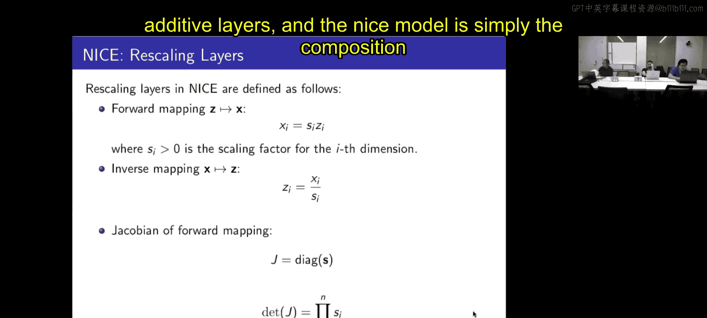

And we can visualize。What this model can do。 Again， this is an early model from。Actually， 2014， 15。

I forget the exact year， but this is an early model。 These are samples from the paper。

 It was tested on。

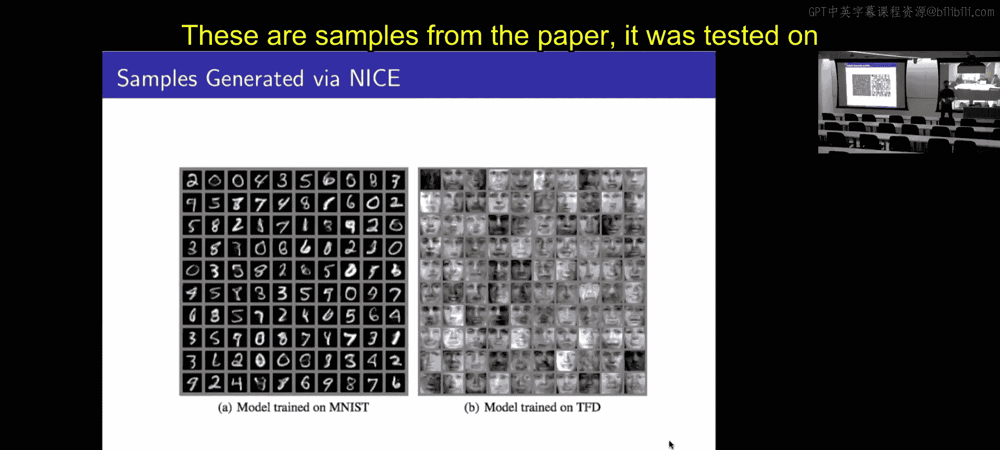

Simple on what are some very simple data sets， but at least this is the first model。

 this is the first normalizing flow model that can actually produce， can actually generate some。

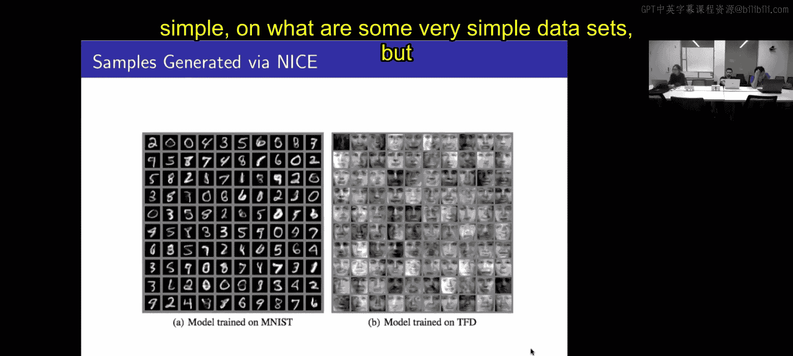

Images。The planar flow model that I talked about in the previous lecture that was never used to directly generate images。

 was used it was used as a component within a variational outencor to make the prior parametermetrable and learnable。

But now this is a flow type of model that can generate images or yeah。

 images of faces and digits directly by itself without relying on any other model family。

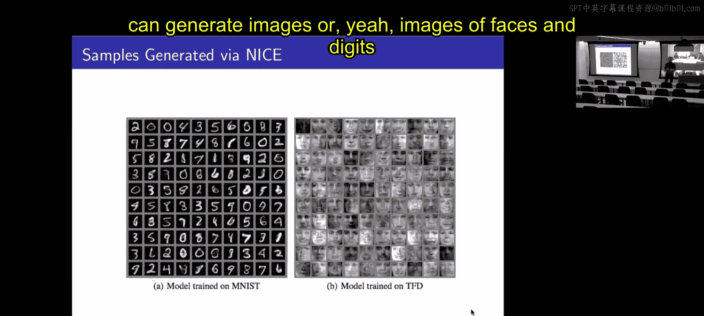

Question。So then the m theta itself does not have to be invertable。 It's the entire trans。

 so the M is just the mapping from one subset of z to another subset of X， but the overall mapping。

 the full Z mapping to the full x， that thing。And its entirety is invertible。

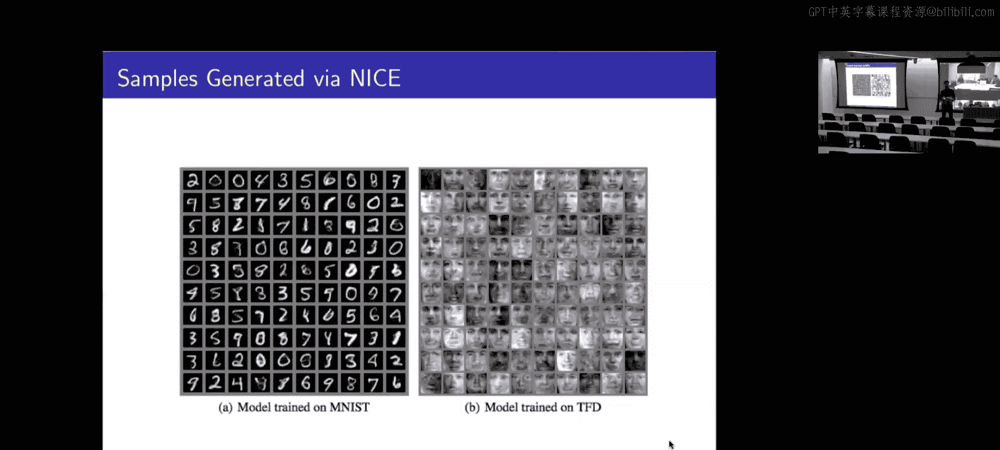

对。Okay， these are some samples from NS on other data sets here we have a model train on something called SVHN。

 which is a digit of house numbers， street View house numbers， and then C410。

 okay so this doesn't look at all like C410 samples right now they can be indistinguishable with modern models。

 but you know at the time this was a great result for normalizing flow models。

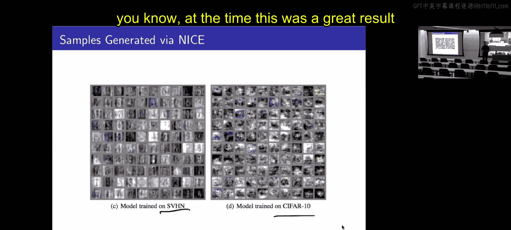

Okay， and then the other extension， then a couple years later。

 there was an extension to this model called wheelelNVP by a similar subset of the authors。

 which can be thought of as a nonvolume preserving extension of nices and here what they did is that they modified the coupling layer。

Well， non volume preserving it still really looks like a coupling layer。

 we have the same identity mapping as in the as in nice except that now the。The other part。

 the non identity part of the forward mapping has this additional X。

 so this mu here that's just our M from the nice model， but now we're also rescaling this。This。嗯。

This model Z by。By something that can be a function of the previous。That can be a function of。

Of this。Sos say so now instead of only having an additive modification， which is the first。

 which is the mu now we also have a rescaling， which itself is learned from。The other components。

 So alpha and mu are both parameterized by neural nets。 So in some sense。

 it's combining the rescaling and the additive coupling layer of nice。

 except that the scaling is also parameterable on the Z and。

It can be parameterized by an expressive neural net。

So that is the definition of the forward mapping in nice again。

 the difference is this extra term here。Is it still invertible yes it is still invertible this is the inverse mapping again for the first component we perform the identity transformation and for the inverse we do the same thing because we know。

呃，XD。We know Z exactly， therefore using Z， we can compute the alpha and the mu that was used in the forward mapping。

 That's just exactly this， these two terms。 And because we know alpha and mu and we so we know basically。

In here we know this term。This term and this term。When we perform the inverse mapping。

 therefore we can just rearrange terms and get an expression for this term。

And you can observe that this is the same thing as in the additive cuping layer。

 but now I'm also dividing by the normalizing by the rescaling factor。

And everything still works out because we have this separation into two subsets。

 we can perform this type of notification。You can perform this type of inversion。Oh。

 and so it's already preserving because what is going to be the Jacobian of this？

So the Jacobbian is going to be the identity on this set of components， but because here we now。

So x as a function of z is now getting this multiplication term。

 well this component is going to be the diagonal of these values。

So therefore Jacob the determinant of the Jacobbian will no longer be one。

 it will be this function and because it's not one， it's not volume preserving。Okay。

 so this is how a nice layer looks like。

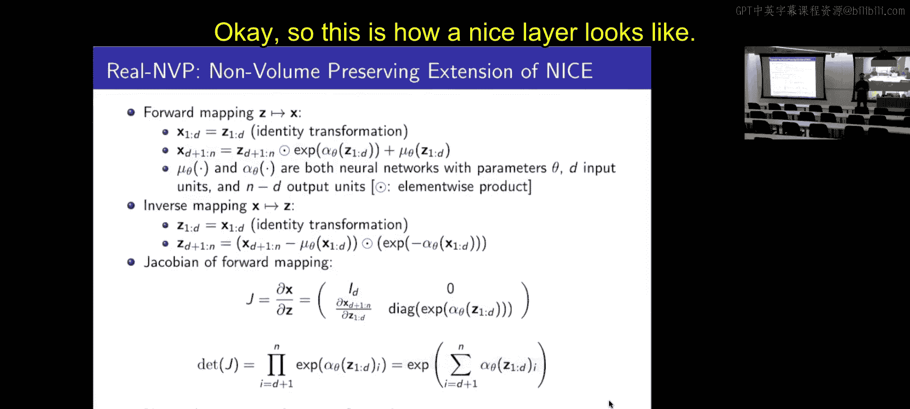

And it came out a couple years later so they also used the bigger neural net and a lot of other practical tricks so it's not just this particular modeling choice there there were a few more choices that went in there。

 but you can see that it's able to generate much more realistic samples of human faces of various types of bedrooms certain natural scenes you can see that these type of flow models can now generate more realistic images and of course there's been more work so there was a follow up on the real VP model called G several years after and then G can generate very very high dimensional images with really good quality it's also very expensive to run it's very demanding in terms of compute。

 which is often the case for these flow models but it's still based on the same architectural ideas as。

余为B题。は。

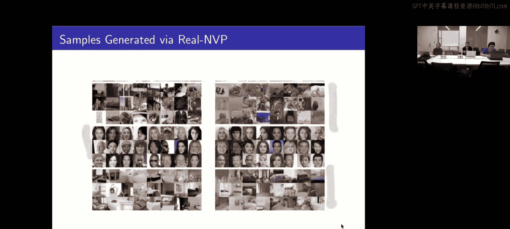

Okay and then another interesting thing that they showed in the real VP paper is that you can still use it as a latent variable model。

 so what we have here in these figures are interpolations between four different vectors so we start with with a human face here here and here at the four corners or here these are pictures of a building that are in in the in the corners right so here here here and here and we can interpolate between them along different aes using this formula and it allows us to interpolate between smoothly interpolate between human faces I guess there were some questions in the previous lecture as to whether these latent spaces are useful because they're high dimensionional again we call that the shape of Z and the shape of x has to be the same。

And this shows that the latent spaces these still learn some interesting structure。

 so faces which are similar will get mapped to similar parts of the latent space again empirically。

This would require more study and the fact that Z is this of the same size as x。In some sense。

Does slightly descentivize it to learn interest， to learn really good representations。

But there is some level of interesting representations that is learned。

Yeah so I guess there's a question about what would be would we find any interesting clusters in latent space and I think it would really depend on the model on the data set it's not guaranteed to do this。

 but at least there is some interesting structure there clearly images that are more similar to each other like I don't know these two are。

Closer together in latent space。

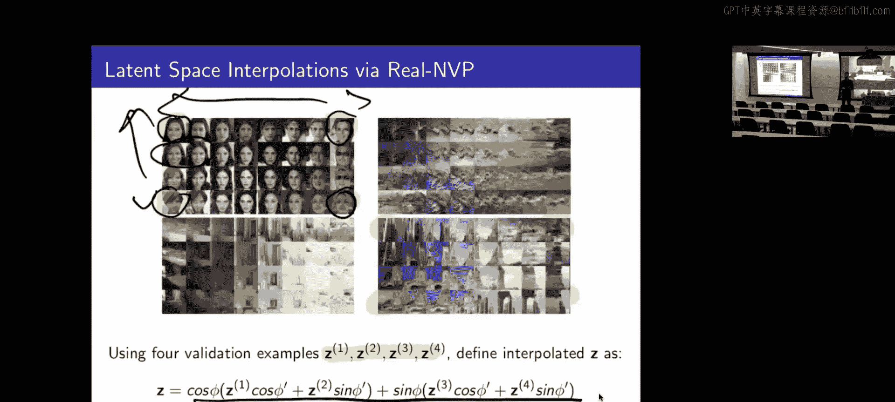

All right， so these are some samples。Okay， so we've seen a few examples of triangular flows。

 next I want to start making some interesting connections between our aggressivegressive flows and the flows that we have just seen。

So。What are the connections between ourgressive flows and sorry our aggressivegressive models and normalizing flows？

Consider the following example。Let's say that we have a Gaussian utter aggressivegressive model。

 what I mean by that， I mean that we have so x here is going to be continuous。

And the model over x is going to be formed by applying the chain rule and then each。

Of these terms in the chain rule is going to be， so each of these terms is going to be a Gaussian with amine mu and well a log variance of alpha I。

So each of these conditional terms is a Gaussian in a lot of our previous examples， for example。

 in pixelel DNA， or in the first example on utteraggressive flows。

 we were using binaryized MNIS as a running examples therefore in those examples。

 this conditional P ofxii given the previous components that was a Bernoulli。

 but it can be any distribution， so it doesn't have to be Bnoulli or softmax it can also be a Gaussian。

 and the parameters of this Gaussian， mui andma mui and alpha I are they're parameterized by neural networks of the previous components and for the first components because there is nothing to condition on。

 there' are just two initial learned constants。So this is the model that we're going to start with。

 consider this model。And now consider what sampling means in this model。

Let's say we have somehow learned this model from data。 Now we want to sample。X from this model。

The way that we would perform sampling is we could first start by generating these。

Generating a vector of normal variables， ZI。And then from ZI， we can get。Exi by。

By the following transformation， So x1 is just going to be so x1 is a Gaussian with mean mute log variance alpha。

 Therefore， I can form X by just taking my uniform， taking my。

Standard taking my unit Gaussian variable Z1， adding V1 to it， and then rescaling by alpha。

And now this gives me a variable x1 that's sampled from this distribution。So now that I have x1。

 I can use x1 to compute。The mean and variance over of the Gaussian over x2。

 And now that I have this mean and variance， how do I get x2。 Well， in the same way。

 I have the mean and variance， I take my unit。Unit Gaussian sample Z2。

 and then I add and rescale the mean in the variance。

 which gives me a sample x2 from this distribution。Okay。And then I can keep going once I have x2。

 I can compute the parameters of the distribution over x3 and then I can get a distribution over。

Over I can have the distribution， I can sample x3 from Z3 and I can keep going like this。

To get the full sample。So this can also be interpreted as a normalizing flow because it defines an invertebible transformation from the first set of random variables Z to the second set of random variables X。

I'm not going to prove that it's invertible， but you should see that it roughly is for the same reason as the。

As the nice and real N VP variables were invertible where we essentially have here at each time step。

 we have a subset So you can consider x0 and x1 as being our two subsets and then x0 x1 or is one subset x2 is the other subset。

 the same strategy applies here。 I will actually have a。

A detail walks through a veryr related model later。 but the idea is that in this model。

 sampling is an deterministic invertebible transformation from。

From a Z that's sampled from a unit Gaussian into a more complicated variable x。

So an utter aggressivegressive model can usually be also seen as a normalizing flow model。

And we can construct normalizing file layers from pretty much arbitrary other aggressive models over continuous variables。

ok。And this is why we sometimes refer to these models as ultraaggressive flows。

So there's even a name for this。For this model it is called the masked utteraggressive flow so it is literally a normalizing flow model that implements the transformation as the forward mapping。

 it implements that sampling algorithm that I just showed in the previous slide。So again。

 we define x from z in a recursive manner， the first component x1 is defined via the following formula。

 now that we have generated x1， we go and we compute the parameters mu to alpha 2 over x2。

 then we compute the second component x2， then we compute the parameters of the third component。

 then we compute the third component， etcter。So this defines a。A generative process。

And you can also visualize what happens using this figure。

 so here we are computing the Ih component of Xi。And so once we're at the I component。

 we have generated the previous i minus1 components which are here。

And given these I minus-1 components， we can compute a mu and an alpha， right。

 So we use these to compute the mu and the alpha。Which are the which are。

Which is what's needed to get X I。 And now we take the。

Ith component of the input Z and we plug it into。Yeah， and then we just apply the forward mapping。

 so here we have a graphical illustration of what's happening。

So this is called a masked utterregressive flow model because the forward mapping is invariable。

 it's a valid flow。One thing to note though is that the forward mapping has to be computed sequentially。

 so this is a little bit slow in order to compute X from Z I have to run a for loop and I can't compute the I components until I have computed all the previous components in my for loop right so I can't compute all the Xs in parallel I have to compute them sequentially in a for loop and I'm blocked on computing Xi until I have computed x minus1 and all the previous components so in that sense the forward mapping is slow it is as slow as a regular or regressive model so if we wanted to implement this on a computer it would run much more slowly than most other mappings。

Because yeah， because we have to run a neural network in a loop inly and this is not paralyzable question。

So it's applied to images， I'm assuming also this。This framework can theoretically so it's not images for images the people typically use a softm distribution instead of a Gaussian but。

It could also be applied Okay， Okay， so because the Gausian。

 the first one is going to be a Gausian and if it's like。

If it's a sequence of pixels and we're auto aggressively generating the the following one by sampling the first。

 so they are going to be more and more。They're going to be more and more complex and so if X1 was like the top left pixel。

 it would mean that we would sample the first one from a Gaussian distribution。

 I'm trying to visualize what it would look like first pixel be samples from a Gaussian distribution they're all sampled from a Gaussian distribution。

 but the marginal over the first pixel is Gaussian。

 but the marginal over the other pixels or audio samples would not be Gausian。Okay。

 I just want to talk about this thing again， so this is the forward mapping we can define an inverse mapping。

 how do we define the inverse mapping well now in the inverse mapping we have all of these x's and our goal is to compute the at the bottom。

So given that I have all these x's， I can compute all the alphas and all the mus in parallel。

 I have all the x's， I can compute all these parameters in parallel at the same time。And。

And given that I have these parameters， I can now again， in parallel compute all the Zs right。

 so the first Z is just going to be a simple rescaling of the of the X right that it's just and a fine coupling so we can。

A fine plus rescaling so this is what we do here the universeverse is just straightforward yeah scale and shift same thing for Z2 because we know mu2 and alpha2 which were used to generate Z2。

 we know them because we computed them here in the first step。

 we just again apply scale and shift and all of these steps can be done in parallel。Right。

 and then of course， because this is an utter aggressivegressive model for all the same reasons as for the nice model。

 the Jacobian is going to be diagonal sorry it's going to be triangular and then the determinant can be computed efficiently okay。

And what's interesting here is that the inverse can be computed efficiently。

 so the forward mapping is going to be very slow， but the inverse is going to be easy。

And this is actually interesting because it enables to do fast likelihood evaluation。

 Remember that when we。😊，In the。In the change of variables formula， we have P of x equals。

P of z given x times this log determinant part。 So if we are to train with a changer variables formula。

 this z of x has to be computed quickly。And that's what we can do here because the interest mapping is efficient at training time。

 we can compute the objective we can do the。Yeah， we can compute our objective efficiently and therefore we can compute the derivative of the objective efficiently and training here as fast。

 but if we were to then take a train model and try to generate samples from it。

 well then we would have to generate Z and then generate X and that requires implementing the forward mapping。

 which will be slow。So the mask， the aggressive flow model。

 inherits the pros and cons of a regular utter aggressiveive model。

Training is reasonably fast because we can compute the inverse mapping efficiently。

 but the forward mapping is slow。For all the same reasons as in regular afterregressive gene model。

Okay， so that's an MA。It has these two properties。 Can we do anything about these two properties。

 can we can we。Can we get a more favorable， can we have faster sampling？Well。

 there is another approach that we could use， which is called an inverse autoregressive。Flow。

 and I think the key thing to note。To understand an a regressive flow is that this mapping F。

Previously， in an MAF， it was utter aggressivegressive in X。

Now is going to be utter aggressivegressive in Z。ok。So what do I mean by this。

 Let's define the forward mapping。 So in the forward mapping， I start with a vector Z。Then in。Well。

 okay， a sample Z from some sort of simple distribution， like a bunch of Gaussians。

And now I will compute the parameters mu and alpha， not from x， but I'll compute them from Z instead。

And because I have already generated Z。Before I because I have generated Z in my first step。

 all of these are already available and so the these are all available。

 therefore all the mus and alphas can be computed in parallel and then we can form the x's in the same way right so x1 equals x2 etcter so is。

This is the same type of transformation， except that the mu and the alpha are now no longer coming。

 they're no longer functions of X， they're functions of Z。Or in other words。

 here I want to generate this Xi， I have already generated all the ZI。

 therefore I can generate these alphas in mu's in parallel。And now。

This mapping is the same given Z and alpha， but the alpha function in the mu are a function of this。

 so therefore the inverse mapping is efficient， I already have all the alphas in use when I need to generate x。

嗯。Okay， so this is a different mapping， it's a related but different type of forward mapping。

So I claim that this forward mapping is invertible。呃。Why is it invertible？

How would we do this Let's say that we have x and we want to compute Z。Well。

I can compute the first component Z1 from x1 by simply。

Doing this shift and scale formula because mu and alpha are just constant。

 they don't depend on anything， I have them， theyre parameters of my model。

 I can compute to z1 if I have x1。Now that I have Z1， I can compute mu2 and alphapha2。

Now that I have mu2 and alphapha2， I can compute Z2。And then I can because I do the shift in scale。

 then once I have Z2， I can compute。Mu 3 and alpha 3 and so on right so I can I can perform so this is the inverse mapping it exists。

 it's clearly invertable， whole the whole display is inverable。嗯。

But it has this interesting feature that now in an inverse at a regressive flow。

 the Z to x mapping is fast， but the x to z mapping is slow。So what does it mean。

 it means that it's going to be slow to evaluate likelihoods and therefore it will be slow to train for the same reason。

As I just explained earlier， when we train we need to compute Z from x and now this is slow so this is a model that will be a very。

 very， very slow to train， in fact， it's going to be impractical to train this from images directly。

 but it will still be useful it's slow to。You know like it's fast sample， it's fast to sample。

And it's also fast to evaluate likelihoods of points that we have sample。

That's an interesting subtle point that I want to make right so if we have so it's fast to sample and let's say that F for a point that we have sampled。

 we have also saved our Z's。Therefore， we can take our sample and we can evaluate its likelihood。

Because the z's are available to us， we don't have to compute them sequentially。

 we have the x and the z。For we have both the Z and the x for a point that we have sampled。

 therefore we can plug them into the formula and it's vast to evaluate likelihood of generated points。

I'll come back to this observation in a moment。Okay but now this is an IIF。

 it's a different type of an regressive flow model and they're closely related。

 so I'm saying that they're transpose because if you take the x's and the Z's。

 if you were to basically flip the two rows， you would get the other model。

 so they're not the same they're in a sense in transpose of each other and they have complementary pros and cons。

嗯。Yeah， and then another quick point I want to make is that the real enVP and nice are。

 in some sense， instances of an IIF。In which we're not fully utter aggressiveive。So in the layer。

 in one layer of an IIF， we compute jointly a bunch of excess from the inputs， so here it says U。

 but U is Z， sorry， I took the figure taken from us from another resource and it implements this forward mapping where we shift and rescale the。

One subset of variables using parameters， alpha and mu。

 which are derived from a different subset of variables。对。So it is an instance of an IAF framework。

However， this is fast because we're not fully at aggressivegressive because we're doing it over blocks。

 so normally in an IAF。In one application of this process。

 we modify only a single pixel here a real NVP model can be seen as an approximation of an IIF where we modify an entire block jointly but it's still the same idea right。

 given the input variables， we compute these parameters from。

Previous block and then we use them to scale and reshift the other block。

So that's the relationship between the real LDP and the II。嗯。Yeah。

 so here both sampling and posterior inferences fast。

 but because we're modifying multiple variables at a time， each layer is in some sense simpler。Okay。

 so now we have seen these two models。MAF has fast likelihood， but slow sampling。And。

And IAF has fast sampling， but slow likelihood。So MAF is better suited for training and for density estimation。

 IAF is better suited for sampling in particular for real time generation。

Can we get the best of both worlds？And that's what I want to talk about in the last five minutes。

And it will give us an efficient algorithm for generating audio。

 and this is actually an important advance in audio generation that I want to talk about。

So how does it work， first of all， let's quickly remember waveNe waveNe is an utteraggressive model for audio。

 it predicts。Audio samples one step at a time and because audio is often sampled at tens of thousands of samples per second。

 a common sampling rate for audio 44000 Hz， so there's 44，000 samples in one second。It will be very。

 very slow to generate from this model because we have to generate samples sequentially。

 so we have to rerun this big neural net。44，000 times per second。Sequentialally， a for loop。

 this is slope。What can we do to make it fast so we're going to use this one interesting idea called model distillation or probability density distillation。

The idea of for density distillation is that。I have some models。

 some probability distribution that I have trained and I'mm going to call this the teacher。

 so the teacher is a distribution over。Over x。Let's say I have trains。

 I want to train another model called the student to mimic the teacher。

And I can train these models by minimizing the kale divergence between S and T。

 we saw the KL divergence， it's a notion of similarity between distributions。

And this is essentially the formula for the EL divergence that we're going to maximize。

So notice that this formula requires a few things。So first here we're taking samples from the student model。

That's just the definition of the KL diversions， it requires an expectation over x。

 if I am to approximate this using Monte Carlo， I need to draw samples from a student model。

Then I also need to evaluate the density。to evaluate the density of the student model。

 this is what's going on here， I have S of X。And finally also need to have the density of the teacher model。

 which is what's doing here。 So we have to find， I guess this is。Applicable。

 if we can find a student and a teacher model for which these tasks are solvable。

And now you can probably see where I'm going。Where would this be。Applicable。

I guess there's hints already on the slide， we're going to apply this to WaveNe。

And the result is going to be an algorithm， which I'm going to call fast wave net or parallel waveNe。

 it will apply this idea to a waveNe model。So the first step of the wave net algorithm is to train the original utter regressive wave net model using maximum likelihood estimation。

 and we know that that's tractable wave net is a form of。

It behaves like a mask utter aggressivegressive flow in my previous example。

It doesn't have to be an actual flow， by the way， you can still train it as waveNe。

 as long as you can efficiently train it and efficiently evaluate samples。

 which we evaluate densities， which we know is easy in an utterregressive model。

And then to make it fast， after we have learned the original wavelength model。

 we're going to train an IIF model this fast to mimic the original wave net。

And that's going to be tractable because first of all。

 we can efficiently sample from an IAF that was the first requirement on the student model。

 and we can also evaluate the density of its own samples。

 which was that little observation that I made on the previous slide because we can cache this when we generate x from Z we can cache Z and therefore we can evaluate it。

And of course， the teacher can also evaluate the density of the samples of S so now all the three criteria hold and we can apply this distillation idea and then once we have distilled a waveNe into an IIF we can sample efficiently from the IIF and in practice this can improve the speed of the waveNe model by up to 1000 x and its actually is a meaningful change and it makes real time or close to realtime generation depending on your hardware the generation from waveNe it makes。

Fast generation from wavenet possible。And it's also a cool way of combining flows at regressive models MAFIAF。

Okay， so that's it。 Okay， I'll take 30 seconds just to do a quick recap of normalizing flows。

 So we saw that normalizing flows allow us to。To to。Learn。

Late variable models for which we have exact maximum。

Likelihood learning and we can also have exact pasterior inference that's something that we usually don't get now the cons are that it only works for continuous variables。

 the dimensionality of Z and x has to be the same which is not great to learn the best possible representation of X and also it imposes computational challenges and it places constraints on the model type that we can use and so in practice normalizing flows although they're grade in theory。

They're not。Widely used everywhere because it is just computationally intensive to train them。 Yeah。

 for the same image quality， you have to have a much bigger computer to train these so they。

Maybe aren't as popular as some other types of models。

 but they're still interesting in practice and they have a lot of interesting use cases such as the one that I just showed you with WNet。

So there are these two strategies for constructing flows。Okay。

 I'm going to pause here and then in the next lecture we will talk about GNS。

 which are going to be a completely different approach to general modeling。

 which will actually it will not care about likelihood it will look at a different objective so yeah we did all this work in。

In VAEs and in flows， just to be able to compute the marginal likelihood well。

 we're going to start next lecture with the question of whether we even need maximum likelihood and whether we can get a better model by just a better and maybe easier to work with model by getting rid of this idea that we absolutely have to optimize maximum likelihood。

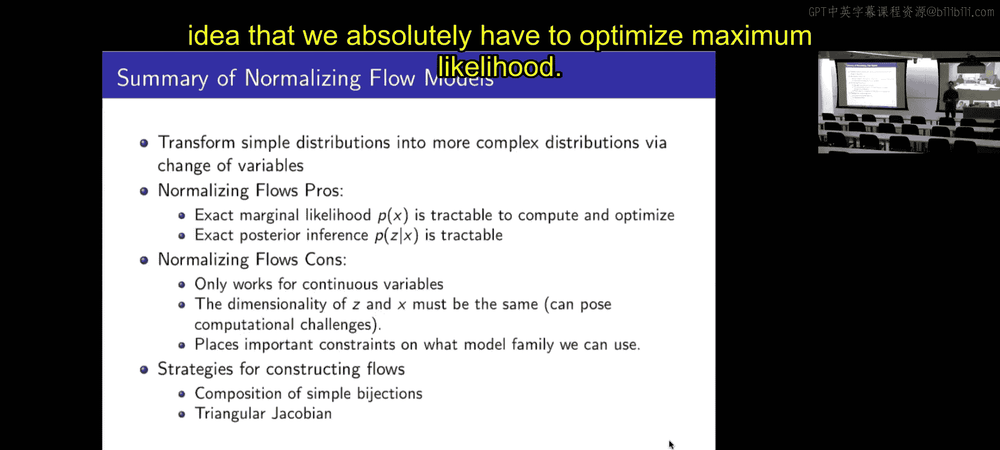