# 康奈尔大学《深度生成模型Deep Generative Models (Cornell Tech CS 6785, Spring 2023) 》中英字幕 - P9：-09-Lecture 9_ Generative Adversarial Networks.zh_en - GPT中英字幕课程资源 - BV1az421q7Vf

All right， so we're going to start a new module today。

 start two lectures on a new type of genre models and let's talk about GNs before we do this as usual let me do a little recap here。

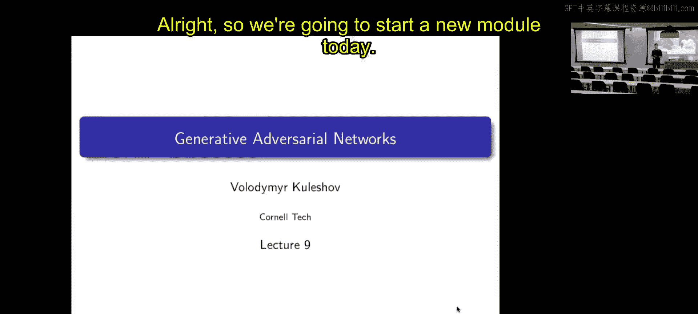

。嗯。Remember that we've been working for the last few weeks with the following setup。

 We have some data set， in this case， images that we collected from some。Distribution。

 some data distribution for a specific task， in this case we have images of animals and we would like to build a generative model over these images。

And what this means is that we want to define a probability distribution。

 Pf theta that will live within some set of possible distributions。

And our task is going to be to find some。Model that approximates well our data distribution in terms of some kind of。

Distance or notion of similarity between distributions， which we call D。

And most of the work that we have done so far in the class has looked at different types of model families。

 so different ways of representing this distribution P theta。Yeah。

We started with our aggressive models， which， as you remember。

 are based on the chain rule of probability。Start with this formula。

 and then they parameterize each conditional theorem here。

Each conditional product in each conditional factor in this product。

Another approach that we have seen after our regressive models were late variable models and in particular variational autoenrs。

And these models have extra variables， extra latent variables， Z。

 which are useful for unsupervised representational learning。

And that was our main motivation for studying variational autoenrs。But if you remember。

Having these latent variables makes things much more complicated because now the correct formula for the probability of the data under the model is this complicated integral or it can be complicated it is complicated in many cases。

 and we can't do this integral exactly so we had to find all this machinery of variational inference to be able to optimize these kinds of models。

So that was really complicated。As an attempt to simplify things and in an attempt to make things more tractable。

 we looked last week at normalizing flow models。And the idea of a normalizing flow is to have this。

Byjective mapping F between the latent space and the observed variables。And if this F is。

In some tractable space， we have the follow we can use the following formula to compute exactly the probability of any data point。

 so instead of having to do this integral and then approximate it there is an exact formula。

So that's nice， but the catch here is that it also this formula involves this extra term。

 which is the determinant of the Jacobian of app。And。A determinant is， it's a。

It's an object that is in many cases， computationally expensive to compute in general when we have so this Jacobian is an n by n matrix。

 in general it takes n cube time to compute the determinant of an n by n matrix。That's too slow for。

Applications of generative modeling where we need to repeatedly compute this gradient this determinant to compute the gradient。

Therefore， we had to restrict our attentions to certain types of fs。

 So when we use this model in practice， this F here is。Not any function。

 we looked at very specific types of functions for which the determinant of the Jacobian is tractable。

 we started with a few examples of simple combinations of a few combinations of simple transformations。

 such as later flows。And then we looked at a more general way of building these invariable transformations via models that have a particular type of utter regressive structure。

 so it can in general， any other aggressivegressive model。

Over continuous variables can be cast as a normalizing flow model。

 and it's also possible to add block structure into thatverivity and this gives us other types of models such as RealLBT or G is a more modern version of that。

Um， but。The the main thing I'm trying to say here is that even though we no longer needed to use variational inference。

 we still had to do a lot of work to get normalizing flow models to。

To obtain tractable normalizing flow models。And the main task was to make this determinant tractable。

So normalizing flows or still a lot of work is what I'm saying。Um， and I guess the reason why these。

 I guess the especially these last two model families were a lot of work is that in every case we we were trying to。

We were trying to approximate this term P of x or its。Or its log， so log P of x。

 all of this work that we did was in order to compute the log likelihood of the data under the model。

And we were。We wanted to do this because the logo likelihood is our training objective。

 that's why we're spending so much effort in trying to find ways of computing it efficiently with all of these model families。

But what if we didn't use the log likelihood？What if we used a different objective for which we would never need to compute this P of x？

And therefore， we wouldn't need to do all of this work using variational inference or using change of variables or trying to come up with families of transformations that have tractable determinants of Jacobbians。

 what if we could just not use log likelihood to begin with。

 and then we wouldn't have to deal with all of these complications。So that's。

That's what we're going to try to do in this lecture and in the next lecture。

 we're going to try to find a new way of training generative models that is based not on maximizing the likelihood。

 but instead on。I'm using a different objective that is based on samples drawn from the model distribution and the data distribution。

So this objective will replace the likelihood， we're going to look at other types of objectives。

And in particular， we're going to so yeah， we're going to look at two types of objectives that replace the likelihood One of them are going to be what i'm going to call sample based objectives and then from there in the next lecture we will generalize to。

To different types of divergencies between distributions。

 we will show that the sampling based objectives that we will study in this lecture correspond to choosing a different。

Training a different type of divergence， not neo divergence but another type of divergence and then in the next lecture we're going to study different types of divergences in how they can affect model training in the process of doing all of this we're going to derive an important new generative model type which is called G which stands for generative adversarial network。

Okay， so that's the recap so far and the plan for what we want to do next。And so again。

 as I said earlier we're going to first so in this lecture in the second sorry in the second part of the lecture i'm going to define GNs or generalversarial networks。

 but before I do this I would like to start with some。High level discussion and motivation。

About different。Training objectives。Not the log likelihood。

 and that might have important advantages over the log likelihoodli。はい。Okay， so let's first。look at。

Let's let's remind ourselves of some interesting properties of the likelihood objective if you remember in one of the early lectures。

 we derived the log likelihood as being equivalent to minimizem decL dirgs between the data distribution and the model distribution。

So when we optimize the divergence， we are precisely trying to recover their distribution。

And we explain why that's the case， there's some algebra that we need to do to rewrite the KL divergence in a different form that looks almost like our sample based log likelihood。

 and then we apply Monte Carlo， we apply a Monte Carlo approximation to that。

 and we get precisely our training log likelihood。And we showed that this is an approximation to the K divergence between the data distribution and the and the。

Model distribution。And if we could optimize over any possible distribution。

 if our model family was infinite and contained any probability， then we。Then you know。

 could eventually an update recover the data distribution and it would be done。

 it would have the optimal model， it would have the optimal test likelihood and the optimal sample quality。

You will literally have the best possible model， because that is。That would be the data distribution。

 The data distribution is the global optimum of our optimization objective。 So in theory。

 this should make sense， but in practice。We don't have a perfect distribution。 We don't have。

 We're not optimizing over the set of all the possible distributions。

 So we have to choose a model family that will never be。

It will rarely it will almost never contain the true distribution， the true data distribution。

 so we're going to be approximating the data distribution and we also have a finite amount of data。

 so we will never recover the optimal model， we're only going to be trying to approach the data distribution from some angle of the model space。

And when we're not able to。Optimize our objective perfectly。Different objectives。

Lead to different tradeoffs in terms of what solution we will get。

 so different objectives lead to different types of approximations to the true data distribution。

If if we have the right model family and under that hypothesis that we had of the model family。

 we do manage to get a kale divergence divergence that's zero we've solved the problem。

 but but you said generally we won't be able to get that zero kale divergence and potentially the model family even。

The best we can do under that model family just because of the expressiveness of the model family。

 we won't be able to even get there right that's exactly right so in practice we won't be able to get the perfect solution because the distributions that we're trying to model those are the distribution over I don't know all the possible images or over all of the text that found on the internet those there a really complicated distributions is unlikely that our a regressive model will。

Perfectly approximate the distribution of all the possible images that are out there， for example。

 so there's often going to be some approximations。That will need to be done and when we cannot perform generalrative modeling optimally different objectives will lead to different tradeoffs let me give you an example。

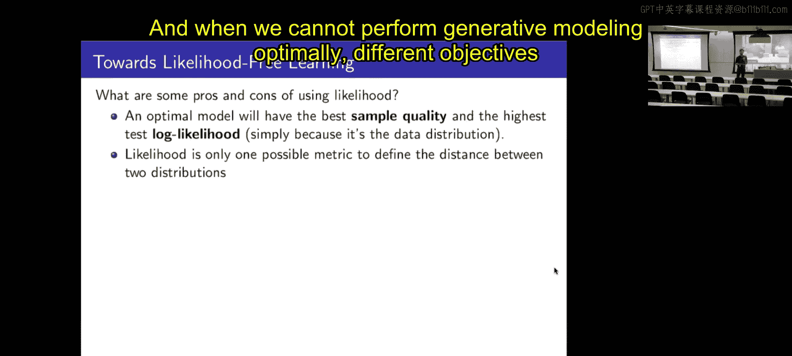

So here in this example， I have。A data distribution， which consists of a mixture of two components。

 It's almost a mixture of two Gausians。 So it's not quite a Gaussian。

 but you can think of it as a mixture of two Gaussians。 So we have one component here again。

 this is our。This is our data distribution。So we have these two components。

 I don't know if you can see it， it's a little bit dark on the。

just try to color it like this so we have these two components in the data distribution our data distribution is bymod。

And we're going to try to approximate this distribution using a unimmodal Gaussian。

 so our model is not able to capture the true data distribution because the true distribution is multimodal bimodal Rs is unimmodal。

 it's just a single Gaussian。If we use the k divergence， well。

 what's going to happen is that we will find something which looks like this。

U it will look like this， it will look like a single big white Gaussian that tries to cover both components of the data distribution。

I will come back later and explain in a bit more detail why that's the case。

 but in practice we have to make a trade off so we could either try to cover both modes。

We could either try to cover both components of the bimodal distribution or if we were to use other objectives。

 I'll come back and define these a little bit later。

 but there's one objective that's sometimes used that's called M&D maximum mean discrepancy or JSD stands for Jensen Shannon divergence。

 we're going to derive this later in this lecture， when we use these other distributions。

We have a different solution， so here when we use the China distribution。

 we fit this component of the Gaus very well and we don't fit this one at all that's a different trait。

I either try to model everything， but it's not perfect or we could ignore one component of the data distribution and just fit one component well。

So as you can see when we don't have the perfect model。

 we have to make different trade offs and different objectives lead to different tradeoffs。

 so it makes sense to think about whether the versionence is the right objective to use or the tasks that we're solving。

Ultimately， when we're doing generator modeling， we're often not interested in the log likelihood in itself。

 or interested in the log likelihood as a proxy for。

Something like good sample quality or good unsupervised representations。

But luck likelihood is not always， in fact， it's often not。

Something that correlates perfectly with image quality。

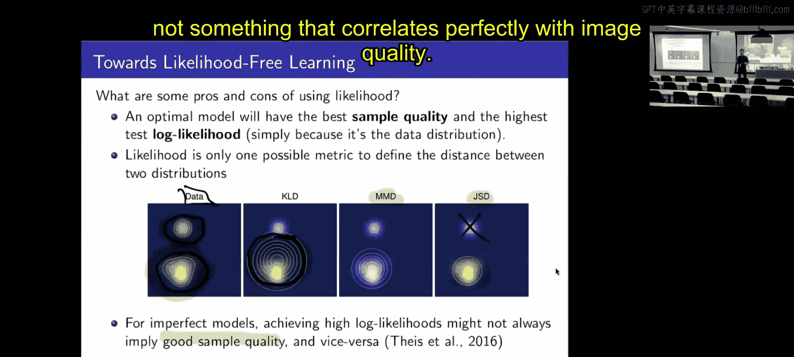

Let me give you an example of of what I mean by this so here this is going to be an example which will have good。

Values for the likelihood。But poor sample quality。How do we construct this example。

 consider a model theta that is a mixture of two components it。1%。

So 1% of the samples from the model are going to come from the data distribution and 99% of the samples are going to come from a noise distribution。

 so most of the data generated from this model will be random noise。ok。嗯。

So we can try to get an estimate of what will be the log likelihood of this model。

I can take the log of the。Of the model distribution。Here I just write out the definition。

So this term is going to be positive so I can lower bound the log likelihood by rid by getting rid of it and then just applying the property of the log I have this relationship so the log probability of the model is bounded by the log probability of the data minus this constant term the log of 100 okay thiss just a little bit of algebra。

And it gives us。It'll lower bound。啊。And obviously， we have the because the data distribution has the optimal likelihood。

 we know that we also have to have this upper bound。Okay。

 the data distribution will have the optical plug likelihood just because。

Just by definition of the Cal of Peren by the definition of the likelihood。

 we know this upper bound holdss so we can take our model distribution and we have an upper bound and a lower bound which are within a constant of each other。

 within an additive constant of each other。And what you can show here is that when this x here increases in dimension。

The relative magnitude of this constant term。Relative to the to this term will start to become smaller and smaller。

 And so percentage wise， the difference between this model distribution or the， you know the。Yeah。

 as a。Percentage wise of this。this model look likelihood will start to look similar to the to the。

We'll start to look similar to the data distribution in higher dimensions。

 And so this is an example of how in certain cases， we can get。

Log likelihoods which are not that much worse than the data distribution。

 but recall that this distribution is 99% noise， so the samples won't look good and so this is an artificial example where cycle quality and log likelihood could be relatively uncorrelated。

Similarly， we could construct an example where we have great samples， but really bad log likelihood。

The simple construction that achieves this is simply a model that memorizes the training set Okay so if we memorize the training set。

 then our samples look great， they look exactly like the training set so if we look at our training set loss it's perfect。

It sample quality， but the test set has zero probability because we're assigning all the probability mass of the model on the training set and that's the only thing it can generate so it will never generate a test set。

 therefore the probability of the test set is zero and here we have really bad log likelihood but great visually looking samples。

And so what this means is that if we're interested in other tasks。

 if we're interested in sample quality， for example， we might want to consider different objectives。

 in fact， if we're interested specifically in sample quality。

 maybe we should look at objectives which measure sample quality directly in some way。

And that's what we're going to try to do using GNS and more generally。

 the idea of using objectives which are not the likelihood， this is called likelihood free learning。

So we never have to， we will never。We will never measure the log likelihood as part of our objectives that are derived here。

 so there are objectives， even if you were to switch from the Kale divergence to something like some other divergence。

 it might require you to still evaluate the log likelihood。Here， we're going to use。

Objectives that are different from the look likelihood and in particular they will not require computing P of x anywhere anywhere in the formula and so that will have two advantages one advantage is that we might be able to optimize directly for what we're interested in which could be sample quality and also we will not have to。

Deal with this complicated task of evaluating likelihoods in the first place。

 which we know is computationally challenging and we have to come up with a lot of sophisticated math。

 we're going to sidestep this by never evaluating what like。

And so the class of generative models that are based on this idea， they're called likelihood free。

 so likelihood free is a very useful term to remember。

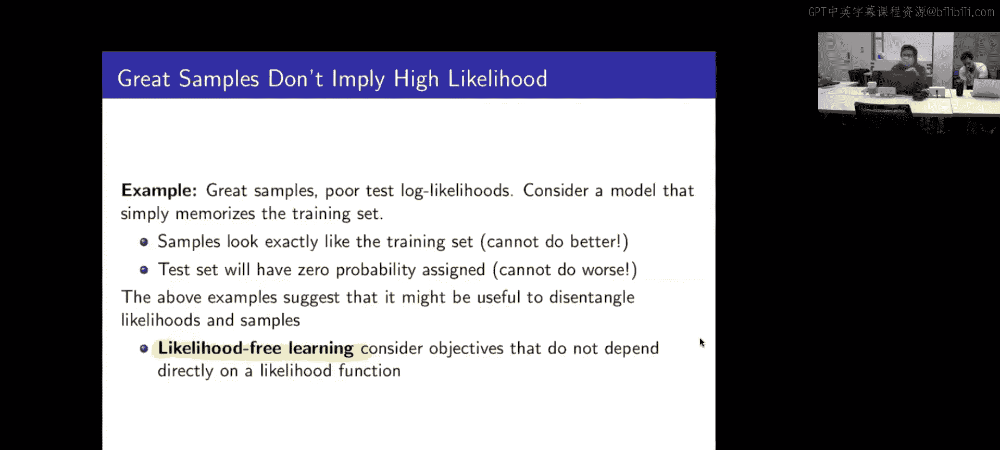

All right， so here's an image， here's a picture that shows what we're interested in。

Let's say that we have some samples coming from。One distribution。

 which we're going to call P and then samples from a third distribution those we're going to call P。

We would like to compare these samples directly。So previously。

 we would bear these samples by evaluating the probability of。

One set of samples under the distribution。Under the model distribution。

 so let's say if P was our data distribution， we would measure the probability of P under Q where Q would be our model。

 that's the approach that P use。Unlike。Here we would like to have a different approach that compares samples from S1 and samples from S2 in terms of their image quality directly without using the likelihood。

Without ever competing the likelihood。嗯。And the specific question that you would like to answer that will help us train a generative model。

 the specific question we would like to answer is given these samples， so samples coming from S。

 samples coming from Q， are they the same distribution？If we can answer this question。

 then we have something which might look like a training objective because then we could。

Optimize this notion of similarity to institutions。I it that's based on samples。

 we could try to optimize directly and make the two distributions similar right so if you remember the KL divergence was a notion of closeness between distributions。

 but that notion of closeness involves computing the log likelihood here the question I'm asking is can we get a notion of closeness between distributions that is based purely on samples that evaluates them in a way that correlates with image quality and that does not involve ever the use of the log likelihood。

That's the question that I'm going to try to answer next。

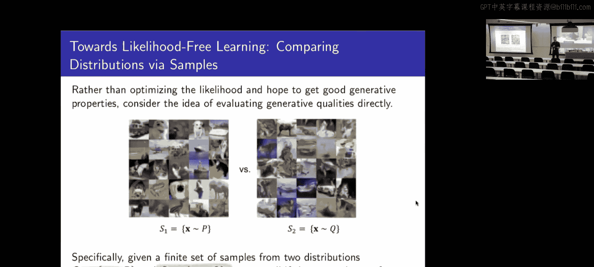

嗯。So the solution to this task is something that's studied a lot in statistics and it's called a。

Two sample tests。So a two sample test is literally。

The or the set of two sample tests is a set of techniques for literally answering the question that I just had in my earlier slide。

 it's a way of reformulating that earlier question in the language of hypothesis testing。

What I mean by this is that we start with。A no hypothesis that the two distribution are the same。

And what a two sample test in statistics does is to。

Either accept or reject this hypothesis H0 sorry is to reject the yeah。

 is to either accept or reject the hypothesis with some probability。

Okay there is an alternate hypothesis that they're not， again。

 this is similar to the kinds of statistical tests involving key values that you would have seen before。

 except here the question that we're trying to answer is are the distributions the same or not。

 so are null hypothesis is that they're the same the alternative is that they're not and then the question is can do we accept or do we reject the null hypothesis with some level of confidence？

That is the mathematical question that a two sample test tries to address。And the way it does this。

 the way a two sample test works is that it defines some kind of testistic that compares these two samples。

And if this test statistic is high if it。Believes that the difference between the two distributions。

 between the two sets of samples is large。Then it。Then it rejects the null hypothesis and if the test statistic is。

If its if it's if it looks within an acceptable range。

 then we do not reject an nu hypothesis okay and an example of what a testistic can look like I will give you more examples。

 but just for now think of it as being you know the difference in means you know you take the average of samples in S1 you take an average of the samples in S2 if the averages are different well probably it's not the same distribution。

 so we can reject an nu hypothesis， but if they're the same well we。

I guess we can't necessarily reject the null hypothesis， it could still be that it's wrong。

 but we don't have enough evidence to reject the nu hypothesis。O。😊，So yeah。

 typically the way a two sample test works is that when。Ts。Less than a certain threshold。

 we accept an all hypothesis， and otherwise we reject this。

And so this framework is going to be useful for us because it's an example of a likelihood free approach to comparing to distributions and determining whether they're the same or not。

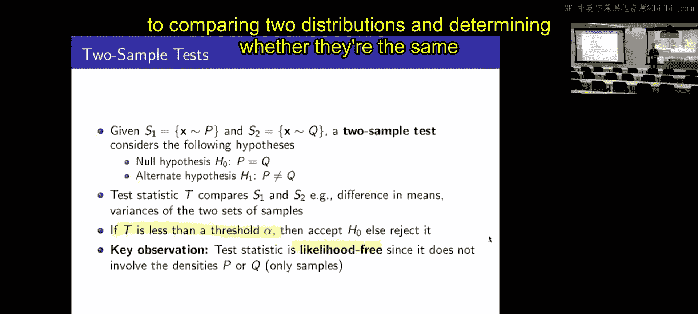

Okay。And。And so we could apply this framework to our task。

 which is generative modeling recall that here our goal is to have some notion of closeness so we could instead of using dec de Persions。

Slash the little likelihood for。For D in this picture， we could instead use a two sample test。

So what it means is that we can assume that we have access to a set of samples from S1。

 so our first set of samples will be our data set right which is this set of samples from data distribution that's going to be our first sample。

And then let's assume we choose a model P theta from which we can sample。Okay。

 let's say that it's easy to draw samples from the model and that's the case for many distributions that we have seen。

 for example， in a variational errorenr it's easy to draw samples in a normalizing flow it's easy to draw samples with our aggressivegressive models that's more challenging remember in our aggressivegressive models sampling is slow because it's sequentialial and other aggressiveive so maybe an un aggressivegressive model might not be the best fit for this framework。

 but let's say if we use any other model from which we can draw samples that gives us。

Another set of samples called S2。And now we can apply the idea of。To sample testing。

 let's say we have some sort of sample test。 I'm going to define。

Some specific to sample tests in a moment， but let's say we have many two sample tests then it naturally gives us an objective right so we could train a generative model to minimize this two sample test objective between this set of samples and this set of samples。

And this approach gives us a different way of constructing a notion of similarity between distributions and gives us a different optimization objective for。

For。For our generative models。RightSo here I have presented to you a different strategy for defining a training objective for generative models。

 it is one that is based not on dec divergence and likelihood。

 but rather on a likelihood free two sample test that I am yet to define。The key idea here is that。

There is an alternative strategy to training generative models， which involves。

Optimizing the statistic， the test， the yeah， the statistics are a two sample tests。

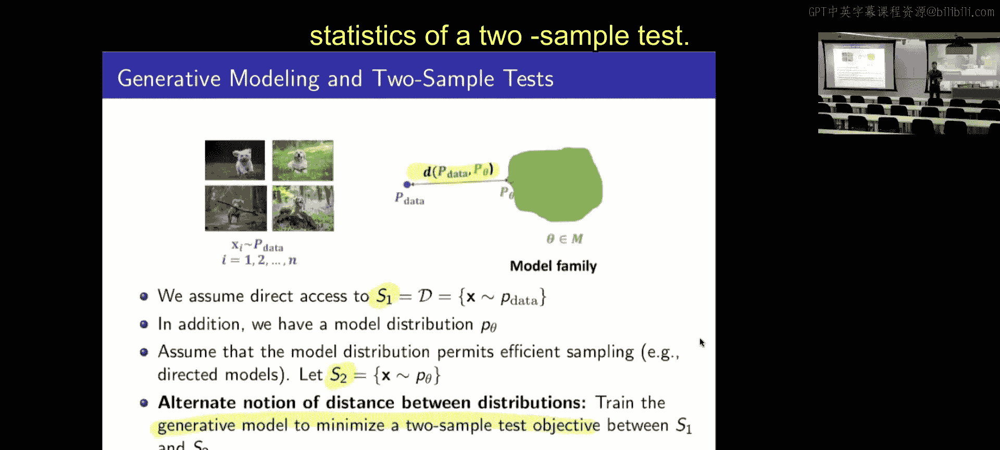

好。So what might be some two sample tests that we could use？It's actually。

A question that's not obvious at all。 It's actually quite hard to find a good to sample test statistic in general。

 So here I have。Some example here I have a few examples。

 so the on the left what you see is two distributions， one of so there are two Gaussians。

So here it's really easy to tell them apart because they have different means。But what if I were to？

Push them so that they overlap and they have precisely the same mean。 Well。

 then I have something like this。 I have these two distributions。 Now they have the same mean。

 They look the same， according to my。According to a statistic that compares the means。

 but now they have a different variance so that's concrete now I could maybe update my statistic I could update my two sample tests to compare both the mean and the variance。

 but if I do that I can again come up with another example where the distributions are not the same or where yeah where they're not the same but they have the same mean variance。

Oops， so here I have。Here I have the。I have two distributions， one of them is Gaussian。

 the other one is Laplace， they have the same mean， the same variance。

 but they clearly look different one of them is like a bell， the other one is like a。

Triangle of some sort with a sharp peak they they don't with the same anymore。

 So for any test that I can come up with， I can then try to cheat and come up with a different distribution that。

That。That's not the same as the one which I'm comparing， but one that looks the same on this picture。

So it's always possible to come up with given it。I can find ways of cheating and coming up with a distribution that fools the test。

Right， and so。And so that's a problem， but in our case。

 we have an interesting way of getting around this problem。

Notice that in our formulation of the problem。We're not just comparing any samples。

 we're comparing samples that come from the data distribution and samples that come from the model distribution。

So we know that the two distributions are different to begin with。

We know that one set of samples come from the model， the other one comes from the data distribution。

Because we know the true answer to whether they're the same or not。

We can use this knowledge to learn the test statistic from data。Right。

We can use the fact that we know that some samples are real and some samples are fake。

To learn a statistic that will try to discriminate them as much as possible。Okay。

So the key idea here is that we're going to try to learn the statistic that。

Maximizes some notion of distance， we know that these samples are real， these samples are fake。

 can I use machine learning to learn a classifier that will maximally separate the two different classes。

Once I have learned this statistic， now I can。I can fix it。

And then I can try to perform generative modeling to make my model distribution and my data distribution similar according to my new test sta once I try to minimize them。

 it's possible that the generative model will try to cheat and it will will generate samples that。

Poolol my statistic it makes things the same according to my statistic。

 but the distributions don't really look the same so then I can fix again my general model。

 I can update my test statistic to try to again discriminate。

The model and the discriminate between the model and the data distribution。

Learn that then again re optimizeize the generalrative model， re optimizeize the test statistic。

 and I can keep doing this until I have something until I'm in a situation where。

No matter what kind of statistic I learn， the samples look indistinguishable。

 and therefore I must have samples which actually look like the data distribution。

Does this strategy make sense？啊。So if you're familiar with GNS， you see where I'm going， I think。

 so this procedure of learning a two sample tests and then using it as a training objective for a generative model。

 that is precisely what a again does here I have。I told you a story for where the defense come from。

This is what again does can be interpreted。As optimizing this to sample statistics。

So if you haven't seen end before， what I'm going to show you next how we can use the machineary of two sample tests to define a specific general model。

The idea of learning the test means that we're going to generate samples and we know that these samples should have a different test statistic from the real samples。

 so therefore we're going to use them to train them we're going have two classes essentially。

 the real and the fake data and we're going to use these samples to learn a model that will distinguish the real from the fake just as a test statistic in a two sample test。

Distinguished history from real estate， but yes， when we do when we do all of the work that we're doing here。

 we never actually define a formula for what P ofx is。Like we did it with other aggressive models。

 for example， so with utter aggressive models， P of x equals the product of these terms for each term。

 I have a formula that's a function of some set of parameters here I never define a formula for what P of x is。

嗯。But I still have a distribution because it's defined via samples right if I were to draw samples from my model。

 they're spread out over the space of all the possible images in some way。

 so it still defines some distribution， except this distribution is not defined explicitly via formula is defined implicit via samples and so this is why we also call these types of models。

And by that， I mean GNs and their extensions， we refer to these models as implicit models。

And I have a slide on that shortly。Okay， so what are agains？Again。

 is going to be a new type of generative model whose model family is defined， but well。

 I guess it's so we start by defining the model family here and the specific model。

The specific parameterturization that I guess the。We're going to refer to the again。

Model as the core of the again model will be the generator okay so the generator is going to be any sampling process that goes from a latent set of variables z to a set of observed variables x。

And the mapping from z to x is going to be defined by some function G with parameters theta。Okay。

 so this defines a mapping between Z and x。Now this model G。Oh。

It can be any parametric process from which we can sample。And now this is basically saying what。

This is answering， this is kind of addressing the question you just asked。

 so notice that this so this G here will be any process that can take samples from it。

So it outputs before all of our parametermetricizations would output the parameters of a distribution over x。

That's what a VE does， the output of the neural network that parameterizes a VE is a mean and a variance over the data distribution or over whatever distribution it's modeling。

Here we're outputting not the parameters of the model。

 but we're outputting samples from the model directly。

And because we never output the parameters of the model。

 we can never write out exactly what the formula is。

 and so the probabilityba is defined implicitly over samples instead of explicitly over。

Over parameters instead of defined explicitly using parameters。

So this is a generator again it can be any sample any sampling process， for example。

 it could be a neural net that takes to z it splits out an x。

 so any mapping between z and x or it could even be something more complicated like some system of differential equations or it could be some simulator。

 it could be any。Any software that generates Z from X and has parameters that we try to tune。

So this is the generator。And then this generator will be trained to minimize a two sample test objective。

And this。objective this two sample tests will come with a learned statistic。

 which we call the discriminator。Okay， so the discriminator is any function that takes real samples x。

And it outputs a label for each sample， which is going to be zero or one， real or fake。

So data a discriminator， it's just any neural old net that tries to determine whether the。

Model and the data distributions are the same or not。And we're going to train the discriminator to。

To separate the fake and the real data as much as possible。So you can see that this is now。Here。

 here we're changing two models that are trying to。Achieve obstacles。

So the generator is trying to fool the the discriminator and generate data。

 which looks like the true data distribution is indistinguished and the discriminator tries to。

 tries to， you know， find whether the。Data and the model distribution are actually the same or not。

And so you can think of these two distribution， these two networks， sorry。

 these two neural networks are playing a game against each other。

A game where one of them tries to fool the other and the other one is trying to not be fooled。So。

 specifically。What I mean by this is that。Both models are going to be optimized using the same training objective。

 except one of them will try to maximize it， and the other one will try to minimize it。

 So this is why it's a。It can be viewed as a two player game in the mathematical sense of the word game or the solution over both models will be a na equilibrium of the game。

So the training objective for the discriminator is going to be as follows here you have it on the slide。

So this is simply performing binary classification using the cross entropy objective。

 which is the objective to would normally use train logistic compression or a neuralNe to classify the inputs into one of two possible classes。

So we're trying to maximize the lock probability。Of the。

I guess we're trying to optimize the log of the score of the discriminator。On the data distribution。

 and we're minimizing the log of the score of the data distribution on the fake data。

 So this objective is encouraging。This term to be high on the， on the data distribution。

 and we're going to try to make it low on the。え？I need the trainator。诶。So yeah， again。

 we're trying to assign probability one to points that are coming from the data distribution and probability zero to points that are coming from the model distribution。

And with a little bit of math。We can actually work out what is in theory the optimal solution here。

 so if you take the well actually I'll show you more about this on the next slide。

 but if you were to work out the math，What happens is that the optimal solution to this discriminator。

And again， you can get this by。Taking the derivative and doing some calculus。

 the optimal solution is this ratio is this。Is this ratio of densities？

Between the data distribution and the model distribution， in particular。

 this is you can also rewrite this as the。呃。As the。As the sigmoid of the lock。

Of the ratios of the two distributions。So the optimal discriminator has the following form。

 and so it outputs something that's closer to one if the data distribution has higher density at a point and it outputs something that's closer to zero if the model density is higher at a point and in particular。

 it is implicitly trying to learn the ratio of the densities of the two distributions。是。

So we're not asking。The generalative model to have a computable density。

 instead we're going to estimate its density using the discriminator。Okay， so this is an instance。

Of a more general approach which I guess I'm calling it here unsupervised learning as supervised learning so by unsupervised learning I mean estimating the density of a distribution at a certain point I guess yeah density estimation that's a classical unsupervised task it turns out that we can often perform density estimation using a form of supervised learning right so let's say that our goal here is to。

Is to find a good well yes to find a good discriminator。

 let's say that we have points coming from two distributions， one of them is indexed by y equals0。

 the other one is indexed by y equal1。And for each assignment of Y。

 we have samples X that are drawn from a distribution condition on that sample。So we can rewrite。

 so this is I guess this is the proof that the discriminator is estimating a ratio of distributions if I wanted to know the probability that y equals one。

 so the probability that this example is fake or real it doesn't matter。

I want to have probability of one class this is what the discriminator is trying to learn right it's trying to learn the probability that the data is real or the data is fake。

 it's trying to classify the distribution from which trying to predict distribution from which data point X comes。

So we can just do a little bit of math here， we start with the so we start by applying basees rule in our first equation here so this is just applying base rule here then we。

We apply the law of total probability on the bottom， we expand things。

 so we simplify things a little bit here， and then we just do a bit of algebra here。

 and then we use the definition of a sigmoid to get the following expression。

 so the optimal definition for the probability of the distribution coming from a certain class。

The optimal form here is。Is this ratio？And then what this is saying is。

By computing this probability using supervised learning right so if we can use supervised learning to predict whether the data comes from one distribution or another distribution。

 we are implicitly learning this ratio between distribution。And so， again， we can estimate the。

Not exactly the density， but we can estimate a ratio of densities by performing supervised learning。

And that's what a discriminator does。It learns this density or this ratio of densities。

And this ratio happens to be a natural test statistic to use。Right， because。Like。

 so this is literally the。The log of the ratio of which distribution is more likely。

So this is the test statistic that is being learned by an optimal discriminator。

 assuming we tend to be optimal and。And yeah， this defines a natural two sample test that we can optimize。

嗯。Using the generative model。Okay， so that was the training procedure and the that was the training objective for the discriminator the generator as the same training objective except that we're minimizing this objective instead of maximizing it so the generator is trained to try to fool the discriminator it's it's trained to try to。

嗯。To try to minimize， to lower the accuracy of the discriminator。This is our goal here。

And so we know that for the optimal discriminator。The optimal discriminator is this ratio of distribution。

So I can understand a little bit better what the generator is optimizing by using that identity and plugging it into my formula or the objective for the generator。

OkaySo let's say that I have an optimal disriminator， which is this ministry of distributions。

I can plug that formula into this objective and see what comes out。

This is what happens when I plug it in。I can do a little bit of math here。

 so I massage things I by two this log four term that comes there yeah I just added the log and I subtracted the log and I folded the log into the expectation we get this。

And now this equals the sum of two k emergencies。And。

Each scale divergence compares either the data distribution or the model distribution to this weighted average of the data and the。

And the。Generator distribution。And the sum of these2 k of divergencies。

 that is literally the definition of another type of divergence， which I mentioned earlier。

 which I mentioned to you earlier， which is called the Jensen Shannon divergence。

So if we take the ratio for。The ratio that's learned by the optimal discriminator and plug it into our generator objective。

We see that our generator objective becomes。Precisely the g machine and divergence between the data distribution and the model distribution。

So one way to understand what again， is doing is that it optimizes the gensen shanin dirgence instead of the k divergence。

But it does that in a。In a strange way， it doesn't optimize it directly like you did with theL dirgence。

 it optimizes it by the means of samples drawn from both distributions。

Here now we have two new properties， we're optimizing our objective using samples instead of a formula for that objective directly。

 and we've also switched from using the L divergence， we switched to using prevention。

So why would the gensen Sha and divergence be a good objective？So first of all。

 it's still a divergence， so it satisfies all the nice properties that divergences have。

It is always greater than or equal to zero for any distribution in p andq and when p equals q。

 actually actually if and only if equals q， the gensenchan divergence equals zero。

 so these are the same properties we had for the Kl divergence。

 it makes the gensen shine divergence a natural objective to optimize。

It also has a few interesting properties that decaled dirgence does not have。

 for example it is symmetric， so flipping P&q gives you the same result that was not the case where the dirgence。

 in fact dec dirgence behaves very differently。If you flip P and Q。And also， if we take the route。

 then we have a proper distance and a distance is。A diversion which satisfies the triangle inequality。

So here are some additional interesting properties。嗯。And and we know that。

If we have the optimal discriminator， of course again。

 all of this is continged on us having an optimal discriminator， if it's not optimal。

 then we're performing some approximation to this， but this doesn't hold true exactly。

 but yeah for the optimal discriminator and the optimal generator the minimum of this objective is achieved when the objective equals precisely minus log of 4。

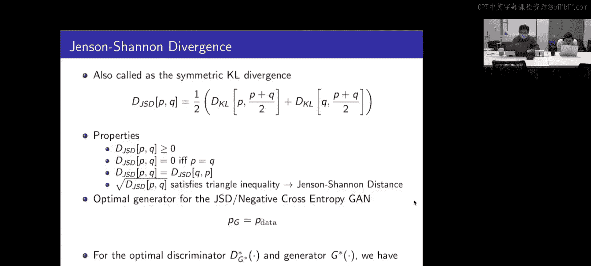

So these are some property of the genenen and divergence。The Genen China Dirgence also has some。

Appealing qualitative properties that might make it a good。Objective to optimize。

Remember this figure， this is when we had。A data distribution that involves two components。

 and we're trying to approximate this data distribution with a unimmodal Gaussian。And。

When we try to fit this Gaussian using decaled divergence。

The resulting model tries to cover both mode of a distribution。So it is modeat covering。

 it tries to cover as much of the input space as possible。On the other hand。

 if we use the Jesen Shanon dirgence， it tries to fit one mode of the distribution well。

So it has this different qualitative behavior。And we can see why that's the case。

 so the Kldirgence has the following formula。😊，Right， so it's the sum over。嗯。

It's the sum over all the data points。And at each data point， we're computing the log of this ratio。

If there's some data point。That has non zero probability under the data distribution。

 It also has to have non zero probability under the model distribution because we do this division by the density of the。

Of the model distribution， so this denominator that I just highlighted。

 it has to be nonze for any x where P data is nonze， otherwise this will blow up to infinity。

So when we train using decal divergence， we're forcing it to have。

We're forcing it to put probability on every point that has non zero probability under the data distribution。

And this is why it is covering。It tries to cover every point because if not this， if it doesn't。

 then this objective blows up。On the other hand， the Jensen Shannon distribution does not have this property in the denominator of the Jensen Shannon distribution as a mixture of the data in the model distribution。

 therefore were never forced to assign nonzero probability to every point and as a result this。

Distribution is mode seeking， so instead of trying to cover both modes。

 it tries to fit one mode well。And that's something that might be good for us if we're interested in sample quality。

In this example， I used Gaussians， I used very simple distributions。

 but imagine we trying to model the distribution of all the images。If we were to use the cable purs。

And our model is not sufficiently expressive， our objective encourages it to try to model every possible image。

It tries to force it to put some probability under any image that could come from the data distribution。

呃。But it doesn't have enough capacity to fit every image so it essentially ends up doing a poor job on every possible image。

 and in practice this is one explanation that people have used to explain why image is coming from a model like a VE might look blurry because it's trying to approximate every image a little bit。

But it's unable to。do everything well， in contrast， using the Jsen shine divergence。

 we are allowed to model only a subset of all the possible images well。

 and so that could lead to sharper images at the cost of lower diversity in the types of images that we can generate。

Okay， so the key idea here is Jensen China and Dirgence is mode seeking。

 we're trying to model one mode well at the expense of diversity。

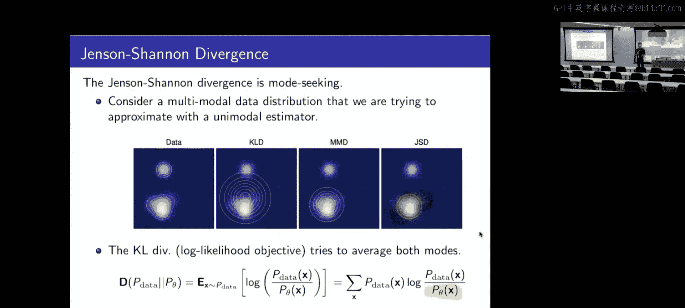

And that could be favorable for us。嗯。Okay， so now I explained to you what's the objective for the generator。

 what's the objective for the discriminator， let's put these things together and define the full G training algorithm。

The way you train again is that you sample a mini batchcher of training points。

And you sample a mini batch of noise vectors。And for each noise vector。

 you pass it into the model to generate a fake sample。

And now you update the generator to maximize the training objective。

Sorry don to minimize the training objective， which means we minimize the accuracy of the discriminator and at the same time you try to update the discriminator to maximize the opposite objective and then you repeat this process and the hope is that discriminator converges to something which。

separates the two class well， but then the generator learns to fool it and we get something that is that is when all is converged。

 the discriminator can tell the samples apart and therefore the same。

Oh how did people discover it was it through mathematical proof was it based on mathematical proof or was it by trial and error I'm pretty sure it's by trial and error if you read yeah there's a story for how the person who invented this his name is Ian Goodfellow so there's like a story he invented it went for drinks one night and then they started just like throwing ideas and then they came up with this idea of having a discriminator they tries to fool a generator he came back at home。

 implemented it at night and it and then they did more research on this and that's how they proposed the again algorithm and then as they were writing the paper then they later worked out the theory and provided this theoretical justification for what it's doing but yeah there's a story online this was like a wired article or something a couple years ago that tells the story yeah。

Okay， so this is a visualization of what GN training is doing and in practice GNs are GNs give really good image quality。

 that's the main defining feature and the main advantage of using GNs in practice they often have very good image quality in fact until a year and a half ago GNs were by far the state of the art in terms of image quality and in recent years they have been matched by another model type called diffusion models which we're going to see in a few weeks。

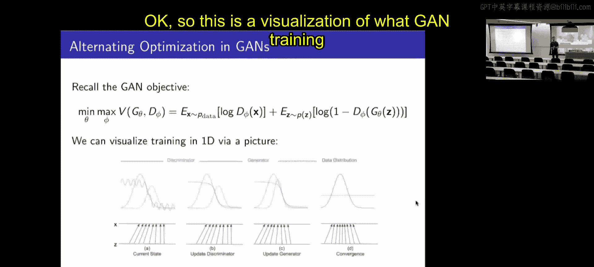

I would say diffusion models and welltrainganNs have similar image quality。

 but GNs are more difficult to train diffusion models are easier to train relatively speaking。

 so GNs can give very high image quality the problem with GNs is that theyre oh and this is just an illustration of how GNs have progressed since they're since they were invented in 2014 over the course of four years they've been improved and refined。

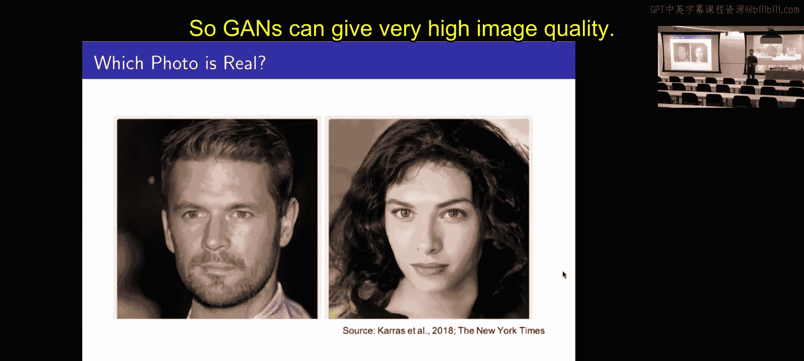

To the degree that they give large photo realisticistic images or they were giving and they they still do。

 but by 2018 they giving very realistic images。And they have also been applied to other domains so you can apply them even for audio。

 however， getting G to work is challenging because the GAN objective is this minim game between discriminator and generator。

It suffers from instability during the optimization process so our objective is no longer a standard machine learning objective just our goal is just to drive some objective down here we have this game where one part of our model is trying to optimize the objective the other one is trying to minimize it and there's all sorts of problems that could arise it it could get stuck in an infinite loop of some sort where it just cycles through different states。

 the gradient can vanish it can converge to just generating a single example and get stuck in that and it's also hard to evaluate GNs because we don't have a。

Well defined objective function and good likelihood， we have samples。

 but samples are hard to compare qualitatively。

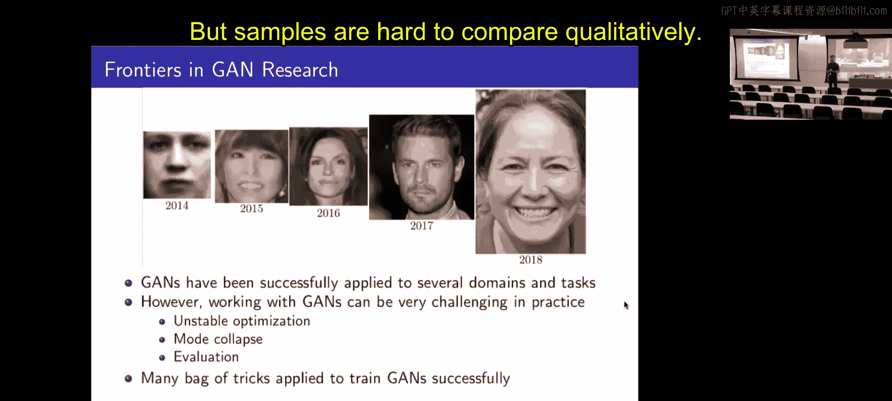

And so there's a lot of tricks that are needed to traingans in practice。

 so just to give you an idea of what could happen here， this is a picture of。Of of training again。

 So it starts here。 It goes smoothly， smoothly。 Everything is nice。 and then boom。

 it just the gradient explodes and， you know， something happened in the neuralled。 some， you know。

 maybe the discriminator。 So this is the greenest the generator generator loss。

 maybe the discriminator went into some part of the parameter space that。

Gave the generator a weird training signal， and then the generator went into some direction with like a weirdization landscape and got stuck there and now has these huge huge。

Udates has these huge gradient magnitudes and yeah it's just stuck and you don't really know why so these things happen all the time and getting again to give you the kinds of images that you saw in the previous slides is actually very。

 very hard。So another example is something called mode collapse so this is。

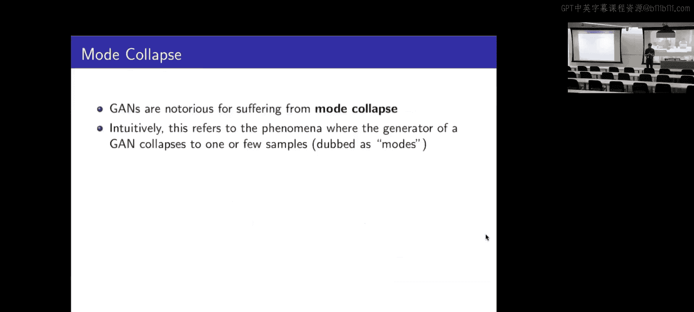

A set of samples drawn from a standard type ofgan you can see that these samples are pretty much the same。

 so it's easy for it to get stuck in generating one example very well but not covering any of the other not generating anything else this is an instance。

It's called the mod collapse problem and it's tied to that property of the Jensen China divergence where we generate only one sample where we can get away with generating one part of the data distribution well。

 but not generating anything else。

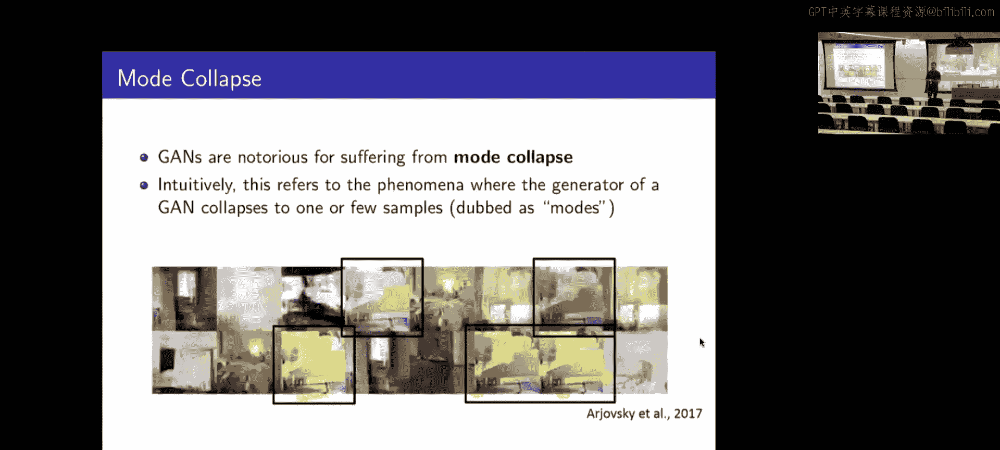

嗯。And then so this is an example， this is a toy example where we can isolate the mode collapse problem here we're training on a distribution that's this mixture of 10 Gaussians。

And what happens is over time， the generator is generating some mode， the discriminator。Eventually。

Figures out that this mode is fake and the other modes are real。

But so then what the generator does is it just switches to another mode。

And then it gets perfect act and it perfectly fools the discriminator when it starts to generate from another mode。

 but then this other mode is again。It be detecting the fake so it jumps to another mode and it just keeps doing this process back and forth and it never converges。

 it can get stuck in this local optimum of just generating one mode。

 which every time pulls the discriminator， but it's not generating the full distribution。

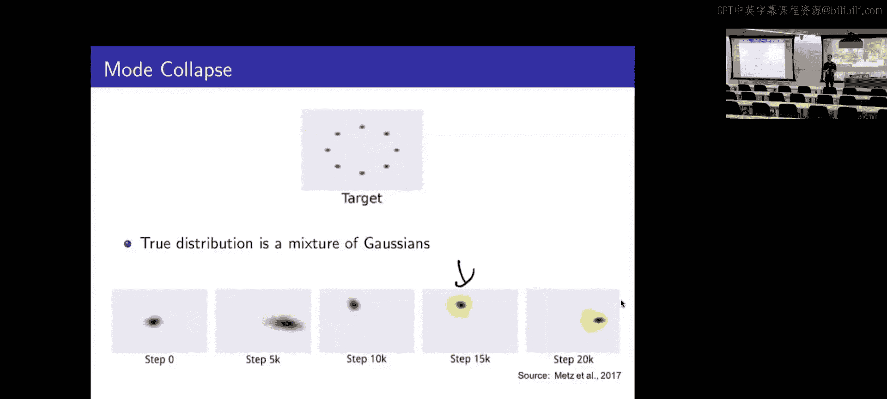

So yeah， this is hard。And this is again another example of mode collapse here we train on our favorite Mminist data set and it's just getting it' spitting out the same digit all the time after it finished training。

 you know， it's just it's just another instance of this local optimum problem where it's stuck in generating one image。

嗯。Yeah， here you can think of each digit as each mode of the Gaussian in the previous example。

 the same explanation， the same analogy can be applied here。And so in practice。

 theres a lot of tricks that need to be used a couple of years ago。

 there was this famous repo calledgan hackx， which is just a set of practical techniques for training GNs。

 and that can involve injecting some noise， playing with the architecture。

 regularizing things in clever ways， there's a lot of these techniques that are used to get GNs。

 working in practice。

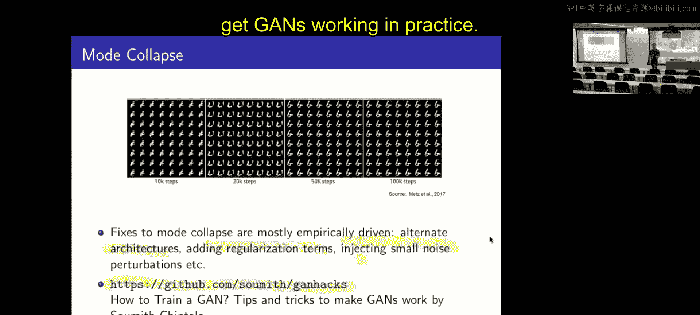

But then the question is also。What do we want out of these models in practice。

 we could get samples which look bad if we don't tune the。The model well。But you know。

 sometimes we are not interested。ampSometimes you could just be interested in interesting examples like this one。

 so this is an art piece created way。Several years ago， it was sold for。400，000 in。

At an auction at Christie's and what I'm trying to say here is that the samples that can come from these models are sometimes weird。

 but there's also potentially artistic value in the weirdness of these samples so you know what is a good sample is a bad sample is something very subjective。

On the one hand， it can generate interesting examples， on the other hand。

 it makes scans hard to work with because it's hard to understand whether a certain sample is good or not and whether our model is achieving something that is acceptable or not。

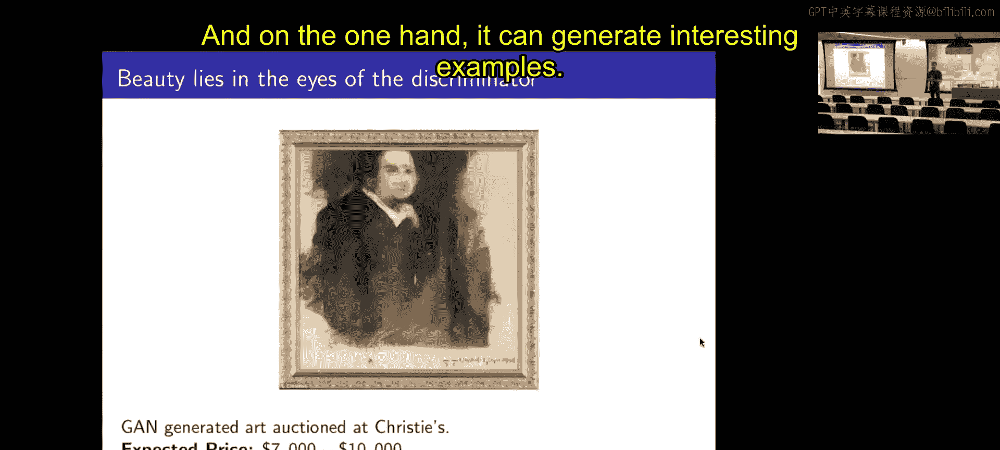

Okay just to summarize things， GNs generate very good samples， they're also very broadly applicable。

Unlike in normalizing flows where we had to be very careful about which。

Mapping between Z and X we choose and again any differentiable process from which we can sample works here。

 so that's a great advantage。Of GNS now the downside is that it doesn't， first of all。

 it doesn't work well for discrete variables because we can't back propagate through the generator and it's also difficult to train because of these optimization processes that are optimization issues that I described。

Yeah， and so in the next lecture， we're going to look at a few more at last versions of GNs。

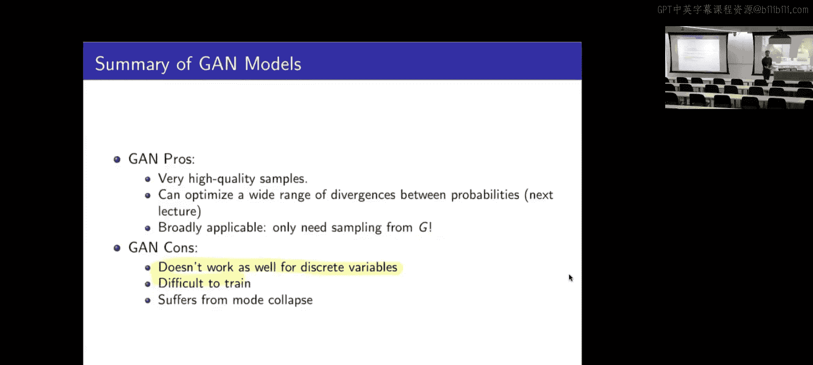