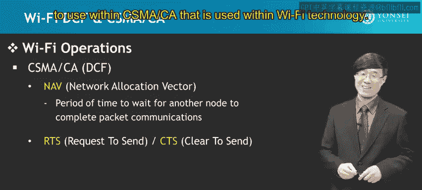

# 延世大学《新兴技术从智能手机到物联网再到大数据Emerging Technologies From Smartphone to IoT to Big Data》 - P100：28_4.2 Wi-Fi DCF CSMA-CA（第1部分）.zh_en - GPT中英字幕课程资源 - BV18hpFewEcG

Yeah。Yeah。Wifi， DCF and CSMACA， What does this mean， we'll soon look into it。

WiF operations are based upon the standards in which DCF distributed coordination function is a technique that is used to enable WiF communication。

And in DCF， a core networking technology that is used to access the ISM band channel is called Carrier S multiple Access with collision avoidance for short CSMAC CA。

Now， once again， we need this because the ISM band is shared with many。

 many devices that are unlicensedly using the ISM band。

 and that is what the ISM band was made for now in that application structure as multiple devices are using it in a unlicensed structure。

 when they access the channel when multiple devices access the channel。

 then we want them to monitor the carrier frequency。And if nobody' is using it。

 we want them to decide when and how to use it。So overall。

 that is where we get the word of carrier sense that you're sensing the carrier frequency。

 that will be the 2。4 gigahHtz or the 5 gigertz frequency range。

And you're trying to do very sensitive， accurate， multiple access where multiple devices are trying to use the channel in a specific way that they don't collide。

 and that is why we add the word collision avoidance。

The role of DCF and CSMACA is because we want to avoid communication failure due to packet collision so what happens if you have a packet collision for multiple users Well those packets will all be wasted they will not be useful in addition。

If you are in a sequence of communication， then most likely the sequence of the packets may become all wasted。

They may all become useless。And that would degrade the efficiency， the utilization of the network。

 and therefore we do not want that。 Why does this occur Once again。

 this occurs because this is a unlicensed ISM band。Operations of CSMAC CA。

They first do carrier sensing， which means that they are going to first look at the channel that they are going to use and they are going to try to use it when nobody else is using it in order to know when to use it in order to know when others are not using it。

 you need to sense the carrier frequency and that is what the CSMA part CS is standing for carrier sensing。

The other is collision avoidance， you want to avoid collisions。

 so if somebody else is using it and you detect that through your carrier sensing。

 then you do not want to send。So there has to be a period once you detect somebody else is going to use it。

 there is a NAV period which you set such that during that period you do not use the channel because you detected that somebody else is using it。

And setting this NAV period is very important to avoid collisions。What is that。

 that is short for network allocation vector， meaning that you've allocated the network and somebody's using it。

 so I'm not going to use it to avoid collisions。And that is what NAV stands for。

Here there are two protocol messages that are exchanged that will set up NAVs in local notess。

 and that is request to send and clear to send。This is like the request to send is what initiates a communication session where I will say requestquest to send。

 and I will ask somebody to reply back。The node that I want to communicate with。

 the station that I want to communicate with， when that station sends back a clear to send as a reply to my request to send。

 then because of these two signals， RTS and CTS， all surrounding devices that have seen us exchange either ATS or CTS。

 or CNs exchange both the RTS and CTS messages，For a NAV period。

 they will withhold from sending anything。And that is how we avoid collision。

 that is the CA collision avoidance technology that we are going to use within CSMACA that is used within Wifi technology。

So the RTS and CTS， these are messages that are exchanged such that local devices will see this and withhold from sending any packets during the NAV period。

This is a solution to the hidden node problem in the ISM band we do not know who is overlooking the channel and who is wanting to send something so therefore these nodes that we don't know who wants to send and who is planning to send we can prevent them from colliding with our packets using the RTS and CTS and the NAV duration。

And that is why we say that it's a solution to the hidden node problem because these hidden node that my node is not aware of will be able to see our RTS and CTS exchanged and avoid collision。

Then you will see that the communication is requested using an RTS。

And the CTS frame is used to accept the communication request made by the RTS。

