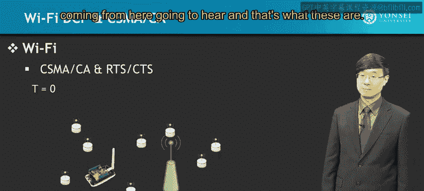

# 延世大学《新兴技术从智能手机到物联网再到大数据Emerging Technologies From Smartphone to IoT to Big Data》 - P101：29_4.2 Wi-Fi DCF CSMA-CA（第2部分）.zh_en - GPT中英字幕课程资源 - BV18hpFewEcG

Yeah。Yeah。In addition， when you're communicating， there are interfrd spaces。

 and these are used to set a priority。Think of it this way if two people are communicating and they are fast talkers。

 they're sending in， they're talking and replying， talking and replying at a very high pace。

 very fast。Then it is very difficult to get yourself to interrupt them in the middle without having your words overlap with somebody else's words。

 this is because they are talking and replying very quickly。

Then you cannot squeeze in into the middle to hijack or intercept the communication session。However。

 if they are talking slowly where they say something， they wait and they reply。

 then they wait and then they reply again back and forth， because they're communicating slow。

 there is a big gap between their。Their words and their replies。Then because of this gap is wider。

 you can easily get into it and inject your message， your sentence。And in other terms。

 you can hijack the conversation。So based upon this inter frame space， which is the space。

 it's a little bit of a short duration of time in between messages and messages and messages。

 packets and packets and packets with this small interval time， is it large。

 is it a wide period of time or a small period of time will determine the priority。

One thing that you will see is that if the session is very short。

 which is what is accomplished by the SIFS， the short Interframe space。

 then a sequence that is so fast in sending and replying。

 sending and replying that the small interframe spaces that are the SIFS。

 the short interframe spaces， there are so fast that once a communication session is in mode using the SIFS Interframe durations。

You cannot bother them。 You have to leave them alone because they are sending and replying very quickly。

After a communication session is over， then there is a longer period before the next communication session is conducted。

 and that is our DIFS duration， which is longer than the SIFS。

And this is a period in which after a quick session of communication using frames， packets。

 and SIF restorations。Then at the end， you will use a TIFS before another one will start communicating。

And that is why as you see right here， there is a DIFS， and then there is a SIFS。😊，In addition。

 there is a contention window， this is also called a backupoff window。

The contention window is a contention window because if there are multiple devices that are trying to communicate and this is detected。

 who will send first is decided through the contention window and this is first set for a given duration where each device that is wanting to send something will select a random number within the contention window period。

And they will wait for that duration， and after that duration。

 they will check to see if the channel is empty， nobody's using it。

 and then they will use the channel。Now， naturally。

 every device is going to select a random number within the contention window period。

That means that they will all select different numbers。

And that will help them avoid because whoever luckily chooses a smaller random number will try to attempt communication quicker than a device。

 a station that chooses a larger number in the contention window period。

And this duration of not sending until the random number of what you selected within the potential window period is waiteded upon。

 that is what we call our backoff window， we are backing off from sending。

 we are withholding from sending until we reach that time duration that we once again detect if somebody else is sending and then。

We go into transmission mode if nobody else is sending。Of course， there is a possibility that。

You have some stations that randomly choose numbers in the contention window。

 and they choose maybe similar numbers or the same number。And then their packets may collide。

 there is always that possibility so to avoid that。

 then if you detect something is going on or you have a collision in packets。

 then the next time the contention window is set it is enlarged to double size and everybody will choose a number。

 a random number in this contention window that is doubled in its size。

 they will choose numbers in this double size contention window period。

That means that the likelihood of them selecting again similar numbers such that they will collide again will be extremely reduced in probability if this happens again then the contention window size will be doubled again and then random numbers will be selected inside this will be repeated 10 times。

To avoid collision。After the window size， the contentual window size is doubled and doubled for the10th time。

 then it's going to be tremendously large and that maximum size is maintained six times without doubling and random numbers are selected for their back off and then it is attempted again so once it's enlarged 10 times and you failed and failed and failed again 10 times。

 then that large contentual window size will be kept and random numbers for all stations will be selected again up to six times will be repeated without doubling the contentual window because it reached its maximum size。

So you have 10 times of doubling it if you continue to fail， and then after you doubled it。

10 times you keep that huge size and you repeat the random number selection again six more times and if you still fail what you do。

 you give up communication and then you go back and then start from the beginning again。

 this is what Wi-fi is using and this is all in the CSMACA operation in which Wi-fi is using in which your smartphone has been using in which you have been using every day you have been using Wifi now you know what you've been using。

Continuing on with this， there is also a slot time。The slot time is a basic amount of time。

 the smallest amount of time， it is like a time unit in which this is used。

 the slot time is used to create multiples of slot times to form a contention window multiple of these times are used to form a DFS or SFS。

TheOnce again， the SIFS is the short inter frame space， and this is for immediate action between RTS。

 CTTS data， where you're in a data session， you're sending back and forth。

 then you will reply within the SIFS duration。Then there's the DIFS， which is the DCF IFS。

This is a minimum idle time for contention based services。

Looking at the numbers that you see right here， the slot times are very small in units of microseconds and based upon what IEE 80211 Wifi mode。

 you see that these numbers may be slightly different and then the SIFS here is in microseconds as well Let's look at their relation Sts use SIFS to maintain highest priority of channel usage during its transmission opportunity。

And because it is the shortest duration of a IFS Interframe space。

 it maintains the sequence of communication without other people intercepting into that communication session。

The DIFS is larger than the SIFS based upon having its two slot times added。So you see the SIFS here。

The slot time is the smallest， the SIFS is larger。And the DIFS is even larger than the SIFS。

 and you'll see that the number difference is based upon two slot times are added coming from here。

 going to here。And that's what these are。

