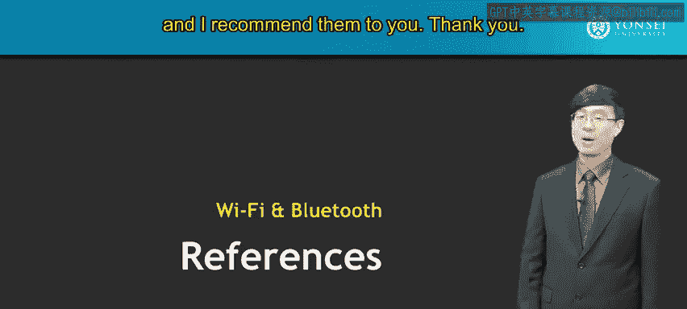

# 延世大学《新兴技术从智能手机到物联网再到大数据Emerging Technologies From Smartphone to IoT to Big Data》 - P102：30_4.2 Wi-Fi DCF CSMA-CA（第3部分）.zh_en - GPT中英字幕课程资源 - BV18hpFewEcG

Yeah。Yeah。Now let's look at this operation in action in this illustrated diagram。At the beginning。

 DFS is weighted。Such that， after a session is done， this is the basic waiting period。

Then a device sends out its RTS and naturally the devices that are near around this device will see the RTS single that will make them all set their NAV such that they don't collide with the packets that are going to be exchanged between this device and another device。

And of course， the RTS time is added。Then after a S I F S duration amount of time， immediately。😊。

The receiving device of the other communication side will send back a clear to send。

 This is a reply back to the RTS request to send that it received。Now， because of this。

 the device is surrounding this device in this blue dotted range。

These devices will naturally set their NAV， they will withhold from sending anything to avoid collision with these two devices that exchange the RTS and CTS in communicating。

Naturally， so the time for the CTS is added in how much time we consumed。

 and then after a short SIFS， SIFS duration， then data will be sent。

And this data packet will be protected because the devices that are surrounding are not sending because they have set the NV duration。

Then after the data packet， there is a SIFS duration， very short one。

 and then an ACment packet that it's confirming that I received your data packet well without errors is sent back to the overall station that sent the data packet and that is added to the time after the AC packet the data was exchanged。

 so after the DIFS period is done then the next session can begin。

Looking at this in a time flow diagram in which time is going down and we have one node representing a neighbor node over near the receiver。

 and we have one node representing a neighbor node way over there。

As a representative node of a neighbor near the node that will send the RTS。

 and let's see how time wise this operation works。First。

 after waiting a DIFS from the former session is over。

 we rate DIFS and an RTS signal is sent out this will reach the other node that it wants to communicate with。

Based upon this moment。The surrounding device will have a NAV duration set where it will not send anything。

Then。After an SIFS duration， a clear to send CTS reply will be sent back。

 and this will trigger the surrounding nodes to also set an NAV such that collisions are not occurred and this communication session is protected。

That's why this device will withhold from sending anything during this NAV period。

 Now we secure the channel。 no collisions will occur so we can go ahead and send our data packet。

After an SIFS period， and then after that data packet is received with a SIFS period。

 an acknowledgement will be sent back。After that， then the session is done。

 I sent my data packet safely and I know that it was received safely because an act was acknowledgement was returned。

 then after a DIFS period somebody else can now use this channel。These are the references that I use。

 and I recommend them to you。 Thank you。😊。

