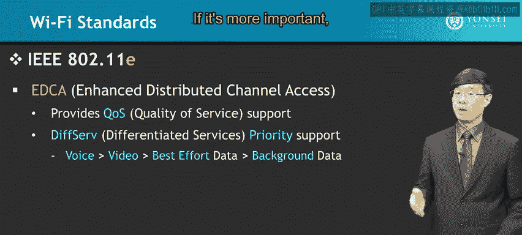
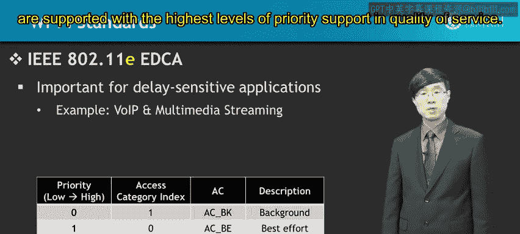
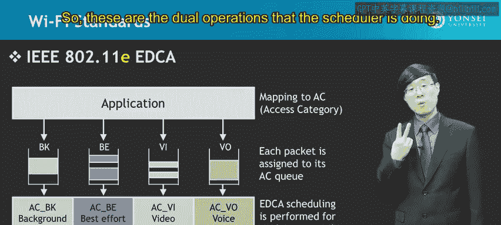
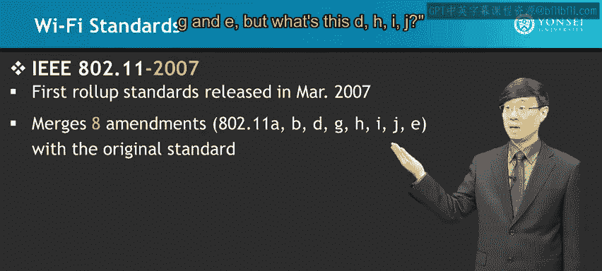

# 延世大学《新兴技术从智能手机到物联网再到大数据Emerging Technologies From Smartphone to IoT to Big Data》 - P103：31_4.3 Wi-Fi标准（第1部分）.zh_en - GPT中英字幕课程资源 - BV18hpFewEcG

Yeah。Yeah。Wifi standards。The standards that we will be looking into are the WiF specifications based on the iEE 802。

11 standards。These show what needs to be done if you're going to build a system， what protocol。

 what requirements does it need to satisfy？Things like the packet， the medium access control。

 the channel， the modulation， the data rates， all these are included。And the data rates。

 we've already seen that 11 A can go up to 54 megabits per second。

 B can go up to 11 megabits per second， 11G can go up to 54 megabit per second。

 11 n can go up to 150 megabits per second， and 11 AD can go up to 7 gigabs per second。

Looking at the original standard， which is the 802。11 dash。1997。And it was released in June of 1997。

 which is where it got its code name。This is the original version of the Wifi standards。

 the IEE 80211 standards。It supports one megabase per second or two megab per second data rates。

It uses CSMACcaA in the 2。4 gigHtz ISMbed， or it uses infrared。

The physical layer modulation schemes include frequency hopping spread spectrum in 2。4 gigahHtz。

Or a direct sequence spread spectrum in the 2。 gigahertz range。

 or infrared in the infrared frequency range。The next one was the 802。11A standard。

 and this was released in September of 1999 as an amendment to the original standard。

It supports error correction coding and defines requirements for OFDM communication at this time this was the new emerging broadband high data rate supportive communication technology and it has maintained significant importance and popularity even till today it is short for orthogonal frequency division multiplexing。

OFTM usage increased the data rate up to 54 megabits per second。

 and this was very attractive and very powerful because the enhanced data rate enabled so many diverse multimedia applications to be supported。

It is interoperable in the 5 gigahHtz ISM band Now this is important because later on I will talk about some protocol that can support both 5 gigaherz and the 2。

4 gigz band and there are some special applications for that This here is the 5 gigHtz ISM band target。

802 to 11 B。This was released in September of 1999。

 and this is a direct extension to the original standard in the aspect of modulation technique。

It uses a HRD SSSS， or they call this high DSSSS because it is short for high rate direct sequence for spectrum。

Also， CCK modulation， which is complementary code key was used。

The data rates could go up to 11 megabits per second compared to its former one or two megabits per second data rates。

And it operated in the 2。4 gigertz range， just like the original IAE80 2。11 1997。IEE A O211 E。

This is a protocol that supports EDCA， the enhanced distributed channel access。

 you can think of this as an enhancement to the DCF original protocol in which the enhancement is supported to enable quality of service。

Required applications。The DFserv， which is differentiated services。

 is a technology that supports priority if it's more important。

 there must be a way to support a higher level of reliability in supporting quality of service。

And the typical services such as voice， then video， then best effort data。

 then just plain background data is what the priority levels were set upon。

 and this was enabled to support this differentiated level in quality based upon these priority levels and we'll soon see how。

The EDCA that was incorporated into the 802。11 E protocol this year was incorporated into the 802。

11 2007 standard roll ups。And was used to include the 80211N11p11AC standards。

 so you may not see 80211 E widely， however， it is all included in these protocols which you use very frequently。

 so even though you don't see it， this is what enables these protocols which you do use very frequently。

 to be so good in quality of service support。Let's see how。So looking at EDCA。

 what are the types of priorities， well the top priority is voice。

 which you see way over there in priority， the highest level is voice。

 and that is AC access category VO， the next one is video， which is access category VI。

 then the third one is best effort data support， which is access category B E。

 and then the lowest priority is the background data traffic， and that is access category AC BK。

 short for background。If you look at the priority over there， it is 3210。

 however the access category index numbers are 3201。

 so overall the number of priority is voice highest， then video， then best effort。

 then the lowest priority is background and keep that in mind even though you may get a little bit confused when you look at the AC index。

 the access category index because 1 and0 are flipped over compared to the actual priority levels。

This is very important for delayed sensitive application such as voiceOver IP， multimedia。

 when we say multimedia， it will include voice and video。

 and that's why it is so important because these are the two highest categories that are supported with the highest levels of priority support in quality of service。

This defines four priority levels with access categories。Eリ四。

The system structure will look like this in which when an application is sending something down。

 it will identify is it voice， video， best effort or is it just background。

 and based on it it will have individual cues。And which queue you go into determines what priority of service you get。

So what did we have before we had these access categories， what did we use before we had 11 E？Well。

 in the former cases there was just one queue and everything got into that queue and it was first come first serve。

 whoever first went in would be sent out first here we're differentiating this such that if you're into a higher priority queue。

 you will be sent out first by the scheduler beneath here。

They will look at what's in what queue and if you're in a high priority queue。

 you will be sent out first。And that is what we're doing here， That is who does this。

 the EDCA scheduler is going to determine what Q is used。

And if you have some type of conflict or priority control that's needed within your access category。

 then internal collision resolution will be done by these units as well。

So the scheduler has a dual purpose。In order to distinguish among the different cues to service the different access categories。

 in addition， within your same category， internal collision conflict is resolved。

 so these are the dual operations that the scheduler is doing。

Then come see 802。11G。And this was released in June of 2003 as an amendment to the 80211B。

This operates in the 2。4 gigertz ISM band like 80211B and it has hardware compatibility support this is really good。

It uses OftTM modulation。And this is what one of the purposes of making 11G technology because we had such good success in an 11A using OFDM。

 reaching up to 54 megabit per second all the developers were saying that's cool。

 let's take that in the 5 gigertz range which is 11A and let's move that into the 2。

4 gigerz range to accomplish 54 megabits per second in this frequency band as well。

And that's what they did。But in order to do this， they had to select the channels very wisely because in 802。

11G interference prevention is conducted in a smart way using channel selection What do you mean Well。

 there are 14 channels and these channels overlap like this？And in these channels。You see this。

 what are the non overlapping ones， let's use them because they will have less interference among co users that are using this frequency in this protocol。

They turn out to be channel1，6 and 11， and they are these channels。

Which you can see that they do not overlap。Now， I do need to mention this as somebody that develops hardware and software for smarts。

 smartwatches， smart cars， as well as wF， 4G， 5G techniques。

 I do need to mention that I drew the main low frequency bands here。

 meaning that the main frequency spectrum lobe， which is the biggest lowbe of the spectrum。

 which has the most energy and power concentrated， is what was drawn。Of course。

 these spectrum main lobes have side lobes that are lower。

 but they go out to the sides and they extend widely。

This is why I'm saying that these are non overlapping channels based on the fact that their main lobes do not overlap。

 however， of course their side lobes which are suppressed based on filtering and masking。

 they do overlap with each other， they are all interfering with each other but。

This right here once again， when I say non overlapping channels， I'm talking about their main lobes。

 okay？The IEE 802。11- 2007， this is the first roll up standard released in March of 2007。Roll up。

What do you mean by roll up Well， Ro up is that we rolled up。

 we merged eight amendments of the original standards。So that means that we have 802。11 A， B， D， G。

 H， I， J， E， these are the ones that were rolled up， combined together into one standard in the 802。

11 2007 Pro。Now you may be thinking， well， I heard of A， B， G， and E， but what's this D，HI J？

Well， let's explain that。802。11 D was released in 2001。

 and this provided country information added into the packet。Then we have 802。

11 H in 2003 this provides DFS and TPC DFS is dynamic frequency selection capability。

 and TPC is transmit power control technology。What are these talking about Well。

 typically you want to select the channel in which there is no users that are using so let's scan the overall frequency band and select where we're going transmit In addition。

 when we do transmit let's use the right amount of power let's not fix the power and I'm always going to use this No let's be smarter so that we see what is the right amount of power and we use just the right level This is what we're talking about here pretty cool。

Then there's the security enhancements， which are included in the 802。11 I protocol。

Then we have the  A02。11 J Pro， which is for the Japanese frequency level support at the 4。

9 gigertz range。And then there's the 802。11e， which we already explain for access categories that are used in support of priority support for quality of service。

Now， all of these were rolled up into a merger in this standard， pretty cool， isn't it。

 and that's why this is important。