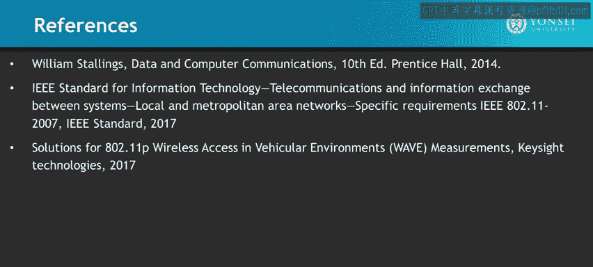

# 延世大学《新兴技术从智能手机到物联网再到大数据Emerging Technologies From Smartphone to IoT to Big Data》 - P104：32_4.3 Wi-Fi标准（第2部分）.zh_en - GPT中英字幕课程资源 - BV18hpFewEcG

Yeah。Yeah。11N this was released in October of 2009。

 and it improves the network throughput using Mimo technology， or some people say Mimo technology。

 multiple input， multiple output， and here we have multiple antennas and multiple antennas sent and received。

And through this， we have extended data services at higher data rates。This operates both in the 2。

4 gigerz and 5 gigerz range。Afterwards， I'm soon going to talk about dual band because there are additional features and services that can be supported by a dual band system one of the biggest contributing factors of Wi-fi technology is 802。

11N because it supports both the ISM bands at the 2。4 gigertz and 5 gigertz range。

 so most appropriate for the dual band operations。Just wait， we'll talk about further about this。

Higher data rate up to 150 megabits per second。IEE 802。11P protocol。

This was released in July of 2010 to support wave wave is wireless access in vehicle or environment。

So automatically you know that it is for various smart cars and intelligent transportation systems on autonomous driving vehicles。

You see why it's important。This operates in the 5。9 gigertz channel， and it uses OFDM with EDCA。

 Where did this come from， EDCA came from IE 802 do11 E， which supports quality service based upon。

Priority channel， access using access categories。Then we have maximum data rate at 54 megabits per second。

 which takes advantage of the good OFDM performance。

It supports V2X communication here we go into connected car technology。V2 x， the X is anything。

 it could be vehicle to vehicle if it's a V2V where the vehicle has a smart device。

 like an onboard unit， which is the controller for the vehicle smartness。

It could be vehicle to infrastructure where the infrastructure is like a base station or a access point。

 and that is what we call the roadside unit， the RSU in addition it could be vehicle to person where the person has a smartphone。

 a smartwatch and that is connected to your vehicle so it could be V2V V2 I V2P so in the X position it could be VIP we don't know what it will be。

 so we represent it overall with an X， it could be any of these。Then comes 802。11AC。

 and in here this was released in December of 2013 as an amendment built upon 802。11N。

This focuses is on higher throughput， higher data rates。

 the new features include support for a wider channel in the5 gigertz band。Before in 11N。

 we had a 40 mehertz bandwidth， but now we can go up to 80 or 160 megahertz in bandwidth。

 enabling higher data rates。And it uses multi user Mimo technology。

 which is an improved MImo multi input multi output technology that can extend increase the data rate。

High density modulation was used。And therefore， the data rate could be very high， going up to 866。

7 megabits per second using the 160 megatz bandwidth。

Then we have 802011 AD This was released in 2012 based upon the Y gig specs。

The Y gig was subsummed by the Wifi Alliance in March of 2013。This uses the 60 gigerz ISM band。

 along with traditional WiF network to support data rates up to 7 gigab per second， truly amazing。

 and in order to enable this， of course， the 60 gigahertz range needed to be used because at that high frequency。

 you get a wider bandwidth， and that enables very high data rates to be exchanged。

10 times faster than 802。11n。It supports wireless， interconnected homes where you need broadband services。

 and that's exactly what you get from this technology。802。11 A H。

Is a protocol that is made to support IoT technology。 So from the beginning。

 you know what its target is， and it was released in December of 2016。

It operates in the 900 megaz range with a narrow bandwidth。And typically。

 we have one to 16 MHz of it， an alternate spectrum to offload traffic under gigahHtz bands was also usable。

Low power consumption naturally needed to be included because it is an IoT technology。

Some of the key features of the low power consumption mode included a relay for service range extension。

 of course that is needed for IoT， and also a wake end dose period protocol to save your energy when you're not needing to use the channel access。

802。11AH Pro provides connectivity to thousands of IoT devices using a single access point。

 and of course we need this because the target application will go up to within a1 kilometer by1 kilometer square area in order to support1 million devices。

 we need something like this， we need a lot of this。

It supports M2M machine to machine communication and IoT market devices such as smart metering and smart home。

The data rate can go up to 347 megabits per second。

 which is sufficient for simultaneous support for multiple IoT applications of various types。

