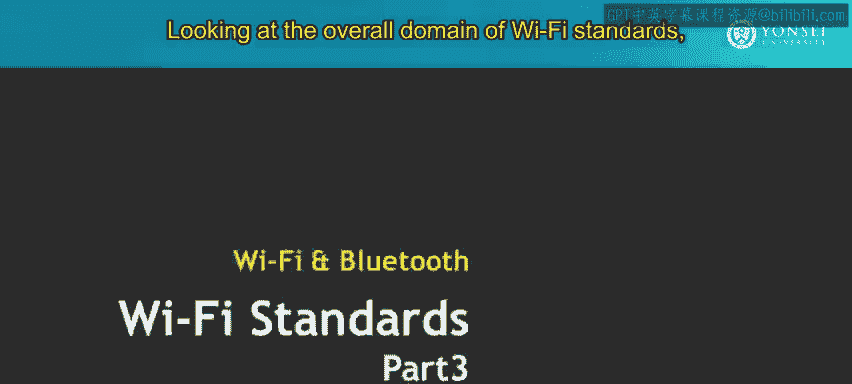
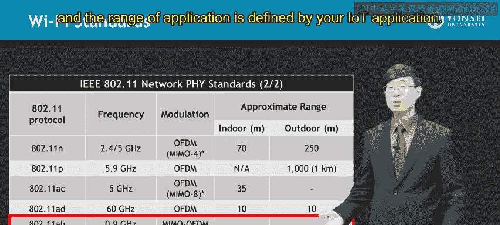
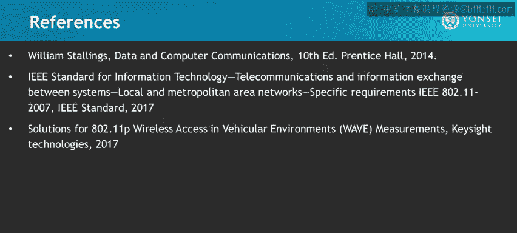

# 延世大学《新兴技术从智能手机到物联网再到大数据Emerging Technologies From Smartphone to IoT to Big Data》 - P105：33_4.3 Wi-Fi标准（第3部分）.zh_en - GPT中英字幕课程资源 - BV18hpFewEcG

Yeah。Yeah。

Looking at the overall domain of Wifi standards。We're going to look at the protocol release date。

 frequency， bandwidth， and stream data rate。First， looking at the 11 1997， which was the original。

 remember that we could use the 2。4 gigertz range and support one or 2 megabits per second this was improved by the 11 A which was released in 1999 and we could go up to 54 megabits per second and the channels that could be used were 5 gigerz ISM band or the 3。

7 gigahertz range。Then we went over to 11B which went back to the 2。

4 gigertz range this was released in 1999 at a similar time with the 11A protocol。

 and in here at the 2。4 gigertz range we were able to go up to 11 megabits per second because formerly we could only go up to1 or2 megabits per second。

 significant enhancement in data rate， then we went into the 11G protocol。

 which the target was to use OFDM， which was successfully used and demonstrated in 11 a and bring that down to the 2。

4 gigertz range， which we have 54 megabits per second could be supported then we went into the protocol of 2007 11 2007 which was a rollup of a lot of protocols and a lot of features this enabled us to combine both the 54 megabits per second in。

5 gigertz range， as well as the 54 megabits per second in the 2。4 gigertz range。

 as well as other features to roll it up so that we had both 2。4 and 5 gigertz frequencies。

Supported with data rates up to 54 megabits per second。One thing to note here。

 as well as the next protocol in 11N is that these both operate in the 5 gigertz range。

 as well as the 2。4 gigertz range， so dual band applications can be supported， which are important。

And right here， you can see that 11N was really important because it could support both the 2。

4 and 5 gigHtz range， and the data rates were extended significantly， being able to go up to 72。

2 megabits per second as well as 150 megabits per second。

 now reaching into the hundreds of megabits per second range。Which is where once again。

 other protocols extended。But then four specific vehicle applications came the 11 P protocol。

 and this worked in the 5。9 gigertz range and the release date was in 2010。

 and you can see the data rates were supporting up to 54 megabits per second。Once again。

 the target was for vehicle operations， so instead of enhancing the data rate what they did in this protocol is that the service range between vehicle to vehicle was extended to hundreds of meters and also the range between the vehicle and the infrastructure for what was communicating with the base station。

 the roadside unit was extended to ranges that could possibly reach out to kilometers or slightly more so instead of enhancing the data rate in this protocol they extended the range for vehicle applications and that is what will be enabled in intelligent transportation systems。

 smart cars on autonomous vehicles， connected cars。To do accident prevention。

 as well as un autotonnomous driving。Then we go into higher data rate applications。

 so instead of extending the range， the distance in here we enhance the data rates and as you can see the data rates are jumping up to very high ranges。

And they're using the five gigertz frequency band， and the date is 2013。

Going up into higher data rates is the 11 AD， and this uses the 60 gigertz frequency band to reach up to 7 gigabits per second Now we're into the gigabits per second range。

Then theres the 11 AH protocol， which has a lower data rate， however。

 enables IoT connectivity in an enhanced way， so sacrificing the data rate to enable multiplepo devices to communicate at lower power and that is what this technology is enabling。

Now we look into the protocol structure in which the approximate communication range is indicated。

 the range is critical because you need to know this to avoid black spots for Wi-F coverage in addition。

 this will tell you the better locations of how and where to deploy your access points to provide full and stable coverage。

Looking into the first protocol of 802。11 1997， you see that indoors around about 20 meters。

 outdoors around about 100 meters。We go to 11A protocol in which the indoor is around about 35 meters and the outdoor range is extended based upon what frequency you use。

Then 11 B uses the 2。4 gigertz range， and you can see that the indoor is extended to 35 meters。

 and the outdoor is about 140 meters。11G has approximately the same range as 11B。

 it operates in the same frequency as 11B and it has the option of using OFDM and when it uses OFDM。

 it can go to a higher data rate in which 11b could go only up to 11 megabits per second 11G when using OFDM can go up to 54 megabits per second at the same range that's pretty cool。

Then we have 11N， which enables higher data rates and also critically important is the dual band at 2。

4 and 5 gigahHtz you can see that indoors is about 70 and outdoors is 250 meters and this technology uses MImo technology multiple antennas and that's where this advantage is added。

Then we have 11P and this is four vehicles now when you look at it indoors it is not specified。

 and this is because vehicles are commonly for outdoor applications。

And here you see the range is outdoors， this is when you use it for a infrastructure to vehicle。

 a V2I connection mode。Typically it can extend to like a kilometer or more。

 whereas for vehicle to vehicle communication， it would be in the range of about 300 meters to maybe extending up to about 380 meters maximum typically in that range is what we're talking about however indoors is not applicable。

11 AC here， you can see that it is up to indoors 35 meters， and it's using the5 gigertz range。

Then you see 11 AD， which uses the 60 gigertz range to extend your data rate into the gigabits per second range。

 extremely high data rates， but because it's 60 gigahertz， it is very sensitive to shadowing。

 the signals do not penetrate solid objects and that is why the range is very short。

 this range is similar to wireless pan technology， although 802。11 is a wireless LA technology。

Then we have the 11 AH standard for IoT devices， and the range of application is defined by your IoT application。

Dual band is something that we talked about in which we had ISM bands at 5 gigertz and 2。

4 gigertz both usable， then ordinary Wifi equipment supports communication in only one single band and the dual band can totally extend this。

So what protocols are we talking about once again at the 2。4 gigertz band， there was 11 B，11 G， 11 n。

 and in the 5 gigertz band we had 11 A， 11 n and 11 A， the common denominator is 11 n。And of course。

 there was that 11- 2007 roll up protocol as well。Pretty cool so you can use 11 n for these type of applications What can you do Well having one access point in the middle。

 this could be like the common factor that will support the 2。

4 gigertz service applications connecting the5 gigerz ISM band applications as well This is where these two networks combined cross communication is possible and then altogether it is extended using the ESS。

To connected to the Internet。All of that is possible through this and that is where dual band is so cool。

 so widely used and that's why it's used in places where you need support for various frequency ranges and that is why these access points that support Le1N are more attractive and sell at higher prices so when you're buying a w-fi device and it says dual band and it costs a little bit more maybe you should invest into it。

Going into Wifi direct h。Wifi Direct enables devices to connect directly to each other。

 think of this as the addOg mode in which you could directly communicate through peer to peer P2 P that was the addOg mode。

Well， this is an extension to that and there are various applications where you may not want to go through your access point and directly have your printer。

 connect to your notebook computer to your laptop computer to your tablet to your pad to your smartphone and other things to directly have it printed out to have a scan and all of that together。

 this is what enables that， not using a access point to enable various point to point connections。

Then we have the connection types that we need to look into in Wifi direct， one to one。

Then we have group， several devices combined simultaneously supported。There's also fettering。

 which is another critical technology， probably you used it if you have a smartphone， in other words。

 turning on a hotspot。This is the technology to share internet connection from your mobile communication network or WiF connection to extend it so that multiple Wifi devices can connect together。

Typical examples are exactly turning on a hotspot on your smartphone would be a representative example。

 and that is what we calltethering。As you can see here。

 by enabling your hotspot connectivity on your smartphone。

 then other devices that do not have mobile communication。

 cellular access can connect to your smartphone and connect to the wide area network， the internet。

 and that is what the WiF standards enable。These are the references that I use。

 and I recommend them to you。 Thank you。

