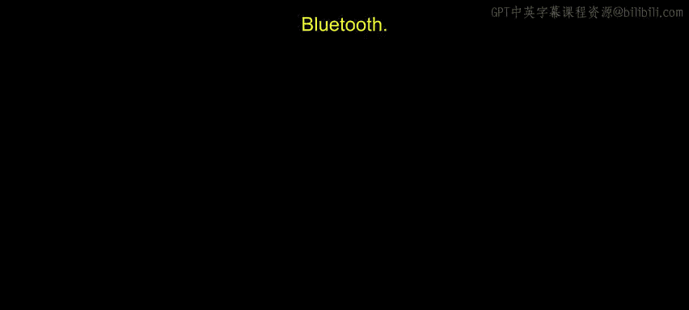
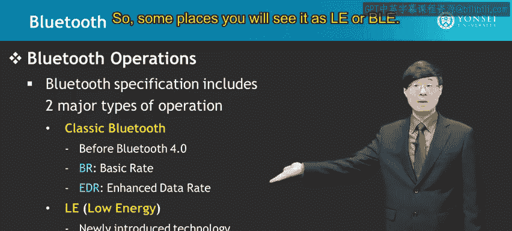
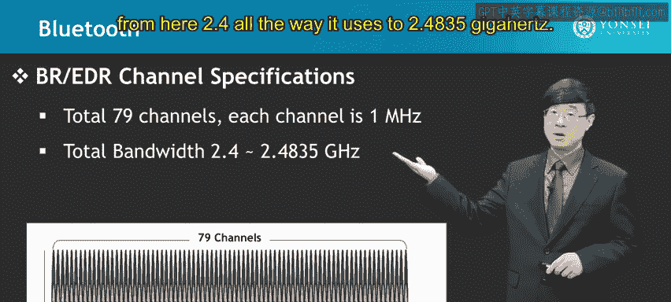
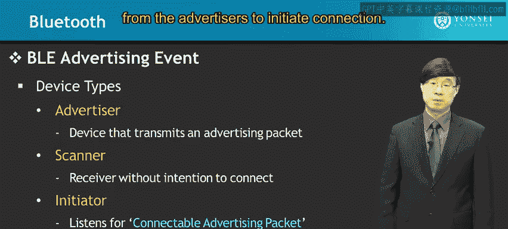
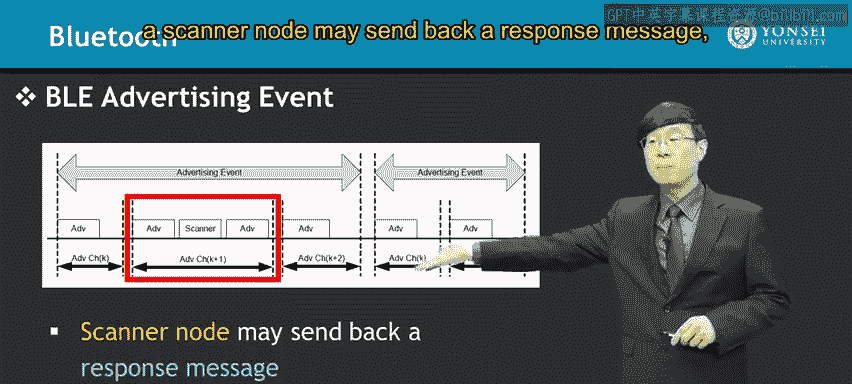
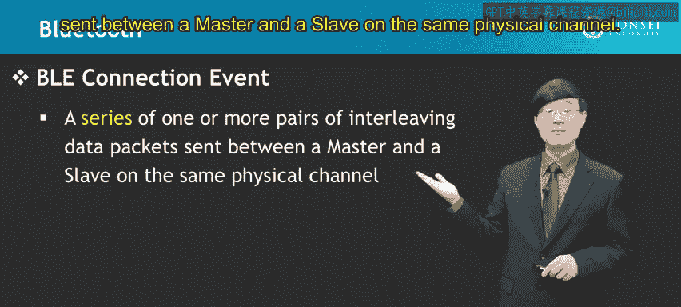
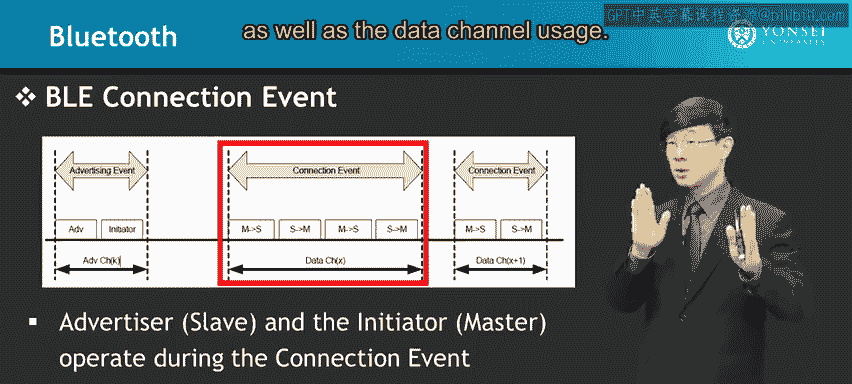
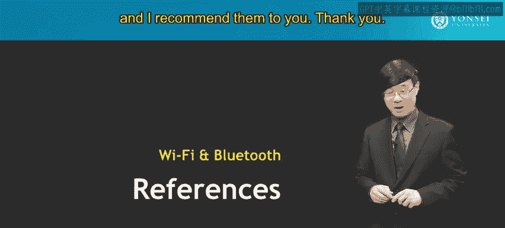

# 延世大学《新兴技术从智能手机到物联网再到大数据Emerging Technologies From Smartphone to IoT to Big Data》 - P106：34_4.4 蓝牙.zh_en - GPT中英字幕课程资源 - BV18hpFewEcG

Yeah。🎼Yeah。Bluetooth。Bluetooth is a wireless personal A network protocol。

 a WPN protocol that is designed and standardized by the Bluetooth SIG Special interest group。

It is used to replace cables， connecting many different types of devices。

 typical things that you would use it for would be from your mobile phone to a headset or a wireless speaker。

 in addition， heart monitor or medical equipment use Bluetooth technology。

Bluetooth standardization is also conducted by the special interest Group。

 which was formed in 1998 and the first specification of Bluetooth was 1。0 that was released in 1999。

The recent release was Bluetooth 5， which was released in 2016。Earlier standards。

 which include Bluetooth 1。1 and 1。2， these were ratified as the IEE 802。15。

1 standard that is the wireless personal area network standard， which is based on the numbers of 802。

15。And the dot one was the representative protocol number for Bluetooth technology。 However。

 it is no longer maintained as an IIE standard， and all standards are just from the Bluetooth special interest group。

 the Bluetooth C。The characteristics of Bluetooth include it operates at the 2。

4 gigahertz unlicensed ISM bed。And also， it uses adaptive frequency hopping technology。

More specifically， it uses frequency hopping spread spectrum technology。

It avoids interference with other non hopping communication networking devices which use Wifi or ZigB or so many others。

In the ISM band， and it improves the coexistence within the ISM band。

The way that a network in Bluetooth is formed is based on a Pconet。

 and it has a star network topology， which has one master node， which is the center of the network。

 which is the center of the star network， and it has multiple slave nodes。

The components of a Pconnet are once again master node and slave node in which a master node there's only one per piconnet。

 and it provides packet exchange， reference clock time and the frequency hopping spread spectrum pattern the way that it is controlled is that it is the formation center of the Pconnet itself and all communication even between slaves that may be located right next to each other have to go through the master to communicate。

The slave nodes can only communicate with the master node。

 and they synchronize to the master's clock and frequency hopping spread spectrum pattern。

Looking into a structure is something like this in which the yellow oval， as well as the green。

 the red， and the light purple one on this side show small piconets that are attempted to be formed where。

The node that is centered at Pconnet， which is written as Pconnet A。

 we will call it piconnet A because a is the master node of that star network。 In addition。

 we have Pconnet C。Because node C is the master and also over here you see Pconnet F。

 which we will call it F because node F is the master。

 and then we have node G with no other nodes inside of its Pconnet range and therefore this is not a Pconnet yet there has to be node in which it forms a star connection to be qualified as a Pconnet。

In further details， A is a master of Picconet A in the yellow one right there。

 and you can see that node B， C and D are connected to it in a star formation。Also， they are。

 therefore， BCD are the slave notes。Note C serves as a master in Pconet C。

 which you see over there Now interesting here is one point that node C is a slave of Pconet A。

 however， it is the master of Pconet C， which connects node E。And because of this。

 when a node takes a role as a slave in one Pconet and performs as a master in another one。

 then it can serve as a connecting communication point between the two piconets。

Then we can also look and see that as a master， node F broadcasts information to node D。

 and other slaves in Pconet F。And you can see the broadcasting signals being sent out。

 where in this Pconnet， which has the green outer line。

 you can see multiple devices that are under the slave as slaves to Pconnet F in which note F is sending out signals。

Another thing to note is that node D is a slave of Piconett F and also is a slave of Picot A above。

So some node can be serving as multiple slaves in two different or more piconets。

 and also as you see for node C， you can be a slave in one piconet， however。

 serving as a master in another pickconet。In addition。

 no nodes are in this formation of the range of no G。

 and therefore G keeps on scanning to see if other devices are in its range such that it would form a piconet in the future right now it's not one yet。

Okay， Bluetooth includes two major types of operations in which we have classic Bluetooth and also low energy technology。

Classic Bluetooth was before the Bluetooth 4。0 standards。

 which means that below up to 3 point something。And it has a basic rate represented as BR。

 and then there's the enhanced data rate at EDR naturally EDR is at a higher data rate。

 then we have low energy， this was newly introduced into the standard of 4。

0 for Bluetooth and you will see it under also the code name of BLE Bluetooth low energy so some places you'll see it as LE or BLE。

Looking at the overall channel specifications of BR and EDR mode。

 you'll see that there is a total of 79 channels where each channel is 1 megahertz。

And the total bandwidth ranges in the 2。4 gigahertz frequency range of the ISM band。

 which is from here 2。4 all the way it uses to 2。4835 gigahertz。

It uses time division duplex scheme within the structure， as you can see here。

 along with the frequency hopping communication mode。Looking at its operation。

 there is a modulation mode and data rate specifications。In the modulation。

 it uses G FSK in which the FSK is frequency shift king and G stands for Gaussian pulse shaped。

So therefore， GFSK frequency hopping spread spectrum is used with。Frequency shift key technology。

 and combining the frequency shifting and hopping， these combine very well together In EDR。

 this uses DPSK technology， which has either。😊，Pi over4 or8 DPSK。

 and that is used as a modulation mode。The data rate that you can get from BR is1 megabits per second。

 but for EDR you can go up to two to three megabits per second， and that is why it's called EDR。Now。

 one master node can interconnect with up to seven slaves， so therefore， when you look at a piconnet。

 which is in a star formation， you'll see a set of up to eight nodes interconnected and communicating together。

The BLE Bluetooth low energy operations look in this type of a format of the spectrum where it uses the 2。

402 to 2。480 gigahertz range， and it has a total of 40 channels which are the channels that you see listed right here。

 among them there are the ones that are orange over there over there and also one right here。

These are the three channels， they are number 37， 38 and 39， theyre numbered sequentially。

 although they are not side by side immediately in the frequency spectrum range， however。

 these are used for primary advertising。And then we have 37 channels。

 which are the blue ones inside here that are used for data。And also。

 they are used as secondary advertising in Bluetooth 5。

The BLE operations are based on TDMA and FDMA multiple access schemes。

The modulation uses GFSK and the data rates that it can achieve before Bluetooth 5。

0 is 1 mega per second。 after Bluetooth 5， it goes up to 2 megabits per second。

The typical difference in the physical layer coding， which is the pi。

 the physical layer PHY coding method， is that Bluetooth 5 supports air correction coding resulting in lower data rate。

 however， it is more secure and more reliable， more resilient against channel errors and various other interference signals。

The data rate is transmitted， being positioned on a time duration called an event。

And there are two types of events that are used in B，L E， Bluetooth low energy。 One is advertising。

 The other is connection。The advertising is an advertised message without connection。

 type broadcasting mechanism。Then we have the event of connection。

 which builds a connection to send data between a master and slave devices。

Looking into further details， the purpose of advertising channels include setup connection between devices and also communicate information between unconnected devices。

Device types include an advertiser， a scanner， and an initiator。

The advertiser is a device that transmits an advertising packet。

 A scanner is a receiver without intention to connect that is scanning the channel。

 Iitiator listens for connectable advertising packets from the advertisers to initiate connection。

Looking at a time sequence of operations in which we have advertising event， another one following。

 and then inside our time intervals， which you see advertisement messages inside。

Let's take a look at this where the advertising event occurs in advertising channels。

 which are the channels 37， 38 and 39。They can either broadcast or conduct unidirectional communication。

 and that's what they're doing right here。Looking into one of the events over there inside the red box。

 a scanner node may send back a response message， and that scanner message is in the middle of the two advertisement messages。

 as you can see over there。

The BLE connection event。Is a series of one or more pairs of interleaving data packets sent between a master and a slave on the same physical channel。

 The initiator listens for a connectible advertising packet。

From an advertiser and request for connection initiation。

The initiation is based on the initiator becoming the master device and the advertiser becoming the slave device please take note that the initiator listens for a connectible advertising packet。

And。Once it receives it from an advertiser， then it will request for connection initiation。

 so the initiator is the one that sends the connection initiation， which makes it the master device。

Then the advertiser who sent out a connectable advertising packet is doing this in somewhat of a passive way to see if there's somebody to connect to。

 so therefore the advertiser device becomes the slave device。Looking at that over there。

 you can see an advertising and an overall connection mechanism in which an initiator detects a connectable message from an advertiser during the advertising event over there。

On the advertising channel。The advertiser， slave， and the initiator， which is the master。

 operate during the connection event。The connection event occurs within the data channel。

 so although we're looking at this in a sequence， we are looking at operations in different channels which you need to visually see in the former picture we had all the blue channels and then we have orange orange orange ones in between so please think of those channels are being used separately for the operations that are being conducted here you have to be careful about distinguishing once again the advertising channel usage as well as the data channel usage。

These are the references that I used， and I recommend them to you。 Thank you。

