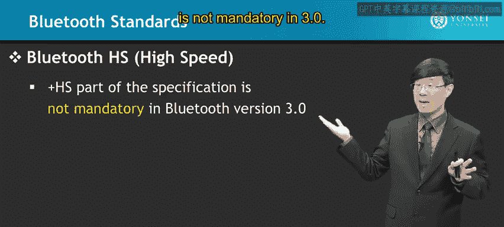

# 延世大学《新兴技术从智能手机到物联网再到大数据Emerging Technologies From Smartphone to IoT to Big Data》 - P107：35_4.5 蓝牙标准（第1部分）.zh_en - GPT中英字幕课程资源 - BV18hpFewEcG

Yeah。🎼Yeah。Bluetooth standards。The Bluetooth evolution is drawn out here where the major protocols are noted in these colored circles based upon a timeline of evolution。

The first thing that we need to distinguish is the classic Bluetooth standards over there at basic rate。

 the BR systems。Dividing it in the middle， then we have Bluetooth low energy standards。

 and the typical cutting point within the sequence flow of evolution is 4。0 standards。Here。

 the Bluetooth low energy standards are evolving， connecting into standards of 5。

0 and what we'll see in the future。Based upon it， in 1。0。

 that was the first adopted specification released in 1999。

Then we have major bugs fixed and stabilized in 1。1 and 1。2， and then once again in 1。1。

 which was based on 2002， that's when the IEEE 802。15。

1 standard was released that included the standard of 1。1 from the Bluetooth6 special interest group。

Leading on to 2。0， that's where the EDR enhanced data rate was added。Then in 2。1。

 simple pairing and NFC support。Was included NFC， near field communication。

 very important technology， added on the specifications of Bluetooth， and that's why 2。1。

 although it's a small circle， it is very important。Leading on to 3。

0 enhanced power control for high speed support， and soon I'll show you about that plus HS support。

 which will come out in the following pages。Then， going into a major revolution to include Bluetooth low energy。

 BLE technology in the specifications， we go into 4。0 in 2010。

Then leading into fourth generation Mo communication LTE coexistence at 4。1 Bluetooth specifications。

Then leading on to 4。2 is higher throughput and enhance security。Then 5。0 standards in 2016。

Doubling in speed means the data rate is going up to be higher。

So now we're going to take a look into EDR standards and some of the specifications in further detail。

 EDR stands for enhanced data rate。 This was introduced in Bluetooth version 2。

0 to enable faster data transfer it supports the data rate up to three megabits per second and EDR provides low power consumption。

 which is really needed because a lot of Bluetooth devices are wireless battery operated。

 and it uses a reduced duty cycle。 That's how they reduce the power consumption。

 So when you're on for the duty cycle， that's when you're operating。

 you get all the data communication done and then once the duty cycle is done。

 then you go into a resting mode where you save energy the most that you can。😊，Bluetooth， high speed。

 theHS。Bluetooth high speed technology was released in 2009， and it was included in the 3。0 version。

 which has a plus HS。Now it's a plus HS。Which means that it's not an automatic inclusion into 3。0。

 What does that mean。Well， when you write 3。0 plus HS。

 this provides data transfer speeds up to 24 megabits per second。 however。

 you're not using just pure Bluetooth。The Bluetooth link is used for negotiation and establishment like a control channel。

 and the high data rate traffic is carried over colocated w-fi links using 802。

11 technology and as you know， w-fi 802。11 technology can go further distances in addition their data rates are much higher than Bluetooth because they are wireless local area network protocols in which Bluetooth is a wireless personal area network protocol so Bluetooth is a Wpan PAN technique in which also Wi-fi is a W La wireless local area network protocol and their purpose and their designs are different。

😊，So when you see the 3。0 plus HS， you know that there is a co located Wifi support that needs to be used。

If you think about it， around about 2009， this is when the evolution of smartphones evolved。

The first smartphones that evolved around about 2007， when it reached 2009。

 already Android based smartphones and Apple based smartphones were abundantly around。In addition。

 we had tablets， smart tablets and iPads around what were on the smartphones。

It was Wiifi and Bluetooth and mobile communication。

 So you had one unit that you could interactively use Wifi and Bluetooth on a same device。

 And these techniques were controlled by onecon unit altogether。 So if you have that。

 why not have Bluetooth take advantage of a helping Wifi system。

 And that is where the concept in 2009 made this possible。😊，Bluetooth high speed， the plus HS。

 This is a part of the specification， iss not mandatory in 3。0。 So when you use it。

 you have that plus HS。

What do you mean by that Well， I mean it like this if it was a standard part of the 3。0 standards。

 then you do not need to write it as a plus HS to follow the 3。0。The reason that it is a 3。

0 with a plus HS written on it means that it is a not a part of the mandatory 3。0 standards。

 so when you use it it needs to be notified that it is in use and that's why they write it as a separate plus HS following Bluetooth 3。

0。And it once again uses Wifi for high speed data communication。

