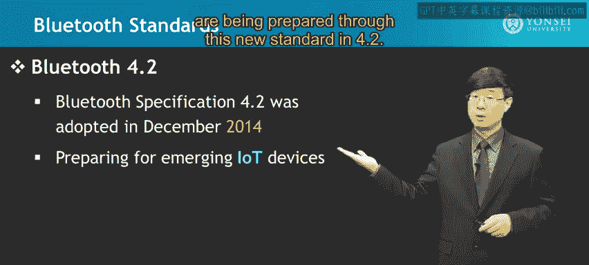

# 延世大学《新兴技术从智能手机到物联网再到大数据Emerging Technologies From Smartphone to IoT to Big Data》 - P108：36_4.5 蓝牙标准（第2部分）.zh_en - GPT中英字幕课程资源 - BV18hpFewEcG

Yeah。🎼Yeah。Bluetooth 4。0。 this is where we have a cut technology and a big jump。

 and therefore the overall standards。Have the terminology of Bluetooth Smart。

 and this was adopted in 2010。This includes the former modes， which are the BR and EDR。

 but it also includes Bluetooth low energy。So the standards of the former protocols up to 3。

0 are included。This is， of course， necessary。 backwards compatibility with former standards。

 That way， a new device with a Bluetooth 4。0 chip and RF and modem on it will always be able to talk with all of the former Bluetooth standards。

😊，Bluetooth 3。0 2。0 and other standards that exist。

That is where the compatibility and interoperability with lower standards are provided by including the technology of the lower modes。

Of course， Bluetooth， low energy， BLE is included。Bally， this is the important thing。

 define several profiles on how a device can consume very low energy。

 just like its name and service a lot of dynamic applications。

It provides reduced power consumption and reduced costs which are both very important while maintaining a similar communication range。

 well that's cool， so you have the same communication range of a wireless pan but then again you have much less battery consumption and it's cheaper well that sounds like a win win to me。

A manufacturer can implement customized specifications for the product， In addition。

 a device can have multiple BLE profiles， and that makes it even cooler。

So you can support Bluetooth healthcare profiles， sports and fitness profiles。Also。

 internet protocol， support profiles， and environmental sensing profiles and other ones。

On one device， you can have multiple profiles supported because the BLE standards of 4。

0 and higher include this type of support for various applications simultaneously。

 and that's really useful。We have Bluetooth pecons。Well。

 this is a device transmitting technology that sends out a unique ID number that can be read by a Bluetooth receiver。

 which can be used by various applications on smartphones。

Think of it this way when you go to a stadium and there's various vending machines and also entrances as well as where are the men's room。

 the restroom and the women's restroom all of this information in addition to finding your seat and other possible coupons in the area。

 well you can locate a Bluetooth Bcon device at specific locations where if somebody enters the proximity。

 the neighborhood of that range， they will receive the Bcon single， and be able to see。

 oh around here， these are the services， these are the support facilities that are around that could be very useful that is exactly what this does。

Bluetooth beconons are commonly deployed as very small devices。

That are battery powered and broadcast signals through BLE technology， this uses BLE。

 the Bons using BLE technology， and they are therefore in a mode where 4。

0 and higher devices can all detect these signals， yet they are at very low energy consuming modes。

Smartphone apps identify the location of the Bluetooth Bcon device and activate location specific information on the smartphone so in other words。

 if I go into a certain range where there was a specific Bluetooth BLE device that was sending out a Bcon signal to identify that there is a special service or a coupon and if I receive that coupon I can go around the corner and there is a stand which sells hot dogs or coke or other type of drinks。

 beverages well that sounds pretty cool then I will know that because a coupon will pop up on my smartphone once it detects the preset Bcon signal that's how this mechanism works。

These bes are used in many location based applications in terms of advertisement。

 coupon distribution， home automation。Transportation systems and sports stadiums as well as stores。

 of course。Bluetooth 4。1。The specifications were included and released in 2013。

 where incremental software updates to Bluetooth were added。And there were no hardware upgrades。

 just software improvements。What happened was they improved the software such that coexistence with LTE technology was possible。

 this was about the time that LTE fourth generation mobile communications were becoming more and more popular and installed everywhere。

 so therefore coexistence control is very important bulk data exchange rate support is included and device multibole simultaneous support is also included。

Bluetooth 4。2。This was released in 2014。Pairing for emerging IoT devices were dealt with in this new release。

This is when IoT technology， the need for it， as well as various products that are coming out。

 are being prepared through this new standard in 4。2。

Low energy secure connection link layer privacy with extended scanner filter policies。And also。

 the sixth version of profile called IPPSP Internet Protocol Support Profile is prepared to support connection home appss。

