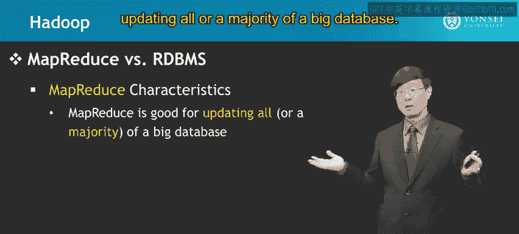
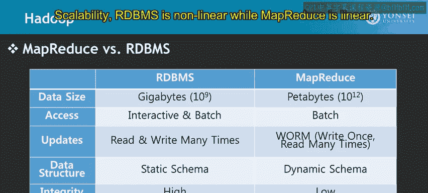
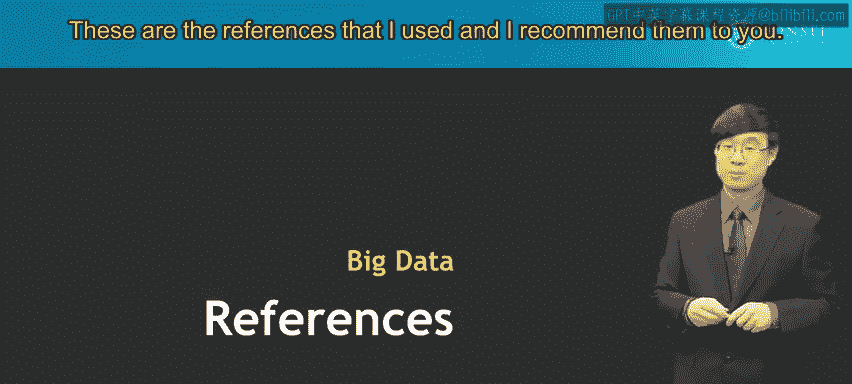

# 延世大学《新兴技术从智能手机到物联网再到大数据Emerging Technologies From Smartphone to IoT to Big Data》 - P10：9_2.6 MapReduce与RDBMS的比较.zh_en - GPT中英字幕课程资源 - BV18hpFewEcG

어。🎼Yeah。🎼In this lecture， we will look into Mareduce versus RDBMS。

RDBMS stands for Relational Data management System。 Let's look at some of the RDBMS characteristics。

It is good for updating a small portion of a big database。😡，It uses a traditional bee tree。

 which is highly dependent on the time required to perform Sih operations。

Maabre characteristics include。It is good for updating all or a majority of a big database。

It uses sort and merge to rebuild the database， which depends more on transfer operations instead of the SeeQ operations。

Our DBMS is good for applications that require the data of the database to be very frequently updated。

For example， point queries or small data set updates。MapRuce is better for。

 write once and read many times warm based data applications。

MabRduce is a complementary system to RDBMS。Let's look at an example where we compare a little bit about the features。

 the pros and cons of our DBMS to MaRuce。The data size of a good RDBM system is like a gigabyte or smaller。

 where Maduce systems work well for petabytes， terabyte type systems。

Access in RDBMS is interactive and batch， where for mapRduce it is batch oriented。

Updates in RDBMS are read and write many times。😡，Where for Ma Reduce， we have warm。

 write once and read many times， and I will talk about more on this。In terms of data structure。

 our DBMS is static schema。And mapreuce is dynamic schema。

We will talk more about SQL comparing it to Hadop on schema terms in the next lecture。

In terms of integrity， our D BMS S is high and mapre is low。 But on the other hand。

 it looks at the overall structure of the whole data set。Scalability， R DVMS is nonlinear。

 where MaRduce is linear。

Now， we look into some data types， structure data。This is data that has a formal defined structure。

What type of data is structure data， Well， this is an example of something that you've looked at。

 XMl documents or database tables or what you put into an Excel file to draw a graph。

Then the data that you put into an Excel file， if it doesn't fit the exact format that is used in there。

 the Excel system will not accept it。This type of data is what we call structure data。

 It has a defined structure。 It is predefined on what you're going to put in there。

 and you have to put in the data that fits its category only。Semi structure data is much looser。

 It has a format where the data structure is used as a guide， and in some cases， may be ignored。

When you put semistructure data into a structured data form like an Excel file。

 then in a lot of cases， a lot of the data may be filtered out and not used。And therefore。

 if you look at an Excel file where you put a lot of semistructure data inside。

 a lot of the values there will be null， null， nu， nu， null， non acceptable。

 That's what happens when you use semistructured data to put into a structured data system。

 There will be conflicts。 And this is why how will I accept。

 How will I use the semistructured data to extract information from it。 This is very important。

 especially because big data systems have one of the challenges where the data types are so diverse。

Then the variety of data is growing and growing every day。

 This is why we need to look into semi structure data， and。Unstructured data。

 because these data types are growing， and we want to find a way that we can use them to extract information and make intelligent decisions。

Here， unstructured data is data that does not have any formal structure。It's plain text。

 or it's coming from an image， or it's coming from a picture， or some type of sound， acoustic sound。

 a voice conversation， various other things that can all be used。😡。

And these three data structures are where the true advantage and power of a big data system like Hadoop will show and shine brightly to your advantage。

Maapreduce is a very effective system when it deals with unstructured and semistructured data， why。

Well， mapre interpretous data during the data processing sessions。

Maapreduce does not use intrinsic properties of the data as input keys and input values。

Parameterters used are selected by the person， the programmer that is analyzing the data。

 So there is a wide variety of。Things that the programmer or the user or the person that needs to make the query is going to use。

MaapRduce has a programming model that is linearly scalable。

 which is a true advantage of Mareduce and Hadop。There are two function types。

 math function and reduce function， and in the following lecture， we will talk much more about these。

Both of these functions define a key value pair that is used。 So we have key value pair1。

 key value pair 2。 and these are the extracted values and information that we do from the overall data set that we are analyzing in our big data engine。

These are the references that I used， and I recommend them to you。

