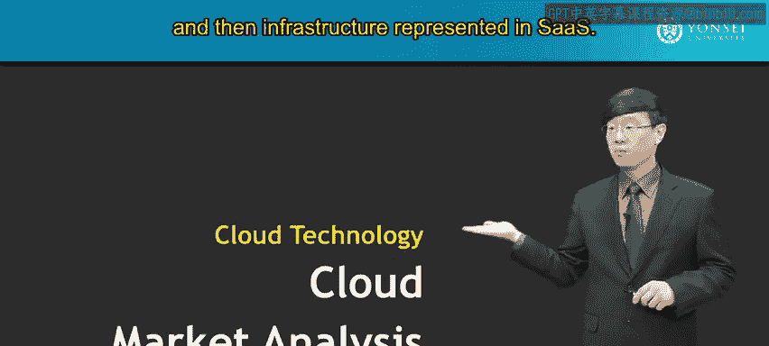
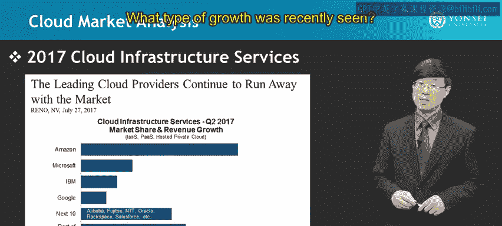
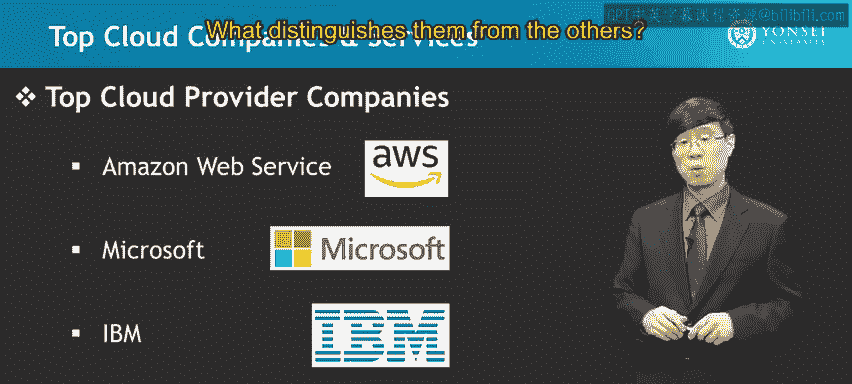

# 延世大学《新兴技术从智能手机到物联网再到大数据Emerging Technologies From Smartphone to IoT to Big Data》 - P110：38_5.1 云市场分析 5.2 顶级云公司和服务.zh_en - GPT中英字幕课程资源 - BV18hpFewEcG

Yeah。🎼Yeah。This module is about cloud technology。I will start off with cloud market analysis。

Looking into data from 2014， you'll see three categories up here， the one over there is SAAS。

 which is softer as a service。Then you'll see in the one in the middle is PAAS。

 which is platform as a service， and then you'll see IAAS right here， the one right here。

 and that is infrastructure as a service。The software。

 platform and infrastructure as a service are the three major categories of cloud computing support that can be provided。

Their definition and what they can actually do for you is explained later in this lecture a couple of slides later。

 so hang in there first we'll do a market analysis。 look at it in three ways。

 number one software represented in SaS， platform technology represented in PAas and then infrastructure represented in SaS。

Looking at the dimension of the vertical axis in SaS。

 you can see on the top of the figure there is a dollar sign and BN written on the top。

 that means that it is in units of billions of US dollars。On the top of pass。

You'll see dollar sign and MN， which means that the vertical axis is in units of millions of US dollars。

And then coming back to IOS infrastructure as a service。Dollar sign and Bn。

 which means that it is in units of billions of dollars。So taking a look at what we have here。

 look at the growth in SaS software based cloud technology， how it is growing。

 especially looking at over there， the vertical axis， which is in units of billions of US dollars。

Then looking into PA platform technology in the middle。

 you can see that the units are in hundreds of millions US dollars， then you can see Ios。

 which is also in units of billions of US dollars and the overall growth。From this。

 it is evident that the need and the consumption of various cloud services。

 regardless of being software platform or infrastructure are in high demand。

 they are growing at extremely high rates quickly and therefore studying this module of cloud technology is so important。

Now we're going to compare these technologies based on a 2016 data set which is included in here in which the CAGR data in terms of percentage is compared over here one thing that you can see is that on the bottom of these blocks on the histogram you can see the bottom is SAS which is softer as a service and it is the most dominating compared to the other two in terms of overall CAGR percentage。

This is why you can see the title of this part is top 10 Reons to leveragever SaS for your business。

Meaning that having Saas based products in supporting cloud computing technology， in addition。

 you will need various SaS technologies to support your business growth。

The second one over on the sauce is the lighter green。

 which is the infrastructure as a service ionos。And it is smaller than the sauce， however。

 it is still significant and also year by year from 2013， going up all the way to 2018。

 including predictions， you can see that it is consistently growing， not as much as Sa。

 but it is significantly growing itself， and we've seen that in a former versionrgin on the former page。

On top of the three is the smallest one which is platform as a service pass。

 however it too is also growing significantly， and you can see how it reaches the overall portion when compared the three。

The next one is Amazon leads the race in cloud computing。

 and you can see a significant overall accomplishment by the company of Amazon when it comes to cloud computing technology and services。

😊，Overall here， this is based on 2017 and the structure of Amazon Web Services， AWS for short。

 is added up and you can see that it's reaching 40%。Where the other secondary contenders， Microsoft。

 Google and IBM add up to 23%。You can see how good Amazon is doing in this terms。

Then the next 10 companies， meaning that excluding the big four over there。

 the next 10 combined over here and the rest of the others combined over here。

 this is also showing you that the four big players that you see here， which include Amazon。

 Microsoft， Google and IBM are dominating the cloud market。

Looking into further details of services in Q2 of 2017。

Here we have a layout of Microsoft IBM and Google divided in the former page。

 the three were added up。 Now they're divided。 and looking at this， comparing the company's Amazon。

 you can see how dominant it is right now， and that's why， of course we need to study Amazon。

 the Amazon web service systems in closer details。Overall， first here。

 you see the big four listed up here and then the next1 combined and the company names that support those。

And then the rest of the market share is included down here。

What type of growth was recently seen that is right here。

You can see that over the last four quarters， one year because each quarter is three months。

 four quarters make a year。 So over the past year of growth， reaching up to the Q2 in 2017。

 you can see that Amazon has shown a growth of 1%。 it was already large so 1% growth when you're already large is significant Microsoft showing growth IBM and Google and you see the next 10 on how they have been growing and the overall balance of what happened over the last year since the Q2 of 2017 to result in this type of age distribution is what you see in the overall data。

Top cloud companies and services。 So we've just seen what the top four big companies are doing。

They were Amazon， Amazon Web service， AWS。마이크。Then IBM。And Googlegle。

So it is worthy to take a closer look and to see how these big four are doing so well。

 what are the characteristics of their service， what distinguishes them from the others？

