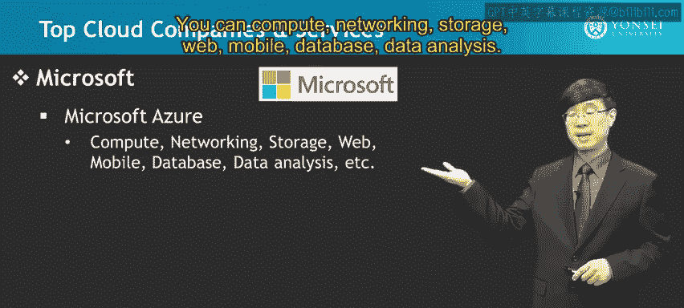

# 延世大学《新兴技术从智能手机到物联网再到大数据Emerging Technologies From Smartphone to IoT to Big Data》 - P111：39_5.3 AWS.zh_en - GPT中英字幕课程资源 - BV18hpFewEcG

Yeah。🎼Yeah。We'll start with AWS。Amazon Web service。This is the number one cloud corporation。

 and amazingly you add up two， three， and four， then it is still larger than those。

It was launched in 2006， so you can see that。It is relatively new and being able to grow and dominate the future market。

 this is the reason why you need to study this course on cloud computing technology。😊。

AWS is a global cloud based product service provider， it provides computing， storage， database。

 analytics， networking， mobile， IoT， management security。

In addition to developer management tools and enterprise apps。

One of the major components of the AWS package is the Amazon EC C2， Amazon Elastic compute cloud。

 so we have two C's， that's why we have C2。Web services that can provide cloud computations。

It is secure， it is resizable， that's a very good feature。

 so just because you have a prese does not mean that you're limited to that prese if you preet it too large at the beginning。

 you can downsize。And even more important， if you start it off too small， you can grow in the middle。

 you can expand your system without needing to start from the beginning。Developer tools are provided。

 this is one of the features if you have really good tools that are powerful that can really control the overall setup such that you get what you want in an easy to develop way and also they are manageable and stable and reliable and fast supporteded then you are a win-win winner in all aspects and that is what AWS is doing and that is why they are number one。

It supports failure resilient， application development。

 and helps to eliminate common failure scenarios。Amazon S3， which is three assets。

 simple storage service security and access management is provided。

 it includes several mechanisms to control and monitor who can access your data。

You can easily control how when and where your data is accessible and secure connections using virtual private cloud technology at endpoints are supported。

You do not need a gateway or net instances to get this type of a service。

 which makes it even cooler and easier to use in a lot of cases。

Looking into further details of a little bit of the history of this S3 from Amazon。

 public web service original releases were in the United States 2006 and in Europe 2007。

You know that AW started in 2006。 So this was one of the。Primary initial products。

It provides storage through web service interfaces like RE， soap Bitorrenent。

And there was also Amazon Cloud Drive that was released in 2011 Web storage application from Amazon storage space characteristics allowed up to eight devices to be able to connect and use this unique storage space。

😊，Multiple mobile devices and different computers could be used that was very useful access permitted using different browsers on the same computer was another thing because browser technology on one computer。

 for example， you can use your Expr that is based on Microsoft Windows。

 also you could be using Chrome as well as other type of browsers as well。

The cloud player originally bundled。Is a service that enables users to play music from their cloud drive from any computer or Android device。

Music browsing based on songs and titles， albums， artists， Jonnus， and playlists were all selectable。

Amazon Cloud Drive options。The options included unlimited photos， so if you're saving photos。

 it is unlimited when you're saving videos， they will give you up to multi gigabyte space。

Unlimited everything is unlimited storage for photos， videos， documents。

 various file types that was included in here as an option。Microsoft。

This is the number two ranked Cloud Corporation， and Microsoft was launched in 1975。

 but at the beginning they did not do cloud computing technology because it was not a concept at the time。

Microsoft， well known， it does what the Microsoft computers do and the operating systems are based on already very famous。

 it does software for computers， consumer electronics， personal computers and services。

 it is one of the super companies when it comes to operating systems and office based application software。

In 2014 is an important period， the company started to scale back on hardware development and then started to focus more on cloud technology。

 and that is when Microsoft starts to become a major contender in this area。

 so overall it is very relatively recent。But however。

 because Microsoft has such a large number of users that are using the Microsoft operating system。

 the Windows based， Exper systems and other things。

That is why Microsoft can expand so dynamically quickly。 In addition， people that are already using。

Microsoft products can interface with the cloud technology that is provided through Microsoft。

Which is the Microsoft Office 365。Cloud based subscription services。

And it combines apps like Excel Outlook， Microsoft Word PowerPoint with cloud services like Oneedrive and Microsoft Teams。

It enables users to create and share anywhere on any device。Then we have Microsoft Azure。

You can compute networking， storage， web， mobile database， data analysis。

 These features are included。

Users can access， build and deploy cloud technology whenever they need to。

 and it is based on hybrid cloud technology What does that mean Well。

 just wait for a couple of minutes and I will give you the details of what a hybrid cloud is about。

It helps to develop data driven intelligent applications。The advantages in Microsoft security。

 privacy， transparency， and computer compliances are added because it is a Microsoft interoperable product。

