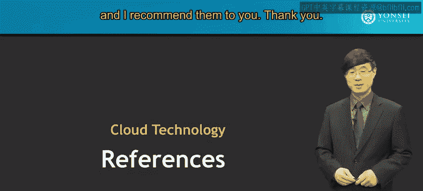

# 延世大学《新兴技术从智能手机到物联网再到大数据Emerging Technologies From Smartphone to IoT to Big Data》 - P112：40_5.4 IBM 5.5 Google.zh_en - GPT中英字幕课程资源 - BV18hpFewEcG

Yeah。🎼Yeah。アB엠。IBM is number three in cloud Corporation rankings。

It supports public and private and hybrid clouds What is a public private and a hybrid cloud once again。

 just wait a couple of minutes I will get to it very soon。It offers more than 130 unique services。

 reaching into infrastructure as a service， platform as a service and software as a service。

 so Ios PA and SaS， they do it all。The IBM Cloud Object storage supports data storage。

 management and controlled access。Direct application connection to object storage and integration to the IBM Cloud services。

You see， support for self service portals and RE APIs。

Rest APIs RE stands for representational state Trans and APIs are application programming interfaces。

 which enable you to access specific services and features。The IBM cloud private is a transformative。

Platform used in building or modernizing cloud applications。

 prepackd enterprise class solutions are included， which makes it very easy to use and very powerful。

It provides enhanced security， speed and control。 There is also the IBM cloud streaming video technology。

 It provides solutions that simplify workflow management and video streaming。

The B2 B based video service support is especially important for IBM cloud service streaming video customers。

That is because it can support companies that are streaming video in a specific way based upon IBM Cloud technology。

 that is where it's important and classified as a B2 B based service platform。

 B2 B standing for business to business relationships。

 So it is more focused on a business supporting another business。

 achieve its goals especially in the domain of streaming video。

 where individual users may not directly use it， because it is a larger。

High scale level between business operations and corporations。Google。

Google is the number four ranked cloud Corporation。The company itself was launched in 1998。

 and it is the world's largest search engine technology corporation。

When it comes down to cloud computing technology， 2011 is a very important turning point。

 This is when Google starts the Google Cloud platform right here。The Google Comp engine。

 this provides infrastructure as a service based on virtual machines。 these virtual machines。

 VMs run on Google's data centers。It provides cloud tools and workflow support。

 and it enables scalable global services based on events， load balancing， cloud computing technology。

Google App Engine was released in 2008。And this is a platform as a service for web application support。

It provides automatic scaling based on resource demands and server loads。

Google Cloud Stage was released in 2010， and it is an online file storage service。

Then we have Google Big Query。This was released in 2012 and data analysis tools that use SQL like queries to process big data sets in seconds is what is included。

Just like the name， this is like cloud computing technology supporting big data analysis and that's where the big query comes from So if you have a big data file that you have in a data center or a data warehouse then finding information from this data that I have here requires queries where you go in and you find a certain part of information that is what we mean by queries。

And SQL is a query language programming tool that you can use to extract information from big data sets。

And that is what this is doing。Then there is the Google Comp engine that was released in 2012。

And it is a infrastructure as a service， support that is enabled on virtual machine technology that is distributed and used in various ways。

I will talk more about Ios and VMs in the following lectures pretty soon， so hang in there。

Google Cloud Endpoints was released in 2013。This was a tool to create service inside app engine and easily connects from Android。

 iOS and JavaScript clients， so various mobile devices could easily use the Google cloud and points。

😊，Google Cloud DNS domain name System， this is a DNS service that is supported by Google Cloud technology。

Google Cloud Data Store， we have no SQL data storage。

 and then there is cloud SQL based storage and processing capability。

The CloudSQL was released in 2014 as general availability， and it fully managed by MySQL databases。

Then I'm going to look into Apple's iCloud， because a lot of people have iPhones and Mac based products。

 which this is the cloud technology that they use， although it's not among the top big four。

 it is definitely worthy to look into it。Public release was in 2011 and cloud storage and cloud computing technology is included。

The operating system is based on OSX or Microsoft Windows 7 or later， or iOS5 or later。

Subscription based collection of Apple's online services and software was what mobilebile me was doing and。

Mobile Me was replaced by iCloud technology， and the mobile Me services stopped in 2012 June。

 and people were given one month to switch over to iCloud。

Some of the major features of iCloud include email， contacts and calendars， find my friends。

Backup and Restore， which is a backup feature for device setting and data。

 and this is supported by iOS 5 or later modes。And find my iPhone。

 which enables a user to track the location of an iOS device or Mac， for example， like your iPhone。

This was formally a feature that was included in mobilebile me。

 and now it is in the iCloud technology。You can manage。Lost or stolen on Apple devices。

Back to my Mac， which enables remote login to other computers that have back to my Mac installed。

We also have iwork for iCloud in here， which is Apple's iwork suit。That includes pages。

 numbers and keynote made available on a web interface。There's also photo stream。

 you can store photos。There's also free storage that has a day limit onto it。

And there's Photo Library on iCloud， which stores all photos at original resolutionsol。

It stores the photo metadata as well， which it self computes and also includes location information。

The storage。It is another feature of iCloud， which was first introduced in 2011。

 and it provides free storage per account。Icloloud Drive， here you can save photos， videos。

 documents and apps。And iCloud keychain， secure database for website and Wifi passwords。

 secure credit card， debit card management for Quick access and Autofi。Then there's iTunes match。

The iunes， music library scan and match tracks function。

It serves tracks copied from CDs or other sources。These are the references that I use and I recommend them to you。

 Thank you。

