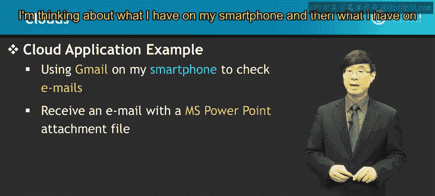
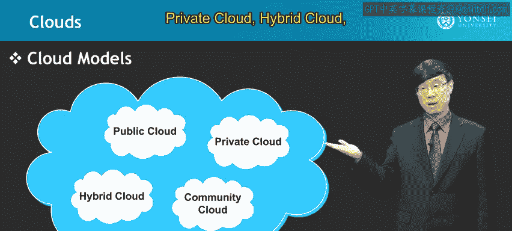
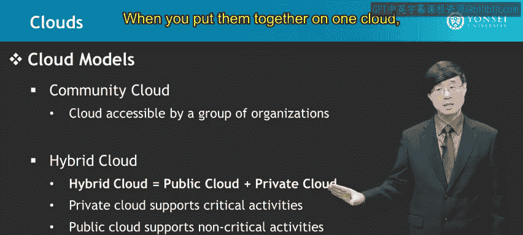
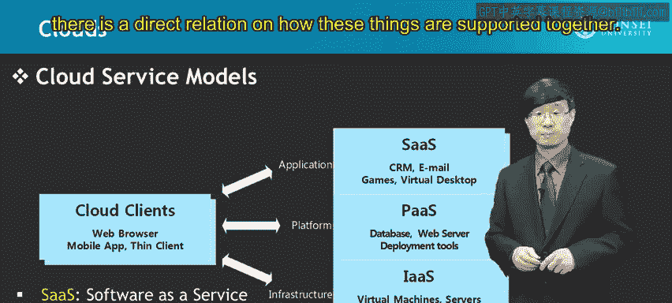
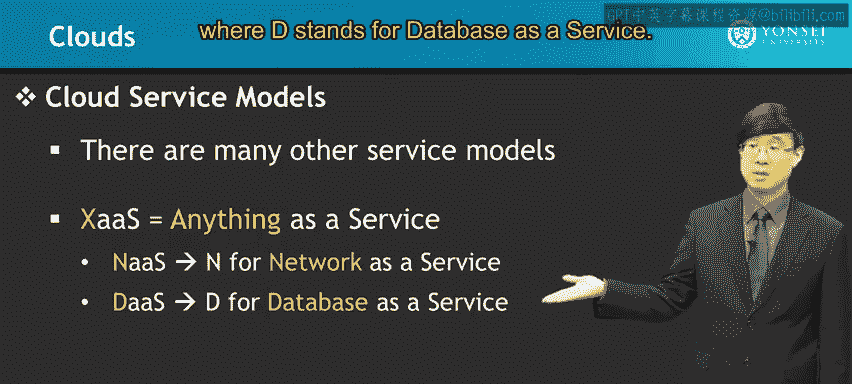
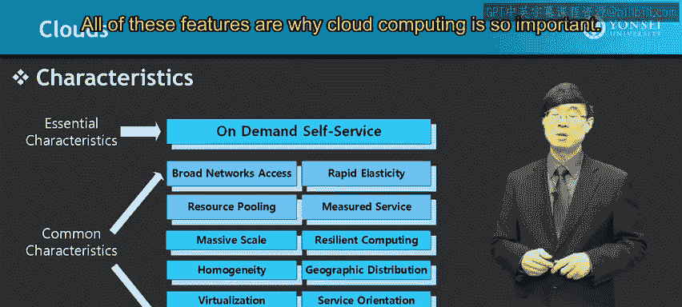
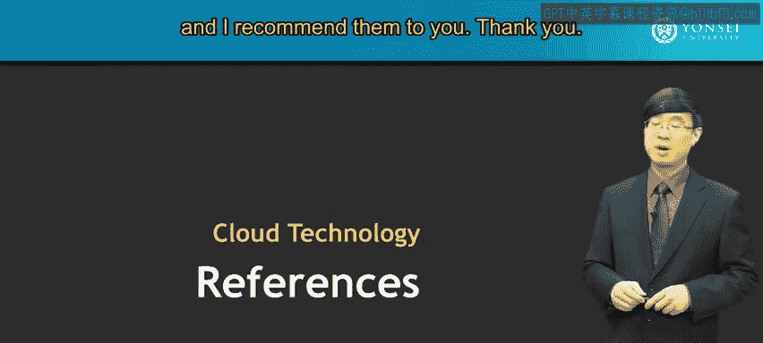

# 延世大学《新兴技术从智能手机到物联网再到大数据Emerging Technologies From Smartphone to IoT to Big Data》 - P113：41_5.6 云.zh_en - GPT中英字幕课程资源 - BV18hpFewEcG

Yeah。🎼Yeah。We will now study about clouds。What do clouds do？They provide online data storage。

They enable configuration and accessing of online applications。In addition。

 they provide a variety of software and provide computing platform and computing infrastructure。

Some of the key things that you can notice from here is that software。

 platform infrastructure are three major things that they provide， in addition。

 classifying some of the characteristics here is that online data storage can be seen savings in terms of platform or onto a infrastructure based storage mechanism。

So the data storage itself is based on a platform through a database or infrastructure。

 which is the storage servers themselves。Cloud application example。

This example is based on using Gmail on my smartphone to check emails。

Especially looking at an attachment file that is included in an email。

And the attachment file is a Microsoft PowerPoint file。

I'm thinking about what I have on my smartphone。

And then what I have on my personal computer or my laptop computer in order to open up a Microsoft PowerPoint file。

In order to open up a Microsoft PowerPoint file on your notebook computer， your laptop computer。

 your personal computer， you need to first have the operating system included Microsoft Windows first install once you have Microsoft Windows which includes the operating system installed。

 then you can install your Microsoft Office package on top of it。

 and then you can go and open up a Microsoft PowerPoint file。

 or an Excel file or Word file or other files。However， on your smartphone。

 you do not have Microsoft Windows operating system。

 You do not have Microsoft Office installed on it。 However， when you receive an email。

That has this type of an attachment file。 You can still open it up on your smartphone。

 How what enables me to do that。That is fundamentally what we mean by cloud services。

 what we do not have as in terms of platform technology， infrastructure， technology。

 whatever software we do not have， then we can immediately get that on demand from the cloud and use it to do whatever we want to do。

 That is basically what cloud computing is enabling you to do on your smartphones。

Google Drive Services has Google Docs， sheets and slides that can be used to open up the file。

 and when you need it， it can be delivered immediately。

 and that is what we mean by cloud computing just looking at this it becomes very powerful on how it can be used。

Not only on smartphones， but also when you look into IoT， Internet of Things。

 these Internet of things devices of course， do not include all the software， all the database。

 all the infrastructure， computing and storage support that it needs。A lot of devices are small。

 very simple， and have limited operational capability。So therefore。

 having IoT alone you may not be able to do a lot， however when IoT devices are connected to a cloud。

 then what you can do is naturally unlimited， and that's why we're studying cloud technology along with IoT technology in this course。

What can a cloud do for us？A cloud can provide services through public or private network or the internet where the service hosting system is at a remote location。

Clouds can support various applications such as email， web conferencing， CRM。

 customer relationship management， games， database management， and various other things。

Cloud models include public cloud， private cloud， hybrid cloud， community cloud。

In which a public cloud enables public systems and service success。It is based on open architectures。

 such that it is possible to receive and send emails and look at websites。

And it could be less secure due to the fact that it is opened and publicly accessible。

Private cloud these enable service success within an organization， due to its private nature。

 it is more secure and more difficult to get access to。

A community cloud is accessible by a group of organizations。That share a cloud together。

A hybrid cloud is a public cloud and a private cloud added together。

The private cloud supports critical activities。And the public cloud supports non criticalit activities。

Such that if it's。Secure information or something specific that you need to protect and it's detailed about the data of your company or about the company itself。

 then you need to use a private cloud such that that information is protected at a much higher degree and level where the public cloud can be used for general users when they need to send email。

 receive email， go to a website and do other operations so therefore private cloud and public cloud are both needed when you put them together on one cloud that is what we will call a hybrid cloud。

The cloud service models look like this in which we have cloud clients， and then we have SaS。

 PAOS and Ios like here。Saas is softer as a service， PAOS is platform as a service。

 and Ios is infrastructure as a service。And what they do is that when you look at Saas， it does CRM。

Customer relationship management， email， games， virtual desktop technology are based on Saas。

 softwareft as a service， cloud computing technology。Then we have Pa。

It provides things like database， web server， deployment tools。And development tools。

These things are what the platform technology is supported。Then we have Ios。

 which is infrastructure as a service， where virtual machines， VMs。And servers。

 storage capability and networking support is provided。

The lower service model supports the management， computing power， and security of the upper layer。

What does that mean in addition， if somebody is going to use IOS， then along with the Ios。

 the infrastructure that is being supported， they will need a platform as well as the software to be added along such that they can get full access of the specific Ios cloud technology that they are receiving so when you look up and down the structure。

 there is a direct relation on how these things are supported together。

Clouds。Looking into the details of the major big three classifications， software as a service。

 this provides a variety of software applications as a service to end users。Think of it like this。

Have I ever used cloud computing technology， When will I get to use cloud computing technology。

 Will I ever use Saas。Well， it turns out that if you have a smartphone， if you have a tablet PC。

 then you've already used it。For example， the applications that you download on your smartphone are SaS technology。

You've been using it for a long， long time。Platform as a service。

 this provides a program executable platform for applications， development tools。

Infrastructure as a service。 This provides the fundamental computing and security resources for the entire cloud。

 It includes backup storage， computing power and virtual machines， VMs。😊。

The cloud service models include。The other type of models which can be classified as X U。

 where the X is where you can put in whatever letter you want to put in， for example。

 people are putting in N to make it NS where n stands for network。

 so it becomes network as a service， then some use doS where D stands for database as a service。

 some use Bo， in which it is business as a service and other things。

These classifications are made based on how people want to use the XS classification to their needs to make their service or overall package unique and easily expressed。

However， all of these three， as well as other things are fundamentally classified into the major three。

 which is SaS software as a service， pass platform as a service and Ios infrastructure as a service。

 in which all of these fall into the SAS Pass Ios categories as well， however。

 people do this and you're welcome to do it as well。😊。

What benefits do you get from cloud computing technology。

 High efficiency and reliable flexibility applications as utilities over internet。

Manipulate and configure apps online， online development and deployment tools。

No software required because you can get whatever you need when you need it on demand。

 cost effective。On demand， self service， and resource available on network。

When we talk about cost effective， you're seeing that instead of buying a software package。

 getting the DVD and installing it on your computer， using cloud computing is number one。

 you are opened up to download a variety of different applications when you need it and you do not need to invest into something that you may not use when you need it you go ahead and download it and then you use it so therefore when you download something you will know that I'm definitely going to use it。

 so there's no waste in investments in money。The characteristics go on here where the essential characteristics is on demand self serviceice。

 and this is exactly what I was talking about。 I will selfservice， I will get it when I need it。

 so selfservice， I will get it on demand when I need it。

And that is the basic essential characteristic that makes cloud computing technology so attractive。

The common characteristics include broadband network access。So I have to have a good network。

 both wireless and wired so that I can download whatever I want when I want it immediately。

Rapid elastic， what this means is that there are various smartphones。

 There are various smart devices。 There are various smart pads and smart tabs。

When I download a cloud service， then that needs to come into my computer or my smartphone and fit the configuration to the right amount of memory。

 the internal bus， the way that display will work so that it will work on my device in order to do that。

 it needs to have this characteristic。Resource pulling naturally。

 you can call things in and use them together when you need to。

 and that is what we're talking about measured service。Massive scale， resilient computing。

 homogeneity。😊，Also， geographic distribution， virtualization， service orientation。

 low cost software and advanced security。 All of these features are why cloud computing is so important。

These are the references that I use， and I recommend them to you。 Thank you。

