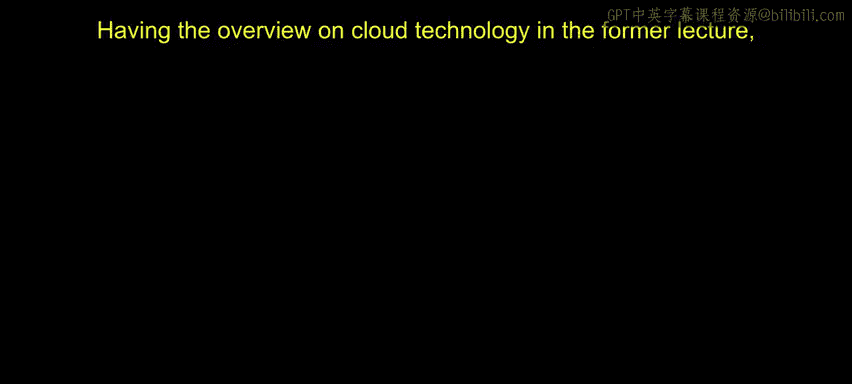
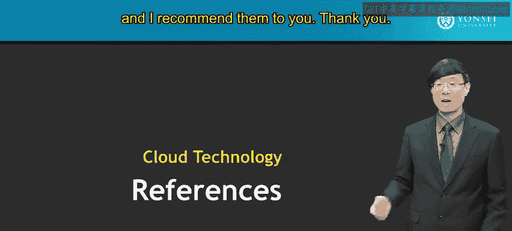

# 延世大学《新兴技术从智能手机到物联网再到大数据Emerging Technologies From Smartphone to IoT to Big Data》 - P114：42_5.7 IaaS、PaaS、SaaS.zh_en - GPT中英字幕课程资源 - BV18hpFewEcG

Yeah。🎼Yeah。Having the overview on cloud technology in the former lecture。

Now we will go into the details of Aas， PAas and Saas。Once again。

 the overall service model where we have these three。And once again。

 you need to know that the upper one depends on the lower capabilities being supported。

 and also when you receive a lower one， you also need the upper ones to come along together so that you can use the lower infrastructure more properly。

 such that in a way that when you receive Ios support。

 you will also need to have passS and SaS as a service package coming to you in a virtual machine type format。

In addition， when you're receiving pass services， so as to say a database。

 then the database will be provided through the pass service。

 but then again you will need SAS technology to support the database usage and that is what we're talking about so if you receive something lower you will need the upper support in a package and deliver to you。

If you receive this， then you will need this as well to be delivered to you however。

 if you receive this， then SaS， you get it you use it because your smartphone or your other mobile smart device will have the platform and infrastructure that it needs to use already there where the software goes in it fits it into the configuration and then you can use it。

Infrastructure as a service， infrastructure support over the Internet， A clouds。

 computing resources and storage resources are what the Ios is about。Computing power。

 storage services， software packages and bundles， and virtual local area networking techniques。

 virtual machine features are what are included。Virtual machine administration。

IOS enables control of computing resources through administrative access to virtual machines When you talk about cloud computing techniques。

 virtual machines are definitely one of the key features。

Server virtualization features are essential。Access to computing resources are enabled by administrative access to virtual machines。

 where virtual machine， administrative command examples include Save data on Cloud server。

 start web server， install new application， and many others。

Looking into how IOS is delivered and how a virtual machine is operated。The software owner。

 the person that designed the virtual machine， will have that placed on the storage and the storage area network。

 the sun。This is where the cloud servers are， and as you can see in the virtual machine。

 it includes a unique package that has its own operating system and application software packaged together that is delivered here。

When somebody requests it such as user one and user two， then they will contact the V switchitch。

And the BSitch will pull the information from the storage and sand and deliver it to the users。

 such that the application and operating system as a package are delivered to somebody's device。

 such like your smartphone。I ask benefits。Flexible and efficient renting of computer and server hardware is the main feature。

Which include virtual desktops。Rentable resources such as virtual machines， storage， bandwidth。

 firewalls， IP addresses， monitoring services， and many other。

They are based on a rent payment structure where resource type， usage time。

 service packages determine how much you're going to pay。

The benefits include portability and interoperability with legacy applications。

This is very important because your device may not have all the older software or operating systems available。

 therefore， if you find an old file that you want to reopen on your computer you may not be able to do that。

 however， the chances of finding that old software package and old version of the operating system somewhere on the cloud if it's a good big cloud。

 you will most likely find it， meaning that you can open old files and old documents。

Enables portability based on infrastructure resources that are used through internet connections。

It enables a method to maintain interoperability with legacy applications and workloads between IOS clouds。

Platform as a service， this provides development and deployment tools for application development。

Typical types include application， delivery only environment。Standalone development environment。

 add on development facilities and open platform as a service。These are the main four。

Looking into the details。The application delivery only environment。

 this provides on demand scaling and application security。

Where the standalone development environment provides an independent platform for a specific function。

Open platformtform as a service provides open source software to run applications。And add on。

 development facilities enable somebody to customize。

 as well as use existing Sa platforms in various ways to build up and extend it into new services。

The past runtime environment for apps are based on a structure in which cloud servers are interacting with users through the IDE that's the integrated development environment。

With the IDE， we have four major components that are interface。Which are scalable infrastructure。

 application hosting， backup and recovery and data security。

 These units that are used as platforms by the users。

Our interface with the integrated development environment that enable you to use the computation resources at the cloud servers。

The PA benefits include lower administrative overhead， lower total cost of ownership。

 scalable solutions， and more current system software。Looking into lower administrative overhead。

 we mean that users do not need to be involved in any administration of the platform。

The lower total cost of ownership， users do not need to purchase any hardware， memory or server。

 they just need to rent it。They just need to buy a lease where they use it for a given period amount of time。

 and when they're done， they can terminate it。In addition。

 scalable solutions include application resource demand based automatic resource scale control。

 meaning that you are going to download exactly what you need In addition。

 when you use it in a way that others are using it and others are using it more and more as a big development team where you're going to design something together。

 then you will be able to mix and match all the different designs in a way such that they all homogeneously can be brought together In addition。

 when you're making solutions and you have multiple programmers。

 then you do not need to worry about the mismatch and version of software on the different computers because they are accessed from the cloud In addition。

 if there is one software development kit that has a testing environment where you test if you。

Your procedure， if your function， if your package or library is operable with the mainframe system。

 then if you pass that type of a testing， then you know that your system will work with the mainframe and the same testing environment will be used for the other developers as well。

 so that when you're doing a big scale， a large scale software development project。Evidently。

 scalable solutions are critical。More current system software。

 this is one of the components that I talked about in here as well as here。

If there is a certain computer program in which you're using and you receive it and you open it up on your computer。

 then there are three things that could happen， number one。

 it is a program that was programmed on a software version that is a higher one than yours。

 or it was one that was on the same version as yours。

 or it was developed off of a software version that is a lower version of yours。Of course。

 if it's at the same version of a software， then it will work perfectly with your program together if it was designed the right way。

 however， if it comes from a higher version compared to the software version that you're using。

 there may be some features that may not work and the other way as well。

 if it comes from a lower version than what you're using。

 then they may not be taking full advantage of the library functions。

 the new library functions that they should have used to make their program more efficient and more powerful。

 either way， one way to avoid all of this is use cloud computing technology。Software as a service。

 This provides softwareer applications as a service to the user。

 software that is deployed on a cloud server， which is accessible through the internet。😊。

Which include the characteristics of on demand availability， you download it when you need to。

 and that is exactly what we're doing on our smartphones。Easy maintenance。

 no user software upgrade or maintenance is needed， all supported by the cloud。

 and that is exactly what we're getting also。flleible scale up or scale down centralized management and data In other words。

 one of the things that you will be able to do is that if you need to make adjustments。

 then you will not be the one that's going to make all the adjustments。

 typically the cloud manager can control what they downloaded to your computer and if they need to send in patches or change a bug that is already in one of the modules。

 then they can do that。Enables a shared data model。

 multiple users can share a single data model and database。😊，Cost effectiveness， pay based on usage。

 no risk in buying the wrong software。Multitenant programming solutions。

 multiple programmers are ensured to use the same software version。

 no version mismatch problems will exist。 These are the characteristics that we also had in the pass and also we have them in the SAas。

The openSa application structure looks like this， interfacing with the cloud servers。

We have the major units that we want to use， the Saas directory web service。

 the Saas messaging web service， as well as the Saas collaboration web service and the Saas content web service。

These are provided to us through a sauce orchestration layer。

This is what we see in the middle that is interfacing with the client user interface layer。

This SAS orchestration layer orchestrates the access of these core SaS functions。

That interact with a cloud server。 So when it comes to importance of controlled units。

 definitely the orchestration is very important。These are the references that I use。

 and I recommend them to you， thank you。

