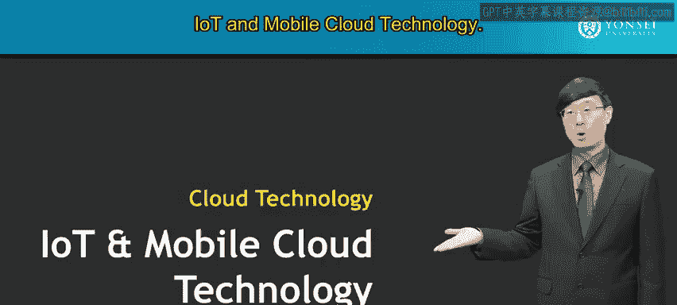
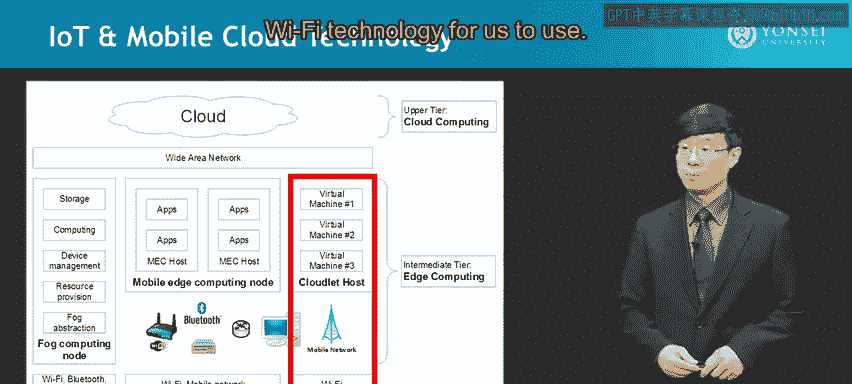
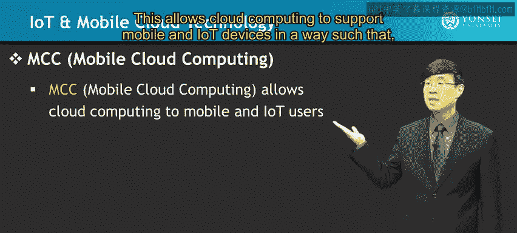
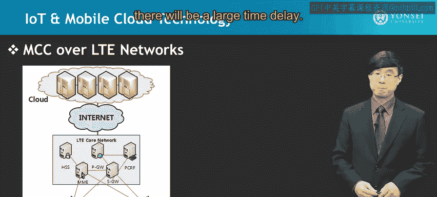
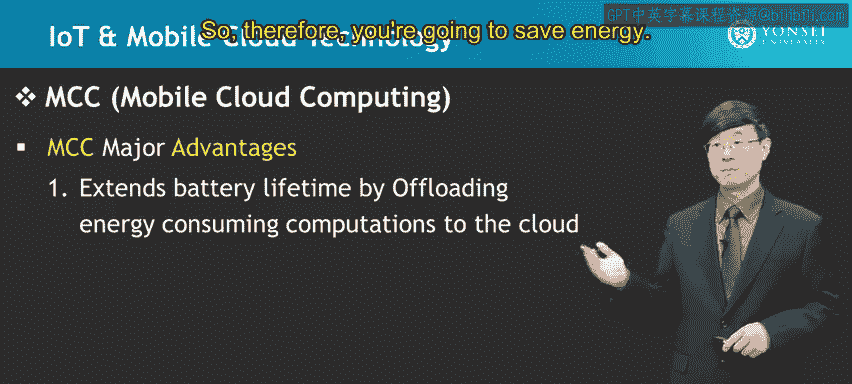

# 延世大学《新兴技术从智能手机到物联网再到大数据Emerging Technologies From Smartphone to IoT to Big Data》 - P115：43_5.8 物联网移动云技术 5.9 MCC移动云计算.zh_en - GPT中英字幕课程资源 - BV18hpFewEcG

Yeah。🎼Yeah。Io T and mobile cloud technology。

Looking into the domain of IoT and mobile cloud technology。

 all of these different IoT and mobile smart devices that exist will need cloud computing support to support the diverse needs of what we want to do with our smart devices with our IoT devices。

So therefore， cloud computing support is needed， however。

 cloud computing support is way there in the internet on a server somewhere at a remote distance。

So if we want to get fast， reliable services quickly。

 then we need some additional technology in cloud computing。

 and that is what is classified as edge computing， in other words。

 bringing the cloud resources to the edge of the network where we are the users are。

 such that we can use them effectively。In order to do cloud based on edge computing technology to bring the cloud technology close to us as possible。

 then there are three categories of technology groups， one is called fog computing。

 which you see over there， it is accessible to us through Wi-fi。

 Bluetooth and ZigB type communication such as wireless LA and wireless pan based techniques。

 and it supports storage computing， device management。

 resource provisioning and fog extraction techniques。Then there's the one over here。

 which includes and uses mobile communication in addition to parts of WiF。

And this is based on the ME， which is mobile edge computing， short MEEC。

 and that's where the ME hosts， which include applications are delivered to us for us to use。

Naturally from the word mobile that's included in the title。

 this uses mobile communication networking。Then we have Cloud Let。And on a cloud Let host。

 you see virtual machines that are there， and they are brought closer to us typically through WiF techniques。

 WiF technology for us to use。

Now we'll look into these three so that we can understand edge computing and mobile cloud computing。

We'll start with mobile cloud computing。 What is this？The trends in cloud computing are like this。

 where user requirements for high data rates and quality of service are exponentially increasing。

In addition， technology evolution in smartphones， IoG devices。

 and various other sensors and actuators are becoming highly advanced。

And on a lot of smart devices and IoT devices， they have very powerful CPUs。Central processing units。

 GPUs， graphic processing units， and system on chipIs， SOC units。However。

The CPUs themselves are not enough to compute all the information and give you accurate and intelligent results。

Another issue is that a lot of cases， even if it was powerful enough to compute it。

 still it would not be good enough because when we want to make a decision。

 we don't want a decision based on one local device。

 we want to make a decision based on the environment。

Look at the surrounding environment and all options。

And then include that into a case where I have situational awareness。

 I know what is going on and what's happening to me， then I make an optimal decision。

In order to have that， even if you could compute it on oneNote。

 still you will not have the full scope of data， and that is why we say not all data is available at a note。

 it's impossible， so even if you were powerful enough to compute it still because you do not have all of the collected data。

 still your result would not be optimal。But then again。

 if I'm going to click the surrounding data that is around me so that I have accurate situational awareness。

 then that is going to be a tremendous amount of data and having a smart device or a mobile device put that all on the memory would be impossible as well。

In addition， when we talk about IoT devices and smart devices like your smartphone， smartwatch。

 the overall amount of energy that you can use is very limited。

 that is why you cannot ask it to always be operating at maximum speed to give you fast results。

 in addition， the devices that we use are small when it comes to IoT and smartphones。So therefore。

Because they are limited by the battery that's on those small devices。

If you are asking your device to compute something fast always。

 it would drain out the battery and the device would be useless。In addition。

 if you were to ask it to compute all the surrounding information that is collected。

 it would be consistently processing and computing。That would drain out the battery as well。

 so either way。Because these are battery limited。Devices， and also， there is so much to compute。

There will always be a limitation that is why mobile， cloud computing becomes very attractive。

This allows cloud computing to support mobile and IoT devices。

In a way such that， when you look at a smart device in LT that we call it user equipment in fourth generation and fifth generation mobile systems。

 as well as IoT systems， well， you can use a distance centralized cloud。Through a core network。

 which could be like the internet or a mobile communication network and ask help from the mobile operator such that you can go through the network。

Connect to the cloud and ask the cloud to save information or compute the results and deliver the results to me。

Looking at what we're talking about， the cloud is way over there， then there's the internet。

 then there is the core network of the mobile communication structure。

Then down here is what we call the radio access network， the RAN， and it has base stations connected。

 which we call En Bs。And that is connected to a UE。

 This right here is a fourth generation mobile communication network。

 LTE or LTEA network looks like this。Then when a user on a smartphone has。Services。

 it will connect to the base stations， the En Bs， which will connect to the core network。

 which will connect to the internet， which will connect to the cloud。

 and then the services will be delivered to the user that's using the smartphone。

This is the process of how mobile， cloud computing is supported to our smartphones。Naturally。

 you can see there is a distance。And also， the operations going through the mobile communication core network。

 as well as the internet， then going all the way to the cloud， there will be a large time delay。

So therefore， there are advantages and disadvantages when we look at the original mobile cloud computing infrastructure。

What are the pros and cons， first let's look at the pros， the advantages。Obviously。

 if you don't compute it on your smart device， you're not going to use it。

 all you do is you collect information， you send it to the cloud。

 and ask the cloud to collect more information， compute and just send me the results。So therefore。

 you're going to save energy。

In addition， these devices have very fast high computing capability and large memory， so therefore。

 when you use them， they will compute the results and send them to you very quickly。😊，In addition。

 you can save and save and save and save， and therefore it becomes very attractive because smartphones and IoT devices have very limited memory。

😊。