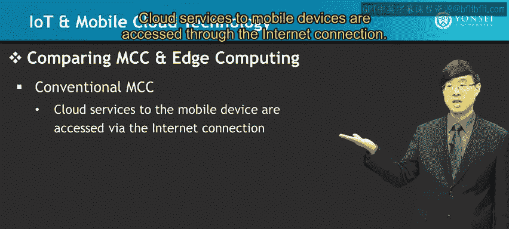
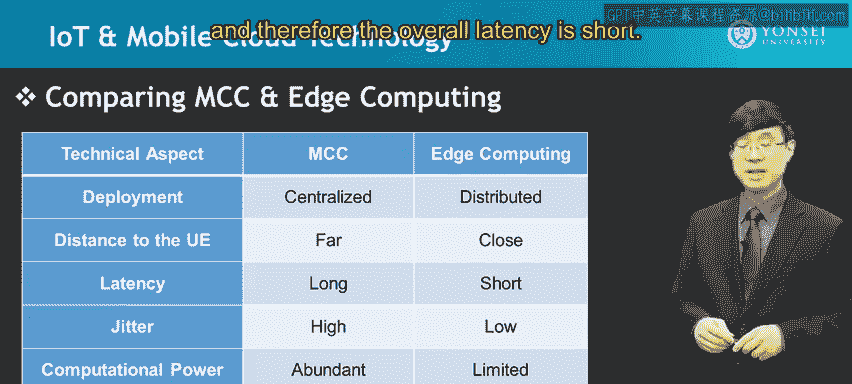

# 延世大学《新兴技术从智能手机到物联网再到大数据Emerging Technologies From Smartphone to IoT to Big Data》 - P116：44_5.10 边缘计算.zh_en - GPT中英字幕课程资源 - BV18hpFewEcG

Yeah。🎼Yeah。Edge computing， cloud technology。Comparing MCCC， mobile cloud computing to edge computing。

Edge computing is a concept to bring the cloud computing technology closer to the users。

In terms of conventional mobile cloud computing， in which we have mobile users connecting through the mobile communication core network。

 through the internet to the cloud servers。That is what we're considering as conventional mobile cloud computing。

Cloud services to mobile devices are accessed through the Internet connection。

And some of the characteristics include long time delay and quality of service performance。

which becomes issues， high usage of the network resources。

 because every request will need to go through the mobile communication network and the internet。

 and then a return must be received。High battery usage of IoT and smart devices because they are sending it to the local base station or something that connects them to the wired area network such that you can access the internet。

Significant packet in Tri time jitter。This is an issue because when you send packets， send packets。

 send packets， then when you send them， they may have a uniform distance in time。

Between the frames and between the packets， however。

 when they go through a complex network and they go through hop by hop， the hop to reach the server。

 and then the server， the cloud computes the results and sends it back to you。

 even though when the packets are leaving the original device。

 they have a uniform distance between packets and frames。

 once they arrive through the internet to a device。

 these interdistances between the frames and packets get totally messed up， and in some cases。

 some may be very densely bursty， clogged up together， where some may be separated far， far apart。

And this is what can。Increase the overall loss probability for delay bound violations。

 especially this is important for real time multimedia services like video games。

 video streaming and things like that。For example。When we receive video files through multimedia services。

 the typical data rate is based upon how many frames per second of images am I receiving such that when I reconstruct them。

 they look like a motion picture。Then typical data rates include 20 frames per second。

30 frames per second， 40 frames per second， and these are typically the case for one frame is made up of multiple packets。

So therefore， each second， for example， I need to receive 30 frames and each frame is made up of multiple packets。

If you think about that， then。One second is divided into 30 segments， and each segment。

 I need to receive all the packets that will help me reconstruct that one frame because I need to reconstruct 30 frames per second to show it on the screen so that it looks like continuous motion picture。

In that case， if a frame does not。Have its packets arrive within that one over 30th type of time interval。

 then the frame will not be reconstructible， and then we will just need to go to the next frame。

In that case， the frames that were delayed will be wasted because they will have。

Delay bound violated their time duration of when they should have been received。

That is what we call a delay bound violation and when it comes to realtime services and multimedia services like video games and videos。

 this becomes very important and not being able to match this performance， in other words。

 having large intrial time jitter of the packets，😊。

Significantly degrade the overall quality of service。Edge computing。Is a solution for this？

Computing and storage resources are moved closer to the edge， closer to the user， In other words。

 they're moved closer to like base stations or access points。

Edge computing characteristics include very short time delay with high quality of service support because it's so close。

Low usage of network resources and low battery usage of IoT and smart devices。

 because you're only communicating in a short range of near distance device that is going to quickly give you results。

But on the other hand， it is more complex。You have to be able to predict what is going to be used。

 you need to bring that over to the edge computing device。And if you do that in advance。

 then you will get maximum speed delivery when it is requested， but on the other hand。

 you need to predict and fetch it over and bring it close enough。

 so therefore there are the challenges of being able to do this the right way。

Looking at some of the characteristics of the conventional mobile cloud computing。

 along with edge computing techniques。The deployment is based on MCC is centralized， however。

 edge computing is distributed。Meaning that centralized MCCC means that the original cloud where the servers are。

 that is controlling the overall cloud computing support。

 so it is centralized where the edge computing devices。

 something like a cloudlet or an ME or a fall computing device。

 these are distributed and abundant and many。Distance to the user equipment UE once again。

 UE is what we call our smart device and all devices that are connected to the mobile communication network。

 either 4G LT or LTA or 5G， which is going to come very soon。

 we will call these devices UE user equipment。So looking at the UE as in terms of MCC， of course。

 the cloud is very far away， however， edge computing is very close。Latency wise。

 MCC is long because you need to go through the mobile communication network， the wide area network。

 you need to go through the internet and go into the location of where the cloud servers are。

 and then you need to bring back your information。However。

 when you use edge computing it is right there right next to you and therefore the overall latency is short as in terms of interarrival packet chter。

 mCCs are high which is not good， however edge computing is low which is very stable and more reliable when it comes to computational power the MCCC is using a cloud server that is in a server location however edge computing devices。

 these are small portable and a lot of cases battery operated。

 so therefore their computational power is very limited。😊。

Also in terms of storage capability， well， the MCCs are at the major cloud， at the major servers。

 so you can store a lot， however， what you can store on edge computing devices are limited。

So therefore， when we look into edge computing， we will focus on the main three， file computing。

 mobile edgedge computing， ME， and also cloudlets in the following lectures。

