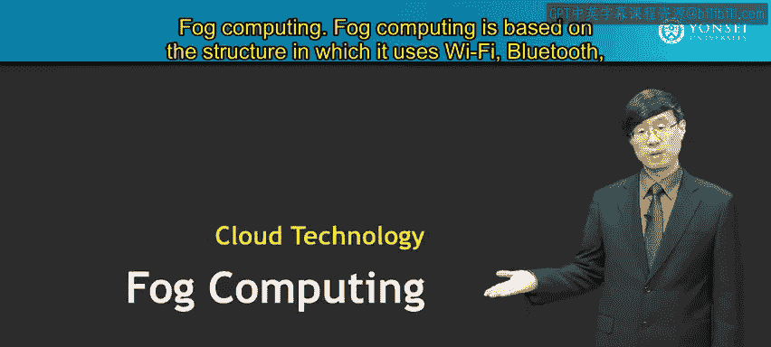
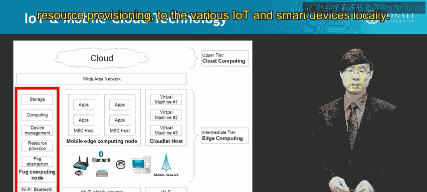
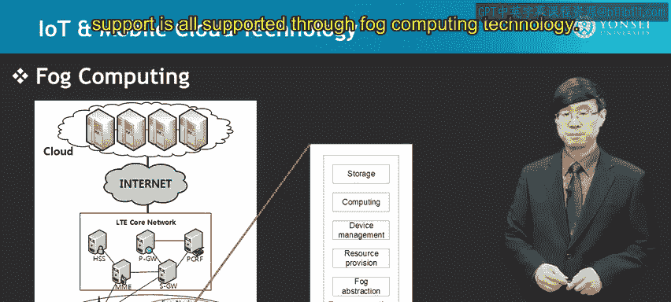
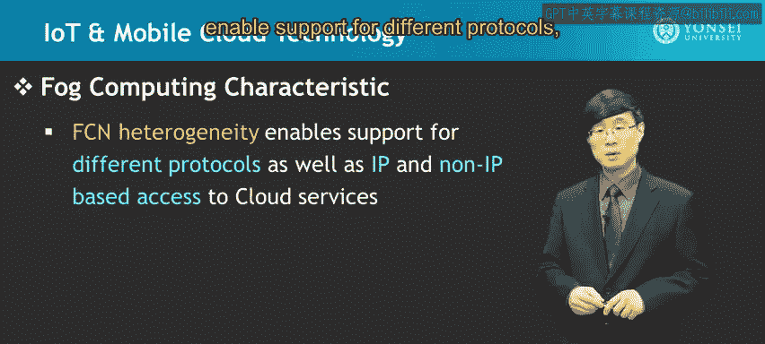

# 延世大学《新兴技术从智能手机到物联网再到大数据Emerging Technologies From Smartphone to IoT to Big Data》 - P117：45_5.11 雾计算.zh_en - GPT中英字幕课程资源 - BV18hpFewEcG

Yeah。🎼Yeah。Far computing。

Foob computing is based on the structure in which it uses WiF， Bluetooth。

 or various wireless pan techniques like Zigby，6L Pan or others。Such that it is providing storage。

 computing， device management， also fog abstraction。

 resource provisioning to the various IoT and smart devices locally。

Looking at the overall network structure， which you've been looking at。

 having a fog node joining the mobile network is where that becomes the new center of connection for local devices such that if they want to communicate with each other。

 they do not need to access the overall backbone network they can share and access each other locally。

 In addition， if they need to get connection to the internet or a main cloud。

 then they can ask the fog node to make connection and use the connection through the fog node that is what we mean by fog computing。

The overall things that are supported， like I mentioned before， from storage all the way。

 resource provisioning and computing support is all supported through fog computing technology。

The definitions are like fog computing， or you will see it under the name of fog networking。

 or in some cases you'll see it under the name of foggging。

It uses one or more collaborative end user clients or near user edge devices。

Fologs support services in terms of substantial amount of storage。

 instead of storing in a cloud data center， you store it locally。Communication support。

 instead of routing over the internet backbone to communicate with each other。

 you are communicating through the fog device。In addition， control， configuration， measurement。

 and management can be provided through the fog device。

 so instead of being controlled by the internet gateways。In addition。

 in the LT network structure we were looking at， there are serving gateways and PDN gateways。

 and instead of using them， we can use the structure of the fogO network to be interactive and work and communicate such that we are also being controlled and managed together。

Fall computing characteristics include that they are decentralized。Although in the former picture。

 I only drew one fall computing device。You can use many， many of them for specific reasons。

And the overall infrastructure is based on a FCN file computing node working together。

FCCNs can be placed anywhere between the N device and the cloud。These are heterogeneous in nature。

 meaning that they do not have to be of one form and one protocol and one networking type。

 they can be diverse in structure， mode and protocol， and can include various functional elements。

 not all fog devices need to be the same they do not all need to be providing the same service。

 some can be providing memory， some can be providing interactive communication and other things like that。

Typical other functional elements could be that typical fog computing devices could include router switches。

 access points， IoT gateways setup box features as well， or on the other hand， router switches。

 access points， IoT gateways and set boxes could have fog modules inside of them so that when you set up a setup box。

It automatically helps support the fogO network as well。

The heterogeneity of FN enables support for different protocols。

 as well as IPN non IP based access to cloud services。

The Uniform fog abstraction layer， this has functions to support resource allocation， monitoring。

 security， device management storage， and compute services for various types of end devices。

