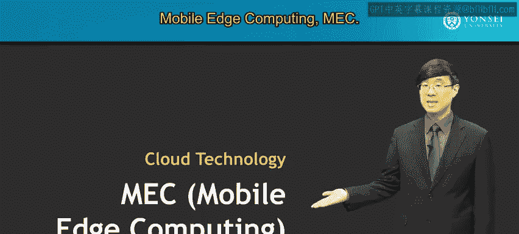
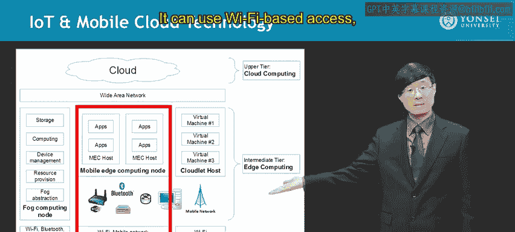
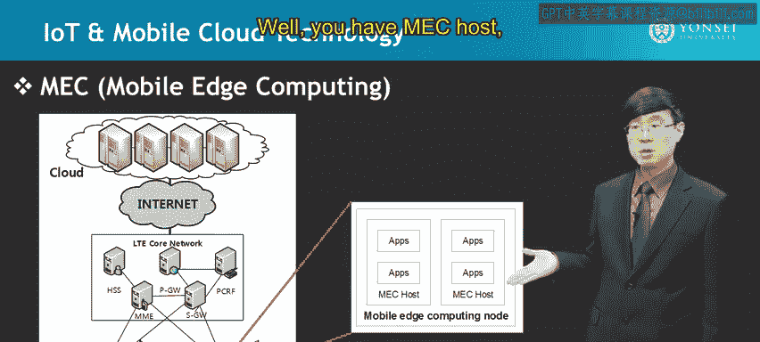
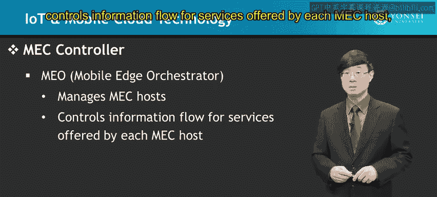

# 延世大学《新兴技术从智能手机到物联网再到大数据Emerging Technologies From Smartphone to IoT to Big Data》 - P118：46_5.12 MEC移动边缘计算.zh_en - GPT中英字幕课程资源 - BV18hpFewEcG

Yeah。🎼Yeah。🎼Mobile edge computing MEEC。

The MEc structure is in the middle， and fundamentally。

 it is based upon the mobile communication network。 It can use Wi-fi based success。

And on the MEc， there are MEc host devices that have applications inside。

A typical case could be in a mobile communication environment。

 a MEECC server is added into the mobile communication network， and when this goes in。

 it has its own location。😊，Where it will work with the base stationation and work with the backbone radio access network and core network of the mobile communication infrastructure once again ME is mobile edge computing。

 it is edge computing using a mobile communication network。

 the typical networks are normally 3G and more events， meaning that 3G are some cases。

 however the most typical ones are 4G like this right here， LTA and LTA。

 as well as the upcoming 5G standards， and of course 5G standards where there these standards will be released in 2019 and 20 these standards of course are expecting various ME techniques to be deployed and used using their infrastructure。

What do the MEEC do Well， you have MEEC hosts once again and they have application supports on them。

The definition is that MEC enables cloud computing and IT services at the edge of the mobile cellular network。

 So once again， when we say ME， we are thinking about a mobile communication network think of LTE and LTA and besides the base stations or the core routers like the serving gateways。

 there are MEC devices， small cloud devices that are in there。

 that will interact with the main cloud that is across the internet it will interact with these devices bring whatever is needed and directly deliver them to the smartphones。

 smart pads， smartwatches and other IoT devices that is what we're talking about right here it is fundamentally based on a mobile cellular network。

😊，Why use this well， faster cloud services for mobile user equipment？

Reduces network congestion What do you mean by that Well。

 if you have a ME that's looking around at multiple users and predicting what these users will use。

 then it can fetch the right resources and save it and deliver it to them quickly。

 not only that when other devices in the local area needed。

 then it already has a copy so it will just redistribute it。

If it was not like this in the original conventional mobile cloud computing MCC mode。

 then each device will communicate with the server that is on the other side of the internet and bring that information and then deliver it。

 everybody will be going through and copying and downloading information directly from the cloud servers。

So therefore， the number of users will be proportional to the amount of traffic on the internet and the mobile core network。

 and we do not want that。So that is where this scalability feature comes in and is tremendously attractive。

 you find what is needed and if it's already there。

 you share it among local users and that what it means by reducing network congestion。😊。

More reliable application support it's just there if I download something that is on an ME then because it's so close。

 if some of the packets have errors， then I can directly recover and ask for retransmission very easily however。

 if there is no ME and I need to connect with the main server that's across the internet then every packet error that I get。

 I will have to wait for it to be reddelivered through the internet and that is not going be good so very reliable。

The MEc characteristics adding on MEs enable cellular operators to open their radio access network to authorize third parties such that application developers。

 content providers can all more actively share resources of the mobile communication network。

 such that it's like you're opening up a new service domain。Based upon MEc technology。

 that's very attractive。Especially when it's cloud computing technology。😊。

MECc servers offer real time information。What types network information types like network load and capacity。

 information of the end devices connected to the server， location information。

 this is especially important if you're doing something like locationbased services， LBS technology。

 and you know that that is more and more important as we go into the future。

 especially like we now have smart cars which are smart devices。

 we have drones and we have even for us various applications that are based on where we are。

 and these locationbased services， LBS type services。

 are supported through cloud computing techniques through MEs very effectively。In addition。

MECs are based on mobile communication networks and when you do use your ME。

 your mobile communication network， location-based information such as assisted GPS information AGPS information can be supported in addition to the accurate clock time that is provided by the mobile communication network itself so not only location for places where I'm shadowed and I can get enough satellite GPS signals in so I'm having difficulty to find where I am in addition to my location and position then the mobile communication infrastructure is there so I can get AGPS support so that I can find my location and get the required support and services。

 advanced services that I want and need to use。Other characteristics include MEc nodes are usually co located with a radio network controller or Mac Bayase station。

So I'm right next to them， which means that the data communication mode and other signaling techniques are right there along with the cloud computing technology。

 which is one of the benefits of ME。Looking into further details of what you mean by your base station。

 well look for these terminologies when you're looking into 4G LTEA and LTA。

 the base station is the Enode B when you're looking into 5G mobile networks the base station is the GNB so look for these terminologies and you'll know where you can place your MEc cloud。

Servers may run multiple ME hosts， this is another good thing。

 so you have a server in a cloud and it's supporting multiple MEEC hosts and some of these hosts may be divided on what they're supporting in specific services or it could be for specific users。

 not for everybody。MECC hosts can perform computation， storage through virtualized interfaces。

 and that is where the power of this technique is coming from， virtual interfaces。

 virtual connections， virtual machines， and all of this is used in a dynamic way brought to us close enough such that it is fast and reliable and that is what the edge technology does。

 and when we're using mobile networks， this is what MEC does for us。😊。

The controller unit of interest is the MEO， which is a mobile edge orchestrator。

 and this manages the ME host。Controls information flow for services offered by each MEc host。

And also controls resources and network topology and manages the mobile edge applications。

