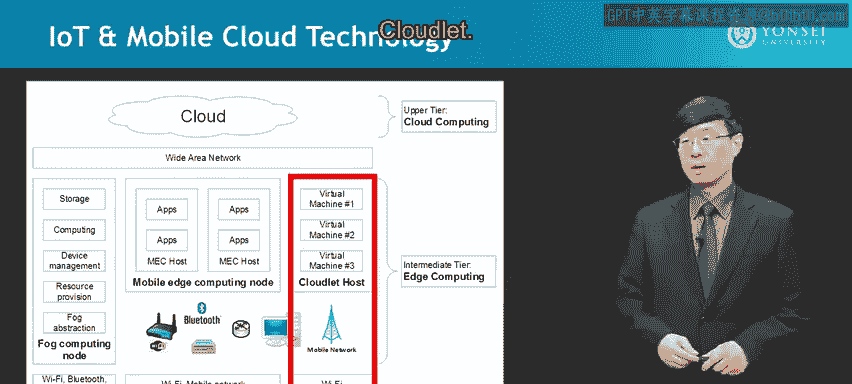
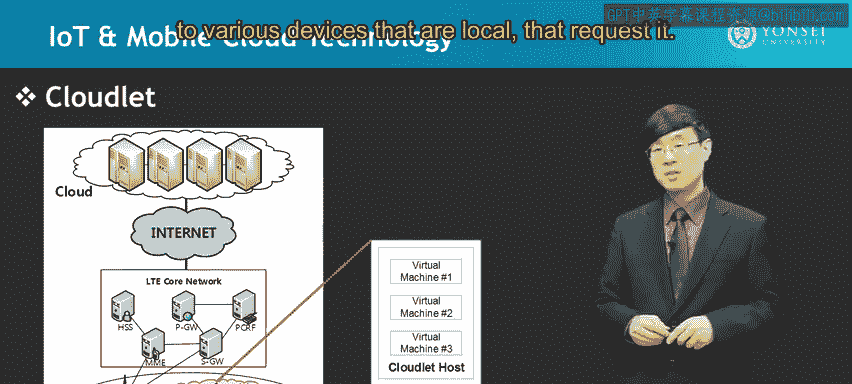
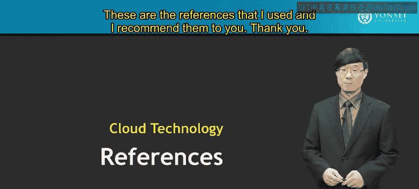

# 延世大学《新兴技术从智能手机到物联网再到大数据Emerging Technologies From Smartphone to IoT to Big Data》 - P119：47_5.13 Cloudlet.zh_en - GPT中英字幕课程资源 - BV18hpFewEcG

Yeah。🎼Yeah。Clud it。

The cloudE structure is typically accessed through WiF connections。And inside。

 we have virtual machines， which are the main features of cloud computing technology。

What is done here is shown in this example in which we have a cloud server。

 which is a local server and a modem device together。

 which may be separate devices interconnected or they may be on one device one unit together they join the network as a local cloud support system。

 however， of course they do not have the full capacity and storage memory that the main cloud would have。

 so we call them cloud Lets。And inside， they can support virtual machines。

Two various devices that are local that request it。

The cloud led definition is based on mobility enhanced small scale cloud data center techniques。

They are located at the edge of the internet nearby the mobile devices， and in some cases。

 some mobile devices could be programmed to be cloud Lets。😊。

CudLets support resource intensive and interactive mobile applications and provide powerful computing resources to mobile devices with low latency。

These cloudlets are used between the UE and cloud device somewhere in the middle。

 and a cloudlet is a data center in a box type concept。That brings the cloud closer to the U。

 so this is really like a cloud， although it does not have all the features and capacity that a cloud will have。

 it is like a miniature device。That has additional communication techniques。

 wireless and wire brought closer to the device such that it is effectively used。

CloudLet's use virtual machine to provision resources for UEs in real time over WiF networks。

So therefore， direct oneH cloud access is enabled， and that is why latency becomes so small and they become much more reliable。

The architecture is based on three layers。And the Cloudt has a cloudt layer。

 which is a group of co located nodes， and it's managed by a cloudette agent。

Then theres a node layer where multiple execution environments running on top of the operating system is what enables this。

 and this is managed by a node agent once again on top was a cloudlet agent on here is a node agent。

😊，Then there's the component layer， this includes a set of services that interface to the higher layers。

As in terms of their execution environment， which is right here。Then comparing these three。

File computing， mobile edge computing， MEEC and cloud computing in terms of mobile device wise。Well。

 file computing router switches access points and gateways。

 whereas mobile edge computing are servers running in the base station。

 mobile communication base stationation， something like an En B or a G node B in the near future。

Data center in a box concept is what a cloud that is。The node location is in fall computing。

 it varies between end devices and the cloud， whereas in ME， the radio network controller。

 as well as the base stations are where the ME needs to be located。When you look at cloudlets。

 these are local or outdoor installations。Softter architecture are based on the fog abstraction layer in fog computing。

 the mobile orchestrator in the mobile communication network is what controls the ME。

And in Cloudlets， it is the cloudette agent， and of course， there's the node agent as well。

 assisting the cloudlet agent。In terms of context awareness， file computing is medium， however。

 mobile edge computing is high， and relatively cloudlet computing is low as the necessary virtual machines that are going to be distributed are already prepared and delivered first in advance。

Proximity is based on the structure of the network where file computing can be one or multiple hops when it comes to ME you're talking about one hopop。

 this is because your smartphone is one hop away from the base station。

And the ME is located right next to the base station。 That is why Onehop。

 although this Onehop is a little bit of a longer Onehop compared to the cloudlet Onehop because these Onehos are wireless local area network based。

 normally they are wireless land Wi-fi- based。 So therefore。

 cloudlets are typically supposed to be close compared to where the macrobase station is in your mobile communication network。

Then comes access mechanisms。When you go to fall computing， it is Bluetooth Wifi。

 or it could be the mobile network and other wireless personal area network techniques。

 such as Zigby。When it comes to MEEC， it is the mobile network primarily， however。

 you could use WiF techniques。When you're looking into Cloudt， Wifi is a primary access type。

 however， other components could be used to connect。

The inter mode communication here in file computing is supported in mobile edge computing it's partial and also cloud computing。

 it is partial as well。Looking at these categories in their characteristics。

The physical proximity for file computing and Cloud， it is high for ME， it is relatively low。

When looking at the power consumed。Mobile edge computing consumes more power because you need to send your signal to the base station。

 and that is why the physical proximity being low results in a high higher power consumption。

When it comes to fall computing or cloud computing。

 you're talking about advice that most likely is very。

 very close and therefore the power consumption is low。Computation time Well。

 file computing here will take higher longer periods。

 whereas mobile edge computing and cloud computing are expected to be faster。Context awareness。

Mobile edge computing has more knowledge， more prediction， more fetching of relevant contents。

 so therefore it is going to be more sensible to what is going to be communicated。

 That means that the overall context awareness is high。

 whereas fall computing and cloud computing are relatively lower。😊。

The logical proximity is in ways such that cloudlet computing is insured。

 whereas fog computing and MEEC are maybe。Then we have non IP support。

 this is also important because not all techniques and devices use IP based protocols。

 looking into file computing， it is a yes， whereas mobile edge computing and cloud computing it is a no。

However， mobile edge computing and cloud computing can be designed in special ways such that they can support non IP devices and non IP services。

These are the references that I use， and I recommend them to you。 Thank you。

