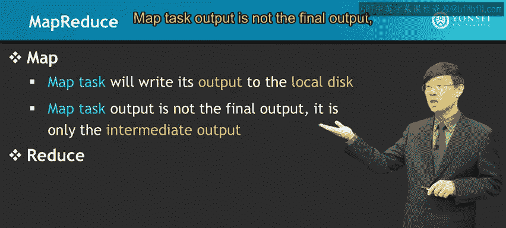
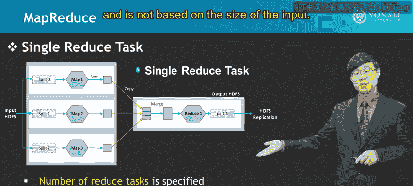
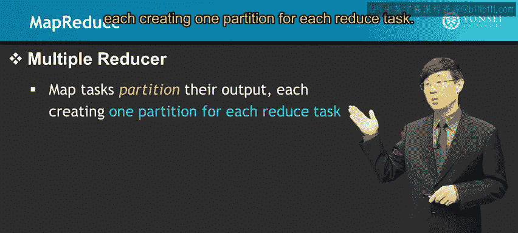
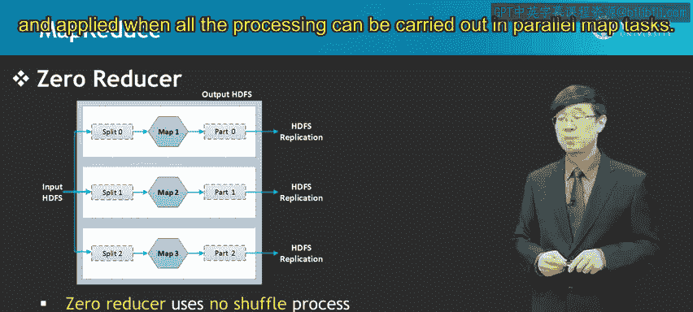

# 延世大学《新兴技术从智能手机到物联网再到大数据Emerging Technologies From Smartphone to IoT to Big Data》 - P11：10_2.7 MapReduce.zh_en - GPT中英字幕课程资源 - BV18hpFewEcG

嗯。🎼Yeah。🎼In this lecture I'm going to look into MapRduce。Haadoop is a reliable。

 shared storage and analysis system that has a combination of the HDFS Had distributed file system and Mapreduce plus alpha。

 Now I'm going to keep the alpha there because later on。

 you're going to soon see additional features being added on， for example。

 like high availability and also yarn and other things。 So therefore。

 I'm going to keep that alpha there。 and I'll talk further details about the enhancements that were made to Hadoop in a very short while。

 But first， let's look at the fundamental two parts。 HDFS and mapreduce， focusing on mapreduce first。

😊，Here。MaapRduce is once again a part divided into map function and reduce function。

Scaling out is done by the DFS， the distributed file system。

 where data is divided and stored in distributed computers and servers。

Hayop uses HFS to move the map reduced computation to several distributed computing machines that will process a part of the divided data that is assigned。

So therefore we have the HDFS that is dividing our data to multiple nodes on our cluster。

 and then each one of these nodes that are operating that are analyzing the data。

 the typical data nodes， they are using MaRduce on their engines to analyze this as we work to extract key value pairs。

Maapreduce job is a unit of work that needs to be executed。Job types include data input。

 mapR program， configuration， information。Job is executed by dividing it into one of the two types of tasks。

 a map task， and reduce task。Job execution is controlled by two types of nodes。

 We have a job tracker and a task tracker。The job tracker coordinates all the jobs。

And it schedules all tasks and assigns the test to multiple test trackers。

It looks like this in its operation mode where first we have a job tracker and the job tracker will look at what needs to be done。

 it will assign it to a task tracker and then after the data processing is done。

 then the result will go back to the job tracker as you see going up over there。

This will be going and processed in parallel for one drop tracker scheduling the work of multiple test trackers。

And this operation is what is actually conducted in the system on the name node and multiple data nodes。

The dataflow， Hadop devs the input into input splits or just for short splits suitable for the mapre job。

 where the split has a fixed size and the HDFS default block size of 64 megabytes。

 this here is used most commonly as because it is the maximum processing efficiency derived solution that mapRduce uses。

Map task is created for each split。And the map task executes the map function for all records within the split。

Have you commonly executed the map task on the node where the input data resides？

Looking at the data flow of Mareduce， you can see that we have a data center inside a data center。

 we have racks。And on the racks， we have multiple nodes。 In this example， in the data center。

 we have two racks， and we have each rack has multiple nodes。

Where the map task and the HDFS blocks are shown right here。

This is an example of a data local map task， and why is this called data local？😡，Soon。

 you'll be able to see in further details when I compare it to the next two other map task cases。

Here you'll see that all of the map task and HDFS block switches and processes are being conducted within the node。

And everything stays within the node on the rack， within the data center。

Data locality optimization does not need to use the cluster network。😡。

And data local flow process shows why the optimal split size of 64 megabytes of an HDFS block size is perfect for this case。

And as you can see， this is one example which is data Local map task once again in the data local map task。

 all of the map task and HDJFS blocks that were in a node were processed on the node。

Here is the rack local map task， and as you can see within the rack。Between the node。

 there is an exchange where the Ma task and HDFS block operations are movingbound。However。

 nothing goes outside of the rack。 This is why we call it a rack local map task。

 a node hosting the HFS block replicas for a map task input split could be running other map tasks。

Job Schr will look for a free map slot on a note in the same rack as one of the blocks。

Then we have the off rack map task。 And in here you can see that we have mapp task and HDFS block exchanges。

From rack to rack。This is the case why we call it off rack。

 because the operation can leave the wreck。 however it stays within the data center。

This is needed when the job scheduler cannot perform data local or rack local map tests sufficiently。

It uses Inter network transfer to satisfy the needs of the OffE Mac task。

Looking further into the details of the map and reduce functions。For Ma。

 MapTask will write its output to the local disk。Map task output is not the final output。

 It is only the intermediate output。

For reduce， map task output is processed by reduced tests to produce the final output。

The reduced task output is stored in the HDFS for a completed job。

 The map task output can be discarded。Looking further into the details of the reduced task。

 there are a couple of reduced task types。 The first one is the single reduced task。

 which is the example right here。You can see that the input to the HDFS leads into three map functions。

 map 1，2，3 over there， and as the outputs are made， they are merged。

 and then the merged result is coming into the reduced function right here。

And this is why since we have a merging into a single reduced function。

 this is the single reduced task。Notes include the functions of split， map， sort and output。

The light blue arrows show the data transfers within a node。

And the orange arrows show data transfers between nodes。

The number of reduced tasks is specified independently and is not based on the size of the input。

Combiner functions。These are user specified functions to run on the map output。

They form the input to the reduced function。They are specifically designed to minimize the data transferred between map tasks and reduced tasks。

This solves the problem of limited network speed on the cluster and helps to reduce the time in completing mapR jobs。

Multiple reducer。Map tasks， partition their output。

 each creating one partition for each reduced task。

Each partition may use many keys and many associated values。

All records for a key are kept in a single partition。

Multiple reducers example is shown right here where instead of having just one right here。

 I have two。And each of these have reduced functions inside。

 and the input that comes over there from the math functions are going into here and here based upon the merging connections over there。

The shuffle process is used in the data flow between the map tasks and the reduced tasks。

 as you see over there， where it needs to merge together to enter the reduced function。In some cases。

 you may use a zero reducer where the input to the HDFS is processed through the map function。

 and the HDFS replications are just used as the output。

Zero reducers do not use any shuffle operation and applied when all the processing can be carried out in parallel map tasks。

These are the references that I use， and I recommend them to you。 Thank you。

