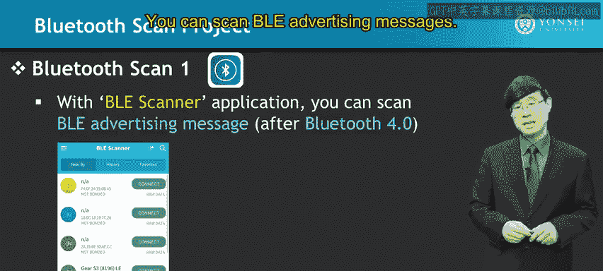
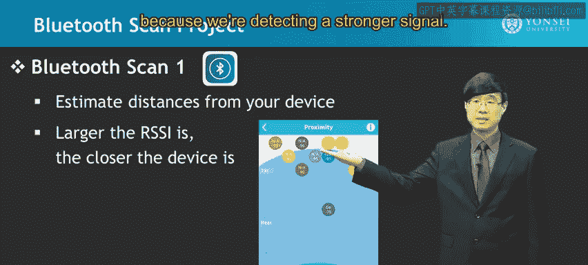
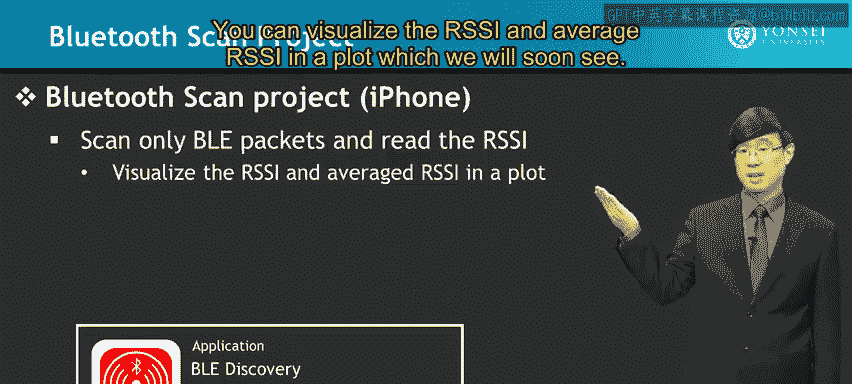
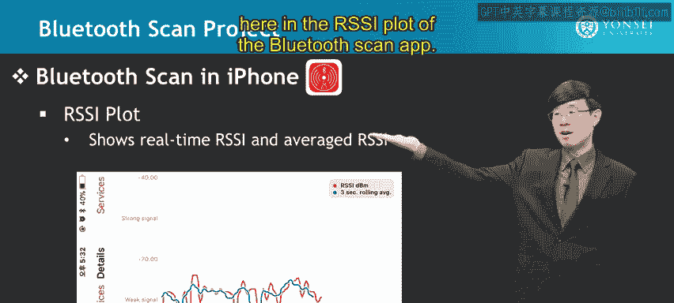
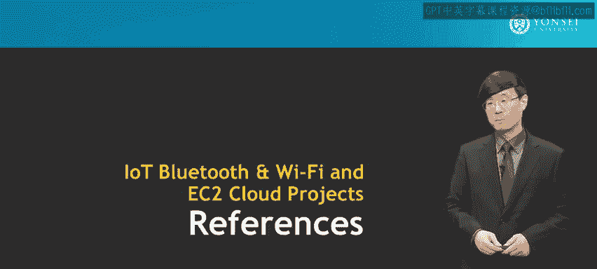

# 延世大学《新兴技术从智能手机到物联网再到大数据Emerging Technologies From Smartphone to IoT to Big Data》 - P120：48_6.1 蓝牙扫描项目.zh_en - GPT中英字幕课程资源 - BV18hpFewEcG

응。🎼Oh。Throughout the course on IoT and cloud computing technology。

 which also includes various aspects of wireless communication。

 now we go into some wireless communication experiments that directly support IoT systems。

That is on Bluetooth to start off with。I'm going to do the Bluetooth scan project with you。

 and there is an Android version which you can see right here where there is a BLE scanner， app 1。

 and an app2， a Bluetooth 4。0 scanner。These are available at the Android App Store。

 the Google App Store。Scan the classic Bluetooth and Bluetooth low energy BLE packets。

Estimate Bluetooth version of the device based on this。

 because theres a clear dividing position of when this became available。

 typically like the Bluetooth 4。0 is a cutting boundary between these two。

Fine distance based on RSSI information receives single strength indication。

Bluetooth scan one with the BL E scanner， the Bluetooth low energy scanner application。

 You can scan BL E advertising messages。 This is for devices that equipped with Bluetooth 4。

0 and beyond。

The interface is like here， looking into the information that's provided here。

 you can see a minus 78 in box 1 in box 2， you can see that it's written as gear S3。

And then you see the connections status， raw data listed in box 3。

You're looking at the RSSI information， received signal strength indication。

 where the power level at the receiver's side is what is being shown right here。If closer to0 DVM。

 the better the signal is right now it's at minus 78， so it's much lower than 0 DVM。

 so you can see the relativeness of it。Packet information。Dvice name is gear S3。

 and that is what is indicated in the second box。Dvice Mac address is also something that you can reference to as well。

The connection bond means connection。Then we have the Connect and raw data check， which is in B 3。

Connect， this is an attempt to bond by sending connection requests。Then we have raw data。

 received raw data packets in hexadymal digits， that's what this is indicating is currently occurring。

Looking over here in further details， there is the raw data where actual packet contents are shown right here。

 and you can see the hexadadeimmal information。Estimates distance from your device and gives you a very convenient display。

😊，The larger the RSSI is the closer the devices because we're detecting a stronger signal。

Bluetooth scan2 is the next part of the project。 you can scan a Bluetooth packet into different Bluetooth versions。

Typically looking at classic Bluetooth， which is a classic scan down there。

 this is for Bluetooth versions before 4。0， then we have low energy scan listed down there。

 that is for Bluetooth low energy， which is Bluetooth 4。0 and afterwards。

Looking at the start scan button being activated will result in this screen and then looking into the details you can see this information provided right here。

In which you see L as in terms of Bluetooth low energy， and then you see classic。

 which is representing the classic modes。 In addition。

 the power levels are listed right here as well that you can see right here。😊。

Other information from this received packet contains vendor and description， device name。

Which are shown over there。And also， the power RSSI can be read from the receiver。

 which are the values shown over here。Bluoo scan project for iPhone。

 I recommend the BLE Discovery app in the Apple App Store。

You can visualize the RSSI and average RSSI in a plot， which we will soon see。

Show whether the advertising packet is connectible or not。

Show which physical layer channel the packet is using。

Let's take a look with the BLE discoveryovery application， you can scan BLE advertising messages。

 as you can see over there。In that part， information you can pick up is RSSI， advertising data。

 local name， device name。The data channels can be the 37th， 38th or 39th channel。

And if the message is a connectible message， then yes will be shown， otherwise， it will show no。

 meaning that it's not a connectible message， it's only an advertising message。

Connectible message means that is it also possible to support data communication？

Real time RSSI and average RSSI values are shown here in the RSSI plot of the Bluetooth scan app。

These are the references that I use， and I recommend them to you。 Thank you。

