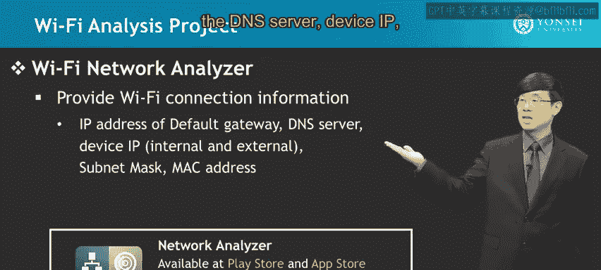
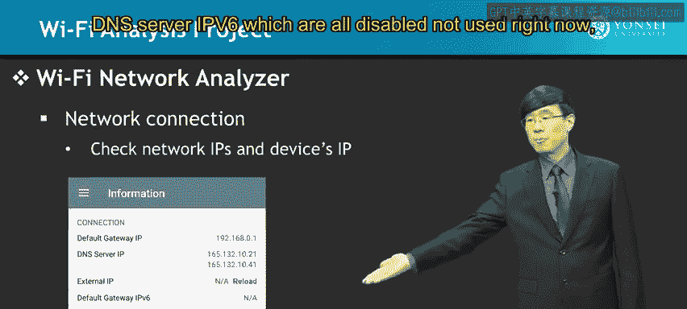
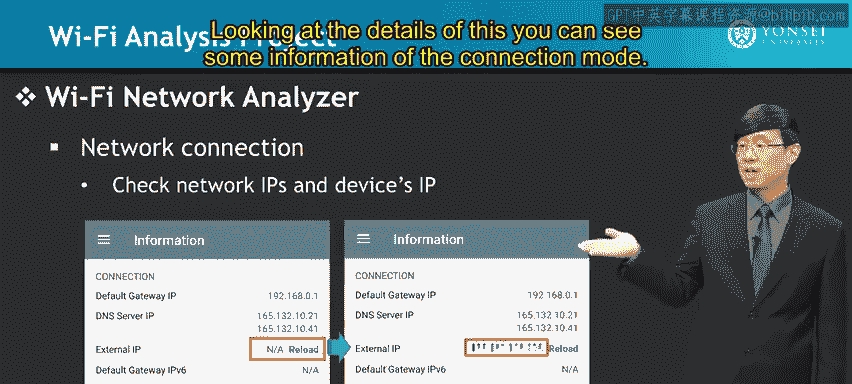
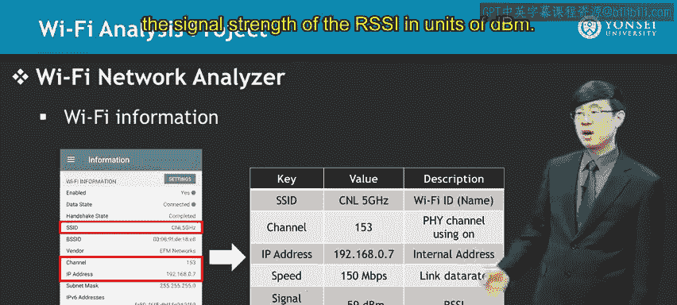
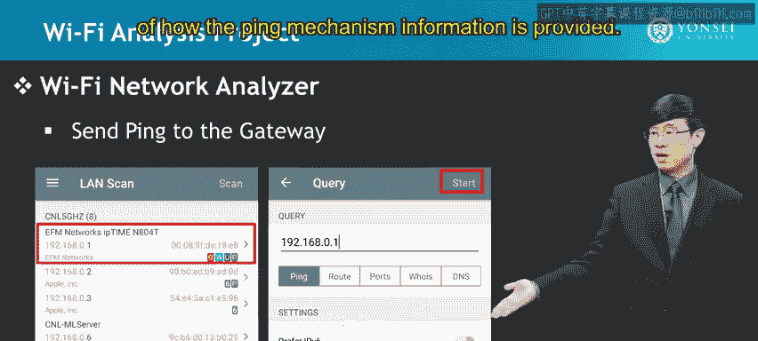
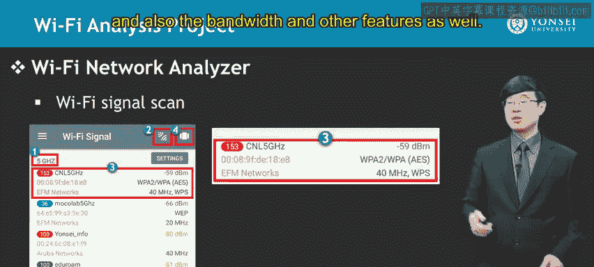
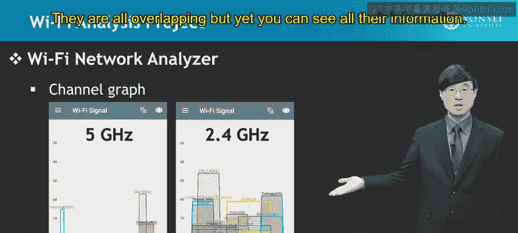

# 延世大学《新兴技术从智能手机到物联网再到大数据Emerging Technologies From Smartphone to IoT to Big Data》 - P121：49_6.2 Wi-Fi分析项目.zh_en - GPT中英字幕课程资源 - BV18hpFewEcG

🎼그。🎼Yeah。Wifi analysislysis project。The network Analyr app is available at the Google Play Store and the Apple App Store。

This provides WiF connection information。IP address of the default gateateway， the DNS server。

 device， IP， Snet mask， and Mac address can all be provided。

Connected access points， SSID， physical layer channel use， single strength， link speed。

 and other information is all viewable。Network Connection wise。

 you can check the network IPs and Dev IP。As you can see right here。

You can see the default G gateway， DNS server， external IP， default Gateway IPV6， DNS Ser IPV6。

 which are all disabled， not used right now， and the external IPV6 and HTTP proxy。

Looking at the details of this， you can see some information of the connection mode。

Wifi information is provided here in which you can see further detailed information which I organize and enlarge for you to see SSID has CNL 5 gigahHz CNL stands for the communication networking laboratory which is my laboratory in Ys University so it's not a spec number。

 it's the name of my lab and we name the Access point that because it's in our lab。

You'll see the wfi name， which is the ID， the channel that it's using right here。 In addition。

 you'll see the internal address， the IP address over there， the speed。😊，The link data rate。

 the single strength of the RSSI in units of DBM。

The land scan， using that scan button， we can go into this， which will pick up various information。

You can see some letters here that are written in these color square boxes on the right side of the scan box that are provided。

 some are orange， some are sky blue， some are purple and other green colors What do they mean G stands for Gateway W stands for web Inter available port 80 or 443 open。

You， if the device provides UPNP or DLNA services， UPNP stands for Universal P and Play。

Very convenient。DLN A is Digital Living Network Alliance。

 This is a advanced feature that can be used to provide network connectivity for various live based network services。

😊，And you can use to share multimedia services using the U features that are listed here。

There's P for pingable， which is device response to an ICMP ping request。

Then we have 64 IPV6 address exists。B， which is device provides bonder service。

Bonjour was developed by Apple and it's used to find printers and file sharing servers， pretty cute。

Then there's the S scanning device， your device。In the top box。

 send ping to the gateway using this right here， you can see that the access point information has been picked up where EFM Network's IP time device is detected。

 that is IP time is the brand of the access point that we use in our laboratory and EFM Network is the company that builds IP time Access point。

 a great company， and the owner and the creator of the company is a dear friend of mine。

Here you can also see the information as in terms of how the ping mechanism information is provided。

Then send ping to the gateway， that information is over there。

 and you can see the timestamps and what was returned back。

Going into the details of the WiF signal scan， you can see the different access point signals and other signals that were detected in the range。

 you can see the DBM， the signal strength of the signals in the range as well。

Looking in here in box number one，5 gigahHtz， this is a frequency band。

 typically explaining if this is a 5 gigHtz or a 2。4 gigertz， you can switch by pressing this button。

 which is that button over there， the button indicated by number two。

Number three box indicates this information showing the access point of our selection in which you can see what type of security protocol is being used and also the bandwidth and other features as well。

This shows the RSSI， SSID Mac address of the access point， bandwidth。

 physical layer channel that's being used， encryption scheme and other information。

The values that you see listed up in here organized down below as well， what is the encryption。

 what is the physical channel， their mapping mechanism is listed down here。

Then you can go into this box right here， Wifi S scan。Channel list， graph switcher。

 and you can see that right here， which is down here。 And by selecting the radio button。

 you get to use different options。Now you can see the channel graph for the 5 gigertz band and the 2。

4 gigertzz span， look at how abundantly these channels are being used。

This is a really good visualization， and I'm thankful that it's so well color coordinated。

 They are all overlapping， but yet you can see all their information。 Very cool。😊。

These are the references that I use and I recommend them to you， thank you。

