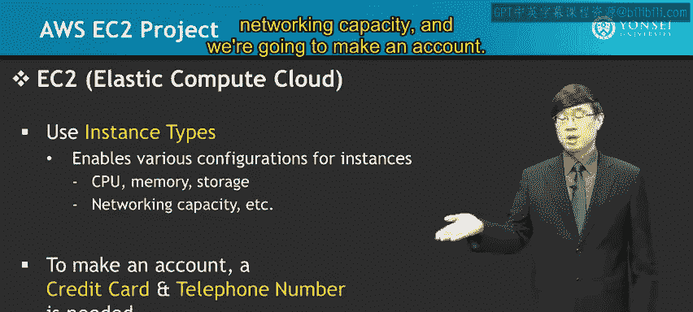
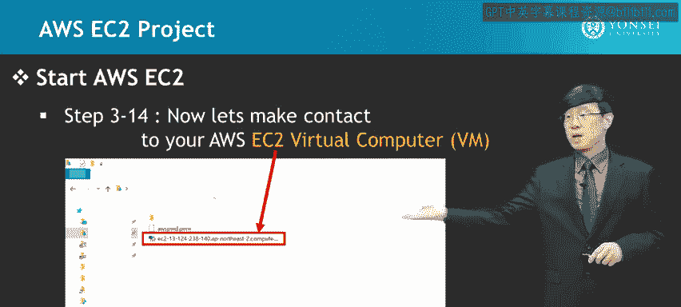
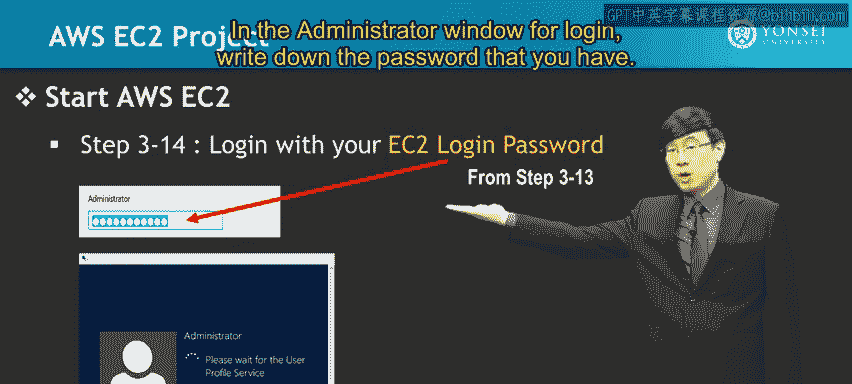
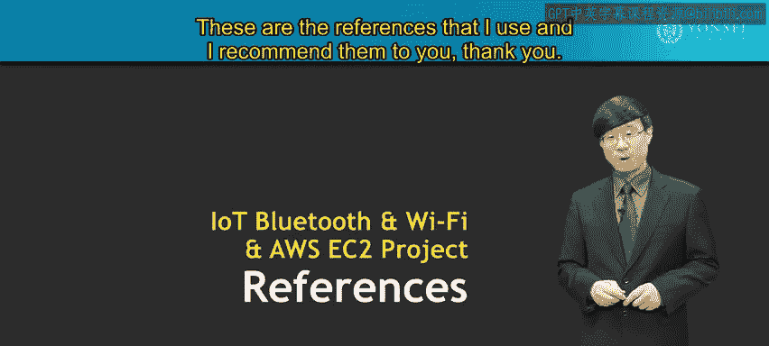

# 延世大学《新兴技术从智能手机到物联网再到大数据Emerging Technologies From Smartphone to IoT to Big Data》 - P122：50_6.3 AWS EC2项目.zh_en - GPT中英字幕课程资源 - BV18hpFewEcG

Yeah。🎼Yeah。AWS EC2 Project。Is the next topic。EC2 stands for Elastic Compute Cloud。

Where we're going to create instances， these are virtual computing environments。 In other words。

 we're going to create a virtual machine based cloud computing system for you in the Amazon web service system。

😊，We're going to use AMIs， which are Amazon machine images。

 these are preconfigud templates for instances， they provide help for servers。

 operating systems and application software so therefore we're going to use them to create our EC2 cloud computing system。

😊，We're going to use the instant types which enable various configurations for instances。

As in terms of CPU， memory， storage， networking capacity。And we're going to make an account。

In order to do this， we will need a credit card and a telephone number。In step one。

 we're going to make an AWS account and start the free trial I know you can do other modes。

 but I want you to start off with this free trial mode to get to know the system and then later on when you're comfortable and you know how to do actually really good development then you go into the professional mode and you can pay for more capacity and more services but for now let's start a little bit light and quick。

Looking in here， you can start and click on these buttons。

The next step is to make an AWS account name， and you can put your name that you want to use down here。

Then you can choose personal or professional， however I would like you to start with the personal mode。

 this is a way to get more comfortable with the system， learn it。

 and then when you're ready to do something really serious， then go to the professional mode。

This is where you need to insert your credit card or debit card information down here。

And then you need to provide a phone number and verify the procedures。Then。

Among these options over here， you can start with the free basic plan mode， among the three。

 the one over there， following down the red arrow。Now it is time to sign into the console and you can do that with this button。

Sign in using the email address of your AWS account。Followed by， check the AWS console options。

 which you see down there underBuild a solution。Looking in further。

The AWVS console options include build a solution， in addition， learn to build。

Looking closer into this。Build a solution has these options you see over here。And among these。

 we're going to focus on launch a virtual machine the one way over there。

But I want you to learn more about how to build and what these features and functions are in order to do that。

 I want you to read through this information。Among theBuild a solution options。

 select launch a virtual machine， like I said before using that over there。And then choose an AMI。

 an Amazon machine image， the AMI provides a template for the operating system， the server。

 and the app。In addition， make a selection of the server location for over here you see it's in the United States。

 Ohio。 However， I changed that to Seoul because I'm in Seoul Korea right now。Choose an AMMI O type。

There are many operating systems that you can use。😡，You can use Windows， Linux。

 and various other options， and you can see the options down here。For our example。

 I would like you to start off using Windows Server 2012， this option right here。

The following procedures that I will show you are based on me using this。Then choose an instant type。

 I want you to learn more about the instant types before you make a selection that I recommend you to read。

 click on that and read the details。 Then going down to the following procedures here。😊。

You can configure instant details， then click onNext， add St， this button right here。

That will lead you to this page when you're here， you can see that you can add storage by selecting a desired size。

Overall， because you started off with a personal mode， the maximum size is set at 30 gigabytes。

 so you can use 30 gigabytes or something smaller。 I'm going to use 30 gigabytes to start it off and then click on the next add tags。

Which leads us to this right here， click to add a name tag。Then。Add tags based on the key and value。

 then click on the next configurefi Security group button。

Look at the options over there and then use this button to。

That will lead us into the next step to configure security group name and type。

Then click on review and launch before that。Take a close look at that option over there。 The RDP。

 That is the remote desktop protocol that Windows uses。If you see the RDP next to it。

 you will see the TCP protocol being used。Then review instants launch settings and if all is good。

 then you can click on launch， which is the button right here。

This launching is significant because now you're going to have a virtual machine。

 a virtual cloud computing system for you。Now that you press the launch。

 we go into select a key pair。However， if you do not have one， then go to the next step and。

We will create what， we will create a new key pair using the key pair name field down here。

We will select the key pair using the download keyP button。

You will see that the key pair name will trigger a file to be created down there in the corner。

Then when all options are set， then click on the launch instances， that button down there。

Check the launch status information and click on the view instances。

 you can see right here of the status that it's being processed and prepared and it will tell you what mode it's in and then this button will help you to view the instances。

Like this right here， you can see the options listed down here。

 check the details of the instant you created。Then to enter your new instance。

Click on connect the button over there Now we're going to go into the instance， the virtual machine。

 the EC2 system that we created。Now you need to make a password。For your EC C2 system。

 your virtual machine cloud computing system。 So here we go。Looking up here。

 use Download Reote desktop file。And that will lead to the file over there。

 That is enlarged over here。Then。Use the get password function down there。 Click on that。

And then to make a password， use the file that was downloaded in step 3- 10。

 the key pair name that we created， that one right here。Then。

A RSA encrypted private key will be made for you。 This private key will be used to make your password。

The private key itself is shown right here in this window， and this will be the encryption code。

 the encryption key that will protect you。From that， your password will be created。

In this step right here。So your EC2 login password is listed down there。

I recommend that you need to record this， write it down and also take your smartphone out and take a picture of that image。

 you want to keep that information because you're going to need it when we log on into the system in a couple of steps。

 so hang in there。Now let's make contact to your AWS EC C2 virtual computer， your virtual machine。

 This is yours， you created it， you launched it， so now let's get into it and use it。

You see the item right there going into the details。

It is now time to log in with your EC2 login password。

 This is the password that I asked you to write down and take a picture with your smartphone。

This is from step 3-13 in the administrator window for login， write down the password that you have。

Now welcome to your EC2 virtual computer This is on the AWS cloud you will see that the Windows server 2012 because this is the option that I selected is listed down here and then you see the functions as in terms of the IP address and other details。

For the project assignment that I need you to do， AWS EC2 provides many other operating systems。

 and that is one of the beauties of using a cloud。It is in the fact that you can change your operating systems。

 you can change the functions and the applications that need to work with various operating systems。

 so you are no longer limited to a computer that has a single operating system when you're using virtual machines and cloud computing technology like you're using right here in AWS EC2。

 the one that you made for yourself， make an easy to instance based on another operating system。

 Also try out the various service solutions。Check the options in compute EC2 and St S3， use these。

 create these， and see what functions you can do with these。These are the references that I use。

 and I recommend them to you， thank you。

