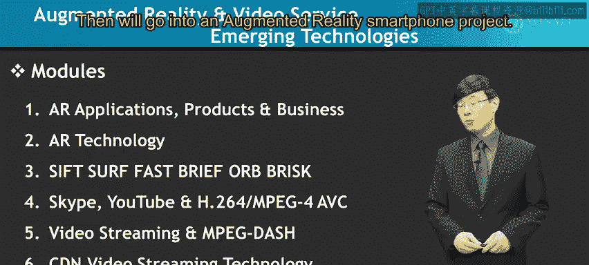
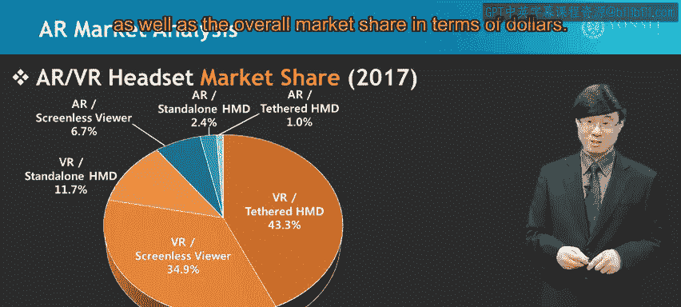
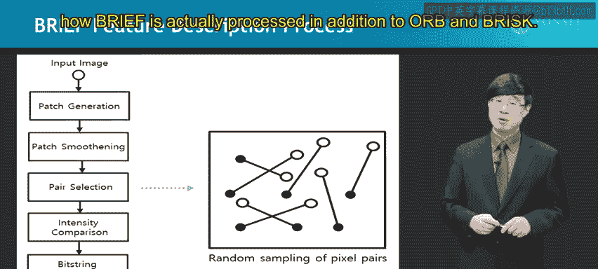
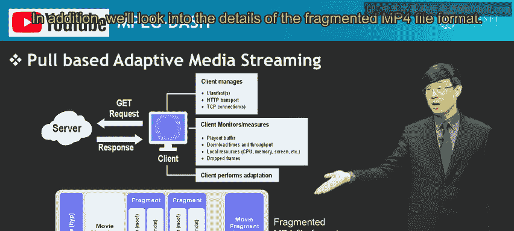
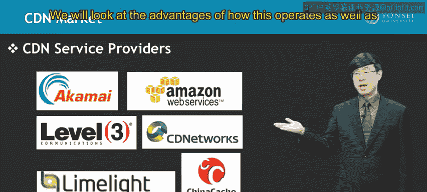
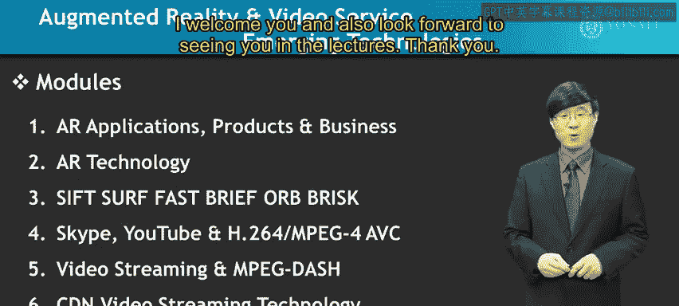

# 延世大学《新兴技术从智能手机到物联网再到大数据Emerging Technologies From Smartphone to IoT to Big Data》 - P123：0_介绍.zh_en - GPT中英字幕课程资源 - BV18hpFewEcG

Yeah。🎼Yeah。🎼Welcome to the course， augmentmented Real and V service Emerging Technologies。

🎼This is a course in the specialization， emerging technologies from smartphones to IoT to big data。

 My name is Zhong Mennchong and I'm a professor at Ys University。 I welcome you to this course。

🎼The modules in this course include AR applications， products and business。AR technology。Sip。

 surf fast， brief orB and riskk。Then we'll look into Skype and YouTube and the video technology that is being used by them。

In specific， the H。 264 MPC4 ABC。Then we'll go into video streaming and impactEC Dash technology。

We'll take a closer look into the CDN based video streaming technology， which is so popular。

 then we'll go into an augmented reality smartphone project。

Looking into the details， you can see the overall market share that we're looking in here based on 2017。

 In addition， the market share for the headset units based on VR and AR technology。

When we look into this， we will also take a forecast look into the future and then see how these technologies are going to grow and expand in new devices。

In terms of how many devices will be sold， as well as the overall market share in terms of dollars。

Looking into the segments of the market size that is growing tremendously。

Then we will look into the AR device types， focusing on smartphones， glass based systems。

 as well as HD， head mounted display systems， as well as lab setups for the lab setup I have in my lab。

In addition， AR technology components will be the focus of the next lecture。

Which is followed by the actual augmented reality processing technology。 How does this work？

And the details， in addition， what if we use cloud offloading to take a burden off of the augmented reality glass head mounted display or the other smartphone device that is supporting the augmented reality service。

 let's take a little bit of that。 or most of it， the computational burden and use the cloud to help。

This will help in saving energy of the smart device or the augmented reality device。 In addition。

 it will provide additional services based on more computation capability and also a larger database。

😊，Looking into the details of this augmented reality process。

 one of the most challenging parts is the feature extraction。

 We will focus on the details of how it's actually done and look into some of the most popular techniques that are used。

 These are the techniques that augmented reality uses in terms of feature detection and description。

 And since these techniques are used in almost all augmented reality devices。

 we will take a closer look into them。 As in terms of sift。😊，The details of surf。The details of fast。

How brief is actually processed in addition to ORB and brisk。

Then we will go into Skype video conferencing technology。

 We will take a close look at the evolution of the Skype video and audio codex。

 but we will focus more on the video codec that has been used by Microsoft since Microsoft acquired Skype in 2011 in specific the Hdo 264。

😊，Then we will go into the YouTube video technology。

 where we will look into HTML5 and MPEC dashash techniques that are used by YouTube。

 and also we will look into the various resolutions and how MPEC Dash is used by YouTube。

Looking into the operations of the pullb adaptive media streaming techniques。

 how it actually is being supported by MEC Dash。For services of YouTube and other video streaming systems。

We will look into the details of how the server and the client interact and work together。

 in addition， we'll look into the details of the fragmented MP4 file format。

Then we will focus on the HTTP technology as well as an example of how this all works together。

 we will also look into the details of the MPD， which is very important because a lot of the information。

 in addition to how the structure of the various contents are provided。

 are all in the hidden secrets of this specification。We will also look into T mode。

 which is a service that。You use frequently when you use YouTube。

 as in terms of putting your finger down there and moving it around such that you can look at a different part of the video。

In order to explain this， we will look into the details of Iframes， P frames， and B frames。

 and the overall video service technology。In addition。

 we will look at how the most popular video streaming systems are supported through CDN technology。

We will look at the advantages of how this operates。

As well as the major service providers and their characteristics。

 followed by the actual network architecture in which what is the function of these blocks and how are these clusters formed？

As well as their sequential time flow operation in order to find you the video service information that you want when you need it。

We will then go into a project with IKA catalogta in which we will download an application and do some experiments。

Focusing on various types of applications， then we will go and do a project with Google Translate。

Where we will take a look into various modes and do testing。

 we will use these two augmented reality applications to see the limits。

 as well as potential functions and features of the most advanced augmented reality support systems。

🎼I welcome you to all of these lectures based in these modules。

🎼And I invite you to go through the course of augmented reality and video service emerging technologies with me。

 I welcome you and also look forward to seeing you in the lectures Thank you。😊。

