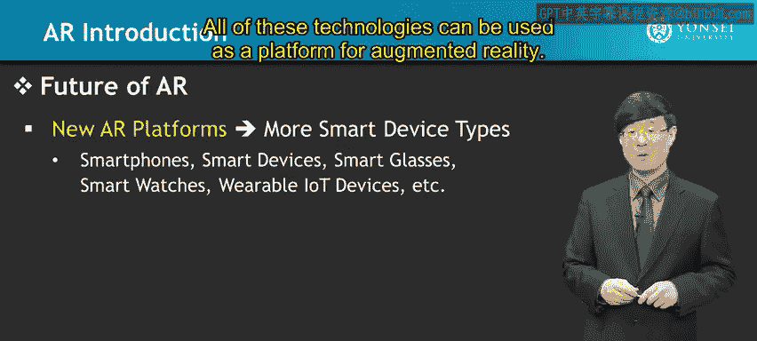

# 延世大学《新兴技术从智能手机到物联网再到大数据Emerging Technologies From Smartphone to IoT to Big Data》 - P124：1_1.1 增强现实（AR）介绍.zh_en - GPT中英字幕课程资源 - BV18hpFewEcG

This course will begin with the first part of augmented reality applications， products and business。

 where an introduction on augmented reality will be the first thing we will study about。

The definition of augmented reality。Auggamented reality is a technology that superimposes a user's real world view with a computer generated virtual text image in real time。

😊，The types of user interfaces that augmented reality will use will be a screen， a monitor， a helmet。

 a face mask， glasses， goggles， a head bouned display， a window or like a car windshield。

 and there are various other surfaces， practically speaking any surface that you can use in a real world view。

😊，Is basically one of the surfaces that can be used for augmented reality display。

Handheld augmented reality displays。 The best one to use is smartphones。

The initial commercial success of the augmented reality model is the smartphone。

The reason is because smartphones have very good processing capability。 They have good cameras。

 They have good displays， and also， the portability of these devices make them perfect for augmented reality。

 For example， this is one im model of augmented reality being used on a smartphone。😊。

Auggamented reality， eyeglasses， these are the second best platform for implementing augmented reality for individual users。

The Google Glass is one of the premier earliest products that shown the potential for augmented reality to be implemented on glasses。

From the outside， other people may not see what is projected on the inside for the individual user and that has a true benefits in having privacy of information in addition。

 you can see that it has a camera module right here。

 so the information that is picked up by the camera is detected and information and various characters are imposed projected on the inside just for the user。

In addition， there are head mounted displays， these are a little bit larger than glasses。

And their capability and functionality， of course， is more enhanced。 As you can see here。

 this is a mobile augmented reality device that can provide an immersive AR experience。😊。

An example of aircraft maintenance and aviation is shown right here。

The augmented reality description is what we're going to talk about next。

Virtual text or image can be superimposed on selected objects。In the real world view of the user。

An augmented reality generated superimposed virtual text or image is about that selected object or what it would mean to the relative object surrounding it and it will be selected in a way such that the text or the other added image will enhance the information that is customized for the individual user。

😡，Augmented reality therefore， is based on context aware computing。

 meaning that what is going to be displayed is selected and it's customized towards the user。

So if you're using augmented reality， the information that is going to be displayed on the augmented reality device will be customized to what you want to see。

For an AR user， the real world and virtual objects coexist on the same point of view。 For example。

 of a smartphone looking at a picture in。A museum， Well。

 the augmented reality device could superimpose what this picture or this art。

Masterpiece is about and you can see that information overlaid on the information right here Now this is just for a demonstration in a real augmented reality device。

 you will not really cover up the object this much， however。

 just so that you can see it on our screen we made this a little bit large and normally it will not be such that it would hinder the view。

 it would block the view of the original object。😊，This is an augmented reality development environment that was used in my laboratory with my grad students。

 this is off of one of our earlier models that we tested and developed augmented reality on and as you can see our test environment where we measure the power and the response time of the system is all here in one unit larger units do exist and now we're doing much more development on various other platforms in addition we're doing it on head mounted displays as well as glasses and of course smartphones。

😊，Short history of augmented reality and virtual reality， because the two coexist。

 and there are some similarities， yet there are much differences we need to know about the tube。

In 1901。The author， Frank Baum， first mentions the idea of character marker。

Which is an electronic display overlaying real life， especially people。

 so if there's a person then on top of him or near him would be his name。

 maybe age and other information that would be needed or useful to people that are looking at that monitor This concept was the original concept。

😊，This grew where in 1989， much， much later。Jron Lanyer coins the phrase of virtual reality。

 VR and its concept model。 As you know， virtual reality is different from augmented reality In virtual reality。

 you have a virtual reality environment， which is animated， It's not the real world。

The good thing about it is that that world can be anything that you want it to be。

 it can be fully designed and fully animated。In addition。

 the characters of how you interact in that virtual world would be an avatar or a certain object where you would control based on your movement。

Therefore， everything in a virtual reality world is may believeie， including yourself。

 which can be transferred into a certain object， a certain character， or an avatar。In 1990。

The concept of augmented reality was put together and。

The difference between augmented reality and virtual reality needs to be looked in further。

 which we will do in the following couple of pages。

Augmented reality therefore seems like a pretty old technology because in 1990 was when the terminology was put together。

Then why do we learn about it now， why is it important now？

Looking into some of the reasons is because higher resolution cameras on smart devices。

 including head mounted displays， smartphones as well as glasses。

 can enable accurate image and object identification。In addition。

 enhanced processing capability with the development of very powerful CPUs and GPUs and various other software techniques that enable the accepted image to be processed very。

 very quickly is one of the other reasons that augmented reality is useful now。😊，In addition。

This is about image processing， which needs to save images and then process them。

 That means that we have to have fast and abundant memory。

And that is one of the true benefits of modern technology。In addition。

There is high definition displays on our smart devices and other various head mounted displays。

 as well as our glasses。And because of these very high definition displays that we have。

 we can accurately show a additional object or an additional text script。

 such that the reality is enhanced in information。In addition。

We cannot do all the processing on the device itself because a smart device。

A glass type augmented reality device or a head mounted display。 a lot of these devices are portable。

 and when they're portable， they are made light and they are made to be limited in battery energy。

That is why。When we have a networking connection that we can use。

 we do not have to do all the processing and all the information retrieval and the character generation on that device。

 that device as in terms of smart device， smartphone， glasses or head mounted display。

We can rely on a server， a cloud， an augmented reality computer to help us。

 but that would mean that we will need to be connected to it through networking。

 wireless and wire networking， and with the advance of these technologies now。

Augmented reality is coming into its true potential to become a real service and product。In addition。

 there are so many new platforms that we can use for augmented reality。

 as I explained in the earlier slides。😊，Because we now have smartphones that are very powerful。

 smart devices， smart glass， smart watches， wearable IoT devices。

 all of these technologies can be used as a platform for augmented reality。

So augmented reality will only get better， more broader。

 more frequently used everywhere from automobiles to piloting devices to drone control and so much more and because of this。

Technology will evolve to make this faster， more accurate， more informative。In addition。

 the power consumption will drop， and there will be new methods to save energy。

 such that the lifeline of the device will be extended。

It will be easier to use more portable and much cheaper。

 there will be much more functionalities and features and it will be much more reliable and more durable All of these features in augmented reality is being enabled and I personally am doing research with my grad students to make this possible as well so therefore expect for augmented reality to come in even stronger。

 more abundant in almost every product in every way and that's why I recommend for you to look into further details of this course。

 which will explain the details of how augmented reality is made possible。😊。

