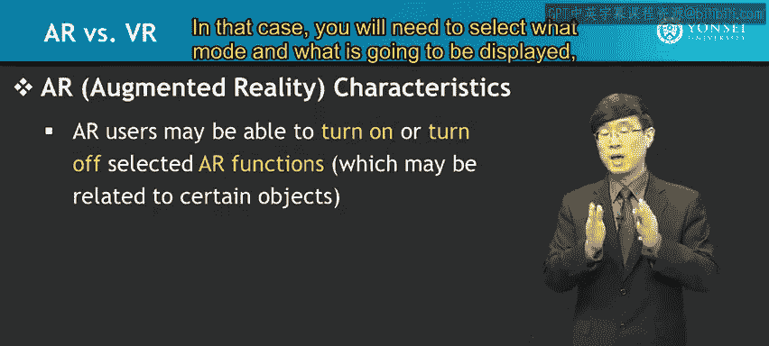
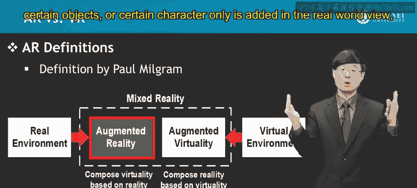

# 延世大学《新兴技术从智能手机到物联网再到大数据Emerging Technologies From Smartphone to IoT to Big Data》 - P125：2_1.2 AR与VR的比较.zh_en - GPT中英字幕课程资源 - BV18hpFewEcG

Yeah。We will now compare augmented reality with virtual reality to check their definitions。

 their similarities， and their differences。The question on augmented reality and virtual reality。

 what is the difference of virtual reality and augmented reality？

Virtual reality users will be fully immersed into an artificial。

 unanimated environment that is all make believe。This is perfect for game playing spaces because you want to have them experience。

 the game players experience a totally different world。The user， the player。

 will commonly use an avatar to exist and interact inside the virtual reality space。

The user's view in virtual reality is different from the real environment。Such that fantasies。

 illusions are easy to create in the virtual world。

Auggamented reality is a mixture of real life and virtual reality。

 In a way such that augmented reality users are able to obtain useful information about locations。

 an object， and they can interact with virtual contents。😊，In the real world。

 so augmented reality is based on the real worldview where selected objects or items are either enhanced by adding information or a certain type of description characterization or something is added symbolically。

 such that it helps the user to do a specific task。

Whereas virtual reality is really about a totally made up environment with made up characters that you can interact with。

An augmented reality user can distinguish the superimposed virtual objects， and that is important。

In such a way that you can identify what has been augmented and added and enhanced。

Auggamented reality users may be able to turn on or turn off selected functions。

 and this is needed such that you can select what mode you're in and what information you may need In addition。

 in some cases there may be too much information on your augmented reality display blocking the view of the real world you may not want that in that case you will need to select what mode and what is going to be displayed and augmented reality technology should enable you to do that the right way。

In comparison to virtual reality， augmented reality users commonly feel less separated from the real world。

 and this is because they are looking at the real world， just that they have augmented。

Virtual characters or text added to it， such that the real world is augmented。

 enhanced as in terms of information。Fantassies and illusions can be created and superimposed on a real worldview。

 which is the true advantage of augmented reality。Looking at it from a point of view of augmented reality definition。

 this is one way to look at it over there is the real environment， Everything is real。

 Nothing is make believe over here is the virtual environment， which is the virtual reality domain。😊。

In the virtual reality domain， everything is make believe。 In addition， you。

 your character that exists within the virtual reality environment is also a make believe character。

 although it may be animated in a way that it looks like you， but still overall it is not you。

Looking at this over here in the mixed reality domain between the real environment and the virtual environment right here。

Is the augmented reality domain， And we can look at it in terms that that domain will have a compose virtuality based on reality。

 whereasas the augmented virtuality is a composed of reality based on virtuality。

 what does that mean， What does that mean， You can think of it like this。

 augmented reality is a real worldview， where you have virtual objects or virtual text added。😊。

Into parts of the real worldview。Then what is this， this augmented virtuality。 Think of it this way。

 You may have a virtual reality domain。 Everything is totally animated。

 although when you open a certain door， or you open a certain box you can actually see a part of the real world view based on some type of camera that is really taking pictures someplace。

 then that is like having a real worldview inside of a virtual reality domain。

 that is augmented virtual， whereas augmented reality is the real world where parts text。

 certain objects， a certain character only is added in the real worldview。

 and that's the difference we're talking about。😊。

One other definition is based on this， if there's a domain of combination of real world and virtual reality。

In addition， a combination of a 3D image， a 3D area in which is really based upon where we can coexist inside。

 In addition， real time interaction is possible because we're in the real world。A combination。

 which would be a cross section area of these three domains is where augmented reality。

 true features can be expressed based on this definition。

Then what are the augmented reality based support techniques， there's sensor based。

 there's vision based， and hybrid tracking based augmented reality？As in terms of it， GPS。

 that is global positioning system to tell you your location as in terms of longitude and latitude。

A gyro sensor to show where you're moving， what movement is actually going on for that device。

A accelerometer， which tells you how fast you are accelerating or decelerating。

In a certain direction， these type of things are what sensors pick up。

 and they can be used in various devices to make augmented reality more real and more accurate。

In addition， there is vision based augmented reality。 And this is。

A domain in which we will study much more in the following lectures of this course。

In which computer vision， something like open GL， like an open graphics library。

 these tools are used such that we create augmented reality technology to detect what's in there。

 What are the objects， What are we interested in among those objects。😊。

And then we find just the right characterization or the information to display it， near it， or on it。

That is what we're talking about here and some of the tools that you can use to accomplish that is listed here。

Hybrid tracking based AR， This is like the and sensor， this and this added up into one。

For typical applications like an outdoors augmented reality， yeah， you need both， you need sensors。

 and you need vision based augmented reality technology support。These are the references that I used。

 and I recommend them to you。 Thank you。

