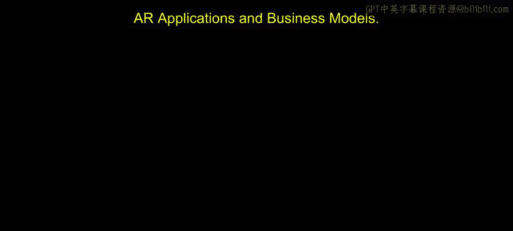
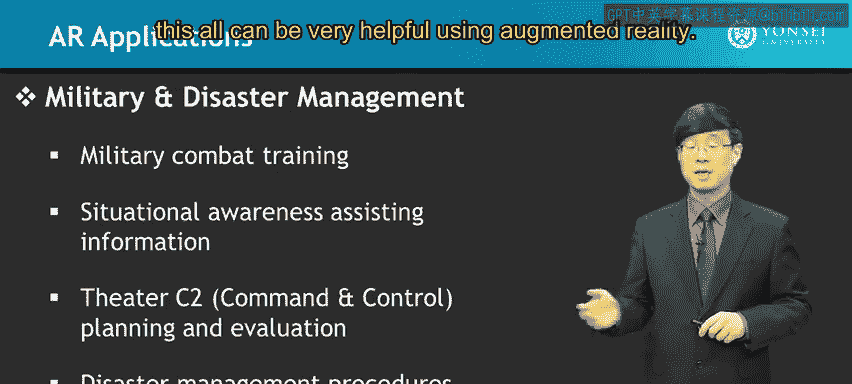
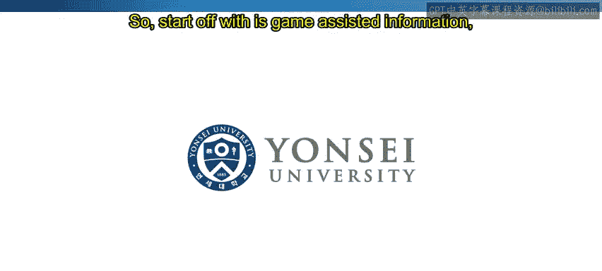

# 延世大学《新兴技术从智能手机到物联网再到大数据Emerging Technologies From Smartphone to IoT to Big Data》 - P126：3_1.3 AR应用和商业模式（第1部分）.zh_en - GPT中英字幕课程资源 - BV18hpFewEcG

AR applications and business models。Architecture。Planning of buildings and landscapes can definitely benefit from augmented reality technology。

Rebuilding of ruins。Archaeologic information overlaid landscape scanning。

 of course you can see the benefits of how augmented reality can truly contribute。

Arts and performances， holographic and 3D design As。Animation design assistance。

 musical note assistance， sound coordination services， and image and sound coordination services。

 these are， of course， where augmented reality can be very helpful。😊，Then there's commerce。

To help select products in a catalog。Finding product information about a product or object。

Real time stock and sales information， there are already technologies that support this and the former ones。

That I just explained， and we'll get into that in some of the following lectures that I will do in this course。

 but evidently， you can see where augmented reality can be so effective。

In terms of a catalog which is just a picture in a magazine， well， in that case。

 it doesn't really give you a good feeling， but if you have augmented reality technology。

 you can bring it up to a level where you can see the actual object that is being sold。

 you can turn it around， you can look at it from various angles and different light news and almost to a level where you can magnify to even see the texture of the surface。

These type of things， as well as how it operates， can be displayed based upon what information is provided by the catalog augmented reality service provider。

 these type of things make products more attractive， in addition。

 there are various ways to make extra sales points to the customers such that the product is attractive based on a feature in which a simple picture and a catalog would not be able to clearly demonstrate。

Then there's education。Students customize assisting text， graphics， video and audio support。

Intertractactive computer simulated experience of historical events and exploring Ely you can just see the potential here of how it can be used having somebody。

 having a student and a teacher go into the past， go into locations that they could not visit properly。

 but through augmented reality technology they can see things which they were not able to do if this technology was not supporting it。

 Evily there's so many ways that it can enhance education experiences。

Then there's medical science and engineering。Health scanning of patient vital signs In other words。

 if you were to look at a certain image or scan a certain characteristic。

 a doctor or a nurse may not be able to pick up every small accurate minative sign that is there。

 however， a machine may be able to pick up that in very accurate ways。In addition。

 medical image processing， looking at a CA scan， an MRI or an X ray。

It may not be easily viewable by the person that's analyzing the overall image。

But an augmented reality device may be able to find something that the doctor or the nurse were not able to find。

Robotic surgery support。There's a lot of robotic surgery technology in which instead of actually incising a lot and doing a big type surgery。

 they have small robotic arms go in and do the surgery procedures and therefore the recovery time is reduced significantly in order to do this type of robotic surgery。

 going into a very narrow place and doing very， very precise procedures on healing the patient。

 treating the patient in that certain way， a doctor is not able to go in and open up and look at that location。

Therefore， augmented reality vision， as well as pinpointing out specific things that the camera is viewing may help robotic surgery significantly。

Anesthesia procedure support。 Of course， when you do these type of procedures to make a certain area numb。

Then needles will need to go into certain locations。

 maybe like a nerve flow place in which a certain amount of anesthesia medicine has to be released at a very accurate level then how deep is that needle going in is it going and reaching the right nerve cell。

 I it there in the proper position in the spinal cord such that it can safely release the right amount of medicine。

Well， all of these type of procedures can be enhanced by augmented reality to guide the doctors and the nurses to do procedures the right way。

Then there's military and disaster management there's so much we can do here。

 in addition I am doing a lot of research in this area as well， military combat training。In addition。

 situational awareness， assisting information， what is this situational awareness。

 this is the technology in which we have an overall view of the theater combat area and we want to figure out what is going on how well are we being defended where should we place our military units and how can potential attacks occur and where are the enemies placed now。

 all that can be provided through situational awareness assisting augmented reality devices because military applications use decoing technologies a lot such that you cannot see what's going on even though they're out in the field。

 they will always be in a certain covert position or with special covering such that they cannot be detected。

 they cannot be easily detected by the human eye， however augmented reality equipment maybe。😊。

Able to detect very small， irregular movement or heat radiation by a certain module in which there is something there。

 as in terms of a military enemy or a terrorist attack。

And that may not be easily viewable by the human eye。

Especially in a combat situation or when there has already been a threat attack due to a terrorist then。

The people that are participating to do disaster recovery or military defense operations。

 they're going into a situation where it's very hectic and they are under a lot of stress。

 and they have to have immediate response and actions。Therefore。

 they may not be able to pick up small covert things in which augmented reality can really help。

This is all a part of theater， C2 technology in which it can support command and control as in terms of planning and evaluation。

And the overall scope of this all combines together for military applications。In addition。

 for disaster management procedures and location guidance， when you go into a disaster area。

 it is very difficult to tell what is going on In addition。

 you are hurrying up to do disaster management， then you may not know all that was or preset in that area。

Therefore， when you go and look at it after a disaster has already occurred。

 you may not be able to identify what was in this region that is when augmented reality can truly help telling you where the original locations were。

 what was there， also what is underneath the building or inside a certain facility that you need to be careful of in addition。

 finding people certain rooms where people may be captured inside this all can be very helpful using augmented reality。

