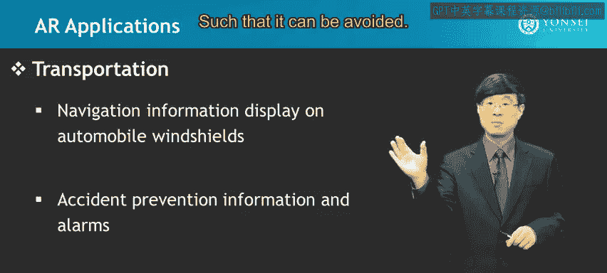
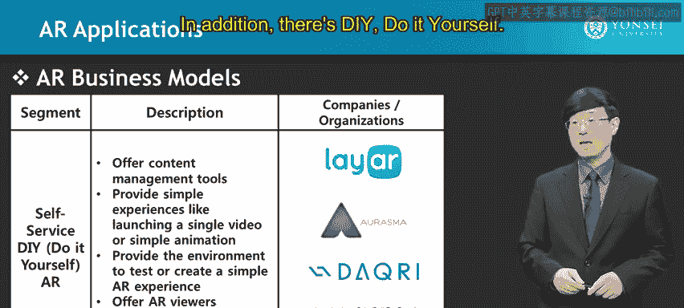
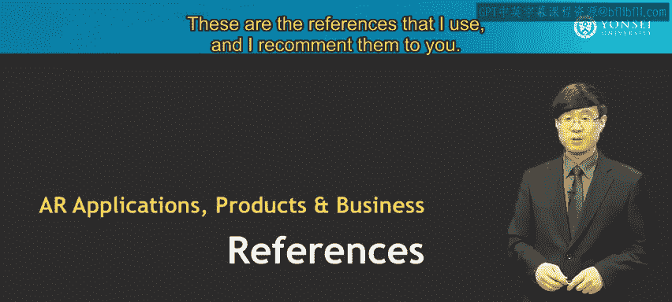

# 延世大学《新兴技术从智能手机到物联网再到大数据Emerging Technologies From Smartphone to IoT to Big Data》 - P127：4_1.3 AR应用和商业模式（第2部分）.zh_en - GPT中英字幕课程资源 - BV18hpFewEcG

Yeah。Sports and entertainment already implemented very popular and soon so much more to come So to start off with is game assisted information as in terms that in football。

 American football， where is the first down line it is sometimes very difficult to find because the markers are standing both on the side of the field then if you're just looking at and concentrating at the middle part of where the game is。

 then you may not be able to see where the markers are to show where the first down area is。

 but then on an augmented reality TV screen， the line can be drawn such that the people that are viewing the game can easily see where is the target range that they're trying to reach This is already done in football games and therefore it makes the game so much more interesting and easier to view In addition。

 in tennis games there is systems like Eagle eye and other things。😊。

The ball is moving so fast in tennis that it's hard for the umpire to see if the ball hit the line。

 was on the line， overlapping the line， or was it inside or outside。And therefore。

 techniques using augmented reality are used to identify where the ball hit the line。

 and these type of systems are already in use。They' are well used and they're going to get better and better and more abundant。

In addition， game rules， guidance information， watching a game， having the game rules。

 just the specific ones that are easy to understand。

Having them on the side in a certain location to help you understand what is going to be ruled well。

 that of course， can be very helpful In addition， team objectives， guidance information。

 this can be used by a coach on the sideline coaching a team or it can be used by team members themselves what do you mean well if team members have augmented reality glasses that they are using and they have the strategic plan of where they need to move at a certain time。

 where they need to be positioned as a team to do a certain act like it may be cycling or something type of team operation where multiple units。

 multiple members need to participate in a specific formation then if they are wearing augmented reality glasses or goggles then they're positioning and how they're going to strategically play out a game or play can be。

😊，Assisted by the augmented reality devices。Commercial advertisement overlaid in real time onto the user's view This is another very important thing from a pure game playing point of view。

 this may not seem very important， however， if you're going to play a game at a professional level or even at an amateur level in which certain sponsor funds are needed。

 then advertisement is going to be very important， it may be the resource that enables you to play。

 that enables you to get the equipment that enables you with the money and the resources to borrow the stadium that you want to play your game in。

 so therefore， although this is not immediately about the sport itself。😊。

This definitely has commercial value， which will enable you to play the game itself in certain locations with the right equipment。

Tourism and sightseeing， of course， this is a wonderful place that augmented reality technology can be used。

😊，Guidance of historical events， places and objects can be displayed。 Tour courses， showing hotel。

 motels， restaurants and restrooms。 Where are they。😊，Navigational tools， these will be very helpful。

 especially if you're in a foreign place where you cannot read all the signs that are there。

In addition， translation and interpretation， this is exactly it。

 and in the following lectures I will show some applications that already do exist that support these type of things。

😊，Foreign language， translation， text， signs and menus。

 all are fully supported by augmented reality applications。

 and there's going to be more and more in the near future。😊，Auggamented reality。

 support of voice translation， sound output into foreign languages。

So therefore augmented reality can be used to display voice as in terms of an acoustic system。

 but in addition， just like when you're watching a foreign movie。

 which has the text of what the actors are saying， displayed just on your view。

 that can be done as well。Transportation。Navigation information displays on automobile windshields。

 Of course， this is already done navigation information In addition。

 target acquisition of enemy components。😊，Are already being displayed on military vehicles。

 including jets and other combat systems。Doing this for automobiles， of course。

 this is one of the most attractive domains that can assist driving navigation and accident prevention。

Then there's， of course， the accident prevention information alarms itself。In other words。

 on a windshield， if there's a certain object that comes into a domain and there is a possibility that there could be an accident to the driver that could be colored in a certain way such that it brings specific attention to the driver。

 such that it can be avoided and。

Everybody can be safe。Looking into the domain of augmented reality。

 there are AR platforms in which provide augmented reality foundation， toolboxes。

 and they help provide custom services， and these are some of the company products that do that。

Auggamented reality products and games， of course， there's so much in this domain to develop and market their own exclusive augmented reality products。

 product types include books， games and so much more。

Then there's custom branded app development work directly with brand marketers and agencies。

 you're going to allow marketers to combine one of a kind custom augmented reality experiences。

 service 3D modeling and integration with other softwares or platforms and companies that provide related technology are shown here。

 and then there's industry specific vertical， augmented reality solutions。

 as in terms such that they serve a niche business verticals。

 and some of the things would be like luxury retail， medical services， pharmaceuticals。

 and cosmetic companies。😊，In addition， there's DIY。

 do it yourself because a lot of people want to develop products and instead of having another company develop it for them。

 they would like to do the proof of concept， and see how their product could be performed in addition。

 add on the features， and then they may complete as it is。

 or they may have then that final design with all the hardware and software components to be mass manufactured using another company's factory either way you want to be able to do the research and development on your own using a DIY AR system and companies that support that are listed here。

 and they offer content management tools， provide simple experience like launching a single video or simple animation。

 provide the environment to test or create a simple AR experience， offer AR viewers。

 customized services and white label options。

These are the references that I use， and I recommend them to you， Thank you。

