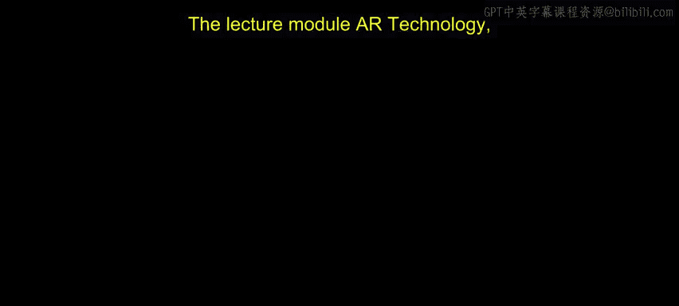
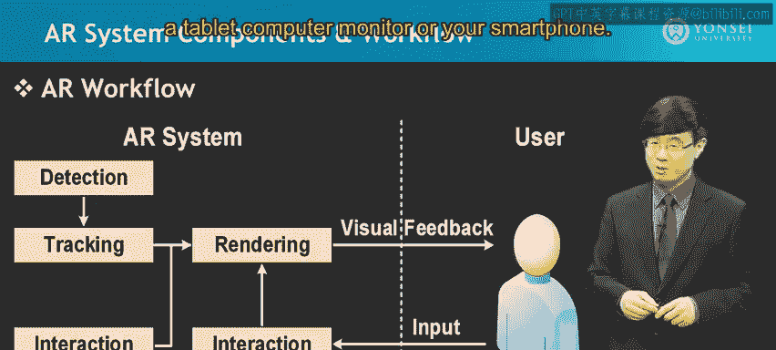
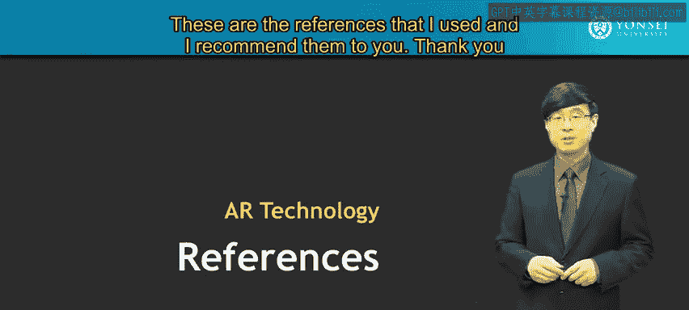

# 延世大学《新兴技术从智能手机到物联网再到大数据Emerging Technologies From Smartphone to IoT to Big Data》 - P129：6_2.1 AR系统组件和工作流程.zh_en - GPT中英字幕课程资源 - BV18hpFewEcG

The lecture module， AR technology is what we will study about and starting off with AR system components and workflow will be the first topic。

AR technology components looking into them， there is the content provider and server based systems。

 and you can see this is where the content is actually stored a part of the content can be made small and stored on the portable mobile device。

 which could be like a smartphone， a head mounted display or glasses。However。

 the majority of the original database will be at the content Pro server。

The contents file data format would be in the form of 3D graphical assets， geographic information。

 text， image， movies， air， content， container， point of interest information。

This would be the domain of what we're looking into。

Interacting with the device through a communication protocol will be what you'll see over there in the middle。

 which would include the protocol of the server to the individual client device。

And details about this will be discussed in the following lecture modules that will follow this module within this course。

 so just hang in there。Looking into the details of the protocol。

 which also contain the video protocol as well as the networking protocols。

 then we come into the user side in which we can see software framework and application program as well as the browser part。

The software framework part has units in which the required software as in terms of the firmware operating system and the user application software are all prepared together to support the augmented reality application。

There is a lot of video processing software that is included in here as well。

 which the following lectures in this course， I will explain in detail。

 then there is the application program and browser。

 these units are what support the actual application device such that once the overall augmented reality information is provided how will that be used to serve the specific application。

And the browser， of course， will be used to find information in a larger domain such that customized applications as well as user designed or user desired information can be retrieved accurately。

Looking into the specific modules on a user， there is the detection and tracking technology that needs to be conducted。

This is focused on recognition units where computer vision， markers and features。

 tracking sensors and camera API are executed。Then there's the rendering process that needs to be done to support visualization。

This is composed of techniques that support computer Gras API。

Video composition and depth composition。Then there's interaction that needs to be done。

 There's the UI， the user interface that needs to be designed such that it is comfortable to use and it is very effective on its features。

😊，Then there's gesture， voice and haptics haptic technology is something in which on a screen in a virtual domain or an augmented reality domain。

 you touch something in the air， and you're really not touching that object， however。

 a button that you push or something that you lift up gives you a feeling as if you are touching or pushing that object。

 such that a certain shake， a certain pulse is given to you that you feel like you are actually touching a real object This is what haptic technology is about In other words。

 it is a virtual technology where the actual feel is given to a virtual action。

Looking at the domain of how the detection， tracking， interaction。

 rendering all work together in the A system is shown right here where the。

Detection gives information to the tracking unit in the AR system。 In addition。

 the interaction part of the AR system is combined with the tracking information and sent to the rendering unit。

This information is then combined with any type of input from the user。😊。

To be put into the system and this input domain of interaction that will be included into the rendering unit。

 this will be done as in terms of the user interface or Haptic interface and other units as well then that input will be included rendered and a visual feedback will be provided to the user as you see right here。

The user will see this information on glasses， head mounted displays， a window， a windshield。

 a computer monitor， a notebook， or laptop computer monitor， a tablet computer monitor。

 or your smartphone。

These are the references that I used， and I recommend them to you。 Thank you。

