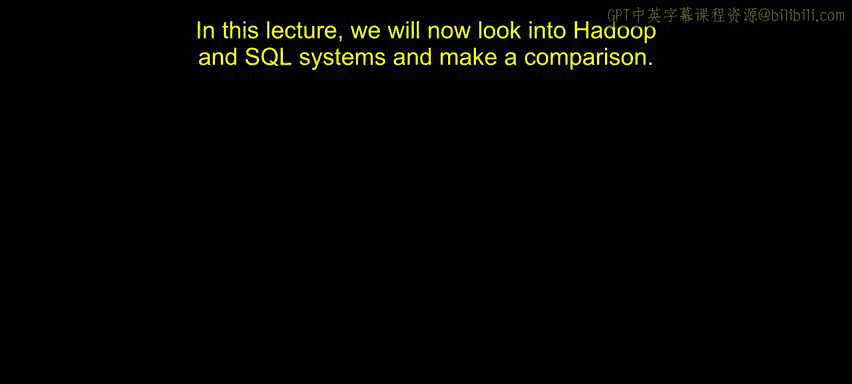
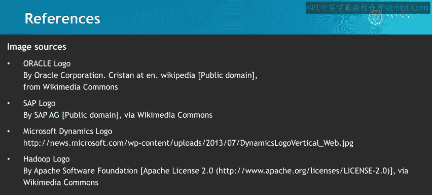
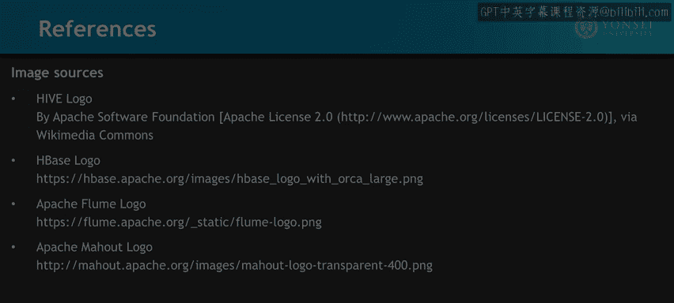

# 延世大学《新兴技术从智能手机到物联网再到大数据Emerging Technologies From Smartphone to IoT to Big Data》 - P12：11_2.8 Hadoop与SQL、RDBMS、RDSMS的比较.zh_en - GPT中英字幕课程资源 - BV18hpFewEcG

🎼In this lecture， we will now look into Hadoop and SQL systemss and make a comparison When I talk about SQL systems。

 I'm talking about RDBMS and RTSMS。Comparing these two， Hadjub uses HF S and Mapreduce。

And SQL stands for structured query language It is pronounced as SQL SQL is used for R DBMS and R DSSMS processing。

 R DBMS stands for relational database management system and R DSSMS stands for relational data stream management system。

 so therefore one is a database and one is a stream Data structure。

We have a comparison that is based on schema on Re， which is the Hadjuop style and schema onrite。

 which is the SQL style。What is schema is another question that could probably asked。

 Schema means schematic representation， diagram。 It has these meanings。

Now we're going to look at and compare the read and write schema characteristics of Hadoop and SQL。

Schema onr means that the data structure must be known in events and properly formatted for the database right in process This means that when you write data into the database。

 you have to have it schema， it has to be structured when you put it in or it may not be inserted。

 it may not be taken in the right way to the database。That is what we mean。

 It has to have its schema when it's written into the database， schema on right。

All analysis processing database parts need to be fully completed。

 and then the distributed process parts can be collected and combined。

Data is stored in a logically organized format， which is the database metadata structure。

And one of these examples， once again， remember when you use Microsoft Excel or any other data analysis tool like in R。

 typically what you will see is that customer structure and information。

 what type of orders are being placed and when and what type of products are being linked to。

 are the type of information that we need to use when we have schema on right。

 which is the typical database structure used in ourDVMS and RDMS。

 where we extract information using SQL。The structure that is used within a schema on right SQL system is a two phase commit system。

It is a distributed algorithm that makes a decision on a transaction to either commit or abort。

This example can be easily found in credit card transactions When you swipe a credit card。

 it is either accepted for that amount or it is rejected。

 and some cases it will give you a reason why it was rejected。

This is typically what we talk about when we talk about a two phase commit。

 The result is either committed or accepted or aborted， rejected it。Now， in a overall system。

 you can see three data systems connected together and。If one server node is delayed。

 the entire data analysis report will be delayed because the three data systems connected in the middle are linked together and they need each other to process the data to make a decision either to accept or reject the process transaction and therefore if one in the middle is not working。

 then nothing will work， you will get no result at all。

 This is the characteristic of a schema onrite SQL type database system， either our DBMS or RDSMS。

SQL， which is based on schema on right， is good in obtaining accurate results based on a database that has all of its transactions completed。

For example， a bank， when it closes in the afternoon。

 then the database is set and you can start to process SQL operations analyzing the data。In addition。

 the schema on rightite is already accomplished because when bank operators put account information into their database。

 it is already in a form that the data has a strict formality， it has its schema already included。

 and it's inserted into the database the right way， that is what it means schema on right。

 when you write it into the system， when you write data into the system， the schema， the structure。

 the format is already well prepared。Compared to SQL， which is schema on write。

 Hadjiop is schema on read， and it is based on a warm， a write once read many based operation。

Data is inserted into HDFS， it does not need any pre formatting， and it can have any structure。

This is why HDFS supports unstructured data right in。 Of course。

 it welcomes semistructure data and structured data as well。When reading the data from HDFS。

 the rule and structure of how you're going to read。

 what are you going to extract and use is defined in the reading program code。

 which is a Java program code。The warm， write once into the HDFS， the HadjiF Dis file system。

 and read many， well， you write it once and then you read it out multiple times and these readouts are based on different queries that you want to look into and extract data from the database。

So the multiple readouts will be all based on what program code is used to extract what based on different。

Programs that execute Mare。Data is divided and duplicated and then stored in the HDFS servers。

 This duplication factor provides robustness， reliability and。😊，Falult tolerance。

The default replication factor is3。And you will see some applications where they will use two or maybe four or five in some cases。

 based on how they want to process the data and how much resources they have available。

Nameode will record where the duplicated files are stored in other words。

 the name node will assign data processing to the data nodes。

 the data nodes are where the map reduce operations are done。

So the name node will record who got what， which data node got what？😡，And。

They will process what map reduced programs。A schema on read example is like this。

A 1 terabyte website search file is divided into four files。

 so each will be 250 gigabytes then we're going to assume a replication factor of just two in this example where three is the default。

 but once again it can be controlled。As you can see， the1 terabyte data file is divided into four。

 which are pink， blue， green and yellow， and these are each duplicated twice， so I have copy 1，2，34。

56，7 a I have eight files that need to be processed。HDFS。

 we are going to assume that there are 25 nodes in the cluster。

 we will use eight data nodes because we had C1 through C8。

And each one of these eight will be reassigned to one of these data nodes。

So there is the name node that has C1 through C8， and we will assign each one of these individually to a individual data node。

 so therefore eight data nodes will be assigned files individually C1 through C8。

The name node records the eight data nodes that were assigned a copy。

A keyword search Java program is applied to all eight data nodes of the set of keywords。

 and they are searched simultaneously in parallel。MaapRduce is applied to different parts of the 1 TBabyte file。

 so each data node server will need to analyze a 250 gigabyte part of the overall 1 terabyte file。

Map program search results are delivered to the reduced program on the data node。

Mareduce transforms the analysis problem into a computation process using keys and values where we have multiple sets of keys and values。

For data analysis results， all distributed computing parts do not need to be fully computed to be combined。

 This is because we made replicas。 We had a replication factor of  two in this example。So。

Any one part of the two， if it's completed， it's good enough。 So I had C1 and C2。 they're the same。

 They are replicated of each other and they are each 250 gigabys of the same part from the original one terabyte file。

 So therefore either C1 or C2 gets computed first of its data node。

 the mapreduce process is completed and the required key value pairs are extracted。

 then if one is done， that's good enough。 The other 10 fail， or if it's delayed， it's still okay。

 I can use that part。 and then I will try to collect all the parts， at least one for each partition。

 we add four for I need at least one the one that's completed quicker， I will collect that up。

 and then I will analyze the overall one terabyte file based on these four parts that are done quicker。

This is how it is actually processed。 So among the replicated parts。

 which I had two for each part of a 250 gigabyte file， among these two， if one fails， still。

 it's okay。 the overall Hadop analysis structure will be completed when at least one of the two is is completed。

Once again， the default replication factor is three， so therefore。

 any part of the three in default application mode will be able to complete the overall analysis based upon completion of each individual cluster component partition part。

Here we had four parts。So this is totally opposite to the twoface commit method that was used in SQL。

 SQL did not make any replications， and also they were put into the system based upon a schema on write structure。

 and then the process was a streamline process of multiple data processing node working together so all had to be completed in a sequence to get a result where overall in here we used replication factors and also we're using schema on read in Hado。

 so the results are much different much more robust and faster in mapreduce based Hado。

Good for databases that are continuously collecting new information in various data types and have to be consistently updated and analyzed。

Examples where Had， schema on Re are much more powerful include websites and emails， social networks。

 augmented reality based systems， keyword search engines and various other places。

These are the references that I use， and I recommend them to you。

