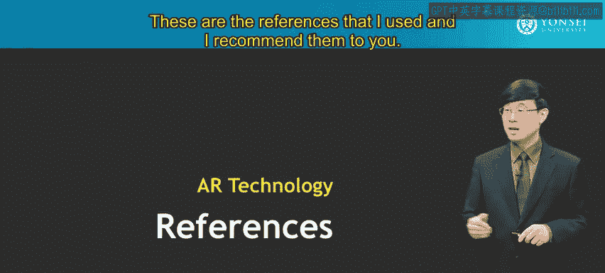

# 延世大学《新兴技术从智能手机到物联网再到大数据Emerging Technologies From Smartphone to IoT to Big Data》 - P130：7_2.2 AR特征检测描述技术.zh_en - GPT中英字幕课程资源 - BV18hpFewEcG

Auggamented reality feature detection and description technology。

Now we're going into the details of how actually augmented reality is done in order to do something in order to display information or put an object in a certain location on a certain entity that is in your real world view。

 you first have to detect that object， you first have to decide what you are going to choose in the real worldview to put text or a certain image or a character on top in order to do that。

 you need feature detection and description technology。Augmented reality feature detection。

Characteristic primitives of an image are identified。

Identification is done by highlighting unique visual cues。

And various feature detection techniques exist。The object is to conduct efficient and effective extraction of stable visual features。

What does this mean？If the computation processing task is too heavy that you need to compute a lot。

Or it doesn't really compute it the right way， such that you get errors in what you actually compute then augmented reality cannot be used and due to these reasons augmented reality was not made possible in older times in devices and this is why augmented reality is now very capable because augmented reality is at a level in which we can be efficient we can process it very quickly with low computation saving the battery consumption of your augmented reality device In addition。

 what you find is very reliable， very accurate and the information that you display on it is very effective therefore overall the effectiveness and the efficiency is there to enable augmented reality applications。

And that is why augmented reality is so popular now。

 and it's going to become so much more popular in the near future。😊。

Augmented reality feature detector requirements。Robust against changing imaging conditions。

What does that mean， Well， think of it this way。This is not virtual reality。

 where the environment and all the characters within the environment are make believe。

This is augmented reality， like on the glasses that you're using right now。

 you get a view of the real world， but then again， the probability that you're gonna stay exactly fixed at a location looking at an object is zero No。

 you are going to move around and look at that at various angles as you conduct your daily work as you conduct your daily pleasure of playing or relaxing。

😊，In that case， what that means is that your view of that certain object or the environment is going to consistently change because this is the real world and everything is displayed on your smartphone or on your glasses or head mounted display or other devices like your car windshield。

 then in that case。The way and angle， the light， as well as the surrounding environment。

 is going to consistently change。So therefore， based on these changing imaging conditions。

 we need the augmented reality feature detector technology to remain robust， reliable。

 such that even if you look at an object under a different lightning or a different environment or at a different angle。

 then still it will detect the same object the same way。

 and provide your desired information in the right way。

It needs to satisfy the application's quality of service requirements。This means that。

Quality of service， as in terms of。Devicice lifeline， how long you can use it on a certain device。

 because if you a device， no matter how good it is， if you can only use the device for five minutes。

 then it won't sell in addition， is the accuracy there is the information displayed within the given amount of time because people that are using their glasses are not going to stay looking at the same object until the information pops up in an augmented reality fashion。

 No， they're just going to go and look at whatever they need to look at at that time the information augmented information or the augmented object that is going to be added on the realwview has to be displayed immediately as in terms of how immediately well。

 down to the level of maybe 10 to 50 milliseconds。It needs to be that fast or even faster。

 then you must be able to complete the entire process of aed reality and serve it in that way before the user looks in a different position and a new view comes into their vision range。

Therefore， the device has to be very accurate， very fast with limited， very little power consumption。

 these type of quality service requirements must be satisfied for that product that is going to be used in a specific way。

As in terms of AR feature detection influencing factors， they include the environment， of course。

 because the environment will consistently change。Changes in viewpoint。

 even if it's in the same environment， based on what angle I'm looking at you will give me a different view of the overall object that I'm looking at。

Image scale， in other words， when you look close and you look far。

 then the object will be large and it will be small based on looking at it through a magnifying range or a macroscopic view that has an overall landscape。

The object that you're looking at will be extremely enlarged or reduced。

As well as the resolution of that object image will be varied significantly。

You need your augmented reality device to be able to work properly at magnified scales as well as reduced compact scales。

 and that is where the image scale comes in， that your device needs to be able to support resolution your camera may have different resolutions。

 the resolution may change based on the light setting。

As well as the resolution may change based on the amount of energy that is left in your device。

The resolution may change based on the network connection if the network is becoming slow。

 the throughput is becoming reduced， the data rate is becoming smaller。

 and there's more and more queuing delay， but you need to use the networking support to get augmented reality services。

 then the video resolution that intakes the image may be reduced。That's the resolution issues。

Lightning is also another thing， is it bright or dark？Because as in terms of dark。

 if it becomes really dark， then if the device is equipped with infrared。

 then you may go into infrared mode and the infrared camera that intakes the information。

 the image may not be at the same resolution。That the camera for a bright day would be at。

In that case， the resolution will drop as it goes into infrared mode because the lightning is not supportive。

We will look at these type of things in our augmented reality smartphone testing project。

 which is the last module of this lecture and so hang in there and we'll test a couple of things on some interesting apps。

😊，The interest point detected in the interest point detection process， the IPD process。

 can be used to obtain feature descriptors。A circular or square region centered at the detected interest points is basically it。

 as you can see， there are circles in this image and that image over there。In addition。

 you can see that the size of the circles fit the size of the regions based on their scale。

 so there's big circles and small circles。Circleles are used in this figure as well as that figure as well。

 however， the size of the regions as well as using squares。

 sometimes instead of circles you'll see the squares that represent the object that is being identified。

😊，Feature detection。Image features with unique interest points are detected。

Feature descriptors characterize image features using a sampling region exactly how is this done Well。

 we will talk about this in further detail in this lecture and the following lectures so hang in there。

😊，Sampling based on an image patch around detected interest points is where the feature detection engine works most。

As in terms of methods， one method is to use spectra descriptors that are generated by considering the local image region gradients。

Some of the techniques supporting this are sift and surfF， which we will look in further details。

 of course。A gradient， what is a gradient because this is used for the local image region processing in feature detection in method one Well you can think of it like this a gradient is a multivariable generalization of the derivative。

A derivative is a derivative of a single variable， normally a scholar。

 a gradient is done on multiple variables。😊，And therefore， normally represented in terms of a vector。

So using gradients in method one is what will enable us to。Generate the spec descriptors。

Another method is method2， which uses local binary features that are identified using a simple point pair pixel intensity comparison。

This here， as in terms of the point pair pixelel intensity comparison。

 are based on local binary features。What we're trying to do is instead of using the gradient。

 which is the differentiation process， these type of methods are much simpler and less computation burdening。

 so therefore you can do them quicker and the energy consumption of the device is reduced significantly。

😊，That is the purpose of these techniques。And the algorithms that enable you to use this in feature detection are brief。

 orB and brisk， which of course we will study in further detail。

Feature detection and description schemes。Schemes that do both feature detection and description are sip。

 surf， or B， and Briisk。Brief does feature description only。And for a feature detector scheme。

 there is fast。And we will study about these algorithms in detail。AR scheme mixed matching。

 What do you mean by mixed matching Well， feature detection results in a specific set of pixels at specific scales identified as interest points。

Different feature description schemes can be applied to different interest points to generate feature descriptions。

 This is because some schemes。Have specific benefits that they are extremely good at when they are processing in their certain way。

 such that you may want to mix and match a certain sequence。

To enable a certain feature while achieving a certain level of reliability， robustness and accuracy。

 and at the same time being sufficiently fast and sufficiently low power consuming。

Application and interest point characteristics based scheme selection is possible。

 you will see some mixing and matching to create a certain algorithm。Something like ORB。

 which I will soon explain in further details。

These are the references that I used and I recommend them to you， thank you。

