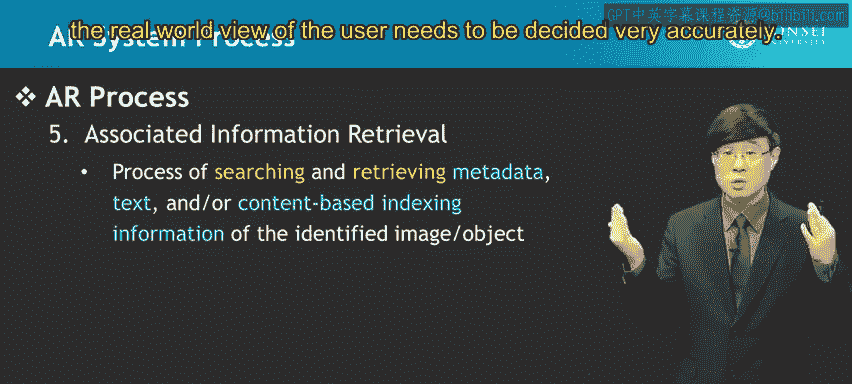

# 延世大学《新兴技术从智能手机到物联网再到大数据Emerging Technologies From Smartphone to IoT to Big Data》 - P131：8_2.3 AR系统流程（第1部分）.zh_en - GPT中英字幕课程资源 - BV18hpFewEcG

The AR system process is what we will focus on now。Looking at an example that uses a smartphone。

 however， once I show you this example， I want you to keep in mind that this smartphone could have been replaced by glasses。

😊，A hand mounted display， a notebook computer， laptop computer， tablet， PC。

 or a windshield or just a window。 variousious other devices can be used instead of this。 However。

 in this example， I'll use a smartphone。The overall process starts with。

AVideo image is taken by the smartphone， and that comes into the system。

Then it enters the AR process in which it starts with。Image acquisition。

Then it goes into the feature extraction mechanism here you see that the features were extracted in which red circles are placed upon the specific locations that uniquely identify a certain object。

Then there's feature matching。 starting with feature matching， you need to use database support。

 This is because the features that you have identified through the feature extraction process。

Now you're going to go to the database and match， find what matches this information。

 what matches these features that were just extracted。

 so therefore you need help of a database and that is what the database is there to do。

Then there's geometric verification process， followed by associated information retrieval。

This associated information retrieval may be in a way such that it is simple text。

 like is shown in this example， or there may be a certain symbol or character that is what is the information that is retrieved。

 then that information is going to be displayed on the object。

 Of course it may not be displayed such that it is covering the actual object that was detected like in this example。

 but this is just an example， the actual information normally is done in a way such that it does not hinder it does not block the view of the original image that you're looking at。

😊，This is the process of what is being done， these five steps。

 and we will now go into the details of them。Right here。In the A process， like we've just seen。

 starts with image acquisition。 This is a process of retrieving an image from the air camera。

 Step two is feature extraction。 This is based on an initial set of measure data。

 The extraction process generates informative nonreundant values。😊。

To facilitate these subsequent feature learning and generalization steps。In this process。

 there is the interest point detection mechanism where you're going to find all of the interest points and decide how these interest points selected ones combine into a certain feature that is extracted。

Now， I must say that feature extraction is a very complicated process among all the processes that we've been talking about。

 this one is number one most computationally burdening， there's so much to do。

 so therefore it will consume the significant amount of your battery。😊，In addition。

 it needs a lot of support in which the image is rendered， processed。

 analyzed in multi multipleultiple ways， and I will dedicate a separate module to exactly explain the most famous popular technologies and how this is done and that lecture module will follow this module so just hang in there。

😡，Then there's feature matching， which needs help of a database where the other prered features and their information are all saved。

 so therefore this process needs database support。The processing of computing abstraction of image information and to make local decisions if there is an image feature。

 which is conducted for all image points。Then we have geometric verification。

 This is the identification process of finding geometrically related images in the image data。

 which is in the database。😊，Then there is associated information retrieval。

 This is the process of searching and retrieving metadata。

 text or content based indexing information or the identified image。😊。

Object that we have just done the feature extraction of。

 so therefore this is another critical component， we need to decide。

 are we going to put an avatar on that object？😊，On the side of it。

 or are we just going to put simple text？Then when you say text how much， a little bit a lot。

 because if we put a lot of text there， number one， it's going to hinder the view。

 it's going to block the view in the real world， such that the user may be annoyed。

Two less information is not going to help the user because the user wants certain information。

 so therefore how much and what object is going to be displayed over projected in the real worldview of the user needs to be decided very accurately。

😊。

Associated information is used for display on the AR screen is projected there such that near the corresponding image or object and normally you don't want it to be overlaid in a way such that it is actually blocking the overall image I know in the example that I showed you on the smartphone example on the former form pages that the text there was added in a big way such that it covered the actual object。

Now， in reality， that will not be the way it's done。 However， just for demonstration purposes。

 I wanted to show you that new information was added。 So I put a big block there with text。

 I know that's normally not the way that you're gonna do it in a real product。 However。

 it gets the point through。 So bear with me on that。😊。

