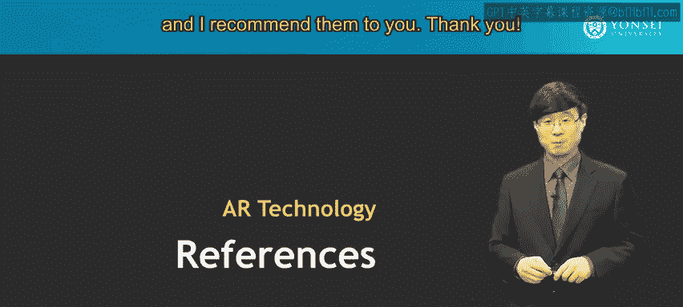

# 延世大学《新兴技术从智能手机到物联网再到大数据Emerging Technologies From Smartphone to IoT to Big Data》 - P132：9_2.3 AR系统流程（第2部分）.zh_en - GPT中英字幕课程资源 - BV18hpFewEcG

Air Cloud cooperative computation， hm， what does that mean？Cooperative computation。

 augmented reality cloud， What does that mean Well。

 all object information cannot be stored on the A device。An AR database is needed。

 we've already said that。AR requires a large amount of computation to compute the task and this is very energy consuming。

 In addition， the overall device may not be that fast to compute everything and retrieve all the information in a quick way。

So there's a speed issue in addition to the energy consumption issue。

The amount of augmented reality processing directly influences the battery power consumption of the A device。

 and a lot of A devices are battery operating， so theres a limited battery。

 there's a limited energy supply。To reduce the processing load on the air device。

And to overcome the limitation of using a small AR database。

 because you want to have a big AR database。Well， to overcome these limitations AR cloud computation。

 offloading can be used offloading， what are you offloading it's something like this。 In other words。

 think of an augmented reality application that is conducted all on the smartphone then the smartphone will have a small database and it will need to do all of this process and give you a reply。

😊，In addition， this feature extraction process， very energy consuming。

And very burdening so is there a way that I can get some help from somewhere to do a part of this in addition。

 make my feature matching as well as geometric verification associated information retrieval come from a large database where there's a lot of varieties and all I need to do is just select what I need to use。

If the database is sufficiently large， then that would be possible。On a smartphone。

 no way you can put a large， big database there。In addition， you have to think of it like this。

What are you going to view on your smartphone or on your glasses or on your head mounted display。

 What are you going to view？The variety of objects that can come into your vision view are so diverse。

 actually。It's unlimited。The number of objects that you may want to look and what is going to come into your view。

 if you use your head mounted display or AR glasses long enough。

 you are going to cover an almost near infinite amount of objects。

 having all that information on your smartphone or on your augmented reality glasses。

 the probability of that， no way， you are going to have to have support from a huge database。😡。

That is why cloud offloading is exactly what you do。You do some part of it here in this example。

 image acquisition and feature extraction are done on the smartphone and the rest is through a wired and wireless network is sent to the cloud in which the remaining process is done and once the information has been acquired。

 then only that final information is sent back to the augmented reality device。

 which in this case is a smartphone。Having support of cloud offloading in some cases。

 you can even do the feature extraction over onto the cloud。

 So your smartphone will only do the image acquisition。 Then everything can be done off the cloud。

 In this example， I'm showing where the feature extraction is done on the smartphone。

 but this can also be done over here as well。😊，This is what cloud offloading is doing In other words。

 the database burden of having a big database and doing all these three procedures in addition。

 if you want even the feature extraction to be done。

 which is a very energycon and computation burdening process to be done by a cloud which has sufficient processing capabilities。

 well， then you can offload it to the cloud， the work that you need can be given off to the cloud。

 and then after it's all done have it sent back。However， as good as this sounds。

 there is the requirement that when you send something to the cloud， it's going to go somewhere else。

Normally at a certain distance。In addition， it will go through the network， it's the information。

 the image is going to travel somewhere。So the challenge you have in augmented reality when you're using cloud offloading is that。

😊，You need to be using cloud offloading only when the network can be very， very fast。

 this process is guaranteed to be very， very quick and information can be returned very quickly because you're going be sending it somewhere having the operation done and being sent back you need to make sure that all of this can be done quick enough and faster or more efficiently than what you can do on your own device。

So even though this sounds very attractive， this may not be usable in all cases， In other words。

 if the network is showing a lot of congestion and it's very slow。

 then you might as well do the overall process， the entire process on your smartphone instead of using offloading because if you try to do offloading。

 nothing may get happened。Cloud offloading virtualization allows cloud servers。

 vendors to run obituary applications on virtual machines。In cloud computing。

 this is like the infrastructure as a service， the Ios operation。

Cloud Server vendors provide computing cycles where AR devices can use these computing cycles to reduce their computation load。

The cloud computing， the offloading units， can help to save energy and enhance the response speed of the air service。

Once again， in cloud services， this has to be fast and accurate and you need support of fast clouds and a fast network。

Now， I do need to mention that in my other lecture that is in the same specialization of this course。

 there is a course on IoT and cloud computing， and in the cloud computing lectures。

 I will talk about edge computing technology in which clouds are located closer to wireless devices。

And this will reduce the networking access time some devices may not have。

A big database like the main cloud would have， however。

 their size could be made sufficient such that they are much more well equipped than what you have on your glasses。

 head mount display or smartphone。Yet they're located close enough in a nearby device such that the quick wireless networking support can get you access to it immediately。

And these type of technologies include cloud computing based on mobile edge computing。

 cloudlets and file computing technology。 And if you know how these are done and how they can support augmented reality then the cloud offloading option becomes much more easier to use。

 So please look into the IoT and cloud computing， emerging technologies lectures to figure out more on how to use that technology。

😊，Adaptive cloud offloading is therefore an option we want to use。

Unconditional offloading may result in excessive delay， so let's be smart。

 Let's look at the condition of the network and the cloud and my device。

And let's figure out what is the best way to process this augmented reality application。

Then we figure out the best way based upon the circumstances of my device， the network。

 and the cloud。And we'll decide and we'll decide on what mode to process this。

 that could be the adaptive component that we have right here。

Adaptive cloud offloading parameters will depend on network condition。

 cloud server status because a cloud may be overloaded with work to do。

 and even though it may be able to support you， it may be slow and once again augmented reality slow maybe you don't need it you want fast normally that's within the application quality of service demands。

 so therefore if the cloud is slow because it's overloaded， then you may not be able to use it。

 although the network may be fully supported。Energy status of your AR device。In other words。

 you may have sufficient energy to compute it on your device。

 or now you see that there's so little energy lift that there's no way you can continuously do the processing of the feature extraction on your device in that case。

 then after image acquisition， just send it off to the cloud and hope for the best for the right information acquisition to come back so that you can display quickly。

You will have to make these type of decisions， the target quality of experience level。

 what is this augmented reality device being used for？A you use it for transportation guidance。

 navigation， can you allow a little bit of delay in your application or if this is being used in a self-dr car。

 a little bit of delay will that have a critical impact on the safety of the vehicle that is being driven automatically。

 you need to figure this out and these type of requirements are what influence the target quality of experience。

This is based on the quality of service of the specific application。

These are the references that I used， and I recommend them to you， thank you。

